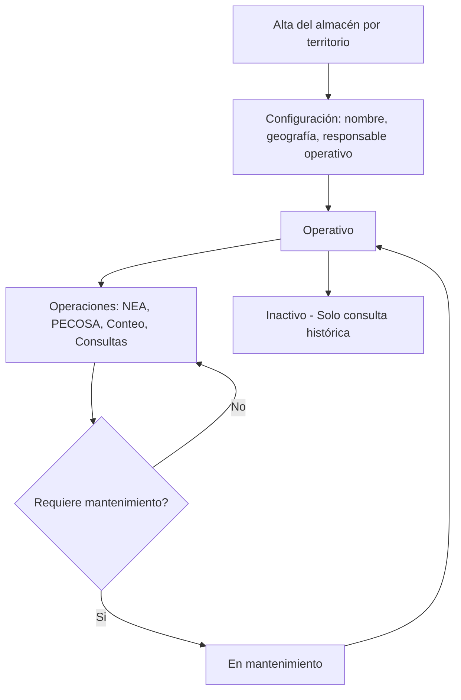
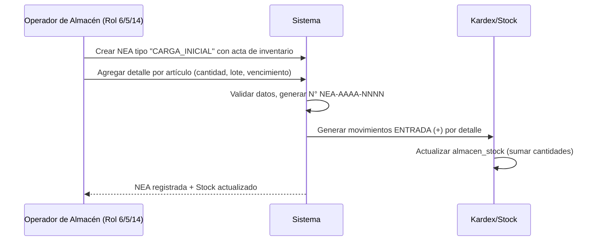
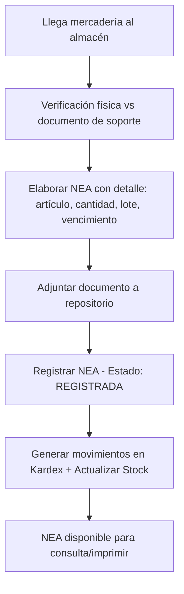
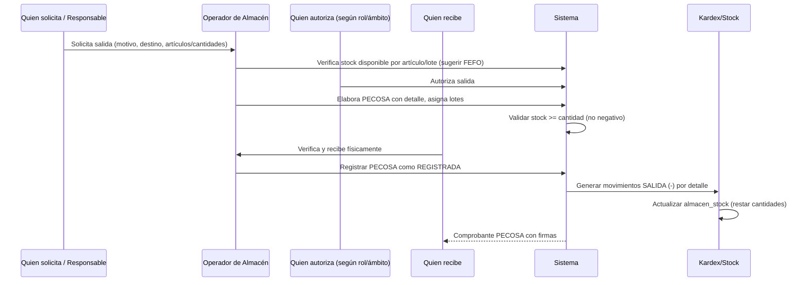
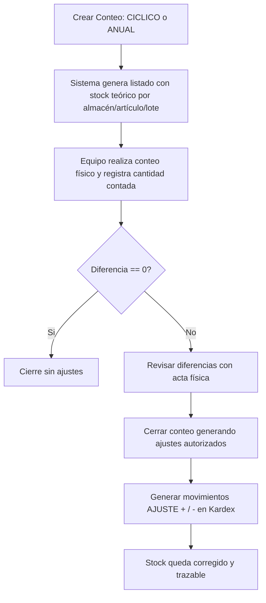
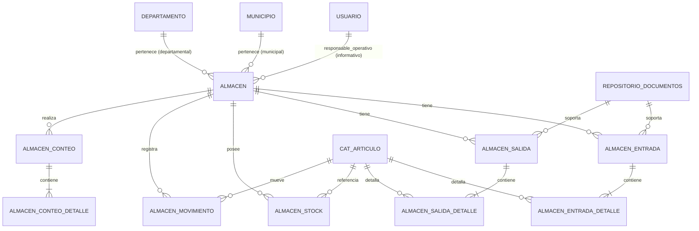
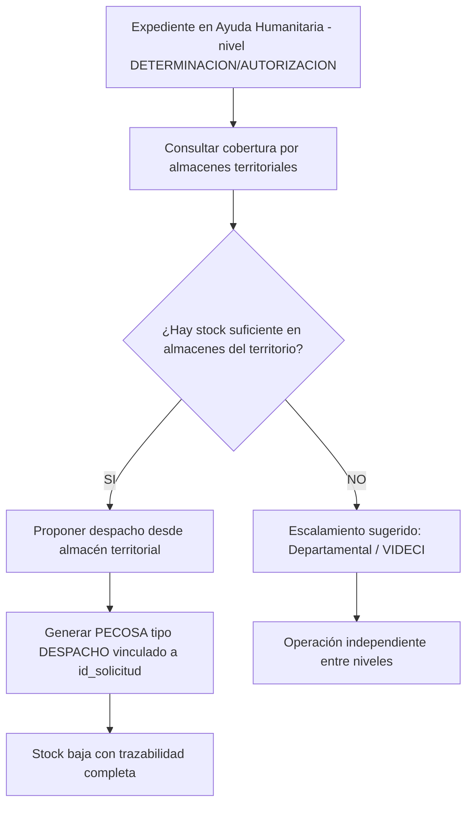

# Arquitectura: Módulo de Almacenes de Ayuda Humanitaria

**Versión:** 1.0  
**Fecha:** 26-oct-2026  
**Estado:** 📐 DISEÑO (Documento únicamente. Sin migración ni API implementadas en esta fase)  
**Alcance:** Módulo independiente y autónomo por territorio. Integración con el flujo de Ayuda Humanitaria en **fase 2**.  
**Base URL propuesta:** `/api/v2/almacenes`  
**Esquema:** `rida`  
**Audiencia:** Equipo técnico SINAGERSAT / VIDECI

---

## Tabla de Contenido

- [1. Objetivo y Alcance](#1-objetivo-y-alcance)
- [2. Decisiones de Diseño Cerradas](#2-decisiones-de-diseño-cerradas)
- [3. Benchmark: ¿Cómo funcionan los almacenes en otras plataformas de ayuda humanitaria?](#3-benchmark-cómo-funcionan-los-almacenes-en-otras-plataformas-de-ayuda-humanitaria)
- [4. ¿Cómo funcionará el módulo? (Visión Operativa Detallada)](#4-cómo-funcionará-el-módulo-visión-operativa-detallada)
- [5. Principios de Diseño](#5-principios-de-diseño)
- [6. Modelo de Datos](#6-modelo-de-datos)
- [7. Reglas de Negocio e Invariantes](#7-reglas-de-negocio-e-invariantes)
- [8. Matriz de Roles, Alcances y Permisos](#8-matriz-de-roles-alcances-y-permisos)
- [9. Contrato API Propuesto](#9-contrato-api-propuesto)
- [10. Transición desde `rida.cat_almacen`](#10-transición-desde-ridacat_almacen)
- [11. Integración Futura con Ayuda Humanitaria (Fase 2)](#11-integración-futura-con-ayuda-humanitaria-fase-2)
- [12. Decisiones Abiertas](#12-decisiones-abiertas)
- [13. Glosario](#13-glosario)

---

## 1. Objetivo y Alcance

### 1.1 Objetivo

Diseñar un **módulo de almacenes autónomo** para la gestión de bienes de Ayuda Humanitaria en el contexto de VIDECI. 

El objetivo es que **cada almacén territorial (Municipal, Departamental o Nacional/VIDECI) pueda operar de forma independiente** para llevar el control de sus existencias, garantizando trazabilidad total mediante **entradas, salidas, stock, kardex, lotes, vencimientos, conteos físicos y alertas**.

### 1.2 Alcance

- Gestionar almacenes a nivel **Municipal**, **Departamental** y **Nacional (VIDECI)**.
- Controlar **entradas** mediante Notas de Entrada a Almacén (**NEA**).
- Controlar **salidas** mediante Pedidos Comprobantes de Salida (**PECOSA**).
- Mantener **stock actual** por almacén, artículo, lote y fecha de vencimiento.
- Mantener **Kardex** inmutable como fuente única de verdad.
- Control de **lotes y vencimientos** (crítico para alimentos, medicina e higiene).
- **Alertas** por stock bajo mínimo / crítico y por vencimientos próximos o vencidos.
- **Conteo físico / inventario cíclico** con generación de ajustes.
- **Reportes y comprobantes** (NEA / PECOSA) imprimibles/PDF.
- Acceso **por rol + geografía** del usuario (sin depender de quién creó el almacén).

### 1.3 Fuera de Alcance (Fase 1)

- **Transferencias entre almacenes** (se evaluará en fase posterior).
- **Integración directa con el motor de Ayuda Humanitaria / `solicitud_articulo` / orden de despacho del motor actual** (se conectará en fase 2).
- **Stock "comprometido/reservado"** (solo stock disponible; se añade al integrar con entregas).
- **Ubicaciones internas detalladas por estantería/celda/bandeja (bins/locations)** — se mantiene a nivel **Almacén**.
- **Código de barras/QR, lectura masiva, picking por ruta compleja** — consideraciones futuras.

---

## 2. Decisiones de Diseño Cerradas

| # | Decisión | Justificación |
| :-- | :--- | :--- |
| 1 | **Módulo independiente y autónomo** | Cada almacén debe poder operar sin depender de aprobaciones jerárquicas entre niveles. El escalamiento municipal→departamental→VIDECI es únicamente un ejemplo, no una regla obligatoria. |
| 2 | **Almacén = Activo Territorial** | El almacén pertenece al territorio (Municipio/Departamento/VIDECI). No pertenece a la persona que lo creó. `creado_por` será únicamente para **auditoría**. |
| 3 | **Acceso por rol + geografía** | Se reutiliza el patrón `validar_scope` del repositorio (basado en `usuarios.usuario.id_municipio` / `id_departamento`). Si una persona deja el cargo, quien tenga el rol correspondiente y el territorio podrá seguir operando. |
| 4 | **Kardex como fuente de verdad** | Todo movimiento (`almacen_movimiento`) es **inmutable**. `almacen_stock` es una **proyección de lectura rápida** mantenida por trigger. `stock = Σ movimientos` debe poder ser verificado. |
| 5 | **NEA / PECOSA** | Se adopta el esquema utilizado por Defensa Civil del Perú: **Nota de Entrada a Almacén (NEA)** para ingresos y **Pedido Comprobante de Salida (PECOSA)** para egresos. |
| 6 | **Lotes y vencimientos** | Obligatorios a considerar para artículos con fecha de caducidad (alimentos, medicinas, kits con productos perecederos). Se aplica lógica **FEFO** (First Expired, First Out) al sugerir lotes en salidas. |
| 7 | **Anulación con movimiento inverso** | **Nunca se elimina** un movimiento registrado. Si una NEA o PECOSA se anula correctamente, se genera un movimiento compensatorio con su respectivo registro en kardex. |
| 8 | **Integración futura planificada** | Se dejan columnas puente (`id_solicitud` nullable) para conectar con el flujo de Ayuda Humanitaria en fase 2 sin reestructurar el módulo. |

---

## 3. Benchmark: ¿Cómo funcionan los almacenes en otras plataformas de ayuda humanitaria?

El diseño se fundamenta en la revisión operativa de las plataformas más utilizadas en el sector humanitario.

| Plataforma / Norma | Contexto | Flujo Operativo Clave | Elementos Tomados para este Diseño |
| :--- | :--- | :--- | :--- |
| **HELM (Humanitarian Software)** | WMS comercial especializado en ayuda humanitaria y *Gift-in-Kind*. | *Goods-in* con verificación contra PO/ASN → *Putaway* → *Picking/Packing* → *Shipping*. Soporta conteo cíclico, discrepancias y trazabilidad completa. | **Recepción verificada**, discrepancias, *cycle counting*, trazabilidad por lote/serie/vencimiento, énfasis en inventario siempre actualizado. |
| **SUMA / LSS (OPS/PAHO)** | Ampliamente utilizado en Latinoamérica para gestionar donaciones tras desastres. | Clasificación de la donación al ingreso → Registro *Recibido/Almacenado* → *Solicitado/Asignado* → *Entregado*. Maneja niveles de stock y *pipeline*. | Clasificación de procedencia/donación, vista *recibido/almacenado/solicitado/entregado*, reporte claro y comparable entre actores. |
| **WFP LESS / COMPAS** | Logística y *commodity tracking* a nivel global. | Seguimiento de llegadas y despachos planificados, rastreo regional/global y reconciliación periódica de existencias. | Control riguroso de movimientos, reconciliación, enfoque en trazabilidad y visibilidad de saldos. |
| **Defensa Civil Perú (Directiva Regional Tacna)** | Altamente análogo a VIDECI (Defensa Civil). | Uso de **NEAS** (Notas de Entrada a Almacén) y **PECOSAS** (Pedidos Comprobantes de Salida), Almacén Regional + Almacenes Adelantados, **stock mínimo/máximo**, inventarios selectivos/anuales, reporte mensual de saldos. | **NEA/PECOSA**, correlativos, stock mínimo/máximo, inventarios selectivos/anuales, reporte mensual de saldos. |
| **UNGRD Colombia / RUV** | Manuales de Logística para Atención de Emergencias. | **Kardex sistemático** (registro único de entradas/salidas/saldos), tarjetas de existencia, conteo físico periódico, devoluciones, soporte documental obligatorio. | **Kardex inmutable**, tarjetas de stock, conteo físico (mínimo 2/año), movimiento inverso por devolución/ajuste, soporte documental. |

### 3.1 Lección clave: ¿Cómo operan realmente?

La gran mayoría de estos sistemas convergen en el mismo ciclo:

```text
[DONACIÓN/COMPRA/LLEGADA] → [VERIFICACIÓN] → [NEA / RECEPCIÓN] → [ALMACENADO] → [SOLICITUD DE SALIDA] → [PECOSA / DESPACHO] → [ENTREGA CON FIRMA] → [ACTUALIZACIÓN DE STOCK/KARDEX]
```

La diferencia está en el nivel de detalle (ubicaciones, códigos de barras). Para **VIDECI** el enfoque pragmático es mantener ese ciclo con **NEA/PECOSA, kardex, lotes/vencimientos y conteo físico**, simplificando lo excesivamente granular para esta primera fase.

---

## 4. ¿Cómo funcionará el módulo? (Visión Operativa Detallada)

El módulo está pensado para el **día a día del almacenero**. A continuación se describe, paso a paso, cómo se opera.

### 4.1 Ciclo de Vida del Almacén



- **Alta:** Creado por usuario con rol y territorio habilitado (rol 6 para municipal, rol 5 para departamental, roles 1/2 para nacional).
- **Responsable operativo:** Se puede asignar un usuario con rol **14 (Almacén)**. Esto es informativo/operativo, **no** es propietario.
- **Independiente:** Un almacén departamental **no requiere autorización** del nacional para registrar NEAS/PECOSAS.
- **Cambio de personal:** Si cambia el responsable, el nuevo usuario con el mismo rol y geografía accede inmediatamente.

### 4.2 Flujo 1: Carga Inicial del Almacén

**Objetivo:** Levantar el inventario físico real al momento de poner en marcha el almacén.

**Cuándo usarlo:** Primer registro del almacén, o regularización con acta de inventario.



**Ejemplo detallado:**

| Campo | Valor | Explicación |
| :--- | :--- | :--- |
| **Almacén** | `ALM-MUN-SIV-001` - Almacén Municipal GAM San Ignacio de Velasco (Santa Cruz) | Almacén territorial municipal |
| **Tipo NEA** | `CARGA_INICIAL` | Se identifica como inventario inicial |
| **Nro. NEA** | `NEA-2026-0001` | Correlativo por año |
| **Soporte** | Acta de Inventario Físico firmada (adjuntado al `repositorio.documentos`) | Respaldo obligatorio |
| **Registrado por** | Usuario con rol 14 / 6 | Trazabilidad |

**Detalle de la NEA:**

| Código Artículo | Nombre | Categoría | Unidad | Cantidad | Lote | Vencimiento | Obs |
| :--- | :--- | :--- | :--- | :--- | :--- | :--- | :--- |
| `ALM-004` | Arroz | `ALIMENTACION_AGUA` | kg | 500.00 | `ARR-INI-01` | 2027-12-31 | Carga inicial |
| `REF-001` | Carpa Familiar 6 Personas | `TECHO_ABRIGO` | unidad | 100.00 | *(sin lote)* | *(sin vencimiento)* | Carga inicial |
| `CAM-003` | Frazada | `TECHO_ABRIGO` | unidad | 300.00 | *(sin lote)* | *(sin vencimiento)* | Carga inicial |
| `HIG-002` | Kit de Higiene Adulto | `SALUD_HIGIENE` | kit | 80.00 | `HIG-INI-01` | 2027-06-30 | Carga inicial |

**Resultado:** Inmediatamente el sistema mostrará en **Stock** estas cantidades disponibles. El **Kardex** mostrará 4 movimientos `ENTRADA` con su saldo correspondiente.

### 4.3 Flujo 2: Entrada de Mercadería (NEA)

**Objetivo:** Registrar todo ingreso posterior (donación, compra, regularización, devolución).



**Tipos de entrada soportados:**

| Tipo | Uso | Requiere Soporte |
| :--- | :--- | :--- |
| `CARGA_INICIAL` | Inventario al arranque | Acta de inventario físico (recomendado/obligatorio) |
| `DONACION` | Donación de instituciones/cooperación | Acta de donación / nota de recepción |
| `COMPRA` | Adquisición mediante compra | Factura / Orden de Compra / Proforma |
| `DEVOLUCION` | Devolución desde salida (por error justificado) | Nota/acta de devolución |
| `AJUSTE` | Regularización autorizada tras constatación | Acta de regularización |
| `OTRO` | Otros casos debidamente justificados | Documento soporte que respalde el ingreso |

**Ejemplo práctico: Donación recibida**

> *"El 28/10/2026 llega una donación de 150 Kg de arroz con Acta de Donación N° AD-045/2026. Se debe registrar en NEA."*

```text
NEA-2026-0002
Tipo: DONACION
Proveedor/Donante: "Fundación XYZ"
Documento Soporte: repositorio.documentos.id = 152
Fecha: 2026-10-28
Registrado por: Juan Pérez (Rol 14 - Almacén)

Detalle:
- ALM-004 | Arroz | 150.00 kg | Lote ARR-DON-01 | Vence 2028-03-31
```

**Efecto inmediato:** Stock de `ALM-004` pasa de **500.00 kg** a **650.00 kg**. Se crea movimiento `ENTRADA (+150.00)` en `almacen_movimiento` con referencia `NEA-2026-0002`.

### 4.4 Flujo 3: Salida de Mercadería (PECOSA)

**Objetivo:** Registrar toda salida de bienes con trazabilidad, validación de stock y firmas.



**Tipos de salida soportados:**

| Tipo | Uso | Observación |
| :--- | :--- | :--- |
| `DESPACHO` | Entrega para atención (en fase 2 vinculado a expediente RIDA). En fase 1, uso manual con motivo claro. | Podrá vincularse a `id_solicitud` en fase 2 |
| `MERMA` | Pérdida por rotura/manipulación justificada | Requiere acta y justificación detallada |
| `VENCIMIENTO` | Retiro por caducidad vencida | Ideal vincular a lote vencido + acta |
| `DEVOLUCION_PROVEEDOR` | Devolución a proveedor por incumplimiento/defecto | Requiere documento soporte |
| `AJUSTE` | Ajuste por corrección debidamente autorizada | Requiere acta de ajuste |
| `OTRO` | Otros casos debidamente justificados | Motivo obligatorio |

**Ejemplo práctico: Salida para apoyo comunitario**

> *"Se requiere entregar 50 carpas y 100 Kg de arroz para apoyo ante situación de emergencia. El Jefe de Almacén autoriza y el representante recibe."*

```text
PECOSA-2026-0001
Tipo: DESPACHO
Almacén: Almacén Municipal GAM San Ignacio de Velasco
Destino/Motivo: "Apoyo comunitario - Situación de Emergencia"
Solicita: Coordinador Territorial
Autoriza: Jefe/Responsable de Almacén
Recibe: Sr. X - Representante Comunitario (CI: XXXXX)
Fecha: 2026-10-28
Estado: REGISTRADA

Detalle con lotes (FEFO sugerido):
- REF-001 | Carpa Familiar 6 Personas | 50.00 unidad | (sin lote) 
- ALM-004 | Arroz | 100.00 kg | Lote ARR-INI-01 | Vence 2027-12-31

Validación Sistema: stock suficiente → PERMITIDO
```

**Efecto inmediato:**
- `REF-001`: 100.00 → **50.00** unidad
- `ALM-004`: 650.00 → **550.00** kg
- Se generan 2 movimientos `SALIDA (-)` en kardex
- PECOSA queda con datos de **solicita / autoriza / recibe** para trazabilidad

> **Importante:** El sistema **NO permitirá** registrar una salida si `cantidad > stock_disponible` para ese artículo/lote. Esto evita saldos negativos.

### 4.5 Flujo 4: Verificar el Estado del Almacén (Consulta Operativa)

Uno de los requerimientos explícitos del usuario: **"debe poder verificar el estado de almacén"**.

El módulo debe permitir responder, en segundos, preguntas como:

- *"¿Qué tenemos en el almacén hoy?"*
- *"¿Cuánto arroz nos queda?"*
- *"¿Hay algún artículo por debajo del mínimo?"*
- *"¿Hay productos por vencer?"*
- *"¿Qué movimientos hubo esta semana?"*

**Vistas disponibles:**

| Vista | Propósito | Uso |
| :--- | :--- | :--- |
| **Stock Actual** | Listado por artículo/lote/vencimiento con cantidad disponible, stock mínimo/máximo, estado de alerta. | Consulta diaria del almacén |
| **Kardex** | Historial completo e inmutable con fecha, tipo (NEA/PECOSA/AJUSTE), documento, cantidad (+/-), saldo. | Auditoría / verificación / conciliación |
| **Alertas** | Bajo mínimo, crítico, por vencer (configurable), vencido. | Acciones preventivas |
| **Valorizado** | Stock × costo de referencia (y valor unitario de entradas para trazabilidad). | Reportes gerenciales |

**Ejemplo: Consulta "Stock Actual" del Almacén Municipal San Ignacio**

| Artículo | Unidad | Lote | Vence | Disponible | Mínimo | Máximo | Estado Alerta | Valor Ref. (Bs) aprox. |
| :--- | :--- | :--- | :--- | :--- | :--- | :--- | :--- | :--- |
| `ALM-004` Arroz | kg | `ARR-INI-01` | 2027-12-31 | 550.00 | 100.00 | 1000.00 | **OK** | 550.00 * costo_ref |
| `ALM-004` Arroz | kg | `ARR-DON-01` | 2028-03-31 | 150.00 | 100.00 | 1000.00 | **OK** | 150.00 * costo_ref |
| `REF-001` Carpa 6 Pers. | unidad | *(sin lote)* | - | 50.00 | 20.00 | 150.00 | **OK** | 50.00 * costo_ref |
| `CAM-003` Frazada | unidad | *(sin lote)* | - | 300.00 | 50.00 | 400.00 | **OK** | 300.00 * costo_ref |
| `HIG-002` Kit Higiene Adulto | kit | `HIG-INI-01` | 2026-12-15 | 80.00 | 30.00 | 150.00 | **POR VENCER** ⚠️ | 80.00 * costo_ref |

**Interpretación:** El operador identifica que el kit `HIG-002` vence el **15/12/2026** y aparece en **POR VENCER**, pudiendo priorizar su salida o hacer seguimiento antes del vencimiento.

**Ejemplo: Kardex resumido para `ALM-004` (Arroz)**

| Fecha | Tipo | Documento | Detalle | Cantidad | Saldo Acumulado | Usuario |
| :--- | :--- | :--- | :--- | :--- | :--- | :--- |
| 2026-10-27 | ENTRADA | `NEA-2026-0001` | Carga inicial (ARR-INI-01) | +500.00 kg | 500.00 kg | Operador Almacén |
| 2026-10-28 | ENTRADA | `NEA-2026-0002` | Donación (ARR-DON-01) | +150.00 kg | 650.00 kg | Operador Almacén |
| 2026-10-28 | SALIDA | `PECOSA-2026-0001` | Despacho (ARR-INI-01 - FEFO) | -100.00 kg | 550.00 kg | Operador Almacén |

> **Regla:** El saldo mostrado es consistente con la sumatoria histórica. Cualquier intento de alterar filas de `almacen_movimiento` debe estar **prohibido** por lógica de negocio.

### 4.6 Flujo 5: Conteo Físico / Inventario Cíclico

**Objetivo:** Verificar el inventario real vs el registrado por sistema. Generar ajustes trazables cuando existen diferencias.



**Estados del conteo:** `ABIERTO` → `EN_CONTEO` → `CERRADO_AJUSTADO` (o `CERRADO_SIN_AJUSTE`)

**Ejemplo práctico:**

| Campo | Valor |
| :--- | :--- |
| **Nro. Conteo** | `CNT-2026-0001` |
| **Almacén** | Almacén Municipal GAM San Ignacio de Velasco |
| **Tipo** | `CICLICO` |
| **Fecha Inicio** | 2026-10-29 |
| **Realizado por** | Comisión de Conteo (Operador + Responsable) |

**Detalle comparativo:**

| Artículo/Lote | Stock Sistema | Contado Físico | Diferencia | Acción |
| :--- | :--- | :--- | :--- | :--- |
| `HIG-002` / `HIG-INI-01` | 80.00 kit | 78.00 kit | **-2.00** (faltante) | Requiere acta + ajuste negativo autorizado |
| `CAM-003` | 300.00 unidad | 300.00 unidad | 0.00 | OK |
| `REF-001` | 50.00 unidad | 51.00 unidad | **+1.00** (sobrante) | Requiere acta + ajuste positivo autorizado |

**Al cerrar el conteo:** El sistema crea movimientos `AJUSTE (-2.00)` y `AJUSTE (+1.00)` con referencia `CNT-2026-0001`, actualizando el stock y dejando constancia en kardex. **Nunca se "edita" el stock directamente**, siempre vía ajuste trazable.

### 4.7 Flujo 6: Alertas Operativas

El sistema debe alertar proactivamente para evitar sorpresas.

| Tipo Alerta | Condición | Prioridad | Acción Sugerida |
| :--- | :--- | :--- | :--- |
| **STOCK_BAJO** | `cantidad_disponible <= stock_minimo` | Media-Alta | Planificar reposición / evaluar salida |
| **STOCK_CRITICO** | `cantidad_disponible <= (stock_minimo * 0.5)` o muy cercano a 0 | **Alta** | Atención inmediata |
| **POR_VENCER** | `fecha_vencimiento - hoy <= 30 días` (configurable) | **Alta** | Priorizar salida con lógica **FEFO** |
| **VENCIDO** | `fecha_vencimiento < hoy` | **Crítica** | Retirar, registrar en `PECOSA` tipo `VENCIMIENTO` con acta |
| **SIN_MOVIMIENTO** | Sin NEA/PECOSA en X días (opcional) | Informativa | Revisar estado del almacén |

**Ejemplo visual en UI (conceptual):**

```text
ALERTAS - Almacén Municipal San Ignacio
[CRÍTICA] HIG-002 (HIG-INI-01) VENCIDO el 15/12/2026
[ALTA]    HIG-002 POR VENCER (quedan < 30 días) - Priorizar salida FEFO
[MEDIA]   ACEITE (si existiera) BAJO MÍNIMO (10 < 25)
```

### 4.8 Flujo 7: Comprobantes, Reportes y Verificación

El sistema debe alertar proactivamente para evitar sorpresas.

| Documento/Reporte | Destino | Notas |
| :--- | :--- | :--- |
| **NEA-AAAA-NNNN** | Soporte de ingreso | Imprimible. Debe reflejar: almacén, fecha, tipo, donante/proveedor, detalle con lote/vencimiento, usuario, soporte documental. |
| **PECOSA-AAAA-NNNN** | Soporte de salida/despacho | Imprimible. Debe reflejar: solicita/autoriza/recibe (con CI/cargo), destino/motivo, detalle con lotes aplicados, totales por unidad/peso. |
| **Kardex por artículo/lote** | Auditoría / conciliación | Inmutable, cronológico, con saldo acumulado. Filtrable por fecha/documento. |
| **Stock Actual** | Operativo | Agrupado por artículo/lote/vencimiento, con alertas y totales (cantidad/peso). |
| **Alertas** | Proactivo | `STOCK_BAJO`, `STOCK_CRITICO`, `POR_VENCER`, `VENCIDO`. |
| **Acta de Conteo / Ajustes** | Físico-contable | Con diferencias, responsables, observaciones y movimientos generados. |

| Tipo Alerta | Condición | Prioridad | Acción Sugerida |
| :--- | :--- | :--- | :--- |
| **STOCK_BAJO** | `cantidad_disponible <= stock_minimo` | Media-Alta | Planificar reposición / evaluar salida |
| **STOCK_CRITICO** | `cantidad_disponible <= (stock_minimo * 0.5)` o muy cercano a 0 | **Alta** | Atención inmediata |
| **POR_VENCER** | `fecha_vencimiento - hoy <= 30 días` (configurable) | **Alta** | Priorizar salida con lógica **FEFO** |
| **VENCIDO** | `fecha_vencimiento < hoy` | **Crítica** | Retirar, registrar en `PECOSA` tipo `VENCIMIENTO` con acta |
| **SIN_MOVIMIENTO** | Sin NEA/PECOSA en X días (opcional) | Informativa | Revisar estado del almacén |

**Ejemplo visual en UI (conceptual):**

```text
ALERTAS - Almacén Municipal San Ignacio de Velasco
[CRÍTICA] HIG-002 (HIG-INI-01) VENCIDO el 15/12/2026
[ALTA]    HIG-002 POR VENCER (quedan < 30 días) - Priorizar salida FEFO
[MEDIA]   HIG-002 BAJO MÍNIMO
```

### 4.9 Búsqueda, Filtros y Consulta Rápida

El módulo debe permitir encontrar rápidamente **almacenes, artículos, lotes, NEA, PECOSA, movimientos y alertas**. Se utiliza el patrón `q` + filtros, alineado al estilo del repositorio.

#### 4.9.1 Listado de Almacenes

**Ruta:** `GET /api/v2/almacenes`

| Parámetro | Tipo | Requerido | Descripción | Ejemplo |
| :--- | :--- | :--- | :--- | :--- |
| `q` | `string` | NO | Búsqueda por `codigo`, `nombre`, `municipio` o `departamento` (case-insensitive) | `?q=san ignacio` |
| `nivel` | `enum(municipal\|departamental\|nacional)` | NO | Filtrar por nivel territorial | `?nivel=municipal` |
| `id_municipio` | `int` | NO | Filtrar por municipio | `?id_municipio=70101` |
| `id_departamento` | `int` | NO | Filtrar por departamento | `?id_departamento=7` |
| `estado` | `enum(ACTIVO\|INACTIVO\|MANTENIMIENTO)` | NO | Filtrar por estado | `?estado=ACTIVO` |
| `skip/limit/todos` | `int/bool` | NO | Paginación estándar | `?skip=0&limit=20` |

#### 4.9.2 Stock Actual con Búsqueda

**Ruta:** `GET /api/v2/almacenes/{id_almacen}/stock`

| Parámetro | Tipo | Requerido | Descripción | Ejemplo |
| :--- | :--- | :--- | :--- | :--- |
| `q` | `string` | NO | Buscar por `codigo_articulo`, `nombre_articulo` o `lote` | `?q=arroz` o `?q=ARR-DON-01` |
| `id_articulo` | `int` | NO | Filtrar por artículo exacto | `?id_articulo=12` |
| `id_categoria_ayuda` | `int` | NO | Filtrar por categoría | `?id_categoria_ayuda=2` |
| `solo_alertas` | `bool` | NO | Mostrar solo ítems con alerta (`STOCK_BAJO`, `CRITICO`, `POR_VENCER`, `VENCIDO`) | `?solo_alertas=true` |
| `con_lote` | `bool` | NO | Mostrar solo ítems con lote registrado | `?con_lote=true` |

#### 4.9.3 Kardex con Filtros

**Ruta:** `GET /api/v2/almacenes/{id_almacen}/kardex`

| Parámetro | Tipo | Requerido | Descripción | Ejemplo |
| :--- | :--- | :--- | :--- | :--- |
| `id_articulo` | `int` | NO | Filtrar por artículo | `?id_articulo=12` |
| `codigo_articulo` | `string` | NO | Filtrar por código | `?codigo_articulo=ALM-004` |
| `lote` | `string` | NO | Filtrar por lote (parcial o exacto) | `?lote=ARR` |
| `tipo_movimiento` | `enum(ENTRADA\|SALIDA\|AJUSTE)` | NO | Tipo de movimiento | `?tipo_movimiento=ENTRADA` |
| `nro_documento` | `string` | NO | Buscar por `NEA-XXXX` / `PECOSA-XXXX` / `CNT-XXXX` | `?nro_documento=NEA-2026-0002` |
| `fecha_desde` | `date` | NO | Desde (YYYY-MM-DD) | `?fecha_desde=2026-10-01` |
| `fecha_hasta` | `date` | NO | Hasta (YYYY-MM-DD) | `?fecha_hasta=2026-10-31` |
| `q` | `string` | NO | Búsqueda libre (artículo, lote, documento, observación) | `?q=donacion` |
| `skip/limit` | `int` | NO | Paginación | `?skip=0&limit=50` |

#### 4.9.4 Entradas / Salidas con Búsqueda

**Rutas:** `GET /api/v2/almacenes/{id_almacen}/entradas` y `GET /api/v2/almacenes/{id_almacen}/salidas`

| Parámetro | Tipo | Aplica | Descripción | Ejemplo |
| :--- | :--- | :--- | :--- | :--- |
| `q` | `string` | Ambas | Buscar por N° documento, artículo, lote, proveedor/donante, destino/motivo | `?q=fundacion` |
| `nro_nea` / `nro_pecosa` | `string` | Ambas | Buscar por correlativo exacto/parcial | `?nro_nea=NEA-2026-0002` |
| `tipo` | `enum` | Ambas | Tipo de documento (CARGA_INICIAL/DONACION/COMPRA/DEVOLUCION/AJUSTE/OTRO o DESPACHO/MERMA/VENCIMIENTO/DEVOLUCION_PROVEEDOR/AJUSTE/OTRO) | `?tipo=DONACION` |
| `proveedor_donante` | `string` | Entradas | Filtrar por donante/proveedor | `?proveedor_donante=Fundación` |
| `destino_motivo` | `string` | Salidas | Filtrar por destino/motivo | `?destino_motivo=emergencia` |
| `fecha_desde` / `fecha_hasta` | `date` | Ambas | Rango de fechas | `?fecha_desde=2026-10-01&fecha_hasta=2026-10-31` |
| `estado` | `enum(BORRADOR\|REGISTRADA\|ANULADA)` | Ambas | Estado del documento | `?estado=REGISTRADA` |

### 4.10 Unidades, Peso, Volumen y Totales por Documento

#### 4.10.1 Fundamento

- **Unidad de medida:** Se toma de `rida.cat_articulo.unidad_de_medida` vinculado a `rida.cat_unidad_medida` (`unidad`, `kg`, `litro`, `caja`, `kit`).
- **Peso unitario:** Se utiliza `rida.cat_articulo.peso_unitario_kg` (NUMERIC). Se calcula `peso_total = cantidad * peso_unitario_kg` por línea y por documento.
- **Volumen unitario:** **Aún no existe** en `rida.cat_articulo`. Se propone añadir `volumen_unitario_m3 NUMERIC(10,4)` en fase posterior. Mientras tanto el sistema mostrará **"N/D"**.
- **Valorización referencial:** Se usa `costo_referencia_bs` de `cat_articulo`. En `almacen_entrada_detalle` y `almacen_salida_detalle` se guardan `valor_unitario_bs` / `valor_total_bs` para trazabilidad.

#### 4.10.2 Ejemplo Detallado: NEA-2026-0002 (Ingreso por Donación)

**Cabecera:**

```text
NEA: NEA-2026-0002 | Almacén: ALM-MUN-SIV-001 (San Ignacio de Velasco - Santa Cruz)
Tipo: DONACION | Donante: Fundación XYZ
Fecha: 2026-10-28 | Registrado por: Juan Pérez (Rol 14)
Soporte: Acta de Donación AD-045/2026 (repositorio.documentos.id=152)
```

**Detalle con unidades, peso y totales:**

| N° | Código | Artículo | Categoría | Unidad Medida | Cantidad | Lote | Vencimiento | Peso Unit. (kg) | Peso Total (kg) | Valor Unit. (Bs) | Valor Total (Bs) |
| :-- | :--- | :--- | :--- | :--- | :--- | :--- | :--- | :--- | :--- | :--- | :--- |
| 1 | `ALM-004` | Arroz | `ALIMENTACION_AGUA` | `kg` | 150.00 | `ARR-DON-01` | 2028-03-31 | 1.000 | **150.00** | 5.50 | 825.00 |
| 2 | `HIG-002` | Kit de Higiene Adulto | `SALUD_HIGIENE` | `kit` | 20.00 | `HIG-DON-01` | 2027-09-30 | 2.500 | **50.00** | 45.00 | 900.00 |

**Totales NEA-2026-0002:**

| Concepto | Total |
| :--- | :--- |
| **Líneas** | 2 |
| **Cantidad total** | 170.00 (150 kg + 20 kit) |
| **Peso total ingresado** | **200.00 kg** |
| **Volumen total** | **N/D** |
| **Valor total referencial** | **1.725,00 Bs** |

#### 4.10.3 Ejemplo Detallado: PECOSA-2026-0001 (Salida por Despacho)

**Cabecera:**

```text
PECOSA: PECOSA-2026-0001 | Almacén: ALM-MUN-SIV-001
Tipo: DESPACHO | Motivo/Destino: "Apoyo comunitario - Situación de Emergencia"
Solicita: Coordinador Territorial | Autoriza: Jefe/Responsable de Almacén | Recibe: Sr. Juan Mamani (CI: 1234567 LP) - Representante Comunitario
Fecha: 2026-10-28 | Registrado por: Juan Pérez (Rol 14)
```

**Detalle con unidades, peso, lotes y validación FEFO:**

| N° | Código | Artículo | Categoría | Unidad Medida | Cantidad | Lote | Vencimiento | Peso Unit. (kg) | Peso Total (kg) | Valor Unit. (Bs) | Valor Total (Bs) |
| :-- | :--- | :--- | :--- | :--- | :--- | :--- | :--- | :--- | :--- | :--- | :--- |
| 1 | `REF-001` | Carpa Familiar 6 Personas | `TECHO_ABRIGO` | `unidad` | 50.00 | *(sin lote)* | - | 25.000 | **1.250,00** | 850.00 | 42.500,00 |
| 2 | `ALM-004` | Arroz | `ALIMENTACION_AGUA` | `kg` | 100.00 | `ARR-INI-01` | 2027-12-31 | 1.000 | **100.00** | 5.50 | 550.00 |

**Validaciones aplicadas:**
- **Stock disponible:** `REF-001` 50/50 OK \| `ALM-004` (ARR-INI-01) 550 >= 100 OK
- **FEFO:** Se seleccionó `ARR-INI-01` (vence 2027-12-31) sobre `ARR-DON-01` (vence 2028-03-31)
- **Lote:** Requerido si el artículo controla lote (`cat_articulo.controla_lote = TRUE`)

**Totales PECOSA-2026-0001:**

| Concepto | Total |
| :--- | :--- |
| **Líneas** | 2 |
| **Cantidad despachada** | 50 unidad + 100 kg |
| **Peso total despachado** | **1.350,00 kg** |
| **Volumen total despachado** | **N/D** |
| **Valor total referencial** | **43.050,00 Bs** |

#### 4.10.4 Stock con Unidades, Peso y Alertas (Vista Operativa)

**Ruta:** `GET /api/v2/almacenes/10/stock?q=arroz`

| Código | Artículo | Categoría | Unidad | Lote | Vence | Disponible | Peso Unit. (kg) | **Peso Disponible (kg)** | Mín/Máx | Alerta | Valor Ref. (Bs) |
| :--- | :--- | :--- | :--- | :--- | :--- | :--- | :--- | :--- | :--- | :--- | :--- |
| `ALM-004` | Arroz | `ALIMENTACION_AGUA` | `kg` | `ARR-INI-01` | 2027-12-31 | 450.00 | 1.000 | **450.00** | 100/1000 | OK | 2.475,00 |
| `ALM-004` | Arroz | `ALIMENTACION_AGUA` | `kg` | `ARR-DON-01` | 2028-03-31 | 150.00 | 1.000 | **150.00** | 100/1000 | OK | 825,00 |

**Totales consulta:** `Peso Disponible Total (kg): 600.00` \| `Líneas: 2`

#### 4.10.5 Kardex con Trazabilidad

**Ruta:** `GET /api/v2/almacenes/10/kardex?codigo_articulo=ALM-004`

| Fecha/Hora | Documento | Tipo | Lote | Cantidad (+/-) | Saldo Acumulado | Unidad | Peso Mov. (kg) | Usuario | Observación |
| :--- | :--- | :--- | :--- | :--- | :--- | :--- | :--- | :--- | :--- |
| 2026-10-27 09:15 | `NEA-2026-0001` | `ENTRADA` | `ARR-INI-01` | **+500.00** | 500.00 kg | `kg` | +500.00 | Juan Pérez | Carga inicial |
| 2026-10-28 10:20 | `NEA-2026-0002` | `ENTRADA` | `ARR-DON-01` | **+150.00** | 650.00 kg | `kg` | +150.00 | Juan Pérez | Donación Fundación XYZ (Acta AD-045/2026) |
| 2026-10-28 14:35 | `PECOSA-2026-0001` | `SALIDA` | `ARR-INI-01` | **-100.00** | 550.00 kg | `kg` | -100.00 | Juan Pérez | Despacho - Apoyo comunitario (FEFO aplicado) |

> **Nota:** Al incorporar `volumen_unitario_m3` en `cat_articulo`, se añadirán `volumen_unitario_m3` y `volumen_total_m3` en el detalle de NEA/PECOSA, en `stock` y en reportes de carga/despacho.


## 5. Principios de Diseño

| Principio | Descripción |
| :--- | :--- |
| **Territorialidad** | El almacén es un activo del municipio/departamento/VIDECI. La geografía define el ámbito, no la persona. |
| **Autonomía Operativa** | No existe "aprobación" jerárquica entre almacenes para registrar NEAS/PECOSAS. Cada uno opera según sus necesidades. |
| **Kardex como Verdad** | Los movimientos son inmutables. Cualquier corrección es un movimiento inverso/ajuste debidamente justificado. |
| **Integridad del Stock** | `stock_disponible >= 0`. El sistema impide salidas que generen saldo negativo. |
| **Trazabilidad Completa** | Quién registró, quién autorizó, quién recibió, qué documento, fecha/hora. |
| **Trazabilidad por Lote** | Para artículos con vencimiento, se controla por lote para habilitar **FEFO** y retiro oportuno de vencidos. |
| **Documentación Obligatoria** | Ingresos/salidas relevantes deben tener soporte documental. |
| **Conciliable** | `SUM(movimientos) = stock actual` debe poder verificarse en cualquier momento. |
| **Minimalista pero Completo** | Fase 1 cubre lo esencial de un almacén humanitario funcional, dejando extensiones (transferencias, bins, barcodes) para fases posteriores. |
| **Coherente con el repo** | Se respeta naming, IDs seriales, catálogos, `repositorio.documentos`, patrón de permisos/alcance. |

---

## 6. Modelo de Datos

> **Nota:** Todas las tablas propuestas van en esquema `rida`. Se **extiende/reemplaza** el uso de `rida.cat_almacen` hacia una entidad operativa más completa, manteniendo la compatibilidad con `rida.entrega.id_almacen` durante la transición.

### 6.1 Diagrama Entidad-Relación (Conceptual)



### 6.2 Tablas Detalladas

#### 6.2.1 `rida.almacen` (Entidad Operativa del Almacén)

Evoluciona `cat_almacen` hacia un almacén realmente operativo. Mantener FK desde `rida.entrega.id_almacen` hacia esta tabla.

| Campo | Tipo | Null | Descripción |
| :--- | :--- | :--- | :--- |
| `id_almacen` | `SERIAL` / `BIGINT` (PK) | NO | Identificador único |
| `codigo` | `VARCHAR(30)` UNIQUE | NO | Código autogenerado: `ALM-MUN-XXX`, `ALM-DEP-XXX`, `ALM-NAC-XXX` |
| `nombre` | `VARCHAR(150)` | NO | Nombre oficial del almacén (ej. "Almacén Municipal GAM San Ignacio de Velasco") |
| `descripcion` | `TEXT` | YES | Descripción / observaciones |
| `nivel` | `VARCHAR(15)` CHECK(`nivel` IN (`municipal`,`departamental`,`nacional`)) | NO | Nivel territorial |
| `id_municipio` | `INTEGER` FK `shared.municipio(id)` | YES | Requerido si `nivel='municipal'`. Recomendado denormalizar para consultas rápidas. |
| `id_departamento` | `INTEGER` FK `shared.departamento(id)` | YES | Requerido si `nivel='departamental'` o `nivel='municipal'` (derivado). Nullable solo si `nivel='nacional'`. |
| `direccion` | `VARCHAR(250)` | YES | Dirección física |
| `lat` | `NUMERIC(10,7)` | YES | Latitud (opcional) |
| `lon` | `NUMERIC(10,7)` | YES | Longitud (opcional) |
| `capacidad_m2` | `NUMERIC(10,2)` | YES | Superficie aproximada (referencial) |
| `estado` | `VARCHAR(15)` CHECK(`estado` IN (`ACTIVO`,`INACTIVO`,`MANTENIMIENTO`)) DEFAULT `ACTIVO` | NO | Estado operativo |
| `id_responsable_operativo` | `INTEGER` FK `usuarios.usuario(id_usuario)` | YES | Usuario responsable **operativo** (informativo). **NO** es propietario. |
| `creado_por` | `INTEGER` FK `usuarios.usuario(id_usuario)` | YES | Auditoría: quién dio de alta el almacén |
| `fecha_creacion` | `TIMESTAMP` DEFAULT `NOW()` | NO | Fecha de creación |
| `fecha_modificacion` | `TIMESTAMP` DEFAULT `NOW()` | YES | Última modificación |

**CHECKs sugeridos:**
- `nivel = 'municipal'` → `id_municipio IS NOT NULL`
- `nivel = 'departamental'` → `id_departamento IS NOT NULL AND id_municipio IS NULL`
- `nivel = 'nacional'` → `id_municipio IS NULL AND id_departamento IS NULL`

#### 6.2.2 `rida.almacen_entrada` (Cabecera NEA - Nota de Entrada a Almacén)

| Campo | Tipo | Null | Descripción |
| :--- | :--- | :--- | :--- |
| `id_entrada` | `BIGSERIAL` (PK) | NO | Identificador interno |
| `nro_nea` | `VARCHAR(30)` UNIQUE | NO | Correlativo: `NEA-2026-0001` |
| `id_almacen` | `INTEGER` FK `rida.almacen(id_almacen)` | NO | Almacén receptor |
| `tipo` | `VARCHAR(20)` CHECK(`tipo` IN (`CARGA_INICIAL`,`DONACION`,`COMPRA`,`DEVOLUCION`,`AJUSTE`,`OTRO`)) | NO | Tipo de ingreso |
| `proveedor_donante` | `VARCHAR(150)` | YES | Quién provee/dona |
| `id_documento_soporte` | `BIGINT` FK `repositorio.documentos(id_documento)` | YES | Acta, factura, nota de donación, etc. |
| `fecha_entrada` | `DATE` | NO | Fecha de ingreso físico |
| `hora_entrada` | `TIME` | YES | Hora (opcional pero útil) |
| `id_usuario_registra` | `INTEGER` FK `usuarios.usuario(id_usuario)` | NO | Quien registró la NEA |
| `estado` | `VARCHAR(15)` CHECK(`estado` IN (`BORRADOR`,`REGISTRADA`,`ANULADA`)) DEFAULT `REGISTRADA` | NO | Estado del documento |
| `observaciones` | `TEXT` | YES | Observaciones generales |
| `motivo_anulacion` | `TEXT` | YES | Obligatorio si `estado='ANULADA'` |
| `anulado_por` | `INTEGER` FK `usuarios.usuario(id_usuario)` | YES | Quien anuló |
| `fecha_anulacion` | `TIMESTAMP` | YES | Fecha/hora de anulación |
| `fecha_creacion` | `TIMESTAMP` DEFAULT `NOW()` | NO | Creación |
| `fecha_modificacion` | `TIMESTAMP` DEFAULT `NOW()` | YES | Modificación |

#### 6.2.3 `rida.almacen_entrada_detalle` (Detalle de NEA)

| Campo | Tipo | Null | Descripción |
| :--- | :--- | :--- | :--- |
| `id_detalle_entrada` | `BIGSERIAL` (PK) | NO | Identificador |
| `id_entrada` | `BIGINT` FK `rida.almacen_entrada(id_entrada)` ON DELETE RESTRICT | NO | Cabecera NEA |
| `id_articulo` | `INTEGER` FK `rida.cat_articulo(id_articulo)` ON DELETE RESTRICT | NO | Artículo ingresado |
| `cantidad` | `NUMERIC(12,2)` CHECK(`cantidad > 0`) | NO | Cantidad ingresada |
| `lote` | `VARCHAR(40)` | YES | Número de lote (recomendado si `controla_lote`) |
| `fecha_vencimiento` | `DATE` | YES | Fecha de vencimiento (recomendado si aplica) |
| `valor_unitario_bs` | `NUMERIC(12,2)` | YES | Valor unitario registrado (documentación/valoración) |
| `valor_total_bs` | `NUMERIC(14,2)` | YES | Calculado o guardado (`cantidad * valor_unitario_bs`) |
| `observaciones` | `VARCHAR(250)` | YES | Observaciones por línea |

**Índice único sugerido:** `(id_entrada, id_articulo, COALESCE(lote,''), COALESCE(fecha_vencimiento,'0001-01-01'))` para evitar duplicados accidentales.

#### 6.2.4 `rida.almacen_salida` (Cabecera PECOSA - Pedido Comprobante de Salida)

| Campo | Tipo | Null | Descripción |
| :--- | :--- | :--- | :--- |
| `id_salida` | `BIGSERIAL` (PK) | NO | Identificador interno |
| `nro_pecosa` | `VARCHAR(30)` UNIQUE | NO | Correlativo: `PECOSA-2026-0001` |
| `id_almacen` | `INTEGER` FK `rida.almacen(id_almacen)` | NO | Almacén que despacha |
| `tipo` | `VARCHAR(20)` CHECK(`tipo` IN (`DESPACHO`,`MERMA`,`VENCIMIENTO`,`DEVOLUCION_PROVEEDOR`,`AJUSTE`,`OTRO`)) | NO | Tipo de salida |
| `destino_motivo` | `VARCHAR(250)` | NO | Destino o motivo claro y descriptivo |
| `id_solicitud` | `INTEGER` FK `rida.solicitud(id_solicitud)` | YES | **PUENTE FUTURO** con Ayuda Humanitaria (NULL en fase 1) |
| `id_usuario_solicita` | `INTEGER` FK `usuarios.usuario(id_usuario)` | YES | Quien solicita la salida |
| `id_usuario_autoriza` | `INTEGER` FK `usuarios.usuario(id_usuario)` | YES | Quien autoriza |
| `id_usuario_recibe` | `INTEGER` FK `usuarios.usuario(id_usuario)` | YES | Quien recibe físicamente (con CI/cargo si se desea detallar) |
| `nombre_quien_recibe` | `VARCHAR(150)` | YES | Nombre de quien recibe (backup) |
| `ci_quien_recibe` | `VARCHAR(20)` | YES | CI de quien recibe (backup) |
| `cargo_quien_recibe` | `VARCHAR(100)` | YES | Cargo/función |
| `id_documento_soporte` | `BIGINT` FK `repositorio.documentos(id_documento)` | YES | Acta, oficio, etc. |
| `fecha_salida` | `DATE` | NO | Fecha de despacho |
| `hora_salida` | `TIME` | YES | Hora de despacho |
| `id_usuario_registra` | `INTEGER` FK `usuarios.usuario(id_usuario)` | NO | Quien registra la PECOSA |
| `estado` | `VARCHAR(15)` CHECK(`estado` IN (`BORRADOR`,`REGISTRADA`,`ANULADA`)) DEFAULT `REGISTRADA` | NO | Estado |
| `observaciones` | `TEXT` | YES | Observaciones |
| `motivo_anulacion` | `TEXT` | YES | Obligatorio si anulada |
| `anulado_por` | `INTEGER` FK `usuarios.usuario(id_usuario)` | YES | Quien anuló |
| `fecha_anulacion` | `TIMESTAMP` | YES | Fecha/hora de anulación |
| `fecha_creacion` | `TIMESTAMP` DEFAULT `NOW()` | NO | Creación |
| `fecha_modificacion` | `TIMESTAMP` DEFAULT `NOW()` | YES | Modificación |

#### 6.2.5 `rida.almacen_salida_detalle` (Detalle de PECOSA)

| Campo | Tipo | Null | Descripción |
| :--- | :--- | :--- | :--- |
| `id_detalle_salida` | `BIGSERIAL` (PK) | NO | Identificador |
| `id_salida` | `BIGINT` FK `rida.almacen_salida(id_salida)` ON DELETE RESTRICT | NO | Cabecera PECOSA |
| `id_articulo` | `INTEGER` FK `rida.cat_articulo(id_articulo)` ON DELETE RESTRICT | NO | Artículo a despachar |
| `cantidad` | `NUMERIC(12,2)` CHECK(`cantidad > 0`) | NO | Cantidad a salir |
| `lote` | `VARCHAR(40)` | YES | Lote a despachar (importante con vencimientos) |
| `fecha_vencimiento` | `DATE` | YES | Fecha de vencimiento del lote |
| `valor_unitario_bs` | `NUMERIC(12,2)` | YES | Referencial |
| `valor_total_bs` | `NUMERIC(14,2)` | YES | Referencial |
| `observaciones` | `VARCHAR(250)` | YES | Observaciones por línea |

#### 6.2.6 `rida.almacen_movimiento` (Kardex - Fuente de Verdad)

**Inmutable. NO permitir UPDATE ni DELETE. Solo INSERT.**

| Campo | Tipo | Null | Descripción |
| :--- | :--- | :--- | :--- |
| `id_movimiento` | `BIGSERIAL` (PK) | NO | Identificador único (secuencial) |
| `id_almacen` | `INTEGER` FK `rida.almacen(id_almacen)` | NO | Almacén del movimiento |
| `id_articulo` | `INTEGER` FK `rida.cat_articulo(id_articulo)` | NO | Artículo |
| `lote` | `VARCHAR(40)` | YES | Lote afectado |
| `fecha_vencimiento` | `DATE` | YES | Vencimiento del lote |
| `tipo_movimiento` | `VARCHAR(15)` CHECK(`tipo_movimiento` IN (`ENTRADA`,`SALIDA`,`AJUSTE`)) | NO | Tipo de movimiento |
| `cantidad_signed` | `NUMERIC(12,2)` | NO | **Con signo:** `+` para ENTRADA/AJUSTE_POSITIVO, `-` para SALIDA/AJUSTE_NEGATIVO |
| `cantidad_abs` | `NUMERIC(12,2)` CHECK(`cantidad_abs > 0`) | NO | Valor absoluto para reportes |
| `referencia_tipo` | `VARCHAR(15)` CHECK(`referencia_tipo` IN (`NEA`,`PECOSA`,`CONTEO`,`ANULACION`,`OTRO`)) | NO | Origen del movimiento |
| `referencia_id` | `BIGINT` | YES | ID de `almacen_entrada` o `almacen_salida` o `almacen_conteo` |
| `nro_documento` | `VARCHAR(30)` | YES | `NEA-2026-0001` / `PECOSA-2026-0001` / `CNT-2026-0001` (desnormalizado) |
| `id_usuario` | `INTEGER` FK `usuarios.usuario(id_usuario)` | NO | Usuario que generó el registro |
| `fecha_movimiento` | `TIMESTAMP` DEFAULT `NOW()` | NO | Fecha/hora exacta |
| `observacion` | `VARCHAR(500)` | YES | Motivo / detalle |

**Índices críticos:** `(id_almacen, id_articulo, fecha_movimiento)`, `(id_almacen, fecha_movimiento)`, `(referencia_tipo, referencia_id)`

#### 6.2.7 `rida.almacen_stock` (Proyección de Stock Actual)

Mantenida por **trigger** tras insertar en `almacen_movimiento`. Es para **lectura rápida**. La fuente de verdad sigue siendo el kardex.

| Campo | Tipo | Null | Descripción |
| :--- | :--- | :--- | :--- |
| `id_stock` | `BIGSERIAL` (PK) | NO | Identificador |
| `id_almacen` | `INTEGER` FK `rida.almacen(id_almacen)` | NO | Almacén |
| `id_articulo` | `INTEGER` FK `rida.cat_articulo(id_articulo)` | NO | Artículo |
| `lote` | `VARCHAR(40)` | NO | Lote (usar `''` si no aplica) |
| `fecha_vencimiento` | `DATE` | YES | Vencimiento (NULL si no aplica) |
| `cantidad_disponible` | `NUMERIC(12,2)` CHECK(`cantidad_disponible >= 0`) | NO | Stock actual disponible |
| `stock_minimo` | `NUMERIC(12,2)` | YES | Mínimo configurado (alerta) |
| `stock_maximo` | `NUMERIC(12,2)` | YES | Máximo configurado (referencial) |
| `costo_referencia_bs` | `NUMERIC(12,2)` | YES | Copia desde `cat_articulo.costo_referencia_bs` (o calculado) |
| `fecha_ultima_actualizacion` | `TIMESTAMP` DEFAULT `NOW()` | NO | Última actualización por trigger |
| `fecha_ultima_entrada` | `DATE` | YES | Última entrada registrada |
| `fecha_ultima_salida` | `DATE` | YES | Última salida registrada |

**Restricción única:** `UNIQUE (id_almacen, id_articulo, lote, COALESCE(fecha_vencimiento, '0001-01-01'))`

> **Trigger sugerido:** `AFTER INSERT ON almacen_movimiento` → calcular nuevo saldo por (almacen,articulo,lote,vencimiento), `UPSERT` en `almacen_stock`, validar `cantidad_disponible >= 0` (si < 0 → RAISE EXCEPTION).

#### 6.2.8 `rida.almacen_conteo` (Cabecera de Conteo Físico)

| Campo | Tipo | Null | Descripción |
| :--- | :--- | :--- | :--- |
| `id_conteo` | `BIGSERIAL` (PK) | NO | Identificador |
| `nro_conteo` | `VARCHAR(30)` UNIQUE | NO | Correlativo: `CNT-2026-0001` |
| `id_almacen` | `INTEGER` FK `rida.almacen(id_almacen)` | NO | Almacén a contar |
| `tipo` | `VARCHAR(15)` CHECK(`tipo` IN (`CICLICO`,`ANUAL`,`EXTRAORDINARIO`)) | NO | Tipo de conteo |
| `estado` | `VARCHAR(15)` CHECK(`estado` IN (`ABIERTO`,`EN_CONTEO`,`CERRADO_SIN_AJUSTE`,`CERRADO_AJUSTADO`,`ANULADO`)) DEFAULT `ABIERTO` | NO | Estado |
| `fecha_inicio` | `DATE` DEFAULT `CURRENT_DATE` | NO | Fecha inicio |
| `fecha_cierre` | `DATE` | YES | Fecha cierre |
| `id_usuario_responsable` | `INTEGER` FK `usuarios.usuario(id_usuario)` | NO | Responsable del conteo |
| `observaciones` | `TEXT` | YES | Observaciones generales |
| `fecha_creacion` | `TIMESTAMP` DEFAULT `NOW()` | NO | Creación |

#### 6.2.9 `rida.almacen_conteo_detalle` (Detalle del Conteo)

| Campo | Tipo | Null | Descripción |
| :--- | :--- | :--- | :--- |
| `id_detalle_conteo` | `BIGSERIAL` (PK) | NO | Identificador |
| `id_conteo` | `BIGINT` FK `rida.almacen_conteo(id_conteo)` ON DELETE CASCADE | NO | Cabecera conteo |
| `id_articulo` | `INTEGER` FK `rida.cat_articulo(id_articulo)` | NO | Artículo |
| `lote` | `VARCHAR(40)` | NO | Lote contado |
| `fecha_vencimiento` | `DATE` | YES | Vencimiento del lote |
| `cantidad_sistema` | `NUMERIC(12,2)` | NO | Stock teórico al momento de abrir conteo |
| `cantidad_contada` | `NUMERIC(12,2)` | YES | Cantidad físicamente contada |
| `diferencia` | `NUMERIC(12,2)` | YES | `cantidad_contada - cantidad_sistema` (+/-) |
| `ajustado` | `BOOLEAN` DEFAULT `FALSE` | NO | Si ya generó movimiento de ajuste |
| `observaciones` | `VARCHAR(250)` | YES | Comentario del conteador |

### 6.3 Cambios sugeridos a tablas existentes

| Tabla | Cambio | Razón |
| :--- | :--- | :--- |
| `rida.cat_articulo` | Añadir `controla_lote BOOLEAN NOT NULL DEFAULT FALSE` (y opcional `controla_vencimiento BOOLEAN NOT NULL DEFAULT FALSE`) | Saber cuándo exigir lote/vencimiento en NEA/PECOSA |
| `rida.cat_almacen` | Marcar como **legacy** o migrar a `rida.almacen`. Mantener hasta re-apuntar FKs. | Darle entidad operativa completa |
| `rida.entrega` | Mantener `id_almacen` FK (re-apuntar hacia `rida.almacen` en migración). Añadir columna puente `id_salida` FK `rida.almacen_salida` (nullable, fase 2) | Puente hacia módulo almacenes en fase 2 |

---

## 7. Reglas de Negocio e Invariantes

### 7.1 Invariantes Críticas

| Regla | Descripción |
| :--- | :--- |
| **I-01** | `almacen_movimiento` es **inmutable**. Prohibido `UPDATE` / `DELETE` vía API o por lógica. Solo `INSERT`. |
| **I-02** | `cantidad_disponible >= 0` en `almacen_stock`. Cualquier intento de generar saldo negativo debe lanzar excepción. |
| **I-03** | `stock_disponible = SUM(cantidad_signed)` sobre `almacen_movimiento` por `(id_almacen, id_articulo, lote, fecha_vencimiento)`. Debe poder conciliarse. |
| **I-04** | NEA/PECOSA pasan por estados `BORRADOR → REGISTRADA → ANULADA`. Una vez `REGISTRADA`, **no se edita**; se anula con movimiento inverso. |
| **I-05** | Toda NEA `REGISTRADA` genera movimientos `ENTRADA (+)`. Toda PECOSA `REGISTRADA` genera movimientos `SALIDA (-)`. |
| **I-06** | Toda anulación válida genera movimiento inverso con referencia `ANULACION`. |
| **I-07** | Almacén debe ser del territorio del usuario o usuario con alcance **nacional** (roles 1/2). |

### 7.2 Reglas Operativas

| Regla | Descripción |
| :--- | :--- |
| **RO-01** | **Correlativos únicos por año:** `NEA-2026-XXXX`, `PECOSA-2026-XXXX`, `CNT-2026-XXXX`. Generados atómicamente. |
| **RO-02** | **FEFO:** Al sugerir lotes para salida, priorizar el de **menor fecha de vencimiento**. Para vencidos, **no sugerir** y mostrar alerta. |
| **RO-03** | **Validación de salida:** Verificar `cantidad_disponible >= cantidad_solicitada` para el lote seleccionado. |
| **RO-04** | **Lote obligatorio:** Si el artículo tiene `controla_lote = TRUE`, exigir `lote` y `fecha_vencimiento` en detalle de NEA/PECOSA. |
| **RO-05** | **Autonomía:** Un almacén departamental/municipal **NO requiere** visto bueno del almacén nacional para operar. |
| **RO-06** | **Territorialidad:** `nivel='municipal'` exige `id_municipio`; `nivel='departamental'` exige `id_departamento`; `nivel='nacional'` sin territorio. |
| **RO-07** | **Conteo:** Al cerrar conteo con diferencias, **solo** se generan ajustes si hay acta/observación y el usuario tiene permiso. |
| **RO-08** | **Documentos soporte:** Recomendar/validar según tipo (`DONACION`, `COMPRA`) el adjunto en `repositorio.documentos`. |

### 7.3 Regla de Auditoría

- **Quién/ cuándo:** `id_usuario_registra`, `fecha_creacion`, `id_usuario_autoriza`, `id_usuario_recibe` (en salidas), `anulado_por`, `fecha_anulacion`.
- **Trazabilidad:** Todo NEA/PECOSA guarda referencias a usuarios y, cuando aplique, a documento soporte.
- **Kardex intocable:** Historial cronológico completo, sin edición.

---

## 8. Matriz de Roles, Alcances y Permisos

Basado en roles existentes del sistema + patrón de alcance por geografía.

| Rol | Código | Alcance | Crear Almacén | Operar NEA/PECOSA | Ajustes/Conteo | Ver Stock/Kardex | Administrar Parámetros (min/max) | Observaciones |
| :--- | :--- | :--- | :--- | :--- | :--- | :--- | :--- | :--- |
| **1** | `superadmin` | **Nacional (Todos)** | **SI** (cualquier nivel) | **SI** | **SI** | **SI** | **SI** | Bypass total (igual que resto del sistema) |
| **2** | `admin` | **Nacional (Todos)** | **SI** (cualquier nivel) | **SI** | **SI** | **SI** | **SI** | Bypass total |
| **3** | `VIDECI Regional` | **Departamental** (según `id_departamento` usuario) | Limitado (generalmente **NO** crea, pero puede operar) | **SI** (almacenes de su depto) | **SI** (con justificación) | **SI** | **SI** | Supervisión regional |
| **5** | `DGR Gobernación` | **Departamental** | **SI** (almacenes **departamentales** de su depto) | **SI** | **SI** | **SI** | **SI** | Propietario territorial departamental |
| **6** | `UGR Municipio` | **Municipal** | **SI** (almacenes **municipales** de su mun) | **SI** | **SI** | **SI** | **SI** | Propietario territorial municipal |
| **8** | `Alcalde` | **Municipal** | **NO** | **NO** (operativo) | **NO** | **SI** (solo lectura) | **NO** | Solo **verificar estado** del almacén municipal |
| **9** | `VIDECI Departamental` | **Departamental** | Limitado | **SI** | **SI** | **SI** | **SI** | Operativo/supervisión departamental |
| **14** | `Almacén` | **Por geografía asignada** | **NO** (en general) | **SI** (NEA/PECOSA dentro de su ámbito) | **SI** (conteos/ajustes según política) | **SI** | **SI** (parámetros min/max) | **Operador puro del almacén**. Accede por rol+geografía, **independiente** de quien lo creó |

> **Regla clave:** El **acceso se determina por rol + territorio**, nunca por `creado_por`. Esto satisface explícitamente el requerimiento: *"si esa persona renuncia y entra otro con ese rol entonces debe poder acceder independiente de quien cree"*.

---

## 9. Contrato API Propuesto

Sigue el estilo del repositorio: rutas bajo `/api/v2/almacenes`, respuestas envueltas (estilo `SuccessResponse`), paginación con `skip/limit`, filtros y validación por ámbito.

### 9.1 Catálogos / Configuración

| Método | Ruta | Descripción |
| :--- | :--- | :--- |
| `GET` | `/almacenes/estados` | Estados válidos: `ACTIVO/INACTIVO/MANTENIMIENTO` |
| `GET` | `/almacenes/tipos-entrada` | Tipos NEA |
| `GET` | `/almacenes/tipos-salida` | Tipos PECOSA |
| `GET` | `/almacenes/tipos-conteo` | Tipos conteo |

### 9.2 Almacenes

| Método | Ruta | Descripción |
| :--- | :--- | :--- |
| `GET` | `/almacenes` | Listado con filtros: `nivel`, `id_municipio`, `id_departamento`, `estado`, `q`. Aplica `scope` por usuario. Soporta `skip/limit/todos`. |
| `POST` | `/almacenes` | Crear almacén (valida nivel vs geografía del usuario). Genera `codigo`. |
| `GET` | `/almacenes/{id_almacen}` | Detalle del almacén (territorio, responsable operativo, estado, fechas). |
| `PUT` | `/almacenes/{id_almacen}` | Actualizar datos generales (nombre, dirección, georef, responsable operativo). **NO** cambiar `nivel`/territorio. |
| `PUT` | `/almacenes/{id_almacen}/estado` | Cambiar `ACTIVO/INACTIVO/MANTENIMIENTO`. |

**Ejemplo `GET /almacenes` (respuesta resumida):**

```json
{
  "data": [
    {
      "id_almacen": 10,
      "codigo": "ALM-MUN-SIV-001",
      "nombre": "Almacén Municipal GAM San Ignacio de Velasco",
      "nivel": "municipal",
      "id_municipio": 70101,
      "municipio": "San Ignacio de Velasco",
      "id_departamento": 7,
      "departamento": "Santa Cruz",
      "estado": "ACTIVO",
      "responsable_operativo": {"id_usuario": 45, "nombre": "Juan Pérez"},
      "puede_operar": true
    }
  ],
  "total": 1,
  "skip": 0,
  "limit": 20
}
```

### 9.3 Stock, Kardex y Alertas

| Método | Ruta | Descripción |
| :--- | :--- | :--- |
| `GET` | `/almacenes/{id_almacen}/stock` | Stock actual por artículo/lote/vencimiento. Incluye `disponible`, `minimo`, `maximo`, `alerta`, `valorizado_ref`. Filtros: `id_articulo`, `solo_alertas`. |
| `PUT` | `/almacenes/{id_almacen}/stock/parametros` | Configurar `stock_minimo`/`stock_maximo` por `(id_articulo,lote,fecha_vencimiento)` o por artículo. |
| `GET` | `/almacenes/{id_almacen}/kardex` | Kardex inmutable con filtros: `id_articulo`, `lote`, `tipo_movimiento`, `fecha_desde`, `fecha_hasta`. Paginado. |
| `GET` | `/almacenes/{id_almacen}/alertas` | Alertas consolidadas: `BAJO_MINIMO`, `CRITICO`, `POR_VENCER`, `VENCIDO`. |
| `GET` | `/almacenes/alertas` | Alertas consolidadas **por ámbito del usuario**. |

### 9.4 Entradas (NEA)

| Método | Ruta | Descripción |
| :--- | :--- | :--- |
| `GET` | `/almacenes/{id_almacen}/entradas` | Listado NEA: filtros `tipo`, `fecha_desde`, `fecha_hasta`, `nro_nea`, `estado`. |
| `POST` | `/almacenes/{id_almacen}/entradas` | Crear NEA. Genera `nro_nea`, valida detalle (lote/vencimiento si aplica), genera movimientos, actualiza stock. **Transaccional**. |
| `GET` | `/almacenes/{id_almacen}/entradas/{id_entrada}` | Detalle completo NEA + movimientos generados. |
| `POST` | `/almacenes/{id_almacen}/entradas/{id_entrada}/anular` | Anular NEA `REGISTRADA`. Requiere `motivo_anulacion >= 10 chars`. Genera **movimiento inverso**. |

**Body ejemplo `POST /almacenes/{id}/entradas`:**

```json
{
  "tipo": "DONACION",
  "proveedor_donante": "Fundación XYZ",
  "id_documento_soporte": 152,
  "fecha_entrada": "2026-10-28",
  "observaciones": "Donación recibida conforme",
  "detalle": [
    {"id_articulo": 12, "cantidad": 150.00, "lote": "ARR-DON-01", "fecha_vencimiento": "2028-03-31"},
    {"id_articulo": 45, "cantidad": 20.00, "lote": "KIT-DON-01", "fecha_vencimiento": "2027-09-30"}
  ]
}
```

### 9.5 Salidas (PECOSA)

| Método | Ruta | Descripción |
| :--- | :--- | :--- |
| `GET` | `/almacenes/{id_almacen}/salidas` | Listado PECOSA con filtros. |
| `POST` | `/almacenes/{id_almacen}/salidas` | Crear PECOSA. **Valida stock disponible** por lote. Sugiere FEFO. Genera movimientos negativos. Transaccional. |
| `GET` | `/almacenes/{id_almacen}/salidas/{id_salida}` | Detalle PECOSA con solicita/autoriza/recibe y movimientos. |
| `POST` | `/almacenes/{id_almacen}/salidas/{id_salida}/anular` | Anular con movimiento inverso + motivo. |

**Body ejemplo `POST /almacenes/{id}/salidas`:**

```json
{
  "tipo": "DESPACHO",
  "destino_motivo": "Apoyo comunitario - Situación de Emergencia",
  "id_usuario_solicita": 33,
  "id_usuario_autoriza": 45,
  "id_usuario_recibe": 67,
  "nombre_quien_recibe": "Sr. Juan Mamani",
  "ci_quien_recibe": "1234567 LP",
  "cargo_quien_recibe": "Representante Comunitario",
  "fecha_salida": "2026-10-28",
  "detalle": [
    {"id_articulo": 5, "cantidad": 50.00, "lote": "", "fecha_vencimiento": null},
    {"id_articulo": 12, "cantidad": 100.00, "lote": "ARR-INI-01", "fecha_vencimiento": "2027-12-31"}
  ]
}
```

### 9.6 Conteos Físicos

| Método | Ruta | Descripción |
| :--- | :--- | :--- |
| `GET` | `/almacenes/{id_almacen}/conteos` | Listado de conteos. |
| `POST` | `/almacenes/{id_almacen}/conteos` | Crear conteo. Genera detalle con `cantidad_sistema` desde `almacen_stock`. |
| `GET` | `/almacenes/{id_almacen}/conteos/{id_conteo}` | Detalle con diferencias. |
| `PUT` | `/almacenes/{id_almacen}/conteos/{id_conteo}/detalle` | Capturar `cantidad_contada` por línea. Calcula `diferencia`. |
| `POST` | `/almacenes/{id_almacen}/conteos/{id_conteo}/cerrar` | Cierra conteo. Genera movimientos `AJUSTE` por diferencias no cero. Requiere observaciones si hay ajustes. |

### 9.7 Errores típicos (alineados con estilo repo)

| Código | Caso | Motivo |
| :--- | :--- | :--- |
| `400` | Datos inválidos / faltan campos obligatorios | Validación |
| `403` | Fuera de ámbito geográfico / sin permiso | `validar_scope` |
| `404` | Almacén/artículo/NEA/PECOSA no existe | No encontrado |
| `409` | Stock insuficiente para salida / NEA/PECOSA ya anulada / duplicado | Regla de negocio |
| `422` | Motivo de anulación < 10 caracteres / lote/vencimiento faltante para artículo que controla lote | Validación estricta |

---

## 10. Transición desde `rida.cat_almacen`

Dado que ya existe `rida.cat_almacen` y `rida.entrega.id_almacen` apunta hacia él, la transición debe ser ordenada.

### 10.1 Mapeo de Datos Existentes

| Valor actual `cat_almacen.nivel` | Valor nuevo `almacen.nivel` | Notas |
| :--- | :--- | :--- |
| `nacional` | `nacional` | Mantener como almacén nacional VIDECI |
| `departamental` | `departamental` | Mantener vínculo `id_departamento` |
| `regional` | `departamental` | Homogeneizar al nuevo modelo (sin `regional`) |

### 10.2 Plan de Migración (Diseño)

1. **Crear** tabla `rida.almacen` con estructura del punto 6.2.1
2. **Migrar** filas de `rida.cat_almacen` → `rida.almacen` (mapear nivel, conservar `id_departamento`, generar `codigo` nuevo si no existe, `estado = 'ACTIVO'`)
3. **Crear** columnas puente si necesario y **re-apuntar** `rida.entrega.id_almacen` hacia `rida.almacen`
4. **Crear** las 8 tablas operativas (`entrada`, `entrada_detalle`, `salida`, `salida_detalle`, `movimiento`, `stock`, `conteo`, `conteo_detalle`)
5. **Crear** triggers para mantener `almacen_stock` desde `almacen_movimiento`
6. **Crear** índices recomendados
7. **Marcar** `rida.cat_almacen` como **legacy** (no eliminar inmediatamente para evitar romper integraciones)
8. **Actualizar** lógica de consulta para leer desde `rida.almacen`

> **Nota:** Este documento es **únicamente diseño**. La migración SQL se ejecutará en fase de implementación, siguiendo las reglas idempotentes del repositorio.

---

## 11. Integración Futura con Ayuda Humanitaria (Fase 2)

El módulo se diseña **separado**, pero preparado para integrarse con el motor de Ayuda Humanitaria cuando corresponda.

### 11.1 Puente Propuesto

| Elemento | Estado | Comentario |
| :--- | :--- | :--- |
| `almacen_salida.id_solicitud` | **Nullable** | Permite vincular una PECOSA tipo `DESPACHO` a una `rida.solicitud` |
| `almacen_movimiento.referencia_tipo` | Soporta `NEA/PECOSA/CONTEO` | Ampliable |
| `almacen_stock` | Listo | Puede consultarse por municipio/departamento del evento |

### 11.2 Flujo Futuro (Conceptual)



**Consideraciones para fase 2:**
- **Cobertura/Déficit:** Comparar `solicitud_articulo.cantidad` vs `almacen_stock.cantidad_disponible` agrupado por ámbito territorial.
- **Múltiples PECOSAS:** Un mismo expediente podría despacharse desde **diferentes almacenes** si es necesario.
- **Stock comprometido:** En ese momento se evaluará añadir `cantidad_comprometida` a `almacen_stock` (al generar PECOSA en borrador/pendiente) para evitar doble reserva.
- **FEFO obligatorio:** Para alimentos/medicinas priorizar lotes próximos a vencer según política VIDECI.

---

## 12. Decisiones Abiertas

| # | Tema | Propuesta | Estado |
| :--- | :--- | :--- | :--- |
| **DA-01** | **Lote/Vencimiento obligatorio** | Exigir solo cuando `cat_articulo.controla_lote = TRUE`. Por defecto `FALSE` para carpas, frazadas, herramientas. | A definir |
| **DA-02** | **Valoración de inventario** | Fase 1: valorización con `costo_referencia_bs` (cat_articulo). Fase 2: evaluar **promedio ponderado** usando `valor_unitario_bs` de NEAS. | A definir |
| **DA-03** | **Quién configura stock mínimo/máximo** | Operador de almacén con rol en territorio (`14`, `6`, `5`) + `1/2`. Registrar en `almacen_stock`. | A definir |
| **DA-04** | **Conteo doble firma** | Opcional: permitir cierre con `id_usuario_responsable` + `id_usuario_supervisa`. No bloquear si falta. | A definir |
| **DA-05** | **Ubicaciones internas (bins)** | Diferir a fase posterior. Mantener control a nivel **almacén**. | Diferido |
| **DA-06** | **Códigos de barras/QR** | Diferir. Actualmente el flujo es manual con correlativos NEA/PECOSA. | Diferido |
| **DA-07** | **Unidades mixtas** | Soportar unidades desde `cat_unidad_medida` (kg, litro, unidad, kit, caja). Validar coherencia con `cat_articulo.unidad_de_medida`. | OK propuesto |
| **DA-08** | **Anulación con permisos** | Restringir anulación a roles con mayor responsabilidad (`1,2,5,6` o según política) y **SIEMPRE** exigir motivo >= 10 caracteres. | A definir |

---

## 13. Glosario

| Término | Significado |
| :--- | :--- |
| **NEA** | *Nota de Entrada a Almacén*. Documento que respalda el ingreso de bienes. Genera movimientos `ENTRADA (+)`. |
| **PECOSA** | *Pedido Comprobante de Salida*. Documento que respalda la salida/despacho de bienes. Genera movimientos `SALIDA (-)`. |
| **Kardex** | Registro cronológico, inmutable e íntegro de todos los movimientos de un almacén/artículo/lote con su saldo. |
| **Stock Disponible** | Cantidad físicamente disponible en el almacén para salida. Nunca menor a 0. |
| **Lote** | Identificador de partida de ingreso. Fundamental para controlar vencimientos. |
| **FEFO** | *First Expired, First Out* (Primero en vencer, primero en salir). Recomendado para perecederos. |
| **Conteo Físico/Cíclico** | Verificación física vs sistema con generación de ajustes trazables. |
| **Movimiento Inverso** | Movimiento compensatorio generado al anular una NEA/PECOSA para mantener integridad del kardex. |
| **Almacén Adelantado** | Almacén territorial más cercano al área de atención (concepto análogo al usado por Defensa Civil Perú). |
| **Activo Territorial** | Bien/instalación que pertenece al territorio (Municipio/Departamento/VIDECI), operativo por rol+geografía, no por propiedad personal. |
| **Correlativo** | Número consecutivo único por año y tipo de documento (`NEA-AAAA-NNNN`, `PECOSA-AAAA-NNNN`, `CNT-AAAA-NNNN`). |
| **Borrador/Registrada/Anulada** | Estados del documento. Solo `REGISTRADA` genera movimientos en el kardex. Una vez `REGISTRADA` no se edita, se anula con movimiento inverso. |
| **Movimiento Signed** | Cantidad con signo en `almacen_movimiento.cantidad_signed` (`+` entrada/ajuste positivo, `-` salida/ajuste negativo). |
| **Movimiento Absoluto** | Cantidad en valor absoluto (`cantidad_abs`) para facilitar reportes y sumatorias. |
| **Fuente de Verdad (Kardex)** | `almacen_movimiento` es la fuente de verdad; `almacen_stock` es solo una proyección para consulta rápida mantenida por trigger. |
| **Proyección / UPSERT** | Actualización automática de `almacen_stock` al insertar en `almacen_movimiento` (insertar o actualizar por clave única). |
| **Soporte Documental** | Documento adjunto en `repositorio.documentos` que respalda la operación (acta de donación, oficio, factura, acta de conteo, etc.). |
| **Responsable Operativo** | Usuario asignado al almacén para operación (`id_responsable_operativo`). Es informativo; el acceso es por rol + territorio, no por este campo. |
| **Creado_por** | Usuario que dio de alta el almacén. Solo auditoría; no otorga acceso. |
| **Alcance / Scope** | Validación geográfica por usuario (`id_municipio`/`id_departamento`) según su rol, siguiendo el patrón `validar_scope`. |
| **Nivel Territorial** | Clasificación del almacén: `municipal`, `departamental` o `nacional`. |
| **Stock Mínimo / Máximo** | Parámetros configurables en `almacen_stock` para generar alertas (`STOCK_BAJO`, `STOCK_CRITICO`). |
| **Valorizado Referencial** | Valor aproximado calculado con `costo_referencia_bs` de `cat_articulo` (fase 1). Puede cambiar en fases posteriores. |
| **Conteo Cíclico / Anual / Extraordinario** | Tipos de conteo físico (`almacen_conteo.tipo`). |
| **Diferencia (conteo)** | `cantidad_contada - cantidad_sistema` (+ sobrante, - faltante). Al cerrar con diferencias se generan movimientos `AJUSTE`. |
| **Ajuste** | Movimiento generado desde conteo físico o correcciones, con trazabilidad. Nunca se edita/borra movimiento original. |
| **Donación / Compra / Carga Inicial / Devolución / Merma / Vencimiento** | Tipos comunes de NEA/PECOSA usados en el diseño. |
| **Unidad de Medida** | Unidad desde `cat_unidad_medida` (`kg`, `litro`, `unidad`, `kit`, `caja`, etc.) coherente con `cat_articulo.unidad_de_medida`. |
| **Peso Unitario / Peso Total** | `peso_unitario_kg` por artículo y `peso_total = cantidad * peso_unitario_kg`. |
| **Volumen Unitario / Volumen Total** | `volumen_unitario_m3` (propuesto, fase posterior). Actualmente se muestra `N/D`. |
| **Puente Fase 2** | Campos preparados para integración futura: `almacen_salida.id_solicitud`, `almacen_movimiento.referencia_tipo` ampliable. |
| **Legacy** | Tabla `rida.cat_almacen` marcada como legado durante la transición hacia `rida.almacen`. |

---

**Fin del documento.**

*Este documento es exclusivamente de **diseño**. No incluye ejecución de migraciones, ni creación de código. Sirve como base para implementar el módulo de almacenes de forma ordenada, trazable y coherente con la arquitectura actual de SINAGERSAT/RIDA.*

---

## 14. PROPUESTA: Solicitud, Aprobación, Despacho (PECOSA), Entrega a Beneficiarios y Actualización de Stock/Kardex

### 14.1 Principio Clave
**El descuento de stock y la actualización del kardex ocurren ÚNICAMENTE al despachar desde el almacén.** Al registrar/despachar la **PECOSA**, se generan los movimientos `SALIDA (-)` en `almacen_movimiento` y se actualiza `almacen_stock` de forma transaccional. 

La **entrega al beneficiario por familia (con verificación, identificación y firma)** es un proceso posterior e independiente, que **NO** genera nuevos movimientos de kardex. Su única función es registrar **a quién se entregó lo que ya salió del almacén**, con acta, trazabilidad y control de entregas parciales.

### 14.2 Flujo Correcto (End-to-End)
```text
[SOLICITUD DE SALIDA] → [APROBACIÓN] → [PECOSA / DESPACHO DESDE ALMACÉN] → [ACTUALIZACIÓN DE STOCK/KARDEX (MOVIMIENTO SALIDA -)] → [VERIFICACIÓN DEL BENEFICIARIO (CI / PADRÓN FAMILIAR)] → [ENTREGA POR FAMILIA CON FIRMA/IDENTIFICACIÓN] → [REGISTRO DE ENTREGA A BENEFICIARIO VINCULADO A PECOSA]
```

### 14.3 Tablas Propuestas
| Tabla | Propósito |
| :--- | :--- |
| `rida.almacen_solicitud` | Cabecera de solicitud interna. Estados: `SOLICITADA`, `APROBADA`, `RECHAZADA`, `ATENDIDA_PARCIAL`, `ATENDIDA_TOTAL`, `CANCELADA`. Vinculable a `rida.solicitud` (expediente) en fase 2. |
| `rida.almacen_solicitud_detalle` | Detalle de bienes solicitados (artículo, cantidad solicitada, observación). Permite comparar lo solicitado vs lo despachado. |
| `rida.almacen_salida` (ampliar) | Añadir: `id_solicitud_salida` (FK), `fecha_despacho` (TIMESTAMP), `id_usuario_despacha`, `id_usuario_entrega` (campo informativo). Ampliar estados: `BORRADOR`, `REGISTRADA`, `DESPACHADA`, `ENTREGADA_PARCIAL`, `ENTREGADA_TOTAL`, `CERRADA`, `ANULADA`. |
| `rida.almacen_salida_detalle` (ampliar) | Añadir: `cantidad_despachada` (NUMERIC) = cantidad que salió del almacén, `cantidad_entregada_acumulada` (NUMERIC DEFAULT 0). Controla entregas parciales sin movimientos. |
| `rida.almacen_entrega_beneficiario` | Cabecera de entrega por familia. Vinculada **únicamente** a `almacen_salida(id_salida)`. Registra jefe/a de familia, identificación, verificación, quien entrega en campo, acta, fecha/hora. **NO genera `almacen_movimiento`.** |
| `rida.almacen_entrega_beneficiario_detalle` | Detalle por familia/artículo/lote/vencimiento con `cantidad_entregada`. Debe cumplir: `cantidad_entregada <= cantidad_despachada - cantidad_entregada_acumulada`. |

### 14.4 Métodos de Verificación (Entrega por Familia)
Basado en WFP SCOPE, UNGRD Colombia y SUMA/LSS, adaptado a VIDECI.

| Método de Verificación | Obligatoriedad | Detalle |
| :--- | :--- | :--- |
| **CI / Documento de Identidad** | **Obligatorio** | Registrar `tipo_documento` y `ci_jefe_familia`. |
| **Padrón Familiar / Código Único de Familia** | **Obligatorio si existe** | Cruzar código de familia, integrantes, dirección/comunidad. Priorizar validar que el que recibe es el jefe/a de familia registrado. |
| **Firma del Jefe/a de Familia** | **Obligatorio** | Debe constar en el **Acta de Entrega por Familia** y adjuntarse a `repositorio.documentos` con `id_acta_entrega`. |
| **Testigo (Autoridad Comunal/Delegado)** | **Recomendado** | Registrar `nombre_testigo`, `ci_testigo`, `cargo_testigo` cuando aplique. |
| **Voucher/Código de Entrega** | **Opcional (Fase posterior)** | Útil para turnos masivos. |
| **Biometría (Huella Digital)** | **Opcional (Fase posterior)** | Solo con dispositivos disponibles y marco de protección de datos. |

### 14.5 Contrato API Propuesto (Ajustado)
| Método | Ruta | Descripción |
| :--- | :--- | :--- |
| `POST` | `/api/v2/almacenes/{id}/solicitudes-salida` | Crear solicitud de salida (no genera movimientos). |
| `POST` | `/api/v2/almacenes/{id}/solicitudes-salida/{id}/aprobar` | Aprobar solicitud. Requiere usuario autorizador. |
| `POST` | `/api/v2/almacenes/{id}/solicitudes-salida/{id}/rechazar` | Rechazar con motivo >= 10 caracteres. |
| `POST` | `/api/v2/almacenes/{id}/salidas` | Crear/registrar **PECOSA/DESPACHO**. Al pasar a `REGISTRADA` o `DESPACHADA`, generar `almacen_movimiento(SALIDA -)` y actualizar `almacen_stock` **transaccionalmente**. Puede vincularse a `id_solicitud_salida`. |
| `GET` | `/api/v2/almacenes/{id}/salidas/{id}/pendiente-entregar` | Listado de lo despachado por artículo/lote vs `cantidad_entregada_acumulada` (permite entregas parciales). |
| `POST` | `/api/v2/almacenes/{id}/salidas/{id}/entregar-beneficiario` | **Registro de entrega por familia**. Exige: `ci_jefe_familia`, `metodo_verificacion`, `id_acta_entrega` (acta firmada adjunta a `repositorio.documentos`), detalle por artículo/lote con `cantidad_entregada`. **NO crea movimientos de kardex**. Actualiza `cantidad_entregada_acumulada`. |
| `GET` | `/api/v2/almacenes/{id}/entregas-beneficiarios` | Historial de entregas por familia vinculado a `nro_pecosa`, comunidad, fecha/hora, quien entregó y acta. |

### 14.6 Ejemplo End-to-End Corregido (Donación → Entrega a Familia)
**Caso:** Almacén Municipal GAM San Ignacio de Velasco (`ALM-MUN-SIV-001`)

| Paso | Acción | Detalle |
| :--- | :--- | :--- |
| **1. LLEGADA / VERIFICACIÓN** | Recepción física | Llega donación Fundación XYZ con **Acta de Donación AD-045/2026** (subida a `repositorio.documentos`). Se verifica cantidades, estado, lotes/vencimientos. Se registra `id_usuario_verifica` (Rol 14), `fecha_verificacion`, `conformidad = true`. |
| **2. NEA / INGRESO** | `NEA-2026-0002` - `DONACION` | Detalle: `ALM-004` Arroz 150.00 kg (Lote `ARR-DON-01`, vence 2028-03-31) y `HIG-002` Kit Higiene 20.00 kit (Lote `HIG-DON-01`, vence 2027-09-30). Se generan movimientos `ENTRADA (+)` en `almacen_movimiento` y se actualiza `almacen_stock`. Acta adjunta. |
| **3. SOLICITUD DE SALIDA** | `SOL-2026-0010` | Comité Comunitario solicita apoyo por emergencia comunitaria. Detalle con artículos/cantidades. Estado `SOLICITADA`. `id_usuario_solicita = 33`. |
| **4. APROBACIÓN** | Aprobación | Usuario autorizado (Rol 6/14/5 según política) aprueba la solicitud. Pasa a `APROBADA`. Se registra `id_usuario_autoriza` y fecha/hora. |
| **5. PECOSA / DESPACHO + ACTUALIZACIÓN DE STOCK/KARDEX** | `PECOSA-2026-0005` - `DESPACHO` | Generada desde `SOL-2026-0010`. Se valida stock disponible por lote, aplica **FEFO** (se sugiere/selecta lote con menor vencimiento). **Al registrar/despachar** se insertan movimientos `SALIDA (-)` en `almacen_movimiento` (`cantidad_signed = -cantidad`) and se update `almacen_stock` (disponible >= 0). Estado pasa a `DESPACHADA`. `fecha_despacho` registrado. **Aquí ocurre el descuento.** |
| **6. VERIFICACIÓN DEL BENEFICIARIO** | Verificación en campo | Al momento de entregar, se verifica la **CI** del jefe/a de familia contra **padrón familiar** (código familia/comunidad). Se confirma que pertenece to the beneficiary group for this dispatch. `metodo_verificacion = CI + PADRON_FAMILIAR`. |
| **7. ENTREGA POR FAMILIA CON FIRMA/IDENTIFICACIÓN** | Registro de entrega | Se crea `almacen_entrega_beneficiario` vinculada a `PECOSA-2026-0005`. Se registra: `nombre_jefe_familia`, `ci_jefe_familia', `tipo_documento`, `codigo_familia', `comunidad/dirección', `id_usuario_entrega', `fecha_hora_entrega', `conformidad = true'. Se adjunta **Acta de Entrega por Familia** (firmada por jefe/a de familia, entrega almacen y testigo si aplica) to `repositorio.documentos' with `id_acta_entrega'. Se registra detalle por artículo/lote/cantidad. Se actualiza `cantidad_entregada_acumulada' in `almacen_salida_detalle'. **Sin movimiento of kardex/stock.** Estado de PECOSA puede pasar to `ENTREGADA_PARCIAL' or `ENTREGADA_TOTAL'. |
| **8. TRAZABILIDAD CERRADA** | Consulta operativa | Queda trazable: `NEA-2026-0002' → ENTRADA (+) → stock / `SOL-2026-0010' → `PECOSA-2026-0005' → SALIDA (-) → stock / `PECOSA-2026-0005' → entregas por familia (quién recibe, CI, firma, acta, fecha/hora, artículos/lotes/cantidades). Stock descontado solo al despachar. |

### 14.7 Reglas de Negocio Adicionales
| Regla | Descripción |
| :--- | :--- |
| **RO-14** | **Descuento al despachar.** La reducción de `almacen_stock' and generation of `almacen_movimiento(SALIDA -)' occurs **ÚNICAMENTE** at the moment of registering/dispatching the **PECOSA**. Delivery to beneficiaries **does NOT** generate stock/movements. |
| **RO-15** | **Entrega vinculada a PECOSA.** Every beneficiary delivery must be linked to `id_salida' (PECOSA) that has been **despachada**. Delivery cannot occur without stock having been deducted from the warehouse. |
| **RO-16** | **Entregas parciales controladas.** `cantidad_entregada' per family + accumulated <= `cantidad_despachada'. Allow partial deliveries, but track via PECOSA. The last delivery should update state to `ENTREGADA_TOTAL' or `CLOSED'. |
| **RO-17** | **Beneficiary verification mandatory.** For family deliveries, at least `ci_jefe_familia', `metodo_verificacion', and `id_acta_entrega' (signed act attached to `repositorio.documentos') must be registered. Cross-check with family register if available. |
| **RO-18** | **Acta of delivery mandatory.** `id_acta_entrega' with signature of head of family (and warehouse deliverer/testigo) must be attached to `repositorio.documentos'. Signature must be visible/registered. |
| **RO-19** | **FEFO at dispatch.** At PECOSA dispatch, prioritize lot with smallest expiration date for perishable goods. Vencidos not to be suggested; alerts show if attempt. |
| **RO-20** | **Prevent duplicate delivery.** In case of linked expedientes/events, validate that same family/event not receiving same article twice (policy-based). Use `codigo_familia' + `id_expediente' / `id_solicitud' as keys. |

