# Documentación técnica — SINB

**Sistema Nacional de Indicadores Bioculturales**

| Campo | Valor |
|---|---|
| Documento | Documentación técnica y funcional del SINB |
| Repositorio | `AGRIdigital-Climbat/SINAGER-SAT` (SINAGERSAT) |
| Rama / versión de referencia | Árbol de trabajo actual (rama `v1.4.0` + cambios en desarrollo) |
| Versión de la API | 1.4.0 (`api/main.py:99`) |
| Última revisión del código | Octubre 2026 |
| Estado | Documentación inicial sobre funcionalidades y componentes encontrados en el repositorio; se complementa progresivamente durante el desarrollo |

> **Alcance de este documento.** Se documenta únicamente lo que está desarrollado en este repositorio: los módulos **Usuarios**, **Shared** (geografía, catálogos y Censo 2024) y **SINB** completo (catálogos bioculturales, pronósticos, avisos, recomendaciones, verificación, pronóstico digital, reportes, modo offline, roles y migración de datos). El módulo **NDVI se documenta como propuesta** (capítulo 11). Las interfaces web y móvil viven fuera de este repositorio (capítulo 14). La **firma digital no forma parte del SINB** y queda fuera de alcance.

---

## Índice

1. [Introducción y alcance](#1-introducción-y-alcance)
2. [Arquitectura general](#2-arquitectura-general)
3. [Stack tecnológico](#3-stack-tecnológico)
4. [Base de datos](#4-base-de-datos)
5. [Módulo Usuarios](#5-módulo-usuarios)
6. [Módulo Shared: geografía, catálogos y Censo 2024](#6-módulo-shared-geografía-catálogos-y-censo-2024)
7. [Módulo SINB](#7-módulo-sinb)
8. [Modo offline](#8-modo-offline)
9. [Roles y permisos del SINB](#9-roles-y-permisos-del-sinb)
10. [Consultas e indicadores](#10-consultas-e-indicadores)
11. [NDVI — propuesta](#11-ndvi--propuesta)
12. [Migración y carga de datos](#12-migración-y-carga-de-datos)
13. [Despliegue y operación](#13-despliegue-y-operación)
14. [Interfaces web y móvil](#14-interfaces-web-y-móvil)
15. [Glosario](#15-glosario)

---

## 1. Introducción y alcance

### 1.1 ¿Qué es el SINB?

El **SINB (Sistema Nacional de Indicadores Bioculturales)** es el módulo del sistema SINAGERSAT encargado de registrar, consultar y verificar la información sobre **indicadores naturales y biofísicos** observados en las comunidades del país: fenómenos naturales, cambios en cultivos, comportamiento de animales, señales observadas por la población local y su significado cultural.

En términos prácticos, el SINB permite:

- Mantener **catálogos bioculturales** (grupo → indicador natural → característica → comportamiento → significado) y zonas geográficas donde aparecen.
- Registrar **pronósticos a largo plazo** (estacionales) y **corto plazo** (temporales) elaborados por observadores.
- Publicar **avisos tempranos** a 24–48 horas.
- Generar **recomendaciones locales** por indicador, con comentarios de la comunidad.
- **Verificar y calificar** automáticamente los pronósticos una vez cumplido su periodo.
- Consultar el **pronóstico digital a 16 días** de cualquier municipio (fuente Open-Meteo).
- Publicar **reportes, mapas GeoJSON** y una **galería de evidencias** con fotos e indicadores destacados.
- Operar en **modo offline** mediante identificadores locales (`id_off`) que luego se sincronizan.

### 1.2 ¿Dónde encaja en SINAGERSAT?

SINAGERSAT es una API REST única que agrupa varios módulos de negocio bajo dos versiones de rutas (`/api/v1` y `/api/v2`):

| Módulo | Prefijo típico | Esquema BD | En este documento |
|---|---|---|---|
| Auth / Usuarios | `/api/v2/auth`, `/api/v2/usuarios` | `usuarios` | Capítulos 5 y 9 |
| Shared (geografía, censo, catálogos) | `/api/v2/shared` | `shared` | Capítulo 6 |
| **SINB** | `/api/v2/sinb` | `sinb` | Capítulos 7, 8, 9, 10 |
| NDVI (propuesta) | `/api/v2/ndvi` | `sinb` | Capítulo 11 |
| EDAN / RIDA / Repositorio | `/api/v1..2/...` | `edan`, `rida`, `repositorio` | Fuera de alcance |

### 1.3 Estado del código de referencia

Este documento se elabora sobre el **árbol de trabajo actual**, que incluye cambios todavía sin commitear:

- Código SINB actualizado: `api/sinb/router_v2.py`, `service.py`, `schemas.py`, `service_ndvi.py`, `utils.py`.
- Migraciones nuevas de BD: `database/migrations/v2.29.0` … `v2.32.0` (SINB), además de `v2.33.0`…`v2.35.0` (otros módulos).
- Scripts de cron y migración de datos sin commitear en `scripts/`.
- Carpeta `docs/` con documentación de apoyo (`docs/pronostico_digital_16_dias.md`).

Las migraciones se enumeran con su estado en el capítulo 4 (tabla 4.5).

### 1.4 Qué NO cubre este documento

- Interfaces web y móvil (residentes fuera del repositorio; ver capítulo 14).
- Firma digital (módulo `api/firma_digital`, ajeno al SINB).
- Módulos EDAN, RIDA, Repositorio y REA (se mencionan solo como contexto).
- Correcciones o hallazgos de código: este documento describe funcionalidad, no incluye un inventario de bugs.

---

## 2. Arquitectura general

El SINB es **puro backend**: una API REST sobre FastAPI que habla con PostgreSQL/PostGIS. No hay código de interfaz en este repositorio.

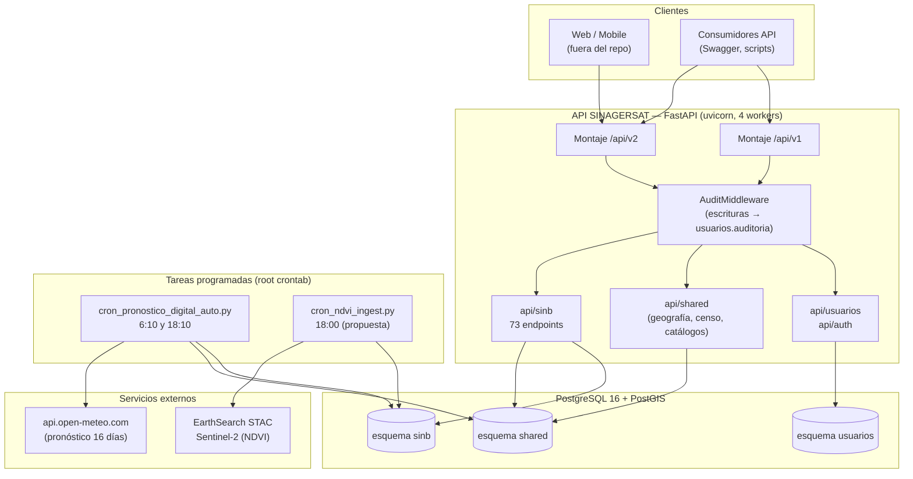

**Puntos clave de la arquitectura:**

- **Una sola app, dos versiones de rutas.** Los routers se registran dos veces: `V1_ROUTERS` bajo `/api/v1` y `V2_ROUTERS` bajo `/api/v2` (`api/main.py:115-119`). El módulo SINB solo existe en **v2** (`api/main.py:24`, montado en `api/main.py:119`).
- **Sin ORM mapeado.** Se usa SQLAlchemy solo como puente de conexión: todas las consultas son SQL escrito con `sqlalchemy.text()` en los archivos `service.py` de cada módulo.
- **Auditoría global.** `AuditMiddleware` (`api/audit.py:80`, montado en `api/main.py:113`) registra toda escritura (POST/PUT/DELETE) exitosa en `usuarios.auditoria`.
- **Documentación OpenAPI** en `/docs`, `/docs/v1`, `/docs/v2` con Swagger UI personalizado (`api/main.py:196-350`).
- **Salud del servicio:** `GET /health` (`api/main.py:364`).

---

## 3. Stack tecnológico

| Capa | Tecnología | Versión / nota | Fuente |
|---|---|---|---|
| Lenguaje | Python | 3.12 | `requirements.txt` |
| Framework web | FastAPI | >= 0.115 | `requirements.txt:1` |
| Servidor ASGI | Uvicorn | >= 0.30, 4 workers | `requirements.txt:2`, `start_api.sh:17` |
| Acceso a BD | SQLAlchemy + psycopg2-binary | >= 2.0 / >= 2.9 (SQL crudo) | `requirements.txt:3-4` |
| Validación | Pydantic + pydantic-settings | >= 2.0 | `requirements.txt:5-6` |
| Autenticación | python-jose (JWT HS256) + bcrypt | >= 3.3 / == 4.2.1 | `requirements.txt:7-8` |
| HTTP externo | httpx | >= 0.27 (Open-Meteo, EarthSearch) | `requirements.txt:10` |
| Excel | openpyxl + python-multipart | >= 3.1 / >= 0.0.9 | `requirements.txt:9,11` |
| Base de datos | PostgreSQL + PostGIS | 16.15 (extensión PostGIS activada) | `config/postgresql.conf`, `database/migration_v1.5.0.sql:17` |
| Geo | PostGIS | `geometry(MultiPolygon/Point, 4326)`, índices GiST | capítulos 4 y 6 |
| Docs API | OpenAPI 3.1 + Swagger UI 5 | CDN jsdelivr, UI custom | `api/main.py:196-350` |
| Despliegue | systemd + shell | sin Docker | `deploy/`, `deploy/systemd/sinagersat-api.service` |

---

## 4. Base de datos

Base de datos `db_sinagersat`, usuario `sinagersat` (`api/config.py:12`). Multi-esquema: los módulos documentados usan `shared`, `usuarios` y `sinb`.

### 4.1 Diagrama general de esquemas

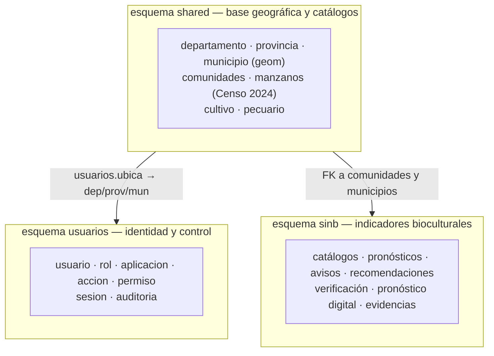

| Esquema | Módulo | Tablas | Capítulo |
|---|---|---|---|
| `shared` | Geografía, catálogos, Censo 2024 | 7 | 6 |
| `usuarios` | Identidad, RBAC, auditoría | 7 | 5 |
| `sinb` | Indicadores bioculturales | 39 + 6 vistas | 7 |

### 4.2 Esquema `shared` (7 tablas)

Base geográfica y de catálogos usada por todos los módulos.

| Tabla | Clave principal | Contenido | Volumen real |
|---|---|---|---|
| `departamento` | `id` | 9 departamentos de Bolivia (`codigo_ine`, `nombre`) | 9 |
| `provincia` | `id` | 113 provincias, FK a `departamento` | 113 |
| `municipio` | `id` | 343 municipios, FK dep/prov, **`geom geometry(MultiPolygon,4326)`** con índice GiST | 343 |
| `comunidades` | `codigo_ine` | Unidades del Censo 2024 tipo Comunidad; `personas`, `viviendas`, `lat/lon`, `area_oficial`, FK `id_municipio`, **`geom (Point,4326)`** | 21.175 |
| `manzanos` | `codigo_ine` | Unidades del Censo 2024 tipo Manzano; mismas columnas, **`geom (MultiPolygon,4326)`** | 247.429 |
| `cultivo` | `id` | Catálogo de cultivos (SIIP) con `grupo` CHECK (7 grupos) | 73 |
| `pecuario` | `id` | Catálogo de especies pecuarias con `grupo` CHECK (6 grupos) | 29 |

Origen del DDL: `database/edan_db_backup.sql`, `database/migration_v1.3.1.sql` (cultivos), `database/migration_v1.3.2.sql` (pecuario), `database/migration_v1.5.0.sql` (PostGIS en `municipio`), `database/migrations/v2.15.0_shared_censo2024.sql` y `v2.16.0_shared_censo2024_estandar.sql` (manzanos/comunidades).

**Nota semántica importante del Censo 2024:** `tipo_unidad` (Manzano/Comunidad) es una clasificación **cartográfica**, mientras que `area_oficial` (Urbana/Rural/Mixto) es la **clasificación oficial del INE a nivel municipio**. Para reportar población urbana/rural debe usarse `area_oficial` (`datos_censo2024/documentacion/README_censo2024.md:235-299`).

### 4.3 Esquema `usuarios` (7 tablas)

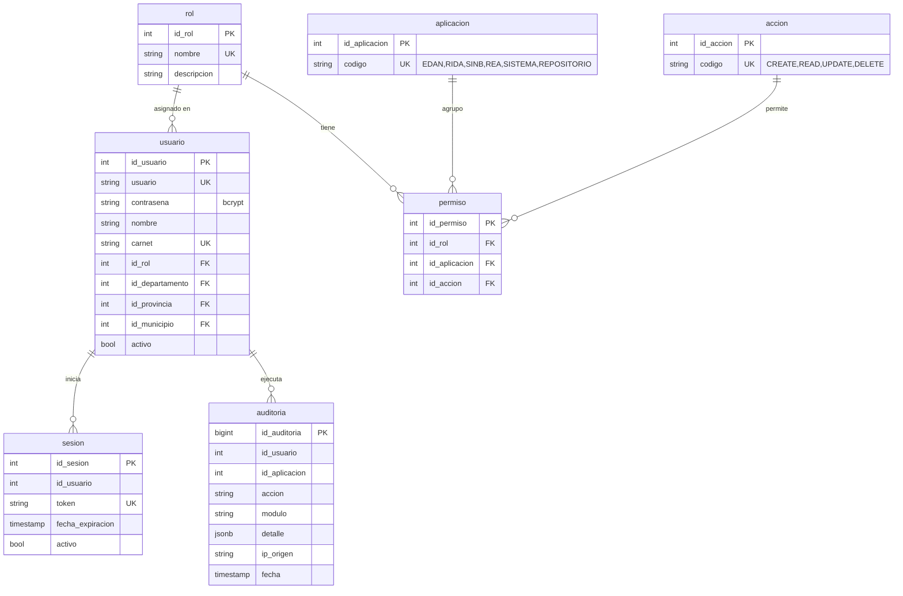

### 4.4 Esquema `sinb` (39 tablas y 6 vistas)

Agrupadas por subdominio. Las tablas marcadas con † son creadas/recreadas por migraciones nuevas del árbol de trabajo (tabla 4.5).

#### a) Catálogos biofísicos y bioculturales (7)

| Tabla | Propósito |
|---|---|
| `grupo` | Grupos de indicadores (nivel superior del catálogo) |
| `indicador_natural` | Indicador natural observado (ej. comportamiento de ríos, fauna) |
| `caracteristica` | Características asociadas al indicador |
| `comportamiento` | Comportamientos observados |
| `significado` | Significado cultural otorgado al comportamiento |
| `categoria_pronostico` | Categorías de pronóstico (antes `categoria_pronostico_temporal`, unificada en v2.31.0) |
| `escenario` | Escenarios posibles de un pronóstico |

#### b) Pronósticos (7)

| Tabla | Propósito |
|---|---|
| `pronostico_largo` † | Pronóstico estacional/largo plazo (antes `pronostico_estacional`) |
| `pronostico_largo_item` † | Ítems internos del pronóstico largo (estructura anidada, v2.32.0) |
| `escenario_estacional` † | Escenarios por ítem del pronóstico largo (recreada en v2.32.0) |
| `pronostico_corto` † | Pronóstico temporal/corto plazo (antes `pronostico_temporal`) |
| `pronostico_observador` | Vínculo pronóstico ↔ observador (antes `observacion_pronostico`) |
| `observador_indice` | Índice/calificación de desempeño del observador |
| `aviso` → `avisos` † | Avisos a 24–48 h (renombrada en v2.29.0) |

#### c) Recomendaciones y normas (2)

| Tabla | Propósito |
|---|---|
| `recomendacion` † | Nueva tabla de recomendaciones del modelo anidado (v2.32.0) |
| `comportamiento_recomendacion` † | Relación comportamiento ↔ recomendación (v2.32.0) |

#### d) Observación de campo y evidencias (4)

| Tabla | Propósito |
|---|---|
| `observacion` / `observacion_registro` | Registro de observaciones de campo (**eliminadas por la migración v2.30.0 del árbol de trabajo**) |
| `observacion_recomendacion` | Vínculo observación ↔ recomendación |
| `evidencia` | Fotos/evidencias con coordenadas (FK comunidades/municipio añadidas en v2.30.0) |

#### e) Verificación de pronósticos (1)

| Tabla | Propósito |
|---|---|
| `verificacion_pronostico` | Resultado de la verificación automática/manual de cada pronóstico (FK `shared.comunidades`) |

#### f) Pronóstico digital Open-Meteo (3) — v2.27.0

| Tabla | Propósito |
|---|---|
| `pronostico_diario_municipal` | Pronóstico diario 16 días por municipio (FK `shared.municipio`) |
| `pronostico_hourly_punto` | Serie horaria por punto/municipio |
| `pronostico_minutely_cache` | Caché minutería/consultas rápidas |

#### g) Satelital / NDVI (4) — v2.28.0 (propuesta, capítulo 11)

| Tabla | Propósito |
|---|---|
| `escena_satelital` | Escenas Sentinel-2 (id, fecha, cobertura de nubes, metadata) |
| `agregado_satelital` | NDVI agregado por comunidad y escena |
| `serie_ndvi_comunidad` | Serie temporal NDVI por comunidad |
| `ndvi_procesamiento_log` | Log de ingesta/procesamiento |

#### h) Zonas geográficas del SINB (3)

| Tabla | Propósito |
|---|---|
| `zona_geografica` | Catálogo de zonas geográficas del SINB |
| `zona_comunidad` | Zona ↔ comunidad (`FK shared.comunidades(codigo_ine)`) — eliminada en v2.31.2 |
| `zona_manzano` | Zona ↔ manzano (`FK shared.manzanos(codigo_ine)`) — eliminada en v2.31.2 |

#### i) Climatología y series de indicadores (6)

| Tabla | Propósito |
|---|---|
| `variable_climatica` | Variables climáticas de referencia |
| `serie_climatica` | Series climáticas por comunidad (eliminada en v2.31.2) |
| `norma_climatica` | Normales climáticas por comunidad (eliminada en v2.31.2) |
| `ventana_observacion` | Ventanas de observación (eliminada en v2.31.2) |
| `serie_indicador` / `desviacion_indicador` / `calificacion_indicador` | Series y desviaciones de indicadores (eliminadas en v2.31.2) |

#### j) Vistas (6)

| Vista | Utilidad |
|---|---|
| `v_verificaciones_pendientes` | Pronósticos cerrados sin verificar (`estado='NO_VERIFICABLE'` y fecha fin vencida); base de `GET /verificacion/pendientes` |
| `v_registro_territorial`, `v_primera_observacion`, `v_tendencia_fenologia` | Consolidados de observación (eliminadas en v2.30.0) |
| `v_indicador_confiabilidad`, `v_calificacion_vigente` | Confiabilidad/calificación de indicadores (caen con v2.31.2) |
| `vw_alertas_ndvi`, `vw_evolucion_mensual_ndvi`, `vw_ultimo_ndvi_comunidad` | NDVI (propuesta) |

### 4.5 Migraciones del SINB (v2.26.0 → v2.32.0)

Migraciones SQL aplicadas con un orden fijo. Estado según el árbol de trabajo actual:

| Versión | Archivo | Qué hace | Estado git |
|---|---|---|---|
| v2.26.0 | `database/migrations/v2.26.0_sinb_id_off.sql` | Añade `id_off bigint` + índices parciales a `observacion`, `observacion_registro`, `pronostico_estacional`, `pronostico_temporal`, `aviso` (base del modo offline); también `recomendacion_local` (eliminada en v2.33.0) | Commiteada |
| v2.27.0 | `v2.27.0_pronosticos_digitales_tablas.sql` | Crea `pronostico_diario_municipal`, `pronostico_hourly_punto`, `pronostico_minutely_cache` + vistas de resumen (pronóstico digital Open-Meteo) | Commiteada |
| v2.28.0 | `v2.28.0_ndvi_satelital.sql` | Crea `escena_satelital`, `agregado_satelital`, `serie_ndvi_comunidad`, `ndvi_procesamiento_log` e INSERTs semilla (NDVI) | Commiteada |
| v2.29.0 | `v2.29.0_renombrar_pronosticos.sql` | Renombra `pronostico_estacional → pronostico_largo`, `pronostico_temporal → pronostico_corto`, `aviso → avisos`; unifica columnas de usuario; recrea `v_verificaciones_pendientes` | Sin commitear |
| v2.30.0 | `v2.30.0_reestructurar_sinb.sql` | Elimina `observacion`/`observacion_registro` y vistas; amplía `recomendacion_local` (eliminada en v2.33.0); crea semilla `categoria_recomendacion` (eliminada en v2.33.0); añade `id_municipio` a pronósticos; índices de ranking | Sin commitear |
| v2.31.0 | `v2.31.0_unificar_categoria_pronostico.sql` | Unifica `categoria_pronostico_temporal` + `campo_pronostico` en `categoria_pronostico`; remapea IDs; elimina `campo_pronostico` | Sin commitear |
| v2.31.1 | `v2.31.1_catalogos_offline.sql` + `v2.31.1_revertir_offline.sql` | Par aplicación/revert de columnas offline en catálogos | Sin commitear |
| v2.31.2 | `v2.31.2_eliminar_tablas_obsoletas.sql` + `v2.31.2_revertir_off_catalogos.sql` | Elimina tablas obsoletas (`serie_climatica`, `serie_indicador`, `calificacion_indicador`, `zona_comunidad`, `zona_manzano`, etc.) y revierte `id_escenario_off` | Sin commitear |
| v2.32.0 | `v2.32.0_pronostico_largo_anidado.sql` | Nuevo modelo de pronóstico largo anidado: `pronostico_largo`, `pronostico_largo_item`, `escenario_estacional`, tablas de relación, `recomendacion`; recrea `v_verificaciones_pendientes` | Sin commitear |
| v2.33.0 | `v2.33.0_eliminar_recomendacion_local.sql` | Elimina `recomendacion_local` y `categoria_recomendacion` — las recomendaciones solo entran por `POST /pronostico-largo` | Pendiente |

**Orden de aplicación:** de menor a mayor número de versión, incluyendo los pares *aplicar/revertir* en el orden en que fueron escritos.

### 4.6 Relaciones con `shared`

Las tablas del SINB se anclan al territorio mediante claves foráneas a `shared`:

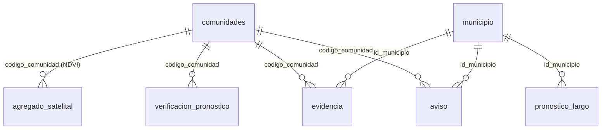

Además, los 4 endpoints de mapas del SINB leen directamente `shared.comunidades`, `shared.municipio` y `shared.manzanos` (capítulo 7.9).

---

## 5. Módulo Usuarios

Autenticación, control de acceso basado en roles (RBAC) y auditoría. Archivos: `api/auth/*`, `api/usuarios/*`, `api/dependencies.py`, `api/audit.py`.

### 5.1 Autenticación (JWT)

| Método | Ruta | Descripción |
|---|---|---|
| POST | `/api/v{1,2}/auth/login` | Devuelve token JWT + perfil + permisos |
| POST | `/api/v{1,2}/auth/register` | Alta de usuario |
| POST | `/api/v{1,2}/auth/verificar-identidad` | Verifica identidad por carnet+celular+geografía+comunidad |
| POST | `/api/v{1,2}/auth/cambiar-contrasena` | Cambio de contraseña |
| GET | `/api/v{1,2}/auth/mis-permisos` | Devuelve los permisos del usuario autenticado |

**Cómo funciona el login** (`api/auth/service.py:47`):

1. Busca el usuario y valida que esté activo.
2. Compara la contraseña con **bcrypt** (`api/auth/jwt.py:9-14`).
3. Calcula la expiración del token (`api/auth/service.py:13-17`):
   - **Roles 6 (UGR Municipio) y 7 (Responsable Local):** token de larga duración (fecha 2099-12-31), reutilizando la sesión activa si existe — pensado para equipos de campo que trabajan sin reconexión.
   - **Resto de roles:** **72 horas**, revocando las sesiones anteriores.
4. Registra la sesión en `usuarios.sesion` y devuelve el token.

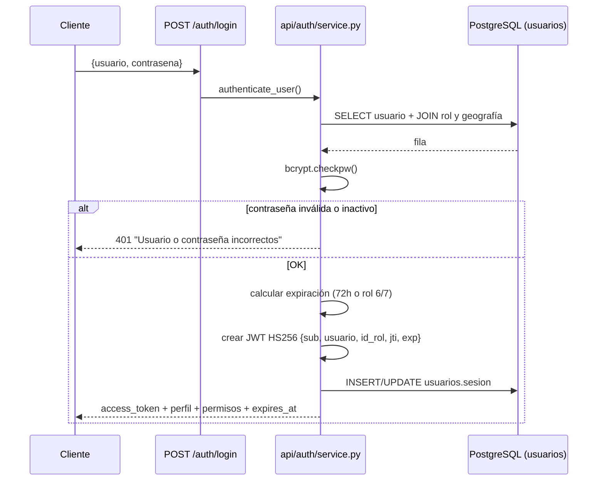

**JWT:** firmado HS256 con `JWT_SECRET` (`api/config.py:15-16`). Claims: `sub` (id_usuario), `usuario`, `id_rol`, `jti` y `exp` (solo para roles distintos de 6/7). En cada petición, `get_current_user` (`api/dependencies.py:19-44`) valida el token **y vuelve a consultar la BD** para confirmar que el usuario exista y esté activo.

### 5.2 Control de acceso (RBAC)

El modelo es una triple combinación **rol × aplicación × acción**:

- **Aplicación** = módulo de negocio: `EDAN`, `RIDA`, `SINB`, `REA`, `SISTEMA`, `REPOSITORIO` (tabla `usuarios.aplicacion`).
- **Acción** = operación CRUD: `CREATE`, `READ`, `UPDATE`, `DELETE` (tabla `usuarios.accion`).
- **Permiso** = fila en `usuarios.permiso(id_rol, id_aplicacion, id_accion)`.

Reglas de evaluación (`api/auth/permisos.py:7-61`):

1. Si el rol es **1 (superadmin)** → siempre pasa; su respuesta de permisos es `full_access` (`api/auth/service.py:41-44`).
2. Si la acción es **READ** → siempre pasa (el RBAC solo restringe escritura).
3. En otro caso, consulta `usuarios.permiso` cruzando `aplicacion` y `accion`; sin fila → **403**.

Se aplica de dos formas:

- `module_permiso(modulo)` — deduce la acción del método HTTP (GET→READ, POST→CREATE, PUT→UPDATE, DELETE→DELETE) y se inyecta a nivel de router (módulos EDAN, RIDA, Repositorio).
- `permiso_required(modulo, accion)` — acción explícita (geografía en `api/shared/router.py:24-27`, usuarios en `api/usuarios/router.py`).

**El módulo SINB no usa este RBAC genérico:** aplica sus propios filtros por rol (`require_rol`) descritos en el capítulo 9.

### 5.3 Catálogo de roles (11 roles)

| id | Rol | Orientación |
|---|---|---|
| 1 | superadmin | Acceso total y gestión de usuarios |
| 2 | admin | Gestiona usuarios y datos de su sistema |
| 3 | VIDECI Regional | Carga y edita formularios propios |
| 4 | UGR Sectores | Carga y edita formularios propios |
| 5 | DGR Gobernación | Carga y edita formularios propios |
| 6 | UGR Municipio | Carga y edita formularios propios (token largo) |
| 7 | Responsable Local | Carga y edita formularios propios (token largo) |
| 8 | Alcalde | Revisa formularios EDAN |
| 9 | VIDECI Departamental | Gestión a nivel departamental |
| 12 | Usuario recolector | Recolección de datos en comunidades para SINB |
| 13 | Observador local | Generación de datos a nivel comunitario SINB |

### 5.4 Endpoints del módulo Usuarios

Prefijo `/api/v{1,2}/usuarios` (30 rutas, `api/usuarios/router.py`; se montan en v1 y v2 — en v2 los catálogos abren escritura a cualquier autenticado, `api/usuarios/router.py:49-52`):

| Área | Métodos y rutas | Líneas |
|---|---|---|
| Cuentas | `GET /`, `GET /{id}`, `POST /`, `POST /importar` (Excel), `PUT /{id}` (perfil), `PUT /{id}/cuenta` (contraseña/rol/estado), `DELETE /{id}` (baja lógica) | `router.py:259-354` |
| Roles | `GET /roles`, `GET /roles/{id}`, `POST /roles`, `PUT /roles/{id}`, `DELETE /roles/{id}` | `router.py:58-83` |
| Aplicaciones | `GET/POST/PUT/DELETE /aplicaciones[/{id}]` | `router.py:93-118` |
| Acciones | `GET/POST/PUT/DELETE /acciones[/{id}]` | `router.py:128-153` |
| Permisos | `GET /permisos/estructura` (matriz rol×app×acción), `GET /permisos/rol/{id}`, `PUT /roles/{id_rol}/permisos` (reemplazo total), `GET /permisos`, `POST /permisos/{rol}/{app}/{accion}`, `DELETE /permisos/{rol}/{app}/{accion}` | `router.py:163-199` |
| Sesiones | `GET /sesiones?id_usuario=` | `router.py:210` |
| Auditoría | `GET /auditoria` (filtros por usuario, aplicación, acción, fechas, geografía, módulo, búsqueda) | `router.py:215-253` |

### 5.5 Auditoría

`AuditMiddleware` (`api/audit.py:80-139`) registra automáticamente cada **POST/PUT/DELETE** con respuesta < 400:

| Elemento | Cómo se determina |
|---|---|
| Acción | Método HTTP (`POST→CREATE`, `PUT→UPDATE`, `DELETE→DELETE`) |
| Aplicación | Prefijo de la URL (`/api/v2/edan/`→EDAN, `/api/v2/rida/`→RIDA, `/api/v2/usuarios/` y `/shared/`→SISTEMA, etc.) — `URL_APP_MAP` (`api/audit.py:8-22`) |
| Módulo | Sub-prefijo (`rida/eventos`, `edan/localidades`, `usuarios`, `shared`…) — `URL_MODULO_MAP` (`api/audit.py:25-41`) |
| Usuario | Claim `sub` del token Bearer (NULL en logins, pues aún no hay token) |
| Detalle | JSON con `path`, `method`, `modulo`, `body` (**la contraseña se elimina**) y `params` |
| IP | `X-Forwarded-For` si existe, si no la IP directa |

Resultado: tabla `usuarios.auditoria` indexada por `(id_aplicacion, modulo, fecha DESC)`.

---

## 6. Módulo Shared: geografía, catálogos y Censo 2024

Archivo único: `api/shared/router.py` (549 líneas) + `api/shared/service.py` (929 líneas). Se crea dos instancias: v1 (`open_writes=False`) y v2 (`open_writes=True`) — `api/shared/router.py:548-549`.

**Autorización:** los GET son **públicos**; las escrituras en v1 exigen permiso `SISTEMA` y en v2 requieren solo estar autenticado (`api/shared/router.py:24-27`).

### 6.1 Geografía administrativa

| Recurso | Métodos | Rutas | Líneas |
|---|---|---|---|
| Departamentos | GET/POST/PUT/DELETE | `/departamentos[/{id}]` | `router.py:31-59` |
| Provincias | GET/POST/PUT/DELETE | `/provincias[/{id}]` (filtro `?id_departamento=`) | `router.py:67-98` |
| Municipios | GET/POST/PUT/DELETE | `/municipios[/{id}]` (filtros dep/prov) | `router.py:194-226` |

### 6.2 Funciones geográficas (PostGIS)

| Método | Ruta | Qué hace | Línea |
|---|---|---|---|
| GET | `/municipios/geojson` | FeatureCollection RFC 7946 con `bbox` y `area_km2` por municipio (transforma a EPSG:4326) | `router.py:114` |
| GET | `/municipios/geom` | `GeometryCollection` con WKT y SRID | `router.py:138` |
| GET | `/municipios/ubicacion?lat&lon` | Punto dentro de polígono (`ST_Contains`) → devuelve el municipio | `router.py:161` |
| GET | `/municipios/{id}/geojson` y `/{id}/geom` | Geometría de un municipio | `router.py:234,247` |

> Estos cinco endpoints devuelven JSON "crudo", sin el envoltorio `{success, message, data, total}` del resto de la API (`api/response.py:7-28`).

### 6.3 Catálogos productivos

| Recurso | Rutas | Notas |
|---|---|---|
| Cultivos | `GET /cultivos/grupos`, `GET /cultivos?grupo&q`, `GET/POST/PUT/DELETE /cultivos[/{id}]` | 73 registros, 7 grupos (`router.py:261-294`) |
| Pecuario | `GET /pecuario/grupos`, `GET /pecuario?grupo&q`, `GET/POST/PUT/DELETE /pecuario[/{id}]` | 29 registros, 6 grupos (`router.py:303-336`) |

### 6.4 Censo 2024

Rutas generadas por una factoría (`_definir_rutas_censo`, `api/shared/router.py:347-442`) aplicada a `manzanos` y `comunidades` → **16 endpoints** con clave `codigo_ine`:

| Método | Ruta | Descripción |
|---|---|---|
| GET | `/manzanos` y `/comunidades` | Listado con filtros `id_municipio`, `codigo_ine`, `q`, `area_oficial`, paginación |
| GET | `/…/geojson` | GeoJSON con `bbox` (operador `&&` sobre índice GiST; límite 50.000) |
| GET | `/{codigo_ine}` | Unidad por código INE |
| GET | `/{codigo_ine}/geojson` | Geometría de la unidad |
| GET | `/{codigo_ine}/poblacion` | Personas y viviendas de la unidad |
| POST / PUT / DELETE | `/…` | Escritura (v1: permiso SISTEMA; v2: autenticado) |

### 6.5 Resúmenes de población

| Ruta | Calcula |
|---|---|
| `GET /censo/poblacion/nacional` | Totales del país (manzanos + comunidades) |
| `GET /censo/poblacion/departamentos` | Resumen por departamento (filtros opcionales) |
| `GET /censo/poblacion/provincias` | Resumen por provincia |
| `GET /censo/poblacion/municipios` | Resumen por municipio |
| `GET /censo/poblacion/departamento/{id}` · `/provincia/{id}` · `/municipio/{id}` | Resumen de un territorio concreto (404 si sin datos) |

Implementación: CTE que agrupa `manzanos` y `comunidades` por el nivel pedido y los suma (`api/shared/service.py:808-917`). Los territorios sin unidades aparecen con ceros.

**Totales nacionales actuales (Censo 2024):**

| Indicador | Valor |
|---|---|
| Manzanos | 247.429 |
| Comunidades | 21.175 |
| Población total | 11.365.333 |
| Viviendas totales | 4.480.201 |

### 6.6 Pipeline del Censo 2024 (carga de datos)

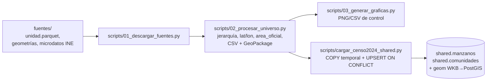

| Etapa | Archivo | Resultado |
|---|---|---|
| Descarga | `datos_censo2024/scripts/01_descargar_fuentes.py` | Universo + geometrías + microdatos (geoportal INE / release `censosbo`) |
| Proceso | `datos_censo2024/scripts/02_procesar_universo.py` | CSV (`manzanos_censo2024.csv`, `comunidades_censo2024.csv`, …) y GeoPackage con 3 capas |
| Gráficas | `datos_censo2024/scripts/03_generar_graficas.py` | 12 PNG + 3 CSV de control |
| Carga | `scripts/cargar_censo2024_shared.py` | `COPY` a tabla temporal → `INSERT … ON CONFLICT (codigo_ine) DO UPDATE` → `ST_GeomFromWKB`; transaccional e idempotente (`--simular` / `--importar`) |

Documentación complementaria: `datos_censo2024/documentacion/README_censo2024.md` y `POSTGRES_censo2024.md`.

---

## 7. Módulo SINB

**Router:** `api/sinb/router_v2.py` (prefijo `/sinb`, montado en `/api/v2` → rutas bajo **`/api/v2/sinb/…`**). **73 endpoints** agrupados en 11 áreas funcionales.

**Lógica de negocio:** `api/sinb/service.py` (SQL crudo) · **Esquemas:** `api/sinb/schemas.py` · **Control de acceso:** `api/sinb/utils.py`.

### 7.1 Tabla maestra de endpoints

| # | Área | Método | Ruta (`/api/v2/sinb`) | Rol de acceso | Línea |
|---|---|---|---|---|---|
| **Catálogos bioculturales (34)** | | | | | |
| 1 | Catálogos | GET/POST | `/grupo[/{id}]` | público / ADMIN | `64,72` |
| 2 | Catálogos | GET/PUT/DELETE | `/grupo/{id}` | público / ADMIN | `82,91,101` |
| 3 | Catálogos | GET/POST | `/indicador-natural[/{id}]` | público / ADMIN | `111,125` |
| 4 | Catálogos | GET/PUT/DELETE | `/indicador-natural/{id}` | público / ADMIN | `134,143,153` |
| 5 | Catálogos | GET/POST | `/caracteristica[/{id}]` | público / ADMIN | `163,174` |
| 6 | Catálogos | PUT/DELETE | `/caracteristica/{id}` | ADMIN | `182,192` |
| 7 | Catálogos | GET/POST | `/comportamiento[/{id}]` | público / ADMIN | `202,214` |
| 8 | Catálogos | PUT/DELETE | `/comportamiento/{id}` | ADMIN | `222,232` |
| 9 | Catálogos | GET/POST | `/significado[/{id}]` | público / ADMIN | `242,255` |
| 10 | Catálogos | PUT/DELETE | `/significado/{id}` | ADMIN | `263,273` |
| 11 | Catálogos | GET/POST | `/zona-geografica[/{id}]` | público / ADMIN | `283,291` |
| 12 | Catálogos | PUT/DELETE | `/zona-geografica/{id}` | ADMIN | `299,309` |
| 13 | Catálogos | GET/POST | `/categoria-pronostico[/{id}]` | público / ADMIN | `319,330` |
| 14 | Catálogos | PUT/DELETE | `/categoria-pronostico/{id}` | ADMIN | `338,348` |
| 15 | Catálogos | GET/POST | `/escenario[/{id}]` | público / ADMIN | `358,370` |
| 16 | Catálogos | PUT/DELETE | `/escenario/{id}` | ADMIN | `379,390` |
| **Pronóstico largo plazo (7)** | | | | | |
| 17 | Pronóstico largo | GET | `/pronostico-largo`, `/pronostico-largo/{id}` | público | `406,435` |
| 18 | Pronóstico largo | POST/PUT/DELETE | `/pronostico-largo[/{id}]` | PRONOSTICO | `446,497,509` |
| 19 | Pronóstico largo | POST/DELETE | `/pronostico-largo/{id}/item/{id_item}/escenario[/{id_escenario}]` | PRONOSTICO | `517,529` |
| **Pronóstico corto plazo (5)** | | | | | |
| 20 | Pronóstico corto | GET | `/pronostico-corto`, `/pronostico-corto/{id}` | público / autenticado | `540,564` |
| 21 | Pronóstico corto | POST/PUT/DELETE | `/pronostico-corto[/{id}]` | PRONOSTICO | `572,581,592` |
| **Observadores — asignación (2)** | | | | | |
| 22 | Observadores | POST/DELETE | `/pronostico/{id}/observadores`, `/pronostico/{id}/observador/{id_usuario}` | LOCAL | `604,626` |
| **Verificación (3)** | | | | | |
| 23 | Verificación | POST | `/verificacion/calcular` | público | `643` |
| 25 | Verificación | PUT | `/verificacion/{id_pronostico}` | VALIDACION | `672` |
| **Observadores — ranking e índice (2)** | | | | | |
| 26 | Observadores | GET | `/observadores/ranking` | público | `974` |
| 27 | Observadores | GET/POST | `/observador-indice` | público / LOCAL | `1181,1221` |
| **Avisos (3)** | | | | | |
| 28 | Avisos | GET | `/avisos` | público | `1097` |
| 29 | Avisos | POST/DELETE | `/avisos[/{id}]` | LOCAL | `1137,1166` |
| **Reportes (1)** | | | | | |
| 30 | Reportes | GET | `/reporte/pronosticos` | público | `1243` |
| **Mapas GeoJSON (4)** | | | | | |
| 31 | Mapas | GET | `/mapa/comunidades/geojson` | público | `1260` |
| 32 | Mapas | GET | `/mapa/municipios/geojson` | público | `1311` |
| 33 | Mapas | GET | `/mapa/manzanos/geojson` | público | `1357` |
| 34 | Mapas | GET | `/mapa/pronosticos/geojson` | público | `1399` |
| **Pronóstico digital Open-Meteo (7)** | | | | | |
| 35 | Digital | GET | `/pronostico-digital/diario` | autenticado (+ alcance geográfico) | `1452` |
| 36 | Digital | GET | `/pronostico-digital/diario/{id_municipio}` | público | `1515` |
| 37 | Digital | GET | `/pronostico-diario/historico` | autenticado | `1555` |
| 38 | Digital | GET | `/pronostico-digital/consultar` | público | `1618` |
| 39 | Digital | GET | `/pronostico-digital/mapa` | público | `1707` |
| 40 | Digital | GET | `/pronostico-digital/hourly/{lat}/{lon}` | público | `1764` |
| 41 | Digital | POST | `/pronostico-digital/actualizar-municipio/{id_municipio}` | público | `1789` |
| **Galería de evidencias (4)** | | | | | |
| 42 | Galería | GET | `/galeria/evidencias` | autenticado | `1840` |
| 47 | Galería | GET | `/galeria/indicadores-destacados` | público | `1905` |
| 48 | Galería | GET | `/galeria/municipio/{id_municipio}` | público | `1934` |
| 49 | Galería | GET | `/galeria/indicator/{id_indicador}` | público | `1962` |

Todas las líneas corresponden a `api/sinb/router_v2.py`. "público" = no exige token; "autenticado" = requiere JWT válido; "ADMIN/PRONOSTICO/VALIDACION/LOCAL" = grupos de roles definidos en `api/sinb/utils.py:8-11` (detallados en capítulo 9).

### 7.2 Catálogos bioculturales

Son el corazón del dominio: describen el conocimiento local como una jerarquía.

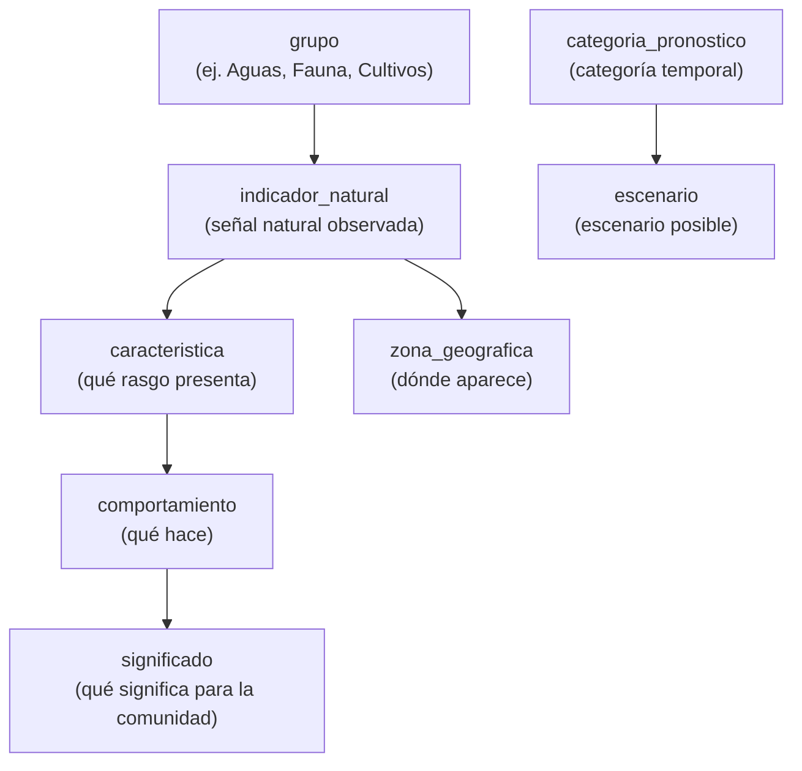

- **Lectura libre:** todos los GET son públicos, de modo que cualquier cliente puede consultar el catálogo sin token.
- **Escritura reservada** a `ROLES_SINB_ADMIN` (roles 1 y 2): POST/PUT/DELETE.
- **Jerarquía de gestión:** las migraciones v2.30.0 y v2.31.0 unifican categorías de pronóstico y añaden la semilla `categoria_recomendacion`.

### 7.3 Pronóstico largo plazo (estacional)

Estructura **anidada** (migración v2.32.0): un pronóstico contiene uno o varios **ítems**, y cada ítem contiene sus **escenarios**.

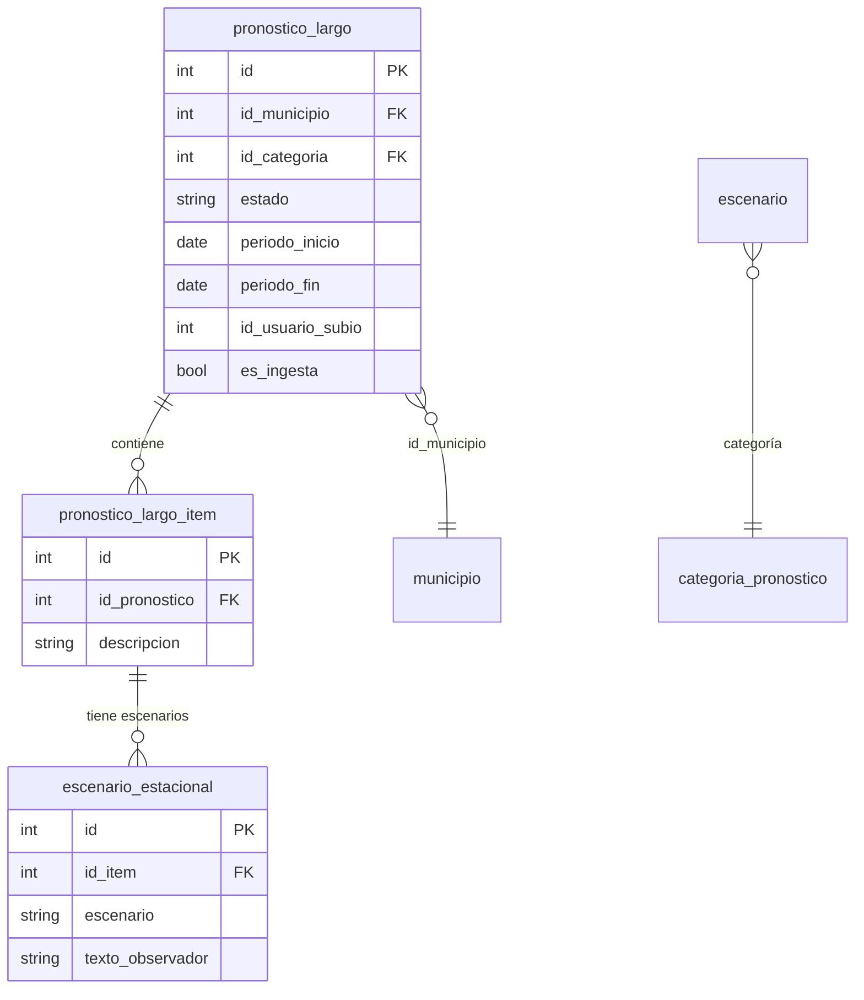

- **Endpoints:** listado/detalle públicos; altas y bajas para `ROLES_SINB_PRONOSTICO`; añadir/quitar escenarios por ítem (`router_v2.py:517,529`).
- Los campos `id_item_off` y `id_pe_off` habilitan el registro offline (capítulo 8).

### 7.4 Pronóstico corto plazo (temporal)

CRUD sobre `pronostico_corto` (antes `pronostico_temporal`): lectura pública (detalle exige token), escritura para `ROLES_SINB_PRONOSTICO` (`router_v2.py:572-592`). Soporta `id_pt_off` para offline.

### 7.5 Avisos tempranos (24–48 h)

| Método | Ruta | Rol | Línea |
|---|---|---|---|
| GET | `/avisos` | público | `1097` |
| POST | `/avisos` | LOCAL | `1137` |
| DELETE | `/avisos/{id}` | LOCAL | `1166` |

Los avisos se vinculan a comunidad y municipio (`FK` a `shared`), y se asocian a observadores mediante `aviso_observador`.

### 7.6 Verificación y calificación de pronósticos

Es el ciclo de control de calidad del SINB:

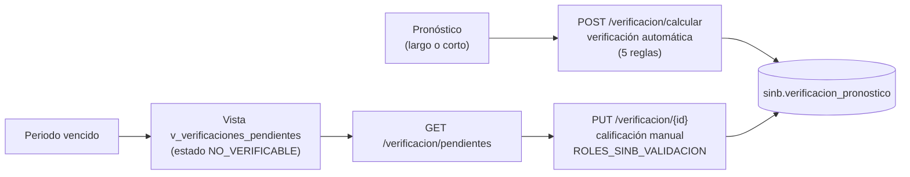

- **Automática** (`api/sinb/service.py:1414+`): aplica 5 reglas sobre el pronóstico y escribe el resultado en `verificacion_pronostico`.
- **Pendientes:** `GET /verificacion/pendientes` se apoya en la vista `v_verificaciones_pendientes`, que filtra los pronósticos cuyo periodo ya venció.
- **Manual:** `PUT /verificacion/{id}` permite a los roles VALIDACION (1, 2, 9) cerrar la verificación con observaciones.

### 7.7 Recomendaciones en pronósticos largos

Las recomendaciones ahora **solo entran por `POST /pronostico-largo`** como parte del contrato anidado. Se guardan en `sinb.pronostico_largo_recomendacion` con `id_pronostico_largo` y heredan la cadena biocultural del padre (`id_indicador_natural`, etc.).

### 7.8 Observadores

Dos funciones complementarias:

- **Asignación:** `POST /pronostico/{id}/observadores` y `DELETE /pronostico/{id}/observador/{id_usuario}` permiten vincular observadores a un pronóstico (roles LOCAL).
- **Desempeño:** `GET /observadores/ranking` (público) devuelve el ranking; `GET/POST /observador-indice` consulta o registra el índice del observador (`observador_indice`).

### 7.9 Reportes y mapas

| Endpoint | Devuelve |
|---|---|
| `GET /reporte/pronosticos` | Resumen consolidado de pronósticos |
| `GET /mapa/comunidades/geojson` | Comunidades en GeoJSON (lee `shared.comunidades`) |
| `GET /mapa/municipios/geojson` | Municipios con geometría (lee `shared.municipio.geom`) |
| `GET /mapa/manzanos/geojson` | Manzanos (lee `shared.manzanos.geom`) |
| `GET /mapa/pronosticos/geojson` | Pronósticos georreferenciados (join con `shared.municipio`) |

Los cuatro mapas son públicos y están pensados para alimentar visores (Leaflet/OpenLayers/QGIS) sin necesidad de backend propio.

### 7.10 Pronóstico digital a 16 días (Open-Meteo)

Funcionalidad estrella para consulta ciudadana: el clima diario de cualquier municipio, sin API key.

#### Flujo completo

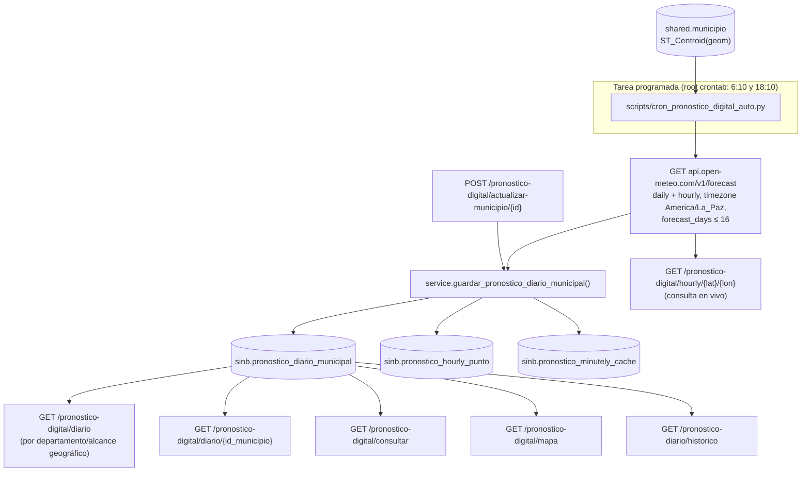

#### Detalles operativos

| Aspecto | Detalle |
|---|---|
| Fuente | `https://api.open-meteo.com/v1/forecast` (`api/sinb/service.py:1681`), plan gratuito sin clave |
| Variables diarias | `temperature_2m_max/min`, `precipitation_sum`, `wind_speed_10m_max`, `weathercode` |
| Variables horarias | `temperature_2m`, `relative_humidity_2m`, `precipitation_probability`, `weathercode` |
| Horizonte | hasta **16 días** (`min(horizonte, 16)`) |
| Persistencia | UPSERT por municipio/fecha en `pronostico_diario_municipal` + tablas hijas horarias y de caché |
| Sincronización | `scripts/cron_pronostico_digital_auto.py` itera los 343 municipios; variante `_manual.py` con `LIMIT 10` para pruebas; launcher `cron_pronostico_digital.sh` |
| Fichero de apoyo | `docs/pronostico_digital_16_dias.md` |

### 7.11 Galería de evidencias

| Endpoint | Contenido |
|---|---|
| `GET /galeria/evidencias` | Evidencias (fotos) — autenticado |
| `GET /galeria/indicadores-destacados` | Indicadores con más evidencias |
| `GET /galeria/municipio/{id_municipio}` | Evidencias de un municipio |
| `GET /galeria/indicator/{id_indicador}` | Evidencias de un indicador concreto |

Las evidencias se almacenan en `sinb.evidencia` con coordenadas y vínculo a comunidad/municipio.

---

## 8. Modo offline

El SINB está pensado para capturar información en zonas sin conectividad. El mecanismo es **offline-first**: el cliente genera identificadores locales y luego sincroniza.

### 8.1 Mecanismo

- Cada registro transaccional puede llevar un **`id_off`** (identificador generado en el dispositivo) con un índice parcial (`WHERE id_off IS NOT NULL`) para búsquedas rápidas (`database/migrations/v2.26.0_sinb_id_off.sql`).
- El cliente envía registros con su `id_off`; el servidor hace *upsert* por ese campo, de modo que la sincronización es **idempotente** (reenviar lo mismo no duplica).

### 8.2 Estado por tabla

| Tabla | Columna offline | Origen |
|---|---|---|
| `observacion` | `id_off` | v2.26.0 (tabla eliminada en v2.30.0) |
| `observacion_registro` | `id_off` | v2.26.0 (eliminada en v2.30.0) |
| `pronostico_estacional` → `pronostico_largo` | `id_off` | v2.26.0 |
| `pronostico_temporal` → `pronostico_corto` | `id_off`, `id_pt_off` (esquema) | v2.26.0 / esquemas |
| `aviso` → `avisos` | `id_off`, `id_aviso_off` (esquema) | v2.26.0 / esquemas |
| `pronostico_largo_item` | `id_item_off` (esquema) | esquema, `api/sinb/schemas.py:252` |
| `pronostico_observador` | `id_observador_off` (esquema) | esquema, `api/sinb/schemas.py:282` |
| `escenario_estacional` | `id_pe_off` | v2.32.0 |

### 8.3 Contexto de sincronización

Los endpoints de sincronización del sistema residen sobre todo en EDAN y RIDA (`POST /api/v1/edan/sync`, `GET /edan/sync/pull`, `POST /api/v2/rida/empadronamiento/sync`, `POST /api/v2/rida/necesidades/sync`). El SINB aporta el lado de los identificadores `id_off` en sus tablas, compatible con el mismo patrón. La propuesta de sincronización completa (push/pull con cursor y resolución de conflictos) está en `propuesta/08-OFFLINE-SINCRONIZACION.md`.

---

## 9. Roles y permisos del SINB

### 9.1 Grupos de roles propios del SINB

Definidos en `api/sinb/utils.py:8-11` y aplicados con `require_rol(...)` en cada endpoint:

| Constante | Roles | Quiénes son | Uso |
|---|---|---|---|
| `ROLES_SINB_ADMIN` | 1, 2 | superadmin, admin | Escritura de catálogos bioculturales |
| `ROLES_SINB_PRONOSTICO` | 1, 2, 9 | + VIDECI Departamental | Crear/editar pronósticos largo y corto |
| `ROLES_SINB_VALIDACION` | 1, 2, 9 | (igual que anterior) | Cerrar verificaciones manualmente |
| `ROLES_SINB_LOCAL` | 1, 6, 7, 8, 12, 13 | UGR Municipio, Responsable Local, Alcalde, Usuario recolector, Observador local | Avisos, índice y asignación de observadores |

### 9.2 Reparto de los 73 endpoints

| Tipo de acceso | Cantidad | Ejemplos |
|---|---|---|
| Restringido por rol (ADMIN/PRONOSTICO/VALIDACION/LOCAL) | 38 | Escritura de catálogos (21), pronósticos (8), avisos (2), observadores (3), validación (1), categorías (3) |
| Requiere solo token (cualquier usuario autenticado) | 4 | `GET /pronostico-corto/{id}`, `GET /galeria/evidencias` |
| Sin token (lecturas públicas) | 31 | Catálogos (10), pronósticos largo/corto (3), pronóstico digital (5), mapas (4), galería (3), verificación (2), ranking e índice (2), avisos (1), reportes (1) |

Total: 38 + 4 + 31 = **73 endpoints**.

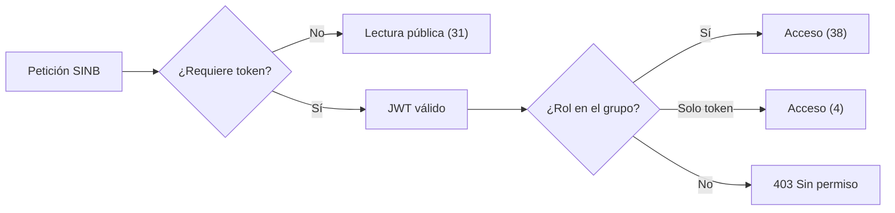

### 9.3 Alcance geográfico

- `scope_geografico(user)` (`api/sinb/utils.py:26`) devuelve el territorio asignado al usuario y se aplica en `GET /pronostico-digital/diario` (`router_v2.py:1489`).
- El resto de endpoints del SINB no filtran por territorio: su restricción es por rol, no territorial.
- Complemento: `validar_scope_localidad` (`api/sinb/utils.py:78`) se emplea en el módulo EDAN.

### 9.4 Relación con el RBAC general

Aunque la tabla `usuarios.aplicacion` incluye la aplicación `SINB` con sus permisos CRUD (usada por la matriz de permisos del capítulo 5), el router del SINB aplica directamente `require_rol` en lugar de `module_permiso`. Son dos mecanismos convivientes: el RBAC genérico para los módulos EDAN/RIDA/Repositorio y los grupos de roles para el SINB.

---

## 10. Consultas e indicadores

Conjunto de endpoints pensados para consumo de tableros, reportes y consultorios. Todos existen en el repositorio.

| Familia | Endpoint | Qué entrega |
|---|---|---|
| **SINB** | `GET /api/v2/sinb/reporte/pronosticos` | Resumen de pronósticos |
| | `GET /api/v2/sinb/observadores/ranking` | Ranking de observadores |
| | `GET /api/v2/sinb/verificacion/pendientes` | Pronósticos pendientes de verificación |
| | `GET /api/v2/sinb/mapa/{comunidades,municipios,manzanos,pronosticos}/geojson` | Capas geográficas |
| | `GET /api/v2/sinb/galeria/indicadores-destacados` | Indicadores destacados por evidencias |
| **Población** | `GET /api/v2/shared/censo/poblacion/{nacional,departamentos,provincias,municipios,…}` | Totales y resúmenes del Censo 2024 |
| | `GET /api/v2/shared/{manzanos,comunidades}/{codigo_ine}/poblacion` | Población de una unidad |
| **Geo** | `GET /api/v2/shared/municipios/geojson`, `/geom`, `/ubicacion` | Cartografía y consulta punto-polígono |
| **Pronóstico digital** | `GET /api/v2/sinb/pronostico-digital/{diario,mapa,consultar}` | Serie de 16 días por municipio |
| **NDVI (propuesta)** | `GET /api/v2/ndvi/{alertas,estadisticas/resumen,geojson/mapa-calor}` | Ver capítulo 11 |

**Nota de formato:** la mayoría de respuestas usan el envoltorio `{success, message, data, total}` (`api/response.py:7-28`); los GeoJSON geográficos y las consultas de censo devuelven estructura propia (ver 6.2 y 6.4).

---

## 11. NDVI — propuesta

> **Estado:** componente **en fase de propuesta/implementación**. Existe código en el repositorio y una migración commiteada, pero su integración completa no está concluida. Este capítulo describe la propuesta tal como está definida en el repositorio, para su seguimiento durante el desarrollo.

### 11.1 ¿Qué propone?

Calcular el **índice de vegetación NDVI** por comunidad a partir de imágenes Sentinel-2, para detectar estrés vegetal y apoyar la observación biocultural.

```
NDVI = (NIR − Red) / (NIR + Red)
```

### 11.2 Componentes de la propuesta

| Componente | Archivo | Contenido |
|---|---|---|
| API | `api/sinb/router_ndvi.py` | 11 endpoints bajo `/api/v2/ndvi` |
| Lógica | `api/sinb/service_ndvi.py` | Consulta EarthSearch STAC (Sentinel-2 L2A), filtro por nubes, cálculo NDVI |
| Migración | `database/migrations/v2.28.0_ndvi_satelital.sql` | Tablas `escena_satelital`, `agregado_satelital`, `serie_ndvi_comunidad`, `ndvi_procesamiento_log` + datos semilla |
| CRON | `scripts/cron_ndvi_ingest.py` | Ingesta diaria por comunidad (cobertura de nubes ≤ 25%) |
| Ingesta masiva | `scripts/ndvi_ingesta_masiva.py` | Carga histórica |
| Pruebas | `scripts/test_ndvi_simple.py`, `test_ndvi_final.py`, `test_earthsearch_debug.py` | Validaciones manuales |
| Documentación | `propuesta/09-SINB-NDVI-SATELITAL.md`, `propuesta/10-SINB-NDVI-CRON.md` | Diseño detallado y plan de CRON |

### 11.3 Flujo propuesto

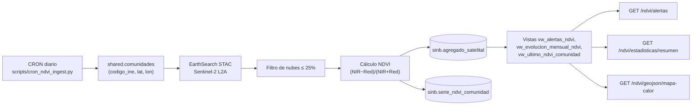

### 11.4 Endpoints previstos (`/api/v2/ndvi`)

| Método | Ruta | Propósito |
|---|---|---|
| GET | `/comunidad` | NDVI de una comunidad |
| GET | `/comunidad/{codigo}/evolucion` | Evolución mensual |
| GET | `/comunidad/{codigo}/serie` | Serie histórica |
| GET | `/alertas` | Comunidades con NDVI crítico |
| GET | `/escenas`, `/escenas/consultar` | Escenas disponibles |
| GET | `/geojson/mapa-calor`, `/geojson/bbox` | Capas para visores |
| POST | `/ingestar` | Disparar ingesta |
| GET | `/procesamiento/log`, `/estadisticas/resumen` | Operación y resumen |

### 11.5 Qué falta (trabajo pendiente declarado)

- Alinear el esquema de `escena_satelital` / `agregado_satelital` con el diseño de v2.28.0.
- Validar la ingesta completa sobre el entorno de producción y los CRON programados.
- Cerrar el control de acceso del endpoint de ingesta.

---

## 12. Migración y carga de datos

Inventario de los scripts reales que cargan o migran datos hacia la base del sistema.

| Script | Origen → Destino | Contenido | Estado |
|---|---|---|---|
| `scripts/cargar_municipios_343.py` | `MUNICIPIOS_343.zip` → `shared.departamento/provincia/municipio` | 9/113/343 municipios con geometría PostGIS; control de calidad (conteos, `ST_IsValid`, huérfanos) | En repo |
| `scripts/cargar_censo2024_shared.py` | `datos_censo2024/procesado/*.csv` + GeoPackage → `shared.manzanos`, `shared.comunidades` | UPSERT por `codigo_ine` + geometría WKB; `--simular`/`--importar` | En repo |
| `datos_censo2024/scripts/01..03_*.py` | Geoportal INE → CSV/GeoPackage/PNG | Descarga, procesado y gráficas de control del Censo 2024 | En repo |
| `scripts/migrate_pronostico_largo.py` | `SINB/sinb_20260714.sql` (MariaDB legado) → `sinb.*` | Migración de pronósticos de largo plazo desde el SINB legado | Sin commitear |
| `scripts/migrate_pronostico_largo_relacional.py` | Idem → `categoria_pronostico`, `escenario`, `escenario_estacional` | Catálogos relacionales del pronóstico largo | Sin commitear |
| `scripts/update_pronostico_corto.py` | Dump legado → `pronostico_corto` | Actualización de pronósticos cortos | Sin commitear |
| `scripts/ndvi_ingesta_masiva.py` | EarthSearch → `sinb.agregado_satelital` | Ingesta masiva NDVI (propuesta) | Sin commitear |
| `scripts/cron_pronostico_digital_auto.py` | Open-Meteo → `sinb.pronostico_diario_municipal` | Sincronización diaria del pronóstico digital | Sin commitear |
| `SINB/sinb_20260714.sql` | Dump MariaDB del SINB legado (46 tablas `t_*`) | Fuente de las migraciones de datos | Sin commitear |

**Migraciones SQL de esquema:** ver capítulo 4.5. Las migraciones semilla de catálogos (acciones y aplicaciones del RBAC) están en `database/migration_v1.2.5_permisos.sql`; las de catálogos productivos en `database/migration_v1.3.1.sql` (73 cultivos) y `v1.3.2.sql` (29 especies pecuarias).

---

## 13. Despliegue y operación

### 13.1 Instalación y arranque

| Acción | Comando / archivo |
|---|---|
| Despliegue completo | `deploy/desplegar_todo.sh` (9 pasos: SO, PostgreSQL, BD, venv, migraciones, `.env`, systemd, arranque) — modos `--db-only`, `--api-only`, `--update` |
| Solo base de datos | `deploy/desplegar_bd.sh` |
| Arranque local | `start_api.sh` (uvicorn, 4 workers, puerto 8000) |
| Detener | `stop.sh` |
| Servicio systemd | `deploy/systemd/sinagersat-api.service` (`uvicorn api.main:app --host 0.0.0.0 --port 8000`, depende de `postgresql.service`) |

### 13.2 Tareas programadas (crontab de root)

| Horario | Script | Función |
|---|---|---|
| `10 6,18 * * *` | `scripts/cron_pronostico_digital_auto.py` | Sincroniza el pronóstico digital de los 343 municipios (log: `/var/log/sinb/pronostico_cron.log`) |
| `0 18 * * *` | `scripts/cron_ndvi_ingest.py` | Ingesta NDVI por comunidad — propuesta (log: `/var/log/sinb/ndvi_cron.log`) |

### 13.3 Copias de seguridad

| Acción | Script |
|---|---|
| Backup diario (pg_dump, retención 14 días, 03:00) | `database/hacer_backup.sh` |
| Restauración | `database/restore_db.sh` |
| Restauración de geometrías de municipios | `database/restaurar_geom.sh` |
| Ejemplo de dump | `backups/db_sinagersat_*.dump` (formato `pg_dump` custom) |

### 13.4 Verificación básica

```bash
curl -s http://127.0.0.1:8000/health      # {"status":"ok"}
systemctl status sinagersat-api
systemctl status postgresql
```

Documentación de apoyo: `README.md`, `propuesta/12-INFRAESTRUCTURA.md`, `deploy/verificar.sh`.

---

## 14. Interfaces web y móvil

> Declaración de alcance: **este repositorio no contiene código de interfaz** (no hay archivos `.vue`, `.jsx`, `.tsx`, `.html` o `.dart` del producto). Lo documentado aquí es exclusivamente el backend.

| Componente | Ubicación conocida | Relación con este repositorio |
|---|---|---|
| Aplicación web | `sat.climbat.net` | Consume la API SINB (mapas, pronósticos, galería) |
| API pública | `api.climbat.net` (`api.climbat.net/health`) | Este mismo backend publicado detrás de proxy |
| App móvil | Aplicación Flutter externa | Consume los endpoints de sincronización offline (capítulo 8) |
| Propuestas de interfaz (no implementadas aquí) | `propuesta/06-FRONTEND.md`, `propuesta/02-COMPONENTES-VISUALES.md` | Diseño propuesto en Vue 3 + PWA/IndexedDB |

La documentación de la interfaz se añadirá cuando su código esté disponible o cuando se acuerde su fuente de referencia.

---

## 15. Glosario

| Sigla / término | Significado |
|---|---|
| **SINB** | Sistema Nacional de Indicadores Bioculturales (módulo de este documento) |
| **SINAGERSAT** | Sistema de alerta temprana y gestión de riesgos que contiene al SINB |
| **EDAN** | Evaluación de Daños y Análisis de Necesidades |
| **RIDA** | Registro de Intervención a Damnificados |
| **UGR** | Unidad de Gestión Regional |
| **VIDECI** | Viceministerio de Defensa Civil y Emergencias |
| **DGR** | Dirección General de Gobernación |
| **INE** | Instituto Nacional de Estadística |
| **CPV-2024** | Censo de Población y Vivienda 2024 |
| **SIIP** | Sistema de Información Agropecuaria (origen del catálogo de cultivos) |
| **NDVI** | Normalized Difference Vegetation Index — índice de vegetación por satélite |
| **STAC** | SpatioTemporal Asset Catalog (catálogo de assets satelitales, p.ej. EarthSearch) |
| **PostGIS** | Extensión geoespacial de PostgreSQL |
| **GiST** | Índice espacial de PostGIS usado en `geom` |
| **GeoJSON** | Formato geográfico en JSON (RFC 7946) |
| **RBAC** | Control de acceso basado en roles |
| **JWT** | JSON Web Token (autenticación) |
| **CRON** | Programador de tareas de Linux |
| **Offline-first** | Diseño que permite trabajar sin conexión y sincronizar después |
| **`id_off`** | Identificador generado en el dispositivo para sincronización offline |
| **Open-Meteo** | API meteorológica gratuita usada por el pronóstico digital |
| **Sentinel-2** | Satélites Copernicus de observación terrestre (fuente NDVI) |
| **UPSERT** | `INSERT … ON CONFLICT … DO UPDATE` (escritura idempotente) |

---

*Fin del documento. Este documento se actualizará progresivamente conforme avance el desarrollo del SINB en este repositorio.*
