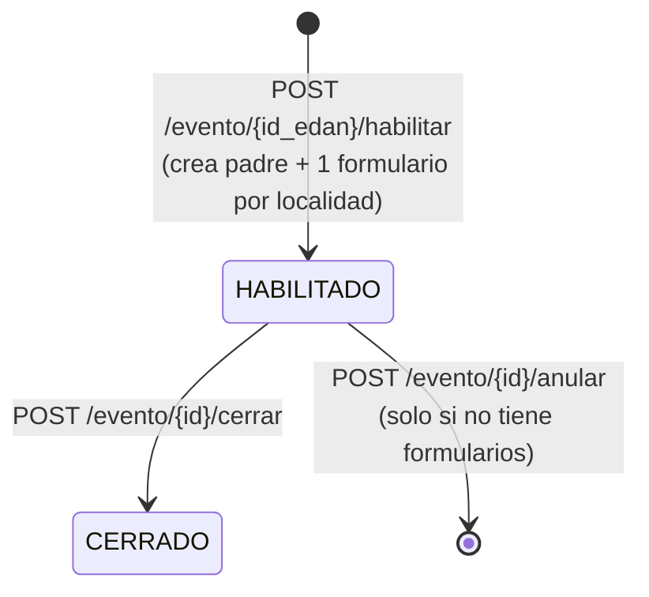

# Documentación de la Base de Datos RIDA

> **Esquema PostgreSQL `rida` — estado real verificado contra la base de datos viva en octubre de 2026.**
> Motor: PostgreSQL 16 + PostGIS · Base: `db_sinagersat` · Puerto: `5432` · **35 tablas**
> Migraciones que construyen el esquema: `database/migrations/v2.17.0` → `v2.35.0`

> **Historial de este documento.** La versión anterior describía un esquema legado (`evento`, `formulariorida`, `formularioridadetalle`, `atencionevento`, …) que **ya no existe** en el repositorio ni en la base de datos. Ha sido reescrito por completo con el esquema implementado.

---

## 1. Resumen general

Esquema lógico **`rida`**, con **36 tablas** (35 en v2.55.0 + `regla_calculo_kit` + `detalle_parametro_kit` − `cat_regla_calculo` en v2.57.0):

| Bloque | Cantidad | Tablas |
|---|---|---|
| **Catálogos** | 18 | `cat_modalidad`, `cat_categoria_ayuda`, `cat_articulo`, `cat_unidad_medida` (v2.56.0), `cat_condicion_hogar`, `cat_parentesco`, `cat_tipo_discapacidad`, `cat_enfermedad_cronica`, `cat_sector`, `cat_almacen`, `cat_unidad_militar`, `cat_requisito`, `cat_estado_formulario`, `cat_estado_evento`, `cat_etapa_solicitud`, `cat_tipo_albergue`, `cat_tipo_rehabilitacion`, `cat_insumo_rehabilitacion` |
| **Empadronamiento** | 4 | `formulario_rida`, `familia`, `integrante`, `ubicacion_familia` |
| **Eventos** | 1 | `evento_rida` |
| **Necesidades** | 1 | `necesidad` |
| **Solicitudes (workflow)** | 5 | `solicitud`, `solicitud_documento`, `bitacora`, `aprobacion_cadena`, `aprobaciones_solicitud` |
| **Ayuda Humanitaria (v2.55.0 / v2.57.0)** | 8 | `cat_estado_rida`, `aprobacion_cadena_ayuda`, `aprobaciones_ayuda_humanitaria`, `solicitud_evaluacion`, `regla_calculo_kit` (v2.57.0), `detalle_parametro_kit` (v2.57.0), `solicitud_articulo` — el viejo `cat_regla_calculo` se ELIMINÓ en v2.57.0 |
| **Logística y ejecución** | 9 | `comando_incidente`, `requerimiento_umee`, `proveedor`, `proforma`, `contratacion`, `proyecto`, `entrega` (+ `nro_orden`, `estado_despacho`, `firmas`, `id_documento`, `observaciones_acta` desde v2.55.0), `entrega_detalle`, `entrega_beneficiario` |

Contenido actual (BD de desarrollo, oct-2026): 9 formularios, 4 familias, 3 integrantes, 2 necesidades, 4 solicitudes, 2 eventos, 0 ubicaciones.

### Relaciones con otros esquemas

| Esquema | Relación |
|---|---|
| `edan` | `formulario_rida.id_edan_localidad → edan.edan_localidades` (UNIQUE); `evento_rida.id_edan → edan.edan` (UNIQUE) |
| `shared` | `formulario_rida.id_municipio/id_departamento`, `solicitud.id_municipio/id_departamento` |
| `usuarios` | `id_usuario` (formularios), `id_usuario_crea` (solicitudes), `id_usuario_habilito/cierro/anulo` (eventos), `aprob_*_por` (solicitudes) |
| `repositorio` | `documentos.id_evento_rida` (v2.48.0) y `solicitud_documento.id_documento → repositorio.documentos` |

---

## 2. Diagrama Entidad-Relación (simplificado)

```
edan.edan ──────────────┐ 1:1
                        │
edan.edan_localidades ──┼──── 1:1 ──── rida.formulario_rida ────┐
                        │            (id_edan_localidad UNIQUE) │
                        │                                       │
                        │                        ┌──────────────┴──────────────┐
                        │                        │                             │
                        │                  1:N   │ 1:N                    1:N  │ 1:1
                        │                        │                             │
                        │               rida.familia                   rida.necesidad
                        │                  │    │                       (id_familia
                        │         1:N      │    │ 1:0..1                  o id_formulario)
                        │                  │    │
                        │          rida.integrante   rida.ubicacion_familia
                        │                               │ FK
                        │                        rida.cat_tipo_albergue
                        │
rida.evento_rida ──── 1:1 con edan.edan  ──┐ 1:N
                                           │
                              rida.formulario_rida.id_evento_rida

rida.formulario_rida ── 1:N ── rida.solicitud ── 1:N ── rida.solicitud_documento ──> repositorio.documentos
                                  │    │    │
                                  │    │    ├── 1:N rida.bitacora
                                  │    │    └── 1:N rida.aprobaciones_solicitud  (v2.36.0, 1 por nivel)
                                  │    └── N:1 rida.aprobacion_cadena  (v2.36.0, por id_modalidad)
                                  │    └── N:1 rida.cat_modalidad ── 1:N rida.cat_requisito
                                  │
                                  ├── rida.comando_incidente ── rida.requerimiento_umee
                                  ├── rida.proforma (─ rida.proveedor)
                                  ├── rida.contratacion
                                  ├── rida.proyecto (geom PostGIS)
                                  └── rida.entrega ── rida.entrega_detalle
                                                    └─ rida.entrega_beneficiario ──> rida.familia

rida.necesidad ── N:1 ── rida.cat_categoria_ayuda ── 1:N ── rida.cat_articulo
rida.cat_tipo_rehabilitacion ── 1:N ── rida.cat_insumo_rehabilitacion
```

---

## 3. Bloque de empadronamiento

### 3.1 `rida.formulario_rida` — cabecera por localidad

| Columna | Tipo | Notas |
|---|---|---|
| `id_formulario` | SERIAL PK | |
| `id_edan_localidad` | INTEGER **UNIQUE** FK → `edan.edan_localidades` | **Identificador offline del formulario** |
| `id_edan` | BIGINT FK → `edan.edan` | Hereda del EDAN |
| `id_evento_rida` | INTEGER FK → `rida.evento_rida` | Asignado al habilitar un evento (v2.24.0) |
| `id_usuario` | INTEGER FK → `usuarios.usuario` | Quien empadrona |
| `id_estado` | INTEGER FK → `rida.cat_estado_formulario` NOT NULL | 1 PENDIENTE, 2 EN_PROCESO, 3 CERRADO |
| `fecha_creacion` / `fecha_modificacion` | TIMESTAMP | Base del LWW en sincronización |

Índices: `formulario_rida_id_edan_localidad_key` (UNIQUE), `idx_formulario_id_edan_localidad` (UNIQUE parcial).

> La versión inicial (v2.17.0) tenía `nombre_localidad`, `tipo_asentamiento`, `n_carpa`, `lat`, `lon`, `geom`, `estado VARCHAR`; **v2.18.0** la redujo a la estructura actual (catálogo de estados normalizado).

### 3.2 `rida.familia`

| Columna | Tipo | Notas |
|---|---|---|
| `id_familia` | SERIAL PK | |
| `id_familia_off` | VARCHAR | **Identificador offline** generado por el dispositivo |
| `id_formulario` | INTEGER NOT NULL FK → `rida.formulario_rida` | |
| `id_edan_localidad` | INTEGER FK → `edan.edan_localidades` | Denormalización para resolver el formulario en sync |
| `id_ubicacion_familia` | INTEGER (FK declarado al final) | Circular con `ubicacion_familia` |
| `id_necesidad` | INTEGER FK → `rida.necesidad` | Circular; referencia a la necesidad representativa |
| `fecha_creacion` / `fecha_modificacion` | TIMESTAMP | |
| `observacion` | TEXT | |

**Eliminadas en v2.19.0:** `codigo_ficha`, `id_condicion`, `ubicacion_original`, `ubicacion_actual`, `id_jefe`, `n_integrantes`, `estado`, `observaciones`.

### 3.3 `rida.integrante`

| Columna | Tipo | Notas |
|---|---|---|
| `id_integrante` | SERIAL PK | |
| `id_familia` | INTEGER NOT NULL FK → `rida.familia` | |
| `nombre`, `apellido` | VARCHAR | Renombrados desde `nombres`/`apellidos` (v2.20.0) |
| `sexo` | CHAR(1) CHECK `M`/`F` | |
| `fecha_nacimiento` | DATE | Base para grupos etarios |
| `tipo_documento`, `numero_documento` | VARCHAR | |
| `numero_ci` | VARCHAR | Columna heredada (compatibilidad) |
| `id_parentesco` | FK → `rida.cat_parentesco` | |
| `es_jefe` | BOOLEAN | |
| `gestante_semanas` | INTEGER CHECK 0–45 | `NULL` si no aplica |
| `lactante_meses` | INTEGER CHECK 0–36 | `NULL` si no aplica |
| `id_discapacidad` | FK → `rida.cat_tipo_discapacidad` | |
| `id_enfermedad` | FK → `rida.cat_enfermedad_cronica` | |
| `telefono` | VARCHAR | |
| `id_integrante_off` | VARCHAR | Identificador offline |
| `fecha_creacion` / `fecha_modificacion` | TIMESTAMP | |

**Índice único de deduplicación de personas** (fundamental para no duplicar empadronamientos):

```sql
idx_integrante_unico_persona UNIQUE (tipo_documento,
    COALESCE(NULLIF(TRIM(numero_documento),''), ''),
    lower(TRIM(nombre)), lower(TRIM(apellido)),
    COALESCE(fecha_nacimiento, '1900-01-01'))
```

**Eliminadas en v2.20.0:** `medicacion_continua`, `actividad_economica`, `observaciones`.

### 3.4 `rida.ubicacion_familia` (v2.21.0)

| Columna | Tipo | Notas |
|---|---|---|
| `id_ubicacion_familia` | SERIAL PK | |
| `id_ubicacion_off` | VARCHAR | Identificador offline |
| `coordenada_lat` | NUMERIC(10,8) | Convención EDAN |
| `coordenada_lon` | NUMERIC(11,8) | |
| `id_familia` | FK → `rida.familia` | |
| `id_cat_tipo_albergue` | FK → `rida.cat_tipo_albergue` | Catálogo poblado por el usuario |
| `fecha_creacion` / `fecha_modificacion` | TIMESTAMP | |

---

## 4. Eventos RIDA

### 4.1 `rida.evento_rida` (v2.24.0) — tabla PADRE

| Columna | Tipo | Notas |
|---|---|---|
| `id_evento_rida` | SERIAL PK | |
| `id_edan` | BIGINT **NOT NULL UNIQUE** FK → `edan.edan` | 1:1 con el EDAN aprobado |
| `id_estado` | INTEGER NOT NULL DEFAULT 1 FK → `rida.cat_estado_evento` | |
| `id_usuario_habilito` / `fecha_habilitacion` | | Auditoría de habilitación |
| `id_usuario_cierro` / `fecha_cierre` | | Auditoría de cierre |
| `id_usuario_anulo` / `fecha_anulacion` / `anulado` | BOOLEAN | Anulación lógica (v2.25.0 eliminó `motivo_anulacion`) |
| `fecha_creacion` / `fecha_modificacion` | TIMESTAMP | |

**Los HIJOS son `rida.formulario_rida`** (uno por localidad), que reciben `id_evento_rida` como FK.

> La tabla guarda **solo IDs**: el desglose (tipo de evento, geografía, alcalde/UGR, localidades) se resuelve por JOIN contra `edan.edan` en la API (patrón "id-empotente", `api/rida/service.py`).

### 4.2 `rida.cat_estado_evento`

| id | codigo | nombre | orden |
|---|---|---|---|
| 1 | `HABILITADO` | Habilitado a partir del EDAN aprobado | 1 |
| 2 | `HABILITAR` | *(dato residual en la BD de desarrollo; el API solo conoce HABILITADO y CERRADO en los flujos)* | 2 |

### 4.3 Ciclo de vida



---

## 5. Necesidades humanitarias

### 5.1 `rida.necesidad`

| Columna | Tipo | Notas |
|---|---|---|
| `id_necesidad` | SERIAL PK | |
| `id_familia` | FK → `rida.familia` | Necesidad a nivel familia |
| `id_formulario` | FK → `rida.formulario_rida` | Necesidad a nivel localidad |
| `id_categoria_ayuda` | FK → `rida.cat_categoria_ayuda` | Renombrado desde `id_categoria` (v2.23.0) |
| `id_articulo` | FK → `rida.cat_articulo` | |
| `cantidad` | NUMERIC(12,2) DEFAULT 0 | |
| `unidad_de_medida` | VARCHAR | Renombrado desde `unidad_medida` |
| `prioridad` | SMALLINT CHECK 1–3 DEFAULT 3 | 1 = alta |
| `estado` | **BOOLEAN** DEFAULT false | Convertido de VARCHAR en v2.23.0 |
| `justificacion` | TEXT | |
| `fecha_requerida` | DATE | |
| `id_necesidad_off` | VARCHAR | Identificador offline |
| `fecha_creacion` / `fecha_modificacion` | TIMESTAMP | |

Índice: `idx_necesidad_id_necesidad_off` (parcial, **no único**).

### 5.2 Catálogos de ayuda y rehabilitación (v2.35.0)

`rida.cat_categoria_ayuda` — **7 categorías activas** de Ayuda Humanitaria (las 5 antiguas quedaron `activo = false`):

| codigo | nombre |
|---|---|
| `ALIMENTOS` | Alimentos |
| `HERRAMIENTAS_MENORES` | Herramientas menores |
| `REF_VIVIENDA` | Refugio y vivienda |
| `ROPA_CAMA` | Ropa de cama |
| `ROPA_AGUA` | Ropa de agua |
| `ARTICULOS_HIGIENE` | Artículos de higiene |
| `ARTICULOS_COCINA` | Artículos de cocina |

Inactivas: `TECHO_ABRIGO`, `ALIMENTACION_AGUA`, `SALUD_HIGIENE`, `MEDIOS_VIDA`, `EQUIPAMIENTO_UMEE`.

`rida.cat_articulo` — artículos por categoría, con código autogenerado `ART-000001` (trigger, v2.23.0), `unidad_de_medida`, `peso_unitario_kg`, `costo_referencia_bs`.

`rida.cat_unidad_medida` (v2.56.0) — catálogo de unidades de medida de los artículos. `cat_articulo.unidad_de_medida` es **FK → `cat_unidad_medida.codigo`** (ON UPDATE CASCADE). El motor de cálculo sigue leyendo `a.unidad_de_medida` sin cambios. Valores sembrados: `kit`, `caja`, `kg`, `litro`, `unidad` (los antiguos `bolsa`/`par` se normalizaron a `unidad`). CRUD: `/api/v2/rida/necesidades/cat-unidades-medida`.

`rida.cat_tipo_rehabilitacion` (5 tipos, ligados a `cat_modalidad`):

| codigo | nombre |
|---|---|
| `DEFENSIVOS` | Rehabilitación de defensivos |
| `SECTOR_PECUARIO` | Rehabilitación sector pecuario |
| `SISTEMAS_AGUA` | Rehabilitación de sistemas de agua |
| `VIAS_TALUDES` | Rehabilitación de vías, taludes y encauses |
| `CUBIERTAS` | Rehabilitación de cubiertas |

`rida.cat_insumo_rehabilitacion` — 25 insumos/servicios agrupados por tipo (`DEF-*`, `PEC-*`, `AGU-*`, …) con `unidad_de_medida` y `costo_referencia_bs`.

---

## 6. Solicitudes (workflow de aprobación)

### 6.1 `rida.solicitud`

| Columna | Tipo | Notas |
|---|---|---|
| `id_solicitud` | SERIAL PK | |
| `id_formulario` | NOT NULL FK → `rida.formulario_rida` | |
| `id_modalidad` | NOT NULL FK → `rida.cat_modalidad` | 4 modalidades |
| `etapa` | VARCHAR(30) NOT NULL | CHECK con las **17 etapas** (v2.34.0) |
| `id_municipio`, `id_departamento` | FK → `shared.*` | |
| `fecha_inicio` | TIMESTAMP | |
| `aprob_ugr`, `aprob_alcalde`, `aprob_dgr`, `aprob_videcid`, `aprob_direccion` | BOOLEAN + `_fecha` + `_por` | 15 columnas **derivadas de solo lectura** desde `rida.aprobaciones_solicitud` (v2.36.0). Se recalculan en cada `PUT` de la máquina y **no** se aceptan en `PUT /{id}`. La migración de fase 2 (`v2.37.0`) las retira |
| `observaciones` | TEXT | |
| `fecha_cierre` | TIMESTAMP | |
| `id_usuario_crea` | FK → `usuarios.usuario` | |

**Eliminada en v2.33.0:** `codigo_expediente` (antes UNIQUE).

> ⚠️ **Nota:** `v2.17.0` declaró `codigo_expediente VARCHAR(30) NOT NULL UNIQUE`, pero el módulo API nunca lo expuso; se eliminó en v2.33.0.

### 6.2 Modalidades (`rida.cat_modalidad`)

| id | codigo | nombre |
|---|---|---|
| 1 | `AYUDA_HUMANITARIA` | Ayuda humanitaria |
| 2 | `RESPUESTA_RAPIDA_UMEE` | Respuesta rápida UMEE |
| 3 | `REHABILITACION_INSUMOS` | Rehabilitación — insumos |
| 4 | `REHABILITACION_RECONSTRUCCION` | Rehabilitación — reconstrucción |

### 6.3 Las etapas (`rida.cat_etapa_solicitud`, v2.60.0)

```
POST → ENVIADA → EN_APROBACION → APROBADA → AUTORIZADA → DESPACHADA → ENTREGADA → CERRADA
           └────────────┴──► RECHAZADA
```

Matriz de transiciones válidas (`api/rida/solicitudes/service.py`, `TRANSICIONES`):

| Desde | Hacia |
|---|---|
| ENVIADA | EN_APROBACION, RECHAZADA |
| EN_APROBACION | APROBADA, RECHAZADA |
| APROBADA | AUTORIZADA |
| AUTORIZADA | DESPACHADA |
| DESPACHADA | ENTREGADA |
| ENTREGADA | CERRADA |
| CERRADA, RECHAZADA | *(fin)* |

Las transiciones las producen los visados del motor
(`PUT /{id}/aprobacion/{nivel}`) y `POST /{id}/rechazar`; quedan registradas en
`rida.bitacora`. Desde v2.60.0 quedan **inactivas** (`activo = FALSE`) las
etapas `BORRADOR`, `EN_REVISION`, `OBSERVADA` y `VALIDADA`; las etapas
`EN_SUMINISTROS`, `DESPACHO_AUTORIZADO`, `EN_TRANSPORTE`, `RECIBIDA` y
`EN_DISTRIBUCION` siguen en el catálogo pero no son alcanzables.

### 6.4 `rida.cat_requisito`

| Columna | Tipo | Notas |
|---|---|---|
| `id_requisito` | SERIAL PK | |
| `id_modalidad` | FK → `rida.cat_modalidad` | Checklist por modalidad |
| `orden`, `nombre_paso` | | Paso del checklist |
| `id_tipo_documento` | FK → `repositorio.tipo_documento` | |
| `instancia` | SMALLINT **1 / 2 / 3** | Etapa de validación del documento |
| `es_documento`, `es_hito_aprobacion` | BOOLEAN | |
| `activo` | BOOLEAN | |

UNIQUE `(id_modalidad, orden)`.

**Instancias permitidas por etapa** (`api/rida/solicitudes/service.py`):

| Etapa | Instancias de requisito admisibles |
|---|---|
| ENVIADA | 1 |
| EN_APROBACION | 1, 2 |
| APROBADA, AUTORIZADA y posteriores | 1, 2, 3 |

### 6.5 `rida.solicitud_documento`

Puente solicitud ↔ `repositorio.documentos`: `id_solicitud`, `id_requisito`, `id_documento`, `id_tipo_documento`, `id_usuario_subio`, `fecha_subida`, `valido`, `observaciones`. Al subir una nueva versión se marca `valido = false` en la anterior.

### 6.6 `rida.bitacora`

`id_bitacora BIGSERIAL`, `id_solicitud`, `paso_orden`, `paso_nombre`, `accion`, `estado_resultante`, `observaciones`, `id_usuario`, `fecha`. Es la trazabilidad completa del workflow.

### 6.7 Aprobaciones: la máquina (v2.36.0)

`APROBACIONES_RIDA.md` es la especificación completa. Resumen:

**`rida.aprobacion_cadena`** — qué niveles participan y en qué orden, por
modalidad. Es lo que hace el motor dinámico: `id_modalidad NULL` = cadena por
defecto (los 7 niveles de v2.60.0), y una modalidad con filas propias usa esas.
`id_cadena BIGSERIAL`, `id_modalidad` (NULL = default), `nivel`, `orden`,
`activo`, `UNIQUE (id_modalidad, nivel)`.

> El `UNIQUE` **no protege** las filas del default: en Postgres los `NULL` no
> colisionan. Por eso hay además `idx_aprobacion_cadena_default`, un índice
> único parcial `ON (nivel) WHERE id_modalidad IS NULL`.

**`rida.aprobaciones_solicitud`** — una fila por nivel de la cadena activa.
`id_aprobacion BIGSERIAL`, `id_solicitud` (FK `ON DELETE CASCADE`), `nivel`,
`estado` (`pendiente`/`aprobado`/`observado`/`espera_correccion`), `observacion`
(motivo de devolución; solo en la fila del nivel devuelto), `por` (FK usuario),
`fecha`, `UNIQUE (id_solicitud, nivel)`.

> `fecha` va **sin `DEFAULT`**: con default, una fila `pendiente` recién creada
> nacería con fecha y el frontend la leería como una decisión ya tomada.

**Sin columna `ordinal`.** El orden sale de `resolver_cadena()`, no de la BD.

`estado_global` **no se almacena**: se deriva en cada lectura
(`estado_global_aprobaciones()`) como el badge del primer nivel no aprobado:
`EN_VALIDACION` → `VICEMINISTRO` → `DGEA` → `REVISION_ARTICULOS` → `SUMINISTRO` →
`DESPACHO` → `EN_ENTREGA` (v2.60.0); con la cadena completa queda `ENTREGADO`.

**Matriz de roles** (`ROLES_NIVEL`, en `api/rida/solicitudes/service.py`,
v2.60.0): `validacion` (9), `viceministro` (15), `dgea` (16),
`revision_articulos` (15), `suministro` (17), `despacho` (9), `entrega` (6),
más los roles 1 y 2 que pueden todo. Alcance por nivel: `entrega` municipio,
`validacion`/`despacho` departamento, el resto nacional. **Secuencia estricta**:
solo se aprueba el primer nivel no aprobado; `validacion` mueve la solicitud de
`ENVIADA` a `EN_APROBACION`, `revision_articulos` a `APROBADA`, `suministro` a
`AUTORIZADA`, `despacho` a `DESPACHADA` y `entrega` a `ENTREGADA` + `CERRADA`
automático. La modalidad Ayuda Humanitaria queda excluida (usa su propia cadena
de 7 niveles en `aprobacion_cadena_ayuda`).

**No hay trigger de creación** (a diferencia de `v2.17.3` en EDAN): las filas se
crean en `crear_solicitud()` (el motor arranca en `ENVIADA`) y, si faltan, se
rellenan con `asegurar_aprobaciones()` (`ON CONFLICT DO NOTHING`) en cada
lectura de la máquina y antes de cada visado. Un `GET` de una solicitud
`RECHAZADA`/`CERRADA` no materializa filas.

> **Ojo:** `rida.cat_requisito.es_hito_aprobacion` **no** son estos niveles. Son
> 35 hitos del workflow completo (Viceministro, DGEA, DGPR, almacén,
> transporte, pago) y viven en etapas distintas de la cadena. Ver §9.8 de
> `APROBACIONES_RIDA.md`.

---

## 7. Bloque logístico y de ejecución

| Tabla | Claves | Contenido |
|---|---|---|
| `comando_incidente` | `id_solicitud` | CODI: código, fecha de conformación, responsable, estado |
| `requerimiento_umee` | `id_comando`, `id_solicitud` | Informe de necesidades, prioridad, fecha, estado |
| `proveedor` | — | nombre, NIT, rubro, representante, teléfono, activo |
| `proforma` | `id_solicitud`, `id_proveedor` | `monto_bs`, `horas_maquinaria`, `seleccionada`, `fecha_presentacion` |
| `contratacion` | `id_solicitud`, `id_proforma`, `id_proveedor` | fechas, `codigo_siges`, responsable de recepción |
| `proyecto` | `id_solicitud`, `id_sector` | tipo, nombre, **`geom` (PostGIS)**, `monto_estimado`, fuente de financiamiento, criterios de prospectiva/correctiva, estado |
| `entrega` | `id_solicitud`, `id_almacen`, `id_unidad_militar` | tipo, transporte, placa, fechas de salida/entrega, estado |
| `entrega_detalle` | `id_entrega`, `id_articulo` | cantidad, peso_kg, valor_bs |
| `entrega_beneficiario` | `id_entrega`, `id_familia`, `id_articulo` | cantidad, fecha, evidencia, **`firma_digital BOOLEAN`** |

Catálogos asociados: `cat_almacen` (niveles y responsables), `cat_unidad_militar` (comando), `cat_sector`.

> Este bloque está **modelado en BD pero expuesto parcialmente por la API**: los endpoints actuales de `/api/v2/rida/solicitudes` cubren etapas, checklist y documentos; la logística de despacho/entrega no tiene router propio todavía.

---

## 8. Catálogos transversales

| Tabla | Columnas relevantes | Poblamiento |
|---|---|---|
| `cat_condicion_hogar` | codigo, nombre, descripcion | Seed |
| `cat_parentesco` | codigo, nombre, activo | Seed |
| `cat_tipo_discapacidad` | codigo, nombre, `requiere_movilidad`, activo | Seed |
| `cat_enfermedad_cronica` | codigo, nombre, `requiere_medicacion_continua`, activo | Seed |
| `cat_sector` | codigo, nombre, activo | Seed |
| `cat_almacen` | codigo, nombre, nivel, depto, responsable | Poblado por usuario |
| `cat_unidad_militar` | codigo, nombre, comando | Poblado por usuario |
| `cat_tipo_albergue` | nombre | Poblado por usuario (v2.21.0, vacío) |

Todos los catálogos usan `codigo VARCHAR UNIQUE` y `activo BOOLEAN`; varios tienen triggers que autogeneran el código (`ART-000001`, `CAT-000001`).

---

## 9. Identificadores offline e integridad

| Tabla | Columna offline | Índice |
|---|---|---|
| `formulario_rida` | `id_edan_localidad` | **UNIQUE** |
| `familia` | `id_familia_off` | *(sin índice)* |
| `integrante` | `id_integrante_off` | *(sin índice)* |
| `ubicacion_familia` | `id_ubicacion_off` | *(sin índice)* |
| `necesidad` | `id_necesidad_off` | Índice parcial, **no único** |
| `integrante` | — | Índice único de deduplicación `idx_integrante_unico_persona` |
| `evento_rida` | `id_edan` | **UNIQUE** |

**Observación:** las columnas `id_familia_off`, `id_integrante_off` y `id_ubicacion_off` **no tienen índice**, pese a usarse como clave de upsert en `POST /rida/empadronamiento/sync`. Con volúmenes crecientes esto afectará el rendimiento de la sincronización. Registrado como pendiente en [docs/INFORME_ENTREGA.md](docs/INFORME_ENTREGA.md).

---

## 10. Migraciones que componen el esquema

| Versión | Fichero | Efecto |
|---|---|---|
| v2.17.0 | `v2.17.0_rida_schema.sql` (641 l.) | Crea las 35 tablas y sus seeds |
| v2.18.0 | `v2.18.0_formulario_rida_estructura.sql` | `cat_estado_formulario` + normaliza `formulario_rida` |
| v2.19.0 | `v2.19.0_familia_estructura.sql` | Simplifica `familia` (8 columnas fuera) |
| v2.20.0 | `v2.20.0_integrante_estructura.sql` | Renombra y simplifica `integrante` |
| v2.21.0 | `v2.21.0_ubicacion_familia.sql` | Nueva `ubicacion_familia` + `cat_tipo_albergue` |
| v2.22.0 | `v2.22.0_documentos_rida.sql` | `documentos.id_formulario_rida` (repositorio, retirado en v2.48.0) |
| v2.23.0 | `v2.23.0_rida_necesidad_articulo_estructura.sql` | Renombres, `estado BOOLEAN`, `*_off`, triggers de código |
| v2.24.0 | `v2.24.0_evento_rida.sql` | `evento_rida`, `cat_estado_evento`, FK en formulario |
| v2.25.0 | `v2.25.0_drop_motivo_anulacion.sql` | Elimina `evento_rida.motivo_anulacion` |
| v2.33.0 | `v2.33.0_quitar_codigo_expediente_solicitud.sql` | Elimina `solicitud.codigo_expediente` |
| v2.34.0 | `v2.34.0_workflow_solicitud.sql` | `cat_etapa_solicitud` + CHECK de 17 etapas |
| v2.60.0 | `v2.60.0_motor_siete_niveles.sql` | Motor de 7 niveles: roles 15/16/17, `cat_modalidad.tiene_motor_calculo`, cadena default de 7 niveles, CHECKs de `nivel`/`orden`, etapas retiradas inactivas y remapeo a `ENVIADA` |
| v2.35.0 | `v2.35.0_separar_rehabilitacion.sql` | 7 categorías AH, `cat_tipo_rehabilitacion`, `cat_insumo_rehabilitacion` |
| v2.48.0 | `v2.48.0_documentos_evento.sql` | `documentos.id_formulario_rida` → `id_evento_rida` (evento RIDA) |
| v2.55.0 | `v2.55.0_ayuda_humanitaria.sql` | Work Queue VIDECI: `cat_estado_rida`, motor secuencial (cadena + instancias), `solicitud_evaluacion`, `cat_regla_calculo` + `solicitud_articulo` (motor de cálculo dinámico), `entrega` como orden/acta, rol 14 Almacén |
| v2.56.0 | `v2.56.0_cat_unidad_medida.sql` | `cat_unidad_medida` (5 seeds: kit/caja/kg/litro/unidad) + FK desde `cat_articulo.unidad_de_medida`; normaliza `bolsa`/`par` → `unidad` |
| v2.57.0 | `v2.57.0_regla_calculo_kit.sql` | **Reemplaza el motor por KITS**: `regla_calculo_kit` (criterio, rangos edad en días, sexo, gestante/discapacidad, `dias_duracion`) + `detalle_parametro_kit` (artículos del kit con `cantidad_base_diaria`); re-apunta `solicitud_articulo.id_regla` y **ELIMINA `cat_regla_calculo`** |

Orden de aplicación: `psql -f database/migrations/vX.Y.Z_*.sql` en orden ascendente (son idempotentes, envueltos en `BEGIN/COMMIT`).

---

## 11. API que expone este esquema

| Grupo Swagger | Prefijo | Fichero |
|---|---|---|
| RIDA > Empadronamiento / Hijos / Sync / Búsqueda | `/api/v2/rida/empadronamiento` | `api/rida/router.py` |
| RIDA > Padres | `/api/v2/rida/evento(s)`, `/edan-aprobados` | `api/rida/router_eventos.py` |
| RIDA > Rehabilitación | `/api/v2/rida/necesidades` | `api/rida/necesidades/router.py` |
| RIDA > Solicitudes | `/api/v2/rida/solicitudes` | `api/rida/solicitudes/router.py` |
| RIDA > Ayuda Humanitaria | `/api/v2/ayuda-humanitaria` | `api/ayuda_humanitaria/router.py` (20 rutas; Work Queue pasos 4-9, motor secuencial, motor de cálculo por kits desde v2.57.0) |
| Repositorio > Documentos | `/api/v2/repositorio/rida/eventos/{id}/documentos` | `api/repositorio/router.py:256,343` |

**Total RIDA: 85 rutas / 124 operaciones** (verificado con `GET /openapi.v2.json`; incluye `cat-unidades-medida` desde v2.56.0).

Documentación relacionada: [docs/01-componentes-y-arquitectura.md](docs/01-componentes-y-arquitectura.md), [docs/03-offline-y-sincronizacion.md](docs/03-offline-y-sincronizacion.md), [docs/manual/](docs/manual/README.md).

---

## 12. Reservas sobre este documento

1. Los conteos de filas corresponden a la **base de datos de desarrollo** (oct-2026) y varían.
2. El bloque logístico (§7) está modelado en BD; su exposición API es parcial.
3. El estado del catálogo `cat_estado_evento` contiene un registro residual (`HABILITAR`) que conviene depurar.
4. El esquema `rea` (4 tablas) existe en la BD pero **no tiene router en la API**.
