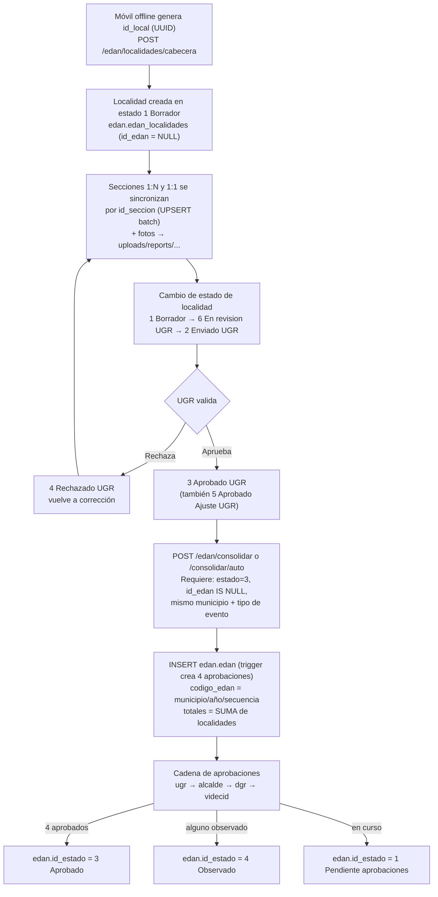

# EDAN — Esquema de base de datos, conexiones, APIs y lógica de funcionamiento

> **Fuente de esta documentación:** exclusivamente lo desplegado y real en este momento.
>
> - **Base de datos viva:** `db_sinagersat` @ `127.0.0.1:5432` (usuario `sinagersat`).
> - **Motor:** PostgreSQL 16.15 (Ubuntu) · extensiones: `postgis 3.4.2`, `pg_trgm 1.6`, `plpgsql 1.0`.
> - **Tamaño total de la BD:** 1005 MB.
> - **API viva:** `SINAGERSAT API v1.4.0` en `http://127.0.0.1:8000` (leída de sus OpenAPIs reales): **695 operaciones** (`/api/v1` 189 + `/api/v2` 504 + 2 de raíz/salud; `/api/v2/edan` 162 — medido 2026-10-20), incluyendo las **23 APIs nuevas EDAN** y las **4 de resumen** (`EDAN > APIs nuevas` / `EDAN > APIs nuevas > Resumen`) de `/api/v2/edan` — ver `PLAN_APIS_V2_EDAN.md` §14/§19/§20/§21).
> - **Fecha de extracción:** 2026-10-11.
> - **Fase 1 (solo BD) aplicada el 2026-10-10:** migraciones `v2.49.0` (identidad `uuid_*` + triggers), `v2.50.0` (tabla `fotografias`), `v2.51.0` (columna `version` + `registro_borrado`), `v2.52.0` (**FK por uuid** en las tablas hijas + `id_seccion` sintético), `v2.53.0` (**tabla `edan_localidades_viviendas`**: detalle 1:N por vivienda con conteos derivados) y `v2.54.0` (**tabla `dispositivo_sync`**: ack de pulls por dispositivo). **Fase 2 (APIs nuevas) implementada el 2026-10-10** (`api/edan/*_v2_nuevas.py`, **23 operaciones** bajo `/api/v2/edan/…`; contrato, roles y guía para la app: `PLAN_APIS_V2_EDAN.md` §14–§20). Las APIs existentes no se modificaron. Pendiente: tombstones de secciones → `v2.55.0`.
> - **Cómo se complementan los dos documentos:** este archivo es la **realidad física** (tablas, columnas, índices, triggers, funciones, FKs y APIs desplegadas); `PLAN_APIS_V2_EDAN.md` es el **contrato de las APIs nuevas** que consume la app/web (endpoints, payloads, roles 6/7, máquina de estados de la cola, sync pull/push/ack y la guía autocontenida §19). Cuando el PLAN cita una columna, tipo, CHECK o FK, la fuente canónica es el §3 de este documento (y viceversa: lo que la BD *permite* no implica que la API lo *exponga* — los campos escribibles reales están listados en PLAN §19.5).
> - **Alcance de este documento:** esquemas `edan`, `shared`, `usuarios`, `repositorio` y el almacenamiento de archivos (`uploads/`). Los esquemas `rida`, `sinb` y `rea` solo aparecen cuando referencian tablas de este alcance.

---

## 1. Visión general

La base tiene **8 esquemas**. En el alcance de este documento hay **42 tablas**:

| Esquema | Tablas | Rol en el sistema |
|---|---:|---|
| `edan` | 26 | Núcleo del formulario EDAN: cabecera consolidada, localidades, 14 secciones de daños/necesidades, aprobaciones, fotografías (Fase 1), tombstones (Fase 1), viviendas (Fase 1), `dispositivo_sync` (Fase 1) y catálogos. |
| `shared` | 7 | Catálogos geográficos compartidos (depto/provincia/municipio/manzanos/comunidades con geometrías PostGIS) + cultivos y especies pecuarias. |
| `usuarios` | 7 | Autenticación, roles, permisos (RBAC), sesiones y auditoría. |
| `repositorio` | 2 | Documentos PDF (metadatos) + catálogo de tipos de documento. |

Otros esquemas existentes en la BD (fuera de alcance): `rida` (37), `sinb` (28), `rea` (4), `public` (objetos PostGIS), `pg_catalog`/`information_schema` (sistema).

### 1.1 Inventario con conteos reales

| Esquema.tabla | Columnas | Filas | Tamaño |
|---|---:|---:|---|
| `edan.edan` | 25 | 5 | 4344 kB |
| `edan.edan_localidades` | 48 | 124 | 3784 kB |
| `edan.aprobaciones_edan` | 11 | 20 | 80 kB |
| `edan.edan_localidades_impacto_poblacion` | 12 | 70 | 232 kB |
| `edan.edan_localidades_salud_establecimientos` | 18 | 12 | 96 kB |
| `edan.edan_localidades_salud_necesidades` | 9 | 32 | 80 kB |
| `edan.edan_localidades_danos_viales` | 18 | 6 | 664 kB |
| `edan.edan_localidades_danos_infra_publica` | 15 | 5 | 640 kB |
| `edan.edan_localidades_servicios_basicos` | 15 | 22 | 648 kB |
| `edan.edan_localidades_unidades_educativas` | 21 | 5 | 128 kB |
| `edan.edan_localidades_danos_vivienda` | 15 | 65 | 408 kB |
| `edan.edan_localidades_danos_agricultura` | 16 | 47 | 888 kB |
| `edan.edan_localidades_danos_pecuario` | 16 | 26 | 288 kB |
| `edan.edan_localidades_infra_productiva` | 13 | 15 | 128 kB |
| `edan.edan_localidades_proteccion` | 15 | 76 | 168 kB |
| `edan.edan_localidades_primera_respuesta` | 10 | 38 | 120 kB |
| `edan.edan_localidades_necesidades_humanitarias` | 24 | 31 | 112 kB |
| `edan.fotografias` | 12 | 108 | 136 kB |
| `edan.registro_borrado` | 6 | 0 | 64 kB |
| `edan.edan_localidades_viviendas` | 10 | 0 | 96 kB |
| `edan.dispositivo_sync` | 5 | 0 | 40 kB |
| `edan.estado_edan` | 4 | 4 | 48 kB |
| `edan.edan_localidades_estado` | 4 | 6 | 48 kB |
| `edan.tipo_evento` | 5 | 48 | 80 kB |
| `edan.tipo_localidad` | 4 | 11 | 48 kB |
| `edan.grupo_etario` | 6 | 4 | 80 kB |
| `edan.grupo_vulnerable` | 6 | 8 | 64 kB |
| `shared.departamento` | 3 | 9 | 56 kB |
| `shared.provincia` | 4 | 113 | 56 kB |
| `shared.municipio` | 6 | 343 | 1568 kB |
| `shared.manzanos` | 12 | 247 429 | 403 MB |
| `shared.comunidades` | 12 | 21 175 | 16 MB |
| `shared.cultivo` | 3 | 73 | 32 kB |
| `shared.pecuario` | 3 | 29 | 32 kB |
| `usuarios.usuario` | 14 | 485 | 312 kB |
| `usuarios.rol` | 3 | 11 | 40 kB |
| `usuarios.aplicacion` | 5 | 6 | 40 kB |
| `usuarios.accion` | 3 | 4 | 40 kB |
| `usuarios.permiso` | 4 | 109 | 40 kB |
| `usuarios.sesion` | 7 | 654 | 648 kB |
| `usuarios.auditoria` | 8 | 4066 | 2368 kB |
| `repositorio.documentos` | 20 | 4 | 248 kB |
| `repositorio.tipo_documento` | 9 | 31 | 48 kB |

**Notación de tablas de campos:** `PK` llave primaria · `FK` llave foránea · `UQ` único · `CHK` check · `NN` not null.

---

## 2. Diagrama ERD del esquema `edan`

```mermaid
erDiagram
    estado_edan ||--o{ edan : "id_estado"
    tipo_evento ||--o{ edan : "id_tipo_evento"
    edan ||--o{ aprobaciones_edan : "1 por nivel (trigger)"
    edan ||--o{ edan_localidades : "agrupa (consolidación)"

    edan_localidades_estado ||--o{ edan_localidades : "id_edan_localidad_estado"
    tipo_localidad ||--o{ edan_localidades : "id_tipo_localidad"
    tipo_evento ||--o{ edan_localidades : "id_tipo_evento"
    grupo_etario ||--o{ edan_localidades_impacto_poblacion : "id_grupo_etario"
    grupo_vulnerable ||--o{ edan_localidades_proteccion : "id_grupo_vulnerable_catalogo"

    edan_localidades ||--o{ edan_localidades_impacto_poblacion : "sección 1:N"
    edan_localidades ||--o{ edan_localidades_salud_establecimientos : "sección 1:N"
    edan_localidades ||--o| edan_localidades_salud_necesidades : "sección 1:1"
    edan_localidades ||--o{ edan_localidades_danos_viales : "sección 1:N"
    edan_localidades ||--o{ edan_localidades_danos_infra_publica : "sección 1:N"
    edan_localidades ||--o{ edan_localidades_servicios_basicos : "sección 1:N"
    edan_localidades ||--o{ edan_localidades_unidades_educativas : "sección 1:N"
    edan_localidades ||--o{ edan_localidades_danos_vivienda : "sección 1:N"
    edan_localidades_danos_vivienda ||--o{ edan_localidades_viviendas : "detalle 1:N (v2.53.0)"
    edan_localidades ||--o{ edan_localidades_danos_agricultura : "sección 1:N"
    edan_localidades ||--o{ edan_localidades_danos_pecuario : "sección 1:N"
    edan_localidades ||--o{ edan_localidades_infra_productiva : "sección 1:N"
    edan_localidades ||--o{ edan_localidades_proteccion : "sección 1:N"
    edan_localidades ||--o| edan_localidades_primera_respuesta : "sección 1:1"
    edan_localidades ||--o| edan_localidades_necesidades_humanitarias : "sección 1:1"
    edan_localidades ||--o{ fotografias : "foto (polimórfica: tipo_entidad + uuid_registro)"

    edan_localidades_viviendas {
        bigint id_vivienda PK
        bigint id_dano_vivienda FK "→ danos_vivienda, CASCADE"
        uuid uuid_registro "identidad permanente, UQ"
        uuid uuid_dano_vivienda "espejo FK → padre (v2.53.0)"
        varchar tipo_dano "TOTAL|PARCIAL (CHK)"
        varchar fotografia "path de la foto de la vivienda"
        int version "optimista"
    }

    edan {
        bigint id_edan PK
        uuid uuid_edan "identidad permanente (Fase 1)"
        varchar codigo_edan "municipio/año/secuencia"
        int id_departamento
        int id_provincia FK "→ shared.provincia"
        int id_municipio
        int id_tipo_evento FK
        int id_estado FK "→ estado_edan"
        int id_usuario_ugr FK "→ usuarios.usuario"
        int id_usuario_alcalde FK "→ usuarios.usuario"
        int total_poblacion_afectada "SUMA de localidades"
        int version "optimista, +1 por UPDATE"
    }
    edan_localidades {
        integer id_edan_localidad PK
        uuid uuid_edan_localidad "identidad permanente (Fase 1), = id_local si es UUID"
        uuid uuid_edan "espejo FK → edan(uuid_edan) (v2.52.0)"
        bigint id_edan FK "NULL = huérfana"
        varchar id_local "UUID offline, UQ"
        int id_edan_localidad_estado FK
        int id_municipio FK "→ shared.municipio"
        text localidad
        boolean imp_flags "14 flags 1:1 de sección"
        int version "optimista, +1 por UPDATE"
    }
    aprobaciones_edan {
        bigint id_aprobacion PK
        bigint id_edan FK
        varchar nivel "ugr|alcalde|dgr|videcid"
        varchar estado "pendiente|aprobado|observado|espera_correccion"
    }
    fotografias {
        bigint id_fotografia PK
        uuid uuid_fotografia "identidad permanente"
        bigint id_edan_localidad FK "ON DELETE CASCADE"
        varchar tipo_entidad "15 valores (CHK), polimórfico"
        uuid uuid_registro "fila dueña, sin FK"
        varchar ruta_archivo "ruta /uploads/reports/..."
        varchar sha256 "NULL en backfill"
        boolean borrado_logico "borrado propagable"
    }
```



### 2.1 Diagrama de conexiones con los demás esquemas

```mermaid
erDiagram
    shared_departamento ||--o{ shared_provincia : "1 depto → N provincias"
    shared_provincia ||--o{ shared_municipio : "1 provincia → N municipios"
    shared_municipio ||--o{ shared_manzanos : "1 municipio → N manzanos"
    shared_municipio ||--o{ shared_comunidades : "1 municipio → N comunidades"

    shared_departamento ||--o{ edan_edan : "geografía"
    shared_provincia ||--o{ edan_edan : "id_provincia FK"
    shared_municipio ||--o{ edan_localidades : "id_municipio FK"
    shared_cultivo ||--o{ edan_danos_agricultura : "id_cultivo FK"
    shared_pecuario ||--o{ edan_danos_pecuario : "id_especie FK"

    usuarios_usuario ||--o{ edan_edan : "id_usuario_ugr / id_usuario_alcalde"
    usuarios_usuario ||--o{ edan_localidades : "id_usuario (autor)"
    usuarios_usuario ||--o{ aprobaciones_edan : "aprueba / devuelve"
    usuarios_rol ||--o{ usuarios_usuario : "id_rol"
    usuarios_rol ||--o{ usuarios_permiso : "id_rol"
    usuarios_aplicacion ||--o{ usuarios_permiso : "id_aplicacion"
    usuarios_accion ||--o{ usuarios_permiso : "id_accion"

    edan_edan ||--o{ repositorio_documentos : "id_edan (CASCADE)"
    repositorio_tipo_documento ||--o{ repositorio_documentos : "id_tipo_documento"
    usuarios_usuario ||--o{ repositorio_documentos : "id_usuario_subio"

    edan_edan {
        bigint id_edan PK
    }
    edan_localidades {
        integer id_edan_localidad PK
    }
    shared_municipio {
        integer id PK
        varchar codigo_ine UQ "6 dígitos"
    }
    repositorio_documentos {
        bigint id_documento PK
        varchar path_archivo "/uploads/..."
        boolean tiene_firma_digital
    }
```

> Los diagramas usan nombres cortos por convención de Mermaid; los nombres reales llevan prefijo de esquema (`edan.`, `shared.`, `usuarios.`, `repositorio.`).

---

## 3. Esquema `edan` (26 tablas)

### 3.1 `edan.edan` — cabecera consolidada (25 columnas, 5 filas)

Una fila = un EDAN municipal consolidado (agrupación de localidades aprobadas).

| # | Campo | Tipo | Nul | Default | Notas |
|---:|---|---|---|---|---|
| 1 | `id_edan` | bigint | NN | sequence | **PK** |
| 2 | `codigo_edan` | varchar(30) | | | `{id_municipio:06d}/{año}/{seq:03d}` p. ej. `070101/2026/003` |
| 3 | `id_departamento` | integer | | | → `shared.departamento.id` (sin FK declarada) |
| 4 | `id_municipio` | integer | | | → `shared.municipio.id` (sin FK declarada) |
| 5 | `fecha_llenado` | date | | | |
| 6 | `fecha_evento` | date | | | heredada de localidades (`MIN`) |
| 7 | `hora_evento` | time | | | heredada de localidades (`MIN`) |
| 8 | `total_poblacion_afectada` | integer | | 0 | **SUMA** de las localidades |
| 9 | `total_familias_afectadas` | integer | | 0 | **SUMA** |
| 10 | `total_familias_damnificadas` | integer | | 0 | **SUMA** |
| 11 | `fecha_creacion` | timestamp | | `CURRENT_TIMESTAMP` | |
| 12 | `fecha_modificacion` | timestamp | | `CURRENT_TIMESTAMP` | usado por LWW del cliente |
| 13 | `id_provincia` | integer | | | **FK** → `shared.provincia.id` (NO ACTION) |
| 14 | `id_tipo_evento` | integer | | | **FK** → `edan.tipo_evento` (NO ACTION) |
| 15 | `id_estado` | integer | NN | 1 | **FK** → `edan.estado_edan` (NO ACTION) |
| 16 | `pendiente_eliminacion` | boolean | NN | false | marca de sync offline |
| 17 | `pendiente_actualizacion` | boolean | NN | false | marca de sync offline |
| 18 | `id_usuario_alcalde` | integer | | | **FK** → `usuarios.usuario` (**SET NULL**) |
| 19 | `id_usuario_ugr` | integer | | | **FK** → `usuarios.usuario` (**SET NULL**); UGR que consolidó |
| 20 | `id_local` | varchar(64) | | | UUID offline; **UQ parcial** `WHERE id_local IS NOT NULL` |
| 21 | `procedencia` | varchar(20) | NN | `'sistema'` | **CHK** de procedencia |
| 22 | `origen_id` | varchar(100) | | | **UQ parcial** `WHERE origen_id IS NOT NULL` |
| 23 | `id_importacion` | bigint | | | **FK** → `edan.edan_importacion_log` (SET NULL) |
| 24 | `uuid_edan` | uuid | NN | trigger | **identidad permanente** (Fase 1, `v2.49.0`); **UQ** `uq_edan_uuid` |
| 25 | `version` | integer | NN | 1 | **versión optimista** (Fase 1, `v2.51.0`), +1 en cada UPDATE |

**Índices:** `edan_pkey` · `edan_id_local_key` (UQ) · `edan_origen_id_key` (UQ) · `uq_edan_uuid` (UQ) · `idx_edan_dep` · `idx_edan_provincia` · `idx_edan_mun` · `idx_edan_municipio2` · `idx_edan_tipo_evento2` · `idx_edan_fecha_creacion DESC` · `idx_edan_fecha_evento` · `idx_edan_procedencia` · `idx_edan_origen_id` · `idx_edan_usuario_ugr` · `idx_edan_usuario_alcalde` · `idx_edan_sync_pull (id_usuario_ugr, fecha_modificacion)`.

**Triggers:** `trg_edan_crear_aprobaciones` `AFTER INSERT` → crea las 4 filas de aprobación (ver §3.6) · `trg_uuid_edan` `BEFORE INSERT/UPDATE` → asigna `uuid_edan` · `trg_bump_version` `BEFORE UPDATE` → `version+1` · `trg_registro_borrado` `AFTER DELETE` → tombstone (ver §3.8).

### 3.2 `edan.edan_localidades` — localidades del formulario (49 columnas)

Una fila = una localidad/comunidad reportada (registro base del móvil). Es el corazón del sistema: **117 de 124 están huérfanas** (`id_edan IS NULL`, aún no consolidadas).

| # | Campo | Tipo | Nul | Default | Notas |
|---:|---|---|---|---|---|
| 1 | `id_edan_localidad` | integer | NN | sequence | **PK** (entero del servidor) |
| 2 | `id_edan` | bigint | S | | **FK** → `edan.edan` (**SET NULL**) — huérfana si es NULL |
| 3 | `localidad` | text | NN | `''` | nombre de la localidad |
| 4–12 | `grup_poblacion`, `grup_salud`, `grup_infraestructura`, `grup_servicios`, `grup_educacion`, `grup_vivienda`, `grup_agropecuario`, `grup_proteccion`, `grup_necesidades` | boolean | NN | false | **9 flags de grupo** (renombrados desde `imp_*` el 2026-10-12, ver §3.2.1); la API los expone como el nodo `grupos` y en el wire legacy como `imp_*`. Mantenidos como **OR de las secciones miembro** (`_marcar_impacto`) |
| 13 | `id_tipo_localidad` | integer | S | | **FK** → `edan.tipo_localidad` (SET NULL) |
| 14 | `id_edan_localidad_estado` | integer | S | | **FK** → `edan.edan_localidades_estado` (SET NULL) |
| 15 | `id_tipo_evento` | integer | S | | **FK** → `edan.tipo_evento` (SET NULL) |
| 16 | `id_departamento` | integer | S | | **FK** → `shared.departamento` (SET NULL) |
| 17 | `id_provincia` | integer | S | | **FK** → `shared.provincia` (SET NULL) |
| 18 | `id_municipio` | integer | S | | **FK** → `shared.municipio` (SET NULL) |
| 19 | `fecha_llenado` | date | S | | |
| 20 | `fecha_evento` | date | S | | |
| 21 | `hora_evento` | time | S | | |
| 22 | `total_poblacion_afectada` | integer | NN | 0 | |
| 23 | `total_familias_afectadas` | integer | NN | 0 | |
| 24 | `total_familias_damnificadas` | integer | NN | 0 | |
| 25 | `id_local` | varchar(64) | S | | **UUID generado por el móvil**; **UQ parcial** — clave del modo offline |
| 26 | `id_usuario` | integer | S | | **FK** → `usuarios.usuario` (SET NULL), autor |
| 27 | `fecha_modificacion` | timestamp | S | `CURRENT_TIMESTAMP` | base del sync pull |
| 28 | `pendiente_actualizacion` | boolean | NN | false | dirty flag offline |
| 29 | `pendiente_eliminacion` | boolean | NN | false | borrado pendiente offline |
| 30–42 | `imp_impacto_poblacion`, `imp_salud_establecimientos`, `imp_danos_viales`, `imp_danos_infra_publica`, `imp_servicios_basicos`, `imp_unidades_educativas`, `imp_danos_vivienda`, `imp_danos_agricultura`, `imp_danos_pecuarios`, `imp_infra_productiva`, `imp_primera_respuesta`, `imp_necesidad_salud`, `imp_necesidad_humanitaria` | boolean | S | false | **13 flags 1:1 de sección** (uno por tabla de sección) |
| 43 | `procedencia` | varchar(20) | NN | `'sistema'` | **CHK** de procedencia |
| 44 | `origen_id` | varchar(100) | | | |
| 45 | `id_importacion` | bigint | | | **FK** → `edan.edan_importacion_log` (SET NULL) |
| 46 | `uuid_edan_localidad` | uuid | NN | trigger | **identidad permanente del formulario** (Fase 1, `v2.49.0`): en transición = `id_local` cuando `id_local` es UUID válido (97/124); **UQ** `uq_edan_localidades_uuid` |
| 47 | `version` | integer | NN | 1 | **versión optimista** (Fase 1, `v2.51.0`), +1 en cada UPDATE |
| 48 | `uuid_edan` | uuid | S | trigger | **espejo** del vínculo con la cabecera (`v2.52.0`): **FK** → `edan.edan(uuid_edan)` **SET NULL**, deriva de `id_edan` (fuente de verdad) |
| 49 | `imp_proteccion` | boolean | NN | false | **flag 1:1 de sección `proteccion`** (añadido 2026-10-12 al renombrar el grupo `imp_proteccion` → `grup_proteccion`; antes convivían en la misma columna) |

**Índices:** `edan_localidades_pkey` · `edan_localidades_id_local_key` (UQ) · `uq_edan_localidades_uuid` (UQ) · `idx_edan_localidades_uuid_edan` · `idx_edan_localidades_edan` · `idx_edan_localidades_dep/prov/mun` · `idx_edan_localidades_estado` · `idx_edan_localidades_evento` · `idx_edan_localidades_tipo` · `idx_edan_localidades_imp (grup_poblacion, grup_salud, grup_infraestructura)` · `idx_edan_localidades_consolidar (id_municipio, id_tipo_evento, id_edan_localidad_estado)` · `idx_edan_localidades_procedencia` · `idx_edan_localidades_origen_id` · `idx_edan_localidades_sync_pull (id_usuario, fecha_modificacion)`.

**CHK:** `edan_localidades_procedencia_check` (mismos valores que la cabecera).

#### 3.2.1 Nodo `grupos` (columnas 4–12 → `grup_*`)

Las 9 columnas de grupo de la tabla (campos 4–12) son la fuente del nodo
`grupos` que la API v2 expone en **toda** localidad y **todo** EDAN padre
(§20.2 de `PLAN_APIS_V2_EDAN.md`). **Renombradas el 2026-10-12** de `imp_*` a
`grup_*` para reservar `imp_*` exclusivamente a los 14 flags de tabla/sección:
el wire legacy sigue publicando los grupos como `imp_*` (mapeo en
`GRUPO_WIRE_LEGACY`, `api/edan/grupos.py`); enviar `grup_*` o los nombres
legacy agrupados en el POST de la API nueva → 400. Mapeo `grup_*` (API) ←
columna ← secciones miembro:

| `grup_*` (API) | columna BD | secciones miembro (OR) |
|---|---|---|
| `grup_poblacion` | `grup_poblacion` | `impacto_poblacion`, `primera_respuesta` |
| `grup_salud` | `grup_salud` | `salud_establecimientos`, `salud_necesidades` |
| `grup_infraestructura` | `grup_infraestructura` | `danos_viales`, `danos_infra_publica` |
| `grup_servicios` | `grup_servicios` | `servicios_basicos` |
| `grup_educacion` | `grup_educacion` | `unidades_educativas` |
| `grup_vivienda` | `grup_vivienda` | `danos_vivienda` |
| `grup_agropecuario` | `grup_agropecuario` | `danos_agricultura`, `danos_pecuario`, `infra_productiva` |
| `grup_proteccion` | `grup_proteccion` | `proteccion` (flag de sección independiente: `imp_proteccion`, col. 49) |
| `grup_necesidades` | `grup_necesidades` | `necesidades_humanitarias` |

Los agregados (`/localidades/mis-resumen`, `/reportes/resumen`, `/mis-resumen`,
`/localidades/municipio/{id}/resumen`) añaden `por_grupo[]` = `[{grupo, cantidad}]`
contando localidades con el grupo activo. Un EDAN padre deriva su nodo `grupos`
como **OR de las columnas de grupo de sus localidades** (`bool_or`).


**Triggers (Fase 1):** `trg_uuid_edan_localidad` `BEFORE INSERT/UPDATE` → asigna/reasigna `uuid_edan_localidad` desde `id_local` · `trg_espejo_uuid_edan` `BEFORE INSERT/UPDATE` → `uuid_edan` = uuid del padre `id_edan` (`v2.52.0`) · `trg_bump_version` `BEFORE UPDATE` → `version+1` · `trg_registro_borrado` `AFTER DELETE` → tombstone (ver §3.8).

### 3.3 Secciones de la localidad (14 tablas)

Todas cuelgan de `edan_localidades` por `id_edan_localidad` con **ON DELETE CASCADE**. Se separan en:

- **1:1** (PK = `id_edan_localidad`, una fila por localidad): `impacto_poblacion` (aunque es 1:N por grupo etario, su PK propia es `id_impacto_poblacion`), `salud_necesidades`, `primera_respuesta`, `necesidades_humanitarias`.
- **1:N** (varias filas por localidad, PK serial propia).

**Columnas comunes de las 9 secciones con foto:** `fotografia varchar(500)` (ruta `/uploads/reports/...`, ahora también replicada en `edan.fotografias`, ver §3.7), `coordenada_lat/lon numeric`, `id_seccion varchar(50)` (**UQ**, identificador offline del ítem), `fecha_modificacion timestamptz DEFAULT now()`, `observaciones text`.

**Columnas nuevas en las 14 tablas (Fase 1):** `uuid_registro uuid NN` — identidad permanente de la fila (**UQ**, trigger `trg_uuid_registro`: respeta el uuid del cliente o deriva `md5(tabla|clave)`; inmutable; con `v2.52.0`, si `id_seccion` es un UUID puro lo usa directo como identidad sintética del flujo nuevo) — `version integer NN DEFAULT 1` (+1 por UPDATE con `trg_bump_version`) — y `uuid_edan_localidad uuid NN` (**FK** → `edan_localidades(uuid_edan_localidad)` **CASCADE**, espejo de `id_edan_localidad`, trigger `trg_espejo_uuid_localidad`, `v2.52.0`).

#### 3.3.1 `edan.edan_localidades_impacto_poblacion` (12 col, 70 filas) — 1:N por grupo etario

| Campo | Tipo | Nul | Default | Notas |
|---|---|---|---|---|
| `id_edan_localidad` | bigint | NN | | **FK** → localidad (CASCADE) |
| `fallecidos` | integer | NN | 0 | |
| `heridos` | integer | NN | 0 | |
| `desaparecidos` | integer | NN | 0 | |
| `observaciones` | text | NN | `''` | |
| `id_impacto_poblacion` | integer | NN | sequence | **PK** |
| `id_seccion` | varchar(50) | S | | **UQ** |
| `id_grupo_etario` | integer | NN | | **FK** → `edan.grupo_etario` (**RESTRICT**) |
| `fecha_modificacion` | timestamptz | NN | `now()` | |

#### 3.3.2 `edan.edan_localidades_salud_establecimientos` (18 col, 12 filas)

`id_establecimiento_salud` **PK** serial · `id_edan_localidad` FK CASCADE · `nombre_establecimiento varchar(200)` · `comunidad varchar(200)` · `nivel_atencion varchar(50)` · `dano_parcial bool` · `dano_total bool` · `medicos_afectados int` · `enfermeras_afectadas int` · `otros_afectados int` · `fotografia varchar(500)` · `coordenada_lat/lon numeric` · `id_seccion varchar(50)` **UQ** · `fecha_modificacion timestamptz now()`.

#### 3.3.3 `edan.edan_localidades_salud_necesidades` (9 col, 32 filas) — **1:1**

`id_edan_localidad` **PK** y FK CASCADE · `numero_personas int NN 0` · `otras_necesidades text NN ''` · `observaciones text NN ''` · `id_seccion varchar(50)` **UQ** · `fecha_modificacion timestamptz now()`.

#### 3.3.4 `edan.edan_localidades_danos_viales` (18 col, 6 filas)

`id_dano_vial` **PK** serial · `id_edan_localidad` FK CASCADE · `tramo varchar(200)` · `dano_parcial bool` · `dano_total bool` · `km_danio numeric NN 0` · `necesidades_inmediatas text` · `observaciones text` · `via bool NN false` **CHK(via = ANY(true,false))** · `puente bool NN false` **CHK** · `fotografia varchar(500)` · `coordenada_lat/lon numeric` · `id_seccion varchar(50)` **UQ** · `fecha_modificacion timestamptz`.

#### 3.3.5 `edan.edan_localidades_danos_infra_publica` (15 col, 5 filas)

`id_dano_infra` **PK** serial · `id_edan_localidad` FK CASCADE · `comunidad varchar(200)` · `tipo_estructura varchar(200)` · `dano_parcial bool` · `dano_total bool` · `observaciones text` · `fotografia varchar(500)` · `coordenada_lat/lon` · `id_seccion varchar(50)` **UQ** · `fecha_modificacion`.

#### 3.3.6 `edan.edan_localidades_servicios_basicos` (15 col, 22 filas)

`id_servicio_basico` **PK** serial · `id_edan_localidad` FK CASCADE · `tipo varchar(50)` **CHK** ∈ `energia_electrica`, `agua_potable`, `alcantarillado`, `gas_domiciliario`, `telecomunicaciones` · `dano_parcial bool` · `dano_total bool` · `necesidades_inmediatas text` · `observaciones text` · `fotografia` · `coordenada_lat/lon` · `id_seccion` **UQ** · `fecha_modificacion`.

#### 3.3.7 `edan.edan_localidades_unidades_educativas` (21 col, 5 filas)

`id_unidad_educativa` **PK** serial · `id_edan_localidad` FK CASCADE · `nombre_establecimiento varchar(200)` · `comunidad varchar(200)` · `dano_parcial bool` · `dano_total bool` · `suspension_clases bool` · `perdida_material bool` · `funciona_albergue bool` · `estudiantes int NN 0` · `profesores int NN 0` · `administrativos int NN 0` · `observaciones text` · `fotografia` · `coordenada_lat/lon` · `id_seccion` **UQ** · `fecha_modificacion`.

#### 3.3.8 `edan.edan_localidades_danos_vivienda` (15 col, 65 filas)

`id_dano_vivienda` **PK** serial · `id_edan_localidad` FK CASCADE · `comunidad varchar(200)` · `dano_parcial int NN 0` · `dano_total int NN 0` · `necesidades_inmediatas text` · `observaciones text` · `fotografia` · `coordenada_lat/lon` · `id_seccion` **UQ** · `fecha_modificacion`.

> **Detalle por vivienda (`v2.53.0`, §3.9):** `dano_total`/`dano_parcial` y `fotografia` son la vista agregada de la fila; el detalle **una fila + foto por casa** vive en `edan.edan_localidades_viviendas` (1:N), con los conteos derivados por trigger.
>
> **Coordenadas del padre en los GET de la API (2026-10-11):** el write-path **nunca** guarda `coordenada_lat/lon` en la fila padre. En la **lectura** la regla es: si el padre **tiene** viviendas hijas → `coordenada_lat/lon = null` (las coords viven en cada vivienda); si **no** tiene viviendas (fila **legacy** de las 65 sin detalle) → **se conservan** sus coordenadas. Así las APIs nuevas siguen siendo compatibles con los datos de la versión anterior y coinciden con el `sync/pull` (que ya las devolvía por `SELECT *`). Detalle y cadena de cambio en `PLAN_APIS_V2_EDAN.md` §20.4.

#### 3.3.9 `edan.edan_localidades_danos_agricultura` (16 col, 47 filas)

`id_dano_agricultura` **PK** serial · `id_edan_localidad` FK CASCADE · `tipo_cultivo varchar(200)` · `id_cultivo int` **FK** → `shared.cultivo.id` (NO ACTION) · `hectareas_afectadas int NN 0` · `hectareas_perdidas int NN 0` · `necesidades_inmediatas text` · `observaciones text` · `fotografia` · `coordenada_lat/lon` · `id_seccion` **UQ** · `fecha_modificacion`.

#### 3.3.10 `edan.edan_localidades_danos_pecuario` (16 col, 26 filas)

`id_dano_pecuario` **PK** serial · `id_edan_localidad` FK CASCADE · `especie varchar(100)` · `id_especie int` **FK** → `shared.pecuario.id` (NO ACTION) · `raza varchar(100)` · `animales_afectados int NN 0` · `animales_muertos int NN 0` · `necesidades_inmediatas text` · `fotografia` · `coordenada_lat/lon` · `id_seccion` **UQ** · `fecha_modificacion`.

#### 3.3.11 `edan.edan_localidades_infra_productiva` (13 col, 15 filas)

`id_infra_productiva` **PK** serial · `id_edan_localidad` FK CASCADE · `tipo varchar(200)` · `dano_parcial int NN 0` · `dano_total int NN 0` · `fotografia` · `coordenada_lat/lon` · `id_seccion` **UQ** · `fecha_modificacion`.

#### 3.3.12 `edan.edan_localidades_proteccion` (15 col, 76 filas)

`id_edan_localidad` **FK** CASCADE (no es PK) · `id_grupo_vulnerable` **PK** serial (secuencia propia, homónimo del catálogo) · `grupo varchar(50)` · `mujeres int NN 0` · `hombres int NN 0` · `apoyo_psicologico bool` · `reposicion_documentos bool` · `observaciones text` · `total int NN 0` · `id_grupo_vulnerable_catalogo int NN` **FK** → `edan.grupo_vulnerable` (**RESTRICT**) · `id_seccion varchar(50)` **UQ** · `fecha_modificacion`.

#### 3.3.13 `edan.edan_localidades_primera_respuesta` (10 col, 38 filas) — **1:1**

`id_edan_localidad` **PK** FK CASCADE · `busqueda bool NN false` · `salvamento bool NN false` · `evacuacion bool NN false` · `observaciones text` · `id_seccion varchar(50)` **UQ** · `fecha_modificacion`.

#### 3.3.14 `edan.edan_localidades_necesidades_humanitarias` (24 col, 31 filas) — **1:1**

`id_edan_localidad` **PK** FK CASCADE · 9 booleanos (`alimentos`, `refugio_vivienda`, `ropa_cama`, `articulos_higiene`, `articulos_cocina`, `prendas_vestir`, `herramientas`, `almacenamiento_agua`, `banos`) todos `NN false` · 9 textos de observación (`obs_alimentos` … `obs_banos`) `NN ''` · `id_seccion varchar(50)` **UQ** · `fecha_modificacion`.

> **Patrón de foto en secciones:** el campo `fotografia` guarda la **ruta URL** (`/uploads/reports/{codigo_ine}/{codigo_ine}_{id_usuario}_{ts}{uuid}.jpg`), no binario. Ver §7.

### 3.4 `edan.aprobaciones_edan` — cadena de aprobación (11 col, 20 filas)

| Campo | Tipo | Nul | Default | Notas |
|---|---|---|---|---|
| `id_aprobacion` | bigint | NN | sequence | **PK** |
| `id_edan` | bigint | NN | | **FK** → `edan.edan` (**CASCADE**) |
| `nivel` | varchar(20) | NN | | **UQ (id_edan, nivel)** · **CHK** ∈ `ugr`, `alcalde`, `dgr`, `videcid` |
| `estado` | varchar(20) | NN | `'pendiente'` | **CHK** ∈ `pendiente`, `aprobado`, `observado`, `espera_correccion` |
| `observacion` | text | S | | texto del devuelto |
| `id_usuario_ultima_accion` | integer | S | | **FK** → `usuarios.usuario` (NO ACTION) |
| `fecha_ultima_accion` | timestamp | S | `CURRENT_TIMESTAMP` | |
| `id_usuario_aprobacion` | integer | S | | **FK** → `usuarios.usuario` |
| `fecha_aprobacion` | timestamp | S | | |
| `id_usuario_devolucion` | integer | S | | **FK** → `usuarios.usuario` |
| `fecha_devolucion` | timestamp | S | | |

Hoy hay **20 filas = 5 EDAN × 4 niveles**.

### 3.5 Catálogos del esquema `edan` (6 tablas)

#### `edan.estado_edan` (4 filas) — estados del EDAN consolidado

| id | nombre | descripción | orden |
|---:|---|---|---:|
| 1 | Pendiente aprobaciones | Formulario pendiente | 1 |
| 2 | Rechazado | Formulario rechazado | 2 |
| 3 | Aprobado | Formulario aprobado | 3 |
| 4 | Observado | Formulario devuelto para correccion | 4 |

Columnas: `id_estado` PK serial · `nombre varchar(50)` NN **UQ** · `descripcion text` · `orden int NN 0`.

#### `edan.edan_localidades_estado` (6 filas) — estados del ciclo de vida de la localidad

| id | nombre | orden |
|---:|---|---:|
| 1 | Borrador | 1 |
| 6 | En revision UGR | 3 |
| 2 | Enviado UGR | 4 |
| 3 | Aprobado UGR | 5 |
| 4 | Rechazado UGR | 6 |
| 5 | Aprobado Ajuste UGR | 7 |

Columnas: `id_edan_localidad_estado` PK · `nombre varchar(50)` NN **UQ** · `descripcion text` · `orden int NN 0`.

#### `edan.tipo_evento` (48 filas)

`id_tipo_evento` PK serial (secuencia `catalogo_tipo_evento_id_tipo_evento_seq`) · `nombre varchar(50)` NN **UQ** · `descripcion text` · `grupo varchar(60)` · `categoria varchar(60)`.

Distribución por grupo: Meteorológico (9), Geológico (9), Antrópico y tecnológico (15), Hidrológico (6), Cambio climático (5), Biológico (2), Otro (1). Ejemplos: `Inundaciones ocasionales`, `Riadas`, `Deslizamientos`, `Sequía meteorológica`, `Incendios forestales`.

#### `edan.tipo_localidad` (11 filas)

`id_tipo_localidad` PK · `nombre varchar(50)` NN **UQ** · `descripcion text` · `orden int NN 0`.
Valores: Localidad, Comunidad, Ayllu, TIOC/TCO, OTB, Distrito, Barrio, Zona, Capitanía, Central agraria, Territorio indígena.

#### `edan.grupo_etario` (4 filas)

`id_grupo_etario` PK · `codigo varchar(50)` NN **UQ** · `nombre varchar(100)` NN **UQ** · `descripcion text` · `orden int` · `activo bool NN true`.
Valores: `ninas_ninos_0_5`, `escolar_6_18`, `adulto_19_60`, `adulto_mayor_60`.

#### `edan.grupo_vulnerable` (8 filas)

`id_grupo_vulnerable` PK serial · `codigo varchar(50)` NN **UQ** · `nombre varchar(100)` NN · `descripcion text` · `orden int` · `activo bool`.
Valores: Niñas y niños 0-5 / 6-12, Adolescentes, Mujeres lactantes, Mujeres embarazadas, Adultos mayores, Personas con discapacidad, Personas con enfermedad crónica.

### 3.6 Triggers y funciones del esquema (12 funciones, 54 triggers)

**Preexistentes** (aprobaciones):

```sql
CREATE TRIGGER trg_edan_crear_aprobaciones
AFTER INSERT ON edan.edan FOR EACH ROW
EXECUTE FUNCTION edan.fn_crear_aprobaciones_edan();
```

```sql
CREATE OR REPLACE FUNCTION edan.fn_crear_aprobaciones_edan() RETURNS trigger AS $$
BEGIN
    INSERT INTO edan.aprobaciones_edan (id_edan, nivel, estado)
    SELECT NEW.id_edan, v.nivel, 'pendiente'
    FROM (VALUES ('ugr'), ('alcalde'), ('dgr'), ('videcid')) AS v(nivel)
    ON CONFLICT (id_edan, nivel) DO NOTHING;
    RETURN NEW;
END; $$ LANGUAGE plpgsql;
```

> Al crear un EDAN (consolidación) **se generan automáticamente sus 4 niveles de aprobación en `pendiente`**.

**Añadidos en la Fase 1** (migraciones `v2.49.0`, `v2.51.0`, `v2.52.0` y `v2.53.0`):

| Trigger | Evento | Tablas | Función | Efecto |
|---|---|---|---|---|
| `trg_uuid_edan_localidad` | BEFORE INSERT/UPDATE | `edan_localidades` | `fn_uuid_edan_localidad()` | Asigna `uuid_edan_localidad`: en INSERT desde `id_local` si es UUID válido (si no, `gen_random_uuid()`); en UPDATE reasigna cuando `id_local` **cambia** a un UUID válido (patrón insert-then-update de la API vieja). No-op si el cliente envía uuid. |
| `trg_uuid_edan` | BEFORE INSERT/UPDATE | `edan` | `fn_uuid_edan()` | Ídem para `uuid_edan` (hoy `id_local` es NULL → `gen_random_uuid()`). |
| `trg_uuid_registro` | BEFORE INSERT/UPDATE | 14 secciones | `fn_uuid_registro()` | INSERT: respeta `uuid_registro` del cliente; si es NULL deriva `edan.fn_derivar_uuid_registro(tabla, id_seccion, id_edan_localidad, es_11)` = `md5(tabla\|clave)` (determinístico ⇒ sobrevive al DELETE+INSERT del sync viejo). UPDATE: **inmutable** (restaura `OLD`). |
| `trg_bump_version` | BEFORE UPDATE | `edan` + `edan_localidades` + 14 secciones | `fn_bump_version()` | `NEW.version := OLD.version + 1` en cada UPDATE. |
| `trg_registro_borrado` | AFTER DELETE | **solo** `edan` y `edan_localidades` | `fn_registrar_borrado()` | Inserta tombstone en `edan.registro_borrado` (idempotente por `ON CONFLICT`). `id_usuario` desde la GUC `app.id_usuario` si la API la fija. **Las 14 secciones no lo tienen** hasta `v2.55.0` (el sync viejo haría falsos tombstones con su DELETE+INSERT). |
| `trg_espejo_uuid_edan` | BEFORE INSERT/UPDATE | `edan_localidades` | `fn_espejo_uuid_edan()` | `uuid_edan` = uuid del padre `id_edan` (**fuente de verdad numérica**, `v2.52.0`); si el padre no existe → NULL (el FK numérico da el error) |
| `trg_espejo_uuid_localidad` | BEFORE INSERT/UPDATE | 14 secciones | `fn_espejo_uuid_localidad()` | `uuid_edan_localidad` = uuid de la localidad `id_edan_localidad` (`v2.52.0`); si la localidad no existe → error claro |
| `trg_uuid_vivienda` | BEFORE INSERT/UPDATE | `edan_localidades_viviendas` | `fn_uuid_vivienda()` | `uuid_registro` lo aporta el cliente (o DEFAULT del servidor); **inmutable** en UPDATE (`v2.53.0`) |
| `trg_espejo_uuid_dano_vivienda` | BEFORE INSERT/UPDATE | `edan_localidades_viviendas` | `fn_espejo_uuid_dano_vivienda()` | `uuid_dano_vivienda` = uuid de la fila padre; si el padre no existe → error claro (`v2.53.0`) |
| `trg_bump_version` (viviendas) | BEFORE UPDATE | `edan_localidades_viviendas` | `fn_bump_version()` | reutiliza la función de v2.51.0 (`v2.53.0`) |
| `trg_recompute_danos` | AFTER INSERT/UPDATE/DELETE | `edan_localidades_viviendas` | `fn_recompute_danos_vivienda()` | `dano_total`/`dano_parcial` del padre = COUNT(*) por `tipo_dano`; solo actúa sobre filas con viviendas (legacy intacta). Si la vivienda cambia de fila, recalcula también la anterior (`v2.53.0`) |

```sql
CREATE OR REPLACE FUNCTION edan.fn_derivar_uuid_registro(
    p_tabla text, p_id_seccion text, p_id_localidad bigint, p_es_11 boolean
) RETURNS uuid LANGUAGE plpgsql AS $$
BEGIN
    -- a) id_seccion sintético del flujo nuevo (UUID puro): identidad directa
    IF p_id_seccion IS NOT NULL
       AND p_id_seccion ~ '^[0-9a-fA-F]{8}-[0-9a-fA-F]{4}-[0-9a-fA-F]{4}-[0-9a-fA-F]{4}-[0-9a-fA-F]{12}$' THEN
        RETURN p_id_seccion::uuid;
    END IF;
    -- b) 1:1 legacy
    IF p_es_11 THEN RETURN md5(p_tabla || '|' || p_id_localidad::text)::uuid; END IF;
    -- c) 1:N legacy
    IF p_id_seccion IS NOT NULL THEN RETURN md5(p_tabla || '|' || p_id_seccion)::uuid; END IF;
    -- d) 1:N sin clave
    RETURN gen_random_uuid();
END; $$;
```

> La derivación usa `md5` (está disponible en el motor; `sha1` no) y **no es criptográfica**: solo garantiza determinismo y unicidad por (tabla, clave). El refuerzo a) de `v2.52.0` hace que las filas creadas por las APIs nuevas (con `id_seccion = uuid_registro::text`) conserven su identidad aunque la app vieja borre y reinserte la fila. Verificado: **0 filas existentes** tienen `id_seccion` en formato UUID puro.

### 3.7 `edan.fotografias` — fotos con identidad propia (12 col, 108 filas) — *Fase 1*

Creada por la migración `v2.50.0`. Las columnas `fotografia` de las secciones **se conservan** (transición); esta tabla es el flujo definitivo de la Fase 2.

| # | Campo | Tipo | Nul | Default | Notas |
|---:|---|---|---|---|---|
| 1 | `id_fotografia` | bigserial | NN | sequence | **PK** interna del servidor |
| 2 | `uuid_fotografia` | uuid | NN | `gen_random_uuid()` | **identidad permanente**; **UQ** `uq_fotografias_uuid` |
| 3 | `id_edan_localidad` | bigint | NN | | **FK** → `edan.edan_localidades` (**CASCADE**) |
| 4 | `tipo_entidad` | varchar(50) | NN | | **CHK** con los 14 nombres cortos de sección (tabla menos `edan_localidades_`) + `'vivienda'` (`v2.53.0`) |
| 5 | `uuid_registro` | uuid | NN | | fila dueña (**polimórfica, sin FK**: validar pertenencia en la API) |
| 6 | `ruta_archivo` | varchar(500) | NN | | ruta `/uploads/reports/...` |
| 7 | `sha256` | varchar(64) | | | **NULL** en las 108 del backfill; se calcula al primer acceso/re-subida |
| 8 | `mime_type` | varchar(100) | | | inferido en backfill (`.jpg`/`.png`) |
| 9 | `tamano_bytes` | bigint | | | NULL en backfill |
| 10 | `fecha_creacion` | timestamptz | NN | `now()` | backfill copia `fecha_modificacion` origen |
| 11 | `fecha_modificacion` | timestamptz | NN | `now()` | watermark del pull |
| 12 | `borrado_logico` | boolean | NN | false | borrado propagable (Fase 2) |

**Índices:** `fotografias_pkey` · `uq_fotografias_uuid` (UQ) · `idx_fotografias_localidad (id_edan_localidad)` · `idx_fotografias_registro (tipo_entidad, uuid_registro)` · `idx_fotografias_sync_pull (fecha_modificacion)`.

**Backfill:** 108 filas copiadas de las 9 secciones con foto (vivienda 51, agricultura 21, pecuario 12, infra_productiva 8, salud_est 6, viales 4, unidades 4, infra_publica 1, servicios 1), con guarda `WHERE NOT EXISTS (misma localidad+tipo+ruta)`.

**Comportamiento de la API nueva sobre esta tabla (PLAN §19.6 / §16.4 / §20.7):** relación **1:N por fila dueña** (muchas `uuid_fotografia` para el mismo `uuid_registro`); `POST /fotografias` espeja `ruta_archivo` en la columna `fotografia` de la dueña (y le sube `version`); reenviar el mismo `uuid_fotografia` reemplaza (upsert); al borrar la fila dueña vía API las fotos quedan `borrado_logico=true` y viajan por pull; el `GET /sync/pull` entrega las fotos (incluidas las borradas lógicamente) filtradas por el alcance del rol.

**Lógica de subida de fotos (cadena obligatoria):** las fotos **no viajan** en `/formularios/completo` ni en `sync/pull` (que solo transporta metadatos, nunca el binario). Se suben siempre con `POST /fotografias` (multipart: `uuid_fotografia` + `tipo_entidad` + `uuid_registro` + `archivo`). La **fila dueña debe existir antes**: si no, el endpoint responde **404** *"sincronice primero su fila"*. Por eso el orden es **primero la fila, luego la foto**; después, pull para releer la `version` de la fila dueña (la foto la incrementa). El `uuid_fotografia` lo genera el cliente **una sola vez** (reintento = upsert, nunca duplica). El servidor valida la imagen por *magic bytes* (≤10 MB), guarda el archivo en `uploads/reports/{codigo_ine}/`, hace upsert aquí y espeja el path en `fotografia` de la dueña. El binario se sirve por `http://<host>:8000` + `ruta_archivo` (o `GET /upload/descargar/...`). Detalle paso a paso en `PLAN_APIS_V2_EDAN.md` §20.7.

### 3.8 `edan.registro_borrado` — tombstones de borrado (6 col, 0 filas) — *Fase 1*

Creada por la migración `v2.51.0`. Registra los borrados físicos para propagarlos por pull en la Fase 2.

| # | Campo | Tipo | Nul | Default | Notas |
|---:|---|---|---|---|---|
| 1 | `id` | uuid | NN | `gen_random_uuid()` | **PK** |
| 2 | `tabla` | varchar(60) | NN | | **CHK** con `edan`, `edan_localidades`, las 14 secciones, `edan_localidades_viviendas` (`v2.53.0`) y `fotografias` |
| 3 | `id_registro` | uuid | NN | | uuid del registro borrado; **UQ** `(tabla, id_registro)` |
| 4 | `clave_legacy` | text | | | `id_local` / clave anterior (diagnóstico) |
| 5 | `borrado_en` | timestamptz | NN | `now()` | watermark del pull |
| 6 | `id_usuario` | integer | | | desde la GUC `app.id_usuario` si la API la fija |

**Índices:** `registro_borrado_pkey` · `uq_registro_borrado (tabla, id_registro)` · `idx_registro_borrado_borrado_en (borrado_en)`.

> **Pendiente Fase 2 (`v2.55.0`):** triggers `AFTER DELETE` en las 14 secciones (hoy excluidos porque el sync viejo hace DELETE+INSERT y generaría falsos tombstones), índices de pull por sección y retiro puntual de triggers de transición cuando la app/web ya no usen `id_local`. *(La `v2.54.0` se usó para `edan.dispositivo_sync`, §3.10.)*
> **Estado 2026-10-10 (APIs nuevas):** los `DELETE` directos de la API nueva de secciones/viviendas son físicos (sin tombstone todavía — se propagan como ausencia en el pull y las fotos asociadas quedan `borrado_logico=true`, §3.9); los de `edan_localidades` sí generan tombstone y viajan a todos los roles con alcance (el uuid del borrado viaja sin filtro geo porque la fila ya no existe para joins).

### 3.9 `edan.edan_localidades_viviendas` — detalle por vivienda (10 col, 0 filas) — *Fase 1*

Creada por la migración `v2.53.0`. Resuelve el problema de la sección `danos_vivienda`: hoy esa tabla guarda solo el **agregado** (`dano_total`/`dano_parcial` como números) con una sola foto por fila; esta tabla permite **una fila + foto por vivienda** sin perder la vista agregada (los conteos del padre se **derivan** de aquí por trigger). `necesidades_inmediatas` y `observaciones` **siguen en la sección** (nivel comunidad).

| # | Campo | Tipo | Nul | Default | Notas |
|---:|---|---|---|---|---|
| 1 | `id_vivienda` | bigserial | NN | sequence | **PK** interna |
| 2 | `id_dano_vivienda` | bigint | NN | | **FK** → `edan_localidades_danos_vivienda` (**CASCADE**) |
| 3 | `uuid_registro` | uuid | NN | `gen_random_uuid()` | **identidad permanente** (la genera el cliente); **UQ** `uq_viviendas_uuid`; inmutable (`trg_uuid_vivienda`) |
| 4 | `uuid_dano_vivienda` | uuid | NN | | **espejo FK** → `danos_vivienda(uuid_registro)` (**CASCADE**); `trg_espejo_uuid_dano_vivienda` |
| 5 | `tipo_dano` | varchar(10) | NN | | **CHK** `TOTAL`\|`PARCIAL` |
| 6 | `coordenada_lat` | numeric | | | latitud de la vivienda (opcional) |
| 7 | `coordenada_lon` | numeric | | | longitud de la vivienda (opcional) |
| 8 | `fotografia` | varchar(500) | | | path del archivo (patrón de las secciones); el ciclo de vida se registra además en `fotografias` con `tipo_entidad='vivienda'` |
| 9 | `version` | integer | NN | 1 | optimista (`trg_bump_version`) |
| 10 | `fecha_modificacion` | timestamptz | NN | `now()` | watermark |

> El vínculo con la localidad es por la fila padre (`id_dano_vivienda` / `uuid_dano_vivienda`); no hay columna propia de localidad.

**Índices:** `edan_localidades_viviendas_pkey` · `uq_viviendas_uuid` (UQ) · `idx_viviendas_dano (id_dano_vivienda)` · `idx_viviendas_uuid_dano (uuid_dano_vivienda)` · `idx_viviendas_sync_pull (fecha_modificacion)`.

**Reglas:**
- **Sin backfill** (decisión de diseño): las 65 filas legacy conservan sus conteos actuales (181 dañadas / 377 parciales); el trigger `trg_recompute_danos` **solo** toca filas que tengan (o acaben de tener) viviendas.
- **Coexistencia**: si la app vieja escribe conteos a mano y la app nueva escribe viviendas, los conteos **derivados ganan** siempre que exista al menos una vivienda en la fila.
- **Fotos por vivienda**: el path vive en `fotografia` (patrón de siempre); la identidad/ciclo de vida se registra en `edan.fotografias` con `tipo_entidad='vivienda'` + `uuid_registro` = uuid de la vivienda (sub-recurso de la API nueva: `POST /v2/formularios/{uuid}/secciones/danos-vivienda/{uuid_dano}/viviendas`). Una vivienda puede tener **N fotos** (una fila `fotografias` por `uuid_fotografia`); el espejo `fotografia` apunta a la última subida.
- **Cascada de fotos al borrar (API 2026-10-10)**: al borrar una vivienda o una fila de sección 1:N vía las APIs nuevas (directo o `push accion=borrar`), la capa de servicio marca `borrado_logico=true` sus fotos en `edan.fotografias` para que la eliminación viaje en el pull a los demás dispositivos (no es trigger; `fotografias` no tiene FK a viviendas).

---

### 3.10 `edan.dispositivo_sync` — ack de pulls por dispositivo (5 col, 0 filas) — *Fase 1*

Creada por la migración `v2.54.0`. Registra hasta dónde lleva su replicación cada instalación del cliente (app Flutter). Se alimenta con `POST /api/v2/edan/sync/ack` (upsert idempotente por `id_dispositivo`); el watermark solo avanza en el cliente **tras** aplicar el pull y ackear.

| # | Campo | Tipo | Nul | Default | Notas |
|---:|---|---|---|---|---|
| 1 | `id_dispositivo` | uuid | NN | | **PK**; uuid estable generado una sola vez por instalación (guardar en almacenamiento persistente del cliente) |
| 2 | `id_usuario` | integer | | | último usuario que ackeó desde ese dispositivo |
| 3 | `watermark_aplicado` | timestamptz | | | `desde` ya replicado y aplicado localmente |
| 4 | `ack_en` | timestamptz | NN | `now()` | último ack recibido |
| 5 | `fecha_registro` | timestamptz | NN | `now()` | primera vez que el dispositivo se registró |

**Índices:** `dispositivo_sync_pkey` · `idx_dispositivo_sync_ack_en (ack_en)`.

---

## 4. Esquema `shared` (7 tablas, catálogos geográficos y productivos)

Jerarquía: `departamento` (9) → `provincia` (113) → `municipio` (343) → `manzanos` (247 429) / `comunidades` (21 175).

| Tabla | PK | Campos | FK / Constraints |
|---|---|---|---|
| `shared.departamento` (9) | `id` | `codigo_ine varchar(2)` NN **UQ**, `nombre varchar(100)` NN **UQ** | raíz |
| `shared.provincia` (113) | `id` | `codigo_ine varchar(4)` NN **UQ**, `id_departamento int` NN, `nombre varchar(100)` NN | **sin FK** · **UQ** `(id_departamento, id)` |
| `shared.municipio` (343) | `id` | `codigo_ine varchar(6)` NN **UQ**, `id_departamento int` NN, `id_provincia int` NN, `nombre varchar(100)` NN, `geom geometry` | **sin FK** a depto/provincia · **UQ** `(id_departamento,id)`, `(id_provincia,id)` · **índice GIST** `idx_municipio_geom` |
| `shared.manzanos` (247 429) | `codigo_ine` text | `nombre`, `tipo_unidad='Manzano'` **CHK**, `personas int 0`, `viviendas int 0`, `lat/lon numeric`, `area_oficial` **CHK** ∈ Urbana/Rural/Mixto, `id_municipio` NN, `geom`, `id_departamento` NN, `id_provincia` NN | FK → `municipio.id` · índices GIST en `geom` |
| `shared.comunidades` (21 175) | `codigo_ine` text | mismas columnas que `manzanos` con `tipo_unidad='Comunidad'` **CHK** | FK → `municipio.id` · índices GIST en `geom` |
| `shared.cultivo` (73) | `id` | `nombre text` NN, `grupo text` NN **CHK** ∈ Cereales, Estimulantes, Frutales, Hortalizas, Industriales, Tuberculos, Forrajes | referenciado por `edan_localidades_danos_agricultura.id_cultivo` |
| `shared.pecuario` (29) | `id` | `nombre text` NN, `grupo text` NN **CHK** ∈ Ganado mayor, Ganado menor, Camélidos, Aves de corral, Piscicultura, Otros | referenciado por `edan_localidades_danos_pecuario.id_especie` |

**Datos geográficos reales:** 9 departamentos, 113 provincias, 343 municipios (INE de 6 dígitos), 247 429 manzanos y 21 175 comunidades con geometrías PostGIS (403 MB + 16 MB).

---

## 5. Esquema `usuarios` (7 tablas)

### 5.1 `usuarios.usuario` (14 col, 485 filas)

| Campo | Tipo | Nul | Default | Notas |
|---|---|---|---|---|
| `id_usuario` | integer | NN | sequence | **PK** |
| `usuario` | varchar(100) | NN | | **UQ** |
| `contrasena` | varchar(255) | NN | | hash bcrypt |
| `nombre` | varchar(200) | NN | | |
| `celular` | varchar(30) | S | | |
| `carnet` | varchar(30) | S | | **UQ** `uq_usuario_carnet` |
| `comunidad` | varchar(200) | S | | |
| `id_departamento` | integer | S | | **FK** → `shared.departamento` |
| `id_provincia` | integer | S | | **FK** → `shared.provincia` |
| `id_municipio` | integer | S | | **FK** → `shared.municipio` |
| `activo` | boolean | S | true | baja lógica |
| `id_rol` | integer | S | **4** | **FK** → `usuarios.rol` |
| `correo` | varchar(200) | S | | |
| `cargo` | varchar(200) | S | | |

Restricciones compuestas de coherencia geográfica (todas NO ACTION):
`usuario_departamento_municipio_fkey (id_departamento,id_municipio)` → `municipio(id_departamento,id)` ·
`usuario_departamento_provincia_fkey` → `provincia(id_departamento,id)` ·
`usuario_provincia_municipio_fkey` → `municipio(id_provincia,id)`.

### 5.2 RBAC: `rol`, `aplicacion`, `accion`, `permiso`

**`usuarios.rol`** (11 filas) — `id_rol` PK serial · `nombre varchar(50)` NN **UQ** · `descripcion varchar(255)`:

| id | nombre | id | nombre |
|---:|---|---:|---|
| 1 | superadmin | 7 | Responsable Local |
| 2 | admin | 8 | Alcalde |
| 3 | VIDECI Regional | 9 | VIDECI Departamental |
| 4 | UGR Sectores | 12 | Usuario recolector |
| 5 | DGR Gobernación | 13 | Observador local |
| 6 | UGR Municipio | | |

**`usuarios.aplicacion`** (6): `EDAN`(1), `RIDA`(2), `SINB`(3), `REA`(4), `SISTEMA`(9), `REPOSITORIO`(12). Columnas: `id_aplicacion` PK · `codigo varchar(20)` **UQ** · `nombre` · `descripcion` · `activo bool`.

**`usuarios.accion`** (4): `CREATE`(1), `READ`(2), `UPDATE`(3), `DELETE`(4).

**`usuarios.permiso`** (109 filas): `id_permiso` PK · `id_rol` NN FK · `id_aplicacion` NN FK · `id_accion` NN FK · **UQ `(id_rol, id_aplicacion, id_accion)`**. Tabla de cruce rol × aplicación × acción.

### 5.3 `usuarios.sesion` (7 col, 654 filas)

`id_sesion` PK · `id_usuario` NN (sin FK declarada) · `token` text NN **UQ** · `fecha_inicio` default `CURRENT_TIMESTAMP` · `fecha_expiracion` NN · `ip_origen varchar(50)` · `activo bool true`.

### 5.4 `usuarios.auditoria` (8 col, 4066 filas)

`id_auditoria` bigint PK · `id_usuario` S · `id_aplicacion` S · `accion varchar(100)` NN · `detalle jsonb` · `ip_origen varchar(50)` · `fecha` default `CURRENT_TIMESTAMP` · `modulo varchar(100)`.
Índices: `idx_auditoria_aplicacion_modulo_fecha (id_aplicacion, modulo, fecha DESC)`, `idx_auditoria_modulo`.
Escrita por el `AuditMiddleware` de la API (§10.9), solo para respuestas `< 400` y sin el campo `contrasena`.

---

## 6. Esquema `repositorio` (2 tablas)

### 6.1 `repositorio.documentos` (20 col, 4 filas)

| Campo | Tipo | Nul | Default | Notas |
|---|---|---|---|---|
| `id_documento` | bigint | NN | sequence | **PK** |
| `id_edan` | bigint | S | | **FK** → `edan.edan` (**CASCADE**) |
| `id_evento_rida` | integer | S | | **FK** → `rida.evento_rida` (**CASCADE**) — fuera de alcance |
| `id_tipo_documento` | integer | NN | | **FK** → `repositorio.tipo_documento` |
| `nombre_original` | varchar(255) | NN | | nombre del archivo subido |
| `path_archivo` | varchar(500) | NN | | ruta bajo `/uploads/...` |
| `tamano_bytes` | integer | NN | | **CHK** `> 0` |
| `hash_sha256` | char(64) | S | | SHA-256 del contenido |
| `id_usuario_subio` | integer | NN | | **FK** → `usuarios.usuario` |
| `id_municipio` / `id_departamento` / `id_provincia` | integer | S | | **FK** → `shared.*` |
| `fecha_subida` | timestamp | S | `now()` | |
| `activo` | boolean | S | true | **borrado lógico** (`DELETE` = soft) |
| `observaciones` | text | S | | |
| `fecha_documento` | date | S | | fecha del documento |
| `nombre_documento` | varchar(255) | S | | título normalizado |
| `tiene_firma_digital` | boolean | NN | false | resultado validación AGETIC |
| `resultado_firma` | jsonb | S | | payload de la validación |
| `fecha_validacion_firma` | timestamp | S | | |

Índices: `documentos_pkey` · `idx_documentos_edan` · `idx_documentos_evento_rida` · `idx_documentos_tipo` · `idx_documentos_municipio/departamento/provincia` · `idx_documentos_fecha DESC` · `idx_documentos_fecha_doc DESC` · `idx_documentos_nombre` · `idx_documentos_activo (WHERE activo)` · `idx_documentos_firma_digital (WHERE tiene_firma_digital AND activo)`.

### 6.2 `repositorio.tipo_documento` (9 col, 31 filas)

`id_tipo_documento` PK · `codigo varchar(50)` NN **UQ** · `nombre varchar(100)` NN · `descripcion text` · `orden int 0` · `activo bool true` · `requiere_versionado bool false` · `extensiones_permitidas varchar(50) 'pdf'` · `tamano_maximo_bytes int 52428800` (50 MB).

Catálogo real (31): `informe_legal`, `informe_tecnico`, `informe_financiero`, `ley_municipal`, `resolucion_alcaldicia`, `edan_firmado`, `otro`, `declaratoria_desastre`, `lista_familias`, `fotograma_evento`(inactivo), `certificacion_presupuestaria`, `solicitud_viceministro`, `solicitud_mae`, `informe_validacion_departamental`(inactivo), `nota_elevacion`(inactivo), `informe_factibilidad_departamental`, `requerimiento_umee`, `informe_necesidades_umee`, `proforma_empresa`, `documentacion_legal_empresa`, `informe_inicio_especificaciones`, `contratacion_empresa`, `solicitud_salida_bienes`, `acta_salida_almacen`, `acta_entrega_recepcion`, `planilla_trabajo`, `acta_conformidad`, `informe_comision`, `acta_descargo_umee`, `carpeta_descargo`(inactivo), `solicitud_ayuda`.

---

## 7. Almacenamiento de archivos (fotos y PDFs)

La base **no guarda binarios**: solo rutas. El filesystem real es `uploads/` (raíz del repo; `UPLOAD_DIR` por defecto = `<repo>/uploads`, configurable por variable de entorno) y se sirve con un mount estático en `/uploads` (`api/main.py:122`).

```
uploads/
├── reports/                    ← FOTOS de secciones EDAN (45 MB)
│   ├── 070101/                 ← por código INE de municipio
│   │   └── 070101_46_87840485ae85.jpg
│   ├── 020101/ ...
│   └── general/                ← fotos sin municipio
│       └── upload_914928228ea1.jpg
├── edan/documentos/            ← PDFs del repositorio EDAN (0.5 MB)
│   ├── 79/doc_070101_28_890731992ba7.pdf   ← por id_edan
│   ├── 76/ ...   74/ ...   71/ ...
└── rida/                       ← PDFs RIDA (5.5 MB, fuera de alcance)
    ├── documentos/{id_evento_rida}/...
    └── solicitudes/...
```

| Tipo | Quién lo escribe | Ruta generada | Dónde queda registrado | Límite |
|---|---|---|---|---|
| **Fotos de secciones** | `POST /upload` y `POST .../{seccion}/con-foto` (`save_upload_file`, `api/upload.py:80`) | `/uploads/reports/{codigo_ine}/{codigo_ine}_{id_usuario}_{ts8}{uuid4}.{ext}` o `/uploads/reports/general/upload_{ts8}{uuid4}.{ext}` | columna `fotografia varchar(500)` de la tabla de sección | 10 MB, solo imagen |
| **Fotos v2 EDAN** | `POST /api/v2/edan/fotografias` (multipart; `service_v2_nuevas.upsert_foto` → `save_upload_file`) | idéntica a la anterior (`/uploads/reports/{codigo_ine}/…`) — la carpeta la decide el municipio de la **localidad dueña** | fila en `edan.fotografias` (`uuid_fotografia`, `tipo_entidad`, `uuid_registro`, `sha256`, `mime_type`, `tamano_bytes`) **+ espejo** del path en `fotografia` de la fila dueña | 10 MB, solo imagen; exige que la fila dueña exista (si no, 404) |
| **PDFs del repositorio** | `POST /repositorio/edan/{id_edan}/documentos` (`save_documento_pdf`, `api/upload.py:215`) | `/uploads/edan/documentos/{id_edan}/doc_{codigo_ine}_{id_usuario}_{ts8}{uuid4}.pdf` | `repositorio.documentos.path_archivo` + `hash_sha256` + `tamano_bytes` | 50 MB, solo `application/pdf` |

**Reglas de subida:**
- El formato se decide por **magic bytes** (`detect_image_ext`), nunca por el `content-type` del cliente: `.jpg .png .webp .gif .bmp .tif .heic .heif .avif`.
- El nombre lo genera el servidor (ASCII, sin caracteres especiales); el nombre original solo se conserva en `repositorio.documentos.nombre_original`.
- La descarga se hace por `GET /upload/descargar/{path}` con protección **path traversal** (`_resolve_upload_path` resuelve y verifica que quede dentro de `UPLOAD_DIR`).
- `delete_file_from_server()` borra el archivo físico (usado en el hard delete del repositorio).

---

## 8. Conexiones (llaves foráneas) del alcance

### 8.1 Salientes desde `edan`

| Tabla hija | Campo(s) | Tabla padre | ON DELETE |
|---|---|---|---|
| `edan.edan` | `id_estado` | `edan.estado_edan` | NO ACTION |
| `edan.edan` | `id_tipo_evento` | `edan.tipo_evento` | NO ACTION |
| `edan.edan` | `id_provincia` | `shared.provincia` | NO ACTION |
| `edan.edan` | `id_usuario_ugr`, `id_usuario_alcalde` | `usuarios.usuario` | **SET NULL** |
| `edan.edan_localidades` | `id_edan` | `edan.edan` | **SET NULL** |
| `edan.edan_localidades` | `id_departamento` / `id_provincia` / `id_municipio` | `shared.*` | **SET NULL** |
| `edan.edan_localidades` | `id_tipo_evento`, `id_tipo_localidad`, `id_edan_localidad_estado` | catálogos `edan.*` | **SET NULL** |
| `edan.edan_localidades` | `id_usuario` | `usuarios.usuario` | **SET NULL** |
| `edan.edan_localidades_*` (14) | `id_edan_localidad` | `edan.edan_localidades` | **CASCADE** |
| `edan.edan_localidades_impacto_poblacion` | `id_grupo_etario` | `edan.grupo_etario` | **RESTRICT** |
| `edan.edan_localidades_proteccion` | `id_grupo_vulnerable_catalogo` | `edan.grupo_vulnerable` | **RESTRICT** |
| `edan.edan_localidades_danos_agricultura` | `id_cultivo` | `shared.cultivo` | NO ACTION |
| `edan.edan_localidades_danos_pecuario` | `id_especie` | `shared.pecuario` | NO ACTION |
| `edan.aprobaciones_edan` | `id_edan` | `edan.edan` | **CASCADE** |
| `edan.aprobaciones_edan` | `id_usuario_*` (3) | `usuarios.usuario` | NO ACTION |
| `edan.edan`, `edan.edan_localidades` | `id_importacion` | `edan.edan_importacion_log` | **SET NULL** |
| `edan.fotografias` | `id_edan_localidad` | `edan.edan_localidades` | **CASCADE** *(Fase 1)* |
| `edan.edan_localidades` | `uuid_edan` *(v2.52.0)* | `edan.edan` (`uuid_edan`) | **SET NULL** (espejo de `id_edan`) |
| `edan.edan_localidades_*` (14) | `uuid_edan_localidad` *(v2.52.0)* | `edan.edan_localidades` (`uuid_edan_localidad`) | **CASCADE** (espejo de `id_edan_localidad`) |
| `edan.edan_localidades_viviendas` | `id_dano_vivienda` *(v2.53.0)* | `edan.edan_localidades_danos_vivienda` | **CASCADE** |
| `edan.edan_localidades_viviendas` | `uuid_dano_vivienda` *(v2.53.0)* | `edan.edan_localidades_danos_vivienda` (`uuid_registro`) | **CASCADE** (espejo) |

### 8.2 Hacia el alcance desde otros esquemas (referencias entrantes)

| Tabla externa | Campo | Tabla de este alcance | ON DELETE |
|---|---|---|---|
| `repositorio.documentos` | `id_edan` | `edan.edan` | **CASCADE** |
| `rida.evento_rida` | `id_edan` | `edan.edan` | NO ACTION |
| `rida.formulario_rida` | `id_edan`, `id_edan_localidad` | `edan.edan`, `edan.edan_localidades` | NO ACTION |
| `rida.familia` | `id_edan_localidad` | `edan.edan_localidades` | NO ACTION |
| `rea.reporte_evento` | `id_edan` | `edan.edan` | **SET NULL** |
| `rea.reporte_evento` | `id_tipo_evento` | `edan.tipo_evento` | NO ACTION |
| `rida.solicitud`, `rida.cat_almacen`, `sinb.*` | geo/usuarios | `shared.*`, `usuarios.usuario` | varía |

**Implicación práctica:** borrar un EDAN borra en cascada sus 4 aprobaciones y sus documentos; borrar una localidad borra en cascada sus 14 secciones; borrar una fila de `danos_vivienda` borra en cascada sus viviendas detalle (`v2.53.0`); los catálogos `grupo_etario` y `grupo_vulnerable` **no se pueden borrar** si están en uso (RESTRICT); borrar un municipio pone a NULL la geografía de localidades y EDAN (no las borra).

---

## 9. Resumen de índices y restricciones (alcance)

- **v2.60.0 (2026-10-20)**: se añadieron **6 índices** idempotentes para las
  APIs de resumen (`database/migrations/v2.60.0_edan_resumen_indices.sql`):
  `edan_localidades.fecha_llenado`, `edan_localidades.fecha_evento`,
  `edan_localidades.fecha_modificacion`, `edan.fecha_modificacion`,
  `fotografias.fecha_creacion` y `aprobaciones_edan.fecha_ultima_accion`.
- **195 índices** en total en los 4 esquemas; de ellos **~95 únicos** (PK + UQ + UQ parciales), incluidos los 16 `uq_*_uuid`, los 15 índices de espejo FK uuid de la Fase 1, los 5 índices de `edan_localidades_viviendas` y los 2 de `dispositivo_sync`.
- **17 constraints `CHECK`**: procedencia (2), aprobaciones nivel/estado (2), servicios básicos tipo (1), daños viales `via`/`puente` (2), repositorio `tamano_bytes > 0` (1), shared `tipo_unidad`/`area_oficial`/`grupo` (6), `fotografias.tipo_entidad` (1), `registro_borrado.tabla` (1), `viviendas.tipo_dano` (1, `v2.53.0`).
- **Sin Row-Level Security**: el alcance geográfico por rol se aplica solo en la capa de aplicación.
- **Sin `ENUM` de PostgreSQL**: todos los dominios son `varchar` + `CHECK` o catálogos.
- **Identidades:** catálogos `edan` usan `GENERATED`/sequence clásica; `shared` usa IDs fijos (INE); `usuarios` usa `serial`/sequence.
- Índices de texto: `pg_trgm` instalado a nivel de BD (uso en búsquedas `ILIKE` del repositorio).

---

## 10. APIs desplegadas (leídas del OpenAPI real)

La API expone **695 operaciones** bajo `/api/v1` (189) y `/api/v2` (504), más `/` y `/health` (medido 2026-10-20).

| Prefijo | Ops | Ámbito |
|---|---:|---|
| `/api/v2/edan` | 162 | **EDAN v2 (principal)**, incluye las **23 APIs nuevas** uuid-first (`EDAN > APIs nuevas`: formularios/secciones/viviendas/fotos/sync/completo; escritura roles 6/7, lectura con scope) y las **4 de resumen** (`EDAN > APIs nuevas > Resumen`: `/resumen/{formularios,edan}/{contadores,graficas}`, sin scope por rol, filtros AND), `GET /fotografias` paginado y `/fotografias/{uuid}/descargar` (§22) — ver `PLAN_APIS_V2_EDAN.md` §19/§20/§21/§22 |
| `/api/v1/edan` | 81 | EDAN v1 (legado) |
| `/api/v1/shared` + `/api/v2/shared` | 55 + 55 | catálogos geográficos |
| `/api/v1/usuarios` + `/api/v2/usuarios` | 30 + 30 | usuarios, roles, permisos, auditoría |
| `/api/v1/repositorio` + `/api/v2/repositorio` | 16 + 16 | documentos PDF |
| `/api/v1/auth` + `/api/v2/auth` | 5 + 5 | login/registro/permisos |
| `/api/v1/upload` + `/api/v2/upload` | 2 + 2 | subida/descarga de archivos |
| `/api/v2/rida` (94), `/api/v2/sinb` (89), `/api/v2/ayuda-humanitaria` (23), `/api/v2/ndvi` (11), `/api/v2/firma-digital` (3) | 220 | fuera de alcance de este documento |

> **v1 y v2 comparten los mismos routers** para `auth`, `shared`, `usuarios`, `upload` y `repositorio` (montados con prefijos distintos). Los módulos exclusivos de v2 son EDAN v2, RIDA, SINB, ayuda-humanitaria, NDVI y firma digital.
>
> **Detalle de las 23 APIs nuevas EDAN** (`/api/v2/edan/formularios…`, `/fotografias`, `/sync/*`, `/formularios/completo`): contrato completo, roles, envelopes de error, campos escribibles y guía para la app en `PLAN_APIS_V2_EDAN.md` §14.2, §19 y §20. La **lógica de subida de fotos** está paso a paso en §20.7 y la **revisión de las APIs de edición y de la cadena de sync** (`pull`/`push`/`ack`) en §20.8.

**Convención de respuestas:** envelope `SuccessResponse {success, message, data, total}` / `ErrorResponse {success:false, error, detail}` (ver `api/response.py`). **Paginación:** `skip` (default 0), `limit` (default 100, máx 1000), `todos=true` para sin `LIMIT`, y `total` con `COUNT(*)` aparte (ver `api/pagination.py`).

### 10.1 Autenticación (5 ops, idénticas en v1/v2)

| Método | Ruta | Descripción |
|---|---|---|
| POST | `/auth/login` | login → JWT (`HS256`, `jti`, expira 480 min por defecto; roles 6 y 7 reciben token largo) |
| POST | `/auth/register` | registro (público) |
| POST | `/auth/verificar-identidad` | verificación de identidad (sin token) |
| POST | `/auth/cambiar-contrasena` | cambio de contraseña (sin token) |
| GET | `/auth/mis-permisos` | permisos del usuario autenticado |

Bearer token validado por `get_current_user` (`api/dependencies.py`), que consulta `usuarios.usuario` exigiendo `activo = true`. Permisos por endpoint: `module_permiso(modulo)` (GET→READ siempre permitido con sesión; POST/PUT/DELETE→CREATE/UPDATE/DELETE contra `usuarios.permiso`) y `require_rol(...)` para listas blancas.

### 10.2 EDAN v2 — `/api/v2/edan` (130 ops legacy; + 23 APIs nuevas = **153** en total)

**Cabecera EDAN y consolidación (18)**

| Método | Ruta | Descripción |
|---|---|---|
| GET | `/edan/` | listar EDANs con filtros |
| GET | `/edan/{id}` | obtener EDAN completo (detallado o compacto) |
| PUT | `/edan/{id}` | actualizar EDAN |
| DELETE | `/edan/{id}` | eliminar EDAN (lógico o permanente) |
| PUT | `/edan/{id}/deshacer` | deshacer consolidación (solo borrador y solo el UGR que la hizo) |
| GET | `/edan/mis-resumen` · `/mis-estados` · `/mis-reportes` | vistas del usuario |
| GET | `/edan/reportes/resumen` · `/geografico` · `/agricultura` · `/pecuario` · `/mis-reportes` | reportes agregados |
| GET | `/edan/consolidar/pendientes` | localidades listas para consolidar |
| POST | `/edan/consolidar` | consolidar localidades seleccionadas en un EDAN |
| POST | `/edan/consolidar/auto` | consolidar todas las aprobadas huérfanas de un municipio+evento |
| PUT | `/edan/localidades/{id}/desconsolidar` | desvincular una localidad |
| PUT | `/edan/localidades/{id}/estado` | cambiar estado de localidad |

**Aprobaciones (5)**

| Método | Ruta | Descripción |
|---|---|---|
| GET | `/edan/{id}/aprobacion` | estado de los 4 niveles + global |
| PUT | `/edan/{id}/aprobacion/ugr` | aprobar o devolver UGR |
| PUT | `/edan/{id}/aprobacion/alcalde` | aprobar o devolver Alcalde |
| PUT | `/edan/{id}/aprobacion/dgr` | aprobar o devolver DGR |
| PUT | `/edan/{id}/aprobacion/videcid` | aprobar o devolver VIDECID |

**Localidades — cabecera y consultas (15)**

| Método | Ruta | Descripción |
|---|---|---|
| POST | `/edan/localidades/cabecera` | crear/actualizar cabecera (1er paso del sync por secciones) |
| POST | `/edan/localidades/documento` | crear localidad completa (todo en uno) |
| GET/PUT/DELETE | `/edan/localidades/{id}/documento` | leer/actualizar/eliminar localidad completa |
| GET | `/edan/localidades/{id}` | una localidad completa (todas las secciones) |
| GET | `/edan/localidades/filtrar` | filtrar localidades comprimidas |
| GET | `/edan/localidades/mis-reportes` · `mis-resumen` · `mis-estados` | vistas del usuario |
| GET | `/edan/localidades/municipio/{id}` · `/resumen` | localidades por municipio |
| GET | `/edan/localidades/por-id-local/{id_local}` | mapear UUID offline → `id_edan_localidad` |
| PUT | `/edan/localidades/estado` | cambiar estado por `id_local` |
| POST | `/edan/localidades/foto/subir` | subir fotos por `id_seccion` (carrete) |

**Secciones 1:N (11 secciones × 4 ops = 44)** — patrón `GET` / `POST` (upsert batch) / `DELETE .../seccion/{id_seccion}` / `DELETE` (vaciar sección):

`impacto-poblacion`, `salud-establecimientos`, `danos-viales`, `danos-infra-publica`, `servicios-basicos`, `unidades-educativas`, `danos-vivienda`, `danos-agricultura`, `danos-pecuarios`, `infra-productiva`, `proteccion`.

**Secciones con foto (9 `POST .../con-foto`)**: mismas secciones excepto `impacto-poblacion` y `proteccion`.

**Secciones 1:1 (3 × 3 = 9)**: `primera-respuesta`, `necesidad-salud` (→ `salud_necesidades`), `necesidad-humanitaria`.

**Catálogos (6 × 5 = 30)**: `tipo-evento`, `estados` (`estado_edan`), `tipo-localidad`, `localidades-estado`, `grupo-vulnerable`, `grupo-etario`.

### 10.3 EDAN v1 — `/api/v1/edan` (81 ops)

Misma superficie con diferencias respecto a v2:

| Grupo | Ops | Detalle |
|---|---:|---|
| Ciclo de vida | 5 | `GET /`, **`POST /` (crear EDAN directo, no existe en v2)**, `GET/PUT/DELETE /{id}`, `PUT /{id}/deshacer` |
| Reportes | 8 | `mis-resumen`, `mis-reportes`, `localidades`, `resumen`, `geografico`, `agricultura`, `pecuario`, `localidades` |
| Localidades | ~14 | `POST /localidades` (huérfana), `PUT/DELETE /localidades/{id}`, `GET/POST /{id}/localidades` (anidadas), `PUT/DELETE /{id}/localidades/{id_l}` |
| Sync offline | 4 | `POST /sync`, `GET /sync/pull`, `POST /localidades/sync`, `GET /localidades/sync/pull` |
| Consolidación | 6 | `consolidar/pendientes`, `consolidar`, `consolidar/auto`, `localidades/municipio/{id}(/resumen)`, `desconsolidar` |
| Secciones | 19 | `GET` de 10 secciones + 9 `POST .../con-foto` (multipart, foto+GPS) + `PUT/DELETE .../proteccion/{id}` |
| Fotos | 1 | `GET /municipios/{id_municipio}/fotos` |
| Catálogos | 25 | `tipo-evento`, `estados`, `tipo-localidad`, `localidades-estado`, `grupo-vulnerable` |

Roles usados en EDAN: escritura local `ROLES_LOCALES = (6,7)` (UGR Municipio, Responsable Local), crear EDAN `(6,)`, lectura `(6,7,8)`.

### 10.4 Shared — `/api/v1|v2/shared` (55 ops cada uno)

| Grupo | Rutas |
|---|---|
| Departamentos (5) | `GET/POST /departamentos`, `GET/PUT/DELETE /departamentos/{id}` |
| Provincias (5) | análogo |
| Municipios (10) | CRUD + `GET /municipios/geojson`, `/geom`, `/{id}/geojson`, `/{id}/geom`, `GET /municipios/ubicacion?lat&lon` |
| Cultivos (6) | `GET /cultivos/grupos`, CRUD `/cultivos` |
| Pecuario (6) | `GET /pecuario/grupos`, CRUD `/pecuario` |
| Manzanos (8) | `GET/POST /manzanos`, `GET /manzanos/geojson`, `GET/PUT/DELETE /manzanos/{codigo_ine}`, `GET /{codigo_ine}/geojson`, `GET /{codigo_ine}/poblacion` |
| Comunidades (8) | análogo a manzanos (`GET/POST /comunidades`, geojson, CRUD por `{codigo_ine}`, `/geojson`, `/poblacion`) |
| Censo (7) | `GET /censo/poblacion/{nacional,departamentos,provincias,municipios,departamento/{id},provincia/{id},municipio/{id}` |

Los GET geográficos y de censo son **públicos** (sin token); las escrituras requieren sesión.

### 10.5 Usuarios — `/api/v1|v2/usuarios` (30 ops cada uno)

| Grupo | Rutas |
|---|---|
| Usuarios (7) | `GET/POST /`, `GET/PUT/DELETE /{id}`, `PUT /{id}/cuenta`, `POST /importar` (carga masiva desde Excel) |
| Roles (6) | `GET/POST /roles`, `GET/PUT/DELETE /roles/{id}`, `PUT /roles/{id}/permisos` |
| Aplicaciones (5) | CRUD `/aplicaciones` |
| Acciones (5) | CRUD `/acciones` |
| Permisos (5) | `GET /permisos`, `GET /permisos/estructura`, `GET /permisos/rol/{id_rol}`, `POST` y `DELETE /permisos/{id_rol}/{id_aplicacion}/{id_accion}` |
| Sesión/Auditoría (2) | `GET /sesiones`, `GET /auditoria` (14 filtros) |

### 10.6 Repositorio — `/api/v1|v2/repositorio` (16 ops cada uno)

| Método | Ruta | Descripción |
|---|---|---|
| GET/POST | `/tipos` | catálogo de tipos de documento |
| GET/PUT/DELETE | `/tipos/{id_tipo}` | CRUD de tipo |
| POST/GET | `/edan/{id_edan}/documentos` | subir / listar PDFs de un EDAN |
| POST/GET | `/rida/eventos/{id_evento_rida}/documentos` | subir / listar PDFs de un evento RIDA |
| GET | `/documentos/filtrar` | filtro por metadata |
| GET | `/documentos/buscar` | búsqueda `ILIKE` por nombre |
| GET/PUT/DELETE | `/documentos/{id_documento}` | metadata · actualizar · **soft delete** |
| GET | `/documentos/{id_documento}/descargar` | descarga el PDF físico |
| DELETE | `/documentos/{id_documento}/hard` | **borrado físico** (BD + archivo) |

### 10.7 Upload — `/api/v1|v2/upload` (2 ops cada uno)

`POST /upload` (imagen, 10 MB, magic bytes → devuelve `path`) · `GET /upload/descargar/{path:path}` (descarga con anti path-traversal).

### 10.8 Auditoría transversal

`AuditMiddleware` montado en la app (`api/main.py:112`, `api/audit.py`): mapea path → aplicación/módulo, método HTTP → acción (`POST→CREATE`, `PUT→UPDATE`, `DELETE→DELETE`), y escribe en `usuarios.auditoria` sólo si `status < 400`, guardando IP (`X-Forwarded-For`), query params y body JSON **sin** `contrasena`. Lectura: `GET /usuarios/auditoria`.

---

## 11. Lógica de funcionamiento actual

### 11.1 Ciclo de vida general



### 11.2 Localidades: registro y modo offline

- El cliente móvil trabaja con un **`id_local` (UUID)** propio; el servidor le asigna `id_edan_localidad` (integer) y expone `GET /edan/localidades/por-id-local/{id_local}` para mapearlos.
- La escritura es **por secciones**: primero la cabecera (`POST /localidades/cabecera`), luego cada sección con UPSERT por `id_seccion varchar(50)` (UQ), lo que permite subir sin conexión y repetir la petición sin duplicar.
- Las marcas `pendiente_actualizacion` / `pendiente_eliminacion` y el índice `..._sync_pull (id_usuario, fecha_modificacion)` sostienen el pull incremental: el cliente pide lo modificado desde su última fecha.
- El flag `procedencia` distingue el origen de cada registro.

### 11.3 Consolidación (localidades → EDAN)

- **Requisitos** (`api/edan/service.py:2917`): todas las localidades deben tener `id_edan_localidad_estado = 3` (Aprobado UGR), `id_edan IS NULL` y pertenecer al mismo `id_municipio` + `id_tipo_evento`.
- La cabecera se **agrega** de las localidades: geografía común, `MIN(fecha_evento)`, `MIN(hora_evento)` y **SUMA** de los 3 totales.
- `codigo_edan` = `{id_municipio:06d}/{año}/{seq:03d}` incrementando la última secuencia del prefijo (`_next_codigo_edan`).
- Se inserta con `id_estado = 1` y el **trigger crea las 4 filas de aprobación**; después se asigna `id_edan` a cada localidad (`SET NULL` en reversa).
- **Desconsolidar** (`PUT /localidades/{id}/desconsolidar`): pone `id_edan = NULL`; si el EDAN queda vacío se elimina; si no, recalcula los totales.
- **Deshacer** (`PUT /edan/{id}/deshacer`): solo en borrador (`id_estado = 1`), solo el UGR que consolidó, y solo si el repositorio no tiene documentos; libera todas las localidades y borra el EDAN.
- `consolidar/auto` selecciona automáticamente todas las huérfanas aprobadas del mismo municipio+evento.

### 11.4 Cadena de aprobaciones del EDAN (motor de 4 niveles)

- **Niveles fijos:** `ugr → alcalde → dgr → videcid` (`NIVELES_APROBACION`, `api/edan/service.py:895`).
- **Estados por nivel:** `pendiente`, `aprobado`, `observado`, `espera_correccion` (CHECK en BD).
- **Regla 1 — aprobar** (`PUT /edan/{id}/aprobacion/{nivel}`): exige que el nivel anterior esté `aprobado`. Si el nivel venía `observado`, el siguiente baja de `espera_correccion` a `pendiente` y se limpia la devolución.
- **Regla 2 — devolver:** solo desde el segundo nivel hacia atrás; el nivel anterior pasa a `observado` (con observación) y el que devuelve pasa a `espera_correccion`. No se puede devolver desde `ugr`.
- **Estado global derivado** (`_sincronizar_estado_edan`, dentro de la misma transacción): cualquier nivel `observado` → `edan.id_estado = 4 (Observado)`; los 4 `aprobado` → `3 (Aprobado)`; en otro caso → `1 (Pendiente aprobaciones)`. El estado `2 (Rechazado)` existe en el catálogo pero el motor no lo escribe.
- El motor es el **único escritor** de `edan.edan.id_estado` y a propósito no toca `fecha_modificacion` (que gobierna el last-write-wins del formulario por sección).

### 11.5 Estados de la localidad

```
1 Borrador → 6 En revision UGR → 2 Enviado UGR → 3 Aprobado UGR
                                   ↘ 4 Rechazado UGR → (corrección) → 2 Enviado UGR
                                   ↘ 5 Aprobado Ajuste UGR
```
Solo las localidades en estado **3** entran a consolidación. El cambio se hace por `PUT /edan/localidades/{id}/estado` (o por `id_local` en v2).

### 11.6 Permisos y roles efectivos

- **JWT Bearer** (`HS256`, expiración configurable; `JWT_EXPIRE_MINUTES=480`; roles 6/7 con expiración extendida), sesión persistida en `usuarios.sesion`.
- **Dos mecanismos:** `module_permiso(módulo)` — mapea método HTTP a acción (`GET→READ` siempre permitido si hay sesión; rol 1 superadmin siempre permitido) consultando `usuarios.permiso ⋈ aplicacion ⋈ accion` — y `require_rol(...)` para listas blancas de `id_rol`.
- **EDAN:** módulo `module_permiso("EDAN")` + `require_rol(6,7)` para escritura de localidades y `(6)` para crear/eliminar EDAN; `8 (Alcalde)` solo lectura.
- **Sin RLS en PostgreSQL:** el filtro geográfico (departamento/municipio según rol) se aplica en las consultas de la API.
- **Escritura de catálogos compartidos:** en v1 exige permiso `SISTEMA`; en v2 basta con estar autenticado.

### 11.7 Documentos y firma digital

1. `POST /repositorio/edan/{id_edan}/documentos` → `save_documento_pdf` valida MIME/extensión/50 MB, calcula **SHA-256**, escribe en `uploads/edan/documentos/{id_edan}/` y crea la fila en `repositorio.documentos` con geografía y usuario.
2. `PUT /documentos/{id}` actualiza metadata; `DELETE` = soft delete (`activo=false`); `DELETE .../hard` = borra archivo + fila.
3. **Firma digital (AGETIC):** `POST /firma-digital/validar-pdf|validar-pdf-url|documento/{id}/validar` consulta `https://validar.firmadigital.bo/backend` y guarda `tiene_firma_digital`, `resultado_firma` (jsonb) y `fecha_validacion_firma`.
4. El borrado del EDAN está bloqueado si el repositorio tiene documentos (ver §11.3).

### 11.8 Auditoría

Toda escritura exitosa queda registrada en `usuarios.auditoria` con usuario, aplicación, módulo, acción, IP y detalle JSON (sin contraseñas), consultable con filtros desde `GET /usuarios/auditoria`.

---

## 12. Observaciones verificadas en la BD actual

1. **117 de 124 localidades están huérfanas** (`id_edan IS NULL`): solo 7 están consolidadas en los 5 EDAN existentes.
2. **Solo 5 EDAN y 4 documentos** en producción: los EDAN `070101/2026/002`, `070101/2026/003` (estado 3 Aprobado) y 3 en estado 1 del municipio `020405`.
3. **El catálogo `edan_localidades_estado` tiene 6 filas con `orden` no correlativo** (1, 6, 2, 3, 4, 5 → orden 1,3,4,5,6,7): el id 6 "En revision UGR" se insertó después y rompió la numeración.
4. **Índices redundantes en `edan.edan`:** `idx_edan_mun` y `idx_edan_municipio2` cubren lo mismo (`id_municipio`); `idx_edan_origen_id` duplica el índice único parcial `edan_origen_id_key`.
5. **`estado_edan.id_estado = 2 (Rechazado)` no lo escribe el motor de aprobaciones** (solo produce 1, 3 y 4); queda como catálogo heredado.
6. **Columnas `fotografia` y `path_archivo` guardan rutas absolutas de URL** (`/uploads/...`), no rutas relativas al filesystem: si cambia el dominio hay que ajustar la presentación.
7. **El repositorio físico es pequeño** (0.5 MB en `uploads/edan`, 45 MB en `uploads/reports`), pero `shared.manzanos` pesa 403 MB: la BD es sobre todo catálogo geográfico PostGIS.
8. **Duplicidad v1/v2:** los módulos `auth`, `shared`, `usuarios`, `upload` y `repositorio` están montados dos veces (mismo código, dos prefijos).
9. **Sin `logout` ni `refresh`** en `auth`, pese a registrar sesiones en `usuarios.sesion` (654 filas, con `activo`).
10. **`repositorio.documentos` solo tiene 4 filas** (todas apuntan a `id_edan = 79` o a eventos RIDA) pero en disco hay **7 carpetas** en `uploads/edan/documentos/` (64, 70, 71, 74, 76, 77, 79): existen archivos huérfanos de operaciones borradas duramente.
11. **`usuarios.auditoria` crece sin limpieza** (4066 filas, 2.4 MB) y no tiene FK a `usuario`/`aplicacion`.
12. **Coherencia de IDs mixta:** `edan.edan.id_departamento` y `id_municipio` **no tienen FK** hacia `shared.*` (solo `id_provincia` sí), mientras que `edan_localidades` sí tiene las 3 FK.

---

## Anexo A — Secuencias del alcance

`edan.edan_id_edan_seq` · `edan.edan_localidades_id_edan_localidad_seq` · `edan.aprobaciones_edan_id_aprobacion_seq` · `edan.estado_edan_id_estado_seq` · `edan.grupo_vulnerable_id_grupo_vulnerable_seq` · `edan.catalogo_tipo_evento_id_tipo_evento_seq` · `edan.edan_localidades_*_seq` (una por tabla de sección con PK serial) · `repositorio.documentos_id_documento_seq` · `repositorio.tipo_documento_id_tipo_documento_seq` · `usuarios.{usuario,rol,aplicacion,accion,permiso,sesion,auditoria}_*_seq` · `shared.*` sin sequence (IDs fijos).

## Anexo B — Cómo se verificó esta documentación

```sql
-- tablas y columnas
SELECT * FROM information_schema.columns WHERE table_schema IN ('edan','shared','usuarios','repositorio');
-- relaciones reales (incluye esquemas cruzados)
SELECT ... FROM pg_constraint WHERE contype IN ('f','c','u','p');
-- índices
SELECT * FROM pg_indexes WHERE schemaname IN ('edan','shared','usuarios','repositorio');
-- trigger y función
SELECT pg_get_triggerdef(oid) FROM pg_trigger WHERE NOT tgisinternal;
SELECT pg_get_functiondef('edan.fn_crear_aprobaciones_edan()'::regprocedure);
-- conteos
SELECT count(*) FROM <tabla>;
-- APIs
curl -s http://127.0.0.1:8000/openapi.json
```
