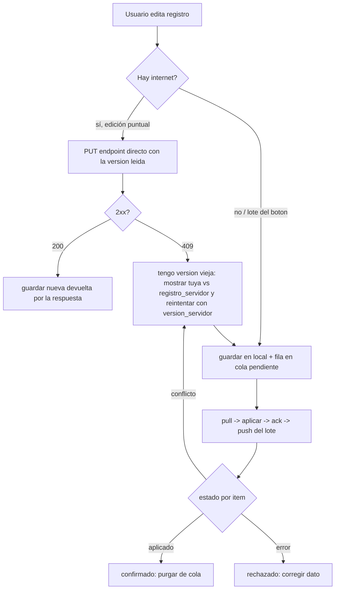
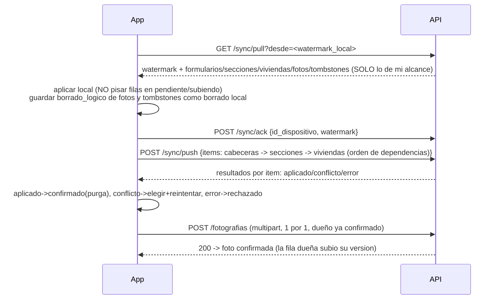

# PLAN — Fase 2: APIs nuevas EDAN bajo v2

> **Estado:** Fase 1 (BD) **aplicada** — migraciones `v2.49.0`–`v2.53.0` + `v2.54.0_dispositivo_sync`
> (2026-10-10). **Fase 2 (APIs) IMPLEMENTADA, ALINEADA CON LA API VIEJA y PROBADA**
> (2026-10-10): **21 operaciones** bajo `/api/v2/edan/…` en
> `api/edan/{schemas,service,router}_v2_nuevas.py`, grupo Swagger `EDAN > APIs nuevas`.
> Accesibilidad igual que la API vieja: **escritura solo roles 6/7** (`require_rol`);
> **lectura con scope** (6/7 propias, 8 municipio, 5/9 departamento, 1–4 nacional,
> filtros `id_departamento/id_provincia/id_municipio`) incluida en `sync/pull`.
> Edición por PUT+`version` (409 con snapshot), borrado de formulario/sección/vivienda/foto
> con **cascada lógica de fotos** (viajan por pull). Pruebas: **41/41 + 46/46 multi-fila +
> 66/66 de roles/edición/sync-con-modificaciones** (§14/§18). Guía para la app: **§19**.
> Pendiente solo: tombstones de secciones → migración `v2.55.0` (la `v2.54.0` se usó
> para `dispositivo_sync`).
> Referencias: `EDAN_ESQUEMA_BD.md` (esquema real), `propuesta_identificadores_uuid_edan.md`
> (propuesta de identificadores UUID), `.opencode/skills/api-get-listados/SKILL.md`
> (convención de GET de listados).

## 1. Qué se acordó (resumen)

1. **Primero BD, luego APIs.** La Fase 1 solo añade columnas/tablas/triggers de
   identidad, versión, fotos y tombstones. **Ninguna API se toca en esa fase.**
2. **APIs nuevas, no adaptar las existentes.** En Fase 2 se crean endpoints
   **limpios con otros nombres** bajo el prefijo v2 (las APIs actuales de
   `api/edan/router*.py` siguen desplegadas y funcionando hasta que la app/web
   migren; después se retiran, no se re-escriben).
3. **Mismo contrato para app y web.** Flutter (SQLite + cola offline) y la web
   consumen las mismas APIs nuevas; la web solo ve lo ya sincronizado.
4. **Identidad permanente por UUID** en toda la vida del registro:
   `uuid_edan_localidad` (cabecera), `uuid_registro` (fila de sección),
   `uuid_fotografia` (foto). Los IDs numéricos (`id_edan_localidad`,
   `id_dano_vivienda`, …) se conservan como claves internas del servidor y para
   las APIs viejas.
5. **Flujo correcto desde el inicio**: upsert idempotente por uuid (fin del
   DELETE+INSERT), conflictos por `version` (no solo LWW), borrados propagables
   por `registro_borrado`, fotos con ciclo de vida propio.

## 2. Estado de partida (resultado de la Fase 1)

| Elemento | En la BD |
|---|---|
| `edan.edan_localidades.uuid_edan_localidad`, `edan.edan.uuid_edan` | `uuid NOT NULL`, único; backfill = `id_local` cuando es UUID válido (97/124), resto `gen_random_uuid()` |
| `uuid_registro` en las 14 tablas de secciones | `uuid NOT NULL`, único; fallback determinístico `md5(tabla|clave)` mientras la API vieja siga con DELETE+INSERT; inmutable (`BEFORE UPDATE`) |
| `edan.fotografias` | `uuid_fotografia` único, `tipo_entidad` + `uuid_registro` (polimórfico, sin FK), `sha256/mime/tamaño` (NULL en backfill), `borrado_logico`; 108 fotos backfilheadas; columnas `fotografia` de secciones **se conservan** |
| `version integer` + trigger `fn_bump_version` | en `edan`, `edan_localidades` y las 14 secciones: todo UPDATE incrementa |
| `edan.registro_borrado` | tombstones `(tabla, id_registro uuid, clave_legacy, borrado_en, id_usuario)`; triggers `AFTER DELETE` solo en `edan.edan` y `edan.edan_localidades` |
| **FK por uuid** (`v2.52.0`) | `edan_localidades.uuid_edan` → FK → `edan(uuid_edan)` **ON DELETE SET NULL** (espejo de `id_edan`); `uuid_edan_localidad` en las 14 secciones → FK → `edan_localidades(uuid_edan_localidad)` **ON DELETE CASCADE** (espejo de `id_edan_localidad`); fuente de verdad = id numérico, el trigger espejo deriva el uuid (la API vieja no se toca) |
| `fn_derivar_uuid_registro` reforzada (`v2.52.0`) | si `id_seccion` es un **UUID puro** → `uuid_registro = id_seccion::uuid` (sobrevive al DELETE+INSERT de la app vieja); si no → `md5(tabla\|clave)` legacy. 0 filas existentes usan formato UUID puro |
| **Detalle por vivienda** (`v2.53.0`) | tabla `edan.edan_localidades_viviendas` (1:N desde la fila de daños): fila por casa con `uuid_registro` propio, `tipo_dano` TOTAL\|PARCIAL, coordenadas, `fotografia` (path, patrón de las secciones) y ciclo de vida vía `fotografias` (`tipo_entidad='vivienda'`, 15º valor del CHECK); `dano_total`/`dano_parcial` del padre se **derivan** por trigger `fn_recompute_danos_vivienda` (COUNT por tipo). Filas legacy sin detalle conservan sus conteos (sin backfill); `necesidades_inmediatas`/`observaciones` siguen en la sección |
| Intactos | `id_local`, `id_seccion` + índices únicos globales `idx_seccion_*` (carga de los `ON CONFLICT` viejos), columnas `fotografia`, `pendiente_*`, LWW por `fecha_modificacion` |

**Pendiente declarado (ahora `v2.55.0`):** migración con triggers
`AFTER DELETE` de tombstones en las 14 secciones (solo cuando desaparezca el
DELETE+INSERT del sync viejo) + índices de pull por sección y, opcionalmente,
retiro de los triggers de transición `fn_uuid_edan*` / fallback
`fn_uuid_registro` si ya no aplican. **`v2.54.0` se usó para `edan.dispositivo_sync`**
(tabla de ack de pulls por dispositivo; §14.4).

## 3. Principios del diseño de las APIs nuevas

- **Contrato de identidad**: el cliente genera `uuid_edan_localidad`,
  `uuid_registro` y `uuid_fotografia` **antes** de crear nada y los envía en
  todos los mensajes. El servidor hace upsert por uuid. **Nunca** se genera un
  uuid nuevo por sincronización.
- **POST/PUT = solo uuid; GET = uuid e id** (acuerdo explícito):
  - **Escritura (`POST`/`PUT`)**: el identificador del contrato es **solo uuid**
    (`uuid_edan_localidad` en la ruta/body, `uuid_registro` por fila,
    `uuid_fotografia` en fotos). **No** se envía `id_local`, `id_seccion` ni ids
    numéricos como identidad.
  - **Lectura (`GET`)**: se puede consultar **por uuid y por id** (ambos
    identificadores válidos en la ruta/parámetro), y las respuestas incluyen
    **uuid e id** (el numérico sigue siendo clave interna del servidor).
- **`id_seccion` sintético (coexistencia)**: toda fila de sección creada por
  las APIs nuevas escribe `id_seccion = uuid_registro::text` (UUID puro). Con el
  refuerzo de `fn_derivar_uuid_registro` (`v2.52.0`), si la app vieja llega a
  borrar+reinsertar esa fila, el uuid se rederiva idéntico → la identidad
  sobrevive; además el `ON CONFLICT (id_seccion)` viejo sigue funcionando y el
  pull viejo nunca ve `id_seccion: null`.
- **Vínculo padre→hijo con FK por uuid** (`v2.52.0`): las hijas cargan
  `uuid_edan` / `uuid_edan_localidad` con FK a la BD (espejo del id numérico,
  fuente de verdad). El service nuevo puede enlazar y validar por uuid sin
  romper nada de la API vieja.
- **Idempotencia**: reintentos con el mismo payload producen el mismo resultado
  (`ON CONFLICT (uuid_…) DO UPDATE`). Sin DELETE+INSERT de secciones.
- **Orden de envío**: cabecera → secciones/filas → fotografías. La descarga
  (pull) trae cambios del servidor, incluidos **eliminaciones** (`registro_borrado`)
  y ediciones hechas desde la web.
- **Conflictos por versión**: el cliente lee `version`, la envía al guardar; si
  `version` del servidor ≠ versión leída → **409 con ambas versiones** (revisión),
  no sobrescritura silenciosa. Filas distintas se combinan sin conflicto.
- **Estados y aprobaciones**: la sincronización **nunca** cambia `id_estado` ni
  la cadena de aprobaciones (UGR→Alcalde→DGR→VIDECI); un registro aprobado no
  vuelve a borrador por un push.
- **Borrados lógicos propagables**: DELETE registra en `registro_borrado` y
  propaga por pull; no se borra físicamente algo que otro dispositivo deba
  descargar.
- **Compatibilidad**: las APIs viejas no cambian de forma (la web desplegada las
  consume tal cual); las nuevas son prefijo/nombre nuevo, no modificaciones de
  endpoints existentes.

## 4. Convención de GET de listados (obligatoria en las APIs nuevas)

Tomada del skill **`api-get-listados`** (ver detalle y checklist en
`.opencode/skills/api-get-listados/SKILL.md`):

1. **`limit`** siempre presente (default del repo 15/50/100, `ge=1`, `le` acotado),
   devuelve **los más recientes primero** (`ORDER BY fecha/creación DESC`).
2. **`skip`** (`ge=0`) junto a `limit` para paginación.
3. **`todos: bool = Query(False)`** → `true` = conjunto completo sin
   `LIMIT/OPTION` (patrón `page = "" if todos else " LIMIT :limit OFFSET :skip"`).
4. **Filtros opcionales** con `Query(None, description=…)`, tipos fuertes
   (`UUID | None`, `date | None`, `Literal[…]`); fechas con sufijo
   `_desde`/`_hasta`; filtro geográfico **uno a la vez** (2+ → 400).
5. **Respuesta** `SuccessResponse`/`DataListResponse[T]` con `data` + `total`
   (total **sin** paginar, mismos filtros). No alterar la forma de las
   respuestas existentes.
6. **Exenciones**: catálogos (`/estados`, `/tipo-evento`, `/tipo-localidad`,
   `/grupo-vulnerable`, `/grupo-etario`, `/localidades-estado`, geografía,
   `/roles`…) → **siempre completos**, sin paginación; y endpoints de
   acción/consulta (`/sync/pull`, `/mapa`, `/geojson`, `/health`…).

## 5. Endpoints nuevos (nombres propuestos bajo `/api/v2/…`)

> Nombres **nuevos** que no colisionan con los actuales
> (`/localidades/sync`, `/localidades/{id}`, `/edan/sync`, …). A confirmar/alinear
> al iniciar la implementación.

| Área | Propuesta | Notas |
|---|---|---|
| Cabecera | `POST/GET/PUT /v2/formularios` — escritura por `uuid_edan_localidad`; **GET por uuid o id** (ambos válidos) | upsert idempotente; PUT exige `version`; respuestas con uuid **e** id |
| Secciones | `POST /v2/formularios/{uuid}/secciones/{tipo}` (upsert por `uuid_registro`); **GET por uuid o id** | 14 tipos; sin borrado total; respuestas con uuid **e** id |
| Viviendas | `POST/PUT/GET/DELETE /v2/formularios/{uuid}/secciones/danos-vivienda/{uuid_dano}/viviendas[/{uuid_vivienda}]` | `v2.53.0`: detalle 1:N por vivienda; el GET de la sección devuelve los conteos derivados + `viviendas[]` |
| Fotos | `POST /v2/fotografías` (multipart: `uuid_fotografia`, `uuid_registro`, `tipo_entidad`) | ver §7 |
| Listados | `GET /v2/formularios` (documento por localidad, §20.18), `GET /v2/fotografías` | convención §4 |
| Sync pull | `GET /v2/sync/pull?desde=<marca>` | watermark + `registro_borrado` (§8) |
| Sync push | `POST /v2/sync/push` | lote con flags por ítem (`aplicado`/`conflicto`/`tombstone`) |
| Confirmaciones | `POST /v2/sync/ack` | confirma recepción de descargas (§8) |

## 6. Guardedores de integridad (service)

- **Pertenencia**: toda fila/foto validada contra la cabecera:
  `uuid_registro` debe existir en `tipo_entidad` y pertenecer a
  `id_edan_localidad` indicado (validación en API — `uuid_registro` es
  polimórfico y **no** tiene FK).
- **`tipo_entidad`** = los 14 nombres cortos de sección + `'vivienda'`
  (15 valores, CHECK en BD desde `v2.53.0`).
- **Estados**: rechazar escrituras que intenten mover `id_estado`/aprobaciones
  fuera de la máquina de estados (`NIVELES_APROBACION`).

## 7. Fotografías — ciclo de vida acordado

1. App genera `uuid_fotografia`, guarda el archivo local y su ruta local.
2. Se sincroniza **primero** la fila del formulario (con su `uuid_registro`).
3. La foto se sube y se vincula por `uuid_registro` + `tipo_entidad` (nunca por
   índice de lista ni id temporal).
4. El servidor valida fila/pertenencia, calcula o comprueba **sha256**, y
   devuelve `uuid_fotografia` + `ruta_archivo`.
5. Reintentar la carga con el mismo `uuid_fotografia` o mismo hash **no duplica**
   (upsert). El cliente solo marca la foto sincronizada tras confirmación.
6. Backfill de la Fase 1 dejó `sha256` NULL: al primer acceso o re-subida se
   calcula (script puntual opcional para los 108 archivos en `uploads/reports/`).
7. Las columnas `fotografia` de secciones se mantienen durante la transición;
   se dejan de escribirse cuando la app/web usen solo `/v2/fotografías`, y se
   retiran recién en una migración posterior con verificación.
8. **Detalle por vivienda (`v2.53.0`)**: en la sección `danos_vivienda`, cada
   casa es una fila de `edan_localidades_viviendas` con su `fotografia` (path,
   patrón de siempre) + su registro en `fotografias` con `tipo_entidad='vivienda'`;
   los conteos `dano_total`/`dano_parcial` del padre se derivan de las filas.

### 7.1 Ejemplo resuelto: fotos en secciones 1:N

Casos de prueba del contrato con una localidad
(`uuid_edan_localidad = AAAA-…-0001`) que captura fotos en tres secciones:

| Sección (1:N) | Filas capturadas | Fotos |
|---|---|---|
| agricultura | arroz `AG-…-0001` (2 fotos) · maíz `AG-…-0002` (1 foto) | **3** |
| servicios basicos | centro `SB-…-0001` (2) · norte `SB-…-0002` (2) | **4** |
| salud establecimientos | CESF `SE-…-0001` (3) · hospital `SE-…-0002` (2) · posta `SE-…-0003` (3) | **8** |

**Regla clave:** las fotos no cuelgan de "la sección" en abstracto sino de
**cada fila concreta** dentro de ella; cada foto se sube suelta, con su
dirección completa `(tipo_entidad, uuid_registro)` — ver punto 3.

**Resolución en el service** (al recibir `POST /v2/fotografías`), para
`tipo_entidad=salud_establecimientos`, `uuid_registro=SE-…-0002`:

1. `tipo_entidad` → nombre de tabla
   (`edan.edan_localidades_salud_establecimientos`).
2. `SELECT id_edan_localidad FROM esa_tabla WHERE uuid_registro = …`
   → **404** si la fila no existe.
3. Comprobar que la fila pertenece a la localidad del formulario
   → **400/409** si no coincide.
4. Insert/upsert en `edan.fotografias` con `id_edan_localidad` (FK CASCADE)
   + `(tipo_entidad, uuid_registro)` (índice `idx_fotografias_registro`).

**Agrupación al pull:** el servidor agrupa por `(tipo_entidad, uuid_registro)`:
el hospital recupera sus 2 fotos, la posta sus 3, el maíz su 1. La identidad
de la fila dueña no cambia aunque se sincronice (id sección sintético, §2).

**Resumen de las 15 fotos** (`uuid_fotografia` → fila dueña):

| uuid_fotografia | tipo_entidad | uuid_registro | fila dueña | n |
|---|---|---|---|---|
| FOT-…-0001 | danos_agricultura | AG-…-0001 | arroz | 1 |
| FOT-…-0002 | danos_agricultura | AG-…-0001 | arroz | 2 |
| FOT-…-0003 | danos_agricultura | AG-…-0002 | maíz | 3 |
| FOT-…-0004 | servicios_basicos | SB-…-0001 | centro | 1 |
| FOT-…-0005 | servicios_basicos | SB-…-0001 | centro | 2 |
| FOT-…-0006 | servicios_basicos | SB-…-0002 | norte | 3 |
| FOT-…-0007 | servicios_basicos | SB-…-0002 | norte | 4 |
| FOT-…-0008…0010 | salud_establecimientos | SE-…-0001 | CESF | 5–7 |
| FOT-…-0011…0012 | salud_establecimientos | SE-…-0002 | hospital | 8–9 |
| FOT-…-0013…0015 | salud_establecimientos | SE-…-0003 | posta | 10–12 |

## 8. Sincronización — pull/push, watermark y ack

> Ver **§12** para el lado del cliente: flujo canónico, escenarios
> (app↔web, pérdida de celular, sync diario) y la **cola de sincronización
> local** en SQLite con sus estados.

- **Pull incremental** por `fecha_modificacion >= desde` (índice
  `idx_edan_localidades_sync_pull`), devolviendo cabecera + secciones + fotos +
  **tombstones de `registro_borrado`** (`borrado_en > desde`).
- **Push** por lote: respuesta con resultado por ítem
  (`aplicado` / `conflicto` con `version` servidor vs cliente / `tombstone`).
- **Ack**: `POST /v2/sync/ack` registra hasta qué watermark el dispositivo ya
  aplicó; permite reenviar sin duplicar y depurar `registro_borrado` antiguo.
- **Conflicto = 409 + datos de ambas versiones** para revisión (§3). Nada de
  "última escritura gana" como única estrategia: LWW (`fecha_modificacion`) queda
  solo como criterio de orden/recencia y compatibilidad con las APIs viejas.
- Índices: `fotografias` ya trae `(fecha_modificacion)`; los de secciones
  `(fecha_modificacion)` quedan para `v2.53.0` si el pull por secciones lo
  requiere.

## 9. Flutter y web

- **Flutter**: SQLite local con la misma identidad uuid, cola persistente de
  sincronización (cabecera → secciones → fotos), reintentos idempotentes,
  colas separadas de datos y de fotos, resolución de 409 con UI de revisión.
- **Web**: mismos endpoints/uuid que Flutter, sin cola offline; usa `/v2/sync/push`
  para crear/editar (o los endpoints directos) y pull para refrescar. Un cambio
  no sincronizado desde el móvil no aparece en la web.
- **Migración de clientes**: mientras la app vieja use `id_local`/`id_seccion`,
  las APIs viejas siguen activas; la convivencia se resuelve por los índices
  únicos de `id_local` (resolución dual en service hasta migrar).
- **⚠️ Riesgo de coexistencia a probar en Fase 2**: el sync viejo, al
  *actualizar* una localidad (`service.update_localidad`), borra y reinserta
  **todas** sus secciones desde el payload de la app vieja. Para filas creadas
  por las APIs nuevas, el `id_seccion` sintético + el refuerzo de
  `fn_derivar_uuid_registro` (`v2.52.0`) hacen que la identidad **sobreviva**
  al wipe, pero los *datos* de esas filas dependen de que la app vieja las
  haya recibido en su pull y las reenvíe. Validar con un escenario de
  coexistencia (mitigaciones posibles: no permitir edición vieja de
  localidades ya tocadas por el flujo nuevo, o parche mínimo en el service
  viejo).

## 10. Pruebas obligatorias (los 4 escenarios)

| # | Escenario | Verificar |
|---|---|---|
| 1 | Creado en app → completado en web | pull lo lleva a la web, edición vuelve con `version`, sin uuid nuevo |
| 2 | Creado en web → terminado en app | descarga conserva uuid, edición offline sube idempotente |
| 3 | Creado y terminado solo en app | cola completa (cabecera→secciones→fotos), reconexión, sin duplicados |
| 4 | Creado y terminado solo en web | solo servidor; la app lo recibe en su siguiente pull |

Más: desconexión a mitad de subida de foto, reintentos, ediciones simultáneas
(409), eliminaciones (tombstone visible en otros dispositivos), reinicio de la
app con cola pendiente, y que **ninguna** sincronización altere aprobaciones.

## 11. Orden de trabajo de la Fase 2

1. ~~Auditar esquema real~~ ✔ (`EDAN_ESQUEMA_BD.md`) y ~~migración compatible~~ ✔ (Fase 1).
2. ~~FK por uuid + id_seccion sintético~~ ✔ (`v2.52.0`, aplicada y verificada).
3. ~~Detalle por vivienda + conteos derivados~~ ✔ (`v2.53.0`, aplicada y verificada).
4. ~~Migración `v2.54.0`~~ → se usó para **`edan.dispositivo_sync`** (ack de pulls).
   Tombstones de secciones + índices de pull quedan para **`v2.55.0`** (pendiente;
   bloqueados hasta retirar el DELETE+INSERT del sync viejo).
5. ~~Contratos OpenAPI nuevos~~ ✔ (`api/edan/schemas_v2_nuevas.py`).
6. ~~`service`/`router` nuevos~~ ✔ (`api/edan/service_v2_nuevas.py` +
   `api/edan/router_v2_nuevas.py`, registrado en `api/main.py` como
   `("edan_nuevas", …)` **antes** de `edan_cabecera` para ganarle al
   catch-all `GET /edan/{id:int}`).
7. Flutter y web sobre el nuevo contrato (§9).
8. ~~Pruebas~~ ✔ **41/0** (§14): idempotencia, 409, fotos multipart, push mixto,
   pull/ack, recalculo de viviendas, regression API vieja. Solo entonces retiro
   de endpoints viejos (cuando Flutter/web migren).

## 12. Flujos acordados y cola de sincronización local (cliente)

> Cerrado con el usuario antes de implementar las APIs (2026-10-10). Define
> **cómo usarán** el contrato los clientes (Flutter y web) y qué debe existir
> en el dispositivo para que funcione offline.
> **Implementado (2026-10-10):** la versión exacta con endpoints, payloads y
> respuestas reales está en §15 (sync), §16 (botón general) y §17 (formulario
> nuevo); esta §12 sigue vigente como diseño.

### 12.1 Flujo canónico offline-first (Flutter)

1. **Identidad local (paso 0)**: al crear el registro, el cliente **genera él
   mismo** todos los uuid (`uuid_edan_localidad`, `uuid_registro` por fila,
   `uuid_vivienda`, `uuid_fotografia`) y los guarda en SQLite. **Nunca** se
   regeneran ni se piden al servidor. No existe el patrón "F-001 → id 1250":
   el uuid es la identidad de vida entera; el id numérico es interno del
   servidor y se recibe en la respuesta por conveniencia.
2. **Guardar local**: formulario + secciones + hijos (viviendas) + referencias
   de archivos, con estado `pendiente` en la cola. Todo funciona sin internet.
3. **Push en orden de dependencias**: cabecera → secciones → viviendas →
   fotos. Cada ítem se envía solo cuando su **dueño ya fue aceptado** (la foto
   necesita el uuid del dueño —que el cliente ya tiene desde el paso 0— y que
   esa fila exista en el servidor). Fallo de una fila no bloquea a las demás
   (estado por ítem).
4. **Pull** incremental con watermark (§8) + **ack**.
5. **Confirmación por ítem**: cada fila/foto pasa a `confirmado` SOLO con su
   2xx; el formulario está completo cuando todos sus componentes
   obligatorios lo están.

### 12.2 Escenarios

| Escenario | Comportamiento |
|---|---|
| Solo app | 12.1 completo; la cola persiste reinicios y semanas sin red |
| Solo web | Sin cola: escritura directa con los mismos endpoints/uuid; refresca con pull |
| App crea → web termina | Web descarga por pull (conserva uuids), edita con `version` leída; la app ve el cambio en su próximo pull |
| Web crea → app termina | Igual al revés; la app edita offline y sube idempotente por uuid |
| Multi-hop (app→web→app) | Filas distintas se combinan sin conflicto; **misma fila editada por ambos → 409** con ambas versiones y el usuario elige (sin merge de campos en v1); borrados viajan como tombstone; fotos independientes (upsert por `uuid_fotografia`) |
| Pérdida de celular | App nueva → login → **pull desde `desde=0`** (restauración completa); la app **adopta los uuids del servidor** y no genera ninguno nuevo; cola vacía = todo confirmado. **Pérdida irreversible**: fotos que estaban solo en el cel perdido y nunca se subieron → por eso la regla: **subir fotos apenas haya red** |
| Sync diario | Rutina: pull → aplicar → ack → push de la cola → reintentar fotos con backoff. El watermark solo avanza tras aplicar+ack (repitiendo es seguro: pull idempotente) |

### 12.3 Cola de sincronización local (SQLite de Flutter)

Imprescindible: sin estado por ítem la app no sabría qué ya se envió e
intentaría todo en cada sync. Se implementa como **tablas aparte** (no
columnas en cada tabla de dominio): el esquema local se parece al del
servidor y la cola se maneja en un solo lugar.

```sql
CREATE TABLE cola_sincronizacion (
  id                   INTEGER PRIMARY KEY,
  tabla                TEXT NOT NULL,   -- 'formulario' | 'seccion' | 'vivienda'
  uuid_registro        TEXT NOT NULL,
  accion               TEXT NOT NULL,   -- 'upsert' | 'borrar'
  estado               TEXT NOT NULL,   -- ver máquinas de estado abajo
  version_a_enviar     INTEGER,         -- versión leída que se envía en el PUT
  intentos             INTEGER DEFAULT 0,
  ultimo_error         TEXT,
  fecha_proximo_intento TEXT,
  fecha_registro       TEXT
);

CREATE TABLE cola_fotos (
  uuid_fotografia TEXT PRIMARY KEY,
  ruta_local      TEXT NOT NULL,
  tipo_entidad    TEXT,
  uuid_registro   TEXT,
  sha256          TEXT,
  estado          TEXT NOT NULL,
  intentos        INTEGER DEFAULT 0
);
```

**Estados** (ambas colas):

| Estado | Significado | ¿Se reintenta solo? |
|---|---|---|
| `pendiente` | en cola, espera su turno | Sí, en el próximo sync |
| `subiendo` | petición en vuelo | No (evita doble envío si la app se mata) |
| `confirmado` | 2xx del servidor | No — **se purga la fila** de la cola |
| `conflicto` | 409: cambió en el servidor | No — requiere que el usuario elija versión |
| `rechazado` | 4xx de negocio | No — requiere corrección del dato |

**Reglas de la cola:**
- `subiendo` se marca **antes** de lanzar la petición; si la app muere a
  mitad de vuelo, al reabrir esas filas vuelven a `pendiente` (reenviar es
  seguro: upsert por uuid).
- Cada 2xx **borra** su fila de la cola; cada fallo suma `intentos` y calcula
  `fecha_proximo_intento` (backoff exponencial).
- La UI usa la cola para avisos ("3 pendientes", "1 conflicto") y el
  formulario se marca completo solo cuando todos sus ítems obligatorios están
  `confirmado`.

### 12.4 Rutina de sync diario (Flutter)

1. **Pull**: `GET /v2/sync/pull?desde=<watermark_local>` → ediciones ajenas +
   tombstones; aplicar localmente (incluye borrar lo borrado).
2. **Ack**: `POST /v2/sync/ack` con el watermark aplicado → recién ahí el
   watermark local avanza.
3. **Push**: recorrer `cola_sincronizacion` con `estado='pendiente'` y
   `fecha_proximo_intento <= ahora`, en orden de dependencias.
4. **Fotos**: ídem con `cola_fotos`, solo cuyo dueño ya esté confirmado.
5. Purgar filas `confirmado` residuales.

### 12.5 La web

No usa cola (siempre tiene internet): escribe directo con los mismos
endpoints v2 y los mismos campos que Flutter; las fotos se suben con el
mismo `POST /v2/fotografías` (multipart: `uuid_fotografia`, `tipo_entidad`,
`uuid_registro`, `archivo`, `sha256` opcional) en cuanto el usuario las
elige. Contrato idéntico; solo cambia el transporte local.

## 13. Fuera de alcance / no hacer

- No renombrar ni romper endpoints existentes antes de migrar clientes.
- No cambiar `ON CONFLICT (id_seccion)` ni índices `idx_seccion_*` hasta retirar
  las APIs viejas.
- No borrar columnas `fotografia` ni `id_local` en esta fase.
- No usar la sincronización para saltar estados de aprobación.

## 14. Implementación y pruebas reales (2026-10-10)

### 14.1 Archivos

| Archivo | Contenido |
|---|---|
| `api/edan/schemas_v2_nuevas.py` | `FormularioUpsert/Response`, `SeccionUpsert` (extra="allow", campos reales validados contra `information_schema`), `ViviendaUpsert`, `FotoResponse`, `SyncPushItem/Request`, `SyncAckRequest`, `SyncPullResponse`, `SeccionTipo` (14 literales) |
| `api/edan/service_v2_nuevas.py` | upsert idempotente + 409 por `version` + `id_seccion=uuid::text` + pull/push/ack + fotos + viviendas con recálculo vía trigger |
| `api/edan/router_v2_nuevas.py` | 21 operaciones; tags `EDAN > APIs nuevas` (+ `> Formularios/Viviendas/Fotografías/Sync`) |
| `api/main.py` | `("edan_nuevas", …)` registrado **antes** de `edan_cabecera` (su `GET /{id:int}` no debe capturar `/formularios`, `/fotografias`, `/sync/*`) |

### 14.2 Endpoints implementados (base `/api/v2/edan`)

| Método | Ruta | Rol | Notas |
|---|---|---|---|
| POST | `/formularios` | 6/7 | upsert por `uuid_edan_localidad`; sin `version`. Si llega `id_municipio` y no `id_departamento/id_provincia`, se **derivan** de `shared.municipio` (necesario para filtros y scope) |
| PUT | `/formularios/{uuid}` | 6/7 | exige `version`; **409** con `version_servidor`/`version_cliente`/`registro_servidor` si difiere; 403 si el formulario es de otro usuario |
| GET | `/formularios/{uuid o id}` | scope | **documento completo** `{cabecera, secciones con datos, fotos, secciones_resumen}` (§20.18) con `modo` (`comprimido` def = sólo secciones activas; `completo` = las 14); alcance: **rol 6 = todo su municipio** (lectura), rol 7 = propias, 8/5/9 = su jurisdicción; fuera de alcance → 403 |
| GET | `/formularios?skip&limit&todos&id_departamento&id_provincia&id_municipio&localidad&modo` | scope | `data[]` = **documentos completos** por localidad (mismo formato que `/completo`); filtros además del scope forzado del rol; **rol 6 (UGR Municipio) = TODO su municipio** → `id_municipio=…&todos=true` = **todos los del municipio** (§20.18) |
| DELETE | `/formularios/{uuid}` | 6/7 | borrado físico en cascada (secciones, viviendas, fotos); deja **tombstone** que viaja por pull |
| POST | `/formularios/{uuid}/secciones/{tipo}` | 6/7 | los 14 tipos (se aceptan guiones: `danos-vivienda` = `danos_vivienda`); campos validados contra columnas reales (400 si desconocido o regla de BD) |
| PUT | `/formularios/{uuid}/secciones/{tipo}/{uuid_fila}` | 6/7 | exige `version`; 409 si difiere |
| GET | `/formularios/{uuid}/secciones/{tipo}` | scope | `danos_vivienda` incluye `viviendas[]` |
| GET | `/formularios/{uuid}/secciones/{tipo}/{uuid_fila}` | scope | fila por `uuid_registro` |
| DELETE | `/formularios/{uuid}/secciones/{tipo}/{uuid_fila}` | 6/7 | solo 1:N (1:1 → 400 con explicación); borra físico, **marca `borrado_logico` las fotos** de la fila, y si es `danos_vivienda` elimina sus viviendas en cascada |
| POST/PUT/GET/DELETE | `…/secciones/danos-vivienda/{uuid_dano}/viviendas[/{uuid_v}]` | 6/7 escribe, scope lee | `tipo_dano` TOTAL\|PARCIAL; trigger recalcula conteos del padre; DELETE marca borrado_logico las fotos de la vivienda |
| POST | `/fotografias` | 6/7 | multipart: `uuid_fotografia`, `tipo_entidad` (15 valores incl. `vivienda`), `uuid_registro`, `archivo`; upsert idempotente por uuid; dueña inexistente → **404**; no-imagen → **400** (magic bytes, ≤10MB); dueña de otro usuario → **403**; **espeja el `ruta_archivo` en la columna `fotografia` de la fila dueña** (bump de `version`: §16.3); archivo en `uploads/reports/{codigo_ine}/` |
| GET/DELETE | `/fotografias/{uuid}` | scope/6-7 | DELETE = lógico (`borrado_logico=true`), se propaga por pull |
| GET | `/sync/pull?desde&limit` | scope | 5 colecciones + `watermark` + `totals`; `desde` vacío u omitido = restauración completa; **cada rol recibe solo lo de su alcance** |
| POST | `/sync/push` | 6/7 | lote ≤200; resultado **por ítem**: `aplicado`/`conflicto`/`error` (403 en ítem ajeno no tumba el lote) |
| POST | `/sync/ack` | cualquier rol EDAN | upsert en `edan.dispositivo_sync` (`v2.54.0`); idempotente por `id_dispositivo` |

> **v2.60 (2026-10-20)**: los GET `GET /formularios`, `GET /formularios/estados`,
> `GET /` y `GET /consolidar/pendientes` aceptan además **rangos de fecha**
> desde/hasta (ver §21.5). En `GET /formularios/estados` las geo se combinan
> con AND (ya no hay 400 por 2+ filtros) y `fecha_modificacion_desde` sigue
> siendo sólo el watermark de `tiene_cambios`.
> Se añaden las 4 APIs agregadas `/resumen/...` (§21).

**Total: 21 operaciones** (23 tras §20, que añade `POST/GET /formularios[/{uuid o id}]/completo`). Escritura = `require_rol(6, 7)` idéntico a la API vieja;
los demás roles leen según su alcance y gestionan aprobaciones por las APIs de aprobación.

### 14.3 Bugs corregidos durante las pruebas

1. **Placeholder roto en INSERT** de secciones y viviendas (`VALUES (:a, b, c)` solo ligaba la primera columna) → placeholders completos `:col` por columna.
2. **`_dueño_foto` para `vivienda`**: `edan_localidades_viviendas` no tiene `id_edan_localidad` → resuelto JOIN con el padre `danos_vivienda`.
3. **Serialización**: `Decimal` (coordenadas `numeric`) y `date` (`fecha_llenado`) no eran JSON-serializables → convertidos en `_row_public`.
4. **Default `localidad=""` de Pydantic** sobreescribía la cabecera en updates sin enviar localidad → `""` se ignora junto a `None`.
5. **`sync_push`**: `uuid_edan_localidad` viaja en `datos` para ubicar al padre; se extrae antes del upsert (no es columna escribible del cliente).
6. **Orden de registro en `main.py`**: el catch-all `GET /edan/{id:int}` de `edan_cabecera` capturaba `/formularios` (422 por `int()`); el router nuevo se registra antes.
7. **Sin alcance por rol** (auditoría antes de pasar la doc): el list/pull devolvía TODO el país y cualquiera escribía sobre cualquier formulario → added `_check_acceso` + `_scope_where` espejando `scope_mis_localidades_v2`/`require_rol` de la API vieja (6/7 propias; 8 municipio; 5/9 departamento; 1-4 nacional; escribir solo 6/7).
8. **Fotos huérfanas al borrar fila dueña**: DELETE de sección/vivienda ahora marca `borrado_logico=true` sus fotos (viajan por pull y el otro dispositivo las elimina).
9. **`id_departamento/id_provincia` NULL** al crear solo con `id_municipio` → rotura del filtro de departamento y del scope 5/9 → se derivan de `shared.municipio` en el upsert.
10. **`pull?desde=` (vacío) daba 422** → `desde` se parsea tolerante (vacío/ausente = restauración; inválido = 400).
11. **Tombstones invisibles para usuarios con scope**: la fila borrada ya no tiene geo para filtrarla → los tombstones de `edan_localidades` viajan sin filtro de geo (el uuid solo indica "borra esa fila"); los de secciones llegarán con v2.55.0.
12. **Errores de BD → 500**: FK/CHECK/NOT NULL/UNIQUE envueltos con `db_error` → **400 con mensaje y constraint** (`tipo ∈ {energia_electrica…}` etc.).

### 14.4 Migración `v2.54.0_dispositivo_sync.sql` (aplicada)

```sql
CREATE TABLE edan.dispositivo_sync (
  id_dispositivo      uuid PRIMARY KEY,          -- uuid estable de la instalación
  id_usuario          integer REFERENCES usuarios(id_usuario),
  watermark_aplicado  timestamptz,               -- último pull aplicado y ackeado
  ack_en              timestamptz NOT NULL DEFAULT now(),
  fecha_registro      timestamptz NOT NULL DEFAULT now()
);
```

Úsese `POST /sync/ack` con un uuid generado una sola vez por instalación (guardarlo
en el almacenamiento persistente del cliente). El servidor conserva por dispositivo
hasta dónde lleva su replicación.

### 14.5 Pruebas ejecutadas (41/0) — datos marcados y borrados

Todas con token `admin` y datos **marcados** `TEST_NUEVAS_*` + uuids `aaaaaaaa-0000-4000-8000-…`
(ambos criterios); al final se borraron SOLO los marcados (verificación de 0 residuos).
*(Corrida original del 2026-10-10; tras la alineación de roles §14.3-7 esta misma suite
re-ejecutada con usuario rol 7 quedó **41/41** — §18.2.)*

| # | Escenario | Resultado clave |
|---|---|---|
| 1–2 | Crear formulario + re-POST mismo uuid | 200; **1 fila** (sin duplicar) |
| 3–4 | GET por uuid, por id, list con filtro | 200 |
| 5 | PUT con `version` vieja → nueva | **409** con ambas versiones → 200 con la correcta |
| 6–7 | 6 secciones (multi-fila y 1:1) + re-POST 1:1 | 200; 1:1 no duplica |
| 8 | Campo inexistente en sección | **400** |
| 10–11 | 2 viviendas TOTAL/PARCIAL + re-POST | trigger recalcula padre `dano_total=1, dano_parcial=1, viviendas=2`; sin duplicar |
| 12 | PUT vivienda 409/200 + restore | 409 → 200 |
| 13 | PUT sección 409/200 | 409 → 200 (tipo `agua_potable`→`alcantarillado`) |
| 14 | Foto: upload, re-upload, GET, DELETE lógico, dueña inexistente, archivo .txt | 200 / idempotente 1 fila / borrado_logico=true / **404** / **400** |
| 15 | DELETE vivienda | trigger recalcula padre `1/0/1` |
| 16 | GET inexistentes | 404 |
| 17 | `pull?desde=` | trae filas `TEST_NUEVAS` + watermark |
| 18 | `push` mixto (válida + conflictiva + campo inválido) | `['aplicado','conflicto','error'] 1 1 1` |
| 19 | `ack` ×2 | idempotente: 1 fila, watermark actualizado |
| 20 | Regression API vieja (`/localidades/297`, municipio) | 200 |

### 14.6 Cómo probar de nuevo

```bash
TOKEN=$(scripts/get_sinb_token.sh)
# usar uuids marcados aaaaaaaa-0000-4000-8000-… y textos TEST_NUEVAS_*
# borrar al final SOLO lo marcado:
#   uuid_registro/uuid_edan_localidad/uuid_fotografia/id_dispositivo LIKE 'aaaaaaaa-%'
#   o localidad LIKE 'TEST_NUEVAS%'
```

Script completo de las 41 pruebas: `/tmp/opencode/test_nuevas.sh` (sesión 2026-10-10;
recreable desde esta §14). Pruebas multi-fila adicionales (§18): 44/44.

## 15. Sync: referencia de endpoints (cuándo, cómo, qué datos)

> Confirmación del contrato: **solo se manejan `id` e `uuid`**. El `uuid` es la
> identidad de trabajo (POST/PUT/push/ack lo usan SIEMPRE); el `id` numérico es
> interno del servidor y aparece en TODAS las respuestas y se acepta SOLO en GET
> (por conveniencia de la web). Nunca se envía `id` para escribir.

### 15.1 `GET /api/v2/edan/sync/pull` — descargar cambios del servidor

- **Cuándo usarla:** (a) al abrir la app / pulsar el botón de sync, ANTES de
  subir nada; (b) tras resolver un conflicto (para traer la versión buena);
  (c) restauración tras pérdida del celular con `desde` vacío u omitido.
- **Parámetros:** `desde` (ISO 8601; **vacío u omitido = desde el inicio**;
  valor inválido → 400), `limit` (1–2000 por colección; la respuesta NO usa
  la convención skip/limit porque es un lote de sincronización, paginado por
  watermark).
- **Alcance:** cada rol recibe SOLO lo de su jurisdicción (6/7 propias,
  8 municipio, 5/9 departamento, 1–4 todo) — verificado en pruebas §18 (el
  pull de un 7 ajeno no incluye el formulario de otro 7).
- **Qué trae (estructura real):**

```json
{ "watermark": "2026-10-10T12:25:13.268533",
  "formularios": [ { "id_edan_localidad": 342651, "uuid_edan_localidad": "aaaa…",
                     "localidad": "TEST_NUEVAS_FLUJO", "version": 1,
                     "fecha_modificacion": "2026-10-10T12:23:32-04:00", … } ],
  "secciones":  [ { "uuid_registro": "aaaa…", "id_edan_localidad": 342651,
                    "tipo_seccion": "salud_establecimientos", "version": 1, … } ],
  "viviendas":  [ { "uuid_registro": "aaaa…", "uuid_dano_vivienda": "aaaa…",
                    "tipo_dano": "PARCIAL", "coordenada_lat": -16.51, … } ],
  "fotos":      [ { "uuid_fotografia": "aaaa…", "tipo_entidad": "danos_agricultura",
                    "uuid_registro": "aaaa…", "ruta_archivo": "/uploads/reports/070101/…",
                    "borrado_logico": false, "sha256": "e794ff…", … } ],
  "tombstones": [ { "tabla": "edan_localidades", "id_registro": "aaaa…",
                    "borrado_en": "…", "clave_legacy": "…" } ],
  "totals": { "formularios": 1, "secciones": 11, "viviendas": 2, "fotos": 0, "tombstones": 0 } }
```

- **Cada fila trae `uuid` e `id` y su `version`** → el cliente aplica (LWW solo
  si no hay edición local pendiente en la cola; si la hay, deja `pendiente` y el
  push detectará el conflicto) y **recuerda el `watermark`** (se guarda tras el ack).
- `tipo_seccion` identifica cuál de las 14 tablas es la fila; `fotos` incluye
  las borradas lógicamente (`borrado_logico=true`) para que el cliente las elimine
  en local; `tombstones` hoy cubre `edan` y `edan_localidades`
  (secciones y viviendas → `v2.55.0`, pendientes porque el sync viejo hace
  DELETE+INSERT y generaría falsos borrados).
- **No es necesario ackear para que el pull funcione** (es idempotente por
  `desde`); el ack es registro/observabilidad del servidor.

### 15.2 `POST /api/v2/edan/sync/push` — subir cambios locales por lote

- **Quién:** solo roles 6/7 (como la escritura directa; 5/8/9/1–4 reciben 403).
- **Cuándo usarla:** después del pull+ack (paso 3 del botón §16), para vaciar la
  `cola_sincronizacion` con `estado='pendiente'`. Máx. 200 ítems por llamada;
  si la cola es mayor, en lotes. **El orden dentro del lote debe ser:
  cabeceras → secciones → viviendas** (los ítems se procesan en orden).
- **Fotos: NO van por push.** Viajan directo con
  `POST /api/v2/edan/fotografias` (multipart) porque el archivo binario no cabe
  en el lote JSON; se envían solo cuando su dueño ya quedó `confirmado`.
- **Payload real (respuesta capturada en prueba):**

```json
// solicitud
{ "items": [
  { "accion": "upsert", "tipo": "seccion", "tipo_seccion": "danos_pecuario",
    "datos": { "uuid_edan_localidad": "aaaa…", "uuid_registro": "aaaa…",
               "especie": "Ovino", "animales_afectados": 3 } },
  { "accion": "upsert", "tipo": "seccion", "tipo_seccion": "danos_pecuario",
    "datos": { "uuid_edan_localidad": "aaaa…", "uuid_registro": "aaaa…",
               "version": 1, "animales_afectados": 99 } } ] }
// respuesta — cada item dice que paso tuvo
{ "success": true, "message": "Lote procesado",
  "data": { "resultados": [
    { "indice": 0, "estado": "aplicado", "tipo": "seccion", "message": "OK" },
    { "indice": 1, "estado": "conflicto",
      "message": "Versión desactualizada: el registro cambió en el servidor",
      "version_servidor": 3, "version_cliente": 1,
      "registro_servidor": { "uuid_registro": "aaaa…", "id_dano_pecuario": 1352,
                             "especie": "Vacuno", "animales_afectados": 7,
                             "version": 3, "fecha_modificacion": "…", … } },
    { "indice": 2, "estado": "error", "message": "Campo desconocido o no escribible …" } ],
    "aplicados": 1, "conflictos": 1, "errores": 0 } }
```

- **Reglas:** los ítems son independientes (el fallo de uno no revierte los demás;
  cada ítem hace su propio commit). `datos` = los mismos campos del endpoint
  directo (para `seccion` incluye `uuid_edan_localidad` del padre; para
  `vivienda` incluye `uuid_dano_vivienda`). `accion="borrar"` soporta
  `formulario`, `seccion` (1:N: `datos.uuid_edan_localidad` + `uuid_registro` +
  `tipo_seccion` en el ítem) y `vivienda`; al borrar sección o vivienda, sus
  **fotos quedan `borrado_logico=true`** y viajan por pull. **Un ítem enviado dos
  veces no duplica** (upsert por uuid) → reintentos seguros. Un ítem que toca
  datos de OTRO usuario responde `error` (403) sin tumbar el resto del lote.
- El `estado` de cada ítem alimenta la máquina de estados local (§16.2).

### 15.3 `POST /api/v2/edan/sync/ack` — confirmar el pull aplicado

- **Cuándo usarla:** inmediatamente después de aplicar localmente el pull (§16
  paso 2), NUNCA antes. Si la app muere en medio, no se ackea: el próximo pull
  usa el watermark viejo y repite (seguro por idempotencia).
- **Qué manda / qué devuelve (ejemplo real):**

```json
// solicitud
{ "id_dispositivo": "aaaa…(uuid estable de la instalación, generado una sola vez)",
  "watermark": "2026-10-10T12:30:00" }
// respuesta
{ "success": true, "message": "Ack registrado",
  "data": { "id_dispositivo": "aaaa…",
            "watermark_aplicado": "2026-10-10T12:30:00",
            "ack_en": "2026-10-10T12:25:13.436080" } }
```

- **Para qué sirve:** el servidor guarda por dispositivo hasta dónde va replicado
  (`edan.dispositivo_sync`, upsert idempotente por `id_dispositivo`). El
  watermark del CLIENTE es el que manda para el siguiente `desde`; la tabla del
  servidor es trazabilidad/soporte ("¿este cel ya tiene los últimos cambios?").
- **Nunca** se usa para "confirmar envíos" (eso lo da el 2xx de cada push/foto).

## 16. Botón general de sincronización (comportamiento exacto)

### 16.1 Secuencia del botón (cada pulsación)

```text
[Sync] → 1. pull(desde=watermark_local) → 2. aplicar local + ACK
             → 3. push(cola: cabeceras→secciones→viviendas) → 4. push fotos directas
             → 5. resumen UI ("6 enviados, 1 conflicto, 2 reintentando")
```

1. **Pull**: `GET /sync/pull?desde=<watermark_local>` (sin `desde` la primera vez).
2. **Aplicar + ack**: cada fila entrante se aplica local (ver regla LWW con cola
   abajo); recién cuando TODAS se aplicaron → `POST /sync/ack` con
   `id_dispositivo` + el `watermark` que devolvió el pull → `watermark_local := watermark`
   (persistente). Si algo falló, NO avanza el watermark: repite el mismo pull.
   - Regla de aplicación: si la fila local está `pendiente`/`subiendo` (hay
     cambios míos sin enviar), **no se pisa** (se queda; el push generará 409 y
     se marca `conflicto`). Si no está en cola, se aplica con LWW simple.
3. **Push**: seleccionar `cola_sincronizacion WHERE estado='pendiente' AND
   fecha_proximo_intento <= now()` en orden de dependencias → `POST /sync/push`.
   La foto solo si su dueño ya está `confirmado`.
4. **Transición de estados local** según la respuesta (§16.2). Repetir lotes de
   push mientras queden pendientes y `intentos < max`.
5. El botón puede correr en background (auto cada X min) con la misma secuencia.

### 16.2 Máquina de estados de la cola local ↔ respuestas reales

| Respuesta recibida | Estado en `cola_sincronizacion` / `cola_fotos` | Detalle |
|---|---|---|
| 200 push ítem `aplicado` / 200 foto | `confirmado` → **se purga la fila** | OK definitivo |
| 200 push ítem `conflicto` (409: `version_servidor`, `registro_servidor`) | `conflicto` | Guardar `registro_servidor` en local (columna espejo `servidor_snapshot`); UI abre "elías tuya o suya" al abrir el formulario; al elegir: si es la mía → reintentar PUT con `version_servidor` recién leída (la fila vuelve a `pendiente`); si es la suya → descartar lo local y aplicar el snapshot |
| 200 push ítem `error` (400/404: campo inválido, padre no existe; 403: fila de otro usuario) | `rechazado` | No reintenta solo: requiere corregir el dato (o esperar a que el padre se confirme y pasar a `pendiente`) |
| 403/401 al endpoint entero (rol sin permiso de escritura / token) | no avanza nada | Verificar rol 6/7 y token vivo; reintentar tras corrección |
| 401 / sin red / timeout / 5xx | queda `subiendo` → al reabrir o próximo tick pasa a `pendiente` con `intentos+1` y `fecha_proximo_intento = now + backoff(2^n, máx 1 h)` | Reenviar es seguro: upsert por uuid |
| pull 200 | no toca la cola | avanza watermark tras ack |

- Antes de lanzar cada petición la fila pasa a `subiendo` (evita doble envío si
  la app muere en vuelo).
- La cabecera del formulario solo se considera "sincronizada" cuando todos sus
  ítems obligatorios salieron de la cola (`confirmado` purgado; los
  `conflicto`/`rechazado` se muestran en la ficha con badge).

### 16.3 Regla post-foto (importante)

Al subir una foto el servidor **espeja el path en la columna `fotografia` de la
fila dueña** y eso incrementa su `version` (prueba §18: la fila de agricultura
quedó en `version=4` tras la foto). El cliente debe **releer la `version`** de la
fila local usando la respuesta del pull posterior (o el `version` que devuelve
el propio endpoint) **antes** de un PUT de esa fila; si no, recibirá un 409
esperado y entrará en `conflicto` (resoluble: el snapshot del servidor es su
 propio dato + la foto). Regla simple: **primero sube la fila, luego su foto, y
no edites la fila sin pull intermedio.**

### 16.4 Cascada de fotos al borrar la fila dueña

Al borrar una **fila de sección (1:N)** o una **vivienda** (por endpoint directo
o por `push accion=borrar`), el servidor marca `borrado_logico=true` todas sus
fotos en `edan.fotografias` (son 1:N: una fila puede tener muchas fotos). Los
efectos:

- La fila dueña desaparece físicamente (y sus viviendas si es `danos_vivienda`,
  por FK CASCADE, con recálculo del trigger).
- Las fotos aparecen en el siguiente `pull` de cada dispositivo con
  `borrado_logico: true` → el cliente elimina el archivo local. **Nunca borra
  fotos él mismo por API** (no hay DELETE físico de fotos).
- La subida de una foto a una fila ya borrada responde **404** ("sincronice
  primero su fila"): el cliente debe re-crear la fila o descartar la foto.
- Los tombstones de secciones/viviendas (para saber que una fila desapareció
  aunque el dispositivo nunca la tuvo) siguen pendientes de `v2.55.0`; para
  formularios borrados el tombstone ya viaja hoy.

## 17. Procedimiento para enviar un FORMULARIO NUEVO (paso a paso)

Conexión a internet disponible (o cola del botón cuando no — los pasos son los
mismos, solo cambia CUÁNDE se ejecutan):

1. **Generar identidades en el dispositivo (offline, una sola vez):**
   `uuid_edan_localidad` (formulario), un `uuid_registro` por cada fila de
   sección, un `uuid_registro` por vivienda, un `uuid_fotografia` por foto.
   **Se guardan en SQLite y NUNCA se regeneran**, aunque el envío falle.
2. **Guardar todo en local** con los estados de cola (`pendiente`).
3. **Enviar cabecera:** `POST /formularios`
   ```json
   { "uuid_edan_localidad": "…", "localidad": "Comunidad X", "id_municipio": 70101,
     "total_poblacion_afectada": 120, "imp_salud": true, … }
   ```
   → 200 con `id_edan_localidad` + `version`. 2xx ⇒ cabecera `confirmado`.
   Su `uuid` queda como padre de todo lo demás (las secciones lo referencian
   por ruta o `datos.uuid_edan_localidad` en push).
4. **Enviar secciones** (una por una o en lote, en cualquier orden entre sí):
   `POST /formularios/{uuid_loc}/secciones/{tipo}` con `uuid_registro` propio.
   Repetir por cada fila (ej.: 3 agricultura, 3 pecuario, 2 salud_est,
   1 salud_nec, 3 servicios, 2 daños_vivienda). 2xx ⇒ `confirmado` cada una.
5. **Enviar viviendas** (dependen de su fila `danos_vivienda` ya confirmada):
   `POST …/secciones/danos-vivienda/{uuid_dano}/viviendas` por casa.
   2xx ⇒ `confirmado`; el servidor recalcula `dano_total`/`dano_parcial` del
   padre solo (trigger).
6. **Enviar fotos** (dependen de su fila dueña confirmada), una por una:
   `POST /fotografias` multipart `uuid_fotografia`, `tipo_entidad` (=nombre de
   la sección o `vivienda`), `uuid_registro` del dueño, `archivo`. 2xx ⇒
   `confirmado` (y aplicar §16.3).
7. **Pull+ack final** para traer `id`/`version` definitivos del servidor y
   confirmar que no llegó algún cambio ajeno mientras se llenaba.
8. **Fallos:** cualquier paso puede reintentarse con el MISMO uuid — el
   servidor upsertea (nunca duplica). Si un 409 aparece en un formulario "nuevo",
   es que otro dispositivo/la web creó antes con ese uuid (imposible salvo
   clonación de instalación: regenerar uuid solo en ese caso extremo).

## 18. Pruebas multi-fila exhaustivas (2026-10-10) — 44/44 ✔

Se llenó UN formulario nuevo completo con múltiples filas reales en las 5
familias pedidas (datos marcados `TEST_NUEVAS_*` + uuids `aaaaaaaa-…`;
eliminados al finalizar, 0 residuos). Todos los ítems PASS:

| Familia | Filas creadas | Extra verificado |
|---|---|---|
| **Agricultura** | 3 (maíz con ha afectadas/perdidas, coordenadas) | re-POST idempotente ⇒ sigue 3; PUT 409 (version 999) → PUT 200 (12 ha); foto `tipo_entidad=danos_agricultura` |
| **Pecuario (animales)** | 3 (vacuno/ovino con afectados/muertos) | PUT 200; push mixto con 1 fila válida + 1 conflicto real (`version_servidor=3` vs `1`, trajo el `registro_servidor` completo) |
| **Salud** | 2 establecimientos + 1 necesidades (1:1) | 1:1 no duplica; PUT 200 (`nivel_atencion`); GET list 2/1 |
| **Servicios básicos** | 3 tipos (`energia_electrica`, `agua_potable`, `alcantarillado`) | CHECK del catálogo aplicado (400/500 si tipo inválido); PUT 200; GET list 3 |
| **Viviendas** | 2 filas de daños + 3 viviendas (TOTAL×2, PARCIAL×1) | recalculo padre `2T/1P/3 viv`; PUT vivienda→PARCIAL recalcula `1/2`; GET incluye `viviendas[]`; PUT 409/200 |
| Cabecera | 1 | `secciones_resumen` = `{'salud_establecimientos': 2, 'salud_necesidades': 1, 'servicios_basicos': 3, 'danos_vivienda': 2, 'danos_agricultura': 4, 'danos_pecuario': 3, 'viviendas': 3}` |
| Foto | 1 PNG multipart | `ruta_archivo=/uploads/reports/070101/070101_2_….png` (carpeta por municipio INE); **espejado en `fotografia` de la fila dueña**; archivo existe en disco; dueña inexistente 404; .txt 400 |
| Sync | — | pull trajo cab+14 secciones+3 viviendas+foto con `watermark`/`totals`; ack idempotente (2 acks ⇒ 1 fila) |

Notas de contracto confirmadas por estas pruebas:

- **Toda fila trabajó solo con uuid** (crear/editar/borrar); el `id` numérico
  vino de vuelta en cada respuesta y solo se usó en GET (`/formularios/342651`
  funcionó igual que por uuid).
- El `PUT` sin `version` correcta nunca sobrescribe: devuelve el snapshot del
  servidor (`registro_servidor`) para que el usuario decida (sin merge en v1).
- **Respuesta de foto** (`POST /fotografias`) trae `ruta_archivo` y el espejo
  quedó idéntico en la columna `fotografia` de la fila dueña
  (patrón legacy compatible con la web/repes existentes).

### 18.2 Re-corrida con alineación de roles (2026-10-10) — 66/66 ✔

Tras espejar la accesibilidad de la API vieja (§14.3 ítems 7–12), se corrieron
las **tres suites** sobre datos marcados (`TEST_FINAL_*`/`TEST_NUEVAS_*` + uuids
`aaaaaaaa-…` + usuarios `TEST_NUEVAS_u*`), y se borró **solo lo marcado**
(verificación final: 0 residuos en 13 tablas, 0 usuarios, 0 archivos de prueba —
los PNG de test pesan 68 bytes, los reales nunca):

| Suite | Verificaciones | Cubre |
|---|---|---|
| `test_final.sh` | **66/66** | A escritura solo 6/7 (admin/alcalde→403); B matriz de lectura (propias/municipio/departamento/nacional + filtros `id_departamento/id_provincia/id_municipio` + 403 cross); C altas; **D edición PUT** (sin version→400, version buena→200, vieja→409 con snapshot, resolución, ajeno→403, cabecera con `estado`→200, vivienda→recálculo); **E fotos** (espejo, bump de versión, dueña ajena 403); **F borrados** (sección 1:N, 1:1→400, vivienda, formulario con tombstone, re-delete→404, ajeno→403, cascada viviendas); G 400 legibles (FK/CHECK/NOT NULL con constraint); H guiones=guiones_bajos; **I botón sync con modificaciones** (pull solo-lo-suyo, ack, lote edit+alta+borrado con conflicto resuelto, estado final en BD, tombstone viajando a otro rol, ítem ajeno=error sin tumbar lote); **K escenario viviendas** (3→2, sin foto→3 fotos 1:N, reenvío sin duplicar, borrado por push→fotos `borrado_logico`, recálculo, otro dispositivo lo ve); J regression API vieja 200 |
| `test_nuevas.sh` | 41/41 | idempotencia, 409 por versión en cabecera/sección/vivienda, fotos multipart (404 dueña, 400 no-imagen), push/ack, regresión |
| `test_multifila.sh` | 46/46 | 5 familias multi-fila + recálculo + sync |

## 19. Guía de integración para la app (documento autocontenido)

> Esta sección está escrita para entregarse **tal cual al equipo de la app**:
> resume todo lo necesario para consumir las APIs nuevas. Las secciones §15–§18
> amplían con respuestas capturadas reales.
> **Complemento:** el detalle físico de cada tabla (columnas completas, tipos,
> CHECK, FK, índices, triggers) está en `EDAN_ESQUEMA_BD.md` §3 — este §19 es la
> vista de contrato de API; cuando ambos discrepen en un tipo o regla, la BD
> (esquema real) manda y este §19.5 es la lista de lo que la API *expone*.

### 19.1 Autenticación (igual que las APIs v2 viejas — ya funciona en la app)

1. `POST /api/v2/auth/login` con `{"usuario": "...", "contrasena": "..."}` →
   `data.access_token` (JWT).
2. Enviar `Authorization: Bearer <token>` en **todas** las llamadas.
3. El token debe pertenecer a un usuario con permiso del **módulo EDAN**
   (igual que antes); sin permiso → 403.
4. **No cambia nada respecto a las APIs viejas**: mismo login, mismo header,
   mismo mecanismo de expiración/renovación.

### 19.2 Quién puede qué (espejo exacto de la API vieja)

| Rol | Ver (GET/list/pull) | Escribir (POST/PUT/DELETE/push) |
|---|---|---|
| 1–4 (nacional/admin) | TODO el país (honra filtros query) | **No** en APIs nuevas (403) — escriben por APIs viejas/aprobaciones |
| 5/9 (departamento) | solo su departamento (403 si el usuario no lo tiene asignado) | No |
| 8 (municipio) | solo su municipio (403 si no tiene) | No |
| **6 (UGR Municipio)** | **`GET /formularios` y `GET /formularios/{uuid}` = TODO su municipio** (API general con filtros → mapa UGR; `id_municipio` forzado del usuario, si no lo tiene → 403). **`sync/pull` y `GET /formularios/estados` = solo los suyos** (vista del usuario) | **Sí**, solo sobre los propios (ajeno → 403) |
| **7 (Responsable Local)** | **solo sus formularios** (listado y lectura) | **Sí**, solo sobre los propios |

`sync/pull` aplica la misma matriz: un rol 7 solo recibe sus filas; el alcalde
(8) las de su municipio; el rol 6 **en pull/estados** solo las suyas (su
mapa/listado SÍ ve todo el municipio, ver §20.18). La app usará los roles
**6 y 7**.

### 19.3 Mapa de endpoints (base `/api/v2/edan`)

| Necesito… | Llamada | Identidad |
|---|---|---|
| Crear/actualizar cabecera | `POST /formularios` | uuid en body |
| Editar cabecera | `PUT /formularios/{uuid}` + `version` | uuid |
| Ver cabecera (documento) | `GET /formularios/{uuid o id}` | ambos valen; rol 6 = su municipio |
| Listar formularios | `GET /formularios?skip=&limit=&localidad=&id_municipio=&id_departamento=&id_provincia=&todos=&modo=` | scope automático (rol 6 = **todo su municipio**) |
| Borrar formulario completo | `DELETE /formularios/{uuid}` | uuid |
| Guardar todo de una vez (forma plana legacy) | `POST /formularios/completo` | uuid + 14 `imp_*` obligatorios |
| Ver documento plano legacy completo | `GET /formularios/{uuid o id}/completo` | ambos valen |
| Alta/edición de fila de sección | `POST /formularios/{uuid_loc}/secciones/{tipo}` (upsert) | `uuid_registro` en body |
| Editar fila con control de versión | `PUT …/secciones/{tipo}/{uuid_registro}` + `version` | uuid |
| Ver filas | `GET …/secciones/{tipo}` o `GET …/{tipo}/{uuid_registro}` | uuid (cabecera también acepta id) |
| Borrar fila | `DELETE …/secciones/{tipo}/{uuid_registro}` (solo 1:N) | uuid |
| Viviendas (1:N bajo daños_vivienda) | `POST/PUT/GET/DELETE …/secciones/danos-vivienda/{uuid_dano}/viviendas[/{uuid_v}]` | `uuid_registro` (path del padre acepta uuid o id) |
| Subir foto | `POST /fotografias` (multipart) | `uuid_fotografia` + dueño |
| Ver/borrar foto | `GET/DELETE /fotografias/{uuid}` | uuid |
| Descargar cambios | `GET /sync/pull?desde=<watermark>&limit=` | — |
| Subir lote | `POST /sync/push` | uuids en `datos` |
| Confirmar descarga | `POST /sync/ack` (`id_dispositivo`, `watermark`) | uuid dispositivo |

**Reglas de identidad (confirmadas en 153 verificaciones):**
- Escritos: **SIEMPRE uuid** (nunca enviar ids numéricos).
- Lecturas: uuid o id numérico (el id numérico solo funciona en la cabecera y
  la fila de daños_vivienda padre de viviendas; las demás filas se referencian
  por uuid).
- Toda respuesta trae **uuid e id** y su `version`.
- El `uuid` lo genera la app una sola vez y **nunca se regenera** (reintentos
  con el mismo uuid = upsert, jamás duplican).

### 19.4 Envelopes de respuesta (formas crudas verificadas)

Éxito (todas las operaciones):
```json
{ "success": true, "message": "…", "data": {…}, "total": null }
```

Errores — la máquina de estados local (§16.2) decide por **código HTTP**:

- **409 (versión desactualizada)** — `detail` es un OBJETO (ojo: no string):
```json
{ "detail": {
    "message": "Versión desactualizada: el registro cambió en el servidor",
    "version_servidor": 3, "version_cliente": 1,
    "registro_servidor": { "uuid_registro": "…", "id_dano_pecuario": 1352, "…": "fila completa del servidor" } } }
```
  → conflicto; guardar `registro_servidor` para "elía tuya o suya".
- **400 (dato inválido / regla de BD)** — `detail` string con constraint:
  `"Falta un campo obligatorio [nombre_check_not_null]"`,
  `"Valor no permitido por una regla del campo (CHECK) [edan_localidades_servicios_basicos_tipo_check]"`,
  `"El registro referenciado no existe (violación de clave foránea) […]"`,
  `"Campo desconocido o no escribible para servicios_basicos: 'tipo_x'"`.
  → rechazado (corregir dato, no reintentar).
- **403** — `"Rol 8 no autorizado. Roles permitidos: (6, 7)"` (escritura rol no
  local) o `"El formulario pertenece a otro usuario"` / `"Formulario fuera de su
  municipio"` (cross-alcance). → rechazado/sin reintento.
- **404** — recurso inexistente o fila dueña de foto aún no sincronizada.
- **422** — payload que no pasa Pydantic (uuid malformado, campo faltante del
  schema, ruta/type mismatch). → bug de cliente.
- **`sync/push` siempre responde 200** con el resultado por ítem en
  `data.resultados[]` (`aplicado`/`conflicto`/`error` + `aplicados`/`conflictos`/`errores`).

### 19.5 Campos escribibles por sección (1:N = fila por evento; el resto, campos reales)

Leyenda: `str` texto, `txt` texto largo, `int`, `bool`, `num` decimal, `date`
`"YYYY-MM-DD"`, `!` obligatorio. **Sistema (no escribir; los pone el servidor):**
`id`, `uuid_registro` (sí se envía, es del cliente), `id_seccion`,
`fecha_modificacion`, `version`, `uuid_edan_localidad`. Columnas comunes a
9 secciones: `fotografia` (path, se llena solo al subir foto), `coordenada_lat`,
`coordenada_lon` (num). El detalle columna a columna de cada tabla (definiciones
completas, defaults, FKs, índices): `EDAN_ESQUEMA_BD.md` §3.2 (cabecera), §3.3
(14 secciones), §3.9 (viviendas), §3.7 (fotos).

| tipo de sección | campos escribibles |
|---|---|
| `impacto_poblacion` (1:N por grupo etario) | `fallecidos int!`, `heridos int!`, `desaparecidos int!`, `observaciones txt!`, **`id_grupo_etario int!`** (FK catálogo `edan.grupo_etario`: 1 niño 0-5, 2 escolar 6-18, 3 adulto 19-60, 4 mayor 60+) |
| `salud_establecimientos` (1:N) | `nombre_establecimiento str`, `comunidad str`, `nivel_atencion str`, `dano_parcial bool`, `dano_total bool`, `medicos_afectados int`, `enfermeras_afectadas int`, `otros_afectados int`, foto/coord |
| `salud_necesidades` (**1:1**) | `numero_personas int!`, `otras_necesidades txt!`, `observaciones txt!` |
| `danos_viales` (1:N) | `tramo str`, `dano_parcial bool`, `dano_total bool`, `km_danio num`, `necesidades_inmediatas txt`, `observaciones txt`, `via bool`, `puente bool`, foto/coord |
| `danos_infra_publica` (1:N) | `comunidad str`, `tipo_estructura str`, `dano_parcial bool`, `dano_total bool`, `observaciones txt`, foto/coord |
| `servicios_basicos` (1:N) | **`tipo str!` ∈ {`energia_electrica`, `agua_potable`, `alcantarillado`, `gas_domiciliario`, `telecomunicaciones`}**, `dano_parcial bool`, `dano_total bool`, `necesidades_inmediatas txt`, `observaciones txt`, foto/coord |
| `unidades_educativas` (1:N) | `nombre_establecimiento str`, `comunidad str`, `dano_parcial bool`, `dano_total bool`, `suspension_clases bool`, `perdida_material bool`, `funciona_albergue bool`, `estudiantes int`, `profesores int`, `administrativos int`, `observaciones txt`, foto/coord |
| `danos_vivienda` (1:N + viviendas hijas) | `comunidad str`, `necesidades_inmediatas txt`, `observaciones txt`, foto/coord. **`dano_parcial`/`dano_total` (int) se IGNORAN si la fila tiene viviendas**: el servidor los deriva por trigger (1 casa=1 fila). Crear 1 fila por comunidad/barrio y N viviendas dentro |
| `danos_agricultura` (1:N) | `tipo_cultivo str`, `id_cultivo int` (FK catálogo abierto `shared.cultivo`), `hectareas_afectadas int`, `hectareas_perdidas int`, `necesidades_inmediatas txt`, `observaciones txt`, foto/coord |
| `danos_pecuario` (1:N) | `especie str`, `id_especie int` (FK catálogo abierto `shared.pecuario`), `raza str`, `animales_afectados int`, `animales_muertos int`, `necesidades_inmediatas txt`, foto/coord |
| `infra_productiva` (1:N) | `tipo str`, `dano_parcial int`, `dano_total int`, foto/coord |
| `proteccion` (1:N) | `grupo str`, `mujeres int`, `hombres int`, `total int`, `apoyo_psicologico bool`, `reposicion_documentos bool`, `observaciones txt`, **`id_grupo_vulnerable_catalogo int!`** (FK catálogo `edan.grupo_vulnerable`) |
| `primera_respuesta` (**1:1**) | `busqueda bool`, `salvamento bool`, `evacuacion bool`, `observaciones txt` |
| `necesidades_humanitarias` (**1:1**) | 9 bool: `alimentos`, `refugio_vivienda`, `ropa_cama`, `articulos_higiene`, `articulos_cocina`, `prendas_vestir`, `herramientas`, `almacenamiento_agua`, `banos` + 9 `obs_*` txt |
| **viviendas** (hijas de `danos_vivienda`) | **`tipo_dano str!` ∈ {`TOTAL`, `PARCIAL`}**, `coordenada_lat num`, `coordenada_lon num`, `fotografia str` (path; las fotos con ciclo de vida van a `/fotografias` con `tipo_entidad='vivienda'`) |
| **cabecera** (`POST/PUT /formularios`) | `localidad str`, **`id_municipio int`** (INE; si no envías `id_departamento`/`id_provincia` se derivan solos), `id_tipo_evento int`, `id_tipo_localidad int`, `id_edan_localidad_estado int` (flujos normales de edición; las aprobaciones van por sus APIs propias), `fecha_llenado date`, `fecha_evento date`, `hora_evento "HH:MM:SS"`, `total_poblacion_afectada int`, `total_familias_afectadas int`, `total_familias_damnificadas int`, 9 flags `imp_*` bool + 13 flags detalladas `imp_*` bool |

**Catálogos para poblar selectores/FKs (abierto, lectura con cualquier rol EDAN):**
`GET /api/v2/edan/{grupo-etario, grupo-vulnerable, tipo-evento, tipo-localidad,
estados, localidades-estado}` y `GET /api/v2/shared/{cultivos, pecuario,
departamentos, provincias, municipios}` (convención `skip/limit/todos`).

### 19.6 Fotos (1:N por fila, espejo, cascada)

- Una fila dueña puede tener **N fotos**: cada una con su `uuid_fotografia`.
  Reenviar el **mismo** uuid = reemplaza archivo y metadatos (no duplica).
- El servidor espeja el path en la columna `fotografia` de la fila dueña (última
  subida) **y sube su `version`** → tras subir foto, la app debe usar la versión
  que devuelve la respuesta/pull antes de un nuevo PUT de esa fila (§16.3).
- Servir la imagen: `http://<host>:8000` + `ruta_archivo`
  (p. ej. `/uploads/reports/070101/070101_1201_9163…_.png` — carpeta por
  municipio INE).
- Al borrar la fila dueña (sección 1:N o vivienda, directo o por push), sus
  fotos quedan `borrado_logico=true` y viajan así en el pull para que los demás
  dispositivos eliminen sus copias (§16.4). La app **no borra archivos
  directamente**.

### 19.7 Editar un registro existente — dos caminos, mismo contrato



- El `PUT`/push **sin la `version` que el servidor tiene** nunca sobrescribe:
  devuelve el snapshot y la app decide (así se detectó el conflicto real en la
  corrida K: edición offline de 2 pantallas → 409 con `version_servidor`).
- Un cambio de tipo en vivienda o un borrado/creación de viviendas **no requiere
  tocar la fila padre**: el trigger recalcula `dano_total`/`dano_parcial` solo
  (probado: 3 casas 2T/1P → editar 1 a PARCIAL → 1T/2P → borrar 1 → 1T/1P con
  2 casas → lote push mixto → recalcula de nuevo).

### 19.8 Botón general de sincronización (secuencia oficial)



Reglas duras (§16): `subiendo` antes de enviar; watermark avanza **solo tras
aplicar+ack** (replicar es idempotente); fotos nunca por push; backoff
exponencial en fallos de red; roles 6/7 son los que escriben.

### 19.9 Fechas y formatos

- `date` → `"YYYY-MM-DD"` (`fecha_llenado`, `fecha_evento`).
- `hora_evento` → `"HH:MM:SS"`.
- `fecha_modificacion`/`watermark` → ISO 8601 (`2026-10-10T12:23:32.949942-04:00`
  en secciones/fotos; la cabecera puede venir sin offset — parsear ambos).
- El `desde` del pull acepta lo que devolvió `watermark` literal; vacío u
  omitido = restauración completa.
- Coordenadas: `num` (lat −18.0…−9.5, lon −70.0…−57.0 aprox. Bolivia).

### 19.10 Estado del arte para la app (2026-10-10)

- Swagger vivo: `GET /docs/v2` → grupo **`EDAN > APIs nuevas`** (21 operaciones,
  5 subgrupos); spec: `/openapi.v2.json`.
- 153 verificaciones verdes sobre datos que luego se borraron (0 residuos).
- APIs v1/v2 viejas intactas y en producción (la app puede migrar módulo a
  módulo).
- Pendiente conocido (no bloquea): tombstones de secciones/viviendas → `v2.55.0`.
- **Actualización 2026-10-11 (§20):** +2 operaciones (`formularios/completo`),
  nodo `grupos` (9) en localidades y EDAN padre, `por_grupo` en los 4 resúmenes y
  `viviendas[]` anidadas en todos los GET v2. 4 suites verdes: 78/41/19/45.

---

## 20. Actualización 2026-10-11: `formularios/completo`, nodo `grupos`, `por_grupo` y viviendas anidadas

Cambios posteriores a la publicación de §14–§19. **Migración 2026-10-12**: las 9
columnas de grupo de `edan_localidades` se **renombraron** de `imp_*` a `grup_*`
(`grup_poblacion … grup_necesidades`) y se añadió `imp_proteccion` (flag 1:1 de
la sección `proteccion`), para reservar `imp_*` exclusivamente a los **14 flags
de tabla/sección**. El wire legacy (`/localidades/documento`, filtros) sigue
usando `imp_*` como nombre de publicación de los grupos; el upsert los mantiene
como **OR de sus secciones miembro** (`_marcar_impacto`).

> **Contrato de nombres (importante):** en los POST de la API nueva solo se
> envían las **14 `imp_*`** (flags de tabla). Los **9 `grup_*`** son
> agrupación derivada: solo aparecen en GET y **no se aceptan en POST** (400);
> los nombres legacy agrupados (`imp_poblacion`, `imp_salud`, …) también →
> 400/422. Ver §20.1.

### 20.1 Endpoints nuevos (base `/api/v2/edan`)

| Método | Ruta | Rol | Notas |
|---|---|---|---|
| POST | `/formularios/completo` | 6/7 | **Todo-en-uno** en forma plana legacy: cabecera + 14 flags `imp_*` + 14 secciones (+ viviendas anidadas). Upsert idempotente por uuid. **`id_usuario` OPCIONAL** (autor; si falta → token; si llega → respeta dentro del alcance; ver §20.9); se aceptan `pendiente_actualizacion` / `pendiente_eliminacion` (dirty flags offline) y `fecha_modificacion` (aceptada y **descartada**: el servidor fija `now()`). Las 14 `imp_*` son **obligatorias** (faltante → 400); los `grup_*` no se envían (se derivan). Secciones 1:1: `necesidad_primera_respuesta`, `necesidad_salud`, `necesidad_humanitaria`, `danos_vivienda`. **NO enviar `fotografia` en las filas**: la foto se sube después con `POST /fotografias` (multipart; el servidor espeja el path — ver §20.7). **No borra**; responde `resultados[]` + `formulario`. Regla flag↔fila (enforced): cada sección SOLO se escribe si su flag `true`; flag `true` sin filas → 400 atómico; flag `false` con filas → 400 (simétrico). `impacto_poblacion` con `true` exige las 4 filas (`id_grupo_etario` 1-4) y `proteccion` con `true` exige las 8 filas (`id_grupo_vulnerable_catalogo` 1-8); ≠4/≠8 o ids fuera de catálogo → 400 (tope enforced). Filas existentes fuerzan el flag `true`, nunca se auto-apaga |
| GET | `/formularios/{uuid o id}/completo` | scope | Documento completo: **`cabecera` = TODAS las columnas de `edan_localidades`** (incl. `grup_*` crudas + `version` + `fecha_modificacion`) **+ objetos JSON anidados de cada FK** (ver §20.9) + nodo `grupos` (9 derivados) + 14 secciones (filas con sus FKs anidadas: `id_cultivo` → `cultivo`, `id_especie` → `pecuario`) + `fotos[]` (solo activas); `danos_vivienda` incluye `viviendas[]` |
| GET | `/formularios/estados` | scope | **Listado LIGERO de estados** (espejo de `/localidades/mis-estados` pero con `uuid_edan_localidad` + `version` + `pendiente_eliminacion` + `id_usuario`, para sync). Solo cabecera + estado + flags de sync (sin secciones). Ver §20.12. **Registrar ANTES de `/formularios/{uuid_ref}`** (si no, `estados` lo captura la ruta parametrizada → 400) |

**Total de operaciones nuevas: 24** (21 de §14.2 + 3). El resto del contrato
(autenticación, scope, envelopes, versiones) es idéntico a §19.

### 20.2 Nodo `grupos` (9) — dónde aparece

Cada localidad y cada EDAN padre exponen ahora un nodo `grupos` con los **9 `grup_*`**
booleanos. Fuente única de verdad: `api/edan/grupos.py`.

| `grup_*` | secciones miembro (OR) |
|---|---|
| `grup_poblacion` | `impacto_poblacion`, `primera_respuesta` |
| `grup_salud` | `salud_establecimientos`, `salud_necesidades` |
| `grup_infraestructura` | `danos_viales`, `danos_infra_publica` |
| `grup_servicios` | `servicios_basicos` |
| `grup_educacion` | `unidades_educativas` |
| `grup_vivienda` | `danos_vivienda` |
| `grup_agropecuario` | `danos_agricultura`, `danos_pecuario`, `infra_productiva` |
| `grup_proteccion` | `proteccion` |
| `grup_necesidades` | `necesidades_humanitarias` |

Regla: `grup_* = true` si **alguna** sección miembro está activa, donde *activa* = flag
`imp_*` de sección en `true` **O** la sección tiene filas (`con_datos`).

**Localidad (`grupos` derivado de sus flags de sección + filas):**
`GET /localidades/{id}`, `GET /documento`, `GET /localidades/mis-reportes`,
`GET /localidades/filtrar`, `GET /localidades/municipio/{id}`,
`GET /localidades/mis-estados`.

**EDAN padre (`grupos` = OR de sus localidades):** `GET /{id_edan}`, `GET /`
(listado), `GET /mis-reportes`, `GET /reportes/mis-reportes`, `GET /mis-estados`.

> `GET /localidades/mis-estados` y `GET /mis-estados` devuelven además el nodo
> `grupos` para refrescar badges sin traer las secciones; las columnas crudas
> `grup_*` **se retiran** de la respuesta (solo queda el nodo `grupos`).

### 20.3 `por_grupo` en agregados

Los endpoints de resumen añaden `por_grupo[]` = `[{grupo, cantidad}]` (9 filas,
mismo orden que la tabla anterior), contando localidades con el grupo activo:

- `GET /localidades/mis-resumen`
- `GET /reportes/resumen`
- `GET /mis-resumen` (EDAN)
- `GET /localidades/municipio/{id_municipio}/resumen` **(añadido en esta actualización)**

### 20.4 Viviendas anidadas en los GET v2

En **todos** los GET v2 (legacy y nuevos) que extraigan una localidad o un EDAN
padre, la sección `danos_vivienda` incluye `viviendas[]` (hijos con `uuid_registro`,
`tipo_dano` TOTAL/PARCIAL, coordenadas y `fotografia`). Los **ids internos**
(`id_vivienda`, `id_dano_vivienda`) se eliminan del JSON: casar por `uuid_registro`.
Aplica a `/localidades/{id}`, `/documento`, `/localidades/mis-reportes`, `/filtrar`,
`/municipio/{id}`, `/localidades/{id}/danos-vivienda` y al `GET …/completo`.

**Regla de coordenadas del padre `danos_vivienda` (actualizada 2026-10-11):**

| Caso de la fila padre | `coordenada_lat/lon` en el GET |
|---|---|
| **Tiene** `viviendas[]` | `null` (las coords viven en cada vivienda hija) |
| **No tiene** `viviendas[]` (fila **legacy**) | **se preservan** las coords de la propia fila |

Antes la anulación era incondicional, lo que **borraba la única coordenada** de las
65 filas legacy sin detalle (63 con coords) y las volvía incompatibles con los datos
de la versión anterior. El `sync/pull` ya las devolvía (hace `SELECT *` crudo), así
que además quedaba inconsistente GET vs pull. Con la regla anterior, GET y pull
coinciden. Cadena aplicada en los 4 sitios (`if fila.get("viviendas"): anular`):
`service.py::_build_localidad`, `service_v2_nuevas.py::get_seccion_filas`,
`service_v2_nuevas.py::get_seccion_fila` y `router_v2.py` (GET dinámico
`/localidades/{id}/danos-vivienda`).

> Nota de escritura: el write-path (`upsert_seccion` y `upsert_formulario_completo`)
> **siempre ignora** `coordenada_lat/lon` del padre (nunca las guarda); estas solo
> existen en filas legacy creadas por la app vieja, o en las viviendas hijas.

> **Decisión (2026-10-11):** la API v1 (`/api/v1/edan/…`) comparte `_build_localidad`
> con v2, así que también recibe `grupos` y `viviendas[]` de forma **aditiva**
> (campos nuevos, no rompen a los clientes existentes). No se separan los caminos.

### 20.5 Bug corregido

- **`lWHERE` en `_por_grupo_localidades`** (`api/edan/service.py`): cuando el
  `where` no traía espacio inicial se generaba el SQL `... edan_localidades lWHERE …`
  → **500** en `/localidades/mis-resumen` para roles 6/7/8/9. Corregido a
  `FROM edan.edan_localidades {alias} {where}`.

### 20.6 Pruebas (2026-10-11)

| Suite | Resultado |
|---|---|
| `test_final.sh` (sección **M**: regresión `lWHERE`, grupos/`por_grupo`/viviendas, **M7** coords legacy) | **79/0** |
| `test_nuevas.sh` | **41/0** |
| `test_completo.sh` (formulario completo, adopción legacy `danos_vivienda` 1:1) | **19/0** |
| `test_multifila.sh` (incluye **M8** padre con viviendas → coords null) | **46/0** |
| `test_crud_sync.sh` (**nuevo**: CRUD crear/editar/borrar + sync pull/push/ack marcados) | **43/0** |

Datos de prueba marcados (`aaaaaaaa-…`, `TEST_*`) borrados con verificación de
0 residuos. Baseline post-limpieza: `edan_localidades_danos_vivienda = 65`,
`edan_localidades_viviendas = 0`. Usuarios de prueba (`TEST_NUEVAS_*`, ids
1207–1212) se conservan para re-corridas.

### 20.7 Lógica de subida de fotos bajo la API completa (muy detallado)

Las fotos **no viajan** en `/formularios/completo` ni en `sync/pull`: no son bytes
en un JSON. El campo `fotografia` de una fila es **solo un path** (espejo legacy).
La subida real es siempre una llamada **multipart** separada a `POST /fotografias`.
Esto define una cadena con un **orden obligatorio**:

**Cadena mínima (online):**

```
1. POST /formularios               (cabecera; o /formularios/completo)
2. POST /formularios/{loc}/secciones/{tipo}          (fila dueña; 1:N)
   · o  POST .../danos-vivienda/{uuid_dano}/viviendas (vivienda hija)
3. POST /fotografias   (multipart)  ← la fila dueña YA debe existir (si no: 404)
4. GET  /sync/pull  (releer versiones; la foto subió la version de la fila dueña)
```

**Cadena offline-first (recomendada, integrada con §12 y §16):**

```
a) Encolar en SQLite local: la foto con uuid_fotografia YA generado + el
   uuid_registro de su fila dueña + tipo_entidad + el archivo en disco local.
b) Subir PRIMERO las filas dueñas (sync/push de formularios/secciones/viviendas,
   o POST directos). Las fotos van en la MISMA cola pero SIEMPRE detrás de su fila.
c) Por cada foto pendiente: POST /fotografias (multipart). Si responde 404
   ("sincronice primero su fila") la fila aún no llegó: reordena y reintenta.
d) Tras el lote, GET /sync/pull para traer las versiones nuevas y las fotos de
   otros dispositivos; recién entonces editar (PUT) la fila dueña.
e) Marcar la foto local como sincronizada (guardar ruta_archivo/sha256 del server).
```

**Petición `POST /fotografias`** (roles 6/7; mismo scope que escribir la fila):

| Campo (multipart/form-data) | Obligatorio | Descripción |
|---|---|---|
| `uuid_fotografia` | sí | Identidad permanente **generada por el cliente una sola vez**. Reintento/re-subida con el mismo uuid = upsert (reemplaza archivo+metadatos, revive `borrado_logico=false`), **nunca duplica** |
| `tipo_entidad` | sí | Tabla dueña: una de las **14 secciones** (canónico, p. ej. `danos_vivienda`, `danos_agricultura`) o `vivienda` (casa hija). Se normaliza con `_norm_tipo` |
| `uuid_registro` | sí | `uuid_registro` de la fila dueña (para `vivienda`, el uuid de la casa) |
| `archivo` | sí | Binario de la imagen |
| `sha256` | no | Huella anti-duplicado; si se omite, el servidor la calcula del contenido |

**Qué hace el servidor, en orden:**

1. Lee el archivo y calcula `sha256` (si no vino). Rechaza vacío → 400.
2. Resuelve la fila dueña por (`tipo_entidad`, `uuid_registro`). Si no existe →
   **404** *"La fila dueña (…) no existe: sincronice primero su fila"*. De ahí el
   orden obligatorio del paso 3.
3. Valida el **tipo real de imagen por magic bytes** (no por `Content-Type`), máx
   **10 MB**; formatos: jpg, png, webp, gif, bmp, tif, heic, heif, avif.
4. Renombra el archivo (ASCII, seguro) a
   `{codigo_ine}_{id_usuario}_{timestamp}{uuid}{ext}` y lo guarda en
   `uploads/reports/{codigo_ine}/` (o `reports/general` si no hay municipio). La
   carpeta se decide por el **municipio de la localidad dueña**.
5. Hace **upsert en `edan.fotografias`** con `id_edan_localidad` (de la localidad
   dueña), `tipo_entidad`, `uuid_registro`, `ruta_archivo`, `sha256`, `mime_type`,
   `tamano_bytes`, `borrado_logico=false`, `fecha_modificacion=now()`.
6. **Espeja el path** en la columna `fotografia` de la fila dueña (patrón legacy)
   → **incrementa la `version` de esa fila** (ver §16.3: releer antes de PUT).
7. Responde `SuccessResponse` con la fila de `fotografias` (incluye
   `ruta_archivo`, `sha256`, `borrado_logico`).

**Servir/consumir la imagen:**

- URL directa: `http://<host>:8000` + `ruta_archivo`
  (p. ej. `/uploads/reports/070101/070101_1207_…png`).
- Alternativa autenticada: `GET /upload/descargar/{path}`.
- Metadatos por uuid: `GET /fotografias/{uuid_foto}`.

**Cómo viajan por sync (solo metadatos, nunca bytes):**

- `sync/pull` devuelve `fotos[]` = filas de `edan.fotografias` con
  `fecha_modificacion > watermark` dentro del scope. **No transporta el binario.**
- El otro dispositivo reconcilia: si su archivo local falta → descarga por
  `ruta_archivo`; verifica `sha256`; si `borrado_logico=true` → borra su copia
  local. La app **nunca** borra archivos por API.
- `sync/push` **no** tiene `tipo: foto`: las fotos se suben solo por
  `POST /fotografias` (con el archivo).

**Borrado de fotos (lógico, propaga por pull):**

| Acción | Efecto en `edan.fotografias` |
|---|---|
| `DELETE /fotografias/{uuid}` | `borrado_logico=true` (la fila permanece) |
| `DELETE` de la fila dueña 1:N / vivienda | sus fotos → `borrado_logico=true` |
| `DELETE /formularios/{uuid}` | cascada **física** por FK (las fotos desaparecen) |

> Regla de oro: **primero la fila, luego la foto**; nunca una foto huérfana. Si el
> mismo `uuid_fotografia` se reintenta, es upsert. Si la fila dueña se borró, la
> subida responde 404 y la foto local debe descartarse o re-crearse la fila.

### 20.8 Revisión de las APIs de edición y de la cadena de sync

**Edición (write-path) — contrato uuid-first:**

| Endpoint | Método | Version | Notas |
|---|---|---|---|
| `/formularios` | POST | no | Upsert cabecera por `uuid_edan_localidad` |
| `/formularios/{uuid_ref}` | PUT | **sí** (409) | Ruta y payload deben coincidir en uuid |
| `/formularios/{loc}/secciones/{tipo}` | POST | no | Upsert de una fila (`uuid_registro`); 1:1 ignora `uuid_fila` |
| `/formularios/{loc}/secciones/{tipo}/{uuid_fila}` | PUT | **sí** (409) | `version` del payload obligatoria |
| `/formularios/{loc}/secciones/danos-vivienda/{uuid_dano}/viviendas` | POST | no | Upsert de vivienda por `uuid_registro` |
| `.../viviendas/{uuid_v}` | PUT | **sí** (409) | Ruta y payload deben coincidir en uuid |
| `/formularios/completo` | POST | no | Todo-en-uno idempotente (no borra) |
| `/fotografias` | POST | no | Upsert por `uuid_fotografia` (multipart) |

Reglas comunes: POST = upsert idempotente (nunca DELETE+INSERT); PUT = exige
`version`, si difiere → **409** con `version_servidor`, `version_cliente` y
`registro_servidor` (el cliente puede fusionar y reenviar). Los campos de sistema
(`id_*`, `version`, `fecha_modificacion`, `sha256`, `borrado_logico`…) **no** son
escribibles.

**Cadena de sync (los 3 endpoints, en orden):**

```
GET  /sync/pull?desde=<watermark>&limit=N     → {watermark, formularios, secciones,
                                                 viviendas, fotos, tombstones, totals}
       (aplicar en local; guardar 'watermark')
POST /sync/push  {items:[{accion, tipo, tipo_seccion, datos}...]}
       → {resultados:[{indice, estado: aplicado|conflicto|error, message}],
          aplicados, conflictos, errores}
POST /sync/ack   {id_dispositivo, watermark}   → upsert idempotente por id_dispositivo
```

- `pull`: filtrado por el **scope del rol** (`6/7` propias, `8` municipio, `5/9`
  departamento, `1–4` nacional); `desde` vacío = desde el inicio (restauración);
  `watermark` = `now()` del servidor, se guarda como `desde` del siguiente pull y
  se confirma con `ack`. Exento de paginación (tope por colección = `limit`).
- `push`: por lote (máx. 200 ítems), cada ítem se aplica y confirma por separado.
  `tipo` ∈ `formulario|seccion|vivienda`; `tipo_seccion` obligatorio si
  `tipo=seccion`. Un 409 → `conflicto`; otro `HTTPException` → `error`; excepción
  inesperada → `error`. **No borra ni sube fotos** (eso es `/fotografias`).
- `ack`: idempotente por `id_dispositivo` (upsert; el último watermark gana).

**Cadena completa offline-first:** `pull` → aplicar → `ack`; luego `push` de los
cambios locales → por cada `conflicto`, usar `registro_servidor` del 409, fusionar y
re-`push`; por cada foto pendiente, `POST /fotografias` **después** de que su fila
dueña exista; finalmente `pull` otra vez para refrescar versiones (incluye la subida
de `version` que provoca la foto) y `ack` del nuevo watermark.

### 20.9 Paridad escritura/lectura de la API completa (2026-10-13)

**`id_usuario` — contrato unificado en los 3 endpoints de escritura (2026-10-13):**

- **OPCIONAL** en `POST /formularios` (plano), `PUT /formularios/{ref}` y
  `POST /formularios/completo`. Si **no** llega → se usa el `id_usuario` del
  **token**. Si **llega** → se respeta (autor de la localidad), siempre que
  esté **dentro del alcance del token**:
  - Roles **locales (6/7)**: solo pueden autuar **a su nombre**. Si el payload
    trae un `id_usuario` ajeno → **403** (`No puede registrar a nombre de otro
    usuario…`). Es coherente con el scope de lectura (6/7 solo ven lo propio).
  - Roles **nacional (1-4) / depto (5,9) / municipio (8)**: pueden firmar por
    cualquier usuario **de su alcance** (útil para sincronizar un equipo).
- **INMUTABLE en UPDATE**: editar un registro (PUT o `/completo` sobre uno
  existente) **nunca** cambia el autor ya registrado; el `id_usuario` del
  payload se ignora silenciosamente en el `UPDATE` (el `localidad` y el resto
  de campos sí se actualizan y `version` sube).

**POST `/formularios/completo` (escritura):**

- Se aceptan `pendiente_actualizacion` y `pendiente_eliminacion` (bool, default
  `false`): dirty flags offline del cliente, persistidos como en la tabla.
- `fecha_modificacion` se **acepta y se descarta**: el servidor SIEMPRE fija
  `now()` (igual que en PUT y sync).
- El resto del contrato de §20.1 no cambia (14 `imp_*` obligatorias, `grup_*` →
  400, flag↔fila enforced: solo se escribe la sección si su flag `true`;
  `false` con filas → 400; tope 4/8 enforced).

**GET (lectura) — todas las APIs nuevas: `SELECT *` + FKs anidadas:**

- `GET /formularios/{ref}` (plano) y `GET /formularios/{ref}/completo`
  (`cabecera`) devuelven **todas las columnas de `edan_localidades`**, incluidas
  las 9 `grup_*` crudas y `id_usuario`, `pendiente_actualizacion`,
  `pendiente_eliminacion`, `version`, `fecha_modificacion`.
- Además del id crudo, cada FK se expone como **objeto JSON anidado** (el id
  crudo se conserva):

| id crudo | objeto anidado | columnas expuestas |
|---|---|---|
| `id_departamento` | `departamento` | `{id, codigo_ine, nombre}` |
| `id_provincia` | `provincia` | `{id, codigo_ine, id_departamento, nombre}` |
| `id_municipio` | `municipio` | `{id, codigo_ine, id_departamento, id_provincia, nombre}` |
| `id_tipo_evento` | `tipo_evento` | `{id_tipo_evento, nombre}` |
| `id_tipo_localidad` | `tipo_localidad` | `{id_tipo_localidad, nombre, descripcion, orden}` |
| `id_edan_localidad_estado` | `estado_localidad` | `{id_edan_localidad_estado, nombre, orden}` |
| `id_usuario` | `usuario` | `{id_usuario, usuario, nombre, id_rol}` |
| `id_edan` | `edan` | `{id_edan, codigo_edan, id_estado, id_municipio, id_tipo_evento, fecha_evento}` |

- Las filas de sección resuelven además: `id_cultivo` → `cultivo`
  (`{id, nombre, grupo}`) y `id_especie` → `pecuario` (`{id, nombre, grupo}`).
- Las claves anidadas son `null` si el id es `null` o no resuelve. `sync/pull`
  **no** se toca (devuelve ids crudos, como siempre).
- En `GET /completo` el nodo `grupos` (9 derivados) se mantiene **además** de las
  columnas crudas `grup_*` de la cabecera.

**Pruebas (2026-10-13):** regresión 18/18 + suites completa(23) / nuevas(41) /
multifila(46) / crud+sync(43) / final(79) = **250 pass, 0 fail**.

### 20.10 Guía operativa: sync, edición de registros y fotos (2026-10-13)

**A. Las 3 APIs de sync — cuál usar cuándo** (base `/api/v2/edan`):

| Endpoint | Cuándo | Clave |
|---|---|---|
| `GET /sync/pull?desde=&limit=` | Al abrir la app y al final del ciclo | Trae todo lo modificado después del `watermark` guardado; filtra por scope del rol (6/7 propias, 8 municipio…). Sin `desde` = restauración completa |
| `POST /sync/push` | Subir cambios locales (altas/ediciones/borrados offline) | Lote máx. 200; cada ítem se aplica y responde por separado (`aplicado/conflicto/error`). **No sube fotos** |
| `POST /sync/ack` | Después de aplicar el pull | Confirma el `watermark` (upsert por `id_dispositivo`; el último gana) |

**Ciclo oficial:** `pull` → aplicar en local → `ack` → `push` de cambios → por
cada `conflicto` fusionar y re-`push` → fotos (`POST /fotografias`, después de que
la fila dueña exista) → `pull` final → `ack`. Payload de `push` por ítem:
`{accion: "upsert"|"borrar", tipo: "formulario"|"seccion"|"vivienda",
tipo_seccion?, datos}`.

**B. Cómo actualizar un registro — recetas:**

| Escenario | Endpoint | ¿Exige `version`? | Si hay conflicto |
|---|---|---|---|
| Editar cabecera en línea | `PUT /formularios/{ref}` | **Sí** (400 si falta) | **409** con `version_servidor` + `registro_servidor` (fusionar y reenviar) |
| Editar fila 1:N en línea | `PUT /formularios/{loc}/secciones/{tipo}/{uuid_fila}` | **Sí** | **409** ídem |
| Editar vivienda en línea | `PUT .../viviendas/{uuid_v}` | **Sí** | **409** ídem |
| Cambios offline en lote | `POST /sync/push` (`accion: upsert`) | No | `estado: "conflicto"` en `resultados[]` (mismo 409, no lanza) |
| Todo-en-uno (app con documento completo) | `POST /formularios/completo` | No (se ignora) | Upsert idempotente por uuid; no borra secciones no enviadas |

Reglas comunes: los campos de sistema (`id_*` internos, `version`,
`fecha_modificacion`, `sha256`, `borrado_logico`…) no son escribibles; nunca se
edita con el id numérico; `fecha_modificacion` del cliente se ignora (servidor
fija `now()`).

**C. Fotos — NO enviar `fotografia` en los POST** (claro ya en §20.7):

- El campo `fotografia` de una fila es **solo el espejo del path** que el
  servidor copia al subir la foto. **No lo envíes** en `/formularios/completo`,
  `POST /formularios/{loc}/secciones/{tipo}` ni `sync/push`.
- La subida real es **siempre** `POST /fotografias` (multipart) **después** de
  que exista la fila dueña (si no → 404 *"sincronice primero su fila"*).
- El esquema del POST completo ya no incluye `fotografia` en el ejemplo y la
  marca `deprecated` en `ViviendaUpsert` (por compat se acepta si algún cliente
  viejo la manda, pero no es el flujo).

**D. `grup_*` en GET — regla OR (ejemplo):** `grup_agropecuario` = OR de
`danos_agricultura` + `danos_pecuario` + `infra_productiva`. Si
`imp_danos_agricultura=true`, `imp_danos_pecuarios=false` e
`imp_infra_productiva=false` → **`grup_agropecuario=true`** (basta 1 sección
miembro activa; *activa* = flag `true` **o** la sección tiene filas).

**E. Ejemplo Swagger del POST completo — tipos verificados contra BD (2026-10-13):**

Correcciones aplicadas al `FORMULARIO_COMPLETO_EJEMPLO` contrastando tabla por
tabla (`information_schema` + schemas legacy + catálogos):

| Campo | Antes (mal) | Ahora (BD) |
|---|---|---|
| `id_provincia` | `1` | `701` (provincia de Santa Cruz p/ municipio 70101) |
| `establecimientos_salud.nivel_atencion` | `2` | `"2do Nivel"` (varchar) |
| `danos_infra_publica.tipo_estructura` | `3` | `"Puente de concreto"` (varchar) |
| `danos_agricultura.hectareas_*` | `22.5` / `8.0` | `23` / `8` (integer) |
| `infra_productiva.dano_parcial/total` | booleans | `2` / `1` (integer = cantidades) |
| `proteccion` | `id_grupo_vulnerable` (PK serial) | `id_grupo_vulnerable_catalogo: 5` (FK `edan.grupo_vulnerable` = Mujeres embarazadas); NO se envía `grupo` (solo lectura) |
| `necesidad_humanitaria` | enteros (96, 98…) | **boolean** (`alimentos: true`, …); el `obs_*` de cada ayuda se envía **solo si esa ayuda es `true`** (ej. `herramientas: false` → sin `obs_herramientas`) |

**Filas completas por catálogo (contrato de la app, ahora ENFORCED por el
server):** aunque la relación es 1:N, cuando el flag `imp_*` de estas dos
secciones es `true` el POST envía el set completo y el server lo exige:

- `impacto_poblacion` (`imp_impacto_poblacion=true`): **exactamente las 4 filas**
  (una por cada `id_grupo_etario` 1–4 del catálogo `edan.grupo_etario`), aunque
  los conteos sean 0. Si llegan ≠4 o con `id_grupo_etario` fuera de {1..4} →
  400 (tope 4 enforced).
- `proteccion` (`imp_proteccion=true`): **exactamente las 8 filas** (una por
  cada `id_grupo_vulnerable` 1–8 del catálogo `edan.grupo_vulnerable`), aunque
  los conteos sean 0. Si llegan ≠8 o con `id_grupo_vulnerable_catalogo` fuera
  de {1..8} → 400 (tope 8 enforced). Vinculación por
  `id_grupo_vulnerable_catalogo` (FK); no se envía `grupo` (solo lectura).

Catálogos usados en el ejemplo: `grupo_etario` 1=Niño 0-5, 2=Escolar 6-18,
3=Adulto 19-60, 4=Adulto mayor 60+; `grupo_vulnerable` 1–8 (Niñas/niños 0-5,
6-12, Adolescentes, Mujeres lactantes, Mujeres embarazadas, Adultos mayores,
Discapacidad, Enfermedad inhabilitante); `tipo_evento` 1 = Inundaciones
ocasionales; `tipo_localidad` 1 = Localidad; `estado` 1 = Borrador.

### 20.11 Ejemplos de escritura: por partes y completo (2026-10-13)

Base: `/api/v2/edan`. Auth: `Authorization: Bearer <token>`. En los ejemplos
`UUID_LOC` = uuid de la localidad (cliente), `UUID_FILA` = uuid de la fila de
sección (cliente). `id_usuario` se omite en todos (→ token); para autuar a
nombre de otro ver §20.9.

#### A. Por partes — cabecera + una sección (1:N) + PUT

**1) Crear cabecera** — `POST /formularios` (identidad solo por uuid):

```json
{
  "uuid_edan_localidad": "UUID_LOC",
  "localidad": "El Carmen",
  "id_municipio": 70101,
  "fecha_evento": "2026-10-11",
  "hora_evento": "10:30",
  "total_poblacion_afectada": 120,
  "total_familias_afectadas": 40,
  "total_familias_damnificadas": 30
}
```

Respuesta `200`: la fila completa con `id_edan_localidad` (id del servidor),
`version: 1`, FKs anidadas (`municipio`, `departamento`, `provincia`,
`usuario`, …) y `grupos` (los 9 en `false` aún sin secciones). `id_municipio`
arrastra `id_departamento`/`id_provincia` automáticamente.

**2) Añadir una fila de sección** — `POST /formularios/{UUID_LOC}/secciones/{tipo}`.
Ejemplo `danos_viales` (1:N):

```json
{
  "uuid_registro": "UUID_FILA",
  "tramo": "El Carmen - Puente Verde",
  "via": true,
  "puente": false,
  "dano_parcial": true,
  "dano_total": false,
  "km_danio": 3.5,
  "necesidades_inmediatas": "Maquinaria para reposicion de calzada"
}
```

Respuesta `200`: la fila con `id_dano_vial` (id del servidor) y `version: 1`.
En GET, `danos_viales` es un array; para editar una fila se usa PUT.

**3) Editar esa fila** — `PUT /formularios/{UUID_LOC}/secciones/danos_viales/{UUID_FILA}`
(**exige `version`**; si difiere → `409` con `version_servidor` +
`registro_servidor`):

```json
{
  "uuid_registro": "UUID_FILA",
  "version": 1,
  "km_danio": 5.2,
  "observaciones": "Revisado en campo"
}
```

Respuesta `200`: la fila con `version: 2`. `id_usuario` no se envía (y aunque
se enviara, en UPDATE es inmutable — §20.9).

**4) Editar cabecera** — `PUT /formularios/{UUID_LOC}` (exige `version`):

```json
{
  "uuid_edan_localidad": "UUID_LOC",
  "version": 1,
  "total_familias_afectadas": 45
}
```

Respuesta `200` con `version: 2`. Referencia por uuid **o** id numérico del
servidor en la ruta (`/formularios/342798`).

**5) Viviendas anidadas** — la sección 1:1 `danos_vivienda` arrastra
`viviendas[]`:

```json
{
  "uuid_registro": "UUID_DANO",
  "comunidad": "El Carmen",
  "dano_parcial": 42,
  "dano_total": 17,
  "viviendas": [
    {"uuid_registro": "UUID_VIV1", "tipo_dano": "TOTAL",
     "coordenada_lat": -17.3987, "coordenada_lon": -66.1601},
    {"uuid_registro": "UUID_VIV2", "tipo_dano": "PARCIAL"}
  ]
}
```

Vivienda individual: `PUT /formularios/{UUID_LOC}/secciones/danos-vivienda/{UUID_DANO}/viviendas/{UUID_VIV1}`
con `{"uuid_registro":"UUID_VIV1","version":1,"tipo_dano":"PARCIAL"}`.

#### B. Sección 1:1 — objeto único (no array)

`necesidad_primera_respuesta`, `necesidad_salud`, `necesidad_humanitaria` y
`danos_vivienda` son **1:1**: se envía **un objeto** (o array de 1; >1 → 400).
Ejemplo `necesidad_humanitaria` (booleanos; `obs_*` solo si la ayuda es
`true`):

```json
{
  "uuid_registro": "UUID_NH",
  "alimentos": true,  "obs_alimentos": "50 familias",
  "colchones": true,  "obs_colchones": "80 colchones",
  "herramientas": false,
  "utensilios_cocina": false,
  "higiene": true,    "obs_higiene": "kits de higiene",
  "ropa": false,
  "materiales_construccion": false,
  "techos": false,
  "banos": false
}
```

#### C. Completo — todo-en-uno (`POST /formularios/completo`)

Un solo POST con cabecera + las 14 `imp_*` + las secciones con datos. El
ejemplo Swagger (`FORMULARIO_COMPLETO_EJEMPLO`) es el de referencia y ya está
verificado contra BD (§20.10.E). Estructura (orden recomendado):

```json
{
  "uuid_edan_localidad": "UUID_LOC",
  "localidad": "El Carmen",
  "id_municipio": 70101,
  "id_provincia": 701,
  "fecha_evento": "2026-10-11",
  "hora_evento": "10:30",
  "total_poblacion_afectada": 387,
  "total_familias_afectadas": 96,
  "total_familias_damnificadas": 61,

  "imp_impacto_poblacion": true,
  "imp_primera_respuesta": true,
  "imp_salud_establecimientos": true,
  "imp_necesidad_salud": true,
  "imp_danos_viales": true,
  "imp_danos_infra_publica": true,
  "imp_servicios_basicos": true,
  "imp_unidades_educativas": true,
  "imp_danos_vivienda": true,
  "imp_danos_agricultura": true,
  "imp_danos_pecuarios": true,
  "imp_infra_productiva": true,
  "imp_proteccion": true,
  "imp_necesidad_humanitaria": true,

  "impacto_poblacion": [
    {"uuid_registro": "…", "id_grupo_etario": 1, "fallecidos": 0, "heridos": 2},
    {"uuid_registro": "…", "id_grupo_etario": 2, "fallecidos": 3, "heridos": 11},
    {"uuid_registro": "…", "id_grupo_etario": 3, "fallecidos": 0, "heridos": 9},
    {"uuid_registro": "…", "id_grupo_etario": 4, "fallecidos": 0, "heridos": 5}
  ],
  "proteccion": [
    {"uuid_registro": "…", "id_grupo_vulnerable_catalogo": 1, "mujeres": 4, "hombres": 5},
    {"uuid_registro": "…", "id_grupo_vulnerable_catalogo": 2, "mujeres": 12, "hombres": 14},
    {"uuid_registro": "…", "id_grupo_vulnerable_catalogo": 3, "mujeres": 8, "hombres": 6},
    {"uuid_registro": "…", "id_grupo_vulnerable_catalogo": 4, "mujeres": 7, "hombres": 0},
    {"uuid_registro": "…", "id_grupo_vulnerable_catalogo": 5, "mujeres": 5, "hombres": 0},
    {"uuid_registro": "…", "id_grupo_vulnerable_catalogo": 6, "mujeres": 9, "hombres": 11},
    {"uuid_registro": "…", "id_grupo_vulnerable_catalogo": 7, "mujeres": 6, "hombres": 4},
    {"uuid_registro": "…", "id_grupo_vulnerable_catalogo": 8, "mujeres": 3, "hombres": 2}
  ],
  "necesidad_primera_respuesta": {"uuid_registro": "…", "brigadas": true, "maquinaria": true},
  "establecimientos_salud": [{"uuid_registro": "…", "nombre": "C.E.M. El Carmen", "nivel_atencion": "2do Nivel", "funciona": true}],
  "necesidad_salud": {"uuid_registro": "…", "medicamentos": true, "oxigeno": false},
  "danos_viales": [{"uuid_registro": "…", "tramo": "El Carmen - Puente Verde", "via": true, "km_danio": 3.5}],
  "danos_infra_publica": [{"uuid_registro": "…", "comunidad": "El Carmen", "tipo_estructura": "Puente de concreto", "dano_parcial": true}],
  "servicios_basicos": [
    {"uuid_registro": "…", "tipo": "agua_potable", "dano_total": true},
    {"uuid_registro": "…", "tipo": "energia_electrica", "dano_parcial": true}
  ],
  "unidades_educativas": [{"uuid_registro": "…", "nombre_establecimiento": "U.E. Copa Kollu", "dano_parcial": true, "estudiantes": 520}],
  "danos_vivienda": [{"uuid_registro": "…", "comunidad": "El Carmen", "dano_parcial": 42, "dano_total": 17,
                      "viviendas": [{"uuid_registro": "…", "tipo_dano": "TOTAL"}]}],
  "danos_agricultura": [{"uuid_registro": "…", "tipo_cultivo": "Maiz", "hectareas_afectadas": 23}],
  "danos_pecuarios": [{"uuid_registro": "…", "especie": "Vacuno", "animales_afectados": 6}],
  "infra_productiva": [{"uuid_registro": "…", "comunidad": "El Carmen", "dano_parcial": 2, "dano_total": 1}],
  "necesidad_humanitaria": {"uuid_registro": "…", "alimentos": true, "obs_alimentos": "50 familias"}
}
```

Notas del completo:
- Las 14 `imp_*` son **obligatorias** (true/false explícito). Cada sección SOLO
  se escribe si su flag es `true` (flag `false` con filas → 400).
  `impacto_poblacion` con `true` exige las 4 filas (`id_grupo_etario` 1-4) y
  `proteccion` con `true` exige las 8 filas (`id_grupo_vulnerable_catalogo`
  1-8); ≠4/≠8 → 400 (tope enforced; §20.10.E).
- `grup_*` **no** se envían (400); el servidor los deriva.
- `id_usuario` opcional (→ token). `version` se ignora (upsert por uuid).
- Respuesta `200`: `{resultados: [...], aplicados, conflictos, errores,
  formulario: {cabecera, grupos, <14 secciones>, fotos}}`. Cada resultado es
  `aplicado`/`conflicto`/`error` por fila.
- `GET /formularios/{UUID_LOC}/completo` devuelve el mismo documento con
  `cabecera` completa (todas las columnas + FKs anidadas + `grupos`).


### 20.12 `GET /formularios/estados` — listado ligero de estados para sync (2026-10-13)

Espejo de `GET /localidades/mis-estados` (API vieja) pero en la familia nueva,
con **`uuid_edan_localidad` además del `id`** y los campos que necesita el
cliente para **sincronizar** (`version`, `pendiente_eliminacion`, `id_usuario`).
Sirve para refrescar badges de estado y para sync incremental ("muéstrame lo
que cambió desde X"). **Sin secciones**: payload mínimo por fila.

**Ruta:** `GET /api/v2/edan/formularios/estados` · Scope por rol (6/7 propias,
8 municipio, 5/9 departamento, 1-4 nacional) · `SuccessResponse` con `data` +
`total`.

⚠️ **Orden de registro:** la ruta debe declararse **ANTES** de
`GET /formularios/{uuid_ref}` en `router_v2_nuevas.py`; si va después,
FastAPI captura `estados` como `{uuid_ref}` → 400 "uuid no válido".

**Query (cantidad → paginación → todos → filtros):**

| Param | Tipo | Default | Notas |
|---|---|---|---|
| `limit` | int (1-1000) | 200 | Cantidad; los más recientes primero |
| `skip` | int ≥0 | 0 | Offset (sólo con `limit`) |
| `todos` | bool | false | `true` = sin `LIMIT`/`OFFSET` |
| `id_departamento` | int | — | Filtro geo (**uno a la vez**) |
| `id_provincia` | int | — | Filtro geo (**uno a la vez**) |
| `id_municipio` | int | — | Filtro geo (**uno a la vez**) |
| `localidad` | str | — | ILIKE sobre `localidad` |
| `id_edan_localidad_estado` | int | — | Filtra por estado |
| `fecha_modificacion_desde` | datetime ISO | — | Sólo modificados desde (sync incremental); cada fila trae `tiene_cambios` contra esta fecha |

Si llegan **2+ filtros geográficos** → **400** ("Usa un solo filtro geográfico
a la vez"). Orden: `fecha_modificacion DESC NULLS LAST, id_edan_localidad DESC`.

**Cada fila de `data`:**

- `id_edan_localidad` (int) + **`uuid_edan_localidad`** (str) + `localidad`
- `id_edan_localidad_estado` + `estado_localidad` `{id_edan_localidad_estado, nombre, orden}` (LEFT JOIN; `null` si sin estado)
- `id_edan`, `id_usuario`
- **`version`**, `pendiente_actualizacion`, **`pendiente_eliminacion`**, `fecha_modificacion`
- `grupos` (9 `grup_*` derivados) + `es_huerfana` (sin EDAN consolidado)
- **`tiene_cambios`** (bool|null): `true` si `fecha_modificacion` es posterior al filtro `fecha_modificacion_desde`; `null` si no se mandó el filtro. La app, al verlo en `true`, baja el documento completo (`GET /formularios/{uuid}`) y lo compara.

**Ejemplo (limit=2):**

```json
{"success": true, "total": 125, "data": [{
  "id_edan_localidad": 342930,
  "uuid_edan_localidad": "79c0725a-8b40-4a13-9eb1-489b6020c663",
  "localidad": "…",
  "id_edan_localidad_estado": 6,
  "estado_localidad": {"id_edan_localidad_estado": 6, "nombre": "En revision UGR", "orden": 3},
  "id_edan": null, "id_usuario": 30, "version": 4,
  "pendiente_actualizacion": true, "pendiente_eliminacion": false,
  "fecha_modificacion": "2026-10-13T07:04:27.266695",
  "grupos": {"grup_poblacion": false, "…": "…", "grup_agropecuario": true},
  "es_huerfana": true,
  "tiene_cambios": true
}]}
```

**Ciclo de sync (flag `tiene_cambios`):**

1. La app guarda su último watermark (`fecha_modificacion` máx. que ya tiene).
2. Llama `GET /formularios/estados?fecha_modificacion_desde=<watermark>`.
3. Cada fila con `tiene_cambios: true` → la app baja el documento completo
   (`GET /formularios/{uuid}`) y lo compara con su caché; solo actualiza las
   que difieren.

`version` por fila permite reconciliar optimistic-lock en el cliente (la cabecera
**no** la auto-incrementa el server; el marcador fiable de cambio es
`fecha_modificacion`, que el server fija con `now()` en cada escritura).

**Verificado en vivo (2026-10-13):** `openapi.json` sube de 434 → 435 paths;
`GET /formularios/estados` responde 200 (antes el path devolvía 400 por
conflicto con `{uuid_ref}`); `limit=1`/`todos=true`/`id_edan_localidad_estado`/
`fecha_modificacion_desde`/2-geos→400 todos OK; la tupla
`(id_edan_localidad, id_edan_localidad_estado, localidad)` con `todos=true` es
**idéntica** a la de `/localidades/mis-estados`. Flag `tiene_cambios`: `true`
con `fecha_modificacion_desde`, `null` sin él.


### 20.13 Invariante `grup_*`, documento exacto y respuestas offline (2026-10-14)

> **Esta sección SUPERCEDE** las formas con nodo `grupos` de §20.2, §20.12
> (ejemplo) y el `GET /formularios/{uuid}` pre-BREAKING de §19/§20.1.
> Ver detalle completo en `CAMBIOS_2026-10-14_INVARIANTE_GRUP_OFFLINE.md`.

**A. Invariante `grup_* := OR(sus imp_* miembros)`.** Backfill único ejecutado
(29 filas solo encienden; 0 apagan). Red de lectura: todos los GET y `sync_pull`
sobrescriben los 9 `grup_*` con `OR(imp)` (inmune a drift). Escritura:
`_recalcular_grupos` en toda mutación de `imp_*`. El cliente **nunca** envía
`grup_*` (400 en /completo). `por_grupo` en `/estados` se computa en SQL desde
`imp_*`.

**B. `/completo` = documento exacto.** `version` obligatoria al actualizar
(400 si falta; 409 si difiere). `imp=false` ⇒ purga total (1:1 incluidas) +
fotos `borrado_logico` (incl. hijas de `danos_vivienda`) + viviendas cascada.
1:N presente ⇒ reemplazo exacto. 1:1 `imp=true` ⇒ solo la fila upserteada.
Sets 4/8 intactos.

**C. Nodo `grupos` ELIMINADO de la familia nueva.** Los 9 `grup_*` son planos
en cabecera, siempre sincronizados:

| Endpoint | Forma (2026-10-14) |
|---|---|
| `GET /formularios` | items planos + FK anidadas + `imp_*` + `grup_*`; sin nodo `grupos` |
| `GET /formularios/{uuid}` | **BREAKING**: `{cabecera, secciones_resumen}` |
| `GET /formularios/{uuid}/completo` | `{cabecera, secciones…, fotos}` sin nodo `grupos` |
| `GET /formularios/estados` | **BREAKING**: `{items, resumen:{por_estado, por_grupo}, total}`; items con `grup_*` planos, sin `imp_*` |

**D. `fotografia` aceptada y DESCARTADA** en todos los POST/PUT de filas y
/completo (oculta de Swagger en `ViviendaUpsert`). La foto va con
`POST /fotografias`; el servidor espeja el path.

**E. Respuestas enriquecidas offline** (cadena uuids sin GET extra) en TODAS
las APIs: secciones/viviendas/fotos/DELETE llevan `uuid_edan_localidad`
(+ `uuid_dano_vivienda` en viviendas); `sync/pull` enriquece formularios
(FK + planos), secciones (`tipo_seccion` + uuid localidad), viviendas y fotos
(batch sin N+1). Identidad SOLO por uuid en escritura.

**F. Regla de enviados** (estados 2/3/4/5): grupo true exige ≥1 fila →
400+rollback en POST/PUT cabecera, /completo y DELETE sección.
`sync_push` usa `validar=False` (solo recálculo; parcialidad offline OK).

**G. Bugs corregidos:** `SuccessResponse(data=out)` en estados (antes KeyError
500); `form["cabecera"]` en /completo (tras BREAKING); `ANY(CAST(:us AS
uuid[]))` en purgas (antes `uuid = text` → 500); fotos de viviendas hijas
marcadas `borrado_logico` al purgar/borrar `danos_vivienda`.

**H. Pruebas (2026-10-14):** 7 suites, **285 PASS / 0 FAIL** (incl.
`test_invariante.sh` 25 PASS: recalc, version 400/409, purga, exactitud 1:N/1:1,
regla de enviados, drift, estructura, foto descartada, cadena offline, push).

---

## 20.14 LWW total: se eliminó `version` del contrato; foto 1 activa por fila (2026-10-16)

> **Esta sección SUPERCEDE** toda mención a `version`/409 en §16.2, §16.3,
> §20.13-B, y en las tablas de endpoints/pruebas previas para la familia nueva
> (`/formularios*`, `/fotografias`, `/sync`). **El v2 legacy y el v1 NO cambian.**
> Detalle completo: `CAMBIOS_2026-10-16_LWW_FOTO_1_1.md`.

### A. Política de concurrencia: LWW ("gana el último que llega")

- **NO se envía `version`** en requests. Si llega el campo (`FormularioUpsert`),
  se **acepta y descarta** (documentado como DEPRECATED). En secciones/viviendas/
  /completo el campo no existe en los schemas (los extras se ignoran).
- **NO se valida `version`** en el servidor: se eliminó `exigir_version` y el
  chequeo de igualdad en upsert de cabecera, secciones, viviendas y /completo.
- **NO hay 409 por versión** en esta familia. El estado `conflicto` del push
  sigue mapeado por compatibilidad pero es **inalcanzable** por versiones
  (push devuelve `aplicado` | `error` por ítem).
- **NO se expone `version`** en respuestas: `_row_public` elimina el campo de
  TODA fila pública (cabecera, listas, secciones, viviendas, fotos, /completo,
  pull). La columna y el trigger `trg_bump_version` permanecen en BD por
  migración futura, pero son invisibles al contrato.
- Reglas que **se mantienen** (no son de versión): `imp_*` obligatorias en
  /completo, `imp=false` + filas → 400, enviados estados 2-5 → 400+rollback
  (push con `validar=False`), sets 4/8, recálculo `grup_*`, uuid ruta ≠ payload
  → 400, `grup_*` en wire → 400, `fotografia` aceptada y descartada.

### B. Fotos: 1 activa por fila (reemplazo)

- `POST /fotografias` con un **uuid nuevo** para `(tipo_entidad, uuid_registro)`:
  la foto activa anterior (si existe) pasa a `borrado_logico=true` y la nueva
  queda activa. La fila dueña queda con **exactamente 1 foto activa**.
- Re-upload con el **mismo** `uuid_fotografia`: reemplaza el archivo en el
  mismo uuid (sigue 1 fila activa).
- Índice único parcial en BD: `edan.uq_fotografias_activa` UNIQUE
  `(tipo_entidad, uuid_registro) WHERE borrado_logico=false`.
- La respuesta de `POST /fotografias` ahora incluye **`fila_dueña`**: el objeto
  dueño enriquecido (con `uuid_edan_localidad` / `uuid_dano_vivienda` según
  aplique) para que la app actualice su estado sin GET extra.

### C. Formas actuales de la familia nueva (resumen para la app)

| Endpoint | Forma |
|---|---|
| `POST /formularios` | upsert cabecera; acepta y descarta `version`; resp. `{cabecera, secciones_resumen}` |
| `PUT /formularios/{uuid}` | LWW: **sin** `version`; uuid ruta ≠ payload → 400; resp. igual |
| `GET /formularios/{uuid}` | documento `{cabecera, secciones con datos, fotos, secciones_resumen}` (§20.18); sin `grupos`, sin `version` |
| `GET /formularios` | documentos completos directos en `data` (sin `{items}`), filtros + `skip/limit` + `modo` (§20.18) |
| `GET /formularios/estados` | `{items, resumen:{por_estado, por_grupo}, total}` |
| `POST/PUT .../secciones/{tipo}[/{uuid}]` | LWW; `fotografia` descartada; resp. con cadena uuids |
| `POST/PUT .../danos-vivienda/{id}/viviendas[/{uuid}]` | LWW; sin anidar `viviendas` |
| `POST /formularios/{uuid}/completo` | documento exacto; **sin** `version` obligatoria |
| `POST /fotografias` | multipart; **1 activa por fila**; resp. incluye `fila_dueña` |
| `POST /sync/push` | estados por ítem: `aplicado` \| `error` (conflictos=0) |
| `POST /sync/pull` | enriquecido offline; **sin** `version` en ningún registro |

### D. Guía de uso desde la app Flutter

1. **Nunca** leas ni envíes `version`. Al guardar, manda solo los campos de
   negocio + `uuid_*`; el servidor aplica el último que llega.
2. En cola offline, `sync/push` ya no produce `conflicto` por versión: los
   `errores` son de reglas (403/400) y se reintentan corrigiendo el payload.
3. Sube fotos con `POST /fotografias` (multipart, magic bytes validados: el
   archivo debe ser imagen real). Tras la respuesta, actualiza la foto local
   desde `fila_dueña.fotografia` (espejo del path).
4. Edita libremente: dos dispositivos escribiendo la misma fila es
   "gana el último"; el pull posterior propaga el estado final.

### E. Pruebas (2026-10-16)

8 suites, **340 PASS / 0 FAIL** (estado al cierre de §20.14; con §20.15
queda **9 suites, 386 PASS** y con §20.16 **404 PASS / 0 FAIL** — ver
§20.15.G y §20.16.F):
`test_lww.sh` (58: LWW cabecera/sección/vivienda/completo/push, version=999
ignorada, campo ausente en todas las respuestas, foto 1:1 replace +
`fila_dueña`, índice único, carrera doble PUT, reglas que se mantienen),
`test_nuevas` (50), `test_completo` (23), `test_crud_sync` (44),
`test_multifila` (46), `test_regresion_grup` (18), `test_final` (76),
`test_invariante` (25). Todas las suites previas fueron migradas de
409/version a LWW.

---

## 20.15 POST solo creación + PUT `/formularios/completo` + estados booleanos (2026-10-16)

> **Esta sección SUPERCEDE** el comportamiento de `POST /formularios/completo`
> descrito en §20 (lo creaba o regrababa) y la forma de
> `GET /formularios/estados` (flag nullable que filtraba por fecha).
> **El v2 legacy y el v1 NO cambian.** Detalle para la app (con bloque
> IMPORTANTE del flujo y ejemplos HTTP reales): `CAMBIOS_2026-10-16_LWW_FOTO_1_1.md`.

### A. `POST /formularios/completo` — SOLO creación (409 si existe)

- **Crea** el documento completo si el `uuid_edan_localidad` no existe →
  `200` con las 5 claves originales (`resultados`, `aplicados`,
  `conflictos`, `errores`, `formulario`) — compatibilidad intacta.
- **Si ya existe → `409`** con `detail` explícito: *"…POST /formularios/completo
  es SOLO creación: para editar el documento completo use PUT /formularios/completo
  con el mismo JSON."* El 409 es el señalizador de "usa PUT", no un error fatal
  del flujo.
- **Reglas estáticas 400 SIEMPRE antes** de existencia y de cualquier
  escritura: payload inválido → 400 tanto si el uuid existe como si no,
  y en ambos casos **cero escrituras** (`_validar_completo_payload` corre
  primero en el router/service).

### B. `PUT /formularios/completo` — edición del documento completo (nuevo)

- **Mismo JSON que el POST** (uuid obligatorio en el body) y **también
  acepta el formato anidado exacto del `GET /…/completo`**
  (`cabecera:{…}` + secciones planas + `fotos`) vía
  `model_validator(mode="before")` → `_aplana_formato_get` en
  `FormularioCompletoUpsert`. Round-trip GET→PUT sin transformaciones.
- **404** si el uuid no existe (PUT nunca crea); **400** por reglas
  estáticas (evaluadas primero); **403** por rol/scope —
  `_check_acceso(escribir=True)` se ejecuta **también en el no-op**.
- Respuesta:

  ```json
  { "success": true, "message": "Documento actualizado" | "Documento sin cambios",
    "data": { "hubo_cambios": true|false,
              "cambios": ["cabecera" | "<tipo_seccion>" | ...],
              "resultados": [...], "aplicados": N,
              "conflictos": 0, "errores": 0, "formulario": {...} } }
  ```

- **No-op = cero escrituras**: `hubo_cambios:false` significa que no hubo
  UPDATE, no se movió `fecha_modificacion` (watermark de nadie se invalida),
  `resultados` vacío y `aplicados:0`. La app **limpia su flag dirty solo
  cuando `hubo_cambios` es true** — el servidor decide, no la app.
- `cambios[]` refleja el diff real: `"cabecera"`, altas/bajas/purgas de
  secciones (`imp_*=false` con filas), cambios de filas 1:N y de la fila
  1:1 (`danos_vivienda`, incluida su hija `viviendas[]`).
- Campos inmutables (`id_usuario`/autor, ids internos) no cambian aunque
  el PUT los traiga distintos. `version` en el body: aceptada y descartada.
- La ruta se registra en el router **ANTES** de `PUT /formularios/{uuid_ref}`
  (líneas 55 vs 74) para evitar captura por la ruta parametrizada.

### C. `GET /formularios/estados` — `tiene_cambios` booleano estricto

- **Booleano, nunca `null`**: sin `fecha_modificacion_desde` → `false` para
  todos los items.
- Con watermark → `bool(fm and fm > desde.isoformat())`, **estricto**:
  `fecha_modificacion > watermark` → `true`; **igualdad → `false`** (ya
  asentado; el loop de la app avanza el watermark y no re-baja).
- **El watermark NO filtra**: `items` y `total` son idénticos con o sin
  `fecha_modificacion_desde`; el parámetro solo marca el flag. Así la app
  puede pedir `todos=true` + watermark en una sola llamada.
- Formato del watermark = formato exacto de `fecha_modificacion` en las
  respuestas (naive, sin offset). Comparación por string en el mismo
  dominio temporal que devuelve la BD.

### D. Idempotencia de upserts (base del no-op)

- `upsert_formulario`, `upsert_seccion`, `upsert_vivienda`: `SELECT *` +
  **`_cmp_iguales(actual, nuevo)`** por campo (bool/num/datetime/date/
  time/UUID/str con `time.fromisoformat` y fallback date para tolerar
  `"10:30"` vs `"10:30:00"`) → **UPDATE solo de las columnas con diff**.
  Sin diff → sin UPDATE → sin bump de `fecha_modificacion`.
- `_diff_completo` / `_diff_seccion_filas` / `_diff_fila` / `_diff_hijas`
  alimentan `hubo_cambios`/`cambios`; el branch 1:1 de `danos_vivienda`
  compara también `viviendas[]` (columna compartida `id_dano_vivienda`).
- `_upsert_seccion` **descarta** las claves internas `_SISTEMA` y
  `_FK_OBJETOS` del payload (habilita el round-trip GET→PUT; antes era
  400). Claves realmente desconocidas siguen en 400.
- `FormularioUpsert` (PUT `/formularios/{uuid}`) sigue `extra="forbid"`:
  ese endpoint **no** acepta documentos con secciones → usar `/completo`.

### E. Flujo de la app (decisión acordada — ver bloque IMPORTANTE del MD)

1. `POST /completo` crea; **409 ⇒ usar PUT**.
2. La app mantiene una **columna dirty en SQLite** por formulario/registro
   que modificó offline.
3. Al abrir, consulta **`GET /formularios/estados` con su watermark** →
   `tiene_cambios` true/false; si `true`, baja
   **`GET /formularios/{uuid}/completo`** y refresca su copia local.
4. **Solo envía los registros con flag local `true`** (vía PUT `/completo`
   o endpoints sueltos), todos idempotentes.
5. **El servidor resuelve `hubo_cambios`** (la app no decide ni compara);
   respuesta `true` ⇒ limpia la flag local; `false` ⇒ no-op real.

### F. Verificación en vivo

- `py_compile` de los 3 archivos + `import api.main` (sin linter en repo).
- API reiniciada (4 workers, health 200); rutas verificadas por grep.
- Comprobado con respuestas reales: 409 con `detail`, no-op
  `{"message":"Documento sin cambios","hubo_cambios":false}`,
  cambio `cambios:["cabecera","impacto_poblacion"]`, estados
  true→watermark-asentado→false, round-trip GET→PUT no-op.

### G. Pruebas (2026-10-16)

Nueva suite **`test_put_completo.sh`: 45 PASS / 0 FAIL** en §20.15
(63 con la sección J de §20.16) — A creación y
409; B no-op sin bump de `fecha_modificacion` (leído de la BD); C
cambios/purga/reactivación; D 404/400-prueba-primero/LWW; E idempotencia
de upserts sueltos; F estados booleano estricto + watermark no filtra;
**G flujo completo de la app**; H round-trip GET→PUT no-op; I carrera de
doble PUT.

9 suites migradas a POST-create-only + PUT + estados booleano —
recuento vigente tras §20.16: **404 PASS / 0 FAIL**:

| Suite | PASS |
|---|---|
| `test_put_completo.sh` | 63 |
| `test_nuevas.sh` | 51 |
| `test_completo.sh` | 23 |
| `test_invariante.sh` | 25 |
| `test_crud_sync.sh` | 44 |
| `test_lww.sh` | 58 |
| `test_regresion_grup.sh` | 18 |
| `test_multifila.sh` | 46 |
| `test_final.sh` | 76 |

---

## 20.16 Cabecera: todo `id_*` con su JSON recursivo + GETs solo uuid (2026-10-16)

### A. Decisión y alcance (pedido del usuario)

En las APIs nuevas, **si hay un id debe venir con su JSON anidado** en la
cabecera de cada formulario EDAN, y como POST/PUT mandan todo con uuid,
**los GET ya no exponen `id_local` ni `id_seccion`** (solo uuid + ids
numéricos, para no confundir al cliente). Alcance aprobado:

- Solo la **cabecera `edan_localidades`**, que aparece en 4 GET:
  `GET /formularios`, `GET /formularios/{uuid}`,
  `GET /formularios/{uuid}/completo` y `sync/pull.formularios[]`.
- `GET /formularios/estados` **NO se toca** (sigue ligero: `id_usuario`
  crudo, sin `usuario`/`edan` anidados, `id_local`/`id_seccion` fuera).
- Secciones/fotos/viviendas fuera de alcance de la recursión (ya llevan
  su cadena de uuids).
- El legacy `/documento` (v1 y espejo v2) **conserva su contrato**
  (`id_local` como clave dedupe offline; `id_seccion` aceptado) sin cambios.

### B. Auditoría de ids (qué sí lleva JSON y qué es identidad)

- Top-level de la cabecera con objeto: `id_departamento`, `id_provincia`,
  `id_municipio`, `id_tipo_evento`, `id_tipo_localidad`,
  `id_edan_localidad_estado`, `id_usuario`, `id_edan`,
  **`id_importacion` (nuevo)**.
- **Dentro de los objetos, recursivo**: `usuario.id_rol → rol`,
  `municipio.id_departamento → departamento`,
  `municipio.id_provincia → provincia`,
  `provincia.id_departamento → departamento`,
  `edan.id_estado → estado_edan`, `edan.id_municipio → municipio`,
  `edan.id_tipo_evento → tipo_evento`,
  `importacion.id_usuario → usuario`.
- Identidad **sin JSON** (por PK; no tienen catálogo): `id_edan_localidad`,
  `id_local` (además ya no se expone), `uuid_*`, `id_seccion` (ya no se
  expone), `id_vivienda`, `id_fotografia`, `id_dano_vivienda`.
- Nulos: `id_edan` puede ser NULL en las primeras creaciones → clave
  `"edan": null`; `id_importacion` NULL (hoy 0 filas con valor) →
  `"importacion": null`. **Las claves van siempre presentes.**
- Fuera de alcance (pendiente): `impacto_poblacion.id_grupo_etario →
  grupo_etario` (70/70 filas con valor) y
  `proteccion.id_grupo_vulnerable_catalogo → grupo_vulnerable` (76 filas)
  — secciones, no cabecera.

### C. Implementación

- `_FK_RESOLVER` += `id_importacion` (`edan.edan_importacion_log`, sin la
  columna `detalle`), `id_rol → usuarios.rol`,
  `id_estado → edan.estado_edan`.
- `_MAX_PROF_FK = 6`; `_resolver_ids` ahora es **recursiva** y recibe
  `skip_pk`: el PK del propio objeto no se re-resuelve → sin auto-anidados
  (`usuario.usuario`, `rol.rol`, `edan.edan`, `tipo_evento.tipo_evento`,
  `estado_edan.estado_edan`). Los catálogos no ciclan; el coste queda
  acotado y con `cache` compartida por request.
- Round-trip seguro sin cambios: `_aplanar_completo` solo conserva
  `_CABECERA_COLS | SECCION_FLAG | uuid` → los objetos nuevos viajan en el
  GET y el servidor los descarta en el PUT (no-op intacto). El input ya
  descartaba `id_local`/`id_seccion` vía `_SISTEMA` (`upsert_formulario`,
  `upsert_seccion`).
- **Salida**: `_row_public` ahora hace `pop` de `id_local` e `id_seccion`
  (además de `version`) → todos los GET y echoes de las APIs nuevas dejan
  de exponerlos; el servidor los sigue escribiendo internamente
  (`id_local = str(uuid_edan_localidad)` en el INSERT de cabecera;
  `id_seccion = uuid4()` por fila de sección).
- Swagger: docstrings de los 4 GET de cabecera describen la recursión
  §20.16, `id_usuario → usuario`, el caso `edan` NULL y "solo uuid (sin
  `id_local`/`id_seccion`)"; `FormularioResponse` sin campo `id_local`.

### D. Contrato GET (resumen)

`cabecera.id_usuario` (crudo) **+** `cabecera.usuario = {id_usuario,
usuario, nombre, id_rol, rol:{…}}`; geografía completa recursiva;
`edan = null | {…, estado_edan, municipio, tipo_evento}`;
`importacion = null | {…, usuario}`; sin `id_local`, sin `id_seccion`,
sin `version`; `uuid_edan_localidad` presente siempre.

### E. Pruebas

Secciones nuevas en `test_put_completo.sh`:
- **J §20.16**: J1 doc propio con `id_edan`/`id_importacion` NULL (claves
  presentes en null) + `id_usuario → usuario → rol` + sin auto-anidados +
  geografía recursiva; J2 localidad real CON `id_edan` → objeto `edan`
  completo (`estado_edan`, `municipio`, `tipo_evento`, sin auto-nidos);
  J3 `id_importacion` con valor real → `importacion{…}` + round-trip
  GET→PUT no-op + reset a null; J4 lista; J5 pull; J6 `/completo`;
  J7 `/estados` intacto (`id_usuario` crudo, sin `usuario`/`edan`).
- **J8**: en lista, `{uuid}`, `/completo` (cabecera y TODAS las filas),
  `/secciones/{tipo}`, `sync/pull` (formularios y secciones) y
  `/estados` → **sin `id_local`/`id_seccion`**, con
  `uuid_edan_localidad`/`uuid_registro`.

### F. Pruebas (recuento 2026-10-16)

9 suites — **404 PASS / 0 FAIL**:

| Suite | PASS |
|---|---|
| `test_put_completo.sh` | 63 |
| `test_nuevas.sh` | 51 |
| `test_completo.sh` | 23 |
| `test_invariante.sh` | 25 |
| `test_crud_sync.sh` | 44 |
| `test_lww.sh` | 58 |
| `test_regresion_grup.sh` | 18 |
| `test_multifila.sh` | 46 |
| `test_final.sh` | 76 |

### G. Verificación

`py_compile` + `import api.main` → OK; reinicio con 4 workers (kill →
verificar 0 → setsid uvicorn → health 200 + 4 `spawn_main`); live: cabecera
con `usuario.rol`, `edan` null/objeto, `importacion` null, sin
`id_local`/`id_seccion`; `openapi.v2.json` con los docstrings §20.16.

---

## 20.17 EDAN padre (cabecera): familia uuid-first — GET, consolidar, pendientes y deshacer (2026-10-18)

### A. Decisión y alcance (cerrado con el usuario)

Termina la migración uuid de la familia **EDAN padre (cabecera)** con el
mismo patrón ya aplicado a edan_localidades (§20.14–§20.16). Preguntas
resueltas con el usuario antes de implementar:

1. **Alcance** = los 4 puntos de la lista: `POST /consolidar`,
   `GET /consolidar/pendientes`, `PUT /{ref}/deshacer` y los GET
   obtener/listar EDAN (`GET /` + `GET /{ref}`), **más** el alias
   `POST /formularios/{uuid}` (contrato "identidad en la ruta").
2. **`POST /consolidar`** recibe **solo uuid**: `uuid_edan` (identidad del
   EDAN generada por el cliente; si no llega, la genera el servidor vía
   trigger) + `localidades[]` con sus `uuid_edan_localidad` — sin
   `id_local`/`id_seccion` ni ids numéricos en la escritura.
   *Actualización 2026-10-18 (decisión del usuario)*: se acepta además la
   **forma legada deprecada** `id_municipio`+`id_tipo_evento`+
   `localidad_ids[]` (XOR con la canónica) para no romper con 422 a la
   app actual — ver B.3.
3. **`deshacer` aplica directo** (sin modo preview) y responde con la
   forma nueva.
4. **Fotos**: se mantiene el flujo actual (push de las filas primero; las
   fotos viajan después) — compatible, sin cambios de flujo.

### B. Endpoints nuevos (base `/api/v2/edan`) y su contrato

#### B.1 `GET /` — listar EDAN (antes: rutas viejas `GET /edan/` del router cabecera)

- **Mismos filtros que el GET viejo** (`_filtros_dep` completo: `q`,
  geografía, `estado`/`id_estado`, fechas, flags `pendiente_*`,
  `imp_*` (9), `tiene_agricultura/pecuario`, `con_foto`/`sin_foto`) y
  mismo scope: geografía forzada 5/8/9, roles **6/7 → sólo sus EDAN**
  (`id_usuario_ugr` propio).
- Convención de listados: `limit` (default 50, máx 500) + `skip` +
  `todos=true` sin LIMIT/OFFSET; orden `id_edan DESC` (recientes
  primero); `total` = total sin paginar.
- **Items estilo nuevo**: cabecera de `edan.edan` **sin `version` ni
  `id_local`** (LWW total §20.14) + `uuid_edan` junto a `id_edan` +
  **todo `id_*` con su JSON recursivo** (§20.16: `usuario_ugr`/`usuario_
  alcalde` → `usuario` → `rol`, `municipio` → `departamento`/`provincia`,
  `tipo_evento`, `estado_edan`, `importacion`) + `num_localidades` +
  **`localidades[]` como documentos completos** `{cabecera, 14 secciones,
  fotos}` con id+uuid en todos los niveles (la API vieja también
  devolvía sus localidades inline: paridad de contenido, forma nueva).
- **Arreglo incluido**: `con_foto`/`sin_foto` apuntaban en el router
  viejo a la columna `edan.edan.fotografia`, que **no existe → 500
  preexistente**; ahora se traducen a la semántica real (EXISTS de fotos
  en alguna sección de alguna localidad del EDAN) → 200.

#### B.2 `GET /{ref}` — obtener EDAN por `uuid_edan` **o** `id_edan` (antes: `GET /{id:int}` viejo)

- `ref` numérico → por id; cualquier otra cadena → uuid (422 si no es
  uuid válido); inexistente → **404** (`EDAN no encontrado: {ref}`).
- **Mismo control de alcance que el GET viejo**: `validar_scope_edan`
  (roles 5/8/9 restringidos a su departamento/municipio → 403; los demás
  roles, incl. 6/7, pueden abrir cualquier EDAN — paridad exacta con la
  API vieja, ver D).
- Forma de respuesta = misma que `GET /formularios/{uuid}/completo` a
  nivel EDAN: cabecera pública §20.16 (sin `version`/`id_local`) +
  `localidades[]` (documentos `{cabecera, 14 secciones, fotos}`) +
  `resumen_secciones` + `reportes_rea`; **`modo=compacto`** agrega
  `sumatorias` y sólo las secciones con datos (igual que el viejo);
  `modo` distinto de `detallado|compacto` → 422.

#### B.3 `POST /consolidar` — crear EDAN consolidando localidades (solo uuid)

- **Schema** `ConsolidarNuevoIn` (`extra="forbid"`): **dos formas
  exactamente (XOR)** — canónica uuid o legada deprecada.

```json
{"uuid_edan": "11111111-2222-4333-8444-555555555555",
 "localidades": ["25717620-0347-404f-b933-c609d8733ad4",
                 "33cd83e3-b2c2-457c-8353-58e3c0db7251"]}
```

  `uuid_edan` opcional: si no llega, el servidor lo genera
  (`fn_uuid_edan` rellena sólo si NULL; índice único `uq_edan_uuid`).
- **Forma legada (DEPRECATED, 2026-10-18)** — el body viejo
  `POST /edan/consolidar` sigue aceptándose para no romper a la app
  actual (que aún envía ids):

```json
{"id_municipio": 70101, "id_tipo_evento": 5, "localidad_ids": [278, 325668]}
```

  - Validación XOR en el schema: ambas formas → **422**; ninguna →
    **422**; `localidad_ids` sin `id_municipio`/`id_tipo_evento` →
    **422** (como el `ConsolidarIn` viejo, donde eran obligatorios);
    `extra="forbid"` intacto (campo desconocido → 422).
  - `localidad_ids=[]` → **400** `Debe incluir al menos una localidad`
    (paridad con `service.consolidar`); id desconocido o `id_municipio`/
    `id_tipo_evento` incoherentes con los declarados → **400** con el
    mensaje clásico `Algunas localidades no son consolidables…`
    (**no** 404 — la forma uuid sí da 404 para uuid desconocido).
  - Sin `uuid_edan` no hay idempotencia (servidor genera la identidad,
    igual que antes); reintento legado → 400 clásico (paridad vieja).
    Si llega `uuid_edan` en la forma legada, la idempotencia aplica igual.
  - Entra al mismo camino unificado (mismas validaciones, misma
    respuesta documento nueva). **Migración de la app**: enviar
    `localidades[]` con los uuid que `GET /consolidar/pendientes` ya
    devuelve (`localidades[]` → `uuid_edan_localidad`).
- **Roles**: `_SOLO_67` (6=UGR Municipio, 7=Responsable Local) → 403
  para otros roles.
- **Validaciones** (misma semántica que la API vieja):
  - localidad uuid desconocida → **404** (`Localidad no encontrada: …`);
  - no consolidables (distinto municipio y/o tipo_evento, estado ≠ 3
    "aprobado", o ya con EDAN) → **400** mensaje clásico
    `Algunas localidades no son consolidables: deben estar aprobadas,
    sin EDAN y del mismo municipio/tipo de evento`.
- **Idempotencia estricta por `uuid_edan`** (reintento tras corte de
  red): si el uuid ya existe y el **conjunto exacto** de localidades
  coincide → **200** con el EDAN existente (mismo `id_edan`); si el uuid
  existe con **otro conjunto** (incluido un subconjunto) → **409**
  `uuid_edan ya existe y no corresponde a esta consolidación`.
- Se reutiliza `service.consolidar(...)` (viejo) con el parámetro nuevo
  `uuid_edan` (INSERT con la columna `uuid_edan`).
- **Respuesta** = EDAN completo estilo nuevo (igual que `GET /{ref}`):
  cabecera con todos los `id_*` resueltos (§20.16), `uuid_edan`,
  `localidades[]` como documentos con id+uuid en todos los niveles, sin
  `version` ni `id_local`. Ejemplo real (recortado):

```json
{"success": true, "message": "EDAN consolidado correctamente",
 "data": {"id_edan": 17000,
          "uuid_edan": "11111111-2222-4333-8444-555555555555",
          "codigo_edan": "070101/2026/004",
          "id_municipio": 70101,
          "municipio": {"id": 70101, "nombre": "Santa Cruz de la Sierra",
                        "departamento": {"id": 7, "nombre": "Santa Cruz"},
                        "provincia": {"id": 701, "nombre": "Andrés Ibáñez", "...": "..."}},
          "estado_edan": {"id_estado": 1, "nombre": "Pendiente aprobaciones"},
          "id_usuario_ugr": 1210,
          "usuario_ugr": {"id_usuario": 1210, "usuario": "TEST_NUEVAS_u6",
                          "rol": {"id_rol": 6, "nombre": "UGR Municipio"}},
          "localidades": [{"cabecera": {"id_edan_localidad": 278,
                                        "uuid_edan_localidad": "25717620-…",
                                        "id_edan": 17000, "...": "..."},
                           "impacto_poblacion": [], "danos_viales": [], "...": "...",
                           "fotos": []}],
          "...": "..."}}
```

#### B.4 `GET /consolidar/pendientes` — localidades huérfanas listas para consolidar

- **Paridad total** con `service.listar_consolidables` viejo: huérfanas
  (`id_edan IS NULL`) agrupadas por (municipio, tipo_evento), con
  `cantidad_localidades`, `localidad_ids[]`, totales
  (`total_poblacion/familias_*`), nombres legacy
  (`municipio_nombre`, `departamento_nombre`, `provincia_nombre`,
  `tipo_evento_nombre`), `fecha_evento` mínima y `ORDER BY te.nombre,
  m.nombre`; filtros `estado` (ILIKE) / `id_estado`; scope 5/8/9;
  paginación `limit` (sin límite por defecto) + `skip` + `todos`;
  `total` = total de grupos.
- **Diferencia nueva (§20.17)**: cada grupo trae además
  **`localidades[]`** con `{id_edan_localidad, uuid_edan_localidad,
  localidad, id_edan_localidad_estado, id_usuario}` por localidad, y las
  FK del grupo anidadas (§20.16): `municipio`/`provincia`/`departamento`
  (recursivos) + `tipo_evento`. Los ids numéricos (`id_municipio`,
  `id_tipo_evento`, `id_departamento`, `id_provincia`) siguen presentes.

#### B.5 `PUT /{ref}/deshacer` — disolver consolidación (aplica y responde)

- `ref` = `uuid_edan` o `id_edan`. `_SOLO_67`. **Sin preview**: aplica.
- Reutiliza `service.deshacer_consolidacion` (sólo EDAN en estado
  Borrador → 400; sólo el UGR que lo consolidó → 403; sin documentos en
  el repositorio → 400) — mismo comportamiento que el viejo
  `PUT /{id}/deshacer`.
- **Respuesta nueva** (el viejo devolvía `edan_deshecho` +
  `localidades_liberadas`):

```json
{"success": true, "message": "EDAN deshecho correctamente",
 "data": {"edan": {"id_edan": 17000, "uuid_edan": "11111111-…",
                   "codigo_edan": "070101/2026/004"},
          "localidades_liberadas": 2,
          "localidades": [{"id_edan_localidad": 278,
                           "uuid_edan_localidad": "25717620-…",
                           "localidad": "Tulipan", "id_edan": null},
                          {"id_edan_localidad": 325668,
                           "uuid_edan_localidad": "33cd83e3-…",
                           "localidad": "Urubo", "id_edan": null}]}}
```

  Las localidades quedan huérfanas otra vez
  (`pendiente_actualizacion=true`, visibles por pull). El EDAN se
  elimina (GET posterior → 404). uuid desconocido → 404.

#### B.6 `POST /formularios/{uuid}` — alias con identidad en la ruta

- Alias de `POST /formularios` (mismo `upsert_formulario` idempotente
  LWW) con el `uuid_edan_localidad` en la **ruta**: si el uuid de la ruta
  y el del payload no coinciden → **400** `El uuid de la ruta y el del
  payload no coinciden`.
- **Orden de registro crítico**: se declara **después** de
  `POST /formularios/completo`, o si no `completo` lo captura
  (`uuid_ref="completo"` → 400). Verificado: `POST /formularios/completo
  {}` → 422 de su propio schema (no lo captura el alias).

### C. Enrutado (crítico) — swap en `main.V2_ROUTERS` + 5 rutas viejas eliminadas

`GET /{ref}` (1 segmento, acepta cualquier cadena) sombrearía los
literales de la API vieja. Solución combinada:

1. **Se eliminaron del router cabecera (`router_v2_edan.py`)** — sus
   paths ya no sirven el contrato viejo:

   | Ruta vieja eliminada | La sirve ahora |
   |---|---|
   | `GET /api/v2/edan/` | `router_v2_nuevas` `GET /` (contrato nuevo) |
   | `GET /api/v2/edan/{id:int}` | `router_v2_nuevas` `GET /{ref}` (uuid o id) |
   | `GET /api/v2/edan/consolidar/pendientes` | `router_v2_nuevas` (paridad + `localidades[]`) |
   | `PUT /api/v2/edan/{id}/deshacer` | `router_v2_nuevas` `PUT /{ref}/deshacer` |
   | `POST /api/v2/edan/consolidar` | `router_v2_nuevas` (uuid) |

2. **Se conservan intactos** en el cabecera: `GET /reportes/*` (5),
   `GET /mis-resumen`, `GET /mis-estados`, `GET /mis-reportes`,
   `PUT /{id}`, `DELETE /{id}`, `POST /consolidar/auto`,
   `PUT /localidades/{id}/desconsolidar`, `PUT /localidades/{id}/estado`.
3. **`api/main.py`**: `("edan_cabecera", …)` va **antes** que
   `("edan_nuevas", …)` en `V2_ROUTERS` → los literales (`/mis-*`,
   `/reportes/*`) y los `PUT|DELETE /{id:int}` de cabecera ganan; en los
   paths compartidos ya no hay carrera porque las rutas viejas fueron
   eliminadas. (Starlette: un match parcial de método distinto no corta
   la cadena — `GET /edan/123` cae por `PUT|DELETE /{id:int}` de
   cabecera y termina en `GET /{ref}` de las nuevas.)
4. Routers anteriores sin 1 segmento GET (`edan_v2` sólo
   `/localidades/*`, catálogos `/tipo-evento|/estados|…` van ANTES y sus
   literales ganan; `aprobaciones`/`localidades` van después y sólo
   tienen rutas de 2+ segmentos) → sin carreras.

### D. Riesgo de alcance: `chequear_acceso=False` en las vistas de EDAN padre

`_check_acceso` de las APIs nuevas exige propiedad por localidad para
rol 6/7 (su matriz `scope_mis_localidades_v2`), pero la API vieja **no
chequeaba por localidad al armar el EDAN**: un UGR que consolida
localidades de otros autores debe verlas **dentro de SU EDAN**. Para no
romper eso:

- `get_formulario_completo(..., chequear_acceso: bool = True)`,
  `get_seccion_filas(...)` y `get_viviendas(...)` propagan la flag (el
  chequeo por localidad se salta cuando es `False`).
- Las vistas del EDAN padre (`_localidades_docs` → `get_formulario_completo`)
  pasan **`chequear_acceso=False`** porque el scope ya se validó a nivel
  EDAN (`validar_scope_edan`). Todas las rutas de localidad individuales
  siguen con el chequeo normal (403 si toca).

### E. Pruebas (2026-10-18)

Nueva suite **`test_edan_cabecera.sh`** — secciones:
1 literales legacy tras el swap; 2 `GET /` (forma, paginación
`limit/skip/todos`, 422, `con_foto`/`sin_foto` arreglados, `imp_*`, `q`);
3 `GET /{ref}` uuid/id/404/compacto/422 + scope (rol 8 → 403; rol 6
abre EDAN ajeno = paridad; `GET /` rol 6 = sólo propios en BD);
4 `PUT /{id}` legacy sigue enrutado; 5 pendientes (paridad + `localidades[]`
id+uuid + FKs + paginación + scope); 6 `POST /consolidar` (403 rol,
400 mix de tipos, 200 con uuid cliente, idempotente, 409 subconjunto,
404 uuid desconocido, sin uuid → trigger) **+ forma legada** (422 XOR
ambas/ninguna, 422 forbid `id_local`, 422 sin `id_municipio`, 200
`localidad_ids` con uuid del server, reintento sin uuid → 400 clásico
paridad vieja, reintento con `uuid_edan` → 200 idempotente, id
desconocido/mun incoherente → 400 clásico no 404, lista vacía → 400,
403 rol); 7 `deshacer` (404/403/400, 200 con forma nueva, EDAN borrado
→ 404, EDAN legado → 200, pendientes restaurados); 8 alias
`POST /formularios/{uuid}` (200/400/422 + limpieza); 9 invariantes
finales (pendientes == inicio; EDAN de prueba y EDAN legado ausentes
de la BD).

Recuento total tras la compatibilidad legada (2026-10-18): **10 suites —
459 PASS / 0 FAIL** (9 suites previas intactas: 399 +
`test_edan_cabecera.sh`: 60, antes 47).

### F. Verificación

- `py_compile` de los 7 archivos tocados + `import api.main` → OK;
  `openapi` con los 6 paths nuevos y las 5 rutas viejas ausentes;
  `ConsolidarNuevoIn` muestra las 5 propiedades (canónica + legadas) y
  `additionalProperties: false`.
- Reinicio 4 workers (kill → 0 procesos → `setsid runuser … uvicorn` →
  health 200); smoke live de los 6 endpoints + literales legacy.
- Sin linter en el repo: verificación = `py_compile` + suites
  end-to-end (459 PASS).

### G. Archivos tocados

- `api/edan/schemas_v2_nuevas.py`: `ConsolidarNuevoIn`.
- `api/edan/router_v2_nuevas.py`: bloque EDAN padre al final (6 rutas)
  + alias `POST /formularios/{uuid}` + filtros completos en `GET /`.
- `api/edan/service_v2_edan_nuevas.py`: `get_edan_nuevo`,
  `listar_edans_nuevo` (+ arreglo `con_foto`), `consolidar_nuevo`
  (idempotencia estricta), `pendientes_nuevo`/`_consolidables`,
  `deshacer_nuevo`.
- `api/edan/service.py`: `consolidar(..., uuid_edan=None)` (INSERT con la
  columna); sin cambios de comportamiento del resto.
- `api/edan/service_v2_nuevas.py`: `chequear_acceso` propagado en
  `get_formulario_completo` → `get_seccion_filas` → `get_viviendas`;
  `_FK_RESOLVER` += `id_usuario_ugr`, `id_usuario_alcalde` (columnas
  `usuario`); `id_edan` cols += `uuid_edan`.
- `api/edan/router_v2_edan.py`: eliminadas las 5 rutas viejas (B/C) +
  imports sin uso (`Literal`, `ConsolidarIn`).
- `api/main.py`: `edan_cabecera` antes que `edan_nuevas` en
  `V2_ROUTERS` (comentario actualizado).

## 20.18 GETs de la familia nueva: documentos completos + `modo` (2026-10-19)

**Problema**: `GET /formularios` (lista) devolvía sólo las cabeceras y
`GET /formularios/{uuid}` sólo `{cabecera, secciones_resumen}` — para pintar
un listado con datos la app necesitaba N+1 GET.

**Contrato nuevo**: ambos responden **el mismo documento** que
`GET /formularios/{uuid o id}/completo`:

| Endpoint | Forma |
|---|---|
| `GET /formularios?…` | `data[]` = **documento por localidad**: `{cabecera (§20.16: `imp_*` + 9 `grup_*` planos, sin nodo `grupos`), 14 claves de sección, fotos[]}` + `secciones_resumen` |
| `GET /formularios/{uuid o id}` | idéntico documento + `secciones_resumen` (compat con los clientes existentes) |

- **`modo: Literal["completo","comprimido"] = "comprimido"`** en ambos:
  - `comprimido` (default) = **sólo secciones activas**: flag `imp_*` true
    **O** con filas (verdad por datos).
  - `completo` = **siempre las 14 claves** (vacías si no hay filas).
- **Filtros y scope sin cambios**: mismos `id_departamento`/`id_provincia`/
  `id_municipio`/`localidad`/`todos`/`skip`/`limit` y la matriz de alcance por
  rol (u7 propias, u6 vacío, u8 municipio, u9 depto, admin nacional).
  `id_municipio=…&todos=true` = **todos los del municipio en un solo GET**.
- Los filtros geográficos combinan en AND entre sí.
- Sin cambios en: `GET /formularios/estados` (ligero, §20.12),
  `GET /sync/pull`; `GET /formularios/{uuid o id}/completo` mantiene su
  `?comprimido=true`, ahora con la misma semántica de "sólo activas".
- Auditoría de las demás GET de la familia uuid: las del **EDAN padre**
  (`GET /`, `GET /{ref}`) ya cumplen — `localidades[]` son documentos
  completos uuid+id con las 14 secciones y `grup_*` en cabecera, y
  **cero** `id_local`/`id_seccion` en toda la respuesta.

**Pruebas (2026-10-19)**: 10 suites **465 PASS / 0 FAIL** — `test_nuevas`
§23-24 (documento, `modo` comprimido=completo, municipio+`todos`, `{uuid}`);
`test_edan_cabecera` +2 aserciones recursivas sin `id_local`/`id_seccion`
en `GET /` y `GET /{ref}`; migradas a la forma de documento: `test_final`,
`test_invariante`, `test_lww`, `test_put_completo`. Verificación =
`py_compile` + reinicio 4 workers + health 200.

### A. Archivos tocados

- `api/edan/service_v2_nuevas.py`: `list_formularios` (documentos vía
  `get_formulario_completo(chequear_acceso=False)`, `SELECT` sólo
  `uuid_edan_localidad`, nuevo param `modo`); `get_formulario` (+ secciones
  + fotos, mantiene `secciones_resumen`, param `modo`);
  `get_formulario_completo` (`comprimido` = secciones activas).
- `api/edan/router_v2_nuevas.py`: `GET /formularios` y
  `GET /formularios/{uuid_ref}` con `modo` (orden de query params según la
  convención de listados) y docstrings de documento completo.

### B. Corrección 2026-10-19: alcance del rol 6 en el listado + coords string

**Problema reportado**: `GET /formularios?id_municipio=70101&todos=true` con
rol 6 devolvía solo sus 4 formularios (scope "propias"), nunca las 38 del
municipio → no servía para poblar el **mapa UGR**. El endpoint legado
`GET /localidades/municipio/{id}` sí traía las 38 (su `validar_scope_municipio`
solo restringe roles 5/8/9).

**Corrección** (la "API general con filtros" es distinta de `sync/pull`, que
sigue siendo la vista del usuario):

| Endpoint | Alcance del rol 6 (UGR Municipio) |
|---|---|
| `GET /formularios` (listado) | **TODO su municipio**: `id_municipio` forzado del usuario (`_scope_where` con `id_municipio`; si el query trae otro municipio se **ignora**, igual que el rol 8 hoy); si no tiene municipio → 403 |
| `GET /formularios/{uuid o id}` y `/completo` (lectura) | **todo su municipio** (`_check_acceso` sin `escribir` → sólo valida que el registro esté en SU municipio) |
| secciones/viviendas/foto (lecturas) | igual, vía `_check_acceso(escribir=False)` |
| **escritura** POST/PUT/DELETE/push | **sigue solo sobre lo propio** (ajeno → 403) |
| `sync/pull`, `GET /formularios/estados` | **siguen solo los suyos** (sin cambios) |

- El rol 7 (Responsable Local) **no cambia**: listado y lectura = propias.
- El EDAN padre (`GET /`, `GET /{ref}`, consolidar) **no cambia**: rol 6 sigue
  viendo solo sus EDANs (`scope_mis_edan_v2`).

**Coordenadas como string**: `_row_public` serializa `coordenada_lat` y
`coordenada_lon` como `str(Decimal)` (con la escala de la columna:
`"-17.81277980"`) en lugar de `float` → **paridad exacta con la API vieja**,
que el parser del mapa Dart ya espera. Idempotencia intacta (`_cmp_iguales`
compara `Decimal`↔`str`; la escritura guarda `numeric`).

**Pruebas**: `test_final.sh` §B (b3..b3g: municipio completo, muni ajeno
ignorado, lectura ajena en el municipio → 200, fuera de municipio → 403,
PUT ajeno → 403), `test_crud_sync.sh`/`test_final.sh` M7 con coords como
string. Correr las 10 suites.

---

## 21. Resumen y gráficas EDAN (v2.60, 2026-10-20) — 4 GET

Familia de **consulta agregada** para tableros: reemplaza el trabajo de sumar
en la app (y en el cliente) con un único JSON que sirve para **toda** la
pantalla de resumen. Base `/api/v2/edan/resumen`:

| Método | Ruta | Devuelve |
|---|---|---|
| GET | `/resumen/formularios/contadores` | tarjetas de **EDAN localidad** (formularios) |
| GET | `/resumen/formularios/graficas` | **65 gráficas** de formularios |
| GET | `/resumen/edan/contadores` | tarjetas de **EDAN padre** (cabecera) |
| GET | `/resumen/edan/graficas` | **48 gráficas** de EDAN padre |

Reglas de la familia:

- **Sin scope por rol**: token obligatorio (401 sin él) pero la geografía se
  abre/cierra con el query; no hay recorte por rol como en `mis-*`.
- **Filtros combinables con AND**; cadena geográfica incoherente
  (`id_municipio` de otro `id_departamento`) → **400**.
- **Exentos de paginación** (consulta puntual agregada; ver skill
  `api-get-listados`): no llevan `limit`/`skip`/`todos`. La paginación sólo
  existe dentro de `tabla_registros` (`detalle_limit`/`detalle_skip`).
- Envelope `SuccessResponse`: `total` = `data.totales.total` en contadores y
  `data.total_graficas` en gráficas.
- **Colores calculados en el backend** (paletas fijas por dominio): el cliente
  pinta sin decidir colores.
- **Multi-tipo**: cada gráfica trae `tipos[]` (torta, donut, barras,
  barras_horizontales, barras_agrupadas, barras_apiladas, linea, area,
  treemap) + `tipo` sugerido, `items[{label,value,color,porcentaje}]`,
  `categorias[]`, `series[{label,color,datos[]}]` y `tabla{columnas,filas}`
  (el agregado que la alimenta) — el mismo JSON sirve para cualquier tipo.
- `serie_temporal` en las series (granularidad, etiqueta de eje X, si se
  rellenaron huecos) y `tabla_registros` **opcional** con
  `incluir_detalle=true` (filas crudas filtradas, paginadas).

### 21.1 Filtros

Comunes (AND): geografía (`id_departamento`, `id_provincia`, `id_municipio`),
`id_tipo_evento`, `grupo_evento`, fechas `fecha_llenado_*`, `fecha_evento_*`,
`fecha_modificacion_*` (desde/hasta), `q`, `procedencia`,
`pendiente_actualizacion`, `pendiente_eliminacion`, `con_foto`, `sin_foto`,
`grupo` (una clave `grup_*`), los 9 `grup_*` y las 14 `imp_*` (cada flag
`true` = la tiene, `false` = NO la tiene), `tiene_agricultura`,
`tiene_pecuario`.

Sólo formularios: `id_edan_localidad_estado`, `estado_localidad`,
`id_tipo_localidad`, `solo_huerfanas`, `id_usuario`.

Sólo EDAN padre: `id_estado`, `estado` (nombre), `fecha_creacion_*`,
`id_usuario_ugr`, `id_usuario_alcalde`, `id_importacion`.

Presentación: `nivel` (nacional/departamento/provincia/municipio: se omiten
las gráficas más finas y las desagregaciones degeneradas — p.ej. agrupar por
municipio cuando ya se filtró municipio), `top` (rankings, 1-100), y en las
gráficas `granularidad` (dia/semana/mes/anio), `rellenar_vacios`,
`incluir` (CSV de ids de gráfica), `incluir_detalle`, `detalle_limit`,
`detalle_skip`.

### 21.2 Contadores

- Formularios: `totales` (total, huérfanas, consolidadas, aprobadas,
  pendientes de actualización/eliminación, con foto, población/familias
  afectadas/damnificadas, EDAN vinculados), `cobertura`, `periodo` y listas
  `por_estado`, `por_grupo` (9), `por_tipo_evento`, `por_departamento`,
  `por_municipio` — cada fila con `label`, `value`, `color`, `porcentaje`.
- EDAN padre: `totales` (total, localidades, población/familias, pendientes,
  UGR, alcaldes, tipos de evento, importaciones), cobertura geográfica,
  periodo, `por_estado`, `por_tipo_evento`, `por_departamento`,
  `por_municipio` y el bloque **`aprobaciones`** (`totales` y
  `por_nivel_estado`).

### 21.3 Gráficas

- **Formularios (65)**: estados (y por departamento/municipio, con población),
  huérfanas vs consolidadas, sincronización, procedencia, grupos activos (9)
  y secciones activas (14), tipo/grupo/categoría de evento, tipo de
  localidad, geografía (localidades, población, familias por
  departamento/provincia/municipio + rankings de localidades), series
  temporales (llenado, evento, modificación; mes, día de semana, hora),
  impacto de población (total y por grupo etario), protección (por grupo
  vulnerable, apoyo psicológico, reposición de documentos), vivienda (daños,
  por municipio, tipo, con coordenadas), vías/infraestructura/servicios
  básicos/infra productiva, unidades educativas, salud, agricultura y
  pecuario, primera respuesta, necesidades humanitarias, fotografías
  (por municipio/tipo/cobertura/serie), usuarios e importaciones.
- **EDAN padre (48)**: estados, tipo/grupo/categoría de evento, geografía
  (EDAN, localidades, población, familias por nivel + rankings + histograma),
  series temporales (evento, llenado, creación, modificación, día/hora),
  sincronización, procedencia, usuarios (UGR/alcalde), **aprobaciones**
  (por estado, nivel, nivel × estado, serie, observaciones/devoluciones y
  ranking por EDAN), **importaciones** (totales, por archivo, serie, por
  resultado) y las gráficas de las **localidades** de los EDAN filtrados
  (estados, grupos, población, fotos, serie de llenado).

### 21.4 Implementación y pruebas

- `api/edan/service_v2_resumen.py` (lógica) y `api/edan/router_v2_resumen.py`
  (4 GET, tag Swagger `EDAN > APIs nuevas > Resumen`), registrado en
  `main.V2_ROUTERS` como `edan_resumen` (antes de `edan_nuevas`).
  Los 9 `grup_*` y 14 `imp_*` llegan por una dependencia compartida
  (`FiltrosSecciones`) para no repetir 23 parámetros × 4 endpoints.
- Índices de apoyo: `database/migrations/v2.60.0_edan_resumen_indices.sql`
  (6 índices idempotentes sobre `fecha_llenado`, `fecha_evento` y
  `fecha_modificacion` de `edan_localidades`/`edan`, `fotografias.fecha_creacion`
  y `aprobaciones_edan.fecha_ultima_accion`).
- Pruebas: `/tmp/opencode/test_resumen.sh` (**54 PASS**) + las 10 suites de
  regresión (**471 PASS**) = **525 PASS / 0 FAIL**.

### 21.5 Fechas desde/hasta en los GET existentes (misma fecha)

Se añadieron **rangos de fecha** (AND) a los listados que no los tenían, sin
renombrar ni quitar nada:

| Endpoint | Fechas añadidas |
|---|---|
| `GET /formularios` | `fecha_llenado_*`, `fecha_evento_*`, `fecha_modificacion_*` |
| `GET /formularios/estados` | `fecha_llenado_*`, `fecha_evento_*` (+ `estado` por nombre; las geo ahora se **combinan con AND**: ya no hay 400 por 2+ filtros) |
| `GET /` (EDAN padre) | `fecha_llenado_*`, `fecha_modificacion_*` (+ `id_usuario_alcalde`, `id_importacion`) |
| `GET /consolidar/pendientes` | `fecha_llenado_*`, `fecha_evento_*`, `fecha_modificacion_*` |

En `GET /formularios/estados` el parámetro `fecha_modificacion_desde` sigue
siendo **sólo el watermark** del flag `tiene_cambios` (§20.15): **no filtra**.

---

## 22. Alcance municipio en lectura (6/7) + fechas evento + listado de fotos (v2.61, 2026-10-20)

### 22.1 Rol 6/7 lee TODO su municipio (mapa y listados)

Antes un rol 7 (Responsable Local) solo veía **sus** formularios; el mapa del
municipio quedaba incompleto. Ahora la **LECTURA** de 6/7 se abre a **todo su
municipio** (como ya lo hacía el rol 6 UGR y el rol 8 alcalde), sin scope por
query:

- `scope_mis_localidades_v2` (base de `_scope_lectura`) → para 6/7 devuelve
  `{id_municipio: <municipio del token>}` (403 si el usuario no tiene
  municipio). Se honra en: `GET /formularios`, `GET /formularios/estados`,
  `GET /formularios/{ref}` y `/completo` (lectura). **Las fotos NO entran en
  esta matriz**: son evidencia informativa y se abren a cualquier token
  (ver §22.3).
- El `id_municipio` (u otra geo) del query **se ignora a favor del del token**:
  un 6/7 no puede ver fuera de su municipio aunque lo pida.
- `GET /localidades/filtrar`: el router fuerza el municipio del token para 6/7
  (además del `scope_geografico` de 5/9/8).
- `validar_scope_municipio` / `validar_scope_localidad` (ruta legacy, antes
  **no-op** para 6/7): ahora **sí** restringen al municipio del usuario
  (acotación, no apertura: antes no filtraban nada).

**Lo que NO cambia** (escritura e incremental):

- **Escritura de 6/7 sigue siendo solo sobre lo propio** (`id_usuario`), tanto
  en las APIs nuevas (`_check_acceso(escribir=True)` exige dueño además del
  municipio) como antes.
- **El feed de `sync pull` de 6/7 sigue trayendo SOLO lo propio**: usa
  `scope_mis_localidades_v2(..., solo_propio=True)` para no descargar en el
  dispositivo los formularios de otros usuarios del municipio (eso es del mapa,
  no de la sync).

### 22.2 `fecha_evento_desde/hasta` en `GET /localidades/filtrar`

Se añaden (AND, sobre `edan.edan_localidades.fecha_evento`, `date`), además de
los `fecha_llenado_*` que ya existían. `GET /formularios` ya los traía (§21.5).

### 22.3 `GET /edan/fotografias` paginado + descarga (**sin alcance, solo token**)

Listado agregado de fotos activas para que la galería deje de hacer **N+1**
(bajar cada archivo para saber qué existe). **Las fotos son evidencia
informativa, no privada**: los 3 endpoints de fotos **solo exigen token**
(válido, cualquier rol desde cualquier lugar) y **NO** aplican alcance
geográfico ni por dueño: cualquier usuario autenticado lista y descarga
**todas** las fotos del país.

| Ruta | Qué |
|---|---|
| `GET /fotografias` | lista paginada (`limit`/`skip`/`todos`), `total` real, **nacional para cualquier token** |
| `GET /fotografias/{uuid}` | metadata de una foto + `url_descarga` (sin scope) |
| `GET /fotografias/{uuid}/descargar` | **binario** (imagen) vía `FileResponse`, anti path-traversal en `UPLOAD_DIR` |

- **Filtros AND (opcionales)**: `id_edan_localidad` (id o uuid), `id_municipio`
  (JOIN a `edan_localidades`), **`id_usuario`** (dueño, id numérico — permite
  acotar a un usuario concreto, propio o ajeno), `tipo_entidad`,
  `fecha_creacion_*`, `fecha_modificacion_*`. `id_municipio`/`id_usuario` son
  simples filtros, **no** una restricción de alcance.
- Sólo `borrado_logico=false`; orden `fecha_creacion DESC NULLS LAST,
  id_fotografia DESC`; `JOIN`→`LEFT JOIN` (no se pierden fotos con localidad
  colgante).
- Cada item trae metadata (`uuid_fotografia`, `tipo_entidad`, `uuid_registro`,
  `id_edan_localidad`, `uuid_edan_localidad`, `mime_type`, `tamano_bytes`,
  `sha256`, fechas) + **`url_descarga`**
  (`/api/v2/edan/fotografias/{uuid}/descargar`). `get_foto` también la incluye.
- **Flujo**: `GET /fotografias` (1 llamada → qué existe + `url_descarga`), y
  descargar la imagen bajo demanda con esa URL (una vez por foto que se
  muestra). No hay endpoint de descarga múltiple.
- Códigos: sin token → **401** (lo exige la dependencia de router
  `module_permiso("EDAN")` → `get_current_user`); uuid inexistente o borrado →
  **404**. **No** hay 403 por municipio (abierto).

### 22.4 `total` en el envelope

`GET /formularios` y `GET /localidades/filtrar` devuelven `total` = **COUNT
real** (no el tamaño de la página); se usa para la paginación de tablas. El
nuevo `GET /fotografias` sigue el mismo patrón.

### 22.5 Migración recomendada del cliente (historial/mapa/galería)

- **Mapa e historial**: `GET /formularios` (acepta `id_municipio`, fechas
  desde/hasta, `estado`, y ahora devuelve todo el municipio a un 6/7). Se
  prefiere sobre `/localidades/filtrar` salvo que se necesite el documento
  completo inline.
- **Galería**: `GET /fotografias` (una llamada para saber qué fotos existen +
  `url_descarga`), y descargar bajo demanda con `/fotografias/{uuid}/descargar`.

### 22.6 Implementación y pruebas

- `api/edan/service.py`: `scope_mis_localidades_v2(solo_propio=…)`,
  `validar_scope_municipio/_localidad` (corte 6/7), `filtrar_localidades_documento`
  (+`fecha_evento_*`).
- `api/edan/service_v2_nuevas.py`: `_check_acceso` (lectura municipio /
  escritura dueña), `list_formularios` (usa `_scope_lectura`),
  `listar_fotografias` (**sin scope**, +`id_usuario`, `LEFT JOIN`),
  `resolver_foto_descarga` y `get_foto` (**sin `_check_acceso`** → solo token,
  +`url_descarga`, 404 si borrada), `sync_pull` (`solo_propio`).
- `api/edan/router_v2.py`: `/localidades/filtrar` (+`fecha_evento_*`, municipio
  forzado 6/7). `api/edan/router_v2_nuevas.py`: `GET /fotografias`
  (+`id_usuario`), `GET /fotografias/{uuid}`, `GET /fotografias/{uuid}/descargar`.
- Operaciones OpenAPI: `/api/v2/edan` pasa de 160 a **162** (`GET /fotografias`
  y `…/descargar`).
- Pruebas: `test_municipio.sh` (**37 PASS**: fotos nacionales para cualquier
  token, `id_usuario` propio/ajeno/inexistente, cross-municipio `descargar`=200,
  401/404). Suite completa **567 PASS / 0 FAIL** (las 12 suites: regresión 471 +
  `test_final` 81 + `test_completo` 23 + `test_resumen` 54 + `test_municipio` 31;
  `test_final`/`test_completo` actualizados a lectura-municipio y pull propio).

### 22.7 Fecha final = día completo (v2.61.1, 2026-10-20)

**Bug**: en los GET con rango de fecha, un `*_hasta` (fecha final) comparado
con `<=` contra una columna **`timestamp`** cortaba el día: un registro
modificado el `2026-09-15 14:30` no aparecía con `hasta=2026-09-15` (comparaba
contra `2026-09-15 00:00`) y solo salía poniendo `hasta=2026-09-16`.

**Regla nueva**: toda **fecha final es inclusiva del día**. Se traduce el
límite superior a
`col < CAST(:x AS date) + interval '1 day'` (sargable → sigue usando los
índices de `v2.60.0`, porque la función se aplica al parámetro, no a la
columna). En columnas **`date`** (`fecha_llenado`, `fecha_evento`) el resultado
es idéntico al `<=` de antes (**no hay regresión**: ya eran inclusivas). El
límite **inicial** (`*_desde`) se queda `>=` (arranca a las 00:00 del día, ya
es inclusivo).

Afecta a **todos** los `*_hasta` de los GET EDAN, en los 6 puntos que arman el
SQL:
- `service_v2_nuevas._cond_rangos` → `GET /formularios`, `/formularios/estados`,
  `/consolidar/pendientes` (via `_consolidables`).
- `service._filters` → `GET /` (EDAN padre): `fecha_creacion_hasta`,
  `fecha_modificacion_hasta` (+evento/llenado por uniformidad).
- `service._filters_localidades` → listados `mis-*` de localidades.
- `service_v2_resumen._f_where`/`_e_where` → contadores/gráficas del dashboard.
- `service_v2_nuevas.listar_fotografias` → `GET /fotografias`
  (`fecha_creacion_*`/`fecha_modificacion_*`, `timestamptz`).
- `service.filtrar_localidades_documento` → `GET /localidades/filtrar`.

**Efecto en el contrato**: una "fecha final" ahora **incluye ese día entero**.
Cualquier pantalla que ya pasaba el día siguiente para compensar el corte debe
dejar de hacerlo. No hay parámetros nuevos.

**Prueba**: `test_municipio.sh` verifica que `fecha_modificacion_desde=hasta=
2026-09-15` devuelve exactamente los registros modificados ese día (3), que
`hasta=2026-09-15` = `hasta=2026-09-14` + los del 15, lo mismo para
`fecha_creacion` en `/fotografias` y `GET /`, y que `fecha_llenado` (date)
sigue inclusiva. Suite completa **567 PASS / 0 FAIL** (12 suites).
