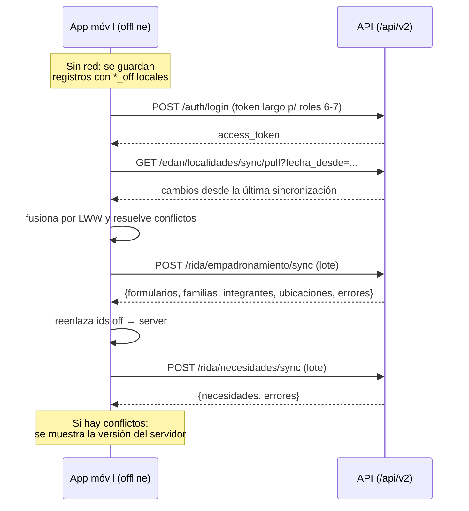

# 03 · Offline y sincronización

> Verificado contra `api/edan/router.py`, `api/rida/*`, `api/sinb/*` y las migraciones `v2.9.0`, `v2.26.0` en octubre de 2026.

El sistema está diseñado **offline-first**: la app móvil trabaja sin red y luego empuja los cambios al servidor. El backend ofrece los endpoints y la resolución de conflictos; **el código del cliente (Flutter) vive fuera de este repositorio**.

## 1. Modelo de datos para trabajo sin conexión

### 1.1 Identificadores generados por el dispositivo

| Identificador | Ámbito | Formato / convención | Ubicación |
|---|---|---|---|
| `id_seccion` | Secciones EDAN (1:N) | `{timestamp_base32}-{uuid_short}` ≈ 24 c. Ej. `1a0357323cb-659d0c9c3d415` | `database/migrations/v2.9.0_add_id_seccion.sql`; **REQUERIDO** en v2 (`api/edan/schemas.py:247`) |
| `id_local` | EDAN y localidades | UUID del cliente; clave de upsert | `api/edan/schemas.py:321,395,600` |
| `id_familia_off` | Familias RIDA | VARCHAR en `rida.familia` | `database/migrations/v2.19.0` |
| `id_integrante_off` | Integrantes RIDA | VARCHAR en `rida.integrante` | `database/migrations/v2.20.0` |
| `id_ubicacion_off` | Ubicaciones RIDA | VARCHAR en `rida.ubicacion_familia` | `database/migrations/v2.21.0` |
| `id_necesidad_off` | Necesidades RIDA | VARCHAR en `rida.necesidad` | `database/migrations/v2.23.0` |
| `id_off` | Tablas transaccionales SINB | `VARCHAR(36)` + índice parcial | `database/migrations/v2.26.0_sinb_id_off.sql` |

El servidor **nunca genera** estos identificadores: solo los recibe y resuelve. El formulario RIDA se identifica por `id_edan_localidad` (UNIQUE en `rida.formulario_rida`).

### 1.2 Borrado diferido (tombstones)

- `edan.edan_localidades.pendiente_actualizacion` / `pendiente_eliminacion` — `api/edan/schemas.py:324-325,398-399,644-645,716-717`.
- Cuando el cliente marca `pendiente_eliminacion=true`, el servidor **no** responde 404: aplica la eliminación y responde que el registro quedó como tombstone.

### 1.3 Versionado

**No hay versionado numérico.** Se usa **LWW (Last-Write-Wins) por `fecha_modificacion`**: gana la escritura con marca de tiempo más reciente. `fecha_modificacion` está deliberadamente excluida de los triggers de aprobación para que no altere el orden LWW (`api/edan/service.py:1029-1049`).

## 2. Endpoints de sincronización

### 2.1 RIDA

| Método y ruta | Fichero | Contenido |
|---|---|---|
| `POST /api/v2/rida/empadronamiento/sync` | `api/rida/router.py:572` | Lote de **formularios, familias, integrantes y ubicaciones** |
| `POST /api/v2/rida/necesidades/sync` | `api/rida/necesidades/router.py:391` | Lote de **necesidades** |

**Payload de empadronamiento** (`EmpadronamientoSyncIn`, `api/rida/schemas.py:213`):

```json
{
  "formularios": [ { "id_edan_localidad": 42, "id_estado": 1, ... } ],
  "familias":    [ { "id_familia_off": "fam-uuid-1", "id_edan_localidad": 42, ... } ],
  "integrantes": [ { "id_integrante_off": "int-uuid-1", "id_familia_off": "fam-uuid-1", ... } ],
  "ubicaciones": [ { "id_ubicacion_off": "ubi-uuid-1", "id_familia_off": "fam-uuid-1", ... } ]
}
```

Reglas de resolución (`api/rida/service.py:952-1046`):

1. **Formulario** → upsert por `id_edan_localidad`.
2. **Familia** → se vincula por `id_familia_off`; si solo llega `id_edan_localidad`, resuelve el `id_formulario` del empadronamiento de esa localidad.
3. **Integrante** → `id_familia` se resuelve por `id_familia_off`.
4. **Ubicación** → ídem.

> *"El lote nunca falla completo: los errores van en `errores[]`. Devuelve los mapeos `off → server` para que el dispositivo reenlace."* (`api/rida/router.py:578`)

Respuesta:

```json
{
  "success": true,
  "message": "Empadronamiento sincronizado correctamente",
  "data": {
    "formularios": [ {"id_edan_localidad": 42, "id_formulario": 35, "aplicado": true, "data": {...}} ],
    "familias":    [ {"id_familia_off": "fam-uuid-1", "id_familia": 10, "aplicado": true} ],
    "integrantes": [ ... ], "ubicaciones": [ ... ],
    "errores": [ {"tipo": "familia", "id": "...", "aplicado": false, "detalle": "..."} ]
  }
}
```

**Payload de necesidades** (`SyncNecesidadesIn`, `api/rida/necesidades/schemas.py:131-146`): lista de `{id_necesidad_off, id_familia_off, id_articulo, id_categoria_ayuda, cantidad, prioridad, estado}`; se resuelven los vínculos por `*_off` (`api/rida/necesidades/service.py:391-460`).

**Requisito:** `require_rol(1, 2, 6, 7)` (`ROLES_ESCRITURA`, `api/rida/router.py:26`).

### 2.2 EDAN

| Método y ruta | Fichero:línea | Contenido |
|---|---|---|
| `POST /api/v1\|2/edan/sync` | `api/edan/router.py:300` | Push de EDAN completos |
| `GET  /api/v1\|2/edan/sync/pull` | `api/edan/router.py:316` | Pull incremental (`fecha_desde`, `skip`, `limit` ≤ 1000) |
| `POST /api/v1\|2/edan/localidades/sync` | `api/edan/router.py:334` | Push de localidades (unidad de reporte) |
| `GET  /api/v1\|2/edan/localidades/sync/pull` | `api/edan/router.py:358` | Pull incremental de localidades |
| `POST /api/v2/edan/localidades/cabecera` | `api/edan/router_v2.py:323` | Sync **por secciones** (primer paso) |
| `GET  /api/v2/edan/localidades/por-id-local/{id_local}` | `api/edan/router_v2.py:343` | Resolución `id_local` → `id_edan_localidad` |

### 2.3 SINB

Las tablas transaccionales llevan `id_off` (`v2.26.0`) para el mismo patrón de upsert idempotente.

## 3. Resolución de conflictos

Algoritmo de `sync_upsert` (`api/edan/service.py:2509-2571`), aplicado por cada ítem del lote:

```
1. pendiente_eliminacion = true  →  se trata como tombstone; solo se aplica
                                    si payload_fecha >= fecha del servidor
2. id_local no existe            →  INSERT + se devuelve el id_local
3. payload_fecha < fecha servidor →  NO se aplica: responde {"aplicado": false,
                                    "conflicto": true, "data": <versión del servidor>}
4. en otro caso                  →  UPDATE + reemplazo de secciones + limpieza
                                    de flags de pendiente
```

`localidad_sync_upsert` (`api/edan/service.py:2605-2661`) sigue el mismo esquema, con **borrado físico** del tombstone (`:2618`) y **preservación del estado decidido por el UGR** (`:2641-2646`), de modo que una re-sincronización del móvil no revierte la aprobación hecha en oficina.

**Propiedades del lote:**

- Nunca falla completo: cada ítem responde individualmente `{aplicado, conflicto, tombstone, error}`.
- Los errores se agregan en `errores[]` y el resto del lote continúa.
- Idempotente: reenviar el mismo lote no duplica registros.

## 4. Flujo completo del dispositivo



## 5. Lo que NO existe

| Elemento | Estado |
|---|---|
| Cola de sincronización (Redis/Celery/RabbitMQ) | **No existe**: todo es síncrono dentro de la petición |
| Servidor de cambios `_changes` / `_since` | No; se usa `fecha_desde` sobre `fecha_modificacion` |
| `ETag` / `If-Match` | No |
| Merge automático de conflictos | No; el servidor responde la versión ganadora y el cliente decide |
| Reintentos con espera exponencial / backoff | En el **cliente** (no está en este repo) |
| Sync de catálogos versionados | Solo `v2.31.1_catalogos_offline.sql` y sus reverts (`v2.31.1_revertir_offline.sql`, `v2.31.2_revertir_off_catalogos.sql`) |

## 6. Nota sobre el plan de documentación del sync EDAN

El fichero `.opencode/plans/sync-docs.md` apunta a `docs/SINCRONIZACION.md` y `docs/CONSOLIDACION_EDAN.md`, **eliminados** en el commit `de381c6` (2026-10-03). Este documento sustituye parcialmente ese contenido para RIDA; el detalle de consolidación EDAN sigue pendiente.

---

**Anterior:** [02 · Autenticación](02-autenticacion-y-roles.md) · **Siguiente:** [04 · Indicadores y reportes](04-indicadores-y-reportes.md)
