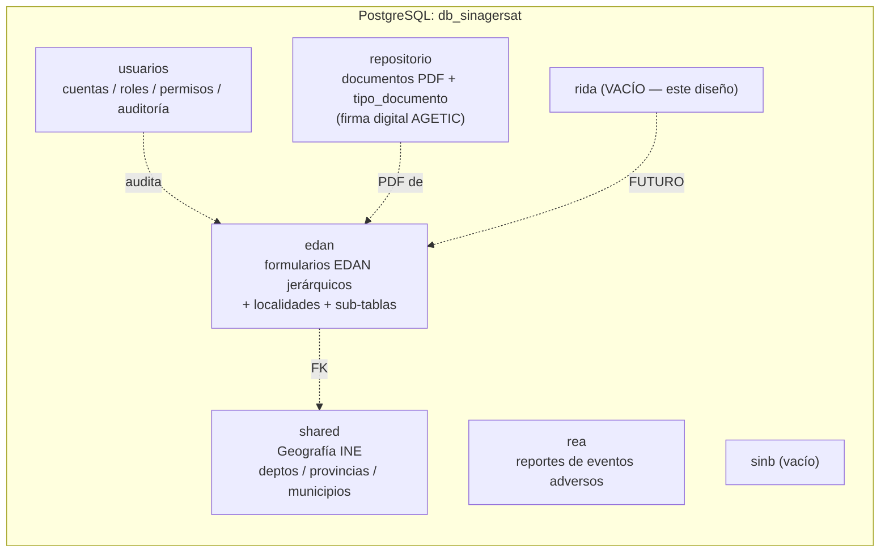
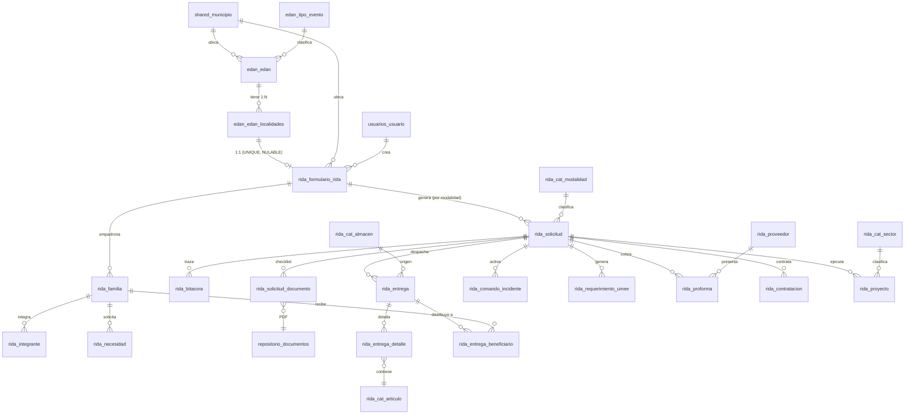
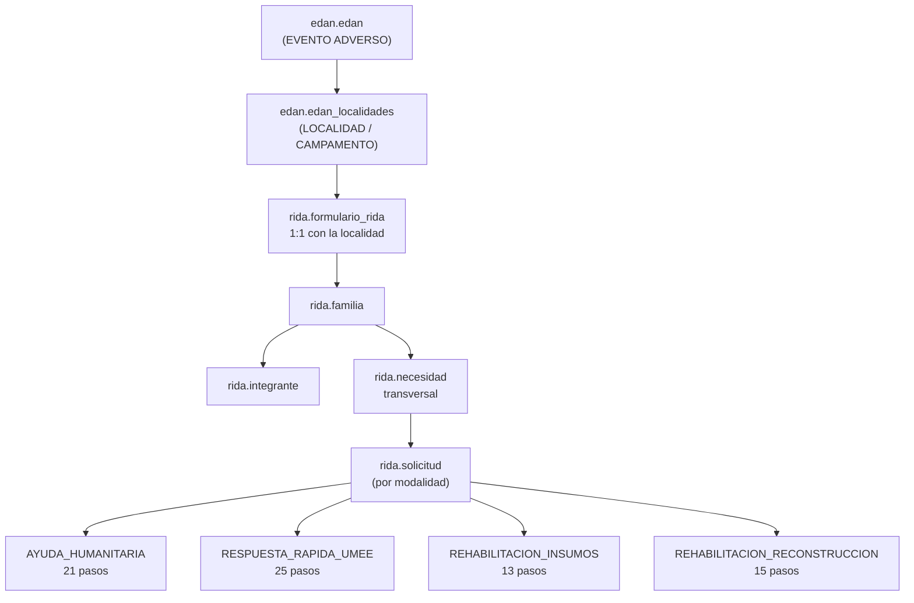
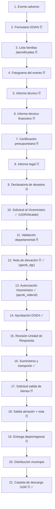
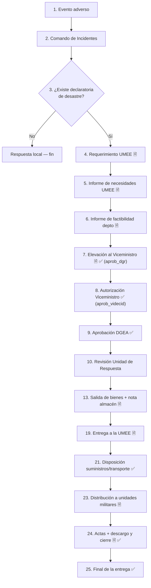
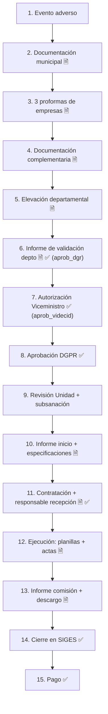
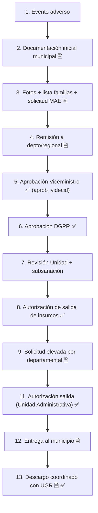
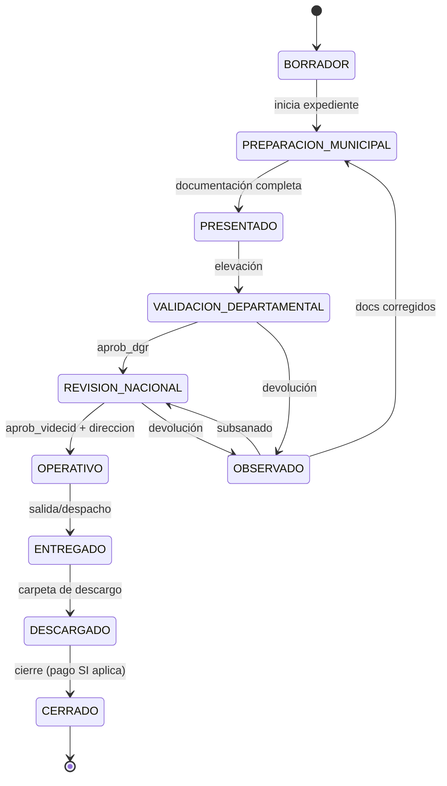
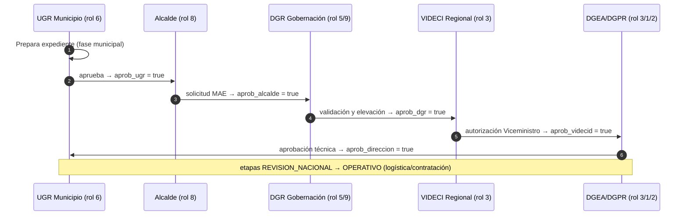
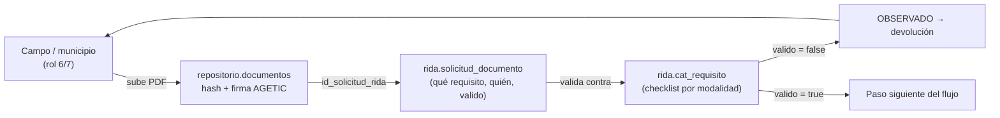

# SINAGERSAT — Base de Datos del Sistema RIDA Integral (diseño)

> [!IMPORTANT]
> Documento de **diseño de base de datos** para el esquema `rida` del Sistema RIDA
> Integral (VIDECI). Alcance: **solo diseño lógico/físico + migración SQL** — no
> incluye API ni frontend. Migración aplicada: ✔ `database/migrations/v2.17.0_rida_schema.sql`.
> 
> **Compatibilidad PostgreSQL:** el diseño se basa en el **DDL real** de la base
> `db_sinagersat` (PostgreSQL 16 + PostGIS), verificado contra
> `database/backup_2026_09_22_030001.sql`. Reutiliza `shared`, `usuarios`, `edan`
> y `repositorio` — **no duplica nada existente**.

| Campo | Valor |
|---|---|
| **Entregable** | Documento de diseño + migración SQL `v2.17.0` (aplicada y verificada idempotente) |
| **Nomenclatura** | Tablas y columnas en español (estilo `Documentacion-Base-Datos-RIDA.md`) |
| **Motor** | PostgreSQL 16 + PostGIS 3 |

---

## 1. Conexión y esquemas existentes

> [!TIP]
> Misma conexión que el resto de módulos SINAGERSAT — una sola base, varios
> esquemas. Las consultas entre esquemas son tan rápidas como dentro de un mismo
> esquema (una sola conexión, sin BDs separadas).

| Parámetro | Valor |
|---|---|
| **Host** | `localhost` (o `/var/run/postgresql` para socket Unix) |
| **Puerto** | `5432` |
| **Base de datos** | `db_sinagersat` |
| **Usuario** | `sinagersat` |
| **Contraseña** | `12345678` |
| **PostgreSQL** | 16 + PostGIS 3 |
| **Esquema objetivo** | `rida` (vacío hoy) |

```bash
PGPASSWORD=12345678 psql -U sinagersat -d db_sinagersat -h localhost -p 5432 -c '\dn'
```



---

## 2. Compatibilidad e integración con la base existente

> [!IMPORTANT]
> Principio rector: **no duplicar lo que ya existe**. `rida` se cuelga de las
> tablas existentes y solo crea lo propio — eventos, geografía, usuarios,
> permisos, auditoría y repositorio de PDF **no se recrean**.

| Necesidad del RIDA | Se reutiliza de (tabla real) | Detalle |
|---|---|---|
| Evento adverso | `edan.edan` | Cabecera EDAN (`id_edan`, `codigo_edan`, fechas, `id_tipo_evento`, `id_departamento`/`id_municipio`, totales de población/familias, flags `aprob_ugr/alcalde/dgr/videcid`). **RIDA NO crea eventos.** |
| Localidad afectada | `edan.edan_localidades` | Vínculo **1:1** con `rida.formulario_rida.id_edan_localidad` (`UNIQUE`). Para **campamentos nuevos sin EDAN** el campo es `NULL` y se completa a mano. |
| Tipo de evento | `edan.tipo_evento` | Catálogo de **48 tipos** existente; no se crea catálogo nuevo. |
| Geografía | `shared.municipio`, `shared.departamento`, `shared.provincia` | FKs directas con los **mismos códigos INE** (`DDPPMM`); `shared.municipio.geom` (Geometry MultiPolygon 4326) para PostGIS. |
| Usuarios y roles | `usuarios.usuario`, `usuarios.rol`, `usuarios.usuario_rol` | Roles 1-9 existentes (sección 8). **No se crean roles nuevos.** |
| Permisos | `usuarios.aplicacion` (**RIDA = id 2**, código `RIDA`), `usuarios.permiso`, `usuarios.accion` | Acciones: CREATE 1, READ 2, UPDATE 3, DELETE 4. Nueva matriz para RIDA (sección 8). |
| Auditoría | `usuarios.auditoria` | Mismo mecanismo: `url_app_map` con `/api/rida`, `id_aplicacion = RIDA`, `detalle` JSONB. |
| Almacenamiento de archivos | `repositorio.documentos` + `repositorio.tipo_documento` | **Reuso** del repositorio de PDF (hash SHA-256, `tamano_bytes > 0`) y de la **validación de firma digital AGETIC** ya implementada. |
| Aprobaciones | patrón de `edan.edan` | Flags `aprob_ugr`, `aprob_alcalde`, `aprob_dgr`, `aprob_videcid` — mismo **estilo simple** elegido (sección 5). |



**Los apoyos (FK) hacia esquemas existentes:** `shared.municipio` /
`shared.departamento` (denormalizados en `formulario_rida` y `solicitud`),
`usuarios.usuario` (en `*_por`, `id_usuario_*`), `edan.edan` y
`edan.edan_localidades` (en `formulario_rida`), `repositorio.documentos` y
`repositorio.tipo_documento` (en `solicitud_documento` y `cat_requisito`).

### 2.1 Cambios mínimos requeridos en esquemas existentes

> [!CAUTION]
> **Única alteración a esquemas existentes.** Si no se quiere tocar
> `repositorio`, la alternativa es `rida.documento` (descartada porque
> duplicaría hash y firma AGETIC). Se recomienda **una migración idempotente**
> (`BEGIN/COMMIT`, `ON CONFLICT`, `IF NOT EXISTS`) siguiendo la convención de
> las migraciones del repo.

Para reusar `repositorio.documentos` con solicitudes RIDA **sin romper EDAN**:

1. `repositorio.documentos.id_edan` pasa de `NOT NULL` a **nullable**.
2. Se agrega **`id_solicitud_rida INTEGER NULL REFERENCES rida.solicitud(id_solicitud)`**.
3. Se **siembran** en `repositorio.tipo_documento` los códigos de documentos RIDA
   (sección 7) — la tabla ya tiene `codigo VARCHAR(50) UNIQUE`, `nombre`,
   `orden`, `activo`, por lo que solo es `INSERT ... ON CONFLICT (codigo) DO NOTHING`.

### 2.2 Lo que `rida` sí crea (resumen)

Todo lo propio del **empadronamiento**, las **necesidades**, las **4 modalidades
de atención**, el **expediente/solicitud**, la **trazabilidad** y la **logística**
(secciones 3 a 6): 11 catálogos + 16 tablas de operación.

---

## 3. Cómo se divide el RIDA Integral: Necesidades, Ayuda Humanitaria, Respuesta Rápida y Rehabilitación

> [!NOTE]
> Un mismo evento y una misma **localidad** se abren en **4 modalidades de
> atención**. La **`necesidad` es transversal**: se identifica una sola vez
> (por familia o por localidad) y alimenta todas las rutas.

### 3.1 Vista general (evento → solicitud por modalidad)



> [!IMPORTANT]
> Una localidad puede tener **varias solicitudes** (hasta 4, una por modalidad);
> cada una es un **expediente independiente** con su propio estado, aprobaciones
> y documentación.

### 3.2 ¿Qué es cada cosa y en qué se diferencia? (narrativa detallada)

#### 3.2.1 Necesidad (transversal — no es una modalidad)

Es el **registro de "qué falta y cuánto"**, sin importar todavía quién lo
entregará. Se levanta durante el empadronamiento en campo (módulos 1-3 de
`Empadronamiento.md`).

- Se asocia a **una familia** (recomendado) o a **la localidad** cuando no hay
  desagregación familiar.
- Se clasifica por **categoría de ayuda** y se detalla por **artículo**
  (`rida.necesidad`).
- **NO es una modalidad**; es el insumo de entrada común:
  - de una necesidad **alimentación** → solicitud de **Ayuda Humanitaria**;
  - de una necesidad **rehabilitación de vivienda** → **Rehabilitación-Reconstrucción**;
  - del análisis de vulnerabilidades del empadronamiento → **necesidades
    específicas** (fórmula láctea, pañales, kit de higiene femenina, etc.).

**Catálogo de categorías de ayuda** (`rida.cat_categoria_ayuda`):

| Categoría | Qué agrupa | Ejemplos de artículo |
|---|---|---|
| `TECHO_ABRIGO` | Vivienda, abrigo, enseres | Carpa, frazada, colchón, kit de enseres, plancha calamina |
| `ALIMENTACION_AGUA` | Alimentación y agua segura | Ración seca familiar, fórmula láctea, bidón de agua, pastillas potabilizadoras |
| `SALUD_HIGIENE` | Salud, higiene, salubridad | Kit de higiene femenina, pañales, kit de primeros auxilios, medicamentos |
| `MEDIOS_VIDA` | Recuperación económica/medios de vida | Herramientas, semilla, insumos agrícolas, kits de trabajo |
| `EQUIPAMIENTO_UMEE` | Equipamiento de respuesta militar (UMEE) | Palas, picos, motobombas, combustible, carpas para unidades |

#### 3.2.2 Ayuda Humanitaria (modalidad `AYUDA_HUMANITARIA`)

> **❓ Qué es:** entrega de bienes de asistencia humanitaria (alimentación,
> agua, higiene, abrigo) a **familias damnificadas**, desde los almacenes de VIDECI.

> **👥 Quién la pide:** el municipio (UGR rol 6) tras el EDAN y la declaratoria
> de desastre.

**Circuitos:** municipio prepara la carpeta → validación departamental →
autorización del Viceministro y aprobación de la **DGEA** → revisión de la Unidad
de Respuesta → despacho de almacén → transporte → entrega al municipio →
distribución familiar → **carpeta de descargo con firmas de las familias (UGR)**.

> [!CAUTION]
> **Diferenciador:** el beneficiario final son **familias**; la evidencia de
> cierre es la **carpeta de descargo** con firmas; **no hay contrato** con
> empresas, **no hay pago a proveedores**, **no hay SICOES/SIGES**.

#### 3.2.3 Respuesta Rápida UMEE (modalidad `RESPUESTA_RAPIDA_UMEE`)

> **❓ Qué es:** equipamiento y logística para la **Unidad Militar de
> Emergencias (UMEE)** y unidades militares de respuesta inmediata.

> [!WARNING]
> **Cuándo se activa:** **solo cuando existe declaratoria de desastre**. Si la
> capacidad local responde sin desastre, el proceso **no se abre** (decisión en
> el paso 3 del flujo).

**Circuito:** comando de incidentes → requerimiento UMEE → informe de necesidades
→ factibilidad departamental → autorización del Viceministro + aprobación DGEA →
revisión Unidad de Respuesta → despacho de almacén → entrega a la UMEE →
**distribución a las unidades militares**.

> [!NOTE]
> **Diferenciador:** beneficiario final = **unidades militares** (no familias);
> cierre = **descargo UMEE con actas de recepción firmadas por las unidades**;
> sin distribución a hogares y sin contrato.

#### 3.2.4 Rehabilitación-Insumos (modalidad `REHABILITACION_INSUMOS`)

> **❓ Qué es:** entrega de **insumos de rehabilitación** (láminas, cemento,
> kits, materiales) a **familias damnificadas** para reparación en corto plazo.

> **👥 Quién la pide:** el municipio (UGR) con documentación técnica, legal,
> financiera y social — incluye **lista de familias damnificadas, cuadro
> fotográfico y solicitud de la MAE (rol 8)**.

**Circuito:** documentación → remisión departamental → aprobación Viceministro +
**DGPR** → revisión de la Unidad → subsanación de observaciones →
**autorización de salida de insumos** → gestión con la Unidad Administrativa →
la departamental recibe y **entrega al municipio** → **descargo en coordinación
con la UGR**.

> [!NOTE]
> **Diferenciador:** entrega de **insumos físicos de rehabilitación**
> (materiales), beneficiario final = familias vía municipio, **no hay
> contratación de servicios**, cierre con **descargo coordinado con la UGR**
> (distinto del descargo de AH — el insumo es para reparación, no para
> alimentación/higiene).

#### 3.2.5 Rehabilitación-Reconstrucción (modalidad `REHABILITACION_RECONSTRUCCION`)

> **❓ Qué es:** **contratación de empresas** para ejecutar servicios de
> **rehabilitación** (corto plazo: restablecer servicios básicos, agua, luz,
> vías) o **reconstrucción** (mediano/largo plazo: reponer infraestructura), en
> el marco de la **Ley N.º 602**. Incorpora el principio de **"no reproducción
> del riesgo"** (criterios prospectivos y correctivos).

> **👥 Quién la pide:** el municipio con EDAN, informes técnico/legal/
> presupuestario, declaratoria y **3 proformas de empresas legalmente
> constituidas**.

**Circuito:** documentación municipal → proformas → elevación y validación
departamental → autorización Viceministro + aprobación DGPR → revisión Unidad →
informe de inicio y especificaciones técnicas → **contratación** + responsable de
recepción → ejecución por la empresa → planillas/actas de conformidad → informe
de la comisión + descargo → **cierre en SIGES → proceso de pago**.

> [!CAUTION]
> **Diferenciador:** es la **única modalidad que contrata** (¡3 proformas!),
> el beneficiario operativo es el municipio vía servicio, la evidencia de
> ejecución son **planillas y actas de conformidad**, y el cierre incluye
> **SIGES + pago** (nada de esto existe en las otras).

### 3.3 Comparativa rápida de las 4 modalidades

| Aspecto | AYUDA HUMANITARIA | RESPUESTA RÁPIDA UMEE | REHABILITACIÓN-INSUMOS | REHABILITACIÓN-RECONSTRUCCIÓN |
|---|---|---|---|---|
| ¿Contrata empresa? | No | No | No | **Sí (3 proformas)** |
| ¿Entrega bienes? | Sí (almacén) | Sí (equipos) | Sí (insumos) | El servicio lo ejecuta la empresa |
| Beneficiario final | Familias | Unidades militares | Familias | Municipio (vía servicio) |
| Se activa solo con declaratoria | No | **Sí** | No | No |
| Evidencia de cierre | Carpeta descargo UGR | Actas + descargo UMEE | Descargo con UGR | Planillas/actas → SIGES → pago |
| Aprobación técnica nacional | **DGEA** | **DGEA** | **DGPR** | **DGPR** |
| Entidades operativas claves | almacén, UGR | comando de incidentes, UMEE | lista familias, MAE, almacén | proformas, contratación, SIGES |
| Documento social | Lista familias | — (requerimiento operativo) | Fotos + lista + MAE | — (proformas y horas maquinaria) |

**Mapa de tablas por modalidad:**

| Tabla | AH | UMEE | REHI | REHR |
|---|---|---|---|---|
| `formulario_rida`, `familia`, `integrante`, `necesidad` | ✅ | ✅ | ✅ | ✅ |
| `solicitud`, `bitacora`, `solicitud_documento` | ✅ | ✅ | ✅ | ✅ |
| `entrega`, `entrega_detalle`, `entrega_beneficiario` | ✅ | ✅ | ✅ | ❌ |
| `comando_incidente`, `requerimiento_umee` | ❌ | ✅ | ❌ | ❌ |
| `proforma`, `contratacion`, `proyecto` | ❌ | ❌ | ❌ | ✅ |

---

## 4. Flujo y pasos por modalidad (línea de secuencia)

> [!TIP]
> Cada flujo se modela en datos (configurable, no hardcodeado) con el catálogo
> `rida.cat_requisito(id_modalidad, orden, nombre_paso, id_tipo_documento,
> instancia, es_hito_aprobacion, es_documento)`. Las tablas siguientes son la
> **semilla** de ese catálogo.

**Instancias:** **1** = local/municipal · **2** = departamental/regional ·
**3** = nacional (VIDECI). Leyenda: 📄 = sube documento · ✅ = hito de aprobación.

### 4.1 Ayuda Humanitaria — 21 pasos



| Nº | Paso | Instancia | Marca |
|---|---|---|---|
| 1 | Ocurrencia del evento adverso | — | |
| 2 | Formulario EDAN del municipio | 1 | 📄 |
| 3 | Lista de familias damnificadas | 1 | 📄 |
| 4 | Fotograma del evento | 1 | 📄 |
| 5 | Informe técnico del municipio | 1 | 📄 |
| 6 | Informe técnico financiero | 1 | 📄 |
| 7 | Certificación presupuestaria del municipio | 1 | 📄 |
| 8 | Informe legal del municipio | 1 | 📄 |
| 9 | Declaratoria de desastre del municipio | 1 | 📄 |
| 10 | Solicitud de ayuda humanitaria al Sr. Viceministro | 1 | ✅ (aprob_alcalde / aprob_ugr) |
| 11 | Informe de validación departamental | 2 | 📄 |
| 12 | Nota elevando la carpeta al Sr. Viceministro | 2 | 📄 ✅ (aprob_dgr) |
| 13 | Autorización de carpeta por el Viceministro de Defensa Civil | 3 | ✅ (aprob_videcid) |
| 14 | Aprobación por el Director General de Emergencia y Auxilio (DGEA) | 3 | ✅ |
| 15 | Revisión por la Unidad de Respuesta | 3 | |
| 16 | Gestión y autorización de suministros y transportes | 3 | ✅ |
| 17 | Solicitud de salida de bienes por la departamental | 2 | 📄 |
| 18 | Salida de bienes y emisión de nota por almacén | 3 | 📄 |
| 19 | Entrega de ayuda por la departamental y regional | 2 | 📄 |
| 20 | Distribución por el municipio o gobernación | 1 | |
| 21 | Elaboración de carpeta de descargo por el UGR | 1 | 📄 ✅ |

### 4.2 Respuesta Rápida UMEE — 25 pasos



| Nº | Paso | Instancia | Marca |
|---|---|---|---|
| 1 | Evento adverso | — | |
| 2 | Conformación del Comando de Incidentes | 2 | |
| 3 | Decisión: ¿existe declaratoria de desastre? (No → respuesta local, fin) | — | |
| 4 | Requerimiento de la UMEE (sí hay desastre) | 2 | 📄 |
| 5 | Informe de necesidades de la UMEE | 2 | 📄 |
| 6 | Informe de factibilidad departamental | 2 | 📄 |
| 7 | Nota elevando la carpeta al Sr. Viceministro | 2 | 📄 ✅ (aprob_dgr) |
| 8 | Autorización del Viceministro | 3 | ✅ (aprob_videcid) |
| 9 | Aprobación de la DGEA | 3 | ✅ |
| 10 | Revisión en la Unidad de Respuesta | 3 | |
| 11 | Informe de necesidades por la UMEE (consolidado → Depto/Regional) | 2 | 📄 |
| 12 | Revisión departamental y solicitud de salida de almacenes | 2 | ✅ |
| 13 | Salida de bienes y emisión de nota (almacén) | 3 | 📄 |
| 14-18 | Solicitudes y autorizaciones de almacén (salida, revisión, autorización, entrega) | 2-3 | ✅ |
| 19 | Entrega a la entidad — UMEE | 2 | 📄 |
| 20 | Revisión en la Unidad de Respuesta (documentos técnicos/legales) | 3 | |
| 21 | Disposición de suministros y transporte | 3 | ✅ |
| 22 | Solicitud de salida de almacenes territoriales | 2 | 📄 |
| 23 | Distribución a unidades militares | 2 | 📄 |
| 24 | Carpeta de descargo y cierre (actas firmadas por unidades) | 2 | 📄 ✅ |
| 25 | Final de la entrega | — | ✅ |

### 4.3 Rehabilitación-Reconstrucción — 15 pasos



| Nº | Paso | Instancia | Marca |
|---|---|---|---|
| 1 | Evento adverso | — | |
| 2 | Municipio: documentación (EDAN, informe técnico, legal, certificación presupuestaria, declaratoria) | 1 | 📄 |
| 3 | Municipio: **3 proformas** de empresas legalmente constituidas (maquinaria/servicios) | 1 | 📄 |
| 4 | Municipio: documentación complementaria (doc. legal empresas + solicitud especificando horas) | 1 | 📄 |
| 5 | Departamentales/regionales elevan documentación al nivel nacional | 2 | 📄 |
| 6 | Informe de validación departamental → despacho | 2 | 📄 ✅ (aprob_dgr) |
| 7 | Viceministro autoriza carpeta → DGPR | 3 | ✅ (aprob_videcid) |
| 8 | DGPR aprueba carpeta → Unidad de Rehabilitación y Reconstrucción | 3 | ✅ |
| 9 | Unidad revisa documentación y observa errores (subsanar) | 3 | |
| 10 | Informe de inicio de proceso + especificaciones técnicas | 3 | 📄 |
| 11 | Unidad Administrativa: contratación + responsable de recepción | 3 | 📄 ✅ |
| 12 | Empresa ejecuta: **planillas de trabajo + actas de conformidad** | 3 | 📄 |
| 13 | Responsable de recepción: informe de la comisión + descargo a despacho del Ministro | 3 | 📄 |
| 14 | Unidad de Contrataciones: **cierre en SIGES** | 3 | ✅ |
| 15 | Proceso de **pago** | 3 | ✅ |

### 4.4 Rehabilitación-Insumos — 13 pasos



| Nº | Paso | Instancia | Marca |
|---|---|---|---|
| 1 | Evento adverso | — | |
| 2 | Municipio: documentación inicial (EDAN, informe técnico, legal, financiero, certificación presupuestaria) | 1 | 📄 |
| 3 | Municipio: documentación social (cuadro fotográfico + lista de familias + **solicitud MAE**) | 1 | 📄 |
| 4 | Remisión de la documentación a la instancia departamental/regional | 1-2 | 📄 |
| 5 | Viceministro aprueba la carpeta → DGPR | 3 | ✅ (aprob_videcid) |
| 6 | DGPR aprueba la carpeta → Unidad | 3 | ✅ |
| 7 | Unidad revisa la documentación y coordina subsanación de observaciones | 3 | |
| 8 | Subsanadas las observaciones → **autorización de salida de insumos** | 3 | ✅ |
| 9 | Departamentales elevan solicitud de insumos de rehabilitación | 2 | 📄 |
| 10 | Unidad gestiona la salida con la Unidad Administrativa | 3 | |
| 11 | Unidad Administrativa autoriza la salida de insumos | 3 | ✅ |
| 12 | Departamental recoge, recibe y **entrega insumos al municipio** | 2 | 📄 |
| 13 | Departamental prepara **documento de descargo** en coordinación con la UGR | 2 | 📄 ✅ |

### 4.5 Estados (línea de secuencia transversal de la solicitud)



> [!NOTE]
> Un **expediente observado** puede reingresar a `PREPARACION_MUNICIPAL`
> (documentos corregidos) o a `REVISION_NACIONAL` (subsanación directa), pero
> todo cambio **se registra siempre en `rida.bitacora`** — no se pierde histórico.

---

## 5. Aprobaciones y línea de secuencia

> [!IMPORTANT]
> Se adoptan **aprobaciones simples estilo EDAN** (el **mismo patrón que ya usa
> `edan.edan`**: flags booleanos + fecha + usuario), **sin** motor BPMN ni tablas
> de workflow genérico.

### 5.1 Flags de aprobación en `rida.solicitud`

| Flag | Significado | Instancia | Lo emite (rol) |
|---|---|---|---|
| `aprob_ugr` | La UGR municipal valida el expediente | Local | 6 UGR Municipio / 7 Responsable Local |
| `aprob_alcalde` | La MAE firma la solicitud (AH paso 10, Rehab-insumos paso 3) | Local | 8 Alcalde |
| `aprob_dgr` | La instancia departamental valida y eleva | Departamental | 5 DGR Gobernación / 9 VIDECI Departamental |
| `aprob_videcid` | Autorización nacional (Viceministro) | Nacional | 3 VIDECI Regional (supervisado por 1/2) |
| `aprob_direccion` | Aprobación técnica nacional (DGEA o DGPR según modalidad) | Nacional | 3 VIDECI Regional / 1 / 2 |

Cada flag tiene sus columnas de acompañamiento (mismo estilo que `edan.edan`):
`aprob_ugr_fecha`, `aprob_ugr_por` (**FK → `usuarios.usuario.id_usuario`**), y
así para cada uno.

### 5.2 Correspondencia de las 3 instancias institucionales

| Instancia (workflow) | Nivel en el sistema | Flags emitidos | Rol(es) | Área geográfica |
|---|---|---|---|---|
| **1 — Local/Municipal** | municipal | `aprob_ugr`, `aprob_alcalde` | 6, 7, 8 | su municipio |
| **2 — Departamental/Regional** | departamental | `aprob_dgr` | 5, 9 | su departamento |
| **3 — Nacional/Central** | nacional | `aprob_videcid`, `aprob_direccion` | 1, 2, 3 (DGEA/DGPR/Unidad) | todos |

### 5.3 Flujo de aprobación (escala local → nacional)



### 5.4 Reglas de secuencia (línea de aprobaciones por modalidad)

> [!IMPORTANT]
> Cadenas **validadas contra la semilla real de `rida.cat_requisito`
> (`es_hito_aprobacion`)** y contra `Analisis RIDA/*`. REHI y REHR **no** tienen
> fases de aprobación local/departamental que emitieran flag: en REHI la solicitud
> MAE es solo documento (paso 3) y la remisión departamental una elevación
> (paso 4); REHR inicia directamente en la validación departamental.

| Modalidad | Orden de aprobaciones obligatorio |
|---|---|
| `AYUDA_HUMANITARIA` | `aprob_ugr` → `aprob_alcalde` → `aprob_dgr` → `aprob_videcid` → `aprob_direccion` (DGEA) |
| `RESPUESTA_RAPIDA_UMEE` | `aprob_dgr` → `aprob_videcid` → `aprob_direccion` (DGEA) → autorización logística |
| `REHABILITACION_INSUMOS` | `aprob_videcid` → `aprob_direccion` (DGPR) → autorizaciones logísticas |
| `REHABILITACION_RECONSTRUCCION` | `aprob_dgr` → `aprob_videcid` → `aprob_direccion` (DGPR) |

Reglas de negocio:

1. Un flag **no puede activarse** si el anterior está en `false`.
2. Toda activación/revocación se registra automáticamente en `rida.bitacora`
   (acción `APROBACION`/`DEVOLUCION` + estado resultante).
3. La **revisión de documentación** (AH paso 15, UMEE paso 10, REHRA paso 9/7)
   puede **reabrir** el flag activado y devolver a `OBSERVADO` sin eliminar
   histórico.
4. Las observaciones de devolución quedan en `solicitud.observaciones` y en la
   bitácora con `estado_resultante = 'OBSERVADO'`.

---

## 6. Esquema `rida` — tablas, campos y conexiones (formato DBeaver)

> [!TIP]
> Convenciones PostgreSQL adoptadas de las tablas existentes (ver
> `backup_2026_09_22_030001.sql`):
> - **PK**: `SERIAL`/`BIGSERIAL` (mismo patrón que `edan_*_seq OWNED BY`).
> - **Fechas**: `TIMESTAMP` con `DEFAULT CURRENT_TIMESTAMP` (igual que `edan.edan`).
> - **Enums**: `VARCHAR` + `CHECK IN (...)` (igual que `edan_procedencia_check`).
> - **JSON**: `JSONB` (precedente: `edan_importacion_log.detalle`, `auditoria.detalle`).
> - **Geometrías**: `GEOMETRY(...,4326)` + **índice GIST** (igual que `shared.municipio.geom`).
> - **Denormalización de geografía** (`id_departamento`/`id_municipio`): precedente
>   directo en `edan.edan_localidades` y `repositorio.documentos`.

### 6.1 Catálogos (11)

#### `rida.cat_modalidad`

| Campo | Tipo | Restricción | Por defecto | Descripción |
|---|---|---|---|---|
| id_modalidad | SERIAL | PK | | |
| codigo | VARCHAR(30) | UNIQUE NOT NULL | | `AYUDA_HUMANITARIA`, `RESPUESTA_RAPIDA_UMEE`, `REHABILITACION_INSUMOS`, `REHABILITACION_RECONSTRUCCION` |
| nombre | VARCHAR(100) | NOT NULL | | Nombre legible |
| descripcion | TEXT | | | |
| orden | INTEGER | | | Para listados |
| activo | BOOLEAN | | true | |

#### `rida.cat_categoria_ayuda`

| Campo | Tipo | Restricción | Por defecto | Descripción |
|---|---|---|---|---|
| id_categoria | SERIAL | PK | | |
| codigo | VARCHAR(30) | UNIQUE NOT NULL | | `TECHO_ABRIGO`, `ALIMENTACION_AGUA`, `SALUD_HIGIENE`, `MEDIOS_VIDA`, `EQUIPAMIENTO_UMEE` |
| nombre | VARCHAR(100) | NOT NULL | | |
| descripcion | TEXT | | | |
| activo | BOOLEAN | | true | |

#### `rida.cat_articulo`

| Campo | Tipo | Restricción | Por defecto | Descripción |
|---|---|---|---|---|
| id_articulo | SERIAL | PK | | |
| id_categoria | INTEGER | **FK → rida.cat_categoria_ayuda.id_categoria** NOT NULL | | Categoría de ayuda |
| codigo | VARCHAR(30) | UNIQUE | | |
| nombre | VARCHAR(150) | NOT NULL | | Harina, carpa, frazada, pañal, ... |
| unidad_medida | VARCHAR(20) | | 'unidad' | unidad, kg, litro, kit |
| peso_unitario_kg | NUMERIC(10,3) | | | Para despacho |
| costo_referencia_bs | NUMERIC(12,2) | | | Para valorización |
| activo | BOOLEAN | | true | |

#### `rida.cat_condicion_hogar`

| Campo | Tipo | Restricción | Por defecto | Descripción |
|---|---|---|---|---|
| id_condicion | SERIAL | PK | | |
| codigo | VARCHAR(20) | UNIQUE NOT NULL | | `DAMNIFICADO` (pérdida directa de vivienda) / `AFECTADO` (daño indirecto) |
| nombre | VARCHAR(50) | NOT NULL | | |
| descripcion | TEXT | | | |

#### `rida.cat_parentesco`

| Campo | Tipo | Restricción | Por defecto | Descripción |
|---|---|---|---|---|
| id_parentesco | SERIAL | PK | | |
| codigo | VARCHAR(20) | UNIQUE NOT NULL | | `JEFE_HOGAR`, `CONYUGE`, `HIJO`, `OTRO` |
| nombre | VARCHAR(50) | NOT NULL | | |
| activo | BOOLEAN | | true | |

#### `rida.cat_tipo_discapacidad`

| Campo | Tipo | Restricción | Por defecto | Descripción |
|---|---|---|---|---|
| id_discapacidad | SERIAL | PK | | |
| codigo | VARCHAR(20) | UNIQUE NOT NULL | | `FISICA`, `SENSORIAL`, `INTELECTUAL`, `NINGUNA` |
| nombre | VARCHAR(50) | NOT NULL | | |
| requiere_movilidad | BOOLEAN | | false | silla de ruedas / muletas |
| activo | BOOLEAN | | true | |

#### `rida.cat_enfermedad_cronica`

| Campo | Tipo | Restricción | Por defecto | Descripción |
|---|---|---|---|---|
| id_enfermedad | SERIAL | PK | | |
| codigo | VARCHAR(20) | UNIQUE NOT NULL | | `DIABETES`, `HIPERTENSION`, `VIH`, `DIALISIS`, `OTRAS` |
| nombre | VARCHAR(80) | NOT NULL | | |
| requiere_medicacion_continua | BOOLEAN | | true | garantiza continuidad de tratamiento |
| activo | BOOLEAN | | true | |

#### `rida.cat_sector`

| Campo | Tipo | Restricción | Por defecto | Descripción |
|---|---|---|---|---|
| id_sector | SERIAL | PK | | |
| codigo | VARCHAR(20) | UNIQUE NOT NULL | | `SALUD`, `EDUCACION`, `VIVIENDA`, `INFRAESTRUCTURA`, `MEDIOS_VIDA` |
| nombre | VARCHAR(80) | NOT NULL | | Sector para mesas técnicas y proyectos |
| activo | BOOLEAN | | true | |

#### `rida.cat_almacen`

| Campo | Tipo | Restricción | Por defecto | Descripción |
|---|---|---|---|---|
| id_almacen | SERIAL | PK | | |
| codigo | VARCHAR(20) | UNIQUE NOT NULL | | Comercial/nacional/departamental |
| nombre | VARCHAR(100) | NOT NULL | | Almacén Central VIDECI, Almacén La Paz, ... |
| nivel | VARCHAR(20) | CHECK IN ('nacional','departamental','regional') | 'nacional' | |
| id_departamento | INTEGER | **FK → shared.departamento.id** (NULL si nacional) | | |
| responsable | VARCHAR(150) | | | |
| activo | BOOLEAN | | true | |

#### `rida.cat_unidad_militar`

| Campo | Tipo | Restricción | Por defecto | Descripción |
|---|---|---|---|---|
| id_unidad | SERIAL | PK | | |
| codigo | VARCHAR(20) | UNIQUE NOT NULL | | `UMEE`, `REG-1`, `BA-1` |
| nombre | VARCHAR(150) | NOT NULL | | Unidad Militar de Emergencias, Regimiento ... |
| comando | VARCHAR(20) | | | Zona militar / comando de origen |
| activo | BOOLEAN | | true | |

#### `rida.cat_requisito` — almacena la línea de secuencia (los pasos de cada modalidad)

| Campo | Tipo | Restricción | Por defecto | Descripción |
|---|---|---|---|---|
| id_requisito | SERIAL | PK | | |
| id_modalidad | INTEGER | **FK → rida.cat_modalidad.id_modalidad** NOT NULL | | |
| orden | INTEGER | NOT NULL | | 1..N (21, 25, 13, 15) |
| nombre_paso | VARCHAR(150) | NOT NULL | | Nombre del paso del flujo |
| id_tipo_documento | INTEGER | **FK → repositorio.tipo_documento.id_tipo_documento** (NULL si no sube PDF) | | Ver sección 7 |
| instancia | INTEGER | CHECK IN (1,2,3) NOT NULL | | 1 local, 2 departamental, 3 nacional |
| es_documento | BOOLEAN | | true | Si el paso requiere adjuntar documento |
| es_hito_aprobacion | BOOLEAN | | false | Si el paso activa un flag de la sección 5 |
| activo | BOOLEAN | | true | |

### 6.2 Operación (núcleo transaccional) — 16 tablas

#### `rida.formulario_rida` — 1:1 con la localidad/campamento

| Campo | Tipo | Restricción | Por defecto | Descripción |
|---|---|---|---|---|
| id_formulario | SERIAL | PK | | |
| id_edan_localidad | INTEGER | **FK → edan.edan_localidades.id_edan_localidad** UNIQUE (NULL para campamentos SIN EDAN) | | vínculo **1:1** decidido |
| id_edan | BIGINT | **FK → edan.edan.id_edan** (NULL) | | contexto del evento cuando no hay localidad EDAN |
| nombre_localidad | VARCHAR(200) | | | solo si no viene del EDAN (campamento nuevo) |
| id_municipio | INTEGER | **FK → shared.municipio.id** NOT NULL | | |
| id_departamento | INTEGER | **FK → shared.departamento.id** | | denormalizado para filtros (patrón edan_localidades) |
| tipo_asentamiento | VARCHAR(20) | CHECK IN ('localidad','campamento','albergue') | 'localidad' | |
| n_carpa | INTEGER | | 0 | cantidad de carpas (campamento) |
| lat | NUMERIC(10,8) | | | |
| lon | NUMERIC(11,8) | | | |
| geom | GEOMETRY(Polygon,4326) | | | PostGIS (**índice GIST** sugerido) |
| estado | VARCHAR(20) | | 'PENDIENTE' | `PENDIENTE`, `EN_PROCESO`, `CERRADO` |
| id_usuario | INTEGER | **FK → usuarios.usuario.id_usuario** | | quién lo crea |
| fecha_creacion | TIMESTAMP | | CURRENT_TIMESTAMP | |
| fecha_modificacion | TIMESTAMP | | CURRENT_TIMESTAMP | |

#### `rida.familia` — empadronamiento (Módulos 1-3 de `Empadronamiento.md`)

| Campo | Tipo | Restricción | Por defecto | Descripción |
|---|---|---|---|---|
| id_familia | SERIAL | PK | | |
| id_formulario | INTEGER | **FK → rida.formulario_rida.id_formulario** NOT NULL | | |
| codigo_ficha | VARCHAR(20) | UNIQUE NOT NULL | | `FAM-001` (autogenerado por formulario) — evita duplicidad de entrega |
| id_condicion | INTEGER | **FK → rida.cat_condicion_hogar.id_condicion** | | `DAMNIFICADO` / `AFECTADO` (prioriza recursos) |
| ubicacion_original | JSONB | | | `{departamento, municipio, comunidad/barrio, direccion}` (JSONB como `auditoria.detalle`) |
| ubicacion_actual | VARCHAR(50) | CHECK IN ('albergue_temporal','casa_acogida','predio_danado','calle','vivienda_propia') | | orienta Techo/Albergue |
| id_jefe | INTEGER | **FK → rida.integrante.id_integrante** (referencia circular) | | jefe/a de hogar |
| n_integrantes | INTEGER | | 1 | tamaño del núcleo familiar |
| estado | VARCHAR(20) | | 'ACTIVA' | |
| observaciones | TEXT | | | |

#### `rida.integrante` — personas y vulnerabilidades (Módulos 2-3)

| Campo | Tipo | Restricción | Por defecto | Descripción |
|---|---|---|---|---|
| id_integrante | SERIAL | PK | | |
| id_familia | INTEGER | **FK → rida.familia.id_familia** NOT NULL | | |
| nombres | VARCHAR(100) | NOT NULL | | |
| apellidos | VARCHAR(100) | NOT NULL | | |
| sexo | CHAR(1) | CHECK IN ('M','F') | | desagregación de género |
| fecha_nacimiento | DATE | | | etapa de vida **calculada** (0-4, 5-11, 12-17, adulto, >60) |
| numero_ci | VARCHAR(15) | | | |
| id_parentesco | INTEGER | **FK → rida.cat_parentesco.id_parentesco** | | relación con el jefe |
| es_jefe | BOOLEAN | | false | |
| gestante_semanas | INTEGER | CHECK (0..45) | | si aplica — nutri/suplementación |
| lactante_meses | INTEGER | CHECK (0..36) | | si aplica — fórmulas/kit maternado |
| id_discapacidad | INTEGER | **FK → rida.cat_tipo_discapacidad.id_discapacidad** | | accesibilidad/albergue |
| id_enfermedad | INTEGER | **FK → rida.cat_enfermedad_cronica.id_enfermedad** | | continuidad de tratamiento |
| medicacion_continua | BOOLEAN | | false | |
| actividad_economica | VARCHAR(50) | | | agrícola, comercio_local, empleo_formal, independiente, ninguno |
| telefono | VARCHAR(20) | | | |
| observaciones | TEXT | | | |

#### `rida.necesidad` — transversal (ver 3.2.1)

| Campo | Tipo | Restricción | Por defecto | Descripción |
|---|---|---|---|---|
| id_necesidad | SERIAL | PK | | |
| id_familia | INTEGER | **FK → rida.familia.id_familia** (NULL si es de localidad) | | |
| id_formulario | INTEGER | **FK → rida.formulario_rida.id_formulario** (si familia NULL) | | necesidad a nivel localidad |
| id_categoria | INTEGER | **FK → rida.cat_categoria_ayuda.id_categoria** NOT NULL | | |
| id_articulo | INTEGER | **FK → rida.cat_articulo.id_articulo** | | |
| cantidad | NUMERIC(12,2) | NOT NULL | 0 | |
| unidad_medida | VARCHAR(20) | | | |
| prioridad | SMALLINT | CHECK IN (1,2,3) | 3 | 1 crítica, 2 alta, 3 normal |
| justificacion | TEXT | | | |
| fecha_requerida | DATE | | | |
| estado | VARCHAR(20) | | 'PENDIENTE' | `PENDIENTE`, `ATENDIDA`, `CERRADA` |

#### `rida.solicitud` — el expediente central (una por modalidad)

| Campo | Tipo | Restricción | Por defecto | Descripción |
|---|---|---|---|---|
| id_solicitud | SERIAL | PK | | |
| id_formulario | INTEGER | **FK → rida.formulario_rida.id_formulario** NOT NULL | | |
| id_modalidad | INTEGER | **FK → rida.cat_modalidad.id_modalidad** NOT NULL | | elegir modalidad |
| codigo_expediente | VARCHAR(30) | UNIQUE NOT NULL | | `RIDA-AH-2026-0001` (AH/UMEE/REHI/REHR) |
| etapa | VARCHAR(30) | NOT NULL | 'BORRADOR' | cadena de la sección 4.5 |
| id_municipio | INTEGER | **FK → shared.municipio.id** | | denormalizado (patrón edan_localidades) |
| id_departamento | INTEGER | **FK → shared.departamento.id** | | denormalizado |
| fecha_inicio | TIMESTAMP | | CURRENT_TIMESTAMP | |
| aprob_ugr | BOOLEAN | | false | |
| aprob_ugr_fecha | TIMESTAMP | | | |
| aprob_ugr_por | INTEGER | **FK → usuarios.usuario.id_usuario** | | |
| aprob_alcalde | BOOLEAN | | false | |
| aprob_alcalde_fecha | TIMESTAMP | | | |
| aprob_alcalde_por | INTEGER | **FK → usuarios.usuario.id_usuario** | | |
| aprob_dgr | BOOLEAN | | false | |
| aprob_dgr_fecha | TIMESTAMP | | | |
| aprob_dgr_por | INTEGER | **FK → usuarios.usuario.id_usuario** | | |
| aprob_videcid | BOOLEAN | | false | |
| aprob_videcid_fecha | TIMESTAMP | | | |
| aprob_videcid_por | INTEGER | **FK → usuarios.usuario.id_usuario** | | |
| aprob_direccion | BOOLEAN | | false | DGEA/DGPR según modalidad |
| aprob_direccion_fecha | TIMESTAMP | | | |
| aprob_direccion_por | INTEGER | **FK → usuarios.usuario.id_usuario** | | |
| observaciones | TEXT | | | motivo de devolución cuando `OBSERVADO` |
| fecha_cierre | TIMESTAMP | | | |
| id_usuario_crea | INTEGER | **FK → usuarios.usuario.id_usuario** | | |

#### `rida.bitacora` — trazabilidad / línea de secuencia real

| Campo | Tipo | Restricción | Por defecto | Descripción |
|---|---|---|---|---|
| id_bitacora | BIGSERIAL | PK | | |
| id_solicitud | INTEGER | **FK → rida.solicitud.id_solicitud** NOT NULL | | |
| paso_orden | INTEGER | | | corresponde a `cat_requisito.orden` |
| paso_nombre | VARCHAR(150) | | | |
| accion | VARCHAR(20) | | | `INICIO`, `DOC_ADJUNTO`, `APROBACION`, `DEVOLUCION`, `SALIDA`, `ENTREGA`, `CIERRE` |
| estado_resultante | VARCHAR(30) | | | estado al que pasa el expediente |
| observaciones | TEXT | | | motivo |
| id_usuario | INTEGER | **FK → usuarios.usuario.id_usuario** | | |
| fecha | TIMESTAMP | | CURRENT_TIMESTAMP | |

#### `rida.solicitud_documento` — checklist de documentos por expediente

| Campo | Tipo | Restricción | Por defecto | Descripción |
|---|---|---|---|---|
| id_solicitud_documento | SERIAL | PK | | |
| id_solicitud | INTEGER | **FK → rida.solicitud.id_solicitud** NOT NULL | | |
| id_requisito | INTEGER | **FK → rida.cat_requisito.id_requisito** | | a qué paso del flujo pertenece |
| id_documento | BIGINT | **FK → repositorio.documentos.id_documento** NOT NULL | | archivo real (con firma validada AGETIC) |
| id_tipo_documento | INTEGER | **FK → repositorio.tipo_documento.id_tipo_documento** | | tipo (ver sección 7) |
| id_usuario_subio | INTEGER | **FK → usuarios.usuario.id_usuario** | | |
| fecha_subida | TIMESTAMP | | CURRENT_TIMESTAMP | |
| valido | BOOLEAN | | true | `false` + observaciones si se devuelve |
| observaciones | TEXT | | | |

#### `rida.comando_incidente` — primera respuesta UMEE

| Campo | Tipo | Restricción | Por defecto | Descripción |
|---|---|---|---|---|
| id_comando | SERIAL | PK | | |
| id_solicitud | INTEGER | **FK → rida.solicitud.id_solicitud** | | modalidad `RESPUESTA_RAPIDA_UMEE` |
| codigo | VARCHAR(20) | UNIQUE | | `CI-2026-001` |
| fecha_conformacion | TIMESTAMP | | | |
| responsable | VARCHAR(150) | | | |
| estado | VARCHAR(20) | | 'ACTIVO' | `ACTIVO`, `CERRADO` |

#### `rida.requerimiento_umee`

| Campo | Tipo | Restricción | Por defecto | Descripción |
|---|---|---|---|---|
| id_requerimiento | SERIAL | PK | | |
| id_comando | INTEGER | **FK → rida.comando_incidente.id_comando** | | |
| id_solicitud | INTEGER | **FK → rida.solicitud.id_solicitud** NOT NULL | | |
| informe_necesidades | TEXT | | | |
| prioridad | SMALLINT | CHECK IN (1,2,3) | 3 | |
| fecha | DATE | | | |
| estado | VARCHAR(20) | | 'PENDIENTE' | |

#### `rida.proveedor` — empresas para proformas/contratación

| Campo | Tipo | Restricción | Por defecto | Descripción |
|---|---|---|---|---|
| id_proveedor | SERIAL | PK | | |
| nombre | VARCHAR(200) | UNIQUE NOT NULL | | |
| nit | VARCHAR(30) | | | |
| rubro | VARCHAR(100) | | | alquiler maquinaria, construcción, servicios |
| representante | VARCHAR(150) | | | |
| telefono | VARCHAR(20) | | | |
| activo | BOOLEAN | | true | |

#### `rida.proforma` — las 3 proformas obligatorias (3.2.5)

| Campo | Tipo | Restricción | Por defecto | Descripción |
|---|---|---|---|---|
| id_proforma | SERIAL | PK | | |
| id_solicitud | INTEGER | **FK → rida.solicitud.id_solicitud** NOT NULL | | modalidad `REHABILITACION_RECONSTRUCCION` |
| id_proveedor | INTEGER | **FK → rida.proveedor.id_proveedor** NOT NULL | | |
| monto_bs | NUMERIC(14,2) | | | |
| horas_maquinaria | NUMERIC(10,2) | | | cuando el servicio es alquiler de maquinaria |
| descripcion_servicio | TEXT | | | |
| seleccionada | BOOLEAN | | false | **solo una** por solicitud |
| fecha_presentacion | DATE | | | |

> [!NOTE]
> **Regla de negocio:** una solicitud de REHR debe tener **al menos 3 proformas**
> de empresas legalmente constituidas antes de pasar al paso 5; `seleccionada`
> solo puede ser `true` en una de ellas.

#### `rida.contratacion` — pasos 11-15 de Rehabilitación-Reconstrucción

| Campo | Tipo | Restricción | Por defecto | Descripción |
|---|---|---|---|---|
| id_contratacion | SERIAL | PK | | |
| id_solicitud | INTEGER | **FK → rida.solicitud.id_solicitud** NOT NULL | | |
| id_proforma | INTEGER | **FK → rida.proforma.id_proforma** (la seleccionada) | | |
| id_proveedor | INTEGER | **FK → rida.proveedor.id_proveedor** | | empresa contratada |
| responsable_recepcion | VARCHAR(150) | | | designado por la Unidad Administrativa |
| fecha_inicio | DATE | | | |
| fecha_fin | DATE | | | |
| codigo_siges | VARCHAR(50) | | | cierre en SIGES (paso 14) |
| estado | VARCHAR(20) | | 'EN_EJECUCION' | `EN_EJECUCION`, `EJECUTADO`, `CERRADO_SIGES`, `PAGADO` |

#### `rida.proyecto` — rehabilitación vs reconstrucción

| Campo | Tipo | Restricción | Por defecto | Descripción |
|---|---|---|---|---|
| id_proyecto | SERIAL | PK | | |
| id_solicitud | INTEGER | **FK → rida.solicitud.id_solicitud** NOT NULL | | |
| id_sector | INTEGER | **FK → rida.cat_sector.id_sector** | | sector de la mesa técnica |
| tipo | VARCHAR(30) | CHECK IN ('REHABILITACION','RECONSTRUCCION','INSUMOS') | | |
| nombre | VARCHAR(200) | NOT NULL | | |
| descripcion | TEXT | | | |
| geom | GEOMETRY | | | georreferenciación de la obra (**índice GIST** sugerido) |
| monto_estimado | NUMERIC(14,2) | | | |
| moneda | CHAR(3) | | 'BOB' | |
| fuente_financiamiento | VARCHAR(100) | | | FORADE, reservas de contingencia, ... |
| incorpora_gestion_riesgo | BOOLEAN | | true | principio **"no reproducción del riesgo"** |
| criterios_prospectiva | TEXT | | | diseño que no regenera vulnerabilidad |
| criterios_correctiva | TEXT | | | |
| estado | VARCHAR(20) | | 'EN_EVALUACION' | |
| fecha_inicio | DATE | | | |
| fecha_fin | DATE | | | |

#### `rida.entrega` — salida/despacho/entrega (AH, Rehab-insumos y UMEE)

| Campo | Tipo | Restricción | Por defecto | Descripción |
|---|---|---|---|---|
| id_entrega | SERIAL | PK | | |
| id_solicitud | INTEGER | **FK → rida.solicitud.id_solicitud** NOT NULL | | |
| id_almacen | INTEGER | **FK → rida.cat_almacen.id_almacen** | | almacén de origen |
| tipo | VARCHAR(30) | CHECK IN ('AYUDA_HUMANITARIA','INSUMOS_REHABILITACION','EQUIPAMIENTO_UMEE') | | |
| id_unidad_militar | INTEGER | **FK → rida.cat_unidad_militar.id_unidad** (NULL) | | solo tipo `EQUIPAMIENTO_UMEE` |
| responsable | VARCHAR(150) | | | |
| transporte | VARCHAR(100) | | | vehículo, ruta |
| placa | VARCHAR(20) | | | |
| fecha_salida | TIMESTAMP | | | |
| fecha_entrega | TIMESTAMP | | | |
| estado | VARCHAR(20) | | 'AUTORIZADA' | `AUTORIZADA`, `EN_TRANSITO`, `ENTREGADA`, `DESCARGADA` |
| observaciones | TEXT | | | |

#### `rida.entrega_detalle` — artículos despachados

| Campo | Tipo | Restricción | Por defecto | Descripción |
|---|---|---|---|---|
| id_detalle | SERIAL | PK | | |
| id_entrega | INTEGER | **FK → rida.entrega.id_entrega** NOT NULL | | |
| id_articulo | INTEGER | **FK → rida.cat_articulo.id_articulo** NOT NULL | | |
| cantidad | NUMERIC(12,2) | NOT NULL | | |
| peso_kg | NUMERIC(12,2) | | | |
| valor_bs | NUMERIC(14,2) | | | |

#### `rida.entrega_beneficiario` — distribución a familias + descargo con firmas

| Campo | Tipo | Restricción | Por defecto | Descripción |
|---|---|---|---|---|
| id_entrega_beneficiario | SERIAL | PK | | |
| id_entrega | INTEGER | **FK → rida.entrega.id_entrega** NOT NULL | | |
| id_familia | INTEGER | **FK → rida.familia.id_familia** NOT NULL | | familia que recibe |
| id_articulo | INTEGER | **FK → rida.cat_articulo.id_articulo** | | |
| cantidad | NUMERIC(12,2) | NOT NULL | | |
| fecha | DATE | | | |
| evidencia | VARCHAR(500) | | | foto de firma / planilla |
| firma_digital | BOOLEAN | | false | firma AGETIC verificada |
| observaciones | TEXT | | | |

### 6.3 Índices recomendados (PostgreSQL/PostGIS)

> [!TIP]
> Índices alineados con los ya presentes en el catálogo actual (e.g.,
> `edan_localidades` indexa por `id_edan`); todos **nombrados** `idx_*`.

| Índice | Tabla | Motivo |
|---|---|---|
| `idx_formulario_id_edan_localidad UNIQUE` | `formulario_rida` | Garantiza el **1:1** con `edan_localidades` |
| `idx_formulario_id_municipio` | `formulario_rida` | Filtros por municipio (scope geográfico) |
| `idx_solicitud_id_formulario` | `solicitud` | Listado de expedientes por formulario |
| `idx_solicitud_etapa` | `solicitud` | Tableros por estado |
| `idx_solicitud_id_departamento, id_municipio` | `solicitud` | Recorte automático por área (`scope_geografico`) |
| `idx_bitacora_id_solicitud` | `bitacora` | Línea de secuencia por expediente |
| `idx_solicitud_documento_id_solicitud` | `solicitud_documento` | Checklist por expediente |
| `idx_familia_id_formulario` | `familia` | Empadronamiento por localidad |
| `idx_entrega_id_solicitud` | `entrega` | Logística por expediente |
| `idx_formulario_rida_geom GIST` | `formulario_rida` | Búsquedas espaciales PostGIS |
| `idx_proyecto_geom GIST` | `proyecto` | Búsquedas espaciales de obras |

---

## 7. Documentos: quién los hace y cómo se relacionan

### 7.1 Modelo de relación documental



1. El **PDF real** vive en `repositorio.documentos` (hash SHA-256, firma digital
   AGETIC validable, `tamano_bytes > 0`, autor).
2. `repositorio.documentos.id_solicitud_rida` lo **vincula** al expediente.
3. `rida.solicitud_documento` registra **a qué requisito/paso** corresponde
   (`id_requisito`), quién lo subió y si fue validado.
4. `rida.cat_requisito` define **qué documentos exige cada modalidad y en qué
   orden** (la "checklist" de la sección 4).

> [!WARNING]
> **Devolución de documentos:** `solicitud_documento.valido = false` +
> observaciones + `bitacora` con `accion = 'DEVOLUCION'`. El expediente pasa a
> `OBSERVADO`; el documento original **no se elimina** (histórico/trazabilidad).

### 7.2 Quién emite cada documento y para qué modalidad

| Documento (código en `repositorio.tipo_documento`) | Lo emite | Para modalidad(es) | Paso(s) |
|---|---|---|---|
| Formulario EDAN | UGR municipal (rol 6/7) | Todas | AH 2 · UMEE 4 · REHR 2 · REHI 2 |
| Informe técnico municipal | UGR municipal | Todas | AH 5 · REHR 2 · REHI 2 |
| Informe técnico financiero | Área financiera municipal | AH, REHI | AH 6 · REHI 2 |
| Informe legal municipal | Área legal municipal | Todas | AH 8 · REHR 2 · REHI 2 |
| Certificación presupuestaria | Área financiera municipal | Todas | AH 7 · REHR 2 · REHI 2 |
| Declaratoria de desastre | Municipio (COE/COMURADE) | Todas | AH 9 · REHR 2 · REHI 2 |
| Fotograma / cuadro fotográfico | UGR/equipo de campo | AH, REHI | AH 4 · REHI 3 |
| Lista de familias damnificadas | UGR municipal | AH, REHI | AH 3 · REHI 3 |
| Solicitud MAE municipal | Alcaldía (rol 8) | REHI | REHI 3 |
| Solicitud de ayuda humanitaria al Viceministro | Alcaldía | AH | AH 10 |
| Informe de validación departamental | DGR Gobernación / VIDECI Departamental | Todas | AH 11 · UMEE 6 · REHR 6 · REHI 4 |
| Nota de elevación de carpeta | Depto/Regional | Todas | AH 12 · UMEE 7 · REHR 5 |
| Proformas (3) de empresas | Empresas proveedoras | REHR | REHR 3 |
| Documentación legal de empresa | Empresas | REHR | REHR 4 |
| Informe de necesidades UMEE | UMEE | UMEE | UMEE 5, 11 |
| Informe de factibilidad departamental | Depto/Regional | UMEE | UMEE 6 |
| Nota / acta de salida del almacén | Almacén VIDECI | AH, UMEE, REHI | AH 18 · UMEE 13 · REHI 11 |
| Planillas de trabajo | Empresa contratista | REHR | REHR 12 |
| Actas de conformidad | Empresa + municipio | REHR | REHR 12 |
| Informe de la comisión (recepción) | Responsable de recepción | REHR | REHR 13 |
| Acta de entrega-recepción | Depto/UMEE/municipio | AH, UMEE, REHI | AH 19 · UMEE 19 · REHI 12 |
| Carpeta de descargo (firmas de familias) | UGR municipal | AH, REHI | AH 21 · REHI 13 |
| Descargo + cierre SIGES | Unidades VIDECI | REHR | REHR 14-15 |

---

## 8. Roles, permisos y área geográfica

### 8.1 Roles existentes — se reutilizan, **no se crean roles nuevos**

| id_rol | Nombre | Descripción actual (EDAN/REA/RIDA) |
|---|---|---|
| 1 | superadmin | Acceso total — bypass de chequeos |
| 2 | admin | CRUD completo + SISTEMA |
| 3 | VIDECI Regional | EDAN READ; REA CREATE/READ/UPDATE |
| 4 | UGR Sectores | EDAN READ; REA CREATE/READ/UPDATE |
| 5 | DGR Gobernación | EDAN READ; REA CREATE/READ/UPDATE |
| 6 | UGR Municipio | EDAN CREATE/READ/UPDATE/DELETE — token eterno |
| 7 | Responsable Local | EDAN READ; REA CREATE/READ/UPDATE — token eterno |
| 8 | Alcalde | EDAN/REA/**RIDA**/SISTEMA: **READ** |
| 9 | VIDECI Departamental | EDAN READ |

> [!IMPORTANT]
> Los roles DGEA / DGPR / Unidad de Respuesta / UMEE **no requieren roles
> nuevos**: se mapean a los roles nacionales existentes (1, 2, 3) según la
> modalidad. La aplicación **RIDA ya existe** en `usuarios.aplicacion` con
> **id = 2** (`PERMISOS_API.md`).

### 8.2 Área geográfica aplicable

> [!NOTE]
> Misma lógica que `api/edan/service.py` — constantes `ROLES_NACIONAL`,
> `ROLES_DEPARTAMENTAL`, `ROLES_MUNICIPAL`, `ROLES_PROPIOS` y función
> `scope_geografico()` (L3042-3066) reutilizadas tal cual.

| Grupo | Roles | Ámbito | Filtro de datos |
|---|---|---|---|
| `ROLES_NACIONAL` | 1, 2, 3, 4 | Todo el país | ninguno |
| `ROLES_DEPARTAMENTAL` | 5, 9 | Su departamento | `id_departamento` |
| `ROLES_MUNICIPAL` | 8 | Su municipio | `id_municipio` |
| `ROLES_PROPIOS` | 6, 7 | Registros que creó | `id_usuario_crea` (+ municipio en RIDA) |

### 8.3 Matriz de permisos propuesta para RIDA (aplicación `RIDA`)

> [!CAUTION]
> DELETE restrictivo, igual que la migración **v1.4.2 de EDAN**: solo
> superadmin/admin (roles 1-2) eliminan; aun así, en RIDA el DELETE de rol 6 se
> limita a **borradores propios** (nunca expedientes aprobados).

| Rol | CREATE | READ | UPDATE | DELETE | Aprobar (flags) |
|---|---|---|---|---|---|
| 1 superadmin | ✅ | ✅ | ✅ | ✅ | ✅ (todas) |
| 2 admin | ✅ | ✅ | ✅ | ✅ | ✅ (todas) |
| 3 VIDECI Regional | ❌ | ✅ (nacional) | ✅ (aprobaciones/revisión) | ❌ | ✅ `aprob_videcid` + `aprob_direccion` |
| 4 UGR Sectores | ❌ | ✅ (nacional) | ❌ | ❌ | ❌ (lectura) |
| 5 DGR Gobernación | ❌ | ✅ (departamento) | ✅ (validación/elevación) | ❌ | ✅ `aprob_dgr` |
| 6 UGR Municipio | ✅ (su municipio) | ✅ (su municipio) | ✅ (su municipio) | ✅ (solo borrador propio) | ✅ `aprob_ugr` |
| 7 Responsable Local | ✅ (formularios/familias) | ✅ | ✅ (registros propios) | ❌ | ❌ |
| 8 Alcalde | ❌ | ✅ | ❌ | ❌ | ✅ `aprob_alcalde` |
| 9 VIDECI Departamental | ❌ | ✅ (departamento) | ✅ (validación) | ❌ | ✅ `aprob_dgr` (visa con 5) |

**Cómo se aplica el scope:** un solicitante de RIDA recibe el recorte automático
(`scope_geografico`) y la API valida que los registros que consulta/escribe estén
en su `id_departamento`/`id_municipio` o sean de su autoría (`id_usuario_crea`).

### 8.4 Mapeo de roles → instancia de aprobación (área geográfica + flag)

| Instancia | Rol(es) | Flag que emiten | Área |
|---|---|---|---|
| Local (1) | 6 UGR Municipio, 7 Responsable Local, 8 Alcalde | `aprob_ugr`, `aprob_alcalde` | municipio |
| Departamental (2) | 5 DGR Gobernación, 9 VIDECI Departamental | `aprob_dgr` | departamento |
| Nacional (3) | 3 VIDECI Regional (visado por 1/2) | `aprob_videcid`, `aprob_direccion` (DGEA/DGPR) | todo el país |

---

## 9. Anexos

### 9.1 Resumen de objetos del esquema `rida`

| Grupo | Tablas | Conteo |
|---|---|---|
| Catálogos | `cat_modalidad`, `cat_categoria_ayuda`, `cat_articulo`, `cat_condicion_hogar`, `cat_parentesco`, `cat_tipo_discapacidad`, `cat_enfermedad_cronica`, `cat_sector`, `cat_almacen`, `cat_unidad_militar`, `cat_requisito` | **11** |
| Operación | `formulario_rida`, `familia`, `integrante`, `necesidad`, `solicitud`, `bitacora`, `solicitud_documento`, `comando_incidente`, `requerimiento_umee`, `proveedor`, `proforma`, `contratacion`, `proyecto`, `entrega`, `entrega_detalle`, `entrega_beneficiario` | **16** |
| **Total esquema `rida`** | | **27** |

**Conexiones externas reutilizadas (FK):** `edan.edan`, `edan.edan_localidades`,
`edan.tipo_evento` (vía EDAN), `shared.municipio`, `shared.departamento`,
`usuarios.usuario`, `repositorio.documentos`, `repositorio.tipo_documento`,
`usuarios.aplicacion`/`permiso`/`auditoria` (mecanismos, no FK directas).

### 9.2 Fuentes del diseño

| Insumo | Ubicación | Aporte |
|---|---|---|
| Arquitectura RIDA | `Arquitectura_RIDA.md` | 4 rutas, principios, 25 fases homologadas, workflow de 3 instancias |
| Estructura vieja | `Documentacion-Base-Datos-RIDA.md` | nomenclatura en español, ciclos y catálogos previos |
| Análisis Ayuda Humanitaria (21 pasos) | `Analisis RIDA/Analisis_Proceso_Solicitud_Ayuda_Humanitaria.md` | secuencia AH y estados |
| Análisis Respuesta Rápida UMEE | `Analisis RIDA/Analisis_Proceso_Equipamiento_Respuesta_Inmediata.md` | Fases I-V del equipamiento militar |
| Análisis Rehab/Reconst + Insumos | `Analisis RIDA/Analisis_Procesos_Rehabilitacion_Reconstruccion_e_Insumos.md` | 15 pasos (servicio) y 13 pasos (insumos) |
| Empadronamiento de campo | `Empadronamiento.md` | Módulos 1-3 de la ficha familiar |
| Rehabilitación vs Reconstrucción | `RehabilitacionReconstruccion.md` | corto/mediano plazo + mecanismo de 3 instancias |
| **DDL real de los esquemas** | `database/backup_2026_09_22_030001.sql` | PostgreSQL 16/PostGIS — shared, usuarios, edan, repositorio |
| Permisos | `docs/PERMISOS_API.md` | catálogos de roles, aplicaciones y acciones |
| Área geográfica | `api/edan/service.py` (L3042-3066) | `ROLES_NACIONAL/DEPARTAMENTAL/MUNICIPAL/PROPIOS` |

### 9.3 Siguientes pasos sugeridos (fuera del alcance)

> [!TIP]
> Orden de implementación: catálogos → operación → índices → semillas → permisos.

1. Migración SQL **idempotente** — ✔ hecho:
   `database/migrations/v2.17.0_rida_schema.sql` (aplicada 2× a `db_sinagersat`,
   `SELECT 'IDEMPOTENT OK v2.17.0 rida_schema'`).
2. Extensión de `repositorio.documentos` (`id_edan` nullable + `id_solicitud_rida`)
   — ✔ incluida en `v2.17.0` (sección 5 de la migración).
3. Semillas: `cat_modalidad`, `cat_categoria_ayuda`, pasos en `cat_requisito`
   (21+25+15+13 = 74), tipos de documento RIDA (23) — ✔ incluido en `v2.17.0`.
4. Permisos RIDA (matriz 8.3) en `usuarios.permiso` — ✔ incluido en `v2.17.0`.
5. Endpoints `/api/rida/*` registrados en `URL_APP_MAP` para auditoría — **pendiente (API, fuera del alcance de BD)**.