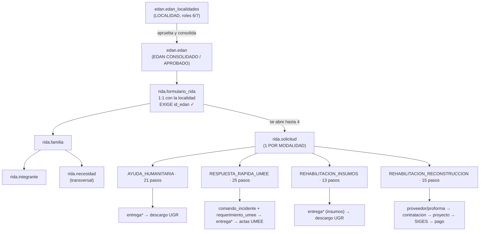
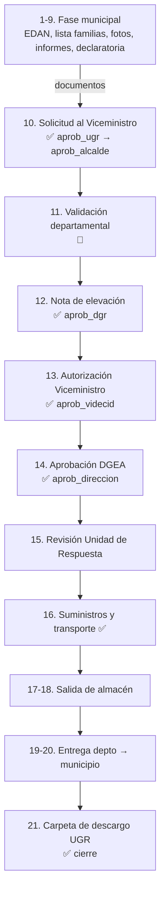
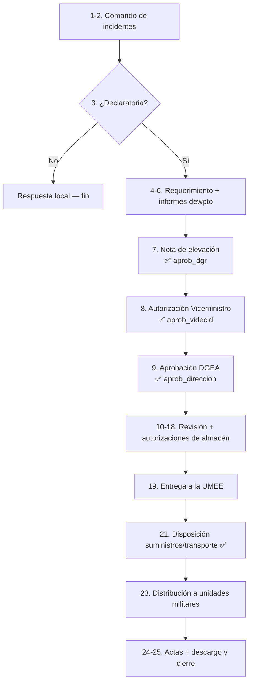
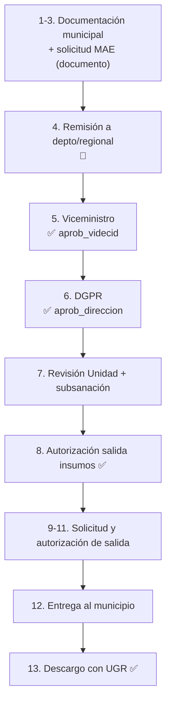
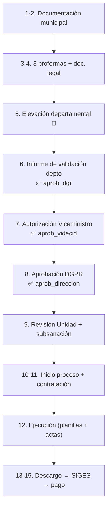
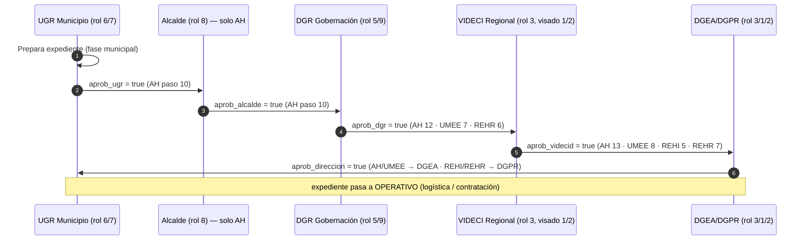
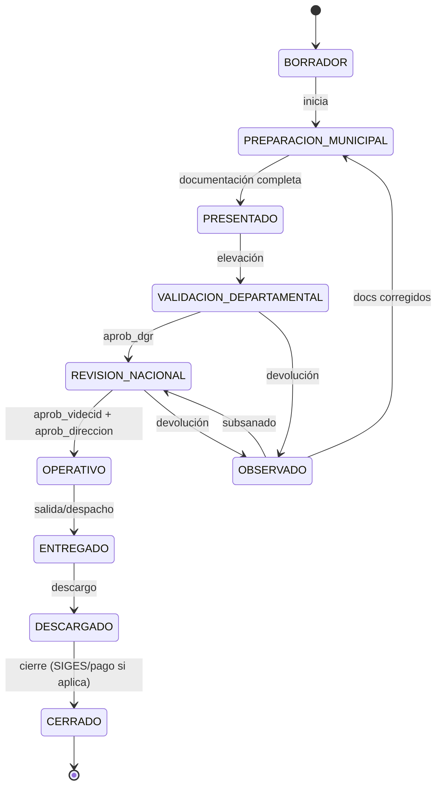

# RIDA Integral — Flujo general, tablas por módulo y aprobaciones

> [!IMPORTANT]
> Documento de **flujo del Sistema RIDA Integral (VIDECI)**: cadena completa
> desde el evento adverso hasta el cierre de cada modalidad, **qué tablas usa
> cada módulo/ruta** (para mapear rutas y flujos) y **cuándo + quién** realiza
> cada aprobación.
>
> Complementa `docs/RIDA_BD.md` (DDL físico + migración `v2.17.0_rida_schema.sql`,
> ya aplicada). Base de datos: `db_sinagersat`, esquema `rida` (**27 tablas**:
> 11 catálogos + 16 de operación).

| Campo | Valor |
|---|---|
| **Ruta completa** | evento → localidad EDAN → EDAN consolidado → `formulario_rida` → empadronamiento → `solicitud` → **división en 4 modalidades** → logística/contratación → descargo/cierre |
| **Nivel del RIDA** | **Por localidad** (1 `formulario_rida` por `edan.edan_localidades`) |
| **Precondición de apertura** | EDAN **consolidado y aprobado** — `formulario_rida.id_edan` **obligatorio** (garantía de consolidación) |
| **Dónde se dividen las modalidades** | En `rida.solicitud` (una expediente por modalidad, máx. 4 por formulario) |
| **Fuentes** | `Arquitectura_RIDA.md`, `Empadronamiento.md`, `Analisis RIDA/*`, `RehabilitacionReconstruccion.md`, `docs/RIDA_BD.md`, migración `v2.17.0` |

---

## 1. Cadena general (alto nivel)

**Lectura de la cadena:**

1. Un **evento adverso** se registra en `edan.edan_localidades` (localidades afectadas).
2. La UGR municipal (rol 6/7) aprueba y **consolida** las localidades en el EDAN
   cabecera (`edan.edan` → estado `APROBADO`). **Sin EDAN consolidado/aprobado no se abre el RIDA.**
3. Se abre **un `rida.formulario_rida` por localidad** (o campamento). `id_edan`
   queda **obligatorio** (contexto consolidado); `id_edan_localidad` lo vincula 1:1.
4. Se **empadrona** (`familia` → `integrante`) y se levantan las **necesidades**
   (`necesidad`, transversal — un solo registro alimenta todas las rutas).
5. Se abre **`rida.solicitud`** (expediente) eligiendo **una modalidad** (hasta 4
   expedientes independientes por formulario). **Aquí se dividen las rutas.**
6. Cada modalidad recorre su línea de pasos (`cat_requisito`) con aprobaciones,
   documentos y operación propios (secciones 3 y 4).

---

## 2. Regla de entrada: el RIDA nace de un EDAN consolidado

> [!IMPORTANT]
> Decisión de diseño acordada: el RIDA es **a nivel localidad**, pero **solo se
> abre cuando el EDAN está consolidado y aprobado**. La garantía es que
> `formulario_rida.id_edan` **siempre tenga valor** (`edan.edan` aprobado).

| Campo de `formulario_rida` | Uso | Regla |
|---|---|---|
| `id_edan` | Contexto del evento ya consolidado | **OBLIGATORIO** (validar en frontend y backend) |
| `id_edan_localidad` | Vínculo 1:1 con la localidad EDAN | `UNIQUE`; `NULL` solo para **campamentos nuevos sin EDAN** |
| `nombre_localidad` | Solo si `id_edan_localidad` es `NULL` (campamento nuevo) | opcional |

> [!NOTE]
> Con `id_edan` obligatorio, un formulario nunca queda "huérfano": si no hay
> EDAN aprobado, el módulo RIDA no permite crear `formulario_rida` (regla de
> negocio a implementar en la API, no en el DDL).

---

## 3. Tablas por módulo (mapa para rutas y flujos)

> [!TIP]
> Objetivo: saber **qué tablas usa cada módulo/ruta** y cuáles son **compartidas
> (transversales)**. Los `cat_*` son catálogos compartidos; la operación se
> reparte entre el núcleo, el expediente y las tablas específicas de cada modalidad.

### 3.1 Esquemas externos que el RIDA **reutiliza** (no duplica)

| Esquema/tabla | Rol en el flujo RIDA |
|---|---|
| `edan.edan` | Cabecera consolidada/aprobada — contexto del evento (`id_edan`) |
| `edan.edan_localidades` | Localidad afectada — vínculo 1:1 del formulario |
| `shared.municipio` / `shared.departamento` | Geografía INE (PostGIS) denormalizada |
| `usuarios.usuario` / `usuarios.rol` / `usuarios.usuario_rol` | Roles 1-9 (no se crean roles nuevos) |
| `usuarios.permiso` / `usuarios.aplicacion` / `usuarios.accion` | Matriz RIDA (aplicación id 2) |
| `usuarios.auditoria` | Auditoría `/api/rida` |
| `repositorio.documentos` | **PDF real** (hash SHA-256 + firma AGETIC), `id_solicitud_rida` |
| `repositorio.tipo_documento` | 23 códigos de documento RIDA sembrados (checklist) |

### 3.2 Tablas compartidas (núcleo + expediente) — usadas por **todas** las modalidades

| Tabla | Qué registra | Uso en el flujo |
|---|---|---|
| `rida.formulario_rida` | Localidad/campamento (1:1) | Cabecera del empadronamiento |
| `rida.familia` | Grupo familiar (condición, ubicación) | Empadronamiento |
| `rida.integrante` | Persona + vulnerabilidades (CI, gestación, discapacidad, enfermedad) | Empadronamiento |
| `rida.necesidad` | "Qué falta y cuánto" (categoría + artículo) | **Transversal**: alimenta las 4 rutas |
| `rida.solicitud` | Expediente por modalidad (flags `aprob_*`, etapa, geografía) | **Punto de división** y estado del trámite |
| `rida.bitacora` | Trazabilidad real (cada acción sobre el expediente) | Todas las etapas |
| `rida.solicitud_documento` | Checklist de documentos por expediente | Validación documental |

**Catálogos compartidos** (usados por el núcleo/expediente):

| Catálogo | Lo usan |
|---|---|
| `rida.cat_modalidad` | `solicitud` (elige modalidad) |
| `rida.cat_requisito` | `solicitud_documento` y el motor del flujo (línea de pasos por modalidad) |
| `rida.cat_categoria_ayuda` | `necesidad` |
| `rida.cat_articulo` | `necesidad`, `entrega_detalle`, `entrega_beneficiario` |
| `rida.cat_condicion_hogar` | `familia` (DAMNIFICADO/AFECTADO) |
| `rida.cat_parentesco` | `integrante` |
| `rida.cat_tipo_discapacidad` | `integrante` |
| `rida.cat_enfermedad_cronica` | `integrante` |

### 3.3 Tablas por modalidad (específicas de cada ruta)

| Tabla | AH | UMEE | REHI | REHR | Qué registra |
|---|:--:|:--:|:--:|:--:|---|
| `rida.entrega` | ✅ | ✅ | ✅ | ❌ | Salida/despacho/entrega (tipo: AYUDA_HUMANITARIA / EQUIPAMIENTO_UMEE / INSUMOS_REHABILITACION) |
| `rida.entrega_detalle` | ✅ | ✅ | ✅ | ❌ | Artículos despachados (cantidad, peso, valor) |
| `rida.entrega_beneficiario` | ✅ | ❌* | ✅ | ❌ | Distribución a familias + evidencia/firma (descargo) |
| `rida.comando_incidente` | ❌ | ✅ | ❌ | ❌ | Comando de incidentes UMEE |
| `rida.requerimiento_umee` | ❌ | ✅ | ❌ | ❌ | Requerimiento + informe de necesidades UMEE |
| `rida.cat_unidad_militar` | ❌ | ✅ | ❌ | ❌ | Unidades militares receptoras (`entrega.id_unidad_militar`) |
| `rida.proveedor` | ❌ | ❌ | ❌ | ✅ | Empresas legalmente constituidas |
| `rida.proforma` | ❌ | ❌ | ❌ | ✅ | Las **3 proformas** obligatorias (mínimo) |
| `rida.contratacion` | ❌ | ❌ | ❌ | ✅ | Contratación + responsable de recepción + SIGES |
| `rida.proyecto` | ❌ | ❌ | ❌ | ✅ | Obra (REHABILITACION/RECONSTRUCCION), sector, monto, riesgo |
| `rida.cat_almacen` | ✅ | ✅ | ✅ | ❌ | Almacén de origen de la entrega |

> \* En UMEE el "beneficiario" final son **unidades militares** (`entrega.id_unidad_militar` +
> `acta_descargo_umee`), no familias: `entrega_beneficiario` (que referencia `familia`) **no se usa**.

**Resumen por modalidad:**

| Modalidad | Tablas específicas | Beneficiario final | Cierre/descargo |
|---|---|---|---|
| **AH** | `entrega*` | Familias | `carpeta_descargo` (firmas de familias, UGR) |
| **UMEE** | `comando_incidente`, `requerimiento_umee`, `cat_unidad_militar` + `entrega*` | Unidades militares | `acta_descargo_umee` |
| **REHI** | `entrega*` (insumos) | Familias (vía municipio) | `carpeta_descargo` coordinado con UGR |
| **REHR** | `proveedor`, `proforma`, `contratacion`, `proyecto`, `cat_sector` | Municipio (servicio) | planillas + actas → SIGES → pago |

---

## 4. Flujo por modalidad (línea de pasos `cat_requisito` → tablas y aprobaciones)

> [!TIP]
> Cada paso del flujo vive en `rida.cat_requisito` (`es_hito_aprobacion` marca
> los jalones). Las tablas de la columna "Transacción" son las que se escriben
> cuando el paso avanza.

### 4.1 Ayuda Humanitaria (AH) — 21 pasos | DG técnica: **DGEA**

| Pasos | Instancia | Tablas que se escriben | Aprobación (flag) |
|---|:---:|---|---|
| 1-9 (fase municipal) | 1 | `solicitud_documento` (EDAN, lista familias, fotograma, informes, declaratoria) | — |
| 10 | 1 | `solicitud` | ✅ `aprob_ugr` (6/7) → `aprob_alcalde` (8) |
| 11 | 2 | `solicitud_documento` (validación departamental) | — |
| 12 | 2 | `solicitud` | ✅ `aprob_dgr` (5/9) |
| 13 | 3 | `solicitud` | ✅ `aprob_videcid` (3, visado 1/2) |
| 14 | 3 | `solicitud` | ✅ `aprob_direccion` (DGEA) |
| 15 | 3 | `bitacora` (revisión) | — |
| 16 | 3 | `bitacora` | ✅ operativo (suministros/transporte) |
| 17-19 | 2-3 | `entrega`, `entrega_detalle`, `solicitud_documento` (nota salida, acta) | — |
| 20 | 1 | `entrega_beneficiario` (distribución) | — |
| 21 | 1 | `solicitud_documento` (`carpeta_descargo`) | ✅ operativo (cierre UGR) |

### 4.2 Respuesta Rápida UMEE — 25 pasos | DG técnica: **DGEA**

> [!WARNING]
> Solo se abre si **existe declaratoria de desastre** (paso 3). Sin declaratoria → respuesta local, fin.

| Pasos | Instancia | Tablas | Aprobación (flag) |
|---|:---:|---|---|
| 1-2 | 2 | `comando_incidente` | — |
| 3 | — | — (decisión) | — |
| 4-6 | 2 | `requerimiento_umee`, `solicitud_documento` (requerimiento, informe necesidades, factibilidad) | — |
| 7 | 2 | `solicitud` | ✅ `aprob_dgr` (5/9) |
| 8 | 3 | `solicitud` | ✅ `aprob_videcid` (3) |
| 9 | 3 | `solicitud` | ✅ `aprob_direccion` (DGEA) |
| 10-11 | 2-3 | `bitacora` (+ informe necesidades consolidado) | — |
| 12-18 | 2-3 | `bitacora`, `solicitud_documento` (salida almacenes) | ✅ operativos (autorizaciones de almacén) |
| 19-20 | 2-3 | `entrega`, `entrega_detalle` (EQUIPAMIENTO_UMEE), `solicitud_documento` (acta) | — |
| 21-22 | 3 | `bitacora`, `solicitud_documento` | ✅ operativo (suministros/transporte) |
| 23 | 2 | `entrega.id_unidad_militar` (distribución) | — |
| 24-25 | 2 | `solicitud_documento` (`acta_descargo_umee`) | ✅ operativos (cierre + final) |

### 4.3 Rehabilitación-Insumos (REHI) — 13 pasos | DG técnica: **DGPR**

> [!NOTE]
> **No hay aprobación local ni departamental.** El MAE (rol 8) solo **aporta la
> solicitud como documento** (paso 3); la primera aprobación es nacional.

| Pasos | Instancia | Tablas | Aprobación (flag) |
|---|:---:|---|---|
| 1-3 | 1 | `solicitud_documento` (EDAN, técnico, legal, financiero, certificación, fotos, lista familias, `solicitud_mae`) | — (MAE = documento) |
| 4 | 2 | `solicitud_documento` (remisión) | — |
| 5 | 3 | `solicitud` | ✅ `aprob_videcid` (3) |
| 6 | 3 | `solicitud` | ✅ `aprob_direccion` (DGPR) |
| 7 | 3 | `bitacora` (subsanación) | — |
| 8 | 3 | `bitacora` | ✅ operativo (salida insumos) |
| 9-11 | 2-3 | `solicitud_documento` (solicitud salida), `bitacora` | ✅ operativo (Unidad Administrativa) |
| 12 | 2 | `entrega`, `entrega_detalle` (INSUMOS_REHABILITACION), `solicitud_documento` (acta) | — |
| 13 | 2 | `entrega_beneficiario`, `solicitud_documento` (`carpeta_descargo`) | ✅ operativo (descargo UGR) |

### 4.4 Rehabilitación-Reconstrucción (REHR) — 15 pasos | DG técnica: **DGPR**

> [!NOTE]
> Única modalidad que **contrata** (3 proformas). **No hay aprobación local**
> (ni UGR ni Alcalde): la cadena inicia en la validación departamental.

| Pasos | Instancia | Tablas | Aprobación (flag) |
|---|:---:|---|---|
| 1-4 | 1 | `proveedor`, `proforma` (mín. 3), `solicitud_documento` (legal empresas, horas) | — |
| 5 | 2 | `solicitud_documento` (elevación) | — |
| 6 | 2 | `solicitud` | ✅ `aprob_dgr` (5/9) |
| 7 | 3 | `solicitud` | ✅ `aprob_videcid` (3) |
| 8 | 3 | `solicitud` | ✅ `aprob_direccion` (DGPR) |
| 9 | 3 | `bitacora` (subsanación) | — |
| 10-11 | 3 | `solicitud_documento` (inicio + especificaciones), `contratacion` (proforma seleccionada, proveedor, responsable) | ✅ operativo (contratación) |
| 12 | 3 | `solicitud_documento` (planillas, actas de conformidad) | — |
| 13 | 3 | `solicitud_documento` (informe comisión) | — |
| 14-15 | 3 | `contratacion.codigo_siges` + `proyecto` (avance) + `solicitud` (fecha cierre, etapa) | ✅ operativos (SIGES, pago) |

---

## 5. Aprobaciones: cuándo suceden y quién las realiza

### 5.1 Flags de aprobación (`rida.solicitud`)

| Flag | Significado | Instancia | Quién lo emite (rol) | Área geográfica |
|---|---|---|---|---|
| `aprob_ugr` | UGR municipal valida el expediente | Local (1) | 6 UGR Municipio / 7 Responsable Local | su municipio |
| `aprob_alcalde` | MAE firma la solicitud | Local (1) | 8 Alcalde | su municipio |
| `aprob_dgr` | Validación y elevación departamental | Departamental (2) | 5 DGR Gobernación / 9 VIDECI Departamental | su departamento |
| `aprob_videcid` | Autorización nacional del Viceministro | Nacional (3) | 3 VIDECI Regional (supervisado por 1/2) | todo el país |
| `aprob_direccion` | Aprobación técnica nacional (DGEA o DGPR) | Nacional (3) | 3 VIDECI Regional / 1 / 2 | todo el país |

### 5.2 Mapa flag → paso → modalidad (cuándo ocurre cada uno)

| Modalidad | `aprob_ugr` | `aprob_alcalde` | `aprob_dgr` | `aprob_videcid` | `aprob_direccion` |
|---|:---:|:---:|:---:|:---:|:---:|
| **AH** (21) | paso 10 | paso 10 | paso 12 | paso 13 | paso 14 (**DGEA**) |
| **UMEE** (25) | — | — | paso 7 | paso 8 | paso 9 (**DGEA**) |
| **REHI** (13) | — | — | — | paso 5 | paso 6 (**DGPR**) |
| **REHR** (15) | — | — | paso 6 | paso 7 | paso 8 (**DGPR**) |

### 5.3 Cadena real por modalidad (orden obligatorio)

| Modalidad | Cadena de aprobaciones |
|---|---|
| `AYUDA_HUMANITARIA` | `aprob_ugr` → `aprob_alcalde` → `aprob_dgr` → `aprob_videcid` → `aprob_direccion` (DGEA) |
| `RESPUESTA_RAPIDA_UMEE` | `aprob_dgr` → `aprob_videcid` → `aprob_direccion` (DGEA) |
| `REHABILITACION_INSUMOS` | `aprob_videcid` → `aprob_direccion` (DGPR) |
| `REHABILITACION_RECONSTRUCCION` | `aprob_dgr` → `aprob_videcid` → `aprob_direccion` (DGPR) |

> [!CAUTION]
> **Diferencias con `RIDA_BD.md §5.4` (corregidas en este documento):**
> - REHI **no** tiene `aprob_ugr`, `aprob_alcalde` ni `aprob_dgr` — la solicitud
>   MAE es solo un documento (paso 3) y la remisión departamental una simple
>   elevación (paso 4, `es_hito_aprobacion = FALSE` en la migración).
> - REHR **no** tiene `aprob_ugr` ni `aprob_alcalde` — inicia en `aprob_dgr`.
>
> Ambos casos coinciden con `Analisis RIDA/Analisis_Procesos_Rehabilitacion_Reconstruccion_e_Insumos.md`
> y con la semilla real de `cat_requisito`.

### 5.4 Flujo de aprobación (escala local → nacional)

> [!TIP]
> El diagrama muestra el recorrido completo (AH). REHI salta directo a VID;
> UMEE/REHR inician en DGR.

### 5.5 Reglas de secuencia y devoluciones

1. Un flag **no puede activarse** si el anterior está en `false` (según la cadena de 5.3).
2. Toda activación/devolución se registra en `rida.bitacora` (`APROBACION` / `DEVOLUCION` + `estado_resultante`).
3. La revisión de documentación puede **reabrir** flags → expediente a `OBSERVADO`
   (se conserva el histórico; `solicitud_documento.valido = false` deja el PDF original).
4. Las observaciones quedan en `solicitud.observaciones`; el expediente puede volver
   a `PREPARACION_MUNICIPAL` o a `REVISION_NACIONAL` según lo subsanado.

**Hitos que avanza el expediente pero NO emiten flag** (autorizaciones operativas):
AH 16 (suministros/transporte) y 21 (descargo); UMEE 12, 14-18 (almacén), 21, 24-25;
REHI 8 y 11 (salida insumos) y 13 (descargo); REHR 11 (contratación), 14 (SIGES) y 15 (pago).

---

## 6. Estados del expediente (línea transversal)

> [!NOTE]
> Cada transición escribe `rida.bitacora` con `estado_resultante`. El RIDA **nunca**
> borra: histórico íntegro (baja lógica / revisión en vez de delete físico).

---

## 7. Referencias

| Qué | Dónde |
|---|---|
| DDL completo + migración + semillas | `docs/RIDA_BD.md`, `database/migrations/v2.17.0_rida_schema.sql` |
| Aprobaciones EDAN (máquina por niveles) | `docs/APROBACIONES_EDAN.md` |
| Flujo EDAN (localidad → UGR) | `docs/FLUJO_EDAN_UGR.md` |
| Consolidación EDAN | `docs/CONSOLIDACION_EDAN.md` |
| Análisis de las 4 rutas | `Analisis RIDA/*`, `Arquitectura_RIDA.md` |
| Empadronamiento de campo | `Empadronamiento.md` |
| Rehabilitación vs Reconstrucción (3 instancias) | `RehabilitacionReconstruccion.md` |
| Roles, permisos y scope geográfico | `docs/PERMISOS_API.md`, `docs/RIDA_BD.md` §8 |