# SINB — Base de Datos y APIs (v2 completa)

**Esquema:** `sinb`  
**Estado:** Migración completada (paso 4) + APIs CRUD v2 implementadas  
**Fecha:** 2026-10-03  
**APIs:** `/api/v2/sinb/*` (FastAPI)

---

## Decisiones de diseño

| Ámbito | Decisión | Justificación |
|---|---|---|
| Identidad | **Esquema `usuarios`** (no hay tablas usuario/login/rol en sinb) | Reutiliza la identidad existente; roles SINB: `admin` (2), `UGR Municipio` (6), `Usuario recolector` (12), `Observador local` (13) |
| Territorio | **Esquema `shared`** (no hay tablas departamento/provincia/municipio/comunidad en sinb) | Fuente única INE; evita duplicación con EDAN/RIDA |
| Zona geográfica | `sinb.zona_geografica` + puentes `zona_comunidad`, `zona_manzano` | Habilita filtro de mapa por zona (andina/valle/llano) sin modificar `shared` |
| Legacy `t_*` | Eliminadas del esquema (datos en `espejo_t_postgres.sql`) | Esquema limpio; migración completada en 4 pasos |
| `id_legacy` | Eliminado en todas las tablas | Nuevo sistema solo usa `uuid` |
| Pronóstico observador | Tabla `pronostico_temporal_observador` creada | Usuario recolector puede asignar 1..N observadores (mismo municipio) |

---

## Estado de la migración

| Paso | Componente | Filas | Estado |
|------|------------|-------|--------|
| **1** | Esquema sinb (39 tablas, 6 vistas) | - | ✓ |
| **2** | Catálogos bioculturales | 1,011 | ✓ |
| **3** | Usuarios (roles: admin, UGR Municipio, Usuario recolector, Observador local) | 265 | ✓ |
| **4** | Observaciones | 231 | ✓ |
| | Observacion_registro | 860 | ✓ |
| | Pronostico_estacional | 237 | ✓ |
| | Pronostico_temporal | 7 | ✓ |
| | Recomendacion_local | 104 | ✓ |

**TOTAL: 2,515 filas migradas**

**Tablas legacy eliminadas:** 46 (`t_*`)

---

## Diagrama ER completo

```mermaid
erDiagram
    grupo ||--o{ indicador_natural : "1:N"
    grupo ||--o{ comportamiento : "1:N"
    grupo ||--o{ significado : "1:N"
    indicador_natural ||--o{ caracteristica : "1:N"
    comportamiento ||--o{ significado : "1:N"
    
    zona_geografica ||--o{ zona_comunidad : "1:N"
    zona_geografica ||--o{ zona_manzano : "1:N"
    zona_comunidad }o--|| shared_comunidades : "FK"
    zona_manzano }o--|| shared_manzanos : "FK"
    
    observacion ||--o{ observacion_registro : "1:N"
    observacion }o--|| shared_comunidades : "FK"
    observacion }o--|| shared_municipio : "FK"
    observacion }o--|| usuarios_usuario : "FK responsable"
    
    pronostico_estacional ||--o{ escenario_estacional : "N:N"
    pronostico_estacional ||--o{ pronostico_observador : "1:N"
    pronostico_estacional }o--|| campo_pronostico : "FK"
    
    pronostico_temporal ||--o{ pronostico_temporal_observador : "1:N"
    pronostico_temporal }o--|| categoria_pronostico_temporal : "FK"
    pronostico_temporal }o--|| campo_pronostico : "FK"
    
    recomendacion_local }o--|| dimension_recomendacion : "FK"
    recomendacion_local }o--|| categoria_comportamiento : "FK"
    
    aviso }o--|| campo_pronostico : "FK"
    aviso }o--|| shared_comunidades : "FK"
    
    observador_indice }o--|| usuarios_usuario : "FK"
    observador_indice }o--|| indicador_natural : "FK"
    
    verificacion_pronostico }o--|| pronostico_estacional : "FK"
    verificacion_pronostico }o--|| pronostico_temporal : "FK"
    
    calificacion_indicador }o--|| indicador_natural : "FK"
    calificacion_indicador }o--|| shared_municipio : "FK"
```



---

## APIs implementadas (`/api/v2/sinb/*`)

### Catálogos Bioculturales (sin paginación, siempre completos)

| Endpoint | Método | Propósito |
|---|---|---|
| `/grupo` | GET, POST | Listar/crear grupos |
| `/grupo/{id}` | GET, PUT, DELETE | CRUD individual |
| `/indicador-natural` | GET, POST | Listar/crear indicadores (filtros: `id_grupo`, `codigo`, `nombre_cientifico`, `nombre_comun`) |
| `/caracteristica` | GET, POST | Listar/crear características (filtro: `id_indicador_natural`) |
| `/comportamiento` | GET, POST | Listar/crear comportamientos (filtros: `id_grupo`, `id_caracteristica`) |
| `/significado` | GET, POST | Listar/crear significados (filtros: `id_grupo`, `id_comportamiento`, `categoria`) |
| `/zona-geografica` | GET, POST | Listar/crear zonas |
| `/campo-pronostico` | GET, POST | Listar/crear campos (Lluvia, Granizo, Helada, Cosecha) |
| `/escenario` | GET, POST | Listar/crear escenarios |
| `/dimension-recomendacion` | GET, POST | Listar/crear dimensiones |
| `/categoria-comportamiento` | GET, POST | Listar/crear categorías |

**Roles requeridos:** POST/PUT/DELETE → `admin` (2) o `superadmin` (1)

---

### Observaciones (últimos 15, paginación, filtros geográficos)

| Endpoint | Método | Propósito |
|---|---|---|
| `/observacion` | GET, POST | Listar (skip, limit, filtros) / crear observación |
| `/observacion/{id}` | GET, PUT, DELETE | CRUD individual con registros anidados |

**Filtros disponibles:**
- `id_municipio`, `id_departamento`, `codigo_comunidad` (geográficos)
- `id_usuario_responsable`
- `fecha_inicio_desde`, `fecha_inicio_hasta`
- `es_validada`

**Scope geográfico automático:**
- Rol 6, 8 (UGR, Alcalde): solo ven su municipio
- Rol 9 (VIDECI): solo ven su departamento
- Rol 1, 2 (admin, superadmin): sin filtros

---

### Pronósticos

#### Estacionales (largo plazo)

| Endpoint | Método | Propósito |
|---|---|---|
| `/pronostico-estacional` | GET, POST | Listar (últimos 15) / crear con escenarios y observadores |
| `/pronostico-estacional/{id}` | GET, PUT, DELETE | CRUD individual |
| `/pronostico-estacional/{id}/escenario` | POST | Agregar escenario con probabilidad |
| `/pronostico-estacional/{id}/escenario/{id_escenario}` | DELETE | Remover escenario |

**Campos de pronóstico:** Lluvia, Granizo, Helada, Cosecha, Terremoto (este último marcado INACTIVO)

**Escenarios típicos:**
- Lluvia: `Mucha`, `Normal`, `Poca`
- Helada: `Leve`, `Moderada`, `Severa`
- Cosecha: `Buena`, `Regular`, `Mala`

#### Temporales (corto plazo)

| Endpoint | Método | Propósito |
|---|---|---|
| `/pronostico-temporal` | GET, POST | Listar (últimos 15) / crear |
| `/pronostico-temporal/{id}` | GET, PUT, DELETE | CRUD individual |

**Categorías temporales:** Semanal, Quincenal, Mensual

---

### Asignación de Observadores a Pronósticos

| Endpoint | Método | Propósito |
|---|---|---|
| `/pronostico/{id}/observadores` | POST | Asignar 1..N observadores (recolector → observadores del mismo municipio) |
| `/pronostico/{id}/observador/{id_usuario}` | DELETE | Remover observador |

**Reglas de negocio:**
- Todos los observadores deben ser del **mismo municipio**
- Roles permitidos: 6, 7, 8, 12, 13 (UGR, Responsable, Alcalde, Usuario recolector, Observador local)
- `confianza`: ALTA (1.0), MEDIA (0.7), BAJA (0.5)
- `tipo_registro`: COLECTIVO (2+ observadores) o INDIVIDUAL (1 observador)

---

### Validación de Pronósticos

#### Validación Automática (tarea diaria)

| Endpoint | Método | Propósito |
|---|---|---|
| `/verificacion/calcular` | POST | Calcular verificación automática de pronósticos vencidos |
| `/verificacion/pendientes` | GET | Listar pronósticos pendientes de verificación |

**Reglas automáticas:**
1. `fecha_fin < NOW()` → marca `PENDIENTE_VERIFICACION`
2. Si hay observaciones en ventana → `EN_VERIFICACION` (requiere manual)
3. Si coincide evento → `COINCIDE`
4. Sin datos → `SIN_DATOS`

#### Validación Manual (experto)

| Endpoint | Método | Propósito |
|---|---|---|
| `/verificacion/{id_pronostico}` | PUT | Validación manual por usuario experto |

**Requerimientos:**
- Rol: `admin` (2) o `VIDECI Departamental` (9)
- Estado: `COINCIDE` o `NO_COINCIDE`
- Observación: texto explicativo obligatorio
- Calificación: 0-100 (opcional)

---

### Recomendaciones

| Endpoint | Método | Propósito |
|---|---|---|
| `/recomendacion-local` | GET, POST | Listar (últimos 15) / crear recomendación |
| `/recomendacion-local/{id}` | DELETE | Eliminar recomendación |

**Dimensiones:** Época de siembra, Lugar de siembra

**Categorías:** Retrasada, Adelantada, Secos, Húmedos, Normales

---

### Avisos de Corto Plazo

| Endpoint | Método | Propósito |
|---|---|---|
| `/aviso` | GET, POST | Listar (últimos 15) / crear aviso |
| `/aviso/{id}` | DELETE | Eliminar aviso |

**Flujo:**
1. Productor dicta aviso («va a granizar»)
2. Se asigna a comunidad + municipio
3. Vigencia: 24-48 horas
4. Al vencer: se verifica si cumplió
5. Genera `observador_indice` tipo `CORTO`

---

### Observador Índice (aciertos por usuario)

| Endpoint | Método | Propósito |
|---|---|---|
| `/observador-indice` | GET, POST | Listar índices / crear registro |

**Tipos:**
- `CORTO`: viene de avisos (§6A)
- `LARGO`: viene de pronósticos estacionales (§6.4)

**Cálculo:**
```
confianza_pronostico = promedio_ponderado(confianza_observadores)
observador_indice = acumula_aciertos_por_registro
```

---

### Mapas GeoJSON

| Endpoint | Método | Propósito |
|---|---|---|
| `/mapa/observaciones/geojson` | GET | GeoJSON de observaciones por comunidad (puntos) |
| `/mapa/comunidades/geojson` | GET | GeoJSON de comunidades (puntos) |
| `/mapa/municipios/geojson` | GET | GeoJSON de municipios (polígonos) |
| `/mapa/manzanos/geojson` | GET | GeoJSON de manzanos censales (polígonos) |
| `/mapa/pronosticos/geojson` | GET | GeoJSON de pronósticos agregados por municipio |

**Filtros geográficos:** `id_departamento`, `id_provincia`, `id_municipio`, `codigo_comunidad`

**Formato:** FeatureCollection RFC 7946, EPSG:4326

---

### Reportes Enriquecidos

| Endpoint | Método | Propósito |
|---|---|---|
| `/reporte/observaciones` | GET | Reporte: totales, por comunidad, por indicador, por validación |
| `/reporte/pronosticos` | GET | Reporte: totales, por estado, verificaciones (coinciden/no coinciden/pendientes) |
| `/reporte/calendario-siembra` | GET | Calendario de siembra por municipio |

---

## Flujos bioculturales implementados

### Nivel 1: Campo y comunidad

**Responsable:** `observador-local` (rol 13)

**Entrada:** Plan de muestreo + observación de bioindicador

**Salida:** Observación en borrador con:
- `codigo_comunidad`, `id_municipio` (territorio)
- `id_usuario_responsable` (autor)
- `fecha_inicio`, `fecha_fin`, `fecha_registro`
- `observacion_registro[]` (característica, comportamiento, significado, indicador)

### Nivel 2: Validación municipal

**Responsable:** `usuario-recolector` (rol 12) valida, `usuario-municipal` (rol 6) consolida

**Entrada:** Observaciones en borrador de sus comunidades

**Salida:** Observación validada (`es_validada = true`)

**Controles:**
- Característica pertenece al indicador (FK)
- Comportamiento pertenece a característica (FK)
- Significado pertenece a comportamiento (FK)
- Indicador en inventario municipal (`municipio_indicador_natural`)
- Evidencia presente si grupo lo exige
- `confianza ≥ 3`

**Motivos de rechazo:**
- `SIN_EVIDENCIA`: falta foto/audio
- `CADENA_INCOHERENTE`: niveles contradictorios
- `FUERA_INVENTARIO`: indicador no autorizado
- `FUERA_TERRITORIO`: coordenada incorrecta
- `SIN_CONSENTIMIENTO`: sin autorización de uso

### Nivel 2: Consolidación municipal

**Responsable:** `usuario-municipal` (rol 6)

**Entrada:** Observaciones validadas del municipio

**Salida:**
- **Recomendación municipal:** Época/Lugar de siembra con alcance `MUNICIPIO` (exige `n_comunidades ≥ 3`)
- **Pronóstico estacional:** con `pronostico_libre` (texto libre paso 0), escenarios, `confianza_largo`

**Pronóstico estacional (7 pasos):**
1. **Paso 0:** `pronostico_libre` = texto dictado por observador (campo abierto)
2. Pasos 1-5: cadena de catálogo (grupo → indicador → característica → comportamiento → significado)
3. Paso 6: escenario del campo con probabilidad
4. **Paso 7:** `confianza_largo` + observadores asignados (colectivo/individual)

**Campos:** Lluvia, Granizo, Helada, Cosecha

**Escenarios típicos:**
- Lluvia: `Mucha`, `Normal`, `Poca`
- Helada: `Leve`, `Moderada`, `Severa`
- Cosecha: `Buena`, `Regular`, `Mala`

### Nivel 2A: Corto plazo (avisos)

**Responsable:** `observador-local` o `usuario-recolector`

**Flujo:**
1. Productor dicta aviso («va a granizar»)
2. Se registra con `texto_libre` + comunidad
3. Vigencia: 24-48 horas
4. Al vencer: verifica si cumplió (`CUMPLIO` / `NO_CUMPLIO` / `SIN_DATOS`)
5. Genera `observador_indice` tipo `CORTO`

### Nivel 3: Nacional (VIDECI)

**Responsable:** `administrador` (rol 2) + `VIDECI Departamental` (rol 9)

**Entrada:** Datos municipales consolidados

**Salida:**
- Vista nacional por zona, departamento y temporada
- Agregación nacional (NDVI, precipitación, indicadores)
- Publicación si cumple cobertura mínima:
  - Comunidades cubiertas ≥ 5% del total de la zona (≈ 75 de 18,331)
  - Municipios ≥ 3
  - Zonas geográficas: las tres (andina, valle, llano)
  - Período ≥ 1 dekada completa
  - 100% observaciones validadas

---

## Verificación de pronósticos

### Validación automática (tarea diaria)

**Endpoint:** `POST /api/v2/sinb/verificacion/calcular`

**Reglas:**
1. `fecha_fin < NOW()` → marca `PENDIENTE_VERIFICACION`
2. Si hay observaciones en ventana → `EN_VERIFICACION` (requiere manual)
3. Si coincide evento → `COINCIDE`
4. Sin datos → `SIN_DATOS`

**Tabla:** `verificacion_pronostico`

| Campo | Tipo | Propósito |
|---|---|---|
| `id_pronostico_estacional` | uuid | FK a pronóstico estacional |
| `id_pronostico_temporal` | uuid | FK a pronóstico temporal |
| `estado` | enum | `PENDIENTE`, `EN_VERIFICACION`, `COINCIDE`, `NO_COINCIDE`, `SIN_DATOS` |
| `calificacion` | numeric | Score 0-100 (opcional) |
| `observacion` | text | Observación cualitativa |
| `es_automatico` | boolean | True si cálculo automático, False si manual |
| `id_usuario_verifica` | int | FK a usuario (solo si manual) |
| `fecha_verificacion` | timestamptz | Fecha de verificación |

### Validación manual (experto)

**Endpoint:** `PUT /api/v2/sinb/verificacion/{id_pronostico}`

**Requerimientos:**
- Rol: `admin` (2) o `VIDECI Departamental` (9)
- Estado: `COINCIDE` o `NO_COINCIDE`
- Observación: texto explicativo obligatorio

**Regla crítica:** Un pronóstico **no se verifica consigo mismo**.

| Pronóstico | No se verifica con | Se verifica con |
|---|---|---|
| Estacional (floración San Juan) | La misma floración | Precipitación real de la temporada |
| Temporal (temperatura mínima) | La misma temperatura | Helada o lluvia ocurrida |
| Cualquiera | Observación del propio observador | Estación meteorológica o satélite |

---

## Calificación de indicadores

**Tabla:** `calificacion_indicador`

| Nivel | Criterio | Significado |
|---|---|---|
| `EN_VERIFICACION` | Recién incorporado o con pocos registros | Estado inicial |
| `USABLE` | Acumula registros y verificaciones aciertan | Puede usarse en decisión |
| `REVISAR` | Pierde vigencia o falla al verificar | Requiere revisión con nota |

**Regla de los 10 años:** Con menos de 10 años de registros, el sistema **informa el dato pero no afirma tendencia**.

---

## Conexiones cruzadas con otros esquemas

| Tabla sinb | Referencia | Tipo FK | Uso |
|---|---|---|---|
| `observacion.codigo_comunidad` | `shared.comunidades(codigo_ine)` | text | Dónde se observó |
| `observacion.id_municipio` | `shared.municipio(id)` | integer | Filtro por municipio |
| `observacion.id_usuario_responsable` | `usuarios.usuario(id_usuario)` | integer | Autor de la sesión |
| `zona_comunidad.codigo_comunidad` | `shared.comunidades(codigo_ine)` | text | Zona → comunidad |
| `zona_manzano.codigo_manzano` | `shared.manzanos(codigo_ine)` | text | Zona → manzano |
| Todas las FK a usuario | `usuarios.usuario(id_usuario)` | integer | 14 tablas referencian usuarios |
| Todas las FK a comunidad | `shared.comunidades(codigo_ine)` | text | 12 tablas referencian comunidades |

---

## Vistas (6)

| Vista | Propósito |
|---|---|
| `v_registro_territorial` | Observaciones con ubicación completa (comunidad, municipio, provincia, departamento, responsable) |
| `v_primera_observacion` | Primera fecha de observación por indicador/comunidad (para fenología) |
| `v_tendencia_fenologia` | Pendiente de fecha vs año (días/década); `es_concluyente` si ≥10 años |
| `v_indicador_confiabilidad` | Nivel de confianza (ALTA/MEDIA/BAJA) según años y comunidades con serie |
| `v_calificacion_vigente` | Última calificación por indicador/municipio (EN_VERIFICACION/USABLE/REVISAR) |
| `v_verificaciones_pendientes` | Pronósticos vencidos sin verificar |

---

## Scripts de migración

| Archivo | Propósito |
|---|---|
| `SINB/modelo_limpio.sql` | DDL esquema limpio (39 tablas, 6 vistas) |
| `SINB/migrar_catastro.sql` | Migración catálogos (paso 2) |
| `SINB/migrar_usuarios.sql` | Migración usuarios + roles (paso 3) |
| `SINB/migrar_transaccional.sql` | Migración datos transaccionales (paso 4) |

---

## Próximos pasos

| Paso | Acción | Estado |
|---|---|---|
| **Paso 5** | Validar APIs con frontend ( Leaflet/Mapbox) | Pendiente |
| **Paso 6** | Tarea automática de verificación (cron diario) | Pendiente |
| **Paso 7** | Series longitudinales (ventana_observacion, serie_indicador) | Pendiente |
| **Paso 8** | Integración con datos satelitales (NDVI Sentinel-2) | Pendiente |

---

## Referencias

- **07-FLUJOS-BIOCULTURALES.md**: Flujos completos de los 3 niveles
- **04-BASE-DE-DATOS.md**: Esquema detallado con tablas y campos
- **10-INTEROPERABILIDAD.md**: Integración con Open-Meteo, Sentinel-2, CHIRPS
