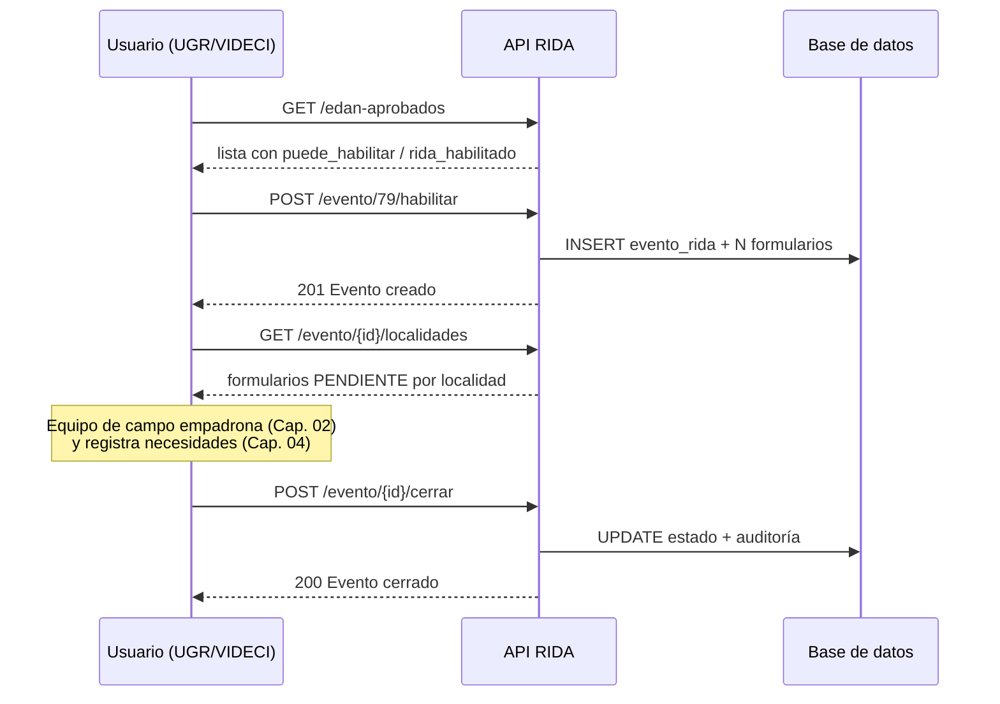

# 03 · Eventos RIDA

> El **evento RIDA** es el padre de todo el proceso: se habilita a partir de un **EDAN aprobado** y auto-crea un formulario de empadronamiento por cada localidad.
> Prefijo: `/api/v2/rida` · Roles que pueden gestionar: **1, 2, 5, 6, 9** (`api/rida/router_eventos.py:23`).

## 1. Concepto

```
EDAN aprobado (estado 3 o 5)
      │  POST /evento/{id_edan}/habilitar
      ▼
evento RIDA  (rida.evento_rida — 1:1 con el EDAN)
      │  auto-crea un HIJO por cada localidad
      ▼
formulario RIDA (estado PENDIENTE) × N localidades
      │
      ▼
empadronamiento (Cap. 02) → necesidades (Cap. 04) → solicitudes (Cap. 05)
```

| Estado | Significado |
|---|---|
| `HABILITADO` | Evento activo, empadronamiento en curso |
| `CERRADO` | Terminado (auditoría: quién y cuándo cerró) |
| anulado | Habilitado por error; solo posible **si no tiene formularios** |

## 2. Checklist

- [ ] 1. Buscar el EDAN aprobado con `GET /edan-aprobados`.
- [ ] 2. Habilitar el evento: `POST /evento/{id_edan}/habilitar`.
- [ ] 3. Verificar que se crearon los formularios: `GET /evento/{id}/localidades`.
- [ ] 4. Empadronar ([Cap. 02](02-empadronamiento.md)).
- [ ] 5. Cerrar el evento cuando termine: `POST /evento/{id}/cerrar`.

## 3. Listar EDAN candidatos

`GET /api/v2/rida/edan-aprobados`

Devuelve solo EDAN con estado **APROBADO (3 o 5)**, y cada uno viene marcado con:

| Campo | Significado |
|---|---|
| `rida_habilitado` | `true` si ya tiene evento RIDA activo |
| `puede_habilitar` | `true` si aún no tiene RIDA o su evento fue anulado |
| `evento_estado_codigo` | `HABILITADO` / `CERRADO` |
| `id_evento_rida`, `fecha_habilitacion`, `fecha_cierre` | Datos del evento existente |

```bash
curl -H "Authorization: Bearer $TOKEN" \
  "http://localhost:8000/api/v2/rida/edan-aprobados?id_departamento=7"
```

Los EDAN ya habilitados aparecen primero.

## 4. Habilitar un evento

`POST /api/v2/rida/evento/{id_edan}/habilitar` → **201**

```bash
curl -X POST -H "Authorization: Bearer $TOKEN" \
  http://localhost:8000/api/v2/rida/evento/79/habilitar
```

**Qué hace:**

1. Valida la geografía del EDAN contra tu scope (`_validar_geo_edan`).
2. Crea la fila `rida.evento_rida` (1:1 con el EDAN).
3. **Crea automáticamente** un `formulario_rida` por cada localidad del EDAN, en estado `PENDIENTE`.

**Errores:**

| Código | Causa |
|---|---|
| `400` | El EDAN no está aprobado |
| `400` | El EDAN ya tiene evento RIDA |
| `403` | Tu rol no está en (1, 2, 5, 6, 9) o la geografía queda fuera de tu alcance |

## 5. Consultar eventos

| Endpoint | Contenido |
|---|---|
| `GET /eventos` | Lista paginada con el desglose del EDAN padre: tipo de evento, fecha, geografía hasta municipio, localidades, alcalde y UGR |
| `GET /evento/{id_evento_rida}` | Detalle de un evento |
| `GET /evento/{id_evento_rida}/localidades` | Localidades (formularios) del evento, paginados y con filtros geográficos |
| `GET /evento/cat-estado-evento` | Catálogo de estados |

Filtros de `GET /eventos`: `id_edan`, `id_estado` (1 HABILITADO, 2 CERRADO), `id_departamento`, `id_provincia`, `id_municipio`, `skip`, `limit` (≤500), `todos`.

**Scope:** los roles 5, 8 y 9 se limitan a su departamento/municipio; 6 y 7 a su geografía; 1–4 ven todo.

```bash
curl -H "Authorization: Bearer $TOKEN" \
  "http://localhost:8000/api/v2/rida/eventos?id_municipio=70101"
```

## 6. Cerrar un evento

`POST /api/v2/rida/evento/{id_evento_rida}/cerrar`

Marca `CERRADO` y registra **quién** y **cuándo** (`id_usuario_cierro`, `fecha_cierre`). ⚠️ El cierre es de proceso: conviene cerrar el evento después de terminar formularios, necesidades y solicitudes.

## 7. Anular un evento habilitado por error

`POST /api/v2/rida/evento/{id_evento_rida}/anular`

- Solo funciona si el evento está `HABILITADO` y **no tiene formularios asociados**.
- Si ya hay formularios creados, no se puede anular: habrá que corregir a nivel de formulario.

## 8. Flujo completo



## 9. Autoevaluación

- [ ] Sé la diferencia entre un EDAN y un evento RIDA.
- [ ] Puedo explicar qué significa `puede_habilitar: false`.
- [ ] Sé por qué un evento no se puede anular una vez con formularios.

---

**Anterior:** [02 · Empadronamiento](02-empadronamiento.md) · **Siguiente:** [04 · Necesidades](04-necesidades.md)
