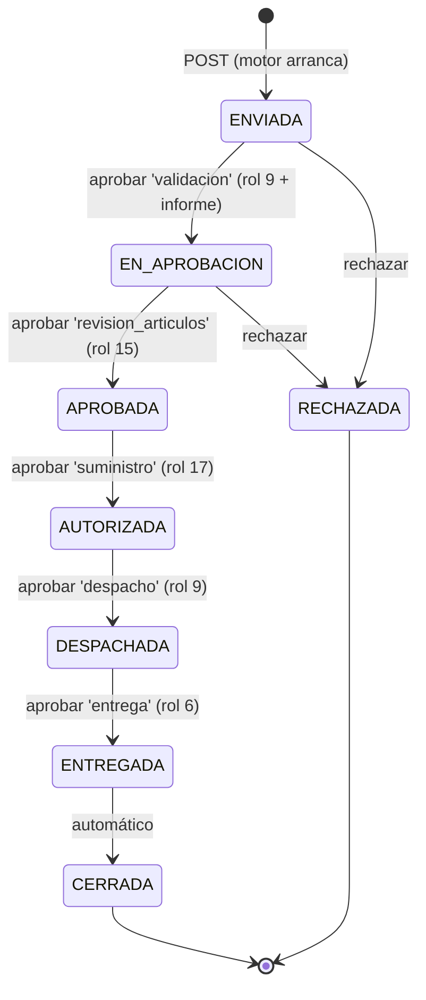

# 05 · Solicitudes y workflow

> El **expediente** que atraviesa las etapas y los **7 niveles** de aprobación.
> Prefijo: `/api/v2/rida/solicitudes` · Escritura: roles **1, 2, 6, 7**

## 1. Conceptos

| Concepto | Definición |
|---|---|
| **Solicitud** | Expediente de ayuda/rehabilitación creado **desde un evento RIDA** |
| **Modalidad** | Tipo de trámite (4 posibilidades) |
| **Etapa** | Posición actual en el flujo |
| **Requisito** | Paso del checklist; puede ser documento o hito de aprobación |
| **Instancia** | Nivel al que pertenece el requisito (1 local, 2 departamental, 3 nacional) |
| **Bitácora** | Historial de cada transición (quién, cuándo, desde/hacia) |

**Una solicitud = un evento + una modalidad.**

## 2. Las 4 modalidades

`GET /api/v2/rida/solicitudes/cat-modalidades`

| id | código | Nombre |
|---|---|---|
| 1 | `AYUDA_HUMANITARIA` | Ayuda humanitaria |
| 2 | `RESPUESTA_RAPIDA_UMEE` | Respuesta rápida UMEE |
| 3 | `REHABILITACION_INSUMOS` | Rehabilitación — insumos |
| 4 | `REHABILITACION_RECONSTRUCCION` | Rehabilitación — reconstrucción |

## 3. Etapas y transiciones (v2.60.0)

`GET /api/v2/rida/solicitudes/cat-etapas` devuelve **solo las etapas activas**.

```
POST ──► ENVIADA ──► EN_APROBACION ──► APROBADA ──► AUTORIZADA ──► DESPACHADA ──► ENTREGADA ──► CERRADA
             └──────────┴──► RECHAZADA
```

| Transición | Quién la mueve | Acción |
|---|---|---|
| `POST` → `ENVIADA` | Creador | `POST /rida/solicitudes` |
| `ENVIADA` → `EN_APROBACION` | VIDECI Departamental (rol 9) | `PUT /{id}/aprobacion/validacion` |
| `EN_APROBACION` → `APROBADA` | Viceministro (rol 15) | `PUT /{id}/aprobacion/revision_articulos` |
| `APROBADA` → `AUTORIZADA` | Suministro (rol 17) | `PUT /{id}/aprobacion/suministro` |
| `AUTORIZADA` → `DESPACHADA` | VIDECI Departamental (rol 9) | `PUT /{id}/aprobacion/despacho` |
| `DESPACHADA` → `ENTREGADA` → `CERRADA` | UGR Municipio (rol 6) | `PUT /{id}/aprobacion/entrega` (cierre automático) |
| `ENVIADA` / `EN_APROBACION` → `RECHAZADA` | Revisor | `POST /{id}/rechazar` |

**Reglas:**

- `CERRADA` y `RECHAZADA` son etapas finales.
- Cada transición queda registrada en `rida.bitacora` (`GET /{id}/bitacora`).
- **Alcance geográfico:** los roles 5 y 9 solo operan sobre su departamento y el
  rol 8 sobre su municipio, en todas las transiciones y lecturas.
- Las etapas `BORRADOR`, `EN_REVISION`, `OBSERVADA`, `VALIDADA`,
  `EN_SUMINISTROS`, `DESPACHO_AUTORIZADO`, `EN_TRANSPORTE`, `RECIBIDA` y
  `EN_DISTRIBUCION` ya no son alcanzables.

## 4. Niveles de aprobación

- `GET /api/v2/rida/solicitudes/{id}/aprobacion` → cadena activa,
  `estado_global` derivado y el estado de cada nivel, con `puede_aprobar` /
  `puede_devolver` calculados para tu usuario.
- `PUT /api/v2/rida/solicitudes/{id}/aprobacion/{nivel}` → **multipart/form-data**
  (`aprobado`, `observacion`, `archivo`, `nombre_documento`, `fecha_documento`).
- `GET /api/v2/rida/solicitudes/cat-cadena-aprobacion` → niveles, roles,
  alcance y cadena por defecto (cachear en el frontend).

| Nivel | Quién lo visa | Alcance | Etapa exigida | Etapa tras aprobar |
|---|---|---|---|---|
| `validacion` | 9 (VIDECI Departamental) | departamento | `ENVIADA` | `EN_APROBACION` |
| `viceministro` | 15 (Viceministro) | nacional | `EN_APROBACION` | — |
| `dgea` | 16 (DGEA) | nacional | `EN_APROBACION` | — |
| `revision_articulos` | 15 (Viceministro) | nacional | `EN_APROBACION` | `APROBADA` |
| `suministro` | 17 (Gestión de Suministro) | nacional | `APROBADA` | `AUTORIZADA` |
| `despacho` | 9 (VIDECI Departamental) | departamento | `AUTORIZADA` | `DESPACHADA` |
| `entrega` | 6 (UGR Municipio) | municipio | `DESPACHADA` | `ENTREGADA` → `CERRADA` |

Los roles 1 y 2 (superadmin / admin) pueden visar cualquier nivel, sin importar el
alcance.

**La cadena no es una lista fija de 7.** Cada solicitud resuelve la suya según su
modalidad (`rida.aprobacion_cadena`) y puede ser más corta, siempre incluyendo
`validacion`, `revision_articulos`, `suministro`, `despacho` y `entrega`. Visar
un nivel fuera de su cadena devuelve `400`. La modalidad **Ayuda Humanitaria**
no usa este motor: gestiona sus visaciones con su propia cadena de 7 niveles
(flujo de Ayuda Humanitaria) y este responde `409`/cadena vacía.

**Secuencia estricta.** Solo se puede aprobar el **primer nivel no aprobado** de
la cadena, y solo cuando la solicitud está en la etapa que ese nivel exige.

**Gates de negocio:**

- `validacion` exige el **checklist de instancia 1 completo** y el **Informe de
  validación** adjunto en el mismo `PUT` (PDF, campo `archivo`).
- `revision_articulos` exige un **cálculo operativo persistido** si la modalidad
  tiene motor (`tiene_motor_calculo = TRUE`); si no, el visado es manual.
- Aprobar `entrega` deja la solicitud en `CERRADA` automáticamente.

**Devolver** solo lo puede hacer quien tiene el turno y solo si el nivel anterior
está `aprobado`; el primer nivel no se puede devolver.

> **Cambio de permisos (v2.60.0).** Salen de la cadena los roles 3 (VIDECI
> Regional), 4 (UGR Sectores), 5 (DGR Gobernación), 8 (Alcalde) y 14 (Almacén).
> Entran 15 (Viceministro), 16 (DGEA) y 17 (Gestión de Suministro).

## 5. Checklist del flujo completo

- [ ] 1. Crear la solicitud desde un evento (`POST`).
- [ ] 2. Subir los documentos de la instancia 1 (`POST /{id}/documentos`).
- [ ] 3. Recorrer la cadena activa (`GET /{id}/aprobacion` para ver los niveles,
      `PUT /{id}/aprobacion/{nivel}` para aprobar o devolver).
- [ ] 4. Aprobar `validacion` adjuntando el informe de validación.
- [ ] 5. Aprobar `viceministro` → `dgea` → `revision_articulos` → `suministro`
      → `despacho` → `entrega` (el cierre es automático).

## 6. Crear la solicitud

`POST /api/v2/rida/solicitudes` → **201**

```json
{
  "id_evento_rida": 15,
  "id_modalidad": 1,
  "observaciones": "Inundación del 28/09, 12 familias afectadas"
}
```

Se crea en etapa **`ENVIADA`** (no hay `BORRADOR`). `id_municipio` e
`id_departamento` se heredan del evento y el **motor de aprobaciones arranca de
inmediato**.

```bash
curl -X POST -H "Authorization: Bearer $TOKEN" -H "Content-Type: application/json" \
  -d '{"id_evento_rida": 15, "id_modalidad": 1}' \
  http://localhost:8000/api/v2/rida/solicitudes
```

## 7. Listar y consultar

`GET /api/v2/rida/solicitudes` con filtros (`etapa`, `id_modalidad`, `modalidad`, geografía, fechas, paginación).

| Endpoint | Contenido |
|---|---|
| `GET /{id}` | Detalle completo |
| `PUT /{id}` | Modificar modalidad / observaciones (solo en `ENVIADA`) |
| `DELETE /{id}` | Eliminar (solo en `ENVIADA` y sin niveles aprobados) |
| `GET /{id}/bitacora` | Historial de transiciones |
| `GET /{id}/checklist` | Requisitos con su estado |

## 8. Requisitos y documentos

`GET /api/v2/rida/solicitudes/cat-requisitos` — checklist por modalidad.

| Campo | Significado |
|---|---|
| `orden` | Posición en el checklist |
| `nombre_paso` | Nombre del requisito |
| `es_documento` | Si requiere subir un PDF |
| `es_hito_aprobacion` | Si es un hito de firma/aprobación |
| `instancia` | 1 local · 2 departamental · 3 nacional |

**Subir un documento:** `POST /api/v2/rida/solicitudes/{id}/documentos` (multipart, PDF)

- Solo en etapa **`ENVIADA`**.
- Debe corresponder a un requisito `es_documento=true` de la modalidad.
- Al subir una nueva versión, la anterior queda `valido = false`.

| Endpoint | Uso |
|---|---|
| `GET /{id}/documentos` | Listar documentos subidos |
| `DELETE /{id}/documentos/{id_doc}` | Quitar un documento |

## 9. Ejemplo guiado: cadena de visaciones (v2.60.0)

> **Modalidad Ayuda Humanitaria:** este ejemplo NO aplica a la modalidad 1. Su
> motor de 7 niveles se abre con
> `POST /api/v2/ayuda-humanitaria/expedientes/{id}/iniciar` (desde `ENVIADA`) y
> su cálculo de kits con `POST /api/v2/ayuda-humanitaria/calculos` (ver §9.1 y
> `ARQUITECTURA_AYUDA_HUMANITARIA.md` §6).

```bash
ID=7   # id_solicitud devuelto al crear

# 1. Subir requisitos de instancia 1
curl -X POST -H "Authorization: Bearer $TOKEN" \
  -F "file=@informe_tecnico.pdf;type=application/pdf" \
  -F "id_requisito=1" -F "fecha_documento=2026-10-29" \
  -F "nombre_documento=Informe técnico" \
  http://localhost:8000/api/v2/rida/solicitudes/$ID/documentos

# 2. Recorrer la cadena (secuencia estricta: uno tras otro)
curl -X PUT -H "Authorization: Bearer $TOKEN" \
  -F "aprobado=true" -F "archivo=@informe_validacion.pdf;type=application/pdf" \
  -F "nombre_documento=Informe de validación" -F "fecha_documento=2026-10-29" \
  .../solicitudes/$ID/aprobacion/validacion          # → EN_APROBACION

curl -X PUT -H "Authorization: Bearer $TOKEN" -F "aprobado=true" \
  .../solicitudes/$ID/aprobacion/viceministro        # rol 15
curl -X PUT -H "Authorization: Bearer $TOKEN" -F "aprobado=true" \
  .../solicitudes/$ID/aprobacion/dgea                # rol 16
curl -X PUT -H "Authorization: Bearer $TOKEN" -F "aprobado=true" \
  .../solicitudes/$ID/aprobacion/revision_articulos  # rol 15 → APROBADA
curl -X PUT -H "Authorization: Bearer $TOKEN" -F "aprobado=true" \
  .../solicitudes/$ID/aprobacion/suministro          # rol 17 → AUTORIZADA
curl -X PUT -H "Authorization: Bearer $TOKEN" -F "aprobado=true" \
  .../solicitudes/$ID/aprobacion/despacho            # rol 9 → DESPACHADA
curl -X PUT -H "Authorization: Bearer $TOKEN" -F "aprobado=true" \
  .../solicitudes/$ID/aprobacion/entrega             # rol 6 → CERRADA (automático)

# 3. Revisar la trazabilidad
curl -H "Authorization: Bearer $TOKEN" .../bitacora
```

### 9.1 Flujo de Ayuda Humanitaria y motor de cálculo

```bash
# A. Abrir el motor AH (7 niveles) — requiere ENVIADA + checklist instancia 1
curl -X POST -H "Authorization: Bearer $TOKEN" \
  http://localhost:8000/api/v2/ayuda-humanitaria/expedientes/$ID/iniciar

# B. Calcular los kits de la modalidad (una vez en EN_APROBACION)
#    previsualización (no persiste):
curl -X POST -H "Authorization: Bearer $TOKEN" -H "Content-Type: application/json" \
  -d '{"id_solicitud": '$ID'}' \
  http://localhost:8000/api/v2/ayuda-humanitaria/calculos

#    operativo (persiste solicitud_articulo + historial):
curl -X POST -H "Authorization: Bearer $TOKEN" -H "Content-Type: application/json" \
  -d '{"id_solicitud": '$ID', "modo": "operativo"}' \
  http://localhost:8000/api/v2/ayuda-humanitaria/calculos

# C. Historial de ejecuciones (más recientes primero)
curl -H "Authorization: Bearer $TOKEN" \
  "http://localhost:8000/api/v2/ayuda-humanitaria/calculos?id_solicitud=$ID&limit=10"
```

Las reglas (kits) del motor tienen ciclo de vida `borrador → publicada`
(publicación con `{"confirmar": true}`; editar una publicada la devuelve a
borrador). Contrato completo: `ARQUITECTURA_AYUDA_HUMANITARIA.md` §6.6-6.7 ·
`AYUDA_HUMANITARIA_BACKEND.md` §5.6.

## 10. Diagrama del flujo



## 11. Errores frecuentes

| Error | Causa | Solución |
|---|---|---|
| `400 El nivel 'X' no pertenece a la cadena` | Tu modalidad no tiene ese nivel | Ver `GET /cat-cadena-aprobacion` |
| `403 Rol N no autorizado para el nivel 'X'` | Tu rol no visa ese nivel | Ver §4 |
| `403 Solicitud fuera de su municipio/departamento` | La solicitud no está en tu jurisdicción | Revisa el municipio/departamento de la solicitud |
| `409 Secuencia estricta: corresponde aprobar 'Y'` | Fuera de turno | Aprueba `Y` primero |
| `409 Para aprobar 'X' la solicitud debe estar en …` | La etapa no es la que exige el nivel | Ver §4 |
| `409 El checklist de instancia 1 no está completo` | Faltan documentos locales | Súbelos en `ENVIADA` |
| `409 El informe de validación es obligatorio` | `PUT validacion` sin `archivo` | Adjunta el PDF en el mismo `PUT` |
| `409 Falta un cálculo operativo` | Modalidad con motor en `revision_articulos` | Ejecuta `POST /ayuda-humanitaria/calculos` en modo operativo |
| `409 La modalidad Ayuda Humanitaria gestiona sus visaciones…` | Modalidad AH | Usa el flujo de Ayuda Humanitaria |
| `409 El modo operativo exige etapa EN_APROBACION` | `/calculos` operativo antes de abrir el motor AH | Abre el motor o usa `modo:"previsualizacion"` |
| `422` al aprobar/devolver | Falta `aprobado`, o la `observacion` al devolver tiene menos de 10 caracteres | Ver §4 |

---

**Anterior:** [04 · Necesidades](04-necesidades.md) · **Siguiente:** [06 · Indicadores](06-indicadores.md)
