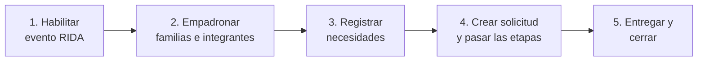

# Manual interactivo del sistema RIDA

> Manual de uso por rol y proceso · Edición octubre 2026 · API v1.4.0
> **Cómo usar este manual:** elige tu perfil en §A o tu tarea en §B. Cada capítulo es autocontenido, con checklist verificables, flujos y ejemplos reales de llamada.

---

## A. Rutas por perfil

| Si eres... | Empieza por | Luego |
|---|---|---|
| **Responsable Local (rol 7)** o **UGR Municipio (rol 6)** — trabajas en campo | [01 · Acceso y roles](01-acceso-y-roles.md) | [02 · Empadronamiento](02-empadronamiento.md) → [04 · Necesidades](04-necesidades.md) → [08 · Offline](08-offline-y-sincronizacion.md) |
| **UGR / Analista** que revisa y aprueba | [01 · Acceso y roles](01-acceso-y-roles.md) | [03 · Eventos](03-eventos.md) → [05 · Solicitudes](05-solicitudes-workflow.md) → [06 · Indicadores](06-indicadores.md) |
| **Alcalde (rol 8)** / **DGR (5)** / **VIDECI (3, 9)** — apruebas | [01 · Acceso y roles](01-acceso-y-roles.md) | [05 · Solicitudes](05-solicitudes-workflow.md) §5 (aprobación) |
| **Administrador de usuarios** | [09 · Administración](09-administracion.md) | [01 · Acceso y roles](01-acceso-y-roles.md) |
| **Quien consulta resultados** | [06 · Indicadores](06-indicadores.md) | [07 · Reportes](07-reportes.md) |
| **Integrador / programador** | [08 · Offline y sincronización](08-offline-y-sincronizacion.md) | [../01-componentes-y-arquitectura.md](../01-componentes-y-arquitectura.md) |

## B. Rutas por tarea

| Quiero... | Ir a |
|---|---|
| Iniciar sesión o recuperar mi contraseña | [01 §2](01-acceso-y-roles.md) · [10 §2](10-faq-y-problemas.md) |
| Saber qué puedo hacer con mi rol | [01 §3](01-acceso-y-roles.md) |
| Empadronar una localidad, familias e integrantes | [02 · Empadronamiento](02-empadronamiento.md) |
| Habilitar un evento RIDA desde un EDAN aprobado | [03 · Eventos](03-eventos.md) |
| Registrar necesidades de una familia | [04 · Necesidades](04-necesidades.md) |
| Crear y mover una solicitud por sus 17 etapas | [05 · Solicitudes](05-solicitudes-workflow.md) |
| Consultar totales e indicadores | [06 · Indicadores](06-indicadores.md) |
| Obtener un reporte | [07 · Reportes](07-reportes.md) |
| Trabajar sin internet y sincronizar después | [08 · Offline](08-offline-y-sincronizacion.md) |
| Crear usuarios, dar permisos o revisar auditoría | [09 · Administración](09-administracion.md) |
| Entender un error | [10 · FAQ y problemas](10-faq-y-problemas.md) |

---

## C. Los 5 pasos del sistema RIDA

1. **Habilitar evento** — a partir de un EDAN aprobado se crea el evento RIDA y un formulario por localidad. → [Cap. 03](03-eventos.md)
2. **Empadronar** — familias, integrantes y ubicaciones en cada formulario. → [Cap. 02](02-empadronamiento.md)
3. **Necesidades** — artículos y cantidades que cada familia/localidad requiere. → [Cap. 04](04-necesidades.md)
4. **Solicitud** — expediente con modalidad, checklist de requisitos y workflow de 17 etapas con 5 niveles de aprobación. → [Cap. 05](05-solicitudes-workflow.md)
5. **Entrega y cierre** — despacho, distribución y `CERRADA`.

## D. Dónde está la documentación técnica

| Documento | Para qué |
|---|---|
| [../README.md](../README.md) | Índice de toda la documentación |
| [../01-componentes-y-arquitectura.md](../01-componentes-y-arquitectura.md) | Cómo está construido el sistema |
| [../02-autenticacion-y-roles.md](../02-autenticacion-y-roles.md) | Seguridad y permisos (detalle técnico) |
| [../03-offline-y-sincronizacion.md](../03-offline-y-sincronizacion.md) | Contratos de sincronización |
| [../04-indicadores-y-reportes.md](../04-indicadores-y-reportes.md) | Catálogo de indicadores |
| [../Documentacion-Base-Datos-RIDA.md](../../Documentacion-Base-Datos-RIDA.md) | Esquema de base de datos |
| [../Arquitectura_RIDA.md](../../Arquitectura_RIDA.md) | Arquitectura y estado real |
| Swagger | `http://<servidor>:8000/docs` (interfaz interactiva para probar cada endpoint) |

## E. Convenciones de este manual

- **Checklist** `[ ]`: marca mentalmente cada paso al completarlo.
- **Código de ejemplo**: reemplaza `TOKEN`, `ID` y credenciales por los tuyos.
- **Advertencia** ⚠️: acción irreversible o con riesgo de error.
- **Referencias** `archivo:línea`: apuntan al código fuente para el equipo técnico.

---

**Empieza:** [01 · Acceso y roles](01-acceso-y-roles.md)
