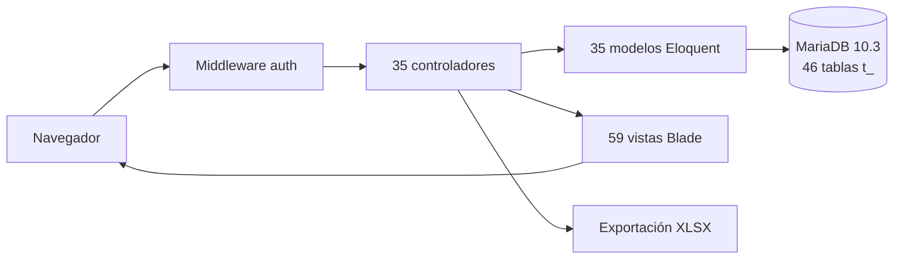
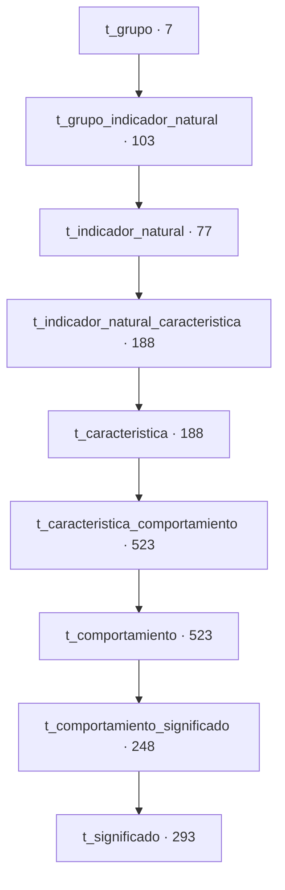
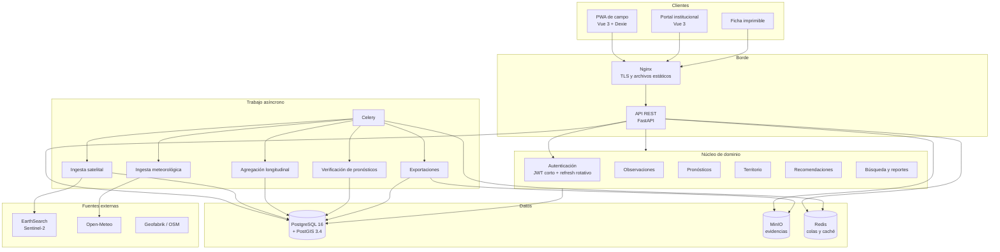
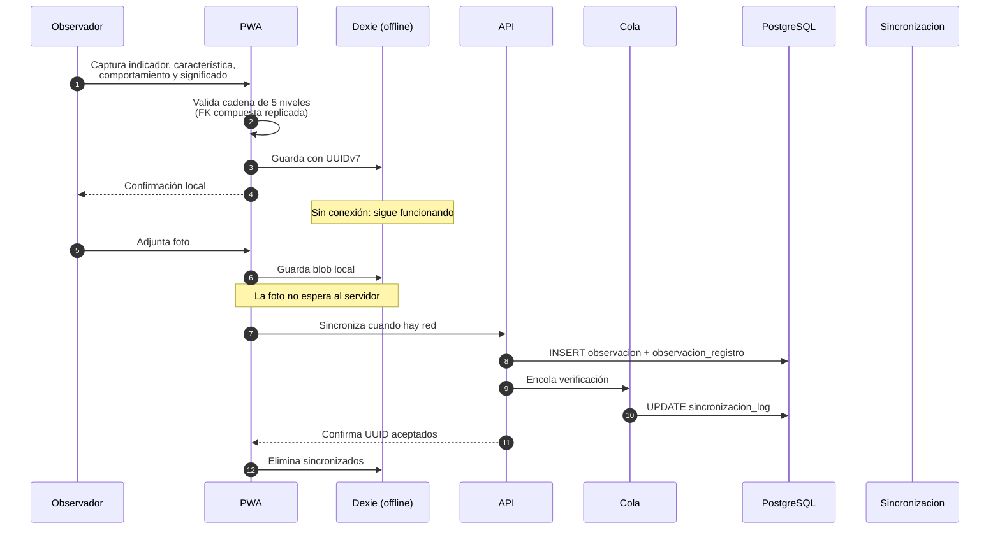
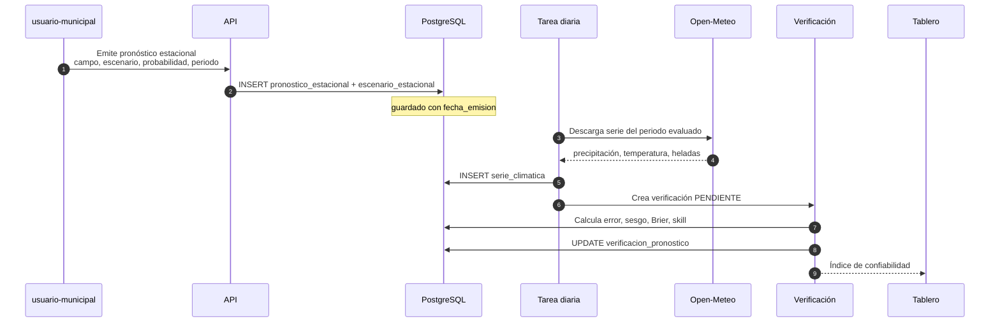
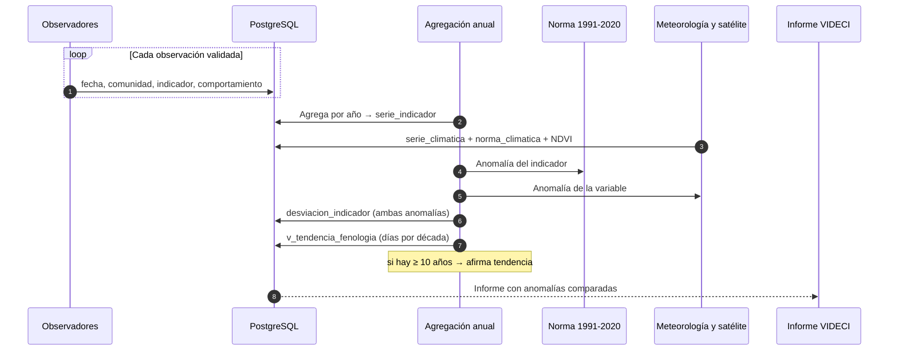
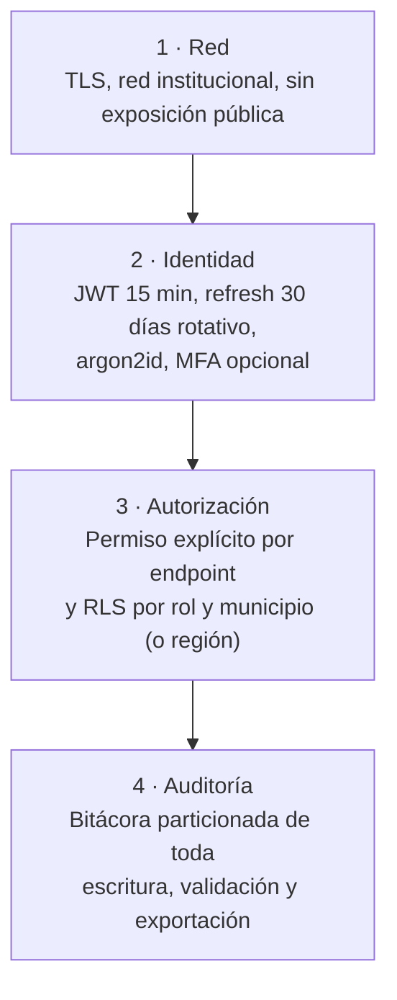
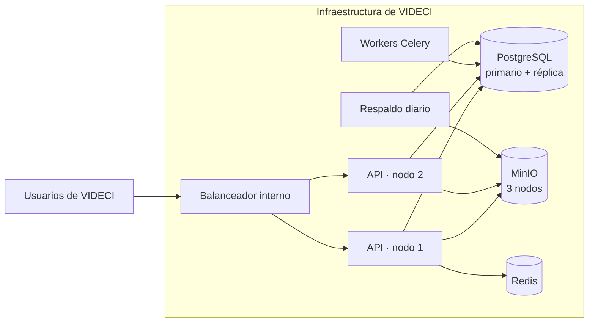

# 01 · Arquitectura

De Laravel monolítico a una plataforma que registra, verifica y aprende. Sin perder el dominio del SINB.

---

## Cómo leer este documento

| Marcador | Significado |
|---|---|
| `[ACTUAL]` | Comprobado en `web/` o en `sinb_20260714.sql` — *fuentes del SINB legado (VIDECI), no incluidas en este repositorio* |
| `[DEFECTO]` | Problema comprobado |
| `[MEJORA]` | Capacidad existente que se modifica |
| `[NUEVO]` | Capacidad que el SINB no tiene |
| `[DECIDIR]` | Requiere firma institucional |

---

## 0. Contraste con la estructura actual del repositorio

> **Actualización de contraste.** §1 describe el **SINB legado de la VIDECI** (Laravel 5.8 + MariaDB, fuente `web/` y `sinb_20260714.sql`, ausentes de este repositorio). El repositorio donde se aplica esta propuesta tiene hoy otra estructura:

| Capa | Estructura actual verificada |
|---|---|
| API | **FastAPI** (Python 3.12) + SQLAlchemy, en `api/`, rutas `/api/v1` y `/api/v2` |
| Base de datos | **PostgreSQL 16 + PostGIS 3.4**, base `db_sinagersat`, **multi-esquema**: `shared`, `usuarios`, `edan`, `rea`, `repositorio`, `rida`, `sinb`, `recursos` |
| Esquema `sinb` | **Existe y está vacío** — es el destino exclusivo del modelo descrito en este documento |
| Dominios vecinos | `edan` y `rida` operan con sus propios módulos API; **son independientes del SINB** |

**Regla de integración**: el SINB es un **dominio autónomo**. Vive en `sinb.*`, no crea claves foráneas hacia `edan.*` ni `rida.*`, y reutiliza `usuarios`, `shared` y `repositorio` **solo cuando el diseño lo requiera y quede justificado**. Detalle en [04 §0](04-BASE-DE-DATOS.md#0-cómo-encaja-con-la-estructura-actual-del-repositorio).

---

## 1. La arquitectura actual

### 1.1 Lo que hay `[ACTUAL]`

| Componente | Detalle verificado |
|---|---|
| Framework | Laravel 5.8 |
| Base de datos | MariaDB 10.3.39 |
| Tablas | 46, todas con prefijo `t_` |
| Rutas web | 75 |
| Vistas Blade | 59 |
| Modelos Eloquent | 35 |
| Roles | 4 (`administrador`, `usuario-municipal`, `usuario-recolector`, `observador-local`) |
| Permisos | 70 |
| Menús | 18 |
| Filas de usuario | 279 |
| Comunidades | 18.331 |
| Observaciones | 243 |
| Pronósticos estacionales | 237 |
| Pronósticos temporales | 7 |
| Cola | `QUEUE_CONNECTION=sync`, sincolas reales |
| Autenticación | Sesión Laravel con `loginModel` como provider |

### 1.2 El dominio que hay que preservar `[ACTUAL]`

Lo más valioso del SINB no es su código: es la **cadena de cinco niveles** y el **vocabulario** que la sostiene.

| Grupo | Ejemplos de indicadores |
|---|---|
| Animales | `Zorro` (*Pseudolopex culpaeus*), `Liqi liqi` (*Vanellus andina*), `Tuju` (*Ctenomys australis*), `Lagartija` |
| Plantas | `Pichitanka, cocinero, espiritu` y otros (*Zonotricia spp*) |
| Condiciones meteorológicas | — |
| Astros | — |
| Constelaciones | — |
| Eventos atmosféricos | — |
| Eventos tradicionales | — |

Características reales: `Tipo de aullido`, `Canto del liqi liqi`. Significados reales: `Helada fuerte`, `Siembra atrasada`, `Mucha lluvia`.

`[MEJORA]` Esta cadena se conserva íntegra en [04](04-BASE-DE-DATOS.md). Es el activo.domain del sistema, y aplanarla en una sola tabla `bioindicador` —como hacía el borrador anterior— destruye la capacidad de consultar «qué indicadores de la zona andina tienen característica de canto».

### 1.3 Los diez defectos estructurales `[DEFECTO]`

| # | Defecto | Evidencia | Impacto arquitectónico |
|---|---|---|---|
| 1 | Gates que conceden siempre | `AuthServiceProvider.php`: `Gate::define($slug, fn() => true)` | Los 70 permisos conceden en el servidor |
| 2 | Autorización solo en la vista | `@permiso(...)` en Blade | `curl` a `POST /usuarios` pasa |
| 3 | Sin transacciones | `grep "DB::transaction"` → 0 | Fallos intermedios dejan datos a medias |
| 4 | `TRUNCATE` en importadores | 4 importadores territoriales | Reimportar destruye el catálogo |
| 5 | `GET /crear-provincia` trunca | `ProvinciasController.php:28-29` | Abrir el alta borra provincias |
| 6 | Login valida correo | `AuthController::login()` usa `required\|email` | Usuario sin correo no entra |
| 7 | Contraseña `'123'` | `UsuariosController:185` | Credencial conocida |
| 8 | `t_password_resets` ausente | No está en el dump | El reset lanza excepción |
| 9 | PDF roto | `PhpSpreadsheet` declarado, no instalado | Error fatal en ejecución |
| 10 | `composer.lock` desincronizado | Faltan `phpspreadsheet`, `dompdf`, `uuid` | Clases ausentes en `vendor/` |

`[ACTUAL]` Otros dos, de catálogo: diez slugs de permiso consultados por las vistas **no existen** en `t_permiso` (`actualizar-departament`, `crear-provinci`, `eliminar-men`…), y el menú 10 apunta a `listarPronosticosEstacional` cuando la ruta es `listaPronosticos` → 404.

### 1.4 Lo que no existe `[ACTUAL]`

Verificado sobre `web/`: no hay API REST, ni PWA, ni app móvil, ni cálculo de pronóstico, ni meteorología consumida, ni IA, ni notificaciones, ni auditoría, ni multi-idioma, ni integración satelital. `QUEUE_CONNECTION=sync` y no hay colas.

### 1.5 El límite institucional `[ACTUAL]`

El SINB está desplegado en **VIDECI**, operado por personal militar, con apoyo del **PMA**. La interfaz se relaciona con **VIDECI**, **MINDEF** y **PROSUCO**.

`[NUEVO]` Esto condiciona la arquitectura mas que cualquier requisito tecnico: todo se despliega en red institucional, los cambios pasan por control de cambios de MINDEF, y las ventanas de mantenimiento son escasas. Ver [12](12-INFRAESTRUCTURA.md).

---

## 2. La arquitectura objetivo

### 2.1 El criterio `[NUEVO]`

Tres preguntas ordenan las decisiones:

| Pregunta | Respuesta | Consecuencia |
|---|---|---|
| ¿Dónde se captura? | En campo, sin conexión, con teléfono | PWA offline-first, no aplicación nativa |
| ¿Dónde se decide? | En VIDECI, red institucional | Despliegue on-premise, sin dependencia de nube pública |
| ¿Cómo se aprende? | Comparando lo registrado con lo medido | Satellite, meteorología y verificación en el diseño |

### 2.2 Vista general

### 2.3 Por qué esos componentes

| Decisión | Alternativas descartadas | Motivo |
|---|---|---|
| **PostgreSQL 16 + PostGIS** | MariaDB actual | `GEOMETRY`, `ST_Intersects`, agregación espacial. MariaDB lo soporta peor y PostGIS es el estándar en SIG |
| **FastAPI** | Laravel 5.8 | El sistema actual es un monolito MVC sin API. Separar el dominio del servidor web habilita PWA, apps y consumidores externos |
| **Vue 3 + PWA** | Laravel Blade + jQuery | Offline, Dexie, y 59 vistas que reescribir de todos modos |
| **Celery + Redis** | Colas de Laravel | Verificado: `QUEUE_CONNECTION=sync`. Sin proceso en segundo plano no hay ingesta diaria posible |
| **MinIO** | Sistema de archivos | Compatible con S3, para las URL firmadas del flujo de evidencias |
| **On-premise** | Nube pública | Restricción institucional de VIDECI |

`[DECIDIR]` El nombre de dominio propuesto `api.sinb.gob.bo` es una sugerencia. El dominio real depende de la decisión institucional.

### 2.4 Estilo de arquitectura `[NUEVO]`

Monolito modular: un solo proceso de API, módulos con límites claros, un solo PostgreSQL. La razón es operativa.

| Consideración | Decisión |
|---|---|
| Equipo | Pequeno, en VIDECI |
| Operación | Personal militar, no equipo de plataforma |
| Coste | Servidores físicos en la institución |
| Escalado | No es un producto de internet; son 18.331 comunidades |

`[NUEVO]` Un monolito modular se despliega, actualiza y revierte más fácil que microservicios. Con este perfil, los microservicios serían un coste sin beneficio.

**Módulos**

| Módulo | Responsabilidad | Tablas que posee |
|---|---|---|
| `identidad` | Usuarios, roles, permisos, sesiones | `usuario`, `login`, `rol`, `permiso`, `menu`, `token_refresh` |
| `territorio` |Jerarquía y geometría | `departamento`, `provincia`, `municipio`, `comunidad`, `zona_geografica` |
| `catalogo` | Indicadores y cadena de cinco niveles | `grupo`, `indicador_natural`, `caracteristica`, `comportamiento`, `significado` |
| `observacion` | Sesiones de campo y detalle | `observacion`, `observacion_registro`, `evidencia` |
| `pronostico` | Estacional y temporal | `campo_pronostico`, `escenario`, `pronostico_estacional`, `pronostico_temporal` |
| `recomendacion` | Vocabulario agronómico | `dimension_recomendacion`, `categoria_comportamiento`, `recomendacion_local`, `variante_local` |
| `clima` | Series, normas, satélite | `variable_climatica`, `serie_climatica`, `escena_satelital`, `agregado_satelital`, `norma_climatica` |
| `analisis` | Series, anomalías, verificación | `serie_indicador`, `desviacion_indicador`, `verificacion_pronostico`, `ventana_observacion` |
| `gobernanza` | Consentimiento y lenguas | `consentimiento_uso`, `traduccion_indicador`, `sinonimo_indicador` |
| `auditoria` | Bitácora y sincronización | `auditoria`, `sincronizacion_log` |

`[MEJORA]` La separacion por modulos es lo que permite que el bloque `analisis` se disene pensando en decadas, mientras el bloque `observacion` se piensa en el dia a dia. Un sistema cuyo esquema no distingue el registro diario del analisis multianual se queda corto a los tres anos.

---

## 3. El dato a lo largo del sistema

### 3.1 Recorrido de una observación

### 3.2 Recorrido de un pronóstico

`[NUEVO]` El pronóstico nace con **su `pronostico_libre` (paso 0)** y **sus observadores** con confianza inicial; la `confianza_largo` es un promedio ponderado calculado en el servidor. Junto existe la **segunda herramienta**, el aviso de corto plazo, con su `confianza_corto` y su vigencia: las dos confianzas nunca se mezclan ([07 §6A](07-FLUJOS-BIOCULTURALES.md)). El **pronóstico digital** (Open-Meteo, cada 15 min) corre en paralelo como **control y ayuda**: no emite confianza, acumula datos para validar después ambos tipos ([10 §8A](10-INTEROPERABILIDAD.md)).

### 3.3 Recorrido del cambio climático

`[NUEVO]` El tercer recorrido es el que hace que el sistema no sea solo un registro. Es donde el conocimiento biocultural de una comunidad se compara con la serie meteorológica y satelital de su territorio, y donde una serie de quince años de observación puede detectar un cambio que ninguna estación del Altiplano registra.

---

## 4. Front-end

`[NUEVO]` Un solo código para los tres tipos de cliente. Ver [06](06-FRONTEND.md).

| Superficie | technology | Uso |
|---|---|---|
| Campo | PWA instalable, offline-first | `observador-local` |
| Municipal | Misma PWA, con secciones de consolidación | `usuario-recolector`, `usuario-municipal` |
| Regional `[NUEVO]` | Misma PWA, reportes y gestión de su región | `usuario-supramunicipal` |
| Institucional | Portal con mapa, tablero y verificación | `administrator` |
| Impresión | CSS de impresión sobre el mismo código | Ficha de campo |

`[NUEVO]` En campo conviven las **dos herramientas de pronóstico** — largo plazo (estacional) y corto plazo (avisos) — con sus **dos confianzas** independientes; los nombres de las herramientas son `[DECIDIR]` ([06 §12B](06-FRONTEND.md), [07](07-FLUJOS-BIOCULTURALES.md)).

`[ACTUAL]` El sistema actual tiene 59 vistas Blade. La reescritura es total, pero se conserva:

| Recurso | Ubicación |
|---|---|
| Logos VIDECI, MINDEF, PROSUCO | `web/public/images/` |
| 30 pictogramas PNG | `web/public/images/` |
| Paleta `#1abb9c`, `#34495e`, `#e74c3c`, `#3498db` | Ver [02](02-COMPONENTES-VISUALES.md) |

`[MEJORA]` `{{ asset(...) }}` sin ruta base no funciona en subdirectorio ([`docs/AUDITORIA.md`](../docs/AUDITORIA.md)). Se usa base URL configurable.

---

## 5. Backend

`[NUEVO]` Ver [03](03-BACKEND.md). Resumen de decisiones:

| Decisión | Detalle |
|---|---|
| ORM | SQLAlchemy 2 asíncrono |
| Migraciones | Alembic, versionadas, reversibles |
| Validación | Pydantic |
| UUIDv7 | Paquete `uuid7` en cliente; `gen_random_uuid()` en servidor |
| Colas | Celery con Redis |
| Tareas | Ingesta diaria, agregación anual, verificación, exportación |
| Documentación | OpenAPI en `/docs` |

`[MEJORA]` El sistema actual no tiene transacciones. Toda escritura de la nueva API ocurre dentro de una, lo que elimina de raíz los defectos 3, 4 y 5 de §1.3.

---

## 6. Seguridad

`[DEFECTO]` Hoy: gates que conceden siempre, autorización en la vista, `/excel` sin autenticación, contraseñas en texto plano o con hash SHA de Laravel 5.8, y sin bitácora.

`[NUEVO]` La arquitectura de seguridad tiene cuatro capas, detalladas en [09](09-SEGURIDAD.md), y opera sobre **cinco roles** (el cuarto legado más el nuevo `usuario-supramunicipal`, [04 §8.1](04-BASE-DE-DATOS.md)):

| Capa | Antes | Después |
|---|---|---|
| Red | Rutas fuera de middleware | Solo Nginx, TLS, red de VIDECI |
| Identidad | Sesión, hash Laravel, password `'123'` | argon2id, JWT con rotación y detección de reuso |
| Autorización | `@permiso` en Blade, gates `true` | Permiso por endpoint + RLS |
| Auditoría | Ninguna | `auditoria` particionada por mes |

---

## 7. Interoperabilidad

`[NUEVO]` Fuentes verificadas y descartadas en [10](10-INTEROPERABILIDAD.md).

| Fuente | Estado | Uso |
|---|---|---|
| EarthSearch STAC, Sentinel-2 | Verificado, sin clave | NDVI, imagen |
| Open-Meteo Archive | Verificado, sin clave | Histórico meteorológico |
| Open-Meteo Forecast | Verificado, sin clave | Previsión, humedad de suelo |
| Geofabrik, OSM | Descarga verificada, 174 MB | Límites de comunidad |
| CHIRPS | Inaccesible desde esta red | `[DECIDIR]` respaldo histórico |
| SENAMHI | Pendiente de convenio | `[DECIDIR]` estaciones |

`[NUEVO]` NDVI no se pide a ninguna fuente: `daily=ndvi` de Open-Meteo devuelve 400, y MODIS no responde. Se calcula desde las bandas `nir`, `red` y `scl` de Sentinel-2 ([10 §6](10-INTEROPERABILIDAD.md#6-ndvi-desde-sentinel-2)).

---

## 8. Modo offline

`[NUEVO]` Ver [08](08-OFFLINE-SINCRONIZACION.md).

`[ACTUAL]` `QUEUE_CONNECTION=sync` y no hay captura sin conexión. La observación va a la base en la misma petición.

| Aspecto | Decisión |
|---|---|
| Sincronización | Por bloques, no por fila |
| Conflicto | Por campo: servidor gana en datos validados, unión en evidencias |
| Identificador | UUIDv7 generado en el cliente |
| Validación | La cadena de cinco niveles se replica en el cliente |
| Evidencia | Blob local primero, subida por URL firmada al final |
| Catálogos | Descargados con número de versión |

---

## 9. Despliegue

`[NUEVO]` Ver [12](12-INFRAESTRUCTURA.md).

`[NUEVO]` Requisitos de operación institucional: dos nodos de aplicación, PostgreSQL con réplica, MinIO distribuido, respaldo diario con prueba de restauración mensual, y registro de cada cambio en el control de cambios de MINDEF.

---

## 10. Fases

`[NUEVO]` El detalle completo —tareas, responsables y criterios de aceptación— vive en [13](13-ROADMAP.md), organizado en **cuatro bloques de construcción**. Resumen:

| Bloque | Contenido | Resultado verificable |
|---|---|---|
| 1 | Base de datos | Migración de las 46 tablas + las nuevas en `sinb.*`, RLS activo |
| 2 | APIs | Contratos REST, tokens, permisos por endpoint |
| 3 | Frontend | PWA offline-first en manos de observadores y revisores |
| 4 | Scripts y automatizaciones | Tareas programadas, ingesta de clima/satélite, respaldos |

`[DECIDIR]` El orden entre bloques no es rígido: la ingesta de clima y satélite (bloque 4) puede empezar antes de terminar el bloque 3, porque no depende de la captura.

---

## 11. Riesgos

`[NUEVO]` Solo los que condicionan decisiones de diseño. El seguimiento completo y sus mitigaciones están en [13](13-ROADMAP.md); los de seguridad, en [09](09-SEGURIDAD.md).

| # | Riesgo | Probabilidad | Impacto | Mitigación |
|---|---|---|---|---|
| 1 | Acceso a SENAMHI no se consigue | Media | Alto | Diseño con Open-Meteo y satélite como base |
| 2 | Las comunidades no adoptan la PWA | Media | Alto | Formación y validación comunitaria ([07 §5.4](07-FLUJOS-BIOCULTURALES.md#54-revisión-comunitaria-nuevo)) |
| 3 | Pocos años de serie para detectar tendencia | Alta | Medio | Declarar el límite en los informes ([07 §9.10](07-FLUJOS-BIOCULTURALES.md#910-el-límite-honesto-decidir)) |
| 4 | El conocimiento local se desacredita si se sobreinterpreta | Media | Alto | Regla de los diez años y umbral de significación |

---

## 12. Trazabilidad

| Tema | Documento |
|---|---|
| Esquema completo, DDL ejecutable | [04-BASE-DE-DATOS.md](04-BASE-DE-DATOS.md) |
| Componentes visuales y mapas | [02-COMPONENTES-VISUALES.md](02-COMPONENTES-VISUALES.md) |
| Servicios, colas, tareas | [03-BACKEND.md](03-BACKEND.md) |
| Contratos REST | [05-APIS.md](05-APIS.md) |
| Vistas, formularios, PWA | [06-FRONTEND.md](06-FRONTEND.md) |
| Tres niveles de flujo, verificación, tendencia | [07-FLUJOS-BIOCULTURALES.md](07-FLUJOS-BIOCULTURALES.md) |
| Captura sin conexión | [08-OFFLINE-SINCRONIZACION.md](08-OFFLINE-SINCRONIZACION.md) |
| Seguridad y auditoría | [09-SEGURIDAD.md](09-SEGURIDAD.md) |
| Satélite, meteorología, GeoJSON | [10-INTEROPERABILIDAD.md](10-INTEROPERABILIDAD.md) |
| Nombres locales, consentimiento | [11-INTERCULTURALIDAD.md](11-INTERCULTURALIDAD.md) |
| Despliegue en VIDECI | [12-INFRAESTRUCTURA.md](12-INFRAESTRUCTURA.md) |
| Fases, fechas, responsables | [13-ROADMAP.md](13-ROADMAP.md) |
| Resumen para exposición | [14-RESUMEN-EJECUTIVO.md](14-RESUMEN-EJECUTIVO.md) |
