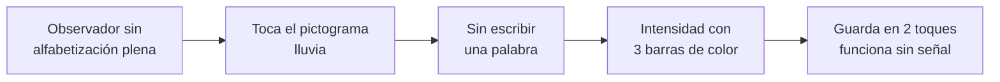
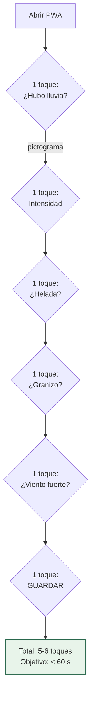

# 02 · Componentes Visuales

**Este es el documento de referencia del frontend.** Inventario de lo que ya existe en `web/public/` y `web/resources/`, decisión de qué se conserva y qué se descarta, design system derivado de la identidad institucional actual, y catálogo de componentes Vue 3 a construir.

> **Contraste con la estructura actual del repositorio**: **este repositorio no contiene `web/` ni ningún frontend** (verificado: no hay `web/`, `src/` ni `package.json`). Los assets que se heredan aquí (30 PNG, paleta, logos) provienen del **SINB legado de la VIDECI** y deben trasladarse explícitamente a este proyecto. Todo lo nuevo de este documento se construye como SPA que consume la API FastAPI existente (`/api/v1`, `/api/v2`), sin dependencias del frontend legado.

---

## 1. Por qué este documento

El frontend se construye desde cero, pero **no desde el vacío**. El proyecto ya tiene assets decisivos que costaron tiempo y que **no se pueden regenerar**: pictogramas de eventos climáticos, logos institucionales y una paleta de color ya aplicada durante años.

Alguien tiene que decidir qué se hereda. Este documento es esa decisión.

---

## 2. Estado actual del frontend

### 2.1 Los dos árboles de recursos

| Ruta | Contenido | Tamaño | Estado |
|---|---|---|---|
| `web/public/vendors/` | **65 librerías** de terceros | **~52 MB** | ⚠️ Basura mayoritaria |
| `web/public/js/` | 15 archivos propios y de terceros | ~530 KB | ⚠️ Mezclado |
| `web/public/css/` | 5 archivos | ~139 KB | ⚠️ Mezclado |
| `web/public/build/` | `custom.min.css/js` compilados | ~132 KB | ✅ Base visual válida |
| `web/public/images/` | **30 PNG** | ~880 KB | ✅ **Valioso** |
| `web/resources/views/` | 59 Blade | — | ⚠️ Reemplazar |

### 2.2 Lo que realmente carga el layout

`web/resources/views/layout/main.blade.php` es el layout raíz. Este es el inventario **real**, no el real:

| # | Recurso | Versión | Uso en el layout |
|---|---|---|---|
| 1 | `vendors/bootstrap/dist/css/bootstrap.min.css` | **3.3.6** | Estructura completa |
| 2 | `vendors/font-awesome/css/font-awesome.min.css` | 4.x local | Iconos |
| 3 | `https://use.fontawesome.com/releases/v5.8.2/css/all.css` | **5.8.2** CDN | ⚠️ **FA 4 y FA 5 a la vez** |
| 4 | `vendors/nprogress/nprogress.css` + `.js` | 0.2.0 | Barra de progreso |
| 5 | `vendors/iCheck/skins/flat/green.css` + `icheck.min.js` | 1.0 | Checkbox/radio |
| 6 | `vendors/bootstrap-progressbar/…-3.3.4.min.css` | 3.3.4 | Progreso |
| 7 | `vendors/jqvmap/dist/jqvmap.min.css` | 1.5.1 | Mapa |
| 8 | `vendors/bootstrap-daterangepicker/daterangepicker.css` | 2.x | Rango de fechas |
| 9 | `css/toastr.min.css` | — | Notificaciones |
| 10 | `build/css/custom.min.css` | — | ✅ **Tema institucional** |
| 11 | `css/styles.css` | — | Overrides |
| 12 | `vendors/jquery/dist/jquery.min.js` | 3.x | Base |
| 13 | `vendors/bootstrap/dist/js/bootstrap.min.js` | 3.3.6 | JS de Bootstrap |
| 14 | `vendors/fastclick/lib/fastclick.js` | 1.0 | Toque móvil |
| 15 | `vendors/Chart.js/dist/Chart.min.js` | **2.1.4** | Gráficos |
| 16 | `vendors/gauge.js/dist/gauge.min.js` | 2.x | Medidores |
| 17 | `vendors/bootstrap-progressbar/…min.js` | 3.3.4 | Progreso |
| 18 | `vendors/iCheck/icheck.min.js` | 1.0 | Checkbox |
| 19 | `vendors/skycons/skycons.js` | — | Iconos meteorológicos |
| 20 | `vendors/Flot/jquery.flot.{js,pie,time,stack,resize}` | 0.8 | Gráficos |
| 21 | `vendors/flot.orderbars/js/jquery.flot.orderBars.js` | — | Gráfico de barras |
| 22 | `vendors/flot-spline/js/jquery.flot.spline.min.js` | — | Splines |
| 23 | `vendors/flot.curvedlines/curvedLines.js` | — | Líneas curvas |
| 24 | `vendors/DateJS/build/date.js` | — | ⚠️ **34 MB, 800 archivos JS** |
| 25 | `vendors/jqvmap/dist/jquery.vmap.js` + `maps/…world.js` | 1.5.1 | Mapa mundial SVG |

**Carga real del layout: 25 recursos, ~2 MB sin comprimir**, de los cuales 4 están duplicados por versión o función.

### 2.3 Los tres hallazgos críticos

```mermaid
graph TD
    A["65 librerías<br/>~52 MB"] --> A1["DateJS<br/>34 MB · 800 archivos JS"]
    A --> A2["moment 5,7 MB<br/>311 archivos JS"]
    A --> A3["echarts 13,7 MB<br/>420 archivos JS"]
    A --> A4["select2 3,5 MB<br/>docs/ y bower_components incluidos"]

    B["3 sistemas de<br/>notificación"] --> B1["SweetAlert2<br/>public/js"]
    B --> B2["Toastr<br/>public/js + public/css"]
    B --> B3["PNotify<br/>vendors"]

    C["2 frameworks"] --> C1["Vue 2.0.3<br/>2014 · comentado en el layout"]
    C --> C2["jQuery 3.x<br/>y sus 18 plugins"]

    D["2 conjuntos de iconos"] --> D1["Font Awesome 4 local"]
    D --> D2["Font Awesome 5.8 CDN"]

    E["2 grids CSS"] --> E1["Bootstrap 3.3.6"]
    E --> E2["bootstrap-theme.min.css"]

    style A fill:#fde2e1,stroke:#c0392b
    style B fill:#fde2e1,stroke:#c0392b
    style C fill:#fdf3e7,stroke:#b5651d
    style D fill:#fdf3e7,stroke:#b5651d
```



**Vue 2.0.3 (2014) fue intentado y abandonado.** Está en `public/js/vue.min.js` junto con `vue-resource.min.js` y `vue-toasted.min.js`, y el bloque de `<script>` en `main.blade.php` termina con `-->`: **está comentado**. La decisión de ir a Vue 3 no es una moda, es **terminar algo que ya se empezó**.

### 2.4 Lo que NO existe

| Necesario | ¿Hoy? | Nota |
|---|---|---|
| **Leaflet** | ❌ **No** | El mapa actual es `jqvmap`, que solo dibuja países/regiones SVG. No puede marcar puntos sobre un mapa geográfico real |
| SweetAlert2 | ✅ Sí | `public/js/sweetalert2.all.min.js`, 62 KB |
| Vue 3 / Composition API | ❌ No | Solo Vue 2.0.3 abandonado |
| Pinia / Vuex | ❌ No | — |
| Vite / Webpack | ❌ No | No hay `mix-manifest.json`; assets precompilados a mano |
| Tailwind CSS | ❌ No | Bootstrap 3 |
| Cualquier cliente HTTP moderno | ❌ No | Sin axios ni wrapper de `fetch` |
| PWA / service worker | ❌ No | `manifest.json` no existe |
| TypeScript | ❌ No | — |

---

## 3. Inventario completo: qué se conserva, qué se descarta

### 3.1 Matriz de decisión

| Librería | Versión | Tamaño `dist` | Veredicto | Sustituto |
|---|---|---|---|---|
| **bootstrap** | 3.3.6 | 154 KB |  **Descartar** | Tailwind CSS 3 |
| **font-awesome** | 4.x + 5.8 CDN | 1.1 MB |  **Descartar** | **`@lucide/vue`** |
| **jquery** | 3.x | 637 KB |  **Descartar** | API nativa |
| **Chart.js** | 2.1.4 | 144 KB |  **Actualizar** | **Chart.js 4** (API modernizada) |
| **echarts** | 3.1.10 | 468 KB |  **Actualizar** | **ECharts 5** (lazy import) |
| **jqvmap** | 1.5.1 | 21 KB |  **Descartar** | **Leaflet + vue-leaflet** |
| **DateJS** | — | **34 MB** |  **Descartar** | `date-fns` |
| **moment** | — | 34 KB |  **Descartar** | `date-fns` |
| **select2** | 4.0.3 | 65 KB |  **Descartar** | Componente `<CatalogoSelect>` propio |
| **datatables.net** (+8 variantes) | — | 81 KB base |  **Descartar** | Tabla propia + `@tanstack/vue-query` |
| **parsleyjs** | — | 40 KB |  **Descartar** | Validador VeeValidate o propio |
| **bootstrap-daterangepicker** | 2.x | 413 KB |  **Descartar** | Componente `<RangoFechas>` |
| **sweetalert2** | — | 62 KB |  **Descartar** | Componente `<Dialogo>` + toasts |
| **toastr** | — | 5 KB |  **Descartar** | Toasts propios (Tailwind) |
| **pnotify** | — | 72 KB |  **Descartar** | ↑ |
| **dropzone** | — | 33 KB |  **Reimplementar** | `<CargaFotos>` con drag & drop |
| **cropper** | — | 245 KB |  **Reimplementar** | `cropperjs` moderno o recorte en canvas |
| **gauge.js** | 2.x | 20 KB |  **Reimplementar** | ECharts `gauge` |
| **ion.rangeSlider** | 2.1.4 | 38 KB |  **Descartar** | `<input type=range>` estilizado |
| **switchery** | 0.8.1 | 24 KB |  **Descartar** | Toggle propio |
| **iCheck** | 1.0 | 5 KB |  **Descartar** | Checkbox nativo estilizado |
| **iCheck skins** (47 CSS) | — | 320 KB |  **Descartar** | ↑ |
| **nprogress** | 0.2.0 | 4 KB |  **Conservar** | NProgress (sigue siendo lo correcto) |
| **fastclick** | 1.0 | 35 KB |  **Descartar** | Eliminado en iOS 13+; `touch-action` de CSS |
| **skycons** | — | 26 KB |  **Conservar** | Como fuente SVG de pictogramas |
| **fullcalendar** | 3.x | 128 KB |  **Descartar** | Componente `<Calendario>` simple |
| **pdfmake** | — | 416 KB |  **Descartar** | WeasyPrint en el servidor |
| **Flot** (+4 plugins) | 0.8 | 1.9 MB |  **Descartar** | Chart.js / ECharts |
| **morris.js** | — | 300 KB |  **Descartar** | ↑ |
| **raphael** | — | 1.1 MB |  **Descartar** | SVG nativo o ECharts |
| **jquery-sparkline** | — | 323 KB |  **Descartar** | Sparkline SVG propio |
| **jquery.easy-pie-chart** | — | 81 KB |  **Descartar** | Donut SVG con `stroke-dasharray` |
| **jquery.inputmask** | — | 974 KB |  **Descartar** | `v-mask` mínimo |
| **jquery.tagsinput** | — | 16 KB |  **Conservar idea** | `<TagsInput>` propio |
| **jquery.nestable** | 2.x | 18 KB |  **Conservar idea** | `vue-draggable-plus` / HTML5 DnD |
| **jQuery-Smart-Wizard** | — | 196 KB |  **Descartar** | `<Stepper>` propio |
| **validator** | — | 46 KB |  **Conservar idea** | Validación en composable |
| **malihu-custom-scrollbar** | — | 236 KB |  **Descartar** | `scrollbar-width` / `::-webkit-scrollbar` |
| **mjolnic-colorpicker** | — | 135 KB |  **Descartar** | `<input type=color>` |
| **bootstrap-wysiwyg** | — | 73 KB |  **Descartar** | Editor markdown o `contenteditable` |
| **animate.css** | — | 131 KB |  **Conservar** | CSS puro, sin JS, 8 KB minificado |
| **normalize.css** | — | 1 KB |  **Descartar** | Tailwind ya normaliza |
| **devbridge-autocomplete** | — | 100 KB |  **Descartar** | Búsqueda en catálogos locales |
| **jqvmap / EU.png** | — | 357 KB |  **Descartar** | Leaflet con tiles |
| **jszip** | — | 746 KB |  **Descartar** | `fflate` (200 KB) si se necesita |
| **google-code-prettify** | — | 353 KB |  **Descartar** | Shiki en build, no en cliente |
| **starrr** | 0.1 | 11 KB |  **Conservar idea** | Estrellas con Tailwind |
| **eve** | — | 27 KB |  **Descartar** | — |
| **transitionize** | — | 14 KB |  **Descartar** | Transiciones CSS |
| **mocha** | — | 160 KB |  **Descartar** | Vitest |
| **requirejs** | — | 87 KB |  **Descartar** | ES modules nativos |
| **DateJS** | — | **34 MB** |  **Descartar** | `date-fns` |
| **bootstrap-progressbar** | 3.3.4 | 3 KB |  **Descartar** | Componente `BarraProgreso` |
| **bootstrap-wysiwyg** | — | 73 KB |  **Descartar** | ↑ |
| **bootstrap-datetimepicker** | 4.x | 2.8 MB |  **Descartar** | `date-fns` + componente |
| **jquery-knob** | — | 117 KB |  **Descartar** | `input[type=range]` |
| **jquery.hotkeys** | — | 11 KB |  **Descartar** | Event listener |
| **jquery-mousewheel** | — | 20 KB |  **Descartar** | `wheel` nativo |
| **skycons** | — | 26 KB |  **Conservar** | Ver §4.2 |
| **public/js/vue*.js** | Vue 2.0.3 | 132 KB |  **Descartar** | Vue 3 desde npm |
| **bootstrap-theme** | — | 23 KB |  **Descartar** | Paleta Tailwind propia |

### 3.2 Resumen cuantificado

| Categoría | Nº librerías | Peso |
|---|---|---|
|  Descartadas | 47 | ~52 MB |
|  Actualizar / reimplementar | 7 | ~1 MB útil |
|  Conservar tal cual | 2 | ~30 KB |

**Se elimina el 97 % del peso de `vendors/`.**

### 3.3 Los 5 recursos que sí se conservan

| # | Recurso | Por qué | Dónde va |
|---|---|---|---|
| 1 | **30 PNG de `public/images/`** | Pictogramas de eventos climáticos ya diseñados | `src/assets/pictogramas/` |
| 2 | **`build/css/custom.min.css`** (61 KB) | Tema institucional con la paleta probada | Fuente del design system, no se copia el CSS |
| 3 | **Logos PROSUCO / VIDECI / MINDEF** | Identidad institucional obligatoria | `src/assets/marca/` |
| 4 | **`nprogress`** | Barra de carga; sigue siendo la librería correcta | Dependencia npm |
| 5 | **Plantillas `.xlsx`** | Formato de carga masiva ya conocido por los usuarios | `docs/` + importador |

---

## 4. Los pictogramas: el activo más valioso

`web/public/images/` contiene **30 PNG** que cubren exactamente los eventos climáticos del dominio.

### 4.1 Catálogo disponible

```mermaid
graph TD
    IMG["public/images/ · 30 PNG"]

    IMG --> CLIMA["Eventos climáticos"]
    IMG --> FENOM["Fenómenos"]
    IMG --> RIESGO["Niveles de riesgo"]
    IMG --> MARCA["Marca e interfaz"]

    CLIMA --> C1["lluvia.png 2,1 KB"]
    CLIMA --> C2["helada.png 1,4 KB"]
    CLIMA --> C3["granizo.png 1,7 KB"]
    CLIMA --> C4["nevada.png 1,3 KB"]
    CLIMA --> C5["nublado.png 1,3 KB"]
    CLIMA --> C6["sequia.png 1,5 KB"]
    CLIMA --> C7["vientos.png 1,6 KB"]
    CLIMA --> C8["trueno.png 1,5 KB"]
    CLIMA --> C9["tornado.png 1,8 KB"]

    FENOM --> F1["inundacion.png 1,6 KB"]
    FENOM --> F2["deslizamiento.png 2,3 KB"]
    FENOM --> F3["sismo.png 2,3 KB"]
    FENOM --> F4["llama.png 1,0 KB"]

    RIESGO --> R1["riesgo.png 2,4 KB"]
    RIESGO --> R2["verde.png 2,0 KB"]
    RIESGO --> R3["azul.png 1,9 KB"]
    RIESGO --> R4["amarillo.png 1,8 KB"]
    RIESGO --> R5["naranja.png 1,8 KB"]
    RIESGO --> R6["rojo.png 1,7 KB"]

    AGRIC["Agricultura"] --- A1["cosecha.png 2,2 KB"]
    AGRIC --- A2["siembra.png 1,1 KB"]
    AGRIC --- A3["lluvia_agri"]

    MARCA --> M1["LogoProsuco.png 31,8 KB"]
    MARCA --> M2["logovideci.png 345,9 KB"]
    MARCA --> M3["mindef.png 90,5 KB"]
    MARCA --> M4["icon.png 17,6 KB · favicon"]
    MARCA --> M5["user.png 7,4 KB · avatar"]
    MARCA --> M6["loading.gif 76,2 KB"]
    MARCA --> M7["fondo.png 0,6 KB"]
    MARCA --> M8["EU.png 357,1 KB · mapa"]

    style CLIMA fill:#e8f4ea,stroke:#2d6a4f
    style FENOM fill:#fdf3e7,stroke:#b5651d
    style RIESGO fill:#fde2e1,stroke:#c0392b
```



### 4.2 Cobertura contra las categorías del dominio

Las 12 categorías de `t_categorias_pronostico_temporal` (documentadas en [docs/BASE_DE_DATOS.md §8.5](../docs/BASE_DE_DATOS.md)) contra los PNG disponibles:

| Categoría del dominio | Pictograma | Estado |
|---|---|---|
| Lluvia | `lluvia.png` | ✅ |
| Nevada | `nevada.png` | ✅ |
| Inundación | `inundacion.png` | ✅ |
| Riada | `inundacion.png` |  Reutilizar |
| Dezlisamiento | `deslizamiento.png` | ✅ *(typo en el dato original)* |
| Sequía | `sequia.png` | ✅ |
| Incendios | `llama.png` | ✅ |
| Helada | `helada.png` | ✅ |
| Granizada | `granizo.png` | ✅ |
| Mucho calor | — |  **Falta** |
| — | `vientos.png`, `trueno.png`, `tornado.png`, `nublado.png` |  Extras útiles |

**Solo falta «Mucho calor».** Es el único icono que hay que commissionar.

### 4.3 Uso en la interfaz intercultural

Este es el motivo por el que los pictogramas son el activo número uno del proyecto:



Los pictogramas hacen posible el requisito de **≤ 5 toques** del Formulario diario y la captura de señas por parte de un observador local.

**Especificación para la nueva versión:**

| Atributo | Valor | Motivo |
|---|---|---|
| Formato | SVG preferred sobre PNG | Escalable, recoloreable por nivel de riesgo |
| Tamaño | 3 nominally: 24 px (chip), 48 px (botón), 96 px (panel) | — |
| Fondo | Transparente | Se superponen sobre tarjetas de color |
| Variante | Un archivo por **nivel de intensidad** (bajo/normal/alto) | Permite codificar la intensidad sin texto |
| Trazo | Grueso y simple | Legible en pantalla de 5" con sol |
| Alt | `alt` obligatorio con el nombre del evento | Accesibilidad de lectores de pantalla |
| Contraste | ≥ 4.5:1 contra el fondo del botón | WCAG AA |

---

## 5. Design system

### 5.1 Origen

La paleta se extrae del tema actual (`build/css/custom.min.css`). Los colores más frecuentes:

| Color | Ocurrencias | Rol inferred |
|---|---|---|
| **`#1abb9c`** | 25 | **Primary** — verde agua, botones principales |
| **`#34495e`** | 16 | **Sidebar** — azul marino oscuro |
| `#f7f7f7` | 13 | Fondo de página |
| `#73879c` | 7 | Texto secundario |
| `#e6e9ed` | 6 | Bordes y separadores |
| `#e9edef` | 6 | Fondo de tarjeta alterno |
| **`#e74c3c`** | 6 | **Danger** — rojo |
| `#d9dee4` | 6 | Borde fuerte |
| **`#3498db`** | 5 | **Info** — azul |
| `#2a3f54` | 5 | Sidebar hover |
| `#f5f7fa` | 4 | Fondo de contenido |
| `#ce5454` | 4 | Danger hover |

Es la firma del template *Crisp*: verde agua + azul marino. **Se conserva** porque ya está identificada por los usuarios.

### 5.2 Paleta Tailwind

```js
// tailwind.config.js — colores de marca
colors: {
  primary: {
    50:  '#f0fdfa', 100: '#d6f7f0', 200: '#b0eee3', 300: '#7fe1d1',
    400: '#4dceb9', 500: '#1abb9c',   // ← #1abb9c actual
    600: '#14a389', 700: '#108a75', 800: '#0d6f5f', 900: '#0a594c',
  },
  secondary: {
    50:  '#f7f9fa', 100: '#eef2f5', 200: '#d9dee4', 300: '#c3cbd3',
    400: '#a3b0bd', 500: '#8495a6', 600: '#73879c', 700: '#5b6c7e',
    800: '#45525f', 900: '#34495e',   // ← #34495e actual
    950: '#2a3f54',                   // ← #2a3f54 sidebar hover
  },
  danger:  { 500: '#e74c3c', 600: '#ce5454' },
  info:    { 500: '#3498db' },
  warning: { 500: '#f39c12' },
  surface: { DEFAULT: '#ffffff', sunken: '#f7f7f7', raised: '#f5f7fa' },
}
```

### 5.3 Tipografía

El tema actual declara `"Helvetica Neue", Roboto, Arial, "Droid Sans", sans-serif`.

**Decisión**: mantener la pila del sistema **sin cargar ninguna webfont**. Cero descargas, cero FOUT, funciona offline desde el primer arranque.

| Nivel | Tamaño / peso / interlineado | Uso |
|---|---|---|
| `display` | 30 / 700 / 1.2 | Cifras del dashboard |
| `h1` | 24 / 700 / 1.3 | Título de página |
| `h2` | 20 / 600 / 1.35 | Sección |
| `h3` | 18 / 600 / 1.4 | Subsección |
| `body` | 15 / 400 / 1.55 | Texto |
| `small` | 13 / 400 / 1.5 | Metadatos |
| `caption` | 12 / 500 / 1.4 | Etiquetas de tabla |
| `mono` | 13 / 400 / 1.5 | Códigos INE, coordenadas |

> **Contraste con el original**: el tema actual es de 2016 y usa 13-14 px. Subir a 15 px mejora la legibilidad en pantallas pequeñas — crítico para un observador con móvil de gama baja.

### 5.4 Espaciado y radios

Escala de 4 px, derivada del tema:

```js
spacing: { 0:'0', 1:'4px', 2:'8px', 3:'12px', 4:'16px', 5:'20px', 6:'24px',
           8:'32px', 10:'40px', 12:'48px', 16:'64px', 20:'80px' }
borderRadius: { sm:'3px', DEFAULT:'4px', md:'6px', lg:'8px', xl:'12px', full:'9999px' }
```

| Radio | Elemento |
|---|---|
| `sm` (3 px) | Input, badge |
| `DEFAULT` (4 px) | Botón, select |
| `md` (6 px) | Tarjeta, panel |
| `lg` (8 px) | Modal |
| `full` | Avatar, chip, toggle |

### 5.5 Sombras

```js
boxShadow: {
  xs: '0 1px 2px 0 rgb(52 73 94 / 0.05)',
  sm: '0 1px 3px 0 rgb(52 73 94 / 0.1), 0 1px 2px -1px rgb(52 73 94 / 0.1)',
  md: '0 4px 6px -1px rgb(52 73 94 / 0.1), 0 2px 4px -2px rgb(52 73 94 / 0.1)',
  lg: '0 10px 15px -3px rgb(52 73 94 / 0.1), 0 4px 6px -4px rgb(52 73 94 / 0.1)',
  focus:'0 0 0 3px rgb(26 187 156 / 0.35)',
}
```

### 5.6 Escala de riesgo

Codificación de niveles, coherente con `riesgo.png` y los PNG de color:

| Nivel | Color | Texto | Pictograma |
|---|---|---|---|
| Bajo | `#1abb9c` (primary 500) | BAJO | `verde.png` |
| Medio | `#f39c12` (warning) | MEDIO | `amarillo.png` |
| Alto | `#f97316` | ALTO | `naranja.png` |
| Crítico | `#e74c3c` (danger) | CRÍTICO | `rojo.png` |
| Sin dato | `#9ca3af` | SIN DATO | `azul.png` |

**Nunca se comunica riesgo solo por color**: siempre color **+** pictograma **+** texto. Es un requisito de accesibilidad y también de comprehend para quien no distingue rojo y verde.

### 5.7 Breakpoints

| Prefijo | Mínimo | Objetivo |
|---|---|---|
| (base) | 0 px | Móvil del observador. **Prioridad absoluta** |
| `sm` | 640 px | Móvil grande / tableta vertical |
| `md` | 768 px | Tableta horizontal |
| `lg` | 1024 px | Portátil del técnico |
| `xl` | 1280 px | Monitor de oficina |
| `2xl` | 1536 px | Monitor grande |

> El layout actual es de escritorio primero: sidebar fijo de 220 px siempre visible. Eso **no sirve** en un móvil de 5". El nuevo shell es responsive con navegación inferior en móvil.

---

## 6. Catálogo de componentes Vue 3

### 6.1 Inventario objetivo

**63 componentes propios**, repartidos en cuatro niveles: 26 fundaciones y de formulario, 15 de datos y navegación, 10 de feedback, y 12 especializados del dominio. **Cero librería de UI de terceros** (sin Vuetify, PrimeVue, Element Plus, Naive UI): el 100 % del estilo se controla con Tailwind.

| Nivel | Prefijo | Cantidad | Contenido |
|---|---|---|---|
| 0 · Fundaciones | `F` | 9 | `F1` a `F9`. Contenedores, navegación, estados |
| 1 · Formularios | `F` | 17 | `F10` a `F26`. Campos y entradas de datos |
| 2 · Datos y navegación | `D` | 15 | `D1` a `D15`. Tablas, mapas, gráficos, calendario |
| 3 · Feedback | `C` | 10 | `C1` a `C10`. Avisos, diálogos, progreso, vacíos |
| 4 · Especializados | `X` | 12 | `X1` a `X12`. Los propios del ciclo biocultural |
| **Total** | | **63** | |

### 6.2 Nivel 0 · Fundaciones

| # | Componente | Qué hace | Notas de diseño |
|---|---|---|---|
| F1 | `<AppShell>` | Contenedor: sidebar en desktop, bottom-nav en móvil | Colapsa a drawer en `lg` |
| F2 | `<AppSidebar>` | Navegación lateral derivada del RBAC | Íconos Lucide, grupos colapsables |
| F3 | `<AppTopbar>` | Cabecera: búsqueda, idioma, tema, perfil, **indicador de red** | El indicador de red es crítico |
| F4 | `<AppBottomNav>` | Navegación inferior para móvil | 5 destinos máximo |
| F5 | `<IndicadorConexion>` | ● Verde / ámbar / rojo: en línea, pendiente de sincronizar, sin conexión | Muestra **cuántos** registros van en la cola |
| F6 | `<PageHeader>` | Título, breadcrumbs, acciones | |
| F7 | `<Panel>` | Tarjeta con título, contenido y acciones | Base de casi todo |
| F8 | `<LoadingState>` | Skeleton, spinner, vacío y error | 4 estados distintos |
| F9 | `<ErrorState>` | Mensaje + reintento | Nunca una pantalla en blanco |

### 6.3 Nivel 1 · Formularios

| # | Componente | Sustituye a | Regla |
|---|---|---|---|
| F10 | `<CampoTexto>` | `input` de Bootstrap | Label arriba, error abajo, `help` opcional |
| F11 | `<CampoNumero>` | `<input type=number>` | Formato local-aware; no usa `type=number` (problemas con scroll y móvil) |
| F12 | `<AreaTexto>` | `textarea` | Contador de caracteres |
| F13 | `<CampoFecha>` | `bootstrap-daterangepicker` + `DateJS` | `date-fns`; táctil grande |
| F14 | `<RangoFechas>` | `bootstrap-daterangepicker` | Rango predefinidos: campaña, mes, temporada |
| F15 | `<CampoSelect>` | `select` | |
| F16 | `<CatalogoSelect>` | **select2** | ⚠️ El más importante: busca en catálogo local de 18.331 comunidades con fuzzy search y soporta modo **offline** |
| F17 | `<CampoMultiSelect>` | select2 multiple | Chips + búsqueda |
| F18 | `<TagsInput>` | `jquery.tagsinput` | Enter para agregar |
| F19 | `<Interruptor>` | `switchery` | |
| F20 | `<Casilla>` | `iCheck` | Checkbox nativo estilizado |
| F21 | `<Radio>` | `iCheck` | |
| F22 | `<Deslizador>` | `ion.rangeSlider` | `input[type=range]` estilizado |
| F23 | `<SelectorColor>` | `mjolnic-colorpicker` | `input[type=color]` |
| F24 | `<Estrellas>` | `starrr` | Solo para calificación de calidad de dato |
| F25 | `<CargaArchivo>` | `dropzone` | Drag & drop, cola, progreso, reintento |
| F26 | `<RecorteImagen>` | `cropper` | Canvas nativo; salida WebP |

### 6.4 Nivel 2 · Datos y navegación

| # | Componente | Sustituye a | Regla |
|---|---|---|---|
| D1 | `<TablaDatos>` | **datatables.net** + 8 plugins | Orden, filtro, paginación, selección. Virtualizada con `n > 200` |
| D2 | `<Paginacion>` | DataTables | Cursor-based, muestra total real |
| D3 | `<Mapa>` | **jqvmap** | `vue-leaflet`; capas de riesgo, comunidades, estaciones, búfer NDVI |
| D4 | `<CapaMapa>` | — | Control de capas del mapa |
| D5 | `<GraficoLinea>` | Chart.js / Flot | Series temporales: precipitación, NDVI |
| D6 | `<GraficoBarra>` | flot.orderbars | Comparación entre municipios o campañas |
| D7 | `<GraficoTreemap>` | ECharts | Composición del catálogo de indicadores |
| D8 | `<MapaCalor>` | jqvmap | Distribución espacial de observaciones |
| D9 | `<Anillo>` | `jquery.easy-pie-chart` | Un KPI; donut SVG con `stroke-dasharray` |
| D10 | `<Sparkline>` | `jquery-sparkline` | Inline, SVG de 3 paths |
| D11 | `<Calendario>` | `fullcalendar` | Solo vista mes/semana; no día |
| D12 | `<Pasos>` | `jQuery-Smart-Wizard` | Indicador de pasos del formulario largo |
| D13 | `<Acordeon>` | `collapse` de Bootstrap | |
| D14 | `<Pestañas>` | `nav-tabs` | |
| D15 | `<Timeline>` | — | Histórico de una observación o alerta |

### 6.5 Nivel 3 · Feedback yoverlay

| # | Componente | Sustituye a |
|---|---|---|
| C1 | `<Toast>` | **Toastr** + **PNotify** + **SweetAlert2** |
| C2 | `<Dialogo>` | SweetAlert2 (confirmación destructiva) |
| C3 | `<Cargando>` | `bootstrap-progressbar` |
| C4 | `<IndicadorProgreso>` | `nprogress` |
| C5 | `<Tooltip>` | `bootstrap-tooltip` |
| C6 | `<Popover>` | `bootstrap-popover` |
| C7 | `<Notificacion>` | Badge de alertas en el topbar |
| C8 | `<BandejaOffline>` | ⚠️ **Nuevo**: lista de registros pendientes de sincronizar, con reintento manual |
| C9 | `<BarraAccion>` | Acciones contextuales flotantes (FAB) |
| C10 | `<Vacio>` | Estado vacío con ilustración e CTA |

### 6.6 Nivel 4 · Especializados del dominio

Estos no existen en ningún sistema genérico. Son el corazón del SINB.

| # | Componente | Para qué | Actor |
|---|---|---|---|
| X1 | `<CapturaSena>` | **Selector de señas bioculturales**: pictograma + variantes + nota de voz. 6 toques máx. | observador local |
| X2 | `<FormularioDiario>` | **Formulario diario**: 4 pictogramas de evento × 3 niveles de intensidad. 5 toques máx. | Observador |
| X3 | `<SelectorIntensidad>` | Tres barras de color: bajo / normal / alto. Sin texto obligatorio. | Observador |
| X4 | `<FichaPronostico>` | Pronóstico con su rango de vigencia y su escenario | Técnico |
| X5 | `<PanelValidacion>` | Validar contra monitoreo: Cumplido / Parcial / No cumplido + justificación | Técnico |
| X6 | `<PanelConfiabilidad>` | Índice de acierto por bioindicador × ecorregión, con n y umbral | Investigador |
| X7 | `<TendenciaBioindicador>` | Gráfico de floración/conducta por año y su desfase con la precipitación | Investigador |
| X8 | `<ContextoSatelital>` | NDVI + CHIRPS de la comunidad, superpuestos a la ficha de observación | Técnico |
| X9 | `<ListaAlertas>` | Alertas vigentes por municipio con nivel y vigencia | Todos |
| X10 | `<SelectorComunidad>` | Busca comunidad con pictogramas de zona (Andina/Subandina/Amazonía/Chaco) | Técnico |
| X11 | `<BrindadorAudio>` | Reproduce la nota de voz o el boletín en el idioma del usuario | Todos |
| X12 | `<LineaTiempoCampana>` | Campaña agrícola con sus fases y las ventanas de siembra | Técnico |
| X13 `[NUEVO]` | `<AsistentePronostico>` | Paso 0 (campo abierto, la frase tal cual) → cadena de catálogo → escenario → paso final: confianza + observadores 1..N | Observador / recolector |
| X14 `[NUEVO]` | `<TarjetaAviso>` | Aviso de corto plazo: texto libre, comunidad con punto, **barra de vigencia** (24 h por defecto) | Observador / productor |
| X15 `[NUEVO]` | `<BadgeConfianza>` | Dos badges separados: **confianza inicial** (ALTA/MEDIA/BAJA, dato de la persona) e **índice automático** (LARGO / CORTO, calculado; «sin datos» si n = 0) | Técnico |
| X16 `[NUEVO]` | `<HistogramaPronosticos>` | Frecuencia de pronósticos por área (municipio, departamento, zona) con contadores por estado | Técnico / región |
| X17 `[NUEVO]` | `<PanelObservadores>` | Observadores destacados de la sesión: nombres, confianza inicial e índice por tipo, con sus cumplió/no cumplió | Técnico |
| X18 `[NUEVO]` | `<GaleriaBioindicador>` | **1:N fotos del bioindicador, cada una con su descripción**; portada, orden y consentimiento; «añadir foto» con texto obligatorio | Todos |
| X19 `[NUEVO]` | `<PopupMapaBioindicador>` | Popup del mapa: punto por coordenada + nombre local + foto portada + nivel de confianza | Todos |

### 6.7 El componente `<FormularioDiario>` en detalle

Es el componente más importante del proyecto. Requisitos:



| Atributo | Requisito |
|---|---|
| Toques totales | **≤ 6** incluyendo guardar |
| Targets táctiles | **≥ 56 × 56 px** |
| Texto obligatorio | **Ninguno** |
| Estado por defecto | «Sin dato», no «No» — distingue observación de ausencia |
| Sin conexión | Debe funcionar por completo |
| Reanudar | Si se cierra a media captura, se conserva |
| Idioma | Todos los rótulos en el idioma del usuario |
| Foto | Opcional, con geolocalización automática |
| Deshacer | Último registro se puede anular en 10 s |

> **Regla de oro**: un pictograma sin tocar significa *«no lo observé»*, no *«no ocurrió»*. La distinción entre «no ocurrió» y «no lo noté» es la diferencia entre un dato útil y un dato basura en un estudio de confiabilidad.

### 6.8 El componente `<CapturaSena>` en detalle

Para el observador local, que puede no leer.

| Atributo | Requisito |
|---|---|
| Entrada | Pictograma grande (96 px) + variantes de la seña |
| Incluye | 3 floraciones del Qariwa, floración del Sank'ayu, nido alto de Liqi liqi, canto de Tiluchi, etc. |
| Contexto | Muestra la ecorregión del usuario y **su propia historial** de esa seña |
| Voz | Botón de grabación opcional con transcripción posterior |
| Latitud/longitud | Automática por GPS; editable |
| Validación | No bloquea: avisa «esta seña suele registrarse en noviembre» sin impedir |
| Contextoagro | Muestra el resto de señales registradas por otros observadores locales del municipio |

---

## 7. Reglas visuales de la nueva plataforma

### 7.1 Lo que se elimina del diseño actual

| Anti-patrón actual | Problema | Regla nueva |
|---|---|---|
| Sidebar fijo de 220 px siempre visible | Inútil en móvil de 5" | Sidebar en `lg+`; bottom-nav en móvil |
| Formulario de observación largo en una pantalla | 40 campos, inusable | `<Pasos>`: 4 pasos con progreso |
| Tablas con scroll horizontal infinito | Ilegible en móvil | `<TablaDatos>` responsive: tarjetas en móvil |
| `position: fixed` dentro de tarjetas | Se descuadra al hacer scroll | Capas fijas a un contenedor con `overflow` |
| Formulario `<table>` para el cuerpo | HTML inválido → submit roto | Nunca |
| `<select>` con 18.331 `<option>` | Congela el navegador | `<CatalogoSelect>` con búsqueda |
| Font Awesome 4 + 5 | Glifos duplicados e inconsistentes | Solo `@lucide/vue` |
| Sin indicador de red | El usuario no sabe si se guardó | `<IndicadorConexion>` siempre visible |
| Sin feedback de guardado | El usuario repite la captura | Toast inmediato + contador en la bandeja |
| Texto de 13 px | Legibilidad pobre | 15 px mínimo |

### 7.2 Reglas de la nueva plataforma

| # | Regla |
|---|---|
| R1 | **Mobile-first real.** Cada pantalla se diseña a 360 px primero. |
| R2 | **El estado vacío es una pantalla diseñada**, no un hueco. |
| R3 | **Toda acción da feedback** en ≤ 100 ms, visual o tactile. |
| R4 | **Nunca se pierde una captura.** Si el POST falla, queda en la bandeja offline. |
| R5 | **El estado de red es visible** en todo momento, no solo cuando falla. |
| R6 | **Ningún dato crítico depende solo del color.** Color + icono + texto. |
| R7 | **Objetivo táctil ≥ 48 px**; 56 px en el Formulario diario. |
| R8 | **Cero carga bloqueante sin red** en las vistas de captura. |
| R9 | **Una acción destructiva siempre pide confirmación** con consequence explícita. |
| R10 | **Los errores dicen qué hacer**, no solo qué pasó. |
| R11 | **Toda tabla es ordenable y filtrable**, y expone su total real. |
| R12 | **Toda vista de listado tiene vista de mapa** cuando la entidad tiene ubicación. |

### 7.3 Accesibilidad

| Criterio | Objetivo |
|---|---|
| WCAG | **2.1 AA** |
| Contraste de texto | ≥ 4.5:1 (normal), ≥ 3:1 (grande) |
| Contraste de UI | ≥ 3:1 contra el fondo |
| Navegación por teclado | Total; foco visible (`shadow-focus`) |
| Lectores de pantalla | Landmarks, `aria-live` en toasts, `alt` en pictogramas |
| Tamaño mínimo de texto | 15 px base; **nunca** bajar a 12 para contenido |
| `prefers-reduced-motion` | Respetado en todas las transiciones |
| Foco al cambiar de vista | Se mueve al `h1` |
| Formularios | `<label>` asociado, error con `aria-describedby` |
| Datos sin color | Toda tabla tiene estado textual |

---

## 8. Estructura de `src/`

```
web-nuevo/src/
├── assets/
│   ├── pictogramas/          ← los 30 PNG + SVG nuevos
│   ├── marca/                ← Logo PROSUCO, logo VIDECI, MINDEF, favicon
│   └── mapa/                 ← teselas locales de respaldo
├── components/
│   ├── foundation/           ← F1-F9   (AppShell, Panel, Estados…)
│   ├── form/                 ← F10-F26 (CampoTexto, CatalogoSelect…)
│   ├── data/                 ← D1-D15  (TablaDatos, Mapa, Gráficos…)
│   ├── feedback/             ← C1-C10  (Toast, Dialogo, BandejaOffline…)
│   └── domain/               ← X1-X12  (Formulario diario, CapturaSena…)
├── composables/
│   ├── useApi.ts             ← cliente HTTP con retry y cola
│   ├── useAuth.ts
│   ├── useCatalogos.ts       ← caché IndexedDB de catálogos
│   ├── useOffline.ts         ← estado de red y bandeja
│   ├── useSync.ts            ← orquestación de sincronización
│   ├── useGeo.ts             ← GPS con fallback manual
│   ├── useVoz.ts             ← grabación y TTS
│   └── useIdioma.ts
├── stores/
│   ├── auth.ts               ← Pinia
│   ├── catalogos.ts
│   ├── offline.ts
│   ├──sync.ts
│   └── ui.ts
├── router/
│   └── index.ts              ← createWebHashHistory + guardas RBAC
├── textos/
│   └── es.ts                      ← único diccionario, en español
├── styles/
│   ├── tailwind.css
│   └── tokens.css            ← vars CSS del design system
├── workers/
│   └── sync.worker.ts        ← sincronización fuera del main thread
└── main.ts
```

---

## 9. Presupuesto de bundle

Objetivos por chunk. Se verifican en CI con un umbral que rompe el build.

| Chunk | Contenido | Objetivo (gz) |
|---|---|---|
| `vendor-core` | Vue, vue-router, Pinia, Dexie | ≤ 180 KB |
| `app` | Composables, stores, `foundation/` | ≤ 90 KB |
| `formulario-diario` | `domain/X2-X3` + `form/` mínimo | ≤ 70 KB |
| `catalogos` | Datos estáticos locales | ≤ 45 KB |
| `mapa` | Leaflet + vue-leaflet (**lazy**) | ≤ 160 KB |
| `graficos` | Chart.js **o** ECharts, nunca ambos (**lazy**) | ≤ 120 KB |
| `iconos` | `@lucide/vue` con tree-shaking | ≤ 25 KB |
| **Inicial** | Solo lo necesario para pintar | **≤ 120 KB** |

**Regla dura**: la primera apertura sin red debe mostrar el Formulario diario funcional. Por eso `mapa` y `graficos` son `dynamic import` y nunca están en el chunk inicial.

---

## 10. Resumen ejecutivo para decisión

| Pregunta | Respuesta |
|---|---|
| ¿Se puede reutilizar el CSS actual? | **No.** Se reutiliza la **paleta** y el layout, no el código. |
| ¿Se pueden reutilizar los pictogramas? | **Sí, y es el activo #1.** 30 PNG que cubren el 91 % de las categorías. Falta «Mucho calor». |
| ¿Se reutiliza algún logo? | **Sí**: PROSUCO, VIDECI, MINDEF. Son identidad institucional obligatoria. |
| ¿Se reutiliza alguna librería? | **2**: `nprogress` y `skycons`. El resto se reemplaza. |
| ¿Hay que construir un design system? | **Sí.** 63 componentes Vue 3 propios, sin librería de UI de terceros. |
| ¿Vue es una apuesta nueva? | **No.** Vue 2.0.3 se intentó en 2014 y se abandonó. Esto es terminarlo en Vue 3. |
| ¿Hace falta un diseñador? | **Sí, para X1-X12.** Los componentes de dominio son los que definen la plataforma. |
| ¿Cuánto pesa el resultado? | ~95 KB gz iniciales, contra los ~2 MB del layout actual. |

---

## Ver también

- [README](README.md) — decisiones de stack
- [01-ARQUITECTURA.md](01-ARQUITECTURA.md) — atributos de calidad y presupuesto de bundle
- [06-FRONTEND.md](06-FRONTEND.md) — implementación de la SPA en Vue 3
- [08-OFFLINE-SINCRONIZACION.md](08-OFFLINE-SINCRONIZACION.md) — cómo la UI refleja el estado offline
- [11-INTERCULTURALIDAD.md](11-INTERCULTURALIDAD.md) — pictogramas, idiomas y accesibilidad
- [docs/FUNCIONALIDAD.md](../docs/FUNCIONALIDAD.md) — pantallas actuales que se rediseñan
