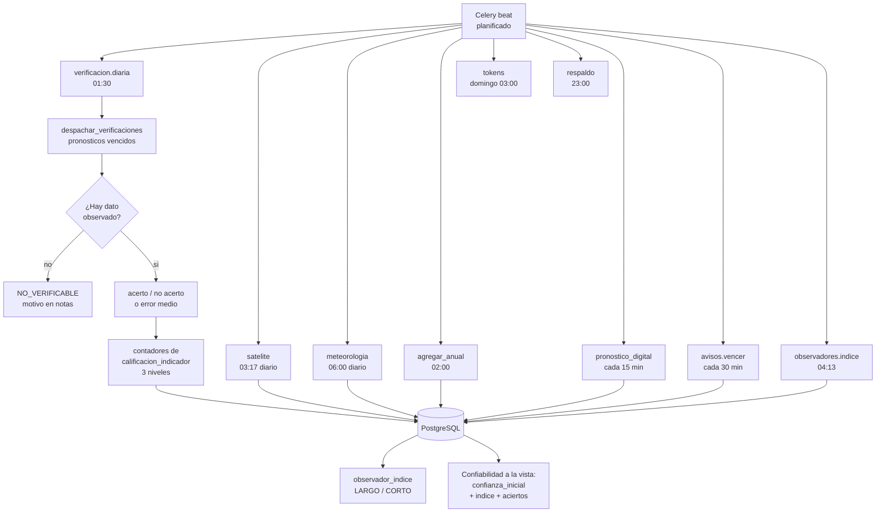
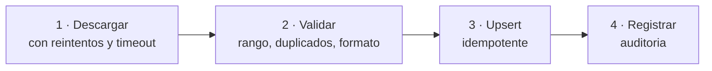

# 03 · Backend

Servicios, tareas programadas y lógica de dominio. Lo que hace que el sistema aprenda.

---

## Cómo leer este documento

| Marcador | Significado |
|---|---|
| `[ACTUAL]` | Comprobado en `web/` |
| `[DEFECTO]` | Problema comprobado |
| `[MEJORA]` | Capacidad existente que se modifica |
| `[NUEVO]` | Capacidad que el SINB no tiene |
| `[DECIDIR]` | Requiere firma institucional |

---

## 0. Contraste con la estructura actual del repositorio

> **Actualización de contraste.** §1 describe el **SINB legado de la VIDECI** (Laravel 5.8 + MariaDB, fuente `web/`, ausente de este repositorio). Este repositorio ya tiene un backend distinto:

| Elemento | Estado actual verificado en este repositorio |
|---|---|
| API | **FastAPI** (Python 3.12), `api/main.py`, rutas `/api/v1`, `/api/v2`, OpenAPI generado por FastAPI |
| ORM / BD | **SQLAlchemy** sobre **PostgreSQL 16 + PostGIS 3.4** (`api/database.py`, base `db_sinagersat`) |
| Validación | Pydantic v2 (esquemas en `api/*/schemas.py`) |
| Auditoría | `AuditMiddleware` (`api/audit.py`) sobre toda escritura |
| Authenticación | JWT HS256 (`api/auth/jwt.py`) |
| Migraciones | SQL versionadas en `database/migrations/` (v2.x) y `database/migration_v*.sql` |
| Esquema `sinb` | **Existe y está vacío** — destino de todo lo nuevo del SINB |
| Dominios vecinos | `edan` y `rida` son **independientes** del SINB (módulos API propios) |

**Consecuencia para este documento**: las capacidades marcadas `[NUEVO]` en §2+ se leen como **ampliación del backend actual** (Celery, Redis, MinIO, tareas programadas, cliente HTTP), no como migración desde Laravel. §1 queda como diagnóstico del legado de la VIDECI.

---

## 1. El backend actual `[ACTUAL]` (SINB legado · VIDECI)

### 1.1 Lo que hay

| Elemento | Detalle |
|---|---|
| Framework | Laravel 5.8 |
| ORM | Eloquent |
| Base de datos | MariaDB 10.3.39 |
| Controladores | 35 |
| Modelos | 35 |
| Migraciones | Presentes, 27 archivos |
| Cola | `QUEUE_CONNECTION=sync` en `.env` |
| Autenticación | `AuthController` con provider `loginModel` |
| Autorización | `AuthServiceProvider` + `@permiso` en Blade |
| PDF | `dompdf` declarado en `composer.json`, ausente en `vendor/` |
| Excel | `PhpSpreadsheet` declarado, ausente en `vendor/` |

### 1.2 Lo que no hay `[ACTUAL]`

Verificado sobre `web/`: no existe API REST, ni cola con broker, ni tarea programada, ni cliente HTTP a fuentes externas, ni motor de pronóstico, ni job en segundo plano, ni caché, ni Dockerfile, ni configuración de despliegue.

> *Contraste*: esta ausencia es la del **legado**. En este repositorio **ya existe API REST** (`api/`, FastAPI) y migraciones versionadas (`database/migrations/`). Las carencias que siguen vigentes aquí —cola, tareas programadas, cliente HTTP, caché— son las que este documento debe cerrar como `[NUEVO]`.

`[DEFECTO]` Las implicaciones son concretas:

| Defecto | Consecuencia técnica |
|---|---|
| `QUEUE_CONNECTION=sync` | Un job se ejecuta dentro de la petición web. Si tarda, el usuario espera |
| `DB::transaction` → 0 ocurrencias | Un fallo a mitad de un guardado deja registros parciales |
| `TRUNCATE` en 4 importadores | Un error de red en la fila 800 pierde las 799 anteriores |
| `GET /crear-provincia` trunca antes de insertar | Abrir el formulario borra el catálogo de provincias |
| Sin caché | Cada pantalla recalcula agregados sobre tablas completas |
| Sin `.env` por entorno | Un cambio de configuración se hace editando archivos |

### 1.3 Un ejemplo del problema `[DEFECTO]`

`ProvinciasController::store()`:

```php
// web/app/Http/Controllers/ProvinciasController.php
Provincia::truncate();                       // borra todo
foreach ($request->departamento as $d) {
    Provincia::create([...]);                // inserta fila por fila
}
```

`[DEFECTO]` Si la petición muere en el bucle, el catálogo queda vacío o a medias, sin transacción que lo revierta. Con nueve departamentos y 111 provincias, el volumen no es el problema: la ausencia de atomicidad lo es.

---

## 2. La pila objetivo `[NUEVO]`

> *Contraste*: **FastAPI, SQLAlchemy, Pydantic y PostgreSQL 16 + PostGIS ya están implementados** en este repositorio (`api/`). De esta tabla queda realmente pendiente como `[NUEVO]`: Alembic (hoy las migraciones son SQL versionadas en `database/migrations/`), Celery, Redis, MinIO y la observabilidad. No es una migración desde cero, sino una **ampliación** de lo existente.

| Capa | Tecnología | Versión | Motivo |
|---|---|---|---|
| Runtime | Python | 3.12 | `asyncio`, tipado fuerte, ecosistema científico |
| API | FastAPI | 0.115 | Validación con Pydantic, OpenAPI automático, async nativo |
| ORM | SQLAlchemy | 2.0 async | Control explícito de transacciones |
| Migraciones | Alembic | 1.13 | Reversibles y versionadas |
| Validación | Pydantic | 2.9 | Un solo esquema para entrada y documentación |
| Tareas | Celery | 5.4 | Reintentos, planificación, workers |
| Broker | Redis | 7.2 | Colas y caché |
| Objetos | MinIO | RELEASE.2025 | Compatible con S3, URL firmadas |
| Base | PostgreSQL | 16 + PostGIS 3.4 | `GEOMETRY`, agregación espacial |
| Observabilidad | Prometheus + Grafana | — | Métricas de latencia, cola y verificación |

`[NUEVO]` FastAPI genera la documentación OpenAPI desde los modelos Pydantic. El contrato de [05](05-APIS.md) y el código no pueden desincronizarse, porque el primero **es** el segundo.

---

## 3. Estructura del proyecto `[NUEVO]`

> *Contraste*: `sinb-api/` es una **estructura propuesta**, no la actual. El código real vive en `api/` (routers por módulo: `shared`, `usuarios`, `edan`, `rida`, `repositorio`, …). La forma de encajar esta propuesta **sin tocar los módulos existentes** es añadir el SINB como módulo propio dentro de `api/` (por ejemplo `api/sinb/` con su router montado bajo `/api/v1/sinb/…` y `/api/v2/sinb/…`), compartiendo los cimientos ya presentes (`api/database.py`, `api/config.py`, `api/audit.py`, `api/auth/`) y sin modificar `api/edan/` ni `api/rida/`. El árbol siguiente describe el interior de ese módulo.

```
sinb-api/
├── alembic/                     Migraciones versionadas
│   ├── versions/
│   │   ├── 0001_inicial.py
│   │   └── 0002_reglas_pronosticas.py
├── app/
│   ├── main.py                  FastAPI, CORS, middlewares
│   ├── nucleo/
│   │   ├── config.py            Configuración por entorno
│   │   ├── seguridad.py         JWT, argon2id, dependencias de permiso
│   │   ├── db.py                Sesión async, RLS context
│   │   └── errores.py           Manejo uniforme de errores
│   ├── modulos/
│   │   ├── identidad/
│   │   ├── territorio/
│   │   ├── catalogo/
│   │   ├── observacion/
│   │   ├── pronostico/
│   │   ├── recomendacion/
│   │   ├── clima/
│   │   ├── analisis/
│   │   ├── gobernanza/
│   │   └── auditoria/
│   └── tareas/                  Celery
│       ├── __init__.py
│       ├── ingesta_satelital.py
│       ├── ingesta_meteorologica.py
│       ├── agregacion_anual.py
│       ├── verificacion.py            <- el núcleo de §5
│       ├── calificacion.py
│       └── exportaciones.py
├── tests/
└── pyproject.toml
```

`[MEJORA]` La correspondencia entre `app/modulos/` y la tabla de módulos de [01 §2.4](01-ARQUITECTURA.md#24-estilo-de-arquitectura-nuevo) es exacta. Un módulo, un directorio, un conjunto de tablas. Si alguien necesita saber qué código toca una tabla, la respuesta es el nombre del directorio.

> *Contraste*: módulos y tablas del SINB van en `sinb.*`. Los módulos `identidad` y `territorio` **pueden** apoyarse en `usuarios` y `shared` **solo si el diseño lo requiere**; en caso contrario se resuelven dentro de `sinb.*`. El módulo `auditoria` reutiliza `AuditMiddleware` existente ampliando su cobertura a `sinb.*`. **Ninguna llamada de estos módulos cruza hacia `edan` o `rida`.**

---

## 4. Configuración y entornos `[NUEVO]`

```python
# app/nucleo/config.py
from pydantic_settings import BaseSettings

class Configuracion(BaseSettings):
    entorno: str = "desarrollo"
    base_datos_url: str
    redis_url: str
    minio_endpoint: str
    minio_access_key: str
    minio_secret_key: str
    correo_host: str = "smtp.videci.gob.bo"

    # Ventanas de validacion por defecto, en dias
    margen_validacion_dias: int = 2
    umbral_habilitar_regla: int = 5

    token_acceso_minutos: int = 15
    token_refresh_dias: int = 30

    class Config:
        env_file = ".env"

    @property
    def es_produccion(self) -> bool:
        return self.entorno == "produccion"

config = Configuracion()
```

`[MEJORA]` Todo se configura por variable de entorno, nunca editando archivos. Esto resuelve el defecto de un único `.env` y permite el mismo artefacto en los tres entornos.

| Entorno | Base de datos | Datos | Efecto |
|---|---|---|---|
| `desarrollo` | PostgreSQL local | Sintéticos | Volver a cargar todo desde cero en minutos |
| `pruebas` | PostgreSQL efímero | Sintéticos | Una prueba por transaction |
| `produccion` | PostgreSQL de VIDECI | Reales | Sin datos sintéticos |

`[DECIDIR]` El nombre de dominio del API es una decisión institucional, no técnica ([09 §9](13-ROADMAP.md#10-decisiones-pendientes)).

---

## 5. Tareas programadas: lo mínimo `[NUEVO]`

Esta sección implementa la verificación de [04 §14](04-BASE-DE-DATOS.md#14-verificación-simplificada-y-calificación-nuevo) y el flujo de [07 §9A](07-FLUJOS-BIOCULTURALES.md#9a-verificación-y-calificación-versión-simple-nuevo). Solo tareas: ninguna decisión del flujo depende de que una persona esté esperándolas.

### 5.0 El panorama de las tareas



`[NUEVO]` El sistema no tiene un «motor de pronóstico» que adivine. Tiene una **tarea diaria que cierra los pronósticos vencidos** y un **revisor que propone el nivel** de cada indicador. Ese es el diseño.

### 5.1 Por qué una tarea y no un cálculo al vuelo

Un pronóstico de inicio de floración emitido el 15 de marzo, con horizonte de 30 días, no se verifica el 20 de marzo: se verifica cuando el periodo objetivo ha pasado. Por eso la verificación es **una tarea programada que consulta qué toca**, no un cálculo que se dispara al insertar.

| Alternativa | Problema |
|---|---|
| Verificar al insertar | No hay periodo observado todavía |
| Verificar siempre al consultar | Cambia el resultado según cuándo se pregunta |
| **Tarea diaria sobre `PENDIENTE` vencidas** | Cada uno se verifica cuando su periodo terminó |

`[NUEVO]` La tercera opción es la correcta: una fila `verificacion_pronostico` en `PENDIENTE` con `periodo_fin < hoy`, y una tarea diaria que la cierra ([04 §14.1](04-BASE-DE-DATOS.md#141-cómo-se-verifica-versión-simple)). No hace falta cola por `ejecutar_en` ni horarios por regla.

### 5.2 Las tareas programadas

```python
# app/tareas/planificacion.py
from celery.schedules import crontab

PLANIFICACION = {
    # Verificacion basica: diaria, cierra los pronosticos vencidos
    "verificacion": {
        "tarea": "sinb.verificacion.diaria",
        "programacion": crontab(hour=1, minute=30),
    },
    # Ingesta satelital: Sentinel-2 pasa cada 5 dias, pero se revisa a diario
    "satelite": {
        "tarea": "sinb.ingesta.satelital",
        "programacion": crontab(hour=3, minute=17),
    },
    # Ingesta meteorologica: diaria a las 06:00 UTC
    "meteorologia": {
        "tarea": "sinb.ingesta.meteorologica",
        "programacion": crontab(hour=6, minute=0),
    },
    # [NUEVO] Pronostico digital (corto plazo, control y ayuda): cada 15 minutos
    "pronostico_digital": {
        "tarea": "sinb.ingesta.pronostico_digital",
        "programacion": crontab(minute="*/15"),
    },
    # [NUEVO] Vencimiento de avisos: cada 30 minutos
    "avisos": {
        "tarea": "sinb.avisos.vencer",
        "programacion": crontab(minute="*/30"),
    },
    # [NUEVO] Indice automatico de observadores (LARGO / CORTO): 04:13
    "indice_observadores": {
        "tarea": "sinb.observadores.indice",
        "programacion": crontab(hour=4, minute=13),
    },
    # Agregacion anual de series: 02:00
    "agregacion": {
        "tarea": "sinb.analisis.agregar_anual",
        "programacion": crontab(hour=2, minute=0),
    },
    # Limpieza de tokens expirados: domingo 03:00
    "mantenimiento": {
        "tarea": "sinb.mantenimiento.tokens",
        "programacion": crontab(day_of_week=0, hour=3, minute=0),
    },
    # Respaldo: 23:00 (lo ejecuta el script de infraestructura, no la app)
    "respaldo": {
        "tarea": "sinb.respaldo.dump",
        "programacion": crontab(hour=23, minute=0),
    },
}
```

`[NUEVO]` Los minutos desiguales (`3:17`, `6:00`, `2:00`) evitan que todas las tareas compitan a medianoche. Es una observación operativa menor que en un despliegue real importa.

### 5.3 La tarea de verificación `[NUEVO]`

```python
# app/tareas/verificacion.py
from datetime import date
from sqlalchemy import text

from app.nucleo.celery import celery_app

celery_app.conf.task_acks_late = True
celery_app.conf.task_reject_on_worker_lost = True


@celery_app.task(
    name="sinb.verificacion.diaria",
    autoretry_for=(OperationalError,),
    retry_backoff=True,
    max_retries=5,
    acks_late=True,
)
def despachar_verificaciones():
    """Vencio el periodo: acerto o no. Una sola vez al dia."""
    async with sesion_db() as sesion:
        vencidos = await buscar_vencidos(sesion)

        if not vencidos:
            return {"procesadas": 0, "vencidos": 0}

        resultados = {"verificadas": 0, "no_verificables": 0, "errores": 0}

        for v in vencidos:
            try:
                estado = await procesar(sesion, v)
                resultados[estado] += 1
            except Exception as exc:
                # Un fallo no debe detener el lote: se registra y se sigue.
                logger.exception("verificacion %s fallo", v["id"])
                await marcar_error(sesion, v["id"], str(exc))
                resultados["errores"] += 1

        return {**resultados, "vencidos": len(vencidos)}


async def buscar_vencidos(sesion, limite: int = 500):
    """Todo pronostico cuyo periodo ya termino y sigue PENDIENTE."""
    return (await sesion.execute(text("""
        SELECT id, fk_id_pronostico_estacional, fk_id_pronostico_temporal,
               fk_id_comunidad, fk_id_variable,
               periodo_fin, valor_pronosticado, acierto_categoria
        FROM verificacion_pronostico
        WHERE estado = 'PENDIENTE'
          AND periodo_fin < CURRENT_DATE
        ORDER BY periodo_fin ASC
        LIMIT :limite
        FOR UPDATE SKIP LOCKED
    """), {"limite": limite})).mappings().all()


async def procesar(sesion, v) -> str:
    """Lo basico: hay dato observado y acerto, o no hay dato."""
    observado = await dato_observado(sesion, v)

    if observado is None:
        await guardar(sesion, v, estado="NO_VERIFICABLE",
                      notas="sin dato observado en el periodo")
        return "no_verificables"

    acerto = comparar(v, observado)
    await guardar(sesion, v, estado="VERIFICADA",
                  valor_observado=observado,
                  acierto_categoria=acerto,
                  error_absoluto=_abs(v["valor_pronosticado"], observado))
    await actualizar_calificacion(sesion, v, acerto)
    return "verificadas"
```

`[NUEVO]` **Una sola tarea diaria, una sola tabla.** No hay `metodo_validacion`, `regla_pronostica` ni `validacion_programada`: la fila de `verificacion_pronostico` se crea al emitir, queda `PENDIENTE` y esta tarea la cierra cuando `periodo_fin` pasó ([04 §14.1](04-BASE-DE-DATOS.md#141-cómo-se-verifica-versión-simple)).

`[NUEVO]` `FOR UPDATE SKIP LOCKED` es lo que permite que dos workers no procesen la misma verificación. `task_acks_late = True` con `task_reject_on_worker_lost = True` hace que si un worker muere a mitad del cálculo, la tarea regrese a la cola en vez de perderse.

`[NUEVO]` El detalle crítico se respeta aquí: **nunca se verifica con la observación que generó el pronóstico** (`es_autoevaluada`, `verificado_por`) — [07 §9.4](07-FLUJOS-BIOCULTURALES.md#94-el-detalle-crítico-no-verificar-consigo-mismo).

### 5.4 Contadores y calificación de tres niveles `[NUEVO]`

```python
# app/tareas/calificacion.py
from sqlalchemy import text


async def actualizar_calificacion(sesion, verif, acerto: bool):
    """Actualiza contadores por ambito y propone cambio de nivel.

    La tarea propone; el nivel lo confirma una persona
    (USABLE: usuario-tecnico; REVISAR: con nota obligatoria).
    """
    indicador = await indicador_de(sesion, verif)
    ambito = await ambito_de(sesion, verif)

    await sesion.execute(text("""
        INSERT INTO calificacion_indicador
            (fk_id_indicador, ambito, fk_id_municipio, nivel)
        VALUES (:indicador, :ambito, :municipio, 'EN_VERIFICACION')
        ON CONFLICT (fk_id_indicador, ambito, fk_id_municipio)
        DO UPDATE SET n_verificaciones = calificacion_indicador.n_verificaciones + 1,
                      n_aciertos = calificacion_indicador.n_aciertos + :acerto::int,
                      evaluado_en = now()
    """), {"indicador": indicador, "ambito": ambito,
           "municipio": verif["fk_id_municipio"], "acerto": acerto})

    fila = (await sesion.execute(text("""
        SELECT nivel, n_verificaciones, n_aciertos
        FROM calificacion_indicador
        WHERE fk_id_indicador = :indicador AND ambito = :ambito
    """), {"indicador": indicador, "ambito": ambito})).mappings().first()

    # Con al menos 10 verificaciones, menos de la mitad de aciertos → proponer REVISAR.
    if fila and fila["n_verificaciones"] >= 10:
        tasa = fila["n_aciertos"] / fila["n_verificaciones"]
        if tasa < 0.5 and fila["nivel"] != "REVISAR":
            await proponer_cambio(sesion, fila, "REVISAR",
                                  motivo="tasa de acierto por debajo del 50 %")
```

`[NUEVO]` La tarea **nunca cambia sola** el nivel a `USABLE` ni aplica `REVISAR`: deja la propuesta y una persona decide ([04 §14.3](04-BASE-DE-DATOS.md#143-calificacion_indicador-tres-niveles-nuevo)).

`[OPCIONAL]` **Fuera de la fase 1**, como referencia a futuro: los seis métodos estadísticos (RMSE, Brier, matriz de confusión, correlación), la métrica fenológica con tolerancia por ventana y la calificación con umbrales de diez años. Todo queda documentado en [04 §14.2](04-BASE-DE-DATOS.md#142-métodos-a-futuro-opcional) y [10 §10.2](10-INTEROPERABILIDAD.md#102-métricas-y-criterios-a-futuro-opcional).

---

## 6. Ingesta de datos externos `[NUEVO]`

### 6.1 Principio `[NUEVO]`

Ninguna tarea de ingesta escribe directo en la tabla de destino. Todas pasan por tres pasos, en transaction:



`[NUEVO]` El paso 2 es el que evita el defecto actual de los importadores: si el dato viene mal, la validación falla antes de escribir y la transaction no deja rastro parcial.

### 6.2 Ingesta satelital `[NUEVO]`

```python
# app/tareas/ingesta_satelital.py
@celery_app.task(name="sinb.ingesta.satelital", max_retries=3, retry_backoff=True)
async def ingesta_satelital():
    async with sesion_db() as sesion:
        escenas_nuevas = await buscar_escenas_pendientes(sesion)

        if not escenas_nuevas:
            return {"nuevas": 0}

        procesadas = 0

        for escena in escenas_nuevas:
            # Si la escena ya existe, no se vuelve a procesar: el upsert es idempotente.
            existe = await ya_registrada(sesion, escena["id"])
            if existe:
                continue

            async with transaction(sesion):
                valores = await calcular_indices(escena)

                if not await validar_rangos(sesion, valores):
                    await registrar_error(
                        sesion, escena,
                        "NDVI fuera de rango o mascara SCL inconsistente",
                    )
                    continue

                await upsert_agregado(sesion, escena, valores)
                await registrar_auditoria(sesion, "INSERTAR", "agregado_satelital", escena["id"])

            procesadas += 1

        return {"nuevas": len(escenas_nuevas), "procesadas": procesadas}


async def validar_rangos(sesion, valores: dict) -> bool:
    """NDVI debe estar entre -1 y 1. Si no, la escena se descarta."""
    ndvi = valores.get("ndvi_promedio")

    if ndvi is None:
        return False
    if not (-1.0 <= ndvi <= 1.0):
        return False
    # Si la mascara SCL dejo menos del 10% de pixeles validos, la escena no sirve.
    if valores.get("fraccion_valida", 1.0) < 0.10:
        return False

    return True
```

`[NUEVO]` La validación de rango ocurre **dentro de la transaction** y antes del `upsert`. Si una escena trae NDVI de 3.2, el registro se rechaza y se anota en la auditoría con el motivo, sin escribir nada en `agregado_satelital`.

### 6.3 Ingesta meteorológica `[NUEVO]`

```python
# app/tareas/ingesta_meteorologica.py
@celery_app.task(name="sinb.ingesta.meteorologica", max_retries=3, retry_backoff=True)
async def ingesta_meteorologica():
    async with sesion_db() as sesion:
        comunidades = await comunidades_con_cobertura(sesion)
        ayer = (date.today() - timedelta(days=1)).isoformat()

        resultados = {"comunidades": len(comunidades), "ok": 0, "fallidas": 0}

        # Lote de 20: Open-Meteo tolera este ritmo sin bloquearse.
        for lote in _lotes(comunidades, 20):
            payloads = [
                _url_archive(co["latitud"], co["longitud"], ayer) for co in lote
            ]

            async with httpx.AsyncClient(timeout=30.0) as cliente:
                respuestas = await asyncio.gather(
                    *(cliente.get(url) for url in payloads),
                    return_exceptions=True,
                )

            for co, r in zip(lote, respuestas):
                if isinstance(r, Exception) or r.status_code != 200:
                    resultados["fallidas"] += 1
                    await registrar_error(sesion, co, "Open-Meteo no respondio")
                    continue

                async with transaction(sesion):
                    await upsert_serie(sesion, co, r.json(), ayer)
                resultados["ok"] += 1

        return resultados
```

`[NUEVO]` `return_exceptions=True` en `asyncio.gather` evita que un fallo individual tumbe el lote completo. Una comunidad sin cobertura no debe impedir las otras 18.330.

### 6.4 Agregación anual `[NUEVO]`

```python
# app/tareas/agregacion_anual.py
@celery_app.task(name="sinb.analisis.agregar_anual")
async def agregar_anual():
    async with sesion_db() as sesion:
        async with transaction(sesion):
            # 1. Actualiza la tabla de agregados en base de datos.
            await refrescar_serie_indicador(sesion)

            # 2. Recalcula tendencias fenologicas.
            await refrescar_tendencias(sesion)

            # 3. Recalcula anomalias contra la norma 1991-2020.
            await refrescar_desviaciones(sesion)

            # 4. Actualiza NDVI de cada comunidad.
            await refrescar_agregados_satelitales(sesion)

        return {"anio": date.today().year, "ok": True}
```

`[NUEVO]` Los pasos 1 a 4 van en una sola transaction porque son la misma unidad lógica: el agregado anual. Si falla el paso 3, los pasos 1 y 2 tampoco se confirman, y el sistema no muestra una tendencia calculada sobre anomalías viejas. Las propuestas de calificación de nivel las deja la tarea diaria de §5.4, no esta.

### 6.5 Limpieza de tokens `[NUEVO]`

```python
@celery_app.task(name="sinb.mantenimiento.tokens")
async def limpiar_tokens():
    async with sesion_db() as sesion:
        async with transaction(sesion):
            resultado = await sesion.execute(text("""
                UPDATE token_refresh
                SET revocado_en = now(), motivo_revocacion = 'EXPIRACION'
                WHERE revocado_en IS NULL
                  AND expira_en < now()
            """))
            return {"revocados": resultado.rowcount}
```

### 6.6 Ingesta del pronóstico digital `[NUEVO]`

```python
# app/tareas/pronostico_digital.py
@celery_app.task(name="sinb.ingesta.pronostico_digital", max_retries=3, retry_backoff=True)
async def pronostico_digital():
    """Control y ayuda para el corto plazo. Solo lectura: nadie edita este dato."""
    async with sesion_db() as sesion:
        comunidades = await comunidades_con_cobertura(sesion)
        resultados = {"ok": 0, "fallidas": 0}

        for co in comunidades:
            # minutely_15: 15 minutos futuros; hourly con past_days=1 para contexto
            payloads = [
                _url_minutely15(co["latitud"], co["longitud"]),
                _url_hourly(co["latitud"], co["longitud"]),
            ]
            respuestas = await _traer(payloads)
            async with transaction(sesion):
                await guardar_pronostico_digital(sesion, co, respuestas)
            resultados["ok" if respuestas else "fallidas"] += 1

        return resultados
```

| Regla | Detalle |
|---|---|
| Cadencia | Cada 15 minutos (`crontab(minute="*/15")`) |
| Fuentes verificadas | Open-Meteo `minutely_15` y `hourly` — sin API key, probadas desde la red ([10 §12](10-INTEROPERABILIDAD.md)) |
| Uso | **Control y ayuda**: acumula datos con los que, después, se validan el pronóstico de **largo** y el de **corto plazo** contra indicadores |
| Nunca certifica | El digital no sustituye la validación del observador: la habilita |
| Idempotencia | `uq_digital` (fuente, comunidad, variable, obtenido_en, horizonte) permite reintentos sin duplicar |

### 6.7 Vencimiento de avisos e índice de observadores `[NUEVO]`

```python
@celery_app.task(name="sinb.avisos.vencer")
async def vencer_avisos():
    """Pasa a VENCIDO todo aviso fuera de su vigencia (cada 30 minutos)."""
    async with sesion_db() as sesion:
        async with transaction(sesion):
            r = await sesion.execute(text("""
                UPDATE aviso
                   SET estado = 'VENCIDO', actualizado_en = now()
                 WHERE estado = 'ACTIVO'
                   AND vigencia_fin < now()
            """))
            return {"vencidos": r.rowcount}


@celery_app.task(name="sinb.observadores.indice")
async def indice_observadores():
    """Recalcula el indice AUTOMATICO por observador y por tipo (LARGO / CORTO).

    La confianza inicial nunca se toca: este indice vive en observador_indice
    y se alimenta del cumplio / no cumplio de cada registro verificado.
    """
    async with sesion_db() as sesion:
        async with transaction(sesion):
            r = await sesion.execute(text("""
                INSERT INTO observador_indice
                    (fk_id_observador, tipo, n_emitidos, n_cumplidos,
                     acertividad, indice, actualizado_en)
                SELECT usuario, tipo, emitidos, cumplidos,
                       cumplidos::numeric / NULLIF(emitidos, 0),
                       round(100 * cumplidos::numeric / NULLIF(emitidos, 0), 2),
                       now()
                  FROM v_pronosticos_por_observador
                ON CONFLICT (fk_id_observador, tipo) DO UPDATE
                   SET n_emitidos    = EXCLUDED.n_emitidos,
                       n_cumplidos   = EXCLUDED.n_cumplidos,
                       acertividad   = EXCLUDED.acertividad,
                       indice        = EXCLUDED.indice,
                       actualizado_en = now()
            """))
            return {"observadores": r.rowcount}
```

`[NUEVO]` Los dos tipos se recalculan **separados**: `LARGO` (estacional) y `CORTO` (avisos). Un buen observador de temporada no es automáticamente bueno avisando por horas. Con `n_emitidos = 0` el índice es 0 y la interfaz muestra «sin datos».

---

## 7. Rendimiento `[NUEVO]`

### 7.1 Los números que importan `[ACTUAL]`

| Tabla | Filas actuales | Proyección a 5 años |
|---|---|---|
| `observacion` | 243 | ~2.000 |
| `observacion_registro` | 1.610 | ~26.000 |
| `escena_satelital` | 0 | ~250.000 |
| `agregado_satelital` | 0 | ~8.500.000 |
| `serie_climatica` | 0 | ~30.000.000 |
| `verificacion_pronostico` | 0 | ~5.000 |
| `calificacion_indicador` | 0 | ~500 |
| `auditoria` | 0 | ~2.000.000 |

`[NUEVO]` El volumen real está en las series meteorológicas y los agregados satelitales, no en las observaciones. Eso determina dónde invertir en optimización.

### 7.2 Índices y particiones `[NUEVO]`

```sql
-- Serie climatica: es la tabla mas grande, particionada por ano
CREATE TABLE serie_climatica (...) PARTITION BY RANGE (fecha);

CREATE TABLE serie_climatica_2025 PARTITION OF serie_climatica
    FOR VALUES FROM ('2025-01-01') TO ('2026-01-01');

-- Indice parcial: la verificacion solo mira los pronosticos verificados
CREATE INDEX ind_verif_estado ON verificacion_pronostico (estado)
    WHERE estado = 'VERIFICADA';

-- Indice compuesto para la consulta mas frecuente: pronosticos por comunidad y fecha
CREATE INDEX ind_observacion_comunidad_fecha
    ON observacion (fk_id_comunidad, fecha_inicio DESC);

-- Cache de catálogos, que se leen mucho y cambian poco
```

| Optimización | Ganancia esperada | Coste |
|---|---|---|
| Partición de `serie_climatica` por año | Consultas más rápidas; `DROP PARTITION` en vez de `DELETE` | Complejidad de migración |
| Índice parcial en `verificacion_pronostico` | La tarea de verificación no toca las filas `PENDIENTE` | Ninguno |
| Caché de catálogos en Redis | El formulario de observación no consulta la BD | Invalidación al cambiar catálogo |
| Paginación por clave, no por offset | La paginación no se degrada con millones de filas | Ninguno |
| `EXPLAIN ANALYZE` antes de cada índice nuevo | Evita índices inútiles | Tiempo de análisis |

`[MEJORA]` Ninguna de estas optimizaciones es necesaria hoy con 243 observaciones. Se documentan para que la migración no tenga que redescubrirlas bajo presión.

---

## 8. Manejo de errores `[NUEVO]`

```python
# app/nucleo/errores.py
class ErrorDominio(Exception):
    codigo = "ERROR_DOMINIO"
    http = 400

    def __init__(self, mensaje: str, detalle: dict | None = None):
        super().__init__(mensaje)
        self.mensaje = mensaje
        self.detalle = detalle or {}


class ObservacionIncompleta(ErrorDominio):
    codigo = "OBSERVACION_INCOMPLETA"
    http = 422

    def __init__(self, faltantes: list[str]):
        super().__init__(
            "La observacion no cumple la cadena de cinco niveles",
            {"faltantes": faltantes,
             "cadena": ["grupo", "indicador", "caracteristica",
                        "comportamiento", "significado"]},
        )


class SinPermiso(ErrorDominio):
    codigo = "SIN_PERMISO"
    http = 403


class ConflictoSincronizacion(ErrorDominio):
    codigo = "CONFLICTO_SINCRONIZACION"
    http = 409

    def __init__(self, campo: str, servidor, cliente):
        super().__init__(
            f"El campo {campo} fue modificado en otro dispositivo",
            {"campo": campo, "valor_servidor": servidor,
             "valor_cliente": cliente, "resolucion": "servidor"},
        )
```

| Código | HTTP | Causa |
|---|---|---|
| `OBSERVACION_INCOMPLETA` | 422 | Falta un nivel de la cadena biocultural |
| `SIN_PERMISO` | 403 | El permiso no cubre la acción |
| `FUERA_DE_TERRITORIO` | 403 | Acceso a una comunidad fuera del ámbito |
| `CONFLICTO_SINCRONIZACION` | 409 | Versión diferente en el cliente |
| `MUESTRA_INSUFICIENTE` | 200 | La verificación se omite, con motivo |

`[NUEVO]` `MUESTRA_INSUFICIENTE` es un 200 a propósito: no es un error del cliente, es una respuesta válida del sistema de verificación.

---

## 9. Pruebas `[NUEVO]`

| Tipo | Qué cubre | Herramienta |
|---|---|---|
| Unitarias | Verificación básica con datos conocidos | `pytest` |
| De integración | RLS, transaction, upsert | `pytest` + PostgreSQL real |
| De contrato | Que la API responde como dice OpenAPI | `schemathesis` |
| De regresión | Los diez defectos de [01 §1.3](01-ARQUITECTURA.md#13-los-diez-defectos-estructurales-defecto) | `pytest` |
| End-to-end | Flujo completo de los tres niveles | Playwright |

```python
# tests/test_verificacion.py
import pytest
from datetime import date


@pytest.mark.asyncio
async def test_despacha_solo_lo_vencido(sesion_db):
    """Un pronostico cuyo periodo aun no termino no se toca."""
    await crear_verificacion(sesion_db, periodo_fin=date(2030, 1, 1))
    await crear_verificacion(sesion_db, periodo_fin=date(2020, 1, 1))

    resultado = await despachar_verificaciones()

    assert resultado["vencidos"] == 1
    assert resultado["verificadas"] == 1


@pytest.mark.asyncio
async def test_sin_dato_observado_queda_no_verificable(sesion_db):
    """Sin dato observado: NO_VERIFICABLE con motivo, no falla."""
    await crear_verificacion(sesion_db, sin_observado=True)

    resultado = await despachar_verificaciones()

    assert resultado["no_verificables"] == 1
    fila = await leer_verificacion(sesion_db)
    assert fila["estado"] == "NO_VERIFICABLE"
    assert fila["notas"]


@pytest.mark.asyncio
async def test_calificacion_propone_revisar(sesion_db):
    """Diez verificaciones con menos de la mitad de aciertos proponen REVISAR."""
    await simular_historial(sesion_db, verificaciones=10, aciertos=3)

    await actualizar_calificacion_desde_historial(sesion_db)

    fila = await leer_calificacion(sesion_db)
    assert fila["propuesta"] == "REVISAR"
    assert fila["aplicado"] is False   # propone, no cambia sola
```

| Prueba | Qué error previene |
|---|---|
| `test_despacha_solo_lo_vencido` | Verificar un pronóstico antes de que su periodo ocurra |
| `test_sin_dato_observado_queda_no_verificable` | Publicar una verificación sin dato que la sostenga |
| `test_calificacion_propone_revisar` | Que un indicador que dejó de acertar siga apareciendo como usable |
| `test_no_verifica_con_observacion_origen` | El error crítico de [07 §9.4](07-FLUJOS-BIOCULTURALES.md#94-el-detalle-crítico-no-verificar-consigo-mismo) |
| `test_rls_bloquea_otro_municipio` | Fuga de datos entre municipios |
| `test_aviso_vence_fuera_de_vigencia` `[NUEVO]` | Que un aviso quede ACTIVO horas después de vencer |
| `test_indice_corto_no_toca_largo` `[NUEVO]` | Que un aviso acertado cambie el índice estacional del observador |
| `test_confianza_se_calcula_en_servidor` `[NUEVO]` | Que un cliente envíe `confianza_largo` falsa |
| `test_digital_es_solo_lectura` `[NUEVO]` | Que se edite o publique el pronóstico digital como si fuera certificado |

---

## 10. Trazabilidad

| Tema | Documento |
|---|---|
| Arquitectura y módulos | [01](01-ARQUITECTURA.md) |
| Esquema de `verificacion_pronostico` y `calificacion_indicador` | [04 §14](04-BASE-DE-DATOS.md#14-verificación-simplificada-y-calificación-nuevo) |
| Flujo de verificación y calificación | [07 §9A](07-FLUJOS-BIOCULTURALES.md#9a-verificación-y-calificación-versión-simple-nuevo) |
| Fórmulas y consultas de métricas | [10 §10](10-INTEROPERABILIDAD.md#10-verificación-y-métodos-a-futuro) |
| Contratos REST | [05](05-APIS.md) |
| Front-end y formularios | [06](06-FRONTEND.md) |
| Sincronización offline | [08](08-OFFLINE-SINCRONIZACION.md) |
| Sesiones y permisos | [09](09-SEGURIDAD.md) |
| Despliegue y procesos | [12](12-INFRAESTRUCTURA.md) |
| Fases y planificación | [13](13-ROADMAP.md) |