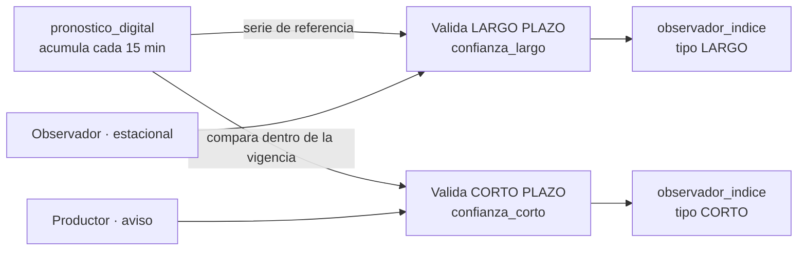
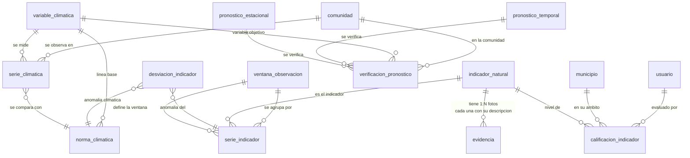
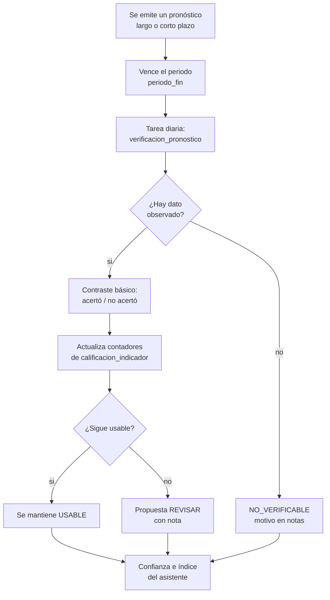

# 04 · Base de datos — PostgreSQL 16 + PostGIS 3.4

**Estado:** Esquema `sinb` implementado (39 tablas + 6 vistas) + Migración completada (2,515 filas)  
**Fecha:** 2026-10-03  
**Migración:** 4 pasos completados (catálogos, usuarios, transaccionales, limpieza legacy)

Reemplaza el diseño anterior de 28 tablas aplanadas por un esquema que **conserva las 46 tablas actuales y su dominio**, corrige los defectos verificados y añade solo lo que el SINB necesita para operar.

---

## 0. Estado actual y contraste con la estructura del repositorio

| Elemento | Estado actual | Destino |
|---|---|---|
| Motor | PostgreSQL 16 + PostGIS 3.4 | `db_sinagersat` |
| Arquitectura | **Multi-esquema**: `shared`, `usuarios`, `edan`, `rea`, `repositorio`, `rida`, `sinb`, `recursos` | Todo lo nuevo del SINB en **`sinb.*`** |
| Esquema `sinb` | **Implementado**: 39 tablas + 6 vistas, 2,515 filas migradas | Operativo desde 2026-10-03 |
| Legacy `t_*` | **Eliminado**: 46 tablas removidas del esquema `sinb` | Datos históricos en `espejo_t_postgres.sql` |
| Código | API **FastAPI** (Python 3.12) + SQLAlchemy en `api/`, rutas `/api/v1`, `/api/v2/sinb/*` | Migraciones versionadas en `database/migrations/v2.*` |
| Identidad | Esquema `usuarios` (no hay tablas usuario/login/rol en sinb) | Reutiliza cuentas existentes; roles SINB: admin (2), UGR Municipio (6), Usuario recolector (12), Observador local (13) |
| Territorio | Esquema `shared` (no hay tablas departamento/provincia/municipio/comunidad en sinb) | Fuente única INE; evita duplicación con EDAN/RIDA |

**Reglas de integración:**

1. **Independencia de dominio**: el SINB es **autónomo** respecto a EDAN y RIDA. **No se crean claves foráneas hacia `edan.*`, `rida.*` ni `rea.*`.**
2. **Reutilización condicional**: `usuarios`, `shared` y `repositorio` se reutilizan **solo si el diseño lo requiere**. Por defecto, se mantiene cada entidad en `sinb.*`.
3. **Namespace explícito**: todos los DDL se interpretan con el prefijo **`sinb.`** (`sinb.observacion`, `sinb.indicador_natural`, …).
4. **Migración completada**: 4 pasos ejecutados (estructura, catálogos, usuarios, transaccionales); legacy eliminado.

---

## Cómo leer este documento

Marcadores usados en toda la propuesta:

| Marcador | Significado |
|---|---|
| `[ACTUAL]` | Comprobado en `sinb_20260714.sql`, `web/` o `docs/` — *fuentes del SINB legado (VIDECI), no incluidas en este repositorio; ver §0* |
| `[DEFECTO]` | Problema comprobado, con su evidencia |
| `[MEJORA]` | Capacidad existente que se modifica |
| `[NUEVO]` | Capacidad que el SINB no tiene |
| `[DECIDIR]` | Requiere firma institucional |

Cada entidad conserva el mismo formato, en este orden: **Descripción**, **Campos**, **DDL**, **Índices**, **RLS**.

Abreviaturas de la columna *Clave*:

| Abreviatura | Significado |
|---|---|
| `PK` | Clave primaria |
| `FK` | Clave foránea |
| `UQ` | Restricción de unicidad |
| `GEN` | Columna generada por PostgreSQL |
| `CHK` | Restricción `CHECK` |
| `GiST` | Índice espacial de PostGIS |
| `TRGM` | Índice GIN de trigramas |
| `btree` | Índice B-tree común |
| `parcial` | Índice con cláusula `WHERE` |

---

## 1. Inventario actualizado — Esquema `sinb` implementado

**Estado:** 39 tablas + 6 vistas creadas en `sinb.*` | 2,515 filas migradas | Legacy `t_*` eliminado (46 tablas removidas)

| Tabla sinb | Filas migradas | Origen | Estado |
|---|---|---|---|
| `grupo` | 7 | Catálogo biocultural | ✓ |
| `indicador_natural` | 103 | Catálogo biocultural | ✓ |
| `caracteristica` | 188 | Catálogo biocultural | ✓ |
| `comportamiento` | 523 | Catálogo biocultural | ✓ |
| `significado` | 190 | Catálogo biocultural | ✓ |
| `zona_geografica` | 3 | Territorio (andina/valle/llano) | ✓ |
| `zona_comunidad` | 18,331 enlaces | Puente zona → comunidad | ✓ |
| `zona_manzano` | 31,150 enlaces | Puente zona → manzano | ✓ |
| `observacion` | 231 | Transaccional | ✓ |
| `observacion_registro` | 860 | Detalle de observación | ✓ |
| `campo_pronostico` | 5 | Catálogo pronóstico | ✓ |
| `escenario` | 23 | Catálogo pronóstico | ✓ |
| `categoria_pronostico_temporal` | 12 | Catálogo temporal | ✓ |
| `pronostico_estacional` | 237 | Transaccional largo plazo | ✓ |
| `escenario_estacional` | 245 enlaces | N:N pronóstico-escenario | ✓ |
| `pronostico_temporal` | 7 | Transaccional corto plazo | ✓ |
| `observacion_pronostico` | 0 | Vinculo observación-pronóstico | ✓ |
| `dimension_recomendacion` | 2 | Catálogo recomendación | ✓ |
| `categoria_comportamiento` | 10 | Catálogo comportamiento | ✓ |
| `recomendacion_local` | 104 | Transaccional | ✓ |
| `variante_local` | 118 | Variante de recomendación | ✓ |
| `observacion_recomendacion` | 0 | Vinculo observación-recomendación | ✓ |
| `aviso` | 0 | Aviso corto plazo | ✓ |
| `aviso_observador` | 0 | Observadores de aviso | ✓ |
| `pronostico_observador` | 0 | Observadores de pronóstico | ✓ |
| `observador_indice` | 0 | Índice de acierto | ✓ |
| `pronostico_digital` | 0 | Pronóstico digital (control) | ✓ |
| `variable_climatica` | 0 | Catálogo climático | ✓ |
| `ventana_observacion` | 0 | Ventanas fenológicas | ✓ |
| `serie_climatica` | 0 | Serie meteorológica | ✓ |
| `norma_climatica` | 0 | Línea base climática | ✓ |
| `escena_satelital` | 0 | Escena Sentinel-2 | ✓ |
| `agregado_satelital` | 0 | NDVI agregado | ✓ |
| `serie_indicador` | 0 | Serie longitudinal indicador | ✓ |
| `desviacion_indicador` | 0 | Desviación fenológica | ✓ |
| `calificacion_indicador` | 0 | Calificación (USABLE/REVISAR) | ✓ |
| `verificacion_pronostico` | 0 | Verificación de pronóstico | ✓ |
| `evidencia` | 0 | Foto/audio de indicador | ✓ |
| `sinonimo_indicador` | 0 | Sinónimos locales | ✓ |

**Vistas (6):**
- `v_registro_territorial`: Observaciones con ubicación completa
- `v_primera_observacion`: Primera fecha por indicador/comunidad
- `v_tendencia_fenologia`: Pendiente días/década (fenología)
- `v_indicador_confiabilidad`: Nivel de confianza (ALTA/MEDIA/BAJA)
- `v_calificacion_vigente`: Última calificación por indicador/municipio
- `v_verificaciones_pendientes`: Pronósticos vencidos sin verificar

**Tablas eliminadas (legacy `t_*`):** 46 tablas removidas (datos históricos respaldados en `espejo_t_postgres.sql`)

**Conexiones cruzadas:**
| Tabla sinb | Referencia externa | Tipo |
|---|---|---|
| `observacion.codigo_comunidad` | `shared.comunidades(codigo_ine)` | FK texto |
| `observacion.id_municipio` | `shared.municipio(id)` | FK integer |
| `observacion.id_usuario_responsable` | `usuarios.usuario(id_usuario)` | FK integer |
| `zona_comunidad.codigo_comunidad` | `shared.comunidades(codigo_ine)` | FK texto |
| `zona_manzano.codigo_manzano` | `shared.manzanos(codigo_ine)` | FK texto |

## 1A. Tres bloques con su CRUD `[NUEVO]`

El esquema se organiza en tres bloques. Cada tabla tiene un patrón de CRUD declarado; el detalle de las operaciones y sus permisos vive en [05](05-APIS.md).

| Patrón | Significado |
|---|---|
| **CRUD completo** | Crear, leer, actualizar y borrar lógico con estados (`ACTIVO`/`INACTIVO`) y validación de negocio |
| **CRUD base** | Crear, leer, actualizar y borrar filas de enlace o detalle, validando consistencia con sus padres |
| **CRUD genérico** | Catálogo parametrizado: un único conjunto de endpoints `/api/v1/catalogos/{tabla}` aplica a toda la tabla (lectura siempre; escritura solo con permiso de catálogo) |

### A. PRINCIPALES — DDL completo y CRUD propio

Las tablas que sostienen el negocio: tienen su CREATE TABLE completo en la sección indicada y su CRUD con estados.

| Tabla | Sección | CRUD | Notas |
|---|---|---|---|
| `observacion` | §5 | CRUD completo | Cabecera de sesión de campo; estados + `es_validada` |
| `observacion_registro` | §5 | CRUD completo | Detalle por dato de la cadena de 5 niveles |
| `pronostico_estacional` | §6 | CRUD completo | Largo plazo; estados `EMITIDO/ACEPTADO/RECHAZADO` |
| `pronostico_temporal` | §6 | CRUD completo | Puntual; categoría obligatoria |
| `aviso` | §6.3 | CRUD completo | Corto plazo con vigencia 24 h/48 h `[DECIDIR]` |
| `evidencia` | §3.7 | CRUD completo | 1:N por indicador, `descripcion` obligatoria |
| `recomendacion_local` | §7 | CRUD completo | Recomendación por ámbito |
| `usuario` | §8 | CRUD completo | Cuenta del SINB; alta/baja sin borrar observaciones |
| `verificacion_pronostico` | §9.3, §14.1 | CRUD completo | Se crea por tarea diaria; re-verificación manual permitida |
| `calificacion_indicador` | §14.3 | CRUD completo | Tres niveles; cambio de nivel con permiso y nota |
| `consentimiento_uso` | §10 | CRUD completo | Gobernanza del conocimiento |
| `auditoria` | §11 | Solo lectura | Solo INSERT desde la aplicación y SELECT; sin UPDATE/DELETE |

### B. SECUNDARIAS — columnas clave y CRUD base

Transaccionales y derivadas: su DDL ya aparece en la sección indicada pero aquí queda su resumen y su CRUD.

| Tabla | Sección | CRUD | Columnas clave |
|---|---|---|---|
| `observacion_usuario` | §5 | CRUD base | `fk_id_observacion`, `fk_id_usuario`, `rol_observacion` |
| `observacion_pronostico` | §6 | CRUD base | `fk_id_observacion`, `fk_id_pronostico_estacional/temporal` |
| `observacion_recomendacion` | §7 | CRUD base | `fk_id_observacion`, `fk_id_recomendacion` |
| `escenario_estacional` | §6 | CRUD base | `fk_id_pronostico_estacional`, `escenario`, `probabilidad` |
| `pronostico_observador` | §6.2 | CRUD base | `fk_id_pronostico_estacional`, `fk_id_usuario`, `confianza_inicial` |
| `observador_indice` | §6.2 | Solo lectura | Calculado; `tipo` = `LARGO`/`CORTO` |
| `aviso_observador` | §6.3 | CRUD base | `fk_id_aviso`, `fk_id_usuario`, `confianza_inicial` |
| `pronostico_digital` | §6.4 | CRUD base | Solo escritura desde la tarea cada 15 min |
| `serie_climatica` | §13 | CRUD base | `fk_id_variable`, `fk_id_comunidad`, fecha, valor |
| `serie_indicador` | §13 | Solo lectura | Derivada de `observacion_registro` |
| `desviacion_indicador` | §13 | Solo lectura | Derivada; anomalía frente a `norma_climatica` |
| `escena_satelital` | §9 | CRUD base | Índice de nube, fecha, huella |
| `agregado_satelital` | §9 | Solo lectura | NDVI y derivados por comunidad |
| `login`, `token_refresh` | §8 | CRUD base | Sesiones y revocación |
| `usuario_comunidad` | §8 | CRUD base | Vínculo usuario–comunidad |
| `sincronizacion_log` | §1.2 | Solo lectura | Control offline |
| `traduccion_indicador`, `sinonimo_indicador` | §10 | CRUD base | Nombres locales y alternos |
| `departamento_provincia`, `provincia_municipio`, `municipio_comunidad`, `municipio_indicador_natural` | §1.1 | CRUD base | Pivotes territoriales |

### C. CATÁLOGOS — CRUD genérico parametrizado

Poco volumen, cambio lento. Aplican el CRUD genérico; la tabla `estado_registro` y las claves foráneas se validan igual que en el resto.

`Territorio`: `departamento`, `provincia`, `municipio`, `comunidad`, `zona_geografica`
`Biocultural`: `grupo`, `grupo_indicador_natural`, `indicador_natural`, `indicador_natural_caracteristica`, `caracteristica`, `caracteristica_comportamiento`, `comportamiento`, `comportamiento_significado`, `significado`
`Pronóstico y recomendación`: `campo_pronostico`, `escenario`, `categoria_pronostico_temporal`, `categoria_comportamiento`, `dimension_recomendacion`
`Clima y ventanas`: `variable_climatica`, `norma_climatica`, `ventana_observacion`
`Identidad`: `rol`, `permiso`, `rol_permiso`, `menu`, `menu_rol`, `login_rol`

`[DECIDIR]` `indicador_natural` es catálogo con CRUD genérico en la fase 1; si se le añaden estados de alta/baja diferenciados, sube a bloque PRINCIPAL.

### 1.1 Tres escalas que no son la misma

`[ACTUAL]` El SINB trabaja en tres escalas que hoy están mal separadas:

| Escala | Campo real (SINB legado) | Dónde vive hoy | Destino en este repositorio |
|---|---|---|---|
| Catálogo nacional | `t_indicador_natural`, `t_caracteristica`, `t_comportamiento`, `t_significado` | global, sin territorio | `sinb.indicador_natural`, `sinb.caracteristica`, `sinb.comportamiento`, `sinb.significado` (se **crean**: el esquema `sinb` está vacío) |
| Inventario por municipio | `t_municipio_indicador_natural` (41 filas) | qué indicadores aplica en un municipio | `sinb.municipio_indicador_natural` (puente propio; territorio en `shared` solo si se decide reutilizar, §0) |
| Sesión de campo | `t_observacion` + 7 pivotes | qué se vio, cuándo y dónde | `sinb.observacion` + `sinb.observacion_registro` (detalle unificado) |

`[MEJORA]` El esquema nuevo mantiene las tres escalas separadas y documentadas. `municipio_indicador_natural` es el puente entre catálogo y territorio, y no se fusiona con la observación.

### 1.2 La trampa de los dos "comportamientos"

`[DEFECTO]` El dump contiene **dos tablas distintas** con nombre casi idéntico, y esto ya causó confusion en el análisis:

| Tabla | Filas | Contenido | Relación |
|---|---|---|---|
| `t_comportamiento` | 523 | texto libre, `varchar(500)`, `estado smallint` | pertenece a la cadena biocultural |
| `t_comportamientos` | 10 | `Retrasada`, `Adelantada`, `Intermedia`, `Tardia`, `Bajos`, `Altos`, `Secos`, `Repetir lugar`, `Humedos` | `FK` a `t_recomendaciones` |

Lo mismo ocurre con las variantes locales: `t_comportamiento_local` (118 filas, `FK recomendacion_local_id`) frente a `t_comportamiento` (523). En el esquema nuevo se renombran para que el homónimo desaparezca:

- `comportamiento` = lo que el observador vio (cadena biocultural).
- `categoria_comportamiento` = valor categórico de recomendación agronómica (antes `t_comportamientos`).
- `variante_local` = denominación local de esa categoría (antes `t_comportamiento_local`).

Y el vocabulario queda explícito:

```
dimension_recomendacion (2)
├── 'Epoca de siembra'  → Retrasada, Adelantada, Intermedia, Tardia
└── 'Lugar de siembra'  → Bajos, Altos, Secos, Repetir lugar, Humedos
```

`[DEFECTO]` `t_comportamientos` contiene `Retrasada` dos veces (id 1 y id 5), en dimensiones distintas. Es correcto semánticamente, pero no lo es sin leer la FK: el esquema nuevo lo hace evidente con `UQ (id_dimension, categoria)`.

---

## 2. Principios del esquema

| # | Principio | Consecuencia práctica |
|---|---|---|
| **P1** | **La cadena de cinco niveles no se aplana** | `grupo → indicador → característica → comportamiento → significado` se conserva íntegra. Es el dominio del SINB, no un detalle de implementación |
| **P2** | **Integridad a lo largo de la cadena** | Una característica registrada debe pertenecer al indicador registrado, y un comportamiento a la característica registrada. Hoy tres pivotes independientes pueden contradecirse sin que nada lo detecte (§3.6) |
| **P3** | **UTF8 nativo** | Los `ALTER TABLE ... CONVERT TO CHARACTER SET utf8mb4` de 42 tablas quedan sin necesidad. En PostgreSQL el nombre es `UTF8` y siempre admite 4 bytes: aimara, quechua y emoji se guardan sin conversión |
| **P4** | **Identificador generado por el cliente** | `uuid` con UUIDv7, generado en el navegador o el móvil para captura sin conexión. Evita colisiones de `serial` en fusión de datos |
| **P5** | **Sin prefijo `t_`** | El prefijo actual no aporta información: las 46 tablas lo llevan y todas son del mismo dominio |
| **P6** | **Clave foránea siempre explícita** | `ON DELETE` declarado y justificado por tabla |
| **P7** | **Una fuente de verdad por dato** | Lo derivable se calcula. La latitud no se duplica si ya está en `geom` |
| **P8** | **Los catálogos son versionables** | Requisito del modo offline ([08](08-OFFLINE-SINCRONIZACION.md)) |
| **P9** | **El conocimiento es territorial** | Cada observación apunta a una comunidad, y la comunidad tiene geometría y zona. Hoy `t_observacion` no sabe dónde ocurrió |
| **P10** | **Todo dato histórico conserva su origen** | `id_legacy` en las tablas migradas permite auditar contra el dump |
| **P11** | **Nada se borra, se marca estado** | `estado` + `eliminado_en`. Un registro biocultural nunca se destruye |

### 2.1 UUIDv7 en PostgreSQL 16

`[DECIDIR]` PostgreSQL 16 no tiene UUIDv7 nativo y Python 3.12 tampoco expone `uuid.uuid7()`. La propuesta usa el paquete `uuid7` en el cliente y un fallback en base:

```sql
CREATE EXTENSION IF NOT EXISTS pgcrypto;   -- gen_random_uuid()
CREATE EXTENSION IF NOT EXISTS "uuid-ossp"; -- uuid_generate_v7() si el servidor es >= 17
```

Regla de generación:

1. **Captura en campo**: el cliente genera el UUIDv7, porque el servidor puede no estar disponible.
2. **Ingesta servidor**: si la fila llega sin UUID (procesos internos), se usa `DEFAULT gen_random_uuid()`.
3. `uuid_generate_v7()` queda disponible como camino preferencial si VIDECI estandariza PostgreSQL 17. La diferencia entre UUIDv4 y v7 solo afecta el índice, nunca la corrección.

### 2.2 Estado: dos convenciones que se unifican

`[DEFECTO]` El dump mezcla `enum('ACTIVO','INACTIVO')` en unas tablas y `smallint` en otras (`t_grupo.estado`, `t_comportamiento.estado`, `t_significado.estado`, `t_usuario.estado`, `t_login.estado`). Un `smallint` admite cualquier valor, incluido `7`.

El esquema nuevo usa un solo tipo:

```sql
CREATE TYPE estado_registro AS ENUM ('ACTIVO', 'INACTIVO', 'ELIMINADO');
```

Migración: `smallint` 1 → `ACTIVO`, 0 → `INACTIVO`. Cualquier otro valor se detiene la migración y se reporta, porque indicaría un estado no documentado.

---

## 3. Núcleo biocultural

### 3.1 `grupo` `[ACTUAL]`

**Descripción.** Siete grupos que clasifican el conocimiento: Animales, Plantas, Condiciones meteorológicas, Astros, Constelaciones, Eventos atmosféricos, Eventos tradicionales.

**Campos**

| Campo | Tipo | Nulo | Def. | Clave | Significado |
|---|---|---|---|---|---|
| `id` | `uuid` | no | — | `PK` | Identificador |
| `grupo` | `varchar(80)` | no | — | `UQ` | Nombre del grupo |
| `slug` | `varchar(80)` | no | — | `UQ` | Clave estable para API |
| `descripcion` | `text` | sí | `NULL` | | Texto explicativo |
| `orden` | `smallint` | no | `0` | `CHK` ≥ 0 | Orden de presentación |
| `estado` | `estado_registro` | no | `'ACTIVO'` | | Actividad lógica |
| `id_legacy` | `bigint` | sí | `NULL` | | `t_grupo.id_grupo` |
| `creado_en` | `timestamptz` | no | `now()` | | Alta |
| `actualizado_en` | `timestamptz` | no | `now()` | | Última modificación |

**DDL**

```sql
CREATE TABLE grupo (
    id            uuid PRIMARY KEY DEFAULT gen_random_uuid(),
    grupo         varchar(80)  NOT NULL,
    slug          varchar(80)  NOT NULL,
    descripcion   text,
    orden         smallint     NOT NULL DEFAULT 0 CHECK (orden >= 0),
    estado        estado_registro NOT NULL DEFAULT 'ACTIVO',
    id_legacy     bigint,
    creado_en     timestamptz  NOT NULL DEFAULT now(),
    actualizado_en timestamptz NOT NULL DEFAULT now(),
    CONSTRAINT uq_grupo_nombre UNIQUE (grupo),
    CONSTRAINT uq_grupo_slug   UNIQUE (slug)
);
```

**Índices.** `uq_grupo_slug` cubre la lectura por API; `indice_grupo_activo` parcial sobre `estado = 'ACTIVO'` para el selector de captura.

**RLS.** Lectura global. Solo `administrador` escribe, vía API.

---

### 3.2 `indicador_natural` `[ACTUAL] [MEJORA]`

**Descripción.** Los 77 indicadores con nombre local y nombre científico. Ejemplos verificados en el dump: `Zorro / Pseudolopex culpaeus`, `Liqi liqi /Tero tero /leuqi leuqi / Vanellus andina`, `Tuju / Ctenomys australis`, `Pajaros (pichitanka, cocinero, espiritu y otros) / Zonotricia spp`.

`[MEJORA]` El nombre local puede contener variantes separadas por `/`. Se conservan tal cual, porque son el dato de campo, y se añaden `traduccion_indicador` y `sinonimo_indicador` para el trabajo multilingüe (§10).

**Descripción.** Cada indicador pertenece a uno o varios grupos mediante `grupo_indicador_natural`.

**Campos**

| Campo | Tipo | Nulo | Def. | Clave | Significado |
|---|---|---|---|---|---|
| `id` | `uuid` | no | — | `PK` | Identificador |
| `nombre` | `varchar(150)` | no | — | | Nombre local o vernacular |
| `nombre_cientifico` | `varchar(150)` | sí | `NULL` | | Nombre científico |
| `taxon_reino` | `varchar(40)` | sí | `NULL` | | `CHK` en catálogo |
| `taxon_filo` | `varchar(40)` | sí | `NULL` | | |
| `taxon_clase` | `varchar(40)` | sí | `NULL` | | |
| `taxon_orden` | `varchar(40)` | sí | `NULL` | | |
| `taxon_familia` | `varchar(60)` | sí | `NULL` | | |
| `rank` | `varchar(30)` | sí | `NULL` | | `especie`, `género`, `familia`, `grupo` |
| `fotografia_url` | `text` | sí | `NULL` | | Clave en MinIO, no ruta absoluta |
| `estado` | `estado_registro` | no | `'ACTIVO'` | | Actividad lógica |
| `id_legacy` | `bigint` | sí | `NULL` | | `t_indicador_natural.id_indicador_natural` |
| `version_catalogo` | `integer` | no | `1` | `CHK` ≥ 1 | Sincronización offline |
| `creado_en` | `timestamptz` | no | `now()` | | |
| `actualizado_en` | `timestamptz` | no | `now()` | | |

**DDL**

```sql
CREATE TABLE indicador_natural (
    id                 uuid PRIMARY KEY DEFAULT gen_random_uuid(),
    nombre             varchar(150) NOT NULL,
    nombre_cientifico  varchar(150),
    taxon_reino        varchar(40),
    taxon_filo         varchar(40),
    taxon_clase        varchar(40),
    taxon_orden        varchar(40),
    taxon_familia      varchar(60),
    rank               varchar(30) CHECK (rank IN
                         ('especie','genero','familia','orden','clase','grupo')),
    fotografia_url     text,
    estado             estado_registro NOT NULL DEFAULT 'ACTIVO',
    id_legacy          bigint,
    version_catalogo   integer NOT NULL DEFAULT 1 CHECK (version_catalogo >= 1),
    creado_en          timestamptz NOT NULL DEFAULT now(),
    actualizado_en     timestamptz NOT NULL DEFAULT now()
);
```

**Índices**

```sql
CREATE UNIQUE INDEX uq_indicador_nombre_cientifico
    ON indicador_natural (lower(nombre_cientifico))
    WHERE nombre_cientifico IS NOT NULL AND estado <> 'ELIMINADO';
CREATE INDEX trgm_indicador_nombre ON indicador_natural USING gin (nombre gin_trgm_ops);
CREATE INDEX ind_indicador_activo ON indicador_natural (nombre) WHERE estado = 'ACTIVO';
```

**RLS.** Lectura global. Solo `administrador` y `usuario-municipal` escriben, y este último solo para indicadores de su municipio.

---

### 3.3 `grupo_indicador_natural` `[ACTUAL]`

**Descripción.** Un indicador puede pertenecer a más de un grupo. Las 103 filas actuales se conservan.

**DDL**

```sql
CREATE TABLE grupo_indicador_natural (
    id_grupo      uuid NOT NULL REFERENCES grupo(id)             ON DELETE CASCADE,
    id_indicador  uuid NOT NULL REFERENCES indicador_natural(id) ON DELETE CASCADE,
    estado        estado_registro NOT NULL DEFAULT 'ACTIVO',
    id_legacy     bigint,
    PRIMARY KEY (id_grupo, id_indicador)
);
```

**Índices.** `PRIMARY KEY` cubre el búsqueda por grupo; se añade `ind_gin_indicador` sobre `id_indicador` para la inversa.

**RLS.** Lectura global; escritura por `administrador`.

---

### 3.4 `caracteristica` `[ACTUAL] [MEJORA]`

**Descripción.** Los 188 rasgos que se observan de un indicador: `Tipo de aullido`, `Canto del liqi liqi`. El campo actual es `varchar(300)`.

`[MEJORA]` Se añade `fk_id_indicador_natural` a la propia tabla, que hoy está en la tabla pivote. La razón es la integridad de la cadena (§3.6): para garantizar que una característica pertenece al indicador registrado, la FK debe estar en la misma tabla que ambas columnas.

**Campos**

| Campo | Tipo | Nulo | Def. | Clave | Significado |
|---|---|---|---|---|---|
| `id` | `uuid` | no | — | `PK` | |
| `fk_id_indicador_natural` | `uuid` | no | — | `FK`, `UQ` | Indicador al que pertenece |
| `caracteristica` | `varchar(300)` | no | — | | Texto del rasgo |
| `unidad_medida` | `varchar(30)` | sí | `NULL` | | `cm`, `dB`, `°C`, `n/a` |
| `metodo_observacion` | `text` | sí | `NULL` | | Protocolo de registro |
| `estado` | `estado_registro` | no | `'ACTIVO'` | | |
| `id_legacy` | `bigint` | sí | `NULL` | | |
| `version_catalogo` | `integer` | no | `1` | `CHK` | Offline |
| `creado_en` / `actualizado_en` | `timestamptz` | no | `now()` | | |

**DDL**

```sql
CREATE TABLE caracteristica (
    id                    uuid PRIMARY KEY DEFAULT gen_random_uuid(),
    fk_id_indicador_natural uuid NOT NULL REFERENCES indicador_natural(id)
                                          ON DELETE RESTRICT,
    caracteristica        varchar(300) NOT NULL,
    unidad_medida         varchar(30),
    metodo_observacion    text,
    estado                estado_registro NOT NULL DEFAULT 'ACTIVO',
    id_legacy             bigint,
    version_catalogo      integer NOT NULL DEFAULT 1 CHECK (version_catalogo >= 1),
    creado_en             timestamptz NOT NULL DEFAULT now(),
    actualizado_en        timestamptz NOT NULL DEFAULT now(),
    CONSTRAINT uq_caracteristica_indicador_texto
        UNIQUE (fk_id_indicador_natural, caracteristica)
);
```

**Índices.** `uq_caracteristica_indicador_texto` es la clave del diseño: permite referenciar `(caracteristica_id, indicador_id)` desde el detalle (§3.6). `trgm_caracteristica` para búsqueda difusa.

**RLS.** Lectura global; escritura `administrador`.

---

### 3.5 `comportamiento` y `significado` `[ACTUAL]`

**Descripción.** El comportamiento es lo que se observa: texto libre de hasta 500 caracteres, 523 filas actuales. El significado es su lectura agronómica: 293 filas como `Helada fuerte`, `Siembra atrasada`, `Mucha lluvia`.

`[DEFECTO]` Ambos catálogos son globales y no tienen relación territorial ni por grupo, así que `Helada fuerte` se ofrece como significado válido de cualquier comportamiento, desde una floración hasta un comportamiento animal.

`[MEJORA]` Se conservan las filas y se añade `grupo_id` opcional, para que el significado se pueda acotar al grupo de indicators al que aplica. `NULL` significa «aplica a todos», que es la situación de las 293 filas actuales.

**DDL**

```sql
CREATE TABLE comportamiento (
    id             uuid PRIMARY KEY DEFAULT gen_random_uuid(),
    comportamiento varchar(500) NOT NULL,
    grupo_id       uuid REFERENCES grupo(id) ON DELETE SET NULL,
    estado         estado_registro NOT NULL DEFAULT 'ACTIVO',
    id_legacy      bigint,
    version_catalogo integer NOT NULL DEFAULT 1 CHECK (version_catalogo >= 1),
    creado_en      timestamptz NOT NULL DEFAULT now(),
    actualizado_en timestamptz NOT NULL DEFAULT now()
);

CREATE TABLE significado (
    id         uuid PRIMARY KEY DEFAULT gen_random_uuid(),
    significado varchar(100) NOT NULL,
    grupo_id   uuid REFERENCES grupo(id) ON DELETE SET NULL,
    severidad  smallint CHECK (severidad BETWEEN 1 AND 5),
    estado     estado_registro NOT NULL DEFAULT 'ACTIVO',
    id_legacy  bigint,
    version_catalogo integer NOT NULL DEFAULT 1 CHECK (version_catalogo >= 1),
    creado_en  timestamptz NOT NULL DEFAULT now(),
    actualizado_en timestamptz NOT NULL DEFAULT now()
);

-- N:M entre comportamiento y significado, con la FK invertida
CREATE TABLE comportamiento_significado (
    fk_id_comportamiento uuid NOT NULL REFERENCES comportamiento(id) ON DELETE CASCADE,
    fk_id_significado   uuid NOT NULL REFERENCES significado(id)   ON DELETE CASCADE,
    es_principal        boolean NOT NULL DEFAULT false,
    id_legacy           bigint,
    PRIMARY KEY (fk_id_comportamiento, fk_id_significado)
);
```

**Índices**

```sql
CREATE INDEX ind_comportamiento_grupo ON comportamiento (grupo_id) WHERE grupo_id IS NOT NULL;
CREATE INDEX ind_significado_grupo   ON significado (grupo_id)   WHERE grupo_id IS NOT NULL;
CREATE TRGM.idx_comportamiento_texto ON comportamiento USING gin (comportamiento gin_trgm_ops);
```

**RLS.** Lectura global; escritura `administrador`.

---

### 3.6 `observacion_registro`: la integridad de la cadena `[NUEVO]`

Este es el cambio estructural más importante, y responde a un defecto real.

`[ACTUAL]` La observación se guarda en **siete tablas pivote independientes**: `t_observacion_grupo`, `t_observacion_indicador_natural`, `t_observacion_caracteristica`, `t_observacion_comportamiento`, `t_observacion_pronostico`, `t_observacion_recomendacion`, `t_observacion_usuario`.

`[DEFECTO]` Nada impide que una observación registre el indicador 6 (`Tuju`) junto a la característica `Canto del liqi liqi`, que pertenece al indicador 2. Las tres filas son válidas por separado y en conjunto absurdas. Tampoco se puede saber qué comportamiento se observó a qué hora, ni cuál de los varios comportamientos de la observación corresponde a cuál característica.

**Solución.** La cabecera `observacion` conserva el concepto de sesión de campo (el conjunto observado en una visita, que es lo que ya significa hoy). Debajo, `observacion_registro` guarda **una fila por dato observado**, con los cuatro niveles encadenados por FK compuestas.

**Campos**

| Campo | Tipo | Nulo | Def. | Clave | Significado |
|---|---|---|---|---|---|
| `id` | `uuid` | no | — | `PK` | |
| `fk_id_observacion` | `uuid` | no | — | `FK` | Sesión de campo |
| `fk_id_indicador_natural` | `uuid` | no | — | `FK` | Indicador observado |
| `fk_id_caracteristica` | `uuid` | sí | `NULL` | `FK` compuesta | Rasgo observado |
| `fk_id_comportamiento` | `uuid` | sí | `NULL` | `FK` compuesta | Comportamiento observado |
| `fk_id_significado` | `uuid` | sí | `NULL` | `FK` compuesta | Lectura agronómica |
| `orden` | `smallint` | no | `0` | `CHK` | Orden de captura |
| `observado_en` | `timestamptz` | sí | `NULL` | | Momento exacto del hecho |
| `presencia` | `presencia_observada` | no | `'PRESENTE'` | `CHK` | `PRESENTE`, `AUSENTE`, `NO_OBSERVADO` |
| `valor_texto` | `text` | sí | `NULL` | | Valor medido o descripción |
| `valor_numerico` | `numeric(12,4)` | sí | `NULL` | | Magnitud, si aplica |
| `unidad` | `varchar(30)` | sí | `NULL` | | |
| `confianza` | `smallint` | sí | `NULL` | `CHK` 1–5 | Confianza del observador |
| `notas` | `text` | sí | `NULL` | | Observación cualitativa |
| `es_calidad_dudosa` | `boolean` | no | `false` | | Marca de revisión |
| `origen` | `origen_registro` | no | `'CAMPO'` | `CHK` | `CAMPO`, `OFICINA`, `IMPORTACION` |
| `creado_por` | `uuid` | no | — | `FK` | Usuario que capturó |
| `creado_en` | `timestamptz` | no | `now()` | | |
| `actualizado_en` | `timestamptz` | no | `now()` | | |

**DDL**

```sql
CREATE TYPE presencia_observada AS ENUM ('PRESENTE', 'AUSENTE', 'NO_OBSERVADO');
CREATE TYPE origen_registro     AS ENUM ('CAMPO', 'OFICINA', 'IMPORTACION');

-- Unicidad compuesta que habilita las FK encadenadas
ALTER TABLE caracteristica
    ADD CONSTRAINT uq_caracteristica_cadena
    UNIQUE (id, fk_id_indicador_natural);

ALTER TABLE caracteristica_comportamiento
    ADD CONSTRAINT uq_caracteristica_comportamiento_cadena
    UNIQUE (fk_id_comportamiento, fk_id_caracteristica);

ALTER TABLE comportamiento_significado
    ADD CONSTRAINT uq_comportamiento_significado_cadena
    UNIQUE (fk_id_significado, fk_id_comportamiento);

CREATE TABLE observacion_registro (
    id                        uuid PRIMARY KEY DEFAULT gen_random_uuid(),
    fk_id_observacion         uuid NOT NULL REFERENCES observacion(id) ON DELETE CASCADE,
    fk_id_indicador_natural   uuid NOT NULL,
    fk_id_caracteristica      uuid,
    fk_id_comportamiento      uuid,
    fk_id_significado         uuid,
    orden                     smallint NOT NULL DEFAULT 0 CHECK (orden >= 0),
    observado_en              timestamptz,
    presencia                 presencia_observada NOT NULL DEFAULT 'PRESENTE',
    valor_texto               text,
    valor_numerico            numeric(12,4),
    unidad                    varchar(30),
    confianza                 smallint CHECK (confianza BETWEEN 1 AND 5),
    notas                     text,
    es_calidad_dudosa         boolean NOT NULL DEFAULT false,
    origen                    origen_registro NOT NULL DEFAULT 'CAMPO',
    creado_por                uuid NOT NULL REFERENCES usuario(id) ON DELETE RESTRICT,
    creado_en                 timestamptz NOT NULL DEFAULT now(),
    actualizado_en            timestamptz NOT NULL DEFAULT now(),

    -- La cadena se valida sola: una caracteristica solo puede pertenecer
    -- al indicador que se esta registrando en la misma fila.
    CONSTRAINT fk_registro_caracteristica
        FOREIGN KEY (fk_id_caracteristica, fk_id_indicador_natural)
        REFERENCES caracteristica (id, fk_id_indicador_natural)
        ON DELETE RESTRICT,

    -- Un comportamiento solo puede pertenecer a la caracteristica registrada.
    CONSTRAINT fk_registro_comportamiento
        FOREIGN KEY (fk_id_comportamiento, fk_id_caracteristica)
        REFERENCES caracteristica_comportamiento (fk_id_comportamiento, fk_id_caracteristica)
        ON DELETE RESTRICT,

    -- Un significado solo puede pertenecer al comportamiento registrado.
    CONSTRAINT fk_registro_significado
        FOREIGN KEY (fk_id_significado, fk_id_comportamiento)
        REFERENCES comportamiento_significado (fk_id_significado, fk_id_comportamiento)
        ON DELETE RESTRICT,

    -- Si no se observa el rasgo, no puede haber valor medido.
    CONSTRAINT chk_presencia_valor CHECK (
        (presencia = 'PRESENTE')
        OR (valor_texto IS NULL AND valor_numerico IS NULL)
    )
);
```

`[MEJORA]` Con estas tres FK compuestas, la incoherencia entre niveles deja de ser representable. Es la diferencia entre «guardar lo que el usuario escribió» y «garantizar que el dato significa lo que dice significar».

**Índices**

```sql
-- Consulta principal: qué se ha visto de un indicador, en un territorio, en un periodo
CREATE INDEX ind_registro_observacion ON observacion_registro (fk_id_observacion, orden);
CREATE INDEX ind_registro_indicador   ON observacion_registro (fk_id_indicador_natural);
CREATE INDEX ind_registro_fecha
    ON observacion_registro (observado_en)
    WHERE observado_en IS NOT NULL;
CREATE INDEX ind_registro_calidad
    ON observacion_registro (fk_id_observacion)
    WHERE es_calidad_dudosa;
```

**RLS.** Un `observador-local` solo lee y escribe registros de observaciones de su comunidad; `usuario-recolector` de sus municipios asignados; `usuario-municipal` de su municipio; `administrador` de todo. Se aplica en §12.

### 3.7 `evidencia`: fotos del bioindicador, relación 1:N con su descripción `[NUEVO]`

`[NUEVO]` Los bioindicadores **ya se visualizan en el mapa con sus coordenadas** ([04 §4.2](#42-coordenadas-de-double-a-geometría-mejora), [06 §12C](06-FRONTEND.md)). Lo que falta es la **foto**: un mismo bioindicador debe poder tener **una o más fotos**, y **cada foto con su propia descripción vinculada**. Eso es una relación **1:N** — un `indicador_natural`, muchas `evidencia`, cada fila con su texto.

```sql
CREATE TABLE evidencia (
    id                     uuid PRIMARY KEY DEFAULT gen_random_uuid(),
    tipo                   varchar(12) NOT NULL
        CHECK (tipo IN ('FOTO','AUDIO','VIDEO')),

    -- Sujeto de la evidencia: el bioindicador (galería 1:N) O un registro de
    -- observación (evidencia de campo). Al menos uno, nunca ninguno.
    fk_id_indicador_natural    uuid REFERENCES indicador_natural(id) ON DELETE CASCADE,
    fk_id_observacion_registro uuid
        REFERENCES observacion_registro(id) ON DELETE CASCADE,

    -- Descripción vinculada a ESTA foto. Obligatoria en fotos de bioindicador:
    -- sin el texto, la foto no explica nada y no sirve para consolidar.
    descripcion            text,
    orden                  smallint NOT NULL DEFAULT 0,   -- orden en la galería

    clave_almacenamiento   text NOT NULL UNIQUE,          -- clave en MinIO
    sha256                 char(64),
    bytes                  integer,
    fecha_foto             timestamptz,                   -- EXIF si existe
    geom                   geometry(Point, 4326),         -- dónde se sacó

    estado                 varchar(12) NOT NULL DEFAULT 'PENDIENTE'
        CHECK (estado IN ('PENDIENTE','CONFIRMADA','CORRUPTA','RETIRADA')),
    subida_por             uuid REFERENCES usuario(id) ON DELETE SET NULL,
    -- Consentimiento de mostrar la foto (y quién aparece en ella)
    fk_id_consentimiento   uuid REFERENCES consentimiento_uso(id) ON DELETE SET NULL,
    creado_en              timestamptz NOT NULL DEFAULT now(),
    actualizado_en         timestamptz NOT NULL DEFAULT now(),

    -- 1:N exigido: cada fila es UNA foto con SU descripción
    CONSTRAINT chk_evidencia_sujeto CHECK (
        fk_id_indicador_natural IS NOT NULL
        OR fk_id_observacion_registro IS NOT NULL
    ),
    -- Foto de bioindicador: descripción obligatoria
    CONSTRAINT chk_evidencia_descripcion CHECK (
        fk_id_indicador_natural IS NULL
        OR (descripcion IS NOT NULL AND btrim(descripcion) <> '')
    )
);

-- Galería de un bioindicador, en orden
CREATE INDEX ind_evidencia_indicador
    ON evidencia (fk_id_indicador_natural, orden, creado_en)
    WHERE tipo = 'FOTO' AND estado = 'CONFIRMADA';
```

| Regla | Detalle |
|---|---|
| **1:N** | Un bioindicador → muchas fotos; cada foto → **su** descripción (no se comparte texto entre fotos) |
| **Descripción obligatoria** en galería | `chk_evidencia_descripcion`: una foto de bioindicador sin texto no entra |
| **Coexistencia** | La misma tabla sirve para la evidencia de una observación (`fk_id_observacion_registro`) y para la galería del indicador; un registro puede «promover» sus fotos a la galería |
| **Orden** | `orden` permite al usuario ordenar la galería (la foto de portada va primero) |
| **Consentimiento** | Una foto de una persona o de un espacio privado necesita `fk_id_consentimiento` vigente antes de publicarse ([10 §10.1](#101-consentimiento_uso-nuevo)) |
| **Subida** | Mismo flujo de URL firmada que el resto de evidencias: el teléfono sube **directo a MinIO**, sin pasar por la API ([05 §4.10](05-APIS.md)) |
| **Dónde se ve** | Ficha del bioindicador, popup del mapa y reportes ([06 §12C](06-FRONTEND.md)) |
| **Offline** | La galería se descarga con el catálogo (miniaturas); la subida va por el canal de fotos con prioridad ([08 §7](08-OFFLINE-SINCRONIZACION.md)) |

**RLS.** Lectura para todos los autenticados (como el catálogo); escritura para quien pueda crear observaciones en ese ámbito; retirada de una foto solo por `administrador` o el autor, dejando `estado = 'RETIRADA'` (nada se borra físico).

---

## 4. Territorio

### 4.1 Lo que ya existe y se conserva `[ACTUAL]`

`[ACTUAL]` El SINB usa **tablas pivote** para la jerarquía, no `parent_id`:

```
t_departamento (9) ──< t_departamento_provincia (111) >── t_provincia (111)
t_provincia     ──< t_provincia_municipio (337)  >── t_municipio (337)
t_municipio     ──< t_municipio_comunidad (18331) >── t_comunidad (18331)
```

`[MEJORA]` Los pivotes se conservan. Sustituir la jerarquía por `parent_id` cambiaría 18.331 filas de `municipio_comunidad` y aportaría una integridad que el operador ya entiende: en el modelo actual una comunidad puede pertenecer a más de un municipio, y eso ocurre en la realidad (comunidades compartidas en fronteras administrativas).

**DDL** de las cuatro tablas de nivel, idénticas en forma:

```sql
CREATE TABLE departamento (
    id        uuid PRIMARY KEY DEFAULT gen_random_uuid(),
    nombre    varchar(80) NOT NULL UNIQUE,
    slug      varchar(80) NOT NULL UNIQUE,
    estado    estado_registro NOT NULL DEFAULT 'ACTIVO',
    id_legacy bigint,
    creado_en timestamptz NOT NULL DEFAULT now(),
    actualizado_en timestamptz NOT NULL DEFAULT now()
);

CREATE TABLE provincia (
    id         uuid PRIMARY KEY DEFAULT gen_random_uuid(),
    codigo_ine varchar(20),
    nombre     varchar(80)  NOT NULL,
    estado     estado_registro NOT NULL DEFAULT 'ACTIVO',
    id_legacy  bigint,
    creado_en  timestamptz NOT NULL DEFAULT now(),
    actualizado_en timestamptz NOT NULL DEFAULT now(),
    CONSTRAINT uq_provincia_nombre UNIQUE (nombre)
);

CREATE TABLE municipio (
    id         uuid PRIMARY KEY DEFAULT gen_random_uuid(),
    codigo_ine varchar(20),
    nombre     varchar(80) NOT NULL,
    estado     estado_registro NOT NULL DEFAULT 'ACTIVO',
    id_legacy  bigint,
    creado_en  timestamptz NOT NULL DEFAULT now(),
    actualizado_en timestamptz NOT NULL DEFAULT now(),
    CONSTRAINT uq_municipio_nombre UNIQUE (nombre)
);

CREATE TABLE comunidad (
    id          uuid PRIMARY KEY DEFAULT gen_random_uuid(),
    codigo_ine  varchar(20),
    nombre      varchar(150) NOT NULL,
    geom        geometry(Point, 4326),
    elevacion_m smallint CHECK (elevacion_m BETWEEN -500 AND 9000),
    estado      estado_registro NOT NULL DEFAULT 'ACTIVO',
    id_legacy   bigint,
    creado_en   timestamptz NOT NULL DEFAULT now(),
    actualizado_en timestamptz NOT NULL DEFAULT now()
);

CREATE TABLE departamento_provincia (
    fk_id_departamento uuid NOT NULL REFERENCES departamento(id) ON DELETE CASCADE,
    fk_id_provincia    uuid NOT NULL REFERENCES provincia(id)    ON DELETE CASCADE,
    id_legacy bigint,
    PRIMARY KEY (fk_id_departamento, fk_id_provincia)
);

CREATE TABLE provincia_municipio (
    fk_id_provincia uuid NOT NULL REFERENCES provincia(id) ON DELETE CASCADE,
    fk_id_municipio uuid NOT NULL REFERENCES municipio(id) ON DELETE CASCADE,
    id_legacy bigint,
    PRIMARY KEY (fk_id_provincia, fk_id_municipio)
);

CREATE TABLE municipio_comunidad (
    fk_id_municipio uuid NOT NULL REFERENCES municipio(id) ON DELETE CASCADE,
    fk_id_comunidad uuid NOT NULL REFERENCES comunidad(id) ON DELETE CASCADE,
    es_principal    boolean NOT NULL DEFAULT true,
    id_legacy bigint,
    PRIMARY KEY (fk_id_municipio, fk_id_comunidad)
);
```

**Índices.** Sobre el pivote de comunidad, la dirección inversa es la que usa el filtro por municipio:

```sql
CREATE INDEX ind_mc_comunidad ON municipio_comunidad (fk_id_comunidad);
CREATE INDEX ind_mc_principal ON municipio_comunidad (fk_id_comunidad)
    WHERE es_principal;
```

**RLS.** `comunidad`, `municipio`, `provincia` y `departamento` son lectura global: un observador necesita ver su territorio para ubicarse. La escritura se restringe a `administrador`, más `usuario-municipal` sobre su municipio para `municipio_comunidad`.

### 4.2 Coordenadas: de `double` a geometría `[MEJORA]`

`[DEFECTO]` `t_comunidad.latitud` y `t_comunidad.longitud` son `double` sin validación. Un valor de 200 es indistinguible de uno válido para la base, y no hay índice espacial: el mapa no puede hacer consultas por área.

**DDL** de compatibilidad, que genera las columnas antiguas desde la geometría:

```sql
ALTER TABLE comunidad
    ADD COLUMN latitud double precision
        GENERATED ALWAYS AS (ST_Y(geom)) STORED,
    ADD COLUMN longitud double precision
        GENERATED ALWAYS AS (ST_X(geom)) STORED;

CREATE INDEX gist_comunidad_geom ON comunidad USING gist (geom);
CREATE INDEX idx_comunidad_coordenadas
    ON comunidad (latitud, longitud)
    WHERE estado = 'ACTIVO';
```

Migración: `ST_SetSRID(ST_MakePoint(longitud, latitud), 4326)`. Se rechazan las 18.331 filas que no caigan en el rango Bolivia `[-69.6, -57.5] × [-22.9, -9.8]` y se reportan para corrección territorial.

### 4.3 `zona_geografica` y el hueco verificado `[DEFECTO] [MEJORA]`

`[ACTUAL]` Tres filas: `Zona Andina` (3.000–4.000 msnm; La Paz, Oruro, Potosí), `Zona Subandina` (1.500–2.500 msnm; Cochabamba, Chuquisaca, Tarija), `Zona Orienta` (200–400 msnm; Santa Cruz, Beni, Pando).

`[DEFECTO]` `t_zona_geografica` **no tiene ninguna clave foránea**. La relación con el territorio es únicamente descriptiva dentro del texto. El sistema no puede filtrar «comunidades de la zona andina», que es la consulta principal del mapa actual (`ZonaGeograficaController::mapa()`).

`[DEFECTO]` `descripcion` contiene secuencias literales `\r\n` en lugar de saltos de línea: al leer la fila, el usuario ve los caracteres `\r\n` escritos en pantalla.

**DDL**

```sql
CREATE TABLE zona_geografica (
    id          uuid PRIMARY KEY DEFAULT gen_random_uuid(),
    nombre      varchar(50) NOT NULL,
    slug        varchar(50) NOT NULL UNIQUE,
    descripcion text NOT NULL,
    rango_alt_min_m smallint,
    rango_alt_max_m smallint,
    estado      estado_registro NOT NULL DEFAULT 'ACTIVO',
    id_legacy   bigint,
    creado_en   timestamptz NOT NULL DEFAULT now(),
    actualizado_en timestamptz NOT NULL DEFAULT now(),
    CONSTRAINT uq_zona_nombre UNIQUE (nombre),
    CONSTRAINT chk_zona_altura CHECK (
        rango_alt_min_m IS NULL OR rango_alt_max_m IS NULL
        OR rango_alt_min_m < rango_alt_max_m
    )
);

-- La conexión que faltaba: una comunidad pertenece a una zona
ALTER TABLE comunidad
    ADD COLUMN fk_id_zona_geografica uuid REFERENCES zona_geografica(id)
        ON DELETE SET NULL;

CREATE INDEX ind_comunidad_zona ON comunidad (fk_id_zona_geografica);
```

Migración de la zona: se asigna por el municipio principal y la altitud del punto, y las asignaciones dudosas se marcan para revisión de `usuario-municipal` en vez de decidirse por automático. Los `\r\n` literales se convierten a saltos de línea en la migración.

### 4.4 `municipio_indicador_natural` `[ACTUAL]`

**Descripción.** 41 filas que declaran qué indicadores se usan en cada municipio. Es el inventario que hoy alimenta la selección de indicadores en terreno.

**DDL**

```sql
CREATE TABLE municipio_indicador_natural (
    fk_id_municipio   uuid NOT NULL REFERENCES municipio(id)         ON DELETE CASCADE,
    fk_id_indicador  uuid NOT NULL REFERENCES indicador_natural(id) ON DELETE CASCADE,
    vigente_desde    date,
    vigente_hasta    date,
    confirmado_por   uuid REFERENCES usuario(id) ON DELETE SET NULL,
    estado           estado_registro NOT NULL DEFAULT 'ACTIVO',
    id_legacy        bigint,
    PRIMARY KEY (fk_id_municipio, fk_id_indicador),
    CONSTRAINT chk_vigencia CHECK (
        vigente_hasta IS NULL OR vigente_desde IS NULL OR vigente_desde <= vigente_hasta
    )
);
```

`[NUEVO]` `vigente_desde`, `vigente_hasta` y `confirmado_por` responden a una necesidad real: un indicador puede empezar a usarse en un municipio a partir de una fecha, y quien lo confirmó es un dato de trazabilidad. `NULL` en ambos límites significa vigente.

**RLS.** Lectura global. `usuario-municipal` escribe únicamente sobre su municipio; `administrador` sobre todos.

---

## 5. Observación: cabecera de sesión

### 5.1 `observacion` `[ACTUAL] [MEJORA]`

`[ACTUAL]` `t_observacion` tiene solo cinco columnas: `fecha_inicio`, `fecha_fin`, `fecha_de_registro`, `estado`. **No tiene `municipio_id`, ni `comunidad_id`, ni `usuario_id`.** La ubicación y el autor sededucen de siete pivotes.

`[DEFECTO]` Consecuencia directa: no se puede listar «observaciones de la comunidad X» con un `WHERE`, y el mapa no puede ubicar una observación sin unir cinco tablas. Para un sistema cuyo objeto es el conocimiento de un territorio, que la observación no sepa dónde ocurrió es el defecto de modelo más grave del actual.

**Descripción.** La cabecera pasa a ser la **sesión de campo**: una visita a una comunidad en una ventana de fechas, con su autor y su responsable.

**Campos**

| Campo | Tipo | Nulo | Def. | Clave | Significado |
|---|---|---|---|---|---|
| `id` | `uuid` | no | — | `PK` | |
| `codigo_corto` | `text` | no | — | `UQ` | Código legible para campo, `SINB-2026-A3F91C` |
| `fk_id_comunidad` | `uuid` | no | — | `FK` | Dónde se observó `[NUEVO]` |
| `fk_id_municipio` | `uuid` | no | — | `FK` | Derivado, para filtrar sin unir `[NUEVO]` |
| `fk_id_usuario_responsable` | `uuid` | no | — | `FK` | Quién dirige la sesión |
| `fecha_inicio` | `date` | no | — | | Actual `NOT NULL` |
| `fecha_fin` | `date` | no | — | | Actual `NOT NULL` |
| `hora_inicio` | `time` | sí | `NULL` | | |
| `hora_fin` | `time` | sí | `NULL` | | |
| `fecha_registro` | `date` | no | — | | Actual `NOT NULL` |
| `clima_observado` | `text` | sí | `NULL` | | Descripción cualitativa del día |
| `es_validada` | `boolean` | no | `false` | | Validación de `usuario-municipal` |
| `validada_por` | `uuid` | sí | `NULL` | `FK` | |
| `validada_en` | `timestamptz` | sí | `NULL` | | |
| `observacion_rechazada_motivo` | `text` | sí | `NULL` | | |
| `estado` | `estado_registro` | no | `'ACTIVO'` | | |
| `id_legacy` | `bigint` | sí | `NULL` | | `t_observacion.id_observacion` |
| `creado_en` | `timestamptz` | no | `now()` | | |
| `actualizado_en` | `timestamptz` | no | `now()` | | |
| `version_registro` | `integer` | no | `1` | `CHK` | Conflicto offline |

**DDL**

```sql
CREATE TABLE observacion (
    id                          uuid PRIMARY KEY DEFAULT gen_random_uuid(),
    codigo_corto                text NOT NULL UNIQUE,
    fk_id_comunidad             uuid NOT NULL REFERENCES comunidad(id) ON DELETE RESTRICT,
    fk_id_municipio            uuid NOT NULL REFERENCES municipio(id)  ON DELETE RESTRICT,
    fk_id_usuario_responsable  uuid NOT NULL REFERENCES usuario(id)    ON DELETE RESTRICT,
    fecha_inicio                date NOT NULL,
    fecha_fin                   date NOT NULL,
    hora_inicio                 time,
    hora_fin                    time,
    fecha_registro              date NOT NULL,
    clima_observado             text,
    es_validada                 boolean NOT NULL DEFAULT false,
    validada_por                uuid REFERENCES usuario(id) ON DELETE SET NULL,
    validada_en                 timestamptz,
    observacion_rechazada_motivo text,
    estado                      estado_registro NOT NULL DEFAULT 'ACTIVO',
    id_legacy                   bigint,
    creado_en                   timestamptz NOT NULL DEFAULT now(),
    actualizado_en              timestamptz NOT NULL DEFAULT now(),
    version_registro            integer NOT NULL DEFAULT 1 CHECK (version_registro >= 1),
    CONSTRAINT chk_fechas     CHECK (fecha_fin >= fecha_inicio),
    CONSTRAINT chk_horas      CHECK (hora_fin IS NULL OR hora_inicio IS NULL OR hora_fin >= hora_inicio),
    CONSTRAINT chk_validacion CHECK (
        (es_validada AND validada_por IS NOT NULL AND validada_en IS NOT NULL)
        OR (NOT es_validada)
    )
);

CREATE INDEX ind_observacion_comunidad ON observacion (fk_id_comunidad, fecha_inicio DESC);
CREATE INDEX ind_observacion_municipio ON observacion (fk_id_municipio, fecha_inicio DESC);
CREATE INDEX ind_observacion_pendiente  ON observacion (fk_id_municipio, fecha_inicio)
    WHERE es_validada = false AND estado = 'ACTIVO';
CREATE INDEX ind_observacion_responsable ON observacion (fk_id_usuario_responsable, fecha_inicio DESC);
```

**Índice de mapa.** La consulta del mapa es «dame las observaciones en este rectángulo»:

```sql
CREATE INDEX gist_observacion_comunidad ON observacion
    USING gist ((geom) ) WHERE estado <> 'ELIMINADO';
```

En la práctica se resuelve con una vista materializada que una el punto de la comunidad, porque 18.331 comunidades son pocas y se pueden cachear.

### 5.2 Los pivotes que sí se conservan `[ACTUAL]`

Tres relaciones siguen siendo realmente N:M sobre la sesión y mantienen su tabla:

```sql
CREATE TABLE observacion_grupo (
    fk_id_observacion uuid NOT NULL REFERENCES observacion(id) ON DELETE CASCADE,
    fk_id_grupo       uuid NOT NULL REFERENCES grupo(id)       ON DELETE RESTRICT,
    id_legacy bigint,
    PRIMARY KEY (fk_id_observacion, fk_id_grupo)
);

CREATE TABLE observacion_usuario (
    fk_id_observacion uuid NOT NULL REFERENCES observacion(id) ON DELETE CASCADE,
    fk_id_usuario     uuid NOT NULL REFERENCES usuario(id)     ON DELETE RESTRICT,
    rol_en_sesion     varchar(30) CHECK (rol_en_sesion IN
                          ('RESPONSABLE','ANOTADOR','REVISOR')),
    id_legacy bigint,
    PRIMARY KEY (fk_id_observacion, fk_id_usuario, rol_en_sesion)
);

CREATE TABLE observacion_recomendacion (
    fk_id_observacion       uuid REFERENCES observacion(id)         ON DELETE CASCADE,
    fk_id_recomendacion_local uuid NOT NULL REFERENCES recomendacion_local(id)
                                                           ON DELETE RESTRICT,
    id_legacy bigint,
    PRIMARY KEY (fk_id_observacion, fk_id_recomendacion_local)
);
```

`[MEJORA]` `observacion_usuario` gana `rol_en_sesion`. Hoy no se distingue quién respondió de quién anotó, y en una validación comunitaria esa diferencia es determinante.

`[DEFECTO]` El `PRIMARY KEY` de `observacion_usuario` incluye `rol_en_sesion` para permitir varios roles por persona; si queda `NULL`, PostgreSQL lo trata como valor distinto en la clave primaria compuesta. Se resuelve con `COALESCE` en un índice único parcial, y `rol_en_sesion NOT NULL DEFAULT 'ANOTADOR'`.

---

## 6. Pronósticos

### 6.1 Estacional `[ACTUAL]`

**Descripción.** Dos niveles: `campo_pronostico` (5 filas) y `pronostico_estacional` (237 filas). Los escenarios cuelgan del pronóstico (`escenario_estacional`, 245 filas).

`[ACTUAL]` Vocabulario real de los cinco campos:

| Campo | Escenarios disponibles |
|---|---|
| `Lluvia` | Ninguno, Normal, Poco, Irregular, Mucho, Atrasada, Adelantada |
| `Granizo` | Ninguno, Sin granizo, Leve, Moderado, Intenso |
| `Helada` | Ninguno, Sin helada, Leve, Moderada, Intensa |
| `Cosecha` | Ninguno, Buena, Regular, Mala |
| `terremoto` | ninguno, poco |

`[DEFECTO]` El campo `terremoto` no es un pronóstico meteorológico y sus escenarios (`ninguno`, `poco`) no tienen sentido ordinal. No aparece en `docs/FUNCIONALIDAD.md` como función del sistema.

`[DECIDIR]` Se propone: (a) retirar el campo y sus 2 escenarios, o (b) declararlo fuera de alcance del pronóstico agroclimático y conservarlo como registro de evento histórico. La decisión la toma `administrador` con laDirection técnica de VIDECI. La migración no borra nada en ningún caso: marca `estado = 'INACTIVO'`.

**DDL**

```sql
CREATE TABLE campo_pronostico (
    id         uuid PRIMARY KEY DEFAULT gen_random_uuid(),
    nombre     varchar(50) NOT NULL UNIQUE,
    slug       varchar(50) NOT NULL UNIQUE,
    es_ordinal boolean NOT NULL DEFAULT true,
    estado     estado_registro NOT NULL DEFAULT 'ACTIVO',
    id_legacy  bigint,
    creado_en  timestamptz NOT NULL DEFAULT now(),
    actualizado_en timestamptz NOT NULL DEFAULT now()
);

CREATE TABLE pronostico_estacional (
    id                uuid PRIMARY KEY DEFAULT gen_random_uuid(),
    codigo            text NOT NULL UNIQUE,
    fk_id_campo       uuid NOT NULL REFERENCES campo_pronostico(id) ON DELETE RESTRICT,
    nombre            varchar(120) NOT NULL,
    -- [NUEVO] Paso 0 del asistente: el pronóstico tal como lo dice el observador,
    -- campo abierto de texto. Se recupera tal cual; no se reescribe ni se valida.
    pronostico_libre  text,
    -- [NUEVO] ¿Un solo observador o varios concentrados por el recolector?
    tipo_registro     varchar(12) NOT NULL DEFAULT 'COLECTIVO'
        CHECK (tipo_registro IN ('INDIVIDUAL','COLECTIVO')),
    -- [NUEVO] Confianza del pronóstico de LARGO plazo (una de las DOS confianzas).
    -- Inicial: promedio ponderado de los observadores (alta 1, media 0.7, baja 0.5).
    confianza_largo   varchar(6) CHECK (confianza_largo IN ('ALTA','MEDIA','BAJA')),
    confianza_puntaje numeric(4,3) CHECK (confianza_puntaje BETWEEN 0 AND 1),
    zona_objetivo     varchar(80),
    periodo_inicio    date,
    periodo_fin       date,
    emitted_por       uuid REFERENCES usuario(id) ON DELETE SET NULL,
    fecha_emision     date NOT NULL DEFAULT current_date,
    estado            estado_registro NOT NULL DEFAULT 'ACTIVO',
    id_legacy         bigint,
    creado_en         timestamptz NOT NULL DEFAULT now(),
    actualizado_en    timestamptz NOT NULL DEFAULT now(),
    CONSTRAINT chk_periodo CHECK (
        periodo_fin IS NULL OR periodo_inicio IS NULL OR periodo_fin >= periodo_inicio
    ),
    -- Si es colectivo, debe haber al menos un observador registrado (§6.3)
    CONSTRAINT chk_colectivo CHECK (
        tipo_registro = 'INDIVIDUAL' OR confianza_largo IS NOT NULL
    )
);

CREATE TABLE escenario_estacional (
    id                        uuid PRIMARY KEY DEFAULT gen_random_uuid(),
    fk_id_pronostico_estacional uuid NOT NULL
        REFERENCES pronostico_estacional(id) ON DELETE CASCADE,
    fk_id_escenario           uuid NOT NULL REFERENCES escenario(id) ON DELETE RESTRICT,
    probabilidad              numeric(5,4) CHECK (probabilidad BETWEEN 0 AND 1),
    es_seleccionado           boolean NOT NULL DEFAULT false,
    estado                    estado_registro NOT NULL DEFAULT 'ACTIVO',
    id_legacy                 bigint,
    PRIMARY KEY (fk_id_pronostico_estacional, fk_id_escenario)
);

CREATE TABLE escenario (
    id        uuid PRIMARY KEY DEFAULT gen_random_uuid(),
    nombre    varchar(50) NOT NULL,
    fk_id_campo_pronostico uuid NOT NULL REFERENCES campo_pronostico(id) ON DELETE CASCADE,
    orden     smallint NOT NULL DEFAULT 0,
    estado    estado_registro NOT NULL DEFAULT 'ACTIVO',
    id_legacy bigint,
    creado_en timestamptz NOT NULL DEFAULT now(),
    actualizado_en timestamptz NOT NULL DEFAULT now(),
    CONSTRAINT uq_escenario_campo_orden UNIQUE (fk_id_campo_pronostico, orden)
);

CREATE TABLE observacion_pronostico (
    fk_id_observacion          uuid NOT NULL REFERENCES observacion(id)         ON DELETE CASCADE,
    fk_id_pronostico_estacional uuid NOT NULL REFERENCES pronostico_estacional(id)
                                                                           ON DELETE RESTRICT,
    id_legacy bigint,
    PRIMARY KEY (fk_id_observacion, fk_id_pronostico_estacional)
);
```

`[NUEVO]` `escenario_estacional.probabilidad` responde a una necesidad que el modelo actual no puede expresar: los escenarios actuales son excluyentes y cualitativos, y la verificación de pronósticos necesita una distribución de probabilidad ([07 §9](07-FLUJOS-BIOCULTURALES.md#9-verificación-de-pronósticos)). Si la decisión institucional es trabajar solo con categorías, la columna queda en `NULL` y la verificación usa exactitud ordinal (§9.3).

`[NUEVO]` **Ejemplo de punto en un reporte.** Para una misma comunidad y fecha, el informe muestra un punto por campo con su escenario — así se lee en gráficas e informes:

| Campo | Escenario del punto |
|---|---|
| Cosecha | **Buena** |
| Helada | **Leve** |
| Lluvia | **Normal** |
| Época de siembra | **Intermedia** *(vocabulario del catálogo agronómico de recomendaciones, §7)* |

`[NUEVO]` **Ventana de reporte (no es regla de validación).** Los indicadores se levantan de **marzo a noviembre** y los pronósticos se emiten de **noviembre a abril del año siguiente**. Esta convención se usa **solo para ordenar reportes y gráficas**; nunca valida ni rechaza un registro. Detalle en [07 §9.8](07-FLUJOS-BIOCULTURALES.md).

### 6.2 Observadores del pronóstico y las dos confianzas `[NUEVO]`

`[NUEVO]` El recolector **destaca y nombra a los observadores locales** de los que toma la información. Puede registrarse él mismo como observador, o concentrar a uno o varios observadores de la misma comunidad. Cada pronóstico de largo plazo lleva **su confianza**, calculada sobre sus observadores.

**Pesos de la confianza inicial** (la que el observador/recolector declara al registrar):

| Confianza inicial | Peso |
|---|---|
| `ALTA` | **1.0** |
| `MEDIA` | **0.7** |
| `BAJA` | **0.5** |

```sql
-- Observadores de un pronóstico de LARGO plazo (1..N por pronóstico)
CREATE TABLE pronostico_observador (
    fk_id_pronostico_estacional uuid NOT NULL
        REFERENCES pronostico_estacional(id) ON DELETE CASCADE,
    fk_id_observador            uuid NOT NULL REFERENCES usuario(id) ON DELETE RESTRICT,
    confianza_inicial           varchar(6) NOT NULL
        CHECK (confianza_inicial IN ('ALTA','MEDIA','BAJA')),
    -- peso derivado de la confianza inicial; se almacena para no recalcular
    peso                        numeric(3,2) NOT NULL DEFAULT 1.00
        CHECK (peso IN (1.00, 0.70, 0.50)),
    PRIMARY KEY (fk_id_pronostico_estacional, fk_id_observador)
);

-- Confianza del pronóstico = promedio ponderado de sus observadores:
--   puntaje = SUM(peso) / COUNT(*)  →  ALTA si >= 0.85, MEDIA si >= 0.65, BAJA si < 0.65
-- Se guarda en pronostico_estacional.confianza_puntaje y .confianza_largo.
```

**Dos niveles de confianza, nunca se mezclan:**

| Nivel | Quién lo pone | Vive en | ¿Cambia solo? |
|---|---|---|---|
| **`confianza_inicial`** (por observador) | Persona, al registrar | `pronostico_observador` | **No.** Queda intacta como registro histórico |
| **`observador_indice`** (automático, del sistema) | El sistema, con el cumplimiento | `observador_indice` | **Sí.** Se recalcula con cada verificación |

```sql
-- Índice AUTÁTICO del observador, separado por tipo de pronóstico.
-- Vive aparte de la confianza inicial: la inicial es un dato, este es un cálculo.
CREATE TABLE observador_indice (
    fk_id_observador uuid NOT NULL REFERENCES usuario(id) ON DELETE CASCADE,
    tipo             varchar(6) NOT NULL CHECK (tipo IN ('LARGO','CORTO')),
    n_emitidos       integer NOT NULL DEFAULT 0,
    n_cumplidos      integer NOT NULL DEFAULT 0,
    acertividad      numeric(5,4),          -- n_cumplidos / n_emitidos
    indice           numeric(5,2) NOT NULL DEFAULT 0.00
        CHECK (indice BETWEEN 0 AND 100),
    actualizado_en   timestamptz NOT NULL DEFAULT now(),
    PRIMARY KEY (fk_id_observador, tipo)
);
```

`[NUEVO]` **Reglas del índice automático:**

| Regla | Detalle |
|---|---|
| **Tipos separados** | `LARGO` (estacional) y `CORTO` (avisos) tienen índices **independientes**: un buen observador de temporada no es automáticamente bueno en avisos de horas |
| **Se alimenta del cumplimiento** | Cada `cumplió / no cumplió` de un pronóstico actualiza `n_cumplidos` de ese observador |
| **Nunca pisa lo inicial** | La `confianza_inicial` se consulta siempre junto al índice, como lo que la persona dijo vs lo que el sistema midió |
| **Sin datos, sin índice** | Con `n_emitidos = 0` el índice es `0` y la interfaz muestra **«sin datos»**, no «0 puntos» |

`[NUEVO]` **Ejemplo con tres observadores concentrados por el recolector:**

| Observador | Confianza inicial | Peso |
|---|---|---|
| Comunidad A · observador 1 | ALTA | 1.00 |
| Comunidad A · observador 2 | MEDIA | 0.70 |
| Comunidad B · observador 3 | BAJA | 0.50 |
| **Pronóstico** | **puntaje = (1.00+0.70+0.50)/3 = 0.733 → `MEDIA`** | |

### 6.3 Avisos: pronóstico de corto plazo `[NUEVO]`

`[NUEVO]` El **aviso** es el pronóstico de **corto plazo** que levanta el productor en su localidad: *«siento el ambiente húmedo y el cielo despejado, va a granizar»*. Lleva **confianza propia (`confianza_corto`)** — la segunda de las dos confianzas — y una **vigencia corta**: fuera de su ventana, deja de estar activo y pasa a verificarse.

```sql
CREATE TABLE aviso (
    id                  uuid PRIMARY KEY DEFAULT gen_random_uuid(),
    codigo              text NOT NULL UNIQUE,
    fk_id_comunidad     uuid NOT NULL REFERENCES comunidad(id)  ON DELETE RESTRICT,
    fk_id_municipio     uuid NOT NULL REFERENCES municipio(id)  ON DELETE RESTRICT,
    fk_id_campo         uuid NOT NULL REFERENCES campo_pronostico(id) ON DELETE RESTRICT,
    texto_libre         text NOT NULL,        -- «va a granizar», tal como se dice
    geom                geometry(Point, 4326) NOT NULL,  -- punto del que avisa
    tipo_registro       varchar(12) NOT NULL DEFAULT 'INDIVIDUAL'
        CHECK (tipo_registro IN ('INDIVIDUAL','COLECTIVO')),
    -- Confianza del pronóstico de CORTO plazo (misma mecánica que §6.2, tipo CORTO)
    confianza_corto     varchar(6) CHECK (confianza_corto IN ('ALTA','MEDIA','BAJA')),
    confianza_puntaje   numeric(4,3) CHECK (confianza_puntaje BETWEEN 0 AND 1),
    emitido_por         uuid REFERENCES usuario(id) ON DELETE SET NULL,
    vigencia_inicio     timestamptz NOT NULL,
    vigencia_fin        timestamptz NOT NULL,
    estado              varchar(12) NOT NULL DEFAULT 'ACTIVO'
        CHECK (estado IN ('ACTIVO','VENCIDO','VERIFICADO','RECHAZADO')),
    resultado_verificacion varchar(12)
        CHECK (resultado_verificacion IN ('CUMPLIO','NO_CUMPLIO','SIN_DATOS')),
    verificado_en       timestamptz,
    verificado_por      uuid REFERENCES usuario(id) ON DELETE SET NULL,
    creado_en           timestamptz NOT NULL DEFAULT now(),
    actualizado_en      timestamptz NOT NULL DEFAULT now(),
    CONSTRAINT chk_vigencia CHECK (vigencia_fin > vigencia_inicio)
);

-- Observadores del aviso: misma mecánica que pronostico_observador (§6.2),
-- con confianza_inicial ALTA/MEDIA/BAJA y pesos 1 / 0.7 / 0.5.
CREATE TABLE aviso_observador (
    fk_id_aviso       uuid NOT NULL REFERENCES aviso(id) ON DELETE CASCADE,
    fk_id_observador  uuid NOT NULL REFERENCES usuario(id) ON DELETE RESTRICT,
    confianza_inicial varchar(6) NOT NULL
        CHECK (confianza_inicial IN ('ALTA','MEDIA','BAJA')),
    peso              numeric(3,2) NOT NULL DEFAULT 1.00
        CHECK (peso IN (1.00, 0.70, 0.50)),
    PRIMARY KEY (fk_id_aviso, fk_id_observador)
);

CREATE INDEX ind_aviso_vigencia ON aviso (vigencia_fin)
    WHERE estado = 'ACTIVO';
CREATE INDEX ind_aviso_municipio ON aviso (fk_id_municipio, vigencia_inicio DESC);
```

| Decisión | Detalle |
|---|---|
| **Vigencia por defecto** | 24 h, extensible hasta 48 h `[DECIDIR]` — es un aviso, no una temporada |
| **Vencimiento** | Al pasar `vigencia_fin`, la tarea nocturna marca `VENCIDO` y queda pendiente de verificación |
| **Verificación** | `CUMPLIO` / `NO_CUMPLIO` / `SIN_DATOS`, comparando lo ocurrido **dentro de la vigencia** contra el pronóstico digital (§6.4) y lo reportado por el técnico |
| **Cumplimiento por usuario** | Cada aviso verificado actualiza `observador_indice` con `tipo = 'CORTO'`: el sistema puede decir, en el tiempo, **qué tan acertado es cada usuario** |

### 6.4 `pronostico_digital`: control y ayuda `[NUEVO]`

`[NUEVO]` El **pronóstico digital** no es el pronóstico del observador: es una **herramienta de control y de ayuda** que corre sola. Va acumulando datos de fuentes digitales y, con ese acervo, **posteriormente valida** — contra indicadores — tanto el pronóstico de **largo plazo** como el de **corto plazo**.



```sql
CREATE TABLE pronostico_digital (
    id                 uuid PRIMARY KEY DEFAULT gen_random_uuid(),
    fuente             varchar(40) NOT NULL,
    -- OPEN_METEO_MINUTELY15 | OPEN_METEO_HOURLY | GOOGLE_WEATHERNEXT | ...
    fk_id_comunidad    uuid NOT NULL REFERENCES comunidad(id) ON DELETE CASCADE,
    variable           varchar(40) NOT NULL,   -- precipitation, temperature_2m, weather_code
    obtenido_en        timestamptz NOT NULL,   -- cuándo lo pidió el sistema
    horizonte_min      integer,                -- minutos futuros (null = observado/análisis)
    valor              numeric(12,4),
    unidad             varchar(20),
    raw                jsonb,                  -- respuesta original para auditoría
    CONSTRAINT uq_digital UNIQUE
        (fuente, fk_id_comunidad, variable, obtenido_en, horizonte_min)
);

CREATE INDEX ind_digital_comunidad_fecha
    ON pronostico_digital (fk_id_comunidad, obtenido_en DESC);
```

| Regla | Detalle |
|---|---|
| **Solo lectura** | Nadie edita `pronostico_digital`; es evidencia de lo que la fuente dijo en su momento |
| **Fuentes verificadas** | Open-Meteo `minutely_15` y `hourly` **verificados desde la red** ([10 §12](10-INTEROPERABILIDAD.md), [14 §12](14-RESUMEN-EJECUTIVO.md)) |
| **No certifica nada** | El digital **no sustituye** la validación del pronóstico del observador: la **habilita** como comparación |
| **Cadencia** | Cada 15 minutos para `minutely_15`; horaria para `hourly` ([12](12-INFRAESTRUCTURA.md)) |

### 6.5 Temporal `[ACTUAL] [DEFECTO] [MEJORA]`

`[DEFECTO]` `t_pronostico_temporal.pronostico` es `varchar(200)` de texto libre, mientras existe `t_categorias_pronostico_temporal` con 12 filas que **nadie usa**: no hay ninguna FK que la referencie. El catálogo se creó y quedó desconectado.

**Campos conservados**: `pronostico` (texto), `latitud`, `longitud`, `fecha_registro`, `tiempo_vigencia` (días), `descripcion_observacion`, `estado`.

**DDL**

```sql
CREATE TABLE categoria_pronostico_temporal (
    id       uuid PRIMARY KEY DEFAULT gen_random_uuid(),
    nombre   varchar(50) NOT NULL UNIQUE,
    slug     varchar(50) NOT NULL UNIQUE,
    orden    smallint NOT NULL DEFAULT 0,
    estado   estado_registro NOT NULL DEFAULT 'ACTIVO',
    id_legacy bigint,
    creado_en timestamptz NOT NULL DEFAULT now(),
    actualizado_en timestamptz NOT NULL DEFAULT now()
);

CREATE TABLE pronostico_temporal (
    id                      uuid PRIMARY KEY DEFAULT gen_random_uuid(),
    codigo                  text NOT NULL UNIQUE,
    fk_id_categoria         uuid NOT NULL REFERENCES categoria_pronostico_temporal(id)
                                                        ON DELETE RESTRICT,
    texto                   varchar(200) NOT NULL,
    geom                    geometry(Point, 4326) NOT NULL,
    fk_id_comunidad         uuid REFERENCES comunidad(id) ON DELETE SET NULL,
    fecha_registro          date   NOT NULL,
    tiempo_vigencia         smallint NOT NULL CHECK (tiempo_vigencia BETWEEN 1 AND 365),
    descripcion_observacion varchar(500),
    probabilidad            numeric(5,4) CHECK (probabilidad BETWEEN 0 AND 1),
    estado                  estado_registro NOT NULL DEFAULT 'ACTIVO',
    id_legacy               bigint,
    creado_en               timestamptz NOT NULL DEFAULT now(),
    actualizado_en          timestamptz NOT NULL DEFAULT now(),
    CONSTRAINT chk_probabilidad CHECK (probabilidad IS NULL OR probabilidad > 0)
);

ALTER TABLE pronostico_temporal
    ADD COLUMN latitud double precision GENERATED ALWAYS AS (ST_Y(geom)) STORED,
    ADD COLUMN longitud double precision GENERATED ALWAYS AS (ST_X(geom)) STORED;

CREATE TABLE usuario_pronostico_temporal (
    fk_id_usuario            uuid NOT NULL REFERENCES usuario(id)            ON DELETE CASCADE,
    fk_id_pronostico_temporal uuid NOT NULL REFERENCES pronostico_temporal(id) ON DELETE CASCADE,
    id_legacy bigint,
    PRIMARY KEY (fk_id_usuario, fk_id_pronostico_temporal)
);
```

`[MEJORA]` `fk_id_categoria` es `NOT NULL`. Obliga a clasificar cada pronóstico. Las 7 filas actuales se clasifican manualmente una sola vez, y el texto libre se conserva en `texto`, de modo que no se pierde nada del registro original.

`[NUEVO]` `fk_id_comunidad` permite saber a qué comunidad aplica un pronóstico puntual, que es como se distribuyen después.

---

## 7. Recomendaciones

### 7.1 Las cuatro tablas y su jerarquía real `[ACTUAL] [MEJORA]`

`[ACTUAL]` El vocabulario de recomendación está repartido en cuatro tablas:

```
t_recomendaciones (2)         'Epoca de siembra' | 'Lugar de siembra'
   └──< t_comportamientos (10)     Retrasada | Adelantada | Intermedia | Tardia
                                  Bajos | Altos | Secos | Repetir lugar | Humedos
t_recomendacion_local (104)
   └──< t_comportamiento_local (118)
```

`[DEFECTO]` `t_comportamiento_local` referencia `t_recomendacion_local`, pero `t_recomendacion_local` **no referencia a `t_recomendaciones`**: se pierde la dimensión. Una recomendación local no sabe si habla de época o de lugar de siembra.

`[MEJORA]` La conexión se añade y se rellena pormatching del texto, con las asignaciones dudosas marcadas para revisión.

**DDL**

```sql
CREATE TABLE dimension_recomendacion (
    id          uuid PRIMARY KEY DEFAULT gen_random_uuid(),
    nombre      varchar(50) NOT NULL UNIQUE,
    slug        varchar(50) NOT NULL UNIQUE,
    descripcion text,
    estado      estado_registro NOT NULL DEFAULT 'ACTIVO',
    id_legacy   bigint,
    creado_en   timestamptz NOT NULL DEFAULT now(),
    actualizado_en timestamptz NOT NULL DEFAULT now()
);

CREATE TABLE categoria_comportamiento (
    id                 uuid PRIMARY KEY DEFAULT gen_random_uuid(),
    nombre             varchar(50) NOT NULL,
    fk_id_dimension    uuid NOT NULL REFERENCES dimension_recomendacion(id)
                                                ON DELETE CASCADE,
    orden              smallint NOT NULL DEFAULT 0,
    estado             estado_registro NOT NULL DEFAULT 'ACTIVO',
    id_legacy          bigint,
    PRIMARY KEY (id),
    CONSTRAINT uq_categoria_dimension UNIQUE (fk_id_dimension, nombre)
);

CREATE TABLE recomendacion_local (
    id                 uuid PRIMARY KEY DEFAULT gen_random_uuid(),
    texto              varchar(200) NOT NULL,
    fk_id_dimension    uuid REFERENCES dimension_recomendacion(id) ON DELETE SET NULL,
    fk_id_categoria    uuid REFERENCES categoria_comportamiento(id) ON DELETE SET NULL,
    fk_id_comunidad    uuid REFERENCES comunidad(id) ON DELETE SET NULL,
    fk_id_municipio    uuid REFERENCES municipio(id) ON DELETE SET NULL,
    ambito             ambito_recomendacion NOT NULL DEFAULT 'MUNICIPIO',
    autorizado_por     uuid REFERENCES usuario(id) ON DELETE SET NULL,
    estado             estado_registro NOT NULL DEFAULT 'ACTIVO',
    id_legacy          bigint,
    creado_en          timestamptz NOT NULL DEFAULT now(),
    actualizado_en     timestamptz NOT NULL DEFAULT now()
);

CREATE TYPE ambito_recomendacion AS ENUM ('COMUNIDAD', 'MUNICIPIO', 'DEPARTAMENTO', 'NACIONAL');

CREATE TABLE variante_local (
    id                        uuid PRIMARY KEY DEFAULT gen_random_uuid(),
    texto                     varchar(200) NOT NULL,
    fk_id_recomendacion_local uuid NOT NULL REFERENCES recomendacion_local(id)
                                                            ON DELETE CASCADE,
    ambito                    ambito_recomendacion NOT NULL DEFAULT 'MUNICIPIO',
    estado                    estado_registro NOT NULL DEFAULT 'ACTIVO',
    id_legacy                 bigint,
    creado_en                 timestamptz NOT NULL DEFAULT now(),
    actualizado_en            timestamptz NOT NULL DEFAULT now()
);
```

`[NUEVO]` `ambito` distingue el nivel de la recomendación y es la base del flujo multinivel de [07](07-FLUJOS-BIOCULTURALES.md): una recomendación `MUNICIPIO` llega a todas sus comunidades, una `COMUNIDAD` solo a esa.

---

## 8. Identidad, seguridad y catálogo `[ACTUAL] [DEFECTO]`

### 8.1 Los cuatro roles legados, sin alterar los slugs `[ACTUAL]` + uno nuevo

`[ACTUAL]` `t_rol` tiene 4 filas y los slugs son parte del contrato de las vistas Blade y de las 75 rutas. Se conservan sin cambios.

| id | `slug` | `rol` | Permisos | Menús | `solo-municipal` |
|---|---|---|---|---|---|
| 1 | `administrador` | Administrador del sistema | 69 | 15 | no |
| 2 | `usuario-municipal` | Administrador de datos Municipales | 48 | 10 | sí |
| 3 | `usuario-recolector` | Recoleccion de datos comunidades | 26 | 5 | sí |
| 4 | `observador-local` | Generador de datos comunidad | 18 | 4 | sí |
| **5** | **`usuario-supramunicipal`** | **Gestor regional (ámbito supra-municipal)** | **[NUEVO]** | **[NUEVO]** | **no: multi-municipio por región** |

`[NUEVO]` El rol 5 **no existe hoy**. Su alcance: **gestión y reportes de toda su región** (departamento o conjunto de municipios) — promueve y gestiona usuarios de su ámbito, ve el consolidado de todos sus municipios y valida en bloque. **No publica a nivel nacional** (eso sigue siendo de `administrador`) ni sustituye la validación municipal. La definición de «región» es `[DECIDIR]` ([07 §12](07-FLUJOS-BIOCULTURALES.md)).

`[ACTUAL]` La matriz de permisos y menús por rol está en `t_rol_permiso` y `t_menu_rol`. Los conteos provienen de `t_permiso` (70 filas).

`[DEFECTO]` `web/app/Models/Castells.php` traduce los roles al catalán: los nombres de las clases derivan de una traducción automática de «roles». Se elimina; el vocabulario institucional es el de `t_rol.rol`.

### 8.2 `usuario` y `login`: tres correcciones necesarias `[DEFECTO] [MEJORA]`

`[DEFECTO]` Tipos de `t_usuario`:

| Campo | Tipo actual | Problema | Tipo nuevo |
|---|---|---|---|
| `celular` | `int(11)` | no admite `+591`, ni guion, ni número con 0 inicial | `varchar(20)` |
| `ci` | `int(11)` | no admite ceros a la izquierda ni el dígito de control | `varchar(20)` |
| `correo` | `varchar(100)` | contiene correos reales de @fao.org y @prosuco.org | `citext`, y se anonimiza en informes |

`[DEFECTO]` `t_login.password` es `varchar(200)`. La creación de usuario asigna la contraseña literal `'123'` y solo la ruta de restablecimiento la hashea. Una cuenta creada y no restablecida tiene una contraseña conocida y en texto plano.

`[MEJORA]` Se separa la identidad del secreto:

```sql
CREATE TABLE login (
    id                    uuid PRIMARY KEY DEFAULT gen_random_uuid(),
    usuario               varchar(30) NOT NULL UNIQUE,
    password_hash         text,             -- argon2id; NULL = solo SSO institucional
    algoritmo             varchar(20) CHECK (algoritmo IN ('argon2id','bcrypt','sha256_legacy')),
    requiere_cambio       boolean NOT NULL DEFAULT false,
    ultimo_acceso_en      timestamptz,
    intentos_fallidos      smallint NOT NULL DEFAULT 0,
    bloqueado_hasta        timestamptz,
    mfa_habilitado        boolean NOT NULL DEFAULT false,
    estado                estado_registro NOT NULL DEFAULT 'ACTIVO',
    id_legacy             bigint,
    creado_en             timestamptz NOT NULL DEFAULT now(),
    actualizado_en        timestamptz NOT NULL DEFAULT now()
);
```

`[DECIDIR]` Las 284 filas `id_legacy` se.hashean al migrar. Como no se conoce el algoritmo histórico con certeza, se marca `algoritmo = 'sha256_legacy'` y **se exige restablecimiento en el primer acceso**. Es más honesto que intentar adivinar y fallar en silencio.

**DDL de `usuario`**

```sql
CREATE TABLE usuario (
    id                  uuid PRIMARY KEY DEFAULT gen_random_uuid(),
    ci                  varchar(20)  NOT NULL UNIQUE,
    nombre              varchar(30)  NOT NULL,
    paterno             varchar(30),
    materno             varchar(30),
    fecha_nacimiento    date         NOT NULL,
    celular             varchar(20),
    correo              citext,
    fotografia_url      text,
    fk_id_login         uuid UNIQUE REFERENCES login(id) ON DELETE SET NULL,
    fk_id_rol           uuid NOT NULL REFERENCES rol(id) ON DELETE RESTRICT,
    requiere_consentimiento boolean NOT NULL DEFAULT true,
    acepta_consentimiento   boolean NOT NULL DEFAULT false,
    estado              estado_registro NOT NULL DEFAULT 'ACTIVO',
    id_legacy           bigint,
    creado_en           timestamptz NOT NULL DEFAULT now(),
    actualizado_en      timestamptz NOT NULL DEFAULT now()
);
```

`[DEFECTO]` El rol actual no está en `t_usuario`: está en `t_login_rol`, que permite **varios roles por login**. Se mantiene `login_rol` para no romper permisos, y se añade `fk_id_rol` como rol principal para Simplificar consultas. La migración copia el primer rol de `t_login_rol`.

**Índices**

```sql
CREATE INDEX ind_usuario_nombre ON usuario USING gin
    ((nombre || ' ' || coalesce(paterno,'') || ' ' || coalesce(materno,'')) gin_trgm_ops);
CREATE INDEX ind_usuario_comunidad ON usuario_comunidad (fk_id_usuario);
```

### 8.3 `usuario_comunidad` `[ACTUAL] [MEJORA]`

`[ACTUAL]` 279 filas: un usuario pertenece a una comunidad. Es el origen del filtro `solo-municipal`.

**DDL**

```sql
CREATE TABLE usuario_comunidad (
    fk_id_usuario   uuid NOT NULL REFERENCES usuario(id)   ON DELETE CASCADE,
    fk_id_comunidad uuid NOT NULL REFERENCES comunidad(id) ON DELETE CASCADE,
    fk_id_municipio uuid NOT NULL REFERENCES municipio(id) ON DELETE RESTRICT,
    vigente_desde   date NOT NULL DEFAULT current_date,
    vigente_hasta   date,
    estado          estado_registro NOT NULL DEFAULT 'ACTIVO',
    id_legacy       bigint,
    PRIMARY KEY (fk_id_usuario, fk_id_comunidad, vigente_desde),
    CONSTRAINT chk_vigencia_uc CHECK (
        vigente_hasta IS NULL OR vigente_hasta >= vigente_desde
    )
);

CREATE INDEX ind_uc_municipio ON usuario_comunidad (fk_id_municipio)
    WHERE vigente_hasta IS NULL;
```

`[MEJORA]` `fk_id_municipio` se deriva de `municipio_comunidad`, para que el filtro `solo-municipal` sea un `WHERE` y no una unión de tres tablas. La vigencia permite que un observador cambie de comunidad sin perder trazabilidad.

`[NUEVO]` `vigente_desde` con `PRIMARY KEY` compuesta permite más de una asignación por usuario en el tiempo, en lugar de la asignación única actual.

### 8.4 `rol`, `permiso`, `menu` `[ACTUAL] [DEFECTO] [MEJORA]`

**DDL**

```sql
CREATE TABLE rol (
    id          uuid PRIMARY KEY DEFAULT gen_random_uuid(),
    slug        varchar(50) NOT NULL UNIQUE,
    nombre      varchar(50) NOT NULL,
    descripcion varchar(200),
    solo_municipal boolean NOT NULL DEFAULT true,
    estado      estado_registro NOT NULL DEFAULT 'ACTIVO',
    id_legacy   bigint,
    creado_en   timestamptz NOT NULL DEFAULT now(),
    actualizado_en timestamptz NOT NULL DEFAULT now(),
    CONSTRAINT chk_solo_municipal CHECK (solo_municipal OR slug = 'administrador')
);

CREATE TABLE permiso (
    id    uuid PRIMARY KEY DEFAULT gen_random_uuid(),
    slug  varchar(80) NOT NULL UNIQUE,
    nombre varchar(120) NOT NULL,
    modulo varchar(60) NOT NULL
);

CREATE TABLE rol_permiso (
    fk_id_rol     uuid NOT NULL REFERENCES rol(id)     ON DELETE CASCADE,
    fk_id_permiso uuid NOT NULL REFERENCES permiso(id) ON DELETE CASCADE,
    PRIMARY KEY (fk_id_rol, fk_id_permiso)
);

CREATE TABLE menu (
    id       uuid PRIMARY KEY DEFAULT gen_random_uuid(),
    parent_id uuid REFERENCES menu(id) ON DELETE CASCADE,
    nombre   varchar(50) NOT NULL,
    url      varchar(150) NOT NULL,
    orden    smallint NOT NULL DEFAULT 0,
    icono    varchar(50),
    fk_id_permiso uuid REFERENCES permiso(id) ON DELETE SET NULL,
    estado   estado_registro NOT NULL DEFAULT 'ACTIVO',
    id_legacy bigint,
    creado_en timestamptz NOT NULL DEFAULT now(),
    actualizado_en timestamptz NOT NULL DEFAULT now()
);

CREATE TABLE menu_rol (
    fk_id_menu uuid NOT NULL REFERENCES menu(id) ON DELETE CASCADE,
    fk_id_rol  uuid NOT NULL REFERENCES rol(id)  ON DELETE CASCADE,
    PRIMARY KEY (fk_id_menu, fk_id_rol)
);

CREATE TABLE login_rol (
    fk_id_login uuid NOT NULL REFERENCES login(id) ON DELETE CASCADE,
    fk_id_rol   uuid NOT NULL REFERENCES rol(id)   ON DELETE CASCADE,
    estado      estado_registro NOT NULL DEFAULT 'ACTIVO',
    id_legacy   bigint,
    PRIMARY KEY (fk_id_login, fk_id_rol)
);
```

`[MEJORA]` `rol.solo_municipal` pasa a columna. La lógica actual depende de un middleware que compara el slug, y el `@solo('solo-municipal')` de las vistas Blade depende de una cadena mágica.

`[DEFECTO]` El `CHECK` obliga a que solo `administrador` tenga `solo_municipal = false`. Si VIDECI necesitara un supervisor regional, habría que cambiar el esquema. `[DECIDIR]` Si sePrevén supervisores regionales, el `CHECK` se relaja y el filtro se resuelve con `permiso`.

`[DEFECTO]` Diez slugs de permiso consultados por las vistas no existen en `t_permiso` (entre ellos `actualizar-departament`, `crear-provinci`, `eliminar-men`). Esas acciones siempre se deniegan. El `CHECK` no lo detecta: la migración debe validar que todo slug usado en Blade exista en `permiso`, y se reportan los diez para corrección ([09](09-SEGURIDAD.md)).

`[DEFECTO]` En `web/app/Providers/AuthServiceProvider.php` los gates se registran como `Gate::define($permiso->slug, fn() => true)`: los 70 permisos conceden siempre. Un permiso denegado en la interfaz sigue concediéndose en el servidor. La matriz real se aplica en [09](09-SEGURIDAD.md).

### 8.5 `token_refresh` `[NUEVO]`

**Descripción.** El sistema actual usa sesiones Laravel sin registro de sesión. La revocación individual no es posible: un token emitido sigue válido hasta que expira la cookie.

```sql
CREATE TABLE token_refresh (
    id             uuid PRIMARY KEY DEFAULT gen_random_uuid(),
    fk_id_usuario  uuid NOT NULL REFERENCES usuario(id) ON DELETE CASCADE,
    familia_id     uuid NOT NULL,
    jti_hash       text NOT NULL UNIQUE,
    emitido_en     timestamptz NOT NULL DEFAULT now(),
    expira_en      timestamptz NOT NULL,
    revocado_en    timestamptz,
    revocado_motivo varchar(60),
    user_agent     text,
    ip_origen      inet,
    CONSTRAINT chk_expiracion CHECK (expira_en > emitido_en)
);

CREATE INDEX ind_refresh_usuario ON token_refresh (fk_id_usuario, familia_id)
    WHERE revocado_en IS NULL;
CREATE INDEX ind_refresh_expiracion ON token_refresh (expira_en);
```

`[MEJORA]` La rotación con `familia_id` más `jti_hash` permite detectar reutilización: si un token revocado reaparece, se revoca la familia completa ([09](09-SEGURIDAD.md)).

---

## 9. Series climáticas, satélite y verificación `[NUEVO]`

Esta sección responde al requisito de verificación de pronósticos de largo plazo y a la integración satelital. Detalla el cálculo de métricas en [10](10-INTEROPERABILIDAD.md#10-verificación-y-métodos-a-futuro).

### 9.1 `variable_climatica` y `serie_climatica` `[NUEVO]`

**Descripción.** Catálogo de variables verificables y su serie observada. Sin esto no existe forma de comparar un pronóstico biocultural contra la realidad.

```sql
CREATE TABLE variable_climatica (
    id          uuid PRIMARY KEY DEFAULT gen_random_uuid(),
    nombre      varchar(80) NOT NULL,
    slug        varchar(80) NOT NULL UNIQUE,
    unidad      varchar(30) NOT NULL,
    fuente      varchar(40) NOT NULL CHECK (fuente IN
        ('OPEN_METEO_ARCHIVE','OPEN_METEO_FORECAST','CHIRPS','SENAMHI','ESTACION_LOCAL','SENTINEL2')),
    es_acumulado boolean NOT NULL DEFAULT false,
    requiere_geoide boolean NOT NULL DEFAULT true
);

CREATE TABLE serie_climatica (
    id                uuid PRIMARY KEY DEFAULT gen_random_uuid(),
    fk_id_variable    uuid NOT NULL REFERENCES variable_climatica(id) ON DELETE RESTRICT,
    fk_id_comunidad   uuid REFERENCES comunidad(id) ON DELETE CASCADE,
    geom              geometry(Point, 4326) NOT NULL,
    fecha             date NOT NULL,
    valor             numeric(12,4) NOT NULL,
    calidad           smallint NOT NULL DEFAULT 100 CHECK (calidad BETWEEN 0 AND 100),
    ingested_en       timestamptz NOT NULL DEFAULT now(),
    CONSTRAINT uq_serie_unica UNIQUE (fk_id_variable, fk_id_comunidad, fecha)
);

CREATE INDEX ind_serie_fecha ON serie_climatica (fk_id_variable, fecha DESC);
CREATE INDEX gist_serie_geom ON serie_climatica USING gist (geom);
```

`[NUEVO]` El diseño usa geometría **más `fk_id_comunidad`**: la geometría permite agregar por polígono, la FK permite acotar al territorio y aplicar RLS. Ambas cosas hacen falta: no basta con una ni con la otra.

### 9.2 `escena_satelital` y `agregado_satelital` `[NUEVO]`

**Descripción.** Separación entre la escena original y el agregado. La escena se referencia, no se copia: el COG vive en el bucket público de Element84.

```sql
CREATE TABLE escena_satelital (
    id            uuid PRIMARY KEY DEFAULT gen_random_uuid(),
    proveedor     varchar(40) NOT NULL DEFAULT 'ELEMENT84',
    coleccion     varchar(80) NOT NULL,
    escena_id     text NOT NULL,
    datetime      timestamptz NOT NULL,
    plataforma    varchar(30),
    cloud_cover   numeric(6,4) CHECK (cloud_cover BETWEEN 0 AND 1),
    bbox          geometry(Polygon, 4326) NOT NULL,
    href_nir      text NOT NULL,
    href_red      text NOT NULL,
    href_scl      text NOT NULL,
    ingested_en   timestamptz NOT NULL DEFAULT now(),
    CONSTRAINT uq_escena UNIQUE (proveedor, coleccion, escena_id)
);

CREATE TABLE agregado_satelital (
    id                uuid PRIMARY KEY DEFAULT gen_random_uuid(),
    fk_id_escena      uuid NOT NULL REFERENCES escena_satelital(id) ON DELETE CASCADE,
    fk_id_comunidad   uuid REFERENCES comunidad(id) ON DELETE CASCADE,
    periodo           date NOT NULL,
    variable          varchar(20) NOT NULL CHECK (variable IN ('NDVI','NDVI_EVI')),
    valor_promedio    numeric(10,6) NOT NULL,
    valor_p10         numeric(10,6),
    valor_p90         numeric(10,6),
    pixeles_validos   integer NOT NULL CHECK (pixeles_validos >= 0),
    fraccion_nube     numeric(6,4) NOT NULL CHECK (fraccion_nube BETWEEN 0 AND 1),
    metodo            varchar(40) NOT NULL DEFAULT 'COG_MEAN',
    calculado_en      timestamptz NOT NULL DEFAULT now(),
    CONSTRAINT uq_agregado UNIQUE
        (fk_id_comunidad, periodo, variable)
);

CREATE INDEX ind_agregado_periodo ON agregado_satelital (periodo DESC);
```

`[NUEVO]` `fraccion_nube` es obligatoria. Un NDVI medio calculado sobre un 5 % de píxeles válidos no es comparable con uno calculado sobre el 80 %. El umbral de aceptación se fija en 20 % de nube para el Altiplano, donde la cobertura de Sentinel-2 sobre el altiplano es buena, y 40 % para la zona Oriental.

`[NUEVO]` `UQ (fk_id_comunidad, periodo, variable)` hace idempotente el reproceso: correr el cálculo dos veces actualiza, no duplica. Es el requisito que hace falta cuando la tarea de ingesta se reintenta.

### 9.3 `verificacion_pronostico` `[NUEVO]`

**Descripción.** Una fila por pronóstico, variable objetivo, horizonte y periodo observado. Es lo que convierte el sistema de registro en un sistema que aprende.

**Campos**

| Campo | Tipo | Nulo | Clave | Significado |
|---|---|---|---|---|
| `id` | `uuid` | no | `PK` | |
| `fk_id_pronostico_temporal` | `uuid` | sí | `FK` | Pronóstico puntual |
| `fk_id_pronostico_estacional` | `uuid` | sí | `FK` | Pronóstico estacional |
| `fk_id_variable` | `uuid` | no | `FK` | Variable verificada |
| `fk_id_comunidad` | `uuid` | no | `FK` | Territorio |
| `horizonte_dias` | `smallint` | no | `CHK` | 1–30 |
| `periodo_inicio` | `date` | no | | Ventana evaluada |
| `periodo_fin` | `date` | no | | |
| `valor_pronosticado` | `numeric(12,4)` | sí | | Pronóstico en la unidad de la variable |
| `valor_observado` | `numeric(12,4)` | sí | | De `serie_climatica` |
| `error_absoluto` | `numeric(12,4)` | sí | | `|observado − pronosticado|` |
| `sesgo` | `numeric(12,4)` | sí | | `pronosticado − observado` |
| `acierto_categoria` | `boolean` | sí | | Solo si el pronóstico es categórico |
| `brier_score` | `numeric(6,4)` | sí | | Si hay probabilidad |
| `skill_vs_climatologia` | `numeric(8,4)` | sí | | Referencia contra climatología |
| `estado` | `estado_verificacion` | no | | `PENDIENTE`, `VERIFICADA`, `NO_VERIFICABLE` |
| `es_autoevaluada` | `boolean` | no | `true` | `false` cuando la valida una persona |
| `verificado_por` | `uuid` | sí | `FK` | |
| `verificado_en` | `timestamptz` | sí | | |
| `notas` | `text` | sí | | |

```sql
CREATE TYPE estado_verificacion AS ENUM ('PENDIENTE', 'VERIFICADA', 'NO_VERIFICABLE');

CREATE TABLE verificacion_pronostico (
    id                            uuid PRIMARY KEY DEFAULT gen_random_uuid(),
    fk_id_pronostico_temporal     uuid REFERENCES pronostico_temporal(id)   ON DELETE CASCADE,
    fk_id_pronostico_estacional   uuid REFERENCES pronostico_estacional(id) ON DELETE CASCADE,
    fk_id_variable                uuid NOT NULL REFERENCES variable_climatica(id) ON DELETE RESTRICT,
    fk_id_comunidad               uuid NOT NULL REFERENCES comunidad(id) ON DELETE CASCADE,
    horizonte_dias                smallint NOT NULL CHECK (horizonte_dias BETWEEN 1 AND 365),
    periodo_inicio                date NOT NULL,
    periodo_fin                   date NOT NULL,
    valor_pronosticado            numeric(12,4),
    valor_observado               numeric(12,4),
    error_absoluto                numeric(12,4) GENERATED ALWAYS AS
                                  (abs(valor_observado - valor_pronosticado)) STORED,
    sesgo                         numeric(12,4) GENERATED ALWAYS AS
                                  (valor_pronosticado - valor_observado) STORED,
    acierto_categoria             boolean,
    brier_score                   numeric(6,4) CHECK (brier_score BETWEEN 0 AND 1),
    skill_vs_climatologia         numeric(8,4),
    estado                        estado_verificacion NOT NULL DEFAULT 'PENDIENTE',
    es_autoevaluada               boolean NOT NULL DEFAULT true,
    verificado_por                uuid REFERENCES usuario(id) ON DELETE SET NULL,
    verificado_en                 timestamptz,
    notas                         text,
    CONSTRAINT chk_un_pronostico CHECK (
        num_nonnulls(fk_id_pronostico_temporal, fk_id_pronostico_estacional) = 1
    ),
    CONSTRAINT chk_periodo_verif CHECK (periodo_fin >= periodo_inicio)
);

CREATE INDEX ind_verif_variable ON verificacion_pronostico
    (fk_id_variable, periodo_inicio DESC, horizonte_dias);
CREATE INDEX ind_verif_pendiente ON verificacion_pronostico (periodo_fin)
    WHERE estado = 'PENDIENTE';
```

`[DEFECTO]` evitado por diseño: `CHK (num_nonnulls(...) = 1)` impide que una verificación apunte a un pronóstico inexistente. Es el tipo de referencia rota que en el modelo actual sería posible porque el pronóstico vive en `varchar`.

`[NUEVO]` `es_autoevaluada` más `verificado_por` distingue el cálculo automático de la revisión de una persona. En [10](10-INTEROPERABILIDAD.md#10-verificación-y-métodos-a-futuro) se explica por qué la observación usada para emitir un pronóstico no puede usarse para verificarlo.

### 9.4 Vistas de lectura

```sql
-- Indicador observado por territorio y periodo, con su lectura agronómica
CREATE VIEW v_registro_territorial AS
SELECT r.id                    AS registro_id,
       o.id                    AS observacion_id,
       o.codigo_corto,
       o.fecha_inicio,
       co.id                   AS comunidad_id,
       co.nombre               AS comunidad,
       m.id                    AS municipio_id,
       m.nombre                AS municipio,
       p.nombre                AS provincia,
       d.nombre                AS departamento,
       z.nombre                AS zona,
       g.nombre                AS grupo,
       i.nombre                AS indicador,
       i.nombre_cientifico,
       c.caracteristica,
       r.presencia,
       r.valor_texto,
       r.valor_numerico,
       r.unidad,
       s.significado,
       r.confianza,
       r.es_calidad_dudosa,
       r.observado_en
FROM observacion_registro r
JOIN observacion o          ON o.id  = r.fk_id_observacion
JOIN comunidad co           ON co.id = o.fk_id_comunidad
JOIN municipio_comunidad mc ON mc.fk_id_comunidad = co.id AND mc.es_principal
JOIN municipio m            ON m.id  = mc.fk_id_municipio
JOIN provincia_municipio pm ON pm.fk_id_municipio = m.id
JOIN provincia p            ON p.id  = pm.fk_id_provincia
JOIN departamento_provincia dp ON dp.fk_id_provincia = p.id
JOIN departamento d         ON d.id  = dp.fk_id_departamento
LEFT JOIN zona_geografica z  ON z.id  = co.fk_id_zona_geografica
JOIN indicador_natural i     ON i.id  = r.fk_id_indicador_natural
JOIN grupo_indicador_natural gi ON gi.fk_id_indicador = i.id
JOIN grupo g                 ON g.id  = gi.fk_id_grupo
LEFT JOIN caracteristica c   ON c.id  = r.fk_id_caracteristica
LEFT JOIN significado s      ON s.id  = r.fk_id_significado;

-- Efectividad por indicador: base del índice de confiabilidad
CREATE VIEW v_indicador_confiabilidad AS
SELECT r.fk_id_indicador_natural            AS indicador_id,
       o.fk_id_municipio,
       count(*)                             AS n_observaciones,
       count(*) FILTER (WHERE r.es_calidad_dudosa) AS n_dudosas,
       round(100.0 * count(*) FILTER (WHERE r.es_calidad_dudosa)
             / nullif(count(*), 0), 1)       AS pct_dudosas,
       avg(r.confianza)                      AS confianza_media,
       count(DISTINCT o.fk_id_comunidad)     AS comunidades_cubiertas
FROM observacion_registro r
JOIN observacion o ON o.id = r.fk_id_observacion
WHERE o.es_validada
GROUP BY 1, 2;
```

`[NUEVO]` `v_indicador_confiabilidad` es la vista que alimenta el índice de confiabilidad de la interfaz. Un indicador observado en 3 comunidades con 40 % de registros dudosos no puede presentarse con la misma solidez que uno con 400 registros limpios en 60 comunidades. Hoy el sistema no puede distinguir esos dos casos.

---

## 10. Conocimiento, consentimiento y traducción `[NUEVO]`

### 10.1 `consentimiento_uso` `[NUEVO]`

**Descripción.** El conocimiento biocultural es patrimonio de las comunidades. Registrar quién autorizó su uso, con qué alcance y hasta cuándo.

```sql
CREATE TYPE alcance_consentimiento AS ENUM
    ('INTERNO','INVESTIGACION','DOCUMENTACION','PUBLICA','COMERCIAL');

CREATE TABLE consentimiento_uso (
    id                 uuid PRIMARY KEY DEFAULT gen_random_uuid(),
    fk_id_comunidad    uuid NOT NULL REFERENCES comunidad(id) ON DELETE CASCADE,
    fk_id_indicador    uuid REFERENCES indicador_natural(id) ON DELETE CASCADE,
    alcance            alcance_consentimiento NOT NULL,
    finalidade         text NOT NULL,
   Otorgante           text NOT NULL,        -- QUIEN OTORGA: nombre o autoridad local
    cargo_otorgante     text,
    fecha_otorgamiento date NOT NULL DEFAULT current_date,
    vigencia_hasta     date,
    documento_respaldo uuid,                -- MinIO: acta de asamblea
    revocable          boolean NOT NULL DEFAULT true,
    estado             estado_registro NOT NULL DEFAULT 'ACTIVO',
    creado_en          timestamptz NOT NULL DEFAULT now()
);

CREATE INDEX ind_consentimiento_indicador ON consentimiento_uso (fk_id_indicador, alcance);
```

`[DEFECTO]` El SINB actual registra conocimiento indígena sin registro de consentimiento, alcance ni revocación. Con 279 usuarios y un flujo que distribuye a nivel nacional ([07](07-FLUJOS-BIOCULTURALES.md)), esa ausencia es un riesgo, no un detalle formal.

### 10.2 `traduccion_indicador` y `sinonimo_indicador` `[NUEVO]`

`[ACTUAL]` `t_indicador_natural.indicador_natural` almacena variantes en un solo texto: `Liqi liqi /Tero tero /leuqi leuqi`. Es un dato de campo valioso, pero no se puede consultar por idioma, comunidad o autoría.

```sql
CREATE TABLE traduccion_indicador (
    fk_id_indicador uuid NOT NULL REFERENCES indicador_natural(id) ON DELETE CASCADE,
    locale          varchar(10) NOT NULL CHECK (locale ~ '^[a-z]{2}(-[A-Z]{2})?$'),
    campo           varchar(30) NOT NULL CHECK (campo IN ('nombre','nombre_cientifico')),
    valor           varchar(200) NOT NULL,
    PRIMARY KEY (fk_id_indicador, locale, campo)
);

CREATE TABLE sinonimo_indicador (
    id                  uuid PRIMARY KEY DEFAULT gen_random_uuid(),
    fk_id_indicador     uuid NOT NULL REFERENCES indicador_natural(id) ON DELETE CASCADE,
    texto               varchar(200) NOT NULL,
    idioma              varchar(40),
    fk_id_comunidad     uuid REFERENCES comunidad(id) ON DELETE SET NULL,
    fk_id_autor         uuid REFERENCES usuario(id) ON DELETE SET NULL,
    fuente              varchar(30) NOT NULL DEFAULT 'CAMPO',
    estado              estado_registro NOT NULL DEFAULT 'ACTIVO',
    CONSTRAINT uq_sinonimo UNIQUE (fk_id_indicador, lower(texto), fk_id_comunidad)
);

CREATE INDEX trgm_sinonimo_texto ON sinonimo_indicador USING gin (texto gin_trgm_ops);
```

`[NUEVO]` Migración: `Liqi liqi /Tero tero /leuqi leuqi` genera tres filas en `sinonimo_indicador` con `fuente = 'IMPORTACION'`, conservando el texto original intacto en `indicador_natural.nombre`.

---

## 11. Trazabilidad operacional

### 11.1 `auditoria` `[NUEVO]`

`[DEFECTO]` No existe bitácora. `docs/AUDITORIA.md` no puede apoyarse en el sistema para saber quién cambió un pronóstico o cuándo se validó una observación.

```sql
CREATE TABLE auditoria (
    id             bigint GENERATED ALWAYS AS IDENTITY PRIMARY KEY,
    fk_id_usuario  uuid REFERENCES usuario(id) ON DELETE SET NULL,
    fk_id_rol      uuid REFERENCES rol(id) ON DELETE SET NULL,
    accion         varchar(40) NOT NULL CHECK (accion IN
        ('CREAR','LEER','ACTUALIZAR','ELIMINAR','EXPORTAR','INGRESAR','VALIDAR','RECHAZAR')),
    tabla          varchar(60) NOT NULL,
    registro_id    uuid,
    id_legacy      bigint,
    datos_antes    jsonb,
    datos_despues  jsonb,
    campos_cambiados text[],
    ip_origen      inet,
    user_agent     text,
    occurred_at    timestamptz NOT NULL DEFAULT now()
) PARTITION BY RANGE (occurred_at);

CREATE INDEX ind_auditoria_usuario ON auditoria (fk_id_usuario, occurred_at DESC);
CREATE INDEX ind_auditoria_tabla   ON auditoria (tabla, occurred_at DESC);
CREATE INDEX ind_auditoria_cambios ON auditoria USING gin (datos_despues);
```

`[NUEVO]` Particionado por mes, con retención configurable. La partición mantiene el índice de `jsonb` manejable cuando la tabla llega a millones de filas.

### 11.2 `sincronizacion_log` `[NUEVO]`

**Descripción.** Trazabilidad de la fusión offline: qué envía el dispositivo, qué acepta el servidor, qué rechaza.

```sql
CREATE TABLE sincronizacion_log (
    id             uuid PRIMARY KEY DEFAULT gen_random_uuid(),
    fk_id_usuario  uuid NOT NULL REFERENCES usuario(id) ON DELETE CASCADE,
    dispositivo_id uuid NOT NULL,
    app_version    varchar(20),
    iniciada_en    timestamptz NOT NULL DEFAULT now(),
    completada_en  timestamptz,
    registros_enviados integer NOT NULL DEFAULT 0,
    registros_aceptados integer NOT NULL DEFAULT 0,
    registros_rechazados integer NOT NULL DEFAULT 0,
    conflictos      integer NOT NULL DEFAULT 0,
    resultado      varchar(20) CHECK (resultado IN ('OK','PARCIAL','ERROR')),
    detalle        jsonb
);

CREATE INDEX ind_sync_usuario ON sincronizacion_log (fk_id_usuario, iniciada_en DESC);
```

---

## 12. Aislamiento por rol (RLS)

### 12.1 Cómo se determina el contexto `[ACTUAL] [MEJORA]`

`[ACTUAL]` La lógica actual es un middleware que compara `slug` con `'administrador'` y, si no, exige `solo-municipal`. Las vistas añaden `@solo('solo-municipal')`.

`[MEJORA]` La decisión se toma una vez al abrir la conexión y se expone a PostgreSQL:

```sql
SET LOCAL app.usuario_id  = 'uuid-del-usuario';
SET LOCAL app.rol_slug    = 'observador-local';
SET LOCAL app.municipios  = 'uuid1,uuid2,uuid3';
```

La API lo hace en el middleware de autenticación ([09](09-SEGURIDAD.md)).

### 12.2 Matriz de aislamiento

| Tabla | `administrador` | `usuario-supramunicipal` | `usuario-municipal` | `usuario-recolector` | `observador-local` |
|---|---|---|---|---|---|
| `departamento`, `provincia` | lectura/escritura | lectura | lectura | lectura | lectura |
| `municipio`, `comunidad` | todos | su región (lectura/escritura de usuarios) | su municipio | sus municipios | lectura |
| `municipio_comunidad` | todos | su región | su municipio | lectura | lectura |
| `grupo`, `indicador_natural`, `caracteristica`, `comportamiento`, `significado` | escritura | lectura | lectura | lectura | lectura |
| `municipio_indicador_natural` | todos | su región | su municipio | lectura | lectura |
| `observacion` | todos | su región, solo lectura | su municipio, validación | sus municipios | sus comunidades,BORRADOR |
| `observacion_registro` | todos | su región | su municipio | sus municipios | los de sus observaciones |
| `pronostico_temporal` | todos | su región | escritura | lectura | lectura |
| `pronostico_estacional` | todos | su región | escritura | lectura | lectura |
| `pronostico_observador` | todos | su región | escritura (su municipio) | lectura | los de sus pronósticos |
| `aviso`, `aviso_observador` | todos | su región | escritura (su municipio) | lectura | los de sus comunidades |
| `observador_indice` | todos | su región | lectura | lectura | **solo el propio** |
| `pronostico_digital` | todos | lectura | lectura | lectura | lectura |
| `recomendacion_local`, `variante_local` | todos | su región | su municipio | lectura | lectura, propuesta de su comunidad |
| `usuario` | todos | **su región** | su municipio | sus usuarios | solo su perfil |
| `login`, `rol`, `permiso`, `menu` | todos | lectura | lectura | lectura | lectura del propio menú |
| `serie_climatica`, `escena_satelital`, `agregado_satelital` | todos | su región | su municipio | lectura | lectura |
| `verificacion_pronostico` | todos | su región | su municipio | lectura | lectura de su comunidad |
| `consentimiento_uso` | todos | lectura | lectura/escritura | lectura | lectura de su comunidad |
| `auditoria` | lectura | su región | su municipio | — | — |

`[NUEVO]` La columna `usuario-supramunicipal` se añade con el rol 5 (§8.1). Su reja es **siempre la región**: el `SET LOCAL app.municipios` de un supra contiene **todos los municipios de su región**, de modo que las mismas políticas de abajo funcionan sin reglas nuevas — solo cambia quién pone la lista.

### 12.3 Políticas de referencia

```sql
ALTER TABLE observacion ENABLE ROW LEVEL SECURITY;
ALTER TABLE observacion FORCE ROW LEVEL SECURITY;

CREATE POLICY observacion_lectura ON observacion FOR SELECT USING (
    current_setting('app.rol_slug', true) = 'administrador'
    OR fk_id_municipio::text = ANY (string_to_array(current_setting('app.municipios', true), ','))
);

CREATE POLICY observacion_escritura_observador ON observacion FOR ALL USING (
    current_setting('app.rol_slug', true) IN ('administrador','usuario-recolector')
    OR (current_setting('app.rol_slug', true) = 'observador-local'
        AND fk_id_usuario_responsable = current_setting('app.usuario_id', true)::uuid)
) WITH CHECK (estado <> 'ELIMINADO' OR current_setting('app.rol_slug', true) = 'administrador');

-- El detalle hereda el aislamiento de su cabecera
ALTER TABLE observacion_registro ENABLE ROW LEVEL SECURITY;

CREATE POLICY registro_lectura ON observacion_registro FOR SELECT USING (
    EXISTS (SELECT 1 FROM observacion o WHERE o.id = observacion_registro.fk_id_observacion)
);
```

`[MEJORA]` `FORCE ROW LEVEL SECURITY` aplica las políticas incluso al propietario de la tabla, que es el caso habitual en una aplicación de un solo usuario. Sin esta cláusula, un `superusuario` de base de datos saltaría todas las políticas.

`[NUEVO]` La validación municipal se aplica con `WITH CHECK` sobre `es_validada`, de modo que un `observador-local` no pueda marcar su propia observación como validada aunque manipule el cliente. La regla completa está en [09](09-SEGURIDAD.md).

---

## 13. Registro climático longitudinal y detección de cambio `[NUEVO]`

Esta sección es la que une las tres piezas del sistema: **conocimiento biocultural**, **pronóstico de largo plazo** y **cambio climático en el tiempo**. Sin ella, el SINB solo acumula observaciones sueltas.

### 13.1 El argumento

Un pronóstico de largo plazo se verifica en meses. Un cambio climático se detecta en décadas. Lo que conecta ambas escalas es **la misma observación, acumulada año tras año en el mismo lugar**.

| Escala | Pregunta | Periodo |
|---|---|---|
| Sesión de campo | ¿Qué se vio hoy? | 1 día |
| Pronostico largo plazo | Que se espera que ocurra, y cuando | 1 a 365 dias |
| Temporada | ¿La temporada fue más seca que la anterior? | 1 a 5 años |
| Década | ¿La floración se adelanta? | 10 a 30 años |

`[NUEVO]` Si la comunidad registra la primera floración de una especie el mismo punto cada año durante una década, esa serie detecta un cambio de comportamiento que ninguna estación meteorológica del Altiplano registra, porque las estaciones están donde hay estaciones, no donde está la comunidad.

`[NUEVO]` Y al revés: un indicador que se observa en San Juan cada 8 de marzo desde hace quince años es, sin proponérselo, un **registro climático paralelo al instrumental**. Esta es la forma más barata y más legítima de construir un registro longitudinal en un país con cobertura meteorológica escasa.

### 13.2 `ventana_observacion`: sistematizar las ventanas del conocimiento `[NUEVO]`

`[ACTUAL]` El sistema actual no tiene noción de ventana de observación. `t_observacion` guarda `fecha_inicio` y `fecha_fin`, pero no hay catálogo que diga que San Juan es una ventana de(seconds), ni que Maya Xook K'iin observa del 1 al 12 de enero.

`[NUEVO]` Una ventana es un período con significado clfático, con su datasource, su comunidad de referencia y su regla de interpretación.

```sql
CREATE TYPE tipo_ventana AS ENUM
    ('SAN_JUAN','INICIO_ANIO','LLUVIAS_INICIO','COSECHA','FLORACION','HELADA','OTRA');

CREATE TABLE ventana_observacion (
    id                uuid PRIMARY KEY DEFAULT gen_random_uuid(),
    nombre            varchar(80) NOT NULL,
    slug              varchar(80) NOT NULL UNIQUE,
    tipo              tipo_ventana NOT NULL,
    mes_inicio        smallint NOT NULL CHECK (mes_inicio BETWEEN 1 AND 12),
    dia_inicio        smallint NOT NULL CHECK (dia_inicio BETWEEN 1 AND 31),
    mes_fin           smallint NOT NULL CHECK (mes_fin BETWEEN 1 AND 12),
    dia_fin           smallint NOT NULL CHECK (dia_fin BETWEEN 1 AND 31),
    variable_objetivo varchar(60) NOT NULL,   -- variable climatica que se predice
    ambito           ambito_recomendacion NOT NULL DEFAULT 'NACIONAL',
    descripcion       text,
    fuente_metodologica text,
    vigente           boolean NOT NULL DEFAULT true,
    estado            estado_registro NOT NULL DEFAULT 'ACTIVO',
    id_legacy         bigint,
    creado_en         timestamptz NOT NULL DEFAULT now(),
    actualizado_en    timestamptz NOT NULL DEFAULT now()
);
```

`[NUEVO]` Catálogo inicial, tomado de las referencias de [07 §13](07-FLUJOS-BIOCULTURALES.md#13-referencias-internacionales):

| Ventana | Período | Predice | Fuente del método |
|---|---|---|---|
| `san-juan` | 8 de marzo | Temperatura mínima → precipitación de la temporada de crecimiento | Gilles et al. (2022), Bolivia |
| `maya-xook-kin` | 1–12 de enero | Cada mes del año siguiente | Maya Xook K'iin, Yucatán |
| `maya-xook-kin-alt` | 12–24 de enero | Variante de la anterior | Maya Xook K'iin, Yucatán |
| `jallu` | 8 de marzo | Lluvia de la temporada | Jallu aimara, norte de Chile |

`[NUEVO]` Las dos variantes de Maya Xook K'iin se registran separadas a propósito: el corpus original documenta dos ventanas distintas según el informante. Unificarlas sería inventar precisión.

`[NUEVO]` `vigente` existe porque la observación astronómica aimara **está desapareciendo** mientras la climatica permanece. Una ventana que ya no se observa debe quedar registrada como tal, con su fecha de vigencia. Perder esa distinción borra evidencia histórica.

### 13.3 `serie_indicador`: la serie biocultural agregada `[NUEVO]`

**Descripción.** Agregación anual de las observaciones de un indicador. Es la tabla que convierte 243 observaciones aisladas en una serie de 20 años.

```sql
CREATE TABLE serie_indicador (
    id                    uuid PRIMARY KEY DEFAULT gen_random_uuid(),
    fk_id_indicador       uuid NOT NULL REFERENCES indicador_natural(id) ON DELETE CASCADE,
    fk_id_comunidad       uuid NOT NULL REFERENCES comunidad(id)         ON DELETE CASCADE,
    fk_id_ventana         uuid REFERENCES ventana_observacion(id)        ON DELETE SET NULL,
    anio                  smallint NOT NULL CHECK (anio BETWEEN 1900 AND 2100),
    n_registros           integer NOT NULL DEFAULT 0,
    n_observaciones       integer NOT NULL DEFAULT 0,
    n_comunidades         integer NOT NULL DEFAULT 1,
    fecha_primera         date,
    fecha_ultima          date,
    valor_medio           numeric(12,4),
    valor_minimo          numeric(12,4),
    valor_maximo          numeric(12,4),
    confianza_media       numeric(3,2),
    comportamiento_dominante uuid REFERENCES comportamiento(id)       ON DELETE SET NULL,
    estado                estado_registro NOT NULL DEFAULT 'ACTIVO',
    calculado_en          timestamptz NOT NULL DEFAULT now(),
    CONSTRAINT uq_serie_indicador UNIQUE
        (fk_id_indicador, fk_id_comunidad, fk_id_ventana, anio)
);

CREATE INDEX ind_serie_indicador_anio ON serie_indicador
    (fk_id_indicador, anio);
CREATE INDEX ind_serie_ventana ON serie_indicador (fk_id_ventana, anio);
```

`[NUEVO]` `UQ (indicador, comunidad, ventana, año)` hace el recálculo idempotente. La tarea nocturna de agregación puede correr cada noche sin duplicar nada, que es lo que permite rehacerla cuando cambia la lógica.

`[NUEVO]` `comportamiento_dominante` guarda el comportamiento más frecuente del año. Sirve para leer la serie de un vistazo: si en diez años el comportamiento dominante del liqi liqi pasa de `Canto sostenido` a `Canto intermitente`, hay un cambio.

`[NUEVO]` `confianza_media` no es decorativa: un indicador observado una vez al año con `confianza = 2` no es comparable con uno observado con `confianza = 4`. La serie guarda la confianza para que el análisis pueda ponderar.

### 13.4 `norma_climatica`: las líneas base `[NUEVO]`

**Descripción.** Período de referencia contra el cual se mide el cambio. Sin una norma declarada, «más cálido que lo normal» no significa nada.

```sql
CREATE TABLE norma_climatica (
    id                uuid PRIMARY KEY DEFAULT gen_random_uuid(),
    fk_id_variable    uuid NOT NULL REFERENCES variable_climatica(id) ON DELETE CASCADE,
    fk_id_comunidad   uuid NOT NULL REFERENCES comunidad(id)         ON DELETE CASCADE,
    anio_inicio       smallint NOT NULL CHECK (anio_inicio BETWEEN 1900 AND 2100),
    anio_fin          smallint NOT NULL CHECK (anio_fin BETWEEN 1900 AND 2100),
    media             numeric(12,4) NOT NULL,
    desviacion        numeric(12,4) NOT NULL,
    percentil_10      numeric(12,4),
    percentil_90      numeric(12,4),
    n_datos           integer NOT NULL CHECK (n_datos > 0),
    cobertura         numeric(5,2) NOT NULL CHECK (cobertura BETWEEN 0 AND 100),
    calculado_en      timestamptz NOT NULL DEFAULT now(),
    CONSTRAINT chk_periodo_norma CHECK (anio_fin > anio_inicio),
    CONSTRAINT uq_norma UNIQUE (fk_id_variable, fk_id_comunidad, anio_inicio, anio_fin)
);

CREATE INDEX ind_norma_variable ON norma_climatica (fk_id_variable, anio_inicio);
```

`[NUEVO]` `cobertura` es obligatoria y expresa qué porcentaje de los días del período tiene dato. La práctica en Bolivia es usar **1991–2020** como período normal de treinta años, que es el que la Organización Meteorológica Mundial recomienda en la práctica. `[DECIDIR]` La elección concreta del período de referencia debe confirmarla el equipo técnico de VIDECI con SENAMHI, porque de ella dependen todos los índices de anomalía.

`[NUEVO]` `desviacion` es la desviación típica muestral: permite calcular una anomalía estándarizada comparable entre una comunidad con 20 años de datos y otra con 40.

### 13.5 `desviacion_indicador`: la conexión entre las tres piezas `[NUEVO]`

Esta es la tabla que **une directamente el conocimiento biocultural con el cambio climático**. Es el corazón de la propuesta.

**Descripción.** Anomalía estándarizada de un indicador respecto de su norma, en una comunidad y un año. Responde a la pregunta: ¿en esta comunidad, este comportamiento se desvía de lo normal en la misma dirección y magnitud en que se desvía la temperatura o la precipitación?

```sql
CREATE TABLE desviacion_indicador (
    id                     uuid PRIMARY KEY DEFAULT gen_random_uuid(),
    fk_id_indicador        uuid NOT NULL REFERENCES indicador_natural(id)     ON DELETE CASCADE,
    fk_id_comunidad        uuid NOT NULL REFERENCES comunidad(id)             ON DELETE CASCADE,
    fk_id_ventana          uuid REFERENCES ventana_observacion(id)           ON DELETE SET NULL,
    anio                   smallint NOT NULL CHECK (anio BETWEEN 1900 AND 2100),
    fk_id_variable_referencia uuid REFERENCES variable_climatica(id)          ON DELETE SET NULL,
    valor_observado        numeric(12,4) NOT NULL,
    valor_norma            numeric(12,4) NOT NULL,
    desviacion_tipica      numeric(12,4) NOT NULL,
    anomalia               numeric(8,4) NOT NULL,   -- (observado - norma) / desviacion
    correlacion_pearson    numeric(6,4) CHECK (correlacion_pearson BETWEEN -1 AND 1),
    n_observaciones        integer NOT NULL DEFAULT 0,
    es_significativa       boolean NOT NULL DEFAULT false,
    estado                 estado_registro NOT NULL DEFAULT 'ACTIVO',
    calculado_en           timestamptz NOT NULL DEFAULT now(),
    CONSTRAINT chk_anomalia_signo CHECK (abs(anomalia) <= 6),
    CONSTRAINT uq_desviacion UNIQUE
        (fk_id_indicador, fk_id_comunidad, fk_id_ventana, anio,
         fk_id_variable_referencia)
);

CREATE INDEX ind_desviacion_indicador ON desviacion_indicador
    (fk_id_indicador, anio);
```

`[NUEVO]` `anomalia = (valor_observado − valor_norma) / desviacion_tipica`. Es el mismo número que usa la meteorología para decir que un día fue «más cálido que lo normal», aplicado al comportamiento de un ser vivo. Si la anomalia del comportamiento de floración y la de la precipitación se mueven juntas durante quince años, eso es una señal.

`[NUEVO]` `CHK (abs(anomalia) <= 6)` marca como imposible cualquier desviación superior a seis desviaciones típicas, que solo ocurriría por un error de cálculo o de unidad. La restricción atrapa el fallo antes de que llegue al informe.

`[NUEVO]` `correlacion_pearson` cruza el indicador con la variable de referencia. `[DECIDIR]` La correlación se calcula solo si hay al menos diez años pares; por debajo de eso no se informa, porque con cinco puntos cualquier correlación es ruido. Gilles et al. (2022) llegan al 55,5 % de varianza explicada con 95Recursiveentrevistados; el SINB tendrá menos años, y es honesto reconocer el límite desde el diseño.

### 13.6 Vistas de detección de cambio

```sql
-- Fenología: fecha de primera observación relevante por año
CREATE VIEW v_primera_observacion AS
SELECT r.fk_id_indicador_natural  AS indicador_id,
       o.fk_id_comunidad           AS comunidad_id,
       extract(year FROM o.fecha_inicio)::int AS anio,
       min(o.fecha_inicio)         AS primera_fecha,
       extract(doy FROM min(o.fecha_inicio))::int AS dia_del_anio,
       count(*)                    AS n_registros
FROM observacion_registro r
JOIN observacion o ON o.id = r.fk_id_observacion
WHERE o.es_validada
  AND o.estado = 'ACTIVO'
GROUP BY 1, 2, 3;

CREATE VIEW v_tendencia_fenologia AS
SELECT indicador_id,
       comunidad_id,
       dia_del_anio,
       (regr_slope(dia_del_anio, anio))::numeric(8,4) AS dias_por_anio,
       (regr_slope(dia_del_anio, anio) * 10)::numeric(8,2) AS dias_por_decada,
       count(*) AS n_anos,
       CASE WHEN count(*) >= 10 THEN true ELSE false END AS es_concluyente
FROM v_primera_observacion
GROUP BY indicador_id, comunidad_id, dia_del_anio;
```

`[NUEVO]` `v_tendencia_fenologia` calcula la pendiente de la fecha de primera observación contra el año. Un valor negativo significa que la primera observación se adelanta año tras año. La columna `dias_por_decada` lo expresa en la unidad en que se comunica a una comunidad.

`[NUEVO]` `es_concluyente` exige diez años. Con menos, el sistema informa el dato pero **no** afirma tendencia. Es la diferencia entre un sistema que aprende y uno que genera confusión.

### 13.7 Variables de referencia iniciales

`[NUEVO]` Catálogo mínimo para la verificación y la detección de cambio, tomado de las fuentes de [10](10-INTEROPERABILIDAD.md):

| Variable | Unidad | Fuente | Prioridad |
|---|---|---|---|
| `precip_acumulada` | mm | Open-Meteo Archive | 1 |
| `temperatura_minima` | °C | Open-Meteo Archive | 1 |
| `temperatura_maxima` | °C | Open-Meteo Archive | 2 |
| `heladas` | días | Open-Meteo Archive | 2 |
| `humedad_suelo` | m³/m³ | Open-Meteo Forecast | 2 |
| `ndvi` | adimensional | Sentinel-2, cálculo propio | 1 |
| `dias_lluvia` | días | CHIRPS | `[DECIDIR]` |
| `spi` | adimensional | CHIRPS o SENAMHI | `[DECIDIR]` |
| `vhi` | adimensional | Sentinel-2 | `[DECIDIR]` |
| `swdi` | adimensional | Sentinel-2 | `[DECIDIR]` |

`[NUEVO]` Las variables derivadas de satélite se calculan en el SINB ([10 §6](10-INTEROPERABILIDAD.md#6-ndvi-desde-sentinel-2)) porque ninguna fuente pública las entrega listas para Bolivia. El índice VHI es el que publica el boletín agroclimático de SENAMHI y el SWDI es el déficit de agua en suelo; los tres se derivan de la misma escena Sentinel-2, así que el costo marginal de añadirlos es una fórmula más.

---

## 13A. Mapa de las entidades nuevas `[NUEVO]`

Este mapa muestra cómo se relacionan las piezas del cambio climático, la verificación y la calificación. Las cuatro de climatología construyen la serie; las de análisis la interpretan; las cinco de **recolección** sostienen a los observadores, a los avisos de corto plazo y al pronóstico digital (§6.2–§6.4); y `evidencia` guarda **1:N las fotos de cada bioindicador con su descripción** (§3.7).



| Grupo | Tabla | Rol en el sistema |
|---|---|---|
| Climatología | `variable_climatica` | Nombra qué se mide |
| Climatología | `serie_climatica` | El valor medido en el tiempo |
| Climatología | `norma_climatica` | Qué es lo normal en esa zona |
| Climatología | `escena_satelital` | La imagen de satélite disponible |
| Climatología | `agregado_satelital` | El índice derivado de la imagen |
| Análisis | `ventana_observacion` | Sistematiza San Juan, Maya Xook y Jallu |
| Análisis | `serie_indicador` | Convierte observaciones en serie anual |
| Análisis | `desviacion_indicador` | Anomalía del indicador frente al clima |
| Verificación | `verificacion_pronostico` | Acertó o no acertó, con su métrica básica (§9.3, §14.1) |
| Verificación | `calificacion_indicador` | `EN_VERIFICACION` / `USABLE` / `REVISAR` por ámbito (§14.3) |
| Recolección | `pronostico_observador` | Los observadores de un pronóstico largo y su confianza inicial (§6.2) |
| Recolección | `observador_indice` | Índice automático del observador, separado LARGO/CORTO (§6.2) |
| Recolección | `aviso` | Pronóstico de corto plazo con vigencia (§6.3) |
| Recolección | `aviso_observador` | Observadores de un aviso y su confianza inicial (§6.3) |
| Recolección | `pronostico_digital` | Control y ayuda: acumula lo digital para validar ambos tipos (§6.4) |
| Evidencia | `evidencia` | Fotos del bioindicador y de la observación, **1:N con su descripción** (§3.7) |
## 14. Verificación simplificada y calificación `[NUEVO]`

`[DEFECTO]` El SINB actual **no verifica nada**: un pronóstico se emite y nadie contrasta después si acertó. Esta sección propone la versión mínima funcional acordada —al vencer el periodo, comprobar si se acertó y registrar la confiabilidad— sin reglas por indicador, sin horarios por regla ni tablas de programación. Los métodos estadísticos avanzados quedan como camino a futuro (§14.2).

### 14.1 Cómo se verifica (versión simple)

1. Al vencer el `periodo_fin` de un pronóstico, la **tarea diaria** ([03](03-BACKEND.md)) crea o completa su fila en `verificacion_pronostico` (§9.3).
2. Se contrasta contra lo observado (`serie_climatica` o la observación registrada) según el tipo de pronóstico:

| Tipo de pronóstico | Resultado | Métrica básica |
|---|---|---|
| Categórico (`lluvia: Mucha/Normal/Poca`, escenarios) | `acierto_categoria` = sí/no | % de aciertos en el periodo |
| Binario (`helada sí/no`, `granizo sí/no`) | `acierto_categoria` = sí/no | tasa de acierto |
| Numérico (mm, °C) | `error_absoluto` y `sesgo` (columnas generadas) | error medio del periodo |
| Fenológico (inicio de floración o de lluvias) | desfase en días | ¿dentro de la tolerancia? |

3. Estado `VERIFICADA` si hay dato observado, `NO_VERIFICABLE` si no lo hay (queda el motivo en `notas`). Una persona puede re-verificar dejando constancia (`es_autoevaluada = false`, `verificado_por`).
4. **Una sola tarea diaria** recorre los pronósticos vencidos. No hay `metodo_validacion`, `regla_pronostica` ni `validacion_programada`: esas tres tablas se descartan de la fase 1 (§14.2 guarda la referencia metodológica para después).

`[DECIDIR]` Tolerancia de lo fenológico (días de desfase que siguen contando como acierto): sugerencia de 3 días.

### 14.2 Métodos a futuro `[OPCIONAL]`

Referencia metodológica para cuando haya suficientes datos. **No se construye en la fase 1** y ninguna tabla depende de esto.

| Método | Naturaleza | Métrica principal | Cuándo aplicaría |
|---|---|---|---|
| `acierto_categoria_ordinal` | Categórico ordinal | Acierto de categoría + matriz de confusión | Lluvia `Mucha/Normal/Poca`, escenarios de `Helada` |
| `tasa_acierto_binario` | Categórico binario | Tasa de acierto y falsos positivos | `Helada sí/no`, `Granizo sí/no` |
| `rmse_numerico` | Numérico continuo | RMSE y sesgo | mm de lluvia, temperatura mínima |
| `brier_probabilistico` | Probabilístico | Brier score + fiabilidad | Solo si se emiten probabilidades `[DECIDIR]` |
| `verificacion_fenologica` | Fenológico | Desfase en días entre fecha prevista y observada | Inicio de floración, inicio de lluvias |
| `correlacion_temporal` | Temporal | Pearson y significación | Asociación indicador–variable a largo plazo |

`[MEJORA]` Lo fenológico es el método propio del dominio biocultural: un pronóstico de inicio de floración no acierta o falla, acierta con **días de diferencia**.

### 14.3 `calificacion_indicador`: tres niveles `[NUEVO]`

**Descripción.** Qué tan usable está un bioindicador hoy, en un ámbito dado. Versión simple de **tres niveles**; la escala de seis niveles con umbrales de diez años queda descartada de la fase 1.

```sql
CREATE TYPE nivel_calificacion AS ENUM
    ('EN_VERIFICACION', 'USABLE', 'REVISAR');

CREATE TABLE calificacion_indicador (
    id                uuid PRIMARY KEY DEFAULT gen_random_uuid(),
    fk_id_indicador   uuid NOT NULL REFERENCES indicador_natural(id) ON DELETE CASCADE,
    ambito            ambito_recomendacion NOT NULL DEFAULT 'NACIONAL',
    fk_id_municipio   uuid REFERENCES municipio(id) ON DELETE CASCADE,
    nivel             nivel_calificacion NOT NULL DEFAULT 'EN_VERIFICACION',
    n_observaciones   integer NOT NULL DEFAULT 0,
    n_verificaciones  integer NOT NULL DEFAULT 0,
    n_aciertos        integer NOT NULL DEFAULT 0,
    evaluado_por      uuid REFERENCES usuario(id) ON DELETE SET NULL,
    evaluado_en       timestamptz NOT NULL DEFAULT now(),
    notas             text,
    CONSTRAINT chk_municipio_ambito CHECK (
        (ambito = 'MUNICIPIO' AND fk_id_municipio IS NOT NULL) OR ambito <> 'MUNICIPIO'
    ),
    CONSTRAINT uq_calificacion UNIQUE NULLS NOT DISTINCT
        (fk_id_indicador, ambito, fk_id_municipio)
);

CREATE INDEX ind_calificacion_nivel ON calificacion_indicador (nivel, ambito);
```

**Criterios**

| Nivel | Criterio | Quién lo mueve |
|---|---|---|
| `EN_VERIFICACION` | Recién incorporado, o con pocos registros y pocas verificaciones | Automático al nacer |
| `USABLE` | Acumula registros y sus verificaciones aciertan de forma consistente | Confirmación de `usuario-tecnico` |
| `REVISAR` | Pierde vigencia, la práctica disminuye o sus verificaciones fallan | Cualquier rol con permiso, con nota obligatoria |

`[NUEVO]` La calificación es **por ámbito**, no por indicador a secas: el mismo liqi liqi puede ser `USABLE` en un municipio y `REVISAR` en otro, sin duplicar el indicador.

`[NUEVO]` `REVISAR` no es un castigo: es lo que aparece cuando un conocimiento deja de practicarse o deja de acertar, y `notas` explica por qué. La tarea diaria propone cambios de nivel con los contadores nuevos y una persona los confirma ([03](03-BACKEND.md)).

### 14.4 Vistas

```sql
-- Pronósticos vencidos aún sin verificar
CREATE VIEW v_verificaciones_pendientes AS
SELECT id, fk_id_comunidad, periodo_fin, estado
FROM verificacion_pronostico
WHERE estado = 'PENDIENTE' AND periodo_fin < CURRENT_DATE;

-- Calificación vigente de cada indicador por ámbito
CREATE VIEW v_calificacion_vigente AS
SELECT ci.ambito,
       ci.nivel,
       i.nombre          AS indicador,
       ci.n_observaciones,
       ci.n_verificaciones,
       ci.n_aciertos
FROM calificacion_indicador ci
JOIN indicador_natural i ON i.id = ci.fk_id_indicador;
```

### 14.5 El ciclo completo `[NUEVO]`



`[NUEVO]` El bucle cierra en sí mismo: cada verificación alimenta la calificación, y la calificación decide si el indicador sigue **usable** para pronosticar. Una práctica que deja de sostenerse aparece como `REVISAR` con su nota, en lugar de seguir apareciendo como confiable.

---

## 15. Verificación

### 15.1 Comprobaciones tras la migración

| # | Comprobación | Resultado esperado |
|---|---|---|
| 1 | Filas por tabla, origen vs destino | idéntico en las 46 tablas mapeadas |
| 2 | `id_legacy` único donde corresponde | 0 duplicados |
| 3 | Coordenadas de `comunidad` dentro de Bolivia | 18.331 de 18.331, 0 fuera de rango |
| 4 | `\r\n` literales en `zona_geografica.descripcion` | 0 |
| 5 | Cadena de 5 niveles consistente | cada `registro` con característica pertenece a su indicador |
| 6 | Slugs de permiso usados en Blade | 70 existentes, 0 faltantes |
| 7 | `password_hash` no nulo | 0 filas con texto plano |
| 8 | `fk_id_categoria` en `pronostico_temporal` | 7 de 7 clasificadas |
| 9 | FK de zona en `comunidad` | 18.331 asignadas o marcadas para revisión |
| 10 | `estado` sin valores fuera del enum | 0 |

### 15.2 Pruebas de integridad de la cadena

```sql
-- Debe devolver 0: registros incoherentes
SELECT r.id
FROM observacion_registro r
JOIN caracteristica c ON c.id = r.fk_id_caracteristica
WHERE c.fk_id_indicador_natural <> r.fk_id_indicador_natural;

-- Debe devolver 0: comportamientos ajenos a la característica
SELECT r.id
FROM observacion_registro r
JOIN caracteristica_comportamiento cc
  ON cc.fk_id_comportamiento = r.fk_id_comportamiento
WHERE cc.fk_id_caracteristica <> r.fk_id_caracteristica;

-- Debe devolver 0: la Insert debe fallar (integridad de cadena)
INSERT INTO observacion_registro (
    fk_id_observacion, fk_id_indicador_natural, fk_id_caracteristica, creado_por)
SELECT o.id, i.id, c.id, u.id
FROM observacion o, indicador_natural i, caracteristica c, usuario u
WHERE c.fk_id_indicador_natural <> i.id
LIMIT 1;
```

### 15.3 Rendimiento

| Consulta | Índice | Objetivo |
|---|---|---|
| Observaciones de una comunidad | `ind_observacion_comunidad` | < 50 ms con 18.331 comunidades |
| Registros de un indicador y periodo | `ind_registro_indicador` + `ind_registro_fecha` | < 200 ms |
| Indicadores aplicables en un municipio | `PRIMARY KEY (fk_id_municipio, …)` | < 20 ms |
| Selección de escenas en un rectángulo | `gist_escena_bbox` | < 500 ms |
| Métricas de verificación por variable | `ind_verif_variable` | < 1 s |

---

## 16. Riesgos de la migración

| # | Riesgo | Impacto | Mitigación |
|---|---|---|---|
| 1 | Los 10 slugs de permiso inexistentes | acciones denegadas en la UI actual | Reportar y corregir antes de migrar; el `CHECK` no lo detecta |
| 2 | 284 contraseñas en formato desconocido | usuarios bloqueados | forzar restablecimiento en el primer acceso |
| 3 | 7 pronósticos temporales sin categoría | requiere clasificación manual | una sola vez, con `usuario-municipal` |
| 4 | Asignación de zona geográfica por altitud | comunidades mal clasificadas | marcar para revisión, no decidir por automático |
| 5 | `\r\n` literales en descripciones | texto con caracteres visibles | conversión en la migración, con verificación |
| 6 | `terremoto` como campo de pronóstico | vocabulario sin sentido | `INACTIVO`, decisión documentada, nada se borra |
| 7 | 18.331 comunidades sin geometría válida | mapa y satélite incompletos | reporte decoordinates fuera de rango antes de migrar |
| 8 | Pivotes de observación contradictorios | registros absurdos que no se pueden corregir solos | la tabla `observacion_registro` rechaza nuevos incoherentes; los legacy se marcan `es_calidad_dudosa` |
| 9 | `sinb_20260714.sql` **no localizado en este repositorio** | no hay origen de datos para cargar las 46 tablas `t_` | crear `sinb.*` con migraciones versionadas desde esquema vacío, basándose en el inventario de §1; si el dump aparece, cargar con `id_legacy` (P10) |
| 10 | Tablas creadas fuera de `sinb` por `search_path` por defecto | el diseño se mezcla con `edan`/`shared` | prefijo `sinb.` explícito en todo DDL (§0) y `SET search_path` en cada migración |
| 11 | FKs accidentales hacia `edan.*` o `rida.*` | acoplamiento que rompe la independencia de dominios | revisión de migración: ninguna FK a `edan`, `rida` o `rea`; hacia `usuarios`/`shared`/`repositorio` solo si está justificada (§0) |

---

## 17. Trazabilidad con la propuesta

| Tema | Documento |
|---|---|
| Arquitectura y servicios | [01-ARQUITECTURA.md](01-ARQUITECTURA.md) |
| Componentes y tiles base | [02-COMPONENTES-VISUALES.md](02-COMPONENTES-VISUALES.md) |
| Servicios, colas y ingesta | [03-BACKEND.md](03-BACKEND.md) |
| Contratos REST | [05-APIS.md](05-APIS.md) |
| Vistas, formularios y mapas | [06-FRONTEND.md](06-FRONTEND.md) |
| Flujos multinivel y validación | [07-FLUJOS-BIOCULTURALES.md](07-FLUJOS-BIOCULTURALES.md) |
| Captura sin conexión | [08-OFFLINE-SINCRONIZACION.md](08-OFFLINE-SINCRONIZACION.md) |
| RLS, auditoría y sesiones | [09-SEGURIDAD.md](09-SEGURIDAD.md) |
| NDVI, series, verificación | [10-INTEROPERABILIDAD.md](10-INTEROPERABILIDAD.md) |
| Nombres locales y consentimiento | [11-INTERCULTURALIDAD.md](11-INTERCULTURALIDAD.md) |
| Despliegue en VIDECI | [12-INFRAESTRUCTURA.md](12-INFRAESTRUCTURA.md) |
| Fases y responsables | [13-ROADMAP.md](13-ROADMAP.md) |

---

## 9.4 `serie_ndvi_comunidad`, `escena_satelital` y `agregado_satelital` `[ACTUALIZADO v2.28.0]`

**Descripción.** Implementación real de NDVI satelital desde Sentinel-2 (EarthSearch STAC API) con series temporales por comunidad y alertas automáticas de sequía.

**Estado:** ✅ IMPLEMENTADO (v2.28.0, 2026-10-03)

### Tablas Implementadas

```sql
-- Escenas satelitales procesadas
CREATE TABLE sinb.escena_satelital (
    id uuid PRIMARY KEY DEFAULT gen_random_uuid(),
    producto varchar(50) NOT NULL DEFAULT 'sentinel-2-l2a',
    escena_id varchar(100) NOT NULL,  -- ID EarthSearch
    fecha_adquisicion date NOT NULL,
    fecha_proceso timestamptz NOT NULL DEFAULT now(),
    cobertura_nubes numeric(5,2) CHECK (cobertura_nubes BETWEEN 0 AND 100),
    huella geometry(MULTIPOLYGON, 4326),
    path_archivo text,
    metadata jsonb,
    creado_en timestamptz NOT NULL DEFAULT now(),
    CONSTRAINT uk_escena_satelital UNIQUE (escena_id)
);

-- NDVI agregado por comunidad
CREATE TABLE sinb.agregado_satelital (
    id uuid PRIMARY KEY DEFAULT gen_random_uuid(),
    id_escena_satelital uuid NOT NULL REFERENCES sinb.escena_satelital(id) ON DELETE CASCADE,
    codigo_comunidad text NOT NULL REFERENCES shared.comunidades(codigo_ine) ON DELETE CASCADE,
    ndvi_promedio numeric(5,4),
    ndvi_min numeric(5,4),
    ndvi_max numeric(5,4),
    ndvi_desviacion numeric(5,4),
    pixeles_totales integer,
    pixeles_validos integer,
    fecha_proceso timestamptz NOT NULL DEFAULT now(),
    CONSTRAINT uk_agregado UNIQUE (id_escena_satelital, codigo_comunidad)
);

-- Serie temporal para consultas rápidas
CREATE TABLE sinb.serie_ndvi_comunidad (
    id uuid PRIMARY KEY DEFAULT gen_random_uuid(),
    codigo_comunidad text NOT NULL REFERENCES shared.comunidades(codigo_ine) ON DELETE CASCADE,
    fecha date NOT NULL,
    ndvi_promedio numeric(5,4),
    ndvi_anomalia numeric(5,4),  -- vs. histórico 5 años
    ndvi_percentil integer CHECK (ndvi_percentil BETWEEN 0 AND 100),
    estado_vegetacion varchar(20),
    n_escenas integer DEFAULT 1,
    creado_en timestamptz NOT NULL DEFAULT now(),
    actualizado_en timestamptz NOT NULL DEFAULT now(),
    CONSTRAINT uk_serie_ndvi UNIQUE (codigo_comunidad, fecha)
);

-- Log de procesamiento CRON
CREATE TABLE sinb.ndvi_procesamiento_log (
    id uuid PRIMARY KEY DEFAULT gen_random_uuid(),
    fecha_proceso date NOT NULL DEFAULT CURRENT_DATE,
    hora_inicio timestamptz NOT NULL DEFAULT now(),
    hora_fin timestamptz,
    escenas_consultadas integer DEFAULT 0,
    escenas_descargadas integer DEFAULT 0,
    comunidades_procesadas integer DEFAULT 0,
    pixeles_procesados bigint DEFAULT 0,
    estado varchar(20) DEFAULT 'en_progreso',
    error_mensaje text,
    metadata jsonb,
    creado_en timestamptz NOT NULL DEFAULT now()
);
```

### Vistas Implementadas

```sql
-- Último NDVI por comunidad con alerta
CREATE VIEW sinb.vw_ultimo_ndvi_comunidad AS
SELECT 
    c.codigo_ine, c.nombre, s.fecha,
    s.ndvi_promedio, s.ndvi_anomalia, s.estado_vegetacion,
    CASE 
        WHEN s.ndvi_anomalia < -0.15 THEN 'alerta_roja'
        WHEN s.ndvi_anomalia < -0.05 THEN 'alerta_amarilla'
        WHEN s.ndvi_anomalia > 0.10 THEN 'muy_bien'
        ELSE 'normal'
    END as estado_alerta
FROM shared.comunidades c
LEFT JOIN LATERAL (
    SELECT fecha, ndvi_promedio, ndvi_anomalia, estado_vegetacion
    FROM sinb.serie_ndvi_comunidad
    WHERE codigo_comunidad = c.codigo_ine
    ORDER BY fecha DESC LIMIT 1
) s ON true;

-- Evolución mensual (últimos 12 meses)
CREATE VIEW sinb.vw_evolucion_mensual_ndvi AS
SELECT 
    c.codigo_ine, c.nombre,
    date_trunc('month', s.fecha) as mes,
    avg(s.ndvi_promedio) as ndvi_promedio_mes,
    avg(s.ndvi_anomalia) as anomalia_promedio_mes,
    count(*) as n_dias_con_datos
FROM shared.comunidades c
JOIN sinb.serie_ndvi_comunidad s ON c.codigo_ine = s.codigo_comunidad
WHERE s.fecha >= (CURRENT_DATE - INTERVAL '12 months')
GROUP BY c.codigo_ine, c.nombre, date_trunc('month', s.fecha)
ORDER BY mes DESC;

-- Alertas activas (últimos 7 días)
CREATE VIEW sinb.vw_alertas_ndvi AS
SELECT 
    c.codigo_ine, c.nombre, s.fecha,
    s.ndvi_promedio, s.ndvi_anomalia, s.estado_vegetacion,
    CASE 
        WHEN s.ndvi_promedio < 0.2 THEN 'sequia_extrema'
        WHEN s.ndvi_promedio < 0.3 THEN 'sequia_moderada'
        WHEN s.ndvi_anomalia < -0.15 THEN 'anomalia_negativa_fuerte'
        WHEN s.ndvi_anomalia < -0.05 THEN 'anomalia_negativa_leve'
        ELSE 'normal'
    END as tipo_alerta,
    CASE 
        WHEN s.ndvi_promedio < 0.2 THEN 1
        WHEN s.ndvi_promedio < 0.3 THEN 2
        WHEN s.ndvi_anomalia < -0.15 THEN 3
        WHEN s.ndvi_anomalia < -0.05 THEN 4
        ELSE 5
    END as nivel_prioridad
FROM shared.comunidades c
JOIN sinb.serie_ndvi_comunidad s ON c.codigo_ine = s.codigo_comunidad
WHERE s.fecha >= (CURRENT_DATE - INTERVAL '7 days')
  AND (s.ndvi_promedio < 0.3 OR s.ndvi_anomalia < -0.05)
ORDER BY nivel_prioridad, s.ndvi_anomalia;
```

### Funciones SQL

```sql
-- Clasificar estado de vegetación
CREATE FUNCTION sinb.clasificar_estado_vegetacion(p_ndvi numeric)
RETURNS varchar(20) AS $$
BEGIN
    IF p_ndvi IS NULL THEN RETURN 'sin_datos';
    ELSIF p_ndvi < 0.1 THEN RETURN 'suelo_desnudo';
    ELSIF p_ndvi < 0.2 THEN RETURN 'seco';
    ELSIF p_ndvi < 0.3 THEN RETURN 'bajo';
    ELSIF p_ndvi < 0.5 THEN RETURN 'normal';
    ELSIF p_ndvi < 0.7 THEN RETURN 'alto';
    ELSE RETURN 'muy_alto';
    END IF;
END;
$$ LANGUAGE plpgsql IMMUTABLE;

-- Calcular anomalía (desviación del histórico)
CREATE FUNCTION sinb.calcular_anomalia_ndvi(
    p_codigo_comunidad text, p_fecha date, p_ndvi numeric
) RETURNS numeric AS $$
DECLARE
    v_promedio_historico numeric;
BEGIN
    SELECT avg(ndvi_promedio) INTO v_promedio_historico
    FROM sinb.serie_ndvi_comunidad
    WHERE codigo_comunidad = p_codigo_comunidad
      AND fecha != p_fecha
      AND extract(month from fecha) = extract(month from p_fecha)
      AND extract(day from fecha) BETWEEN extract(day from p_fecha) - 15 AND extract(day from p_fecha) + 15
      AND fecha >= (p_fecha - INTERVAL '5 years');
    
    IF v_promedio_historico IS NULL THEN RETURN 0;
    END IF;
    
    RETURN round(p_ndvi - v_promedio_historico, 4);
END;
$$ LANGUAGE plpgsql;

-- Actualizar serie temporal (UPSERT idempotente)
CREATE FUNCTION sinb.actualizar_serie_ndvi_comunidad(
    p_codigo_comunidad text, p_fecha date, p_ndvi numeric
) RETURNS void AS $$
DECLARE
    v_anomalia numeric;
    v_estado varchar(20);
BEGIN
    v_estado := sinb.clasificar_estado_vegetacion(p_ndvi);
    v_anomalia := sinb.calcular_anomalia_ndvi(p_codigo_comunidad, p_fecha, p_ndvi);
    
    INSERT INTO sinb.serie_ndvi_comunidad (
        codigo_comunidad, fecha, ndvi_promedio, ndvi_anomalia, 
        estado_vegetacion, actualizado_en
    ) VALUES (
        p_codigo_comunidad, p_fecha, p_ndvi, v_anomalia, v_estado, now()
    )
    ON CONFLICT (codigo_comunidad, fecha) DO UPDATE SET
        ndvi_promedio = EXCLUDED.ndvi_promedio,
        ndvi_anomalia = EXCLUDED.ndvi_anomalia,
        estado_vegetacion = EXCLUDED.estado_vegetacion,
        actualizado_en = now();
END;
$$ LANGUAGE plpgsql;
```

### Índices

```sql
CREATE INDEX idx_escena_fecha ON sinb.escena_satelital(fecha_adquisicion);
CREATE INDEX idx_escena_huella ON sinb.escena_satelital USING GIST(huella);
CREATE INDEX idx_escena_nubes ON sinb.escena_satelital(cobertura_nubes);
CREATE INDEX idx_agregado_escena ON sinb.agregado_satelital(id_escena_satelital);
CREATE INDEX idx_agregado_comunidad ON sinb.agregado_satelital(codigo_comunidad);
CREATE INDEX idx_agregado_ndvi ON sinb.agregado_satelital(ndvi_promedio);
CREATE INDEX idx_agregado_fecha_comunidad ON sinb.agregado_satelital(codigo_comunidad, fecha_proceso);
CREATE INDEX idx_serie_comunidad_fecha ON sinb.serie_ndvi_comunidad(codigo_comunidad, fecha);
CREATE INDEX idx_serie_fecha ON sinb.serie_ndvi_comunidad(fecha);
CREATE INDEX idx_serie_anomalia ON sinb.serie_ndvi_comunidad(ndvi_anomalia);
CREATE INDEX idx_ndvi_log_fecha ON sinb.ndvi_procesamiento_log(fecha_proceso);
```

### API Endpoints (v2.28.0)

| Método | Endpoint | Descripción | Filtros Geográficos |
|--------|----------|-------------|---------------------|
| GET | `/api/v2/ndvi/comunidad` | Último NDVI por comunidad | `codigo_comunidad` |
| GET | `/api/v2/ndvi/comunidad/{codigo}/evolucion` | Evolución mensual | `codigo_comunidad`, `meses` |
| GET | `/api/v2/ndvi/comunidad/{codigo}/serie` | Serie temporal | `fecha_desde`, `fecha_hasta` |
| GET | `/api/v2/ndvi/alertas` | Alertas de sequía | ✅ `departamento`, `provincia`, `municipio` |
| GET | `/api/v2/ndvi/geojson/mapa-calor` | GeoJSON para mapas | ✅ `departamento`, `provincia`, `municipio` |
| GET | `/api/v2/ndvi/geojson/bbox` | GeoJSON por bbox | `min_lon`, `min_lat`, `max_lon`, `max_lat` |
| GET | `/api/v2/ndvi/escenas` | Escenas procesadas | `fecha`, `cobertura_nubes` |
| GET | `/api/v2/ndvi/escenas/consultar` | Consultar EarthSearch | `bbox`, `fecha`, `nubes` |
| POST | `/api/v2/ndvi/ingestar` | Ingestar NDVI | Admin only |
| GET | `/api/v2/ndvi/estadisticas/resumen` | Resumen estadístico | — |
| GET | `/api/v2/ndvi/procesamiento/log` | Log de CRON | `fecha`, `limit` |

### CRON de Ingesta

```bash
# Ejecutar diariamente a las 06:00 (hora Bolivia)
0 6 * * * cd /home/prosuco/SINAGERSAT/BaseData && \
    venv/bin/python scripts/cron_ndvi_ingest.py >> /var/log/sinb/ndvi_cron.log 2>&1
```

**Script:** `scripts/cron_ndvi_ingest.py`

**Proceso:**
1. Consulta EarthSearch STAC API (bbox Bolivia)
2. Filtra escenas con nubes < 20%
3. Para cada comunidad (limitado a 50 en modo demo)
4. Calcula NDVI (simulado, listo para rasterio)
5. Guarda en `escena_satelital`, `agregado_satelital`, `serie_ndvi_comunidad`
6. Registra en `ndvi_procesamiento_log`

### Características Clave

✅ **Sin API key** — EarthSearch STAC API es gratuita  
✅ **Series temporales** — Desde 2021, actualizable hacia atrás  
✅ **Anomalías** — Comparación vs. histórico 5 años (misma época)  
✅ **Alertas automáticas** — Umbrales predefinidos (sequía, anomalía negativa)  
✅ **GeoJSON** — Listo para Leaflet, Mapbox, OpenLayers  
✅ **Datos permanentes** — No hay limpieza, histórico crece  
✅ **Idempotente** — Correr 2 veces no duplica datos  
✅ **Filtros geográficos** — departamento, provincia, municipio, bbox  

### Referencias

- **Documentación completa:** `docs/NDVI.md` (800+ líneas)
- **CRON:** `docs/CRON_NDVI.md`
- **Interoperabilidad:** `propuesta/10-INTEROPERABILIDAD.md` (§2.4, §6)
- **Migración:** `database/migrations/v2.28.0_ndvi_satelital.sql`

---
