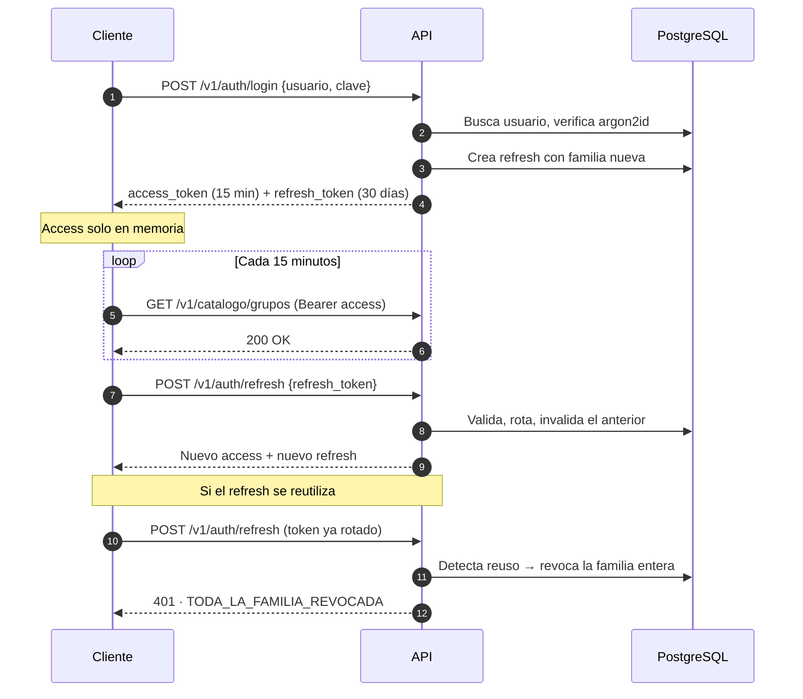
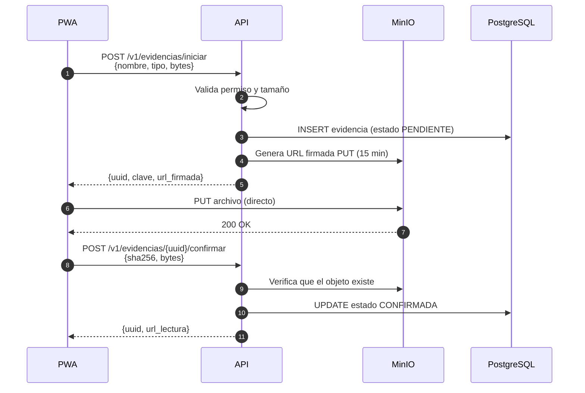

# 05 · API

Contratos REST, permisos por endpoint y el flujo de subida de evidencias.

---

## Cómo leer este documento

| Marcador | Significado |
|---|---|
| `[ACTUAL]` | Comprobado en `web/` — *fuente del SINB legado (VIDECI), no incluida en este repositorio* |
| `[DEFECTO]` | Problema comprobado |
| `[MEJORA]` | Capacidad existente que se modifica |
| `[NUEVO]` | Capacidad que el SINB no tiene |
| `[DECIDIR]` | Requiere firma institucional |

---

## 1. El estado actual de la API `[ACTUAL]` (SINB legado · VIDECI)

### 1.1 Lo que hay

> *Contraste con la estructura actual del repositorio*: en el **SINB legado de la VIDECI** (Laravel) no hay API REST. En **este repositorio ya existe una API REST** (`api/`, FastAPI): rutas versionadas `/api/v1` y `/api/v2`, contrato OpenAPI generado por FastAPI desde Pydantic, autenticación **JWT** (HS256, `api/auth/jwt.py`) y auditoría de escrituras (`AuditMiddleware` en `api/audit.py`). Módulos existentes: `auth`, `shared`, `usuarios`, `edan`, `repositorio`, `rida`, `firma_digital`.
>
> Por tanto, este documento se aplica como **ampliación del módulo SINB** (nuevos endpoints `/api/v1/sinb/…` y `/api/v2/sinb/…`), no como creación de API desde cero. Los endpoints, permisos y contratos de §4 en adelante se montan **sin modificar los routers de `edan` ni `rida`**.

`[ACTUAL]` En el SINB legado no hay API REST. El sistema tiene 75 rutas web, todas con métodos `GET` y `POST` que devuelven HTML. No hay API, ni JSON, ni autenticación de máquina, ni códigos de estado HTTPmozagadores.

| Tipo de ruta | Cantidad | Notas |
|---|---|---|
| Formularios y CRUD | 75 | Devuelven vistas Blade |
| JSON | 0 | No existe |
| Subida de archivos | 2 | `store()` con validación de `mimes` |
| Exportaciones | 3 | Una de ellas (`GET /excel`) sin autenticación |
| API de terceros | 0 | No hay documentación |

### 1.2 Un problema con las exportaciones `[DEFECTO]`

```php
// web/routes/web.php
Route::get('/excel', 'ReportController@excel');   // FUERA del grupo auth
```

`[DEFECTO]` `GET /excel` devuelve nombre, correo, celular, CI y rol de los **279 usuarios**, sin filtro territorial y sin auditoría. Cualquiera que conozca la URL descarga la base de datos de usuarios. Es el defecto de seguridad más grave del sistema actual y debe cerrarse antes de cualquier despliegue.

> *Contraste*: este defecto pertenece al **SINB legado**. En la API actual (`api/`) el patrón es JWT + `AuditMiddleware` en todas las escrituras; al añadir el módulo SINB, cualquier exportación nueva de usuarios **no se expone sin token, filtro territorial y auditoría**, reutilizando ese mismo patrón.

### 1.3 Sin contrato `[ACTUAL]`

`[DEFECTO]` No hay documentación de la API porque no hay API. Un consumidor externo —otro sistema del MINDEF, un SIG, una app de terceros— no tiene forma de saber qué puede pedir ni qué recibe.

> *Contraste*: en este repositorio el contrato sí existe (OpenAPI generado por FastAPI). El trabajo pendiente es **mantenerlo al día** al añadir los endpoints SINB, no crearlo.

---

## 2. La API objetivo `[NUEVO]` (aplicada como ampliación del módulo SINB)

> *Contraste*: en este repositorio los principios ya se cumplen en su mayor parte —REST, JSON, códigos HTTP, OpenAPI generado, JWT, auditoría y **versionado `/api/v1` y `/api/v2` activos**. Lo que propone esta sección para SINB es **usar esos mismos cimientos** con path propio (`/api/v1/sinb/…`), en lugar de crear convenciones paralelas.

### 2.1 Principios

| Principio | Consecuencia |
|---|---|
| REST con recursos | `/v1/observaciones`, no `/v1/getObservacion?id=` |
| JSON en entrada y salida | Sin HTML en la capa de datos |
| Códigos de estado reales | 200, 201, 202, 204, 400, 401, 403, 404, 409, 422, 500 |
| OpenAPI generado | El contrato es el código, no un documento aparte |
| Permiso por endpoint | No hay autorización solo en la vista |
| Auditoría de toda escritura | Incluidas lecturas de datos sensibles |
| Versionado en la ruta | `/v1/...` desde el día uno |

`[NUEVO]` El versionado desde el día uno parece un gasto, pero un cambio de un campo obligatorio rompe a todos los clientes. Con `/v1` congelado, la versión 2 convive con la 1 durante la transición.

### 2.2 Convenciones

| Convención | Regla |
|---|---|
| Base | `/v1` |
| Filtros | Parámetros de consulta: `?municipio=<uuid>&desde=2026-01-01` |
| Paginación | `?limite=50&desplazamiento=cursor` |
| Identificadores | UUIDv7 |
| Fechas | ISO 8601 en UTC: `2026-07-14T14:30:00Z` |
| Importes y decimales | Separador de punto, no coma |
| Errores | `{ "codigo": "...", "mensaje": "...", "detalle": {} }` |
| Idempotencia | `Idempotency-Key` en operaciones de escritura |

---

## 3. Autenticación `[NUEVO]`

> *Contraste*: este repositorio **ya tiene autenticación JWT** en `/api/v1/auth` (`api/auth/`, HS256, expiración por minutos). La propuesta de este documento (access corto + refresh rotado con detección de reuso) es un **endurecimiento**: si se adopta, se evoluciona el módulo `auth` existente o se crea un módulo paralelo para SINB, pero **no se duplica la gestión de usuarios** — las cuentas viven en `usuarios` y se reutilizan **solo si el diseño del SINB lo requiere** (ver [04 §0](04-BASE-DE-DATOS.md#0-cómo-encaja-con-la-estructura-actual-del-repositorio)).

### 3.1 El esquema



### 3.2 Por qué tokens y no sesión `[NUEVO]`

| Necesidad | Sesión Laravel actual | Token |
|---|---|---|
| PWA offline | Requiere cookie y servidor accesible | Funciona sin conexión |
| App móvil nativa | Inviable | Nativo |
| API de terceros | No aplica | Diseñado para eso |
| Cerrar sesión en un dispositivo | Requiere managing `session` | Revocar el refresh |
| Almacenamiento seguro del access | `localStorage` es accesible a XSS | Solo en memoria |

`[MEJORA]` El `access_token` se mantiene **solo en memoria** en el cliente. Nunca en `localStorage`. El `refresh_token` es un `HttpOnly` cookie con `Secure` y `SameSite=Strict`, de modo que un XSS no puede leerlo pero el cliente sí lo envía automáticamente.

### 3.3 Detección de reuso `[NUEVO]`

```python
# app/modulos/identidad/auth.py
class ErrorReusoDeToken(Exception):
    """Un refresh token rotado fue presentado otra vez."""
    pass


async def refrescar(sesion, refresh_token: str) -> tuple[str, str]:
    fila = await obtener_token(sesion, refresh_token)

    if fila is None:
        raise CredencialesInvalidas("Refresh token desconocido")

    # Si el token ya estaba rotado, alguien lo esta reutilizando:
    # revocar la familia entera es la respuesta correcta.
    if fila["revocado_en"] is not None:
        await revocar_familia(sesion, fila["familia_id"],
                              "REUSO_DETECTADO")
        raise ErrorReusoDeToken("Se detecto reuso: toda la familia fue revocada")

    if fila["expira_en"] < datetime.now(timezone.utc):
        raise CredencialesInvalidas("Refresh token expirado")

    # Rotacion: el token usado se invalida y se emite uno nuevo en la misma familia.
    await invalidar(sesion, refresh_token, "ROTACION")

    nuevo_refresh = generar_refresh_token()
    await crear_token(sesion, {
        "familia_id": fila["familia_id"],
        "hash": hash_refresh(nuevo_refresh),
        "expira_en": fila["expira_en"],
        "rotado_desde": refresh_token[:12],
    })

    access = generar_access_token({
        "sub": fila["usuario_id"],
        "rol": fila["rol"],
        "municipios": fila["municipios"],
    })

    return access, nuevo_refresh
```

`[NUEVO]` La rotación sin detección de reuso es peor que no rotar: si un atacante roba un refresh, ambos lo usan y el sistema nunca lo nota. Con detección, la segunda presentación del mismo token invalida la familia completa y obliga a todos los dispositivos de ese usuario a autenticarse de nuevo.

### 3.4 Login: se corrige un defecto `[DEFECTO]`

```php
// web/app/Http/Controllers/AuthController.php  -- ACTUAL, DEFECTUOSO
$request->validate([
    'usuario' => 'required|email',        // <-- exige correo
    'clave'   => 'required',
]);
```

`[DEFECTO]` `required|email` impide iniciar sesión a los 284 usuarios sin correo registrado. La observación local del Altiplano rara vez viene con correo, así que en la práctica una parte del sistema es inaccesible.

`[NUEVO]` El login objetivo acepta **usuario o correo**:

```python
class LoginRequest(BaseModel):
    usuario: str = Field(min_length=3, max_length=120)
    clave: str = Field(min_length=8, max_length=128)

    @field_validator('usuario')
    @classmethod
    def sin_espacios(cls, v: str) -> str:
        return v.strip().lower()
```

---

## 4. Endpoints

> *Contraste*: en este repositorio los prefijos reales son **`/api/v1/…`** y **`/api/v2/…`**. Al montar el módulo SINB se usan `/api/v1/sinb/…` y `/api/v2/sinb/…`. Los endpoints de autenticación de §4.1 se resuelven con el módulo `auth` **ya existente** (§3); los de catálogo, observación, pronóstico, etc. se **crean nuevos** y operan sobre `sinb.*`, sin dependencia de los endpoints de `edan` o `rida`.

---

## 4.1. Módulo SINB (v2) — Endpoints implementados

**Base:** `/api/v2/sinb/`  
**Esquema:** `sinb` (39 tablas) + `shared` (territorio) + `usuarios` (identidad)  
**Autenticación:** JWT obligatorio en todos los endpoints  
**Roles SINB:** `admin` (2), `UGR Municipio` (6), `Usuario recolector` (12), `Observador local` (13)

### 4.1.1 Catálogos Bioculturales (sin paginación)

| Método | Ruta | Permiso | Descripción |
|---|---|---|---|
| GET/POST | `/grupo` | Ver/`admin` | Listar/crear grupos |
| GET/PUT/DELETE | `/grupo/{id}` | Ver/`admin` | CRUD individual |
| GET/POST | `/indicador-natural` | Ver/`admin` | Listar/crear (filtros: `id_grupo`, `codigo`, `nombre_cientifico`, `nombre_comun`) |
| GET/POST | `/caracteristica` | Ver/`admin` | Listar/crear (filtro: `id_indicador_natural`) |
| GET/POST | `/comportamiento` | Ver/`admin` | Listar/crear (filtros: `id_grupo`, `id_caracteristica`) |
| GET/POST | `/significado` | Ver/`admin` | Listar/crear (filtros: `id_grupo`, `id_comportamiento`, `categoria`) |
| GET/POST | `/zona-geografica` | Ver/`admin` | Listar/crear zonas (andina/valle/llano) |
| GET/POST | `/campo-pronostico` | Ver/`admin` | Listar/crear campos (Lluvia, Granizo, Helada, Cosecha) |
| GET/POST | `/escenario` | Ver/`admin` | Listar/crear escenarios |
| GET/POST | `/dimension-recomendacion` | Ver/`admin` | Listar/crear dimensiones |
| GET/POST | `/categoria-comportamiento` | Ver/`admin` | Listar/crear categorías |

**Regla:** Los catálogos **no tienen paginación** — siempre se devuelven completos para modo offline.

### 4.1.2 Observaciones (últimos 15, filtros geográficos)

| Método | Ruta | Permiso | Descripción |
|---|---|---|---|
| GET | `/observacion` | Ver | Listar (skip, limit, filtros: `id_municipio`, `id_departamento`, `codigo_comunidad`, `id_usuario_responsable`, `fecha_inicio_*`, `es_validada`) |
| POST | `/observacion` | Crear | Crear observación con registros anidados |
| GET | `/observacion/{id}` | Ver | Detalle con registros |
| PUT | `/observacion/{id}` | Editar | Actualizar (solo `BORRADOR` o autor) |
| DELETE | `/observacion/{id}` | Eliminar | Eliminar observación |

**Scope geográfico automático:**
- Rol 6, 8 (UGR, Alcalde): solo ven su municipio
- Rol 9 (VIDECI): solo ven su departamento
- Rol 1, 2 (admin, superadmin): sin filtros

### 4.1.3 Pronósticos

#### Estacionales (largo plazo)

| Método | Ruta | Permiso | Descripción |
|---|---|---|---|
| GET | `/pronostico-estacional` | Ver | Listar (últimos 15, filtros geográficos) |
| POST | `/pronostico-estacional` | Crear | Crear con escenarios + observadores |
| GET | `/pronostico-estacional/{id}` | Ver | Detalle completo |
| PUT | `/pronostico-estacional/{id}` | Editar | Actualizar |
| DELETE | `/pronostico-estacional/{id}` | Eliminar | Eliminar |
| POST | `/pronostico-estacional/{id}/escenario` | Crear | Agregar escenario con probabilidad |
| DELETE | `/pronostico-estacional/{id}/escenario/{id_escenario}` | Eliminar | Remover escenario |

#### Temporales (corto plazo)

| Método | Ruta | Permiso | Descripción |
|---|---|---|---|
| GET | `/pronostico-temporal` | Ver | Listar (últimos 15) |
| POST | `/pronostico-temporal` | Crear | Crear pronóstico temporal |
| GET | `/pronostico-temporal/{id}` | Ver | Detalle |
| PUT | `/pronostico-temporal/{id}` | Editar | Actualizar |
| DELETE | `/pronostico-temporal/{id}` | Eliminar | Eliminar |

### 4.1.4 Asignación de Observadores

| Método | Ruta | Permiso | Descripción |
|---|---|---|---|
| POST | `/pronostico/{id}/observadores` | Crear | Asignar 1..N observadores (mismo municipio) |
| DELETE | `/pronostico/{id}/observador/{id_usuario}` | Eliminar | Remover observador |

**Reglas:**
- Todos los observadores deben ser del **mismo municipio**
- Roles permitidos: 6, 7, 8, 12, 13
- `confianza`: ALTA (1.0), MEDIA (0.7), BAJA (0.5)
- `tipo_registro`: COLECTIVO (2+) o INDIVIDUAL (1)

### 4.1.5 Validación de Pronósticos

| Método | Ruta | Permiso | Descripción |
|---|---|---|---|
| POST | `/verificacion/calcular` | Automático | Calcular verificación de pronósticos vencidos |
| GET | `/verificacion/pendientes` | Ver | Listar pendientes |
| PUT | `/verificacion/{id_pronostico}` | `admin`/VIDECI | Validación manual (estado, observación, calificación 0-100) |

**Reglas automáticas:**
1. `fecha_fin < NOW()` → `PENDIENTE_VERIFICACION`
2. Si hay observaciones en ventana → `EN_VERIFICACION` (manual)
3. Si coincide evento → `COINCIDE`
4. Sin datos → `SIN_DATOS`

### 4.1.6 Recomendaciones

| Método | Ruta | Permiso | Descripción |
|---|---|---|---|
| GET | `/recomendacion-local` | Ver | Listar (últimos 15, filtros) |
| POST | `/recomendacion-local` | Crear | Crear recomendación |
| DELETE | `/recomendacion-local/{id}` | Eliminar | Eliminar |

**Dimensiones:** Época de siembra, Lugar de siembra  
**Categorías:** Retrasada, Adelantada, Secos, Húmedos, Normales

### 4.1.7 Avisos de Corto Plazo

| Método | Ruta | Permiso | Descripción |
|---|---|---|---|
| GET | `/aviso` | Ver | Listar (últimos 15, filtros: estado, vigencia) |
| POST | `/aviso` | Crear | Crear aviso (vigencia 24-48h) |
| DELETE | `/aviso/{id}` | Eliminar | Eliminar |

**Flujo:** Productor dicta → comunidad → vigencia → verificación → `observador_indice` tipo `CORTO`

### 4.1.8 Observador Índice

| Método | Ruta | Permiso | Descripción |
|---|---|---|---|
| GET | `/observador-indice` | Ver | Listar índices por usuario/indicador |
| POST | `/observador-indice` | Crear | Crear registro de acierto |

**Tipos:** `CORTO` (avisos), `LARGO` (pronósticos estacionales)

### 4.1.9 Mapas GeoJSON

| Método | Ruta | Permiso | Descripción |
|---|---|---|---|
| GET | `/mapa/observaciones/geojson` | Ver | Observaciones por comunidad (puntos) |
| GET | `/mapa/comunidades/geojson` | Ver | Comunidades (puntos) |
| GET | `/mapa/municipios/geojson` | Ver | Municipios (polígonos) |
| GET | `/mapa/manzanos/geojson` | Ver | Manzanos censales (polígonos) |
| GET | `/mapa/pronosticos/geojson` | Ver | Pronósticos agregados por municipio |

**Filtros:** `id_departamento`, `id_provincia`, `id_municipio`, `codigo_comunidad`  
**Formato:** FeatureCollection RFC 7946, EPSG:4326

### 4.1.10 Reportes Enriquecidos

| Método | Ruta | Permiso | Descripción |
|---|---|---|---|
| GET | `/reporte/observaciones` | Ver | Totales, por comunidad, por indicador, validación |
| GET | `/reporte/pronosticos` | Ver | Totales, estado, verificaciones |
| GET | `/reporte/calendario-siembra` | Ver | Calendario por municipio |

---

## 4.2. Autenticación `[NUEVO]`

| Método | Ruta | Permiso | Descripción |
|---|---|---|---|
| POST | `/v1/auth/login` | Público | Autentica y devuelve tokens |
| POST | `/v1/auth/refresh` | Público con refresh | Rota el par de tokens |
| POST | `/v1/auth/logout` | Autenticado | Revoca la familia actual |
| POST | `/v1/auth/logout-todos` | Autenticado | Revoca todas las sesiones |
| GET | `/v1/auth/yo` | Autenticado | Usuario, rol, municipios, permisos |
| POST | `/v1/auth/cambiar-clave` | Autenticado | Cambia la contraseña con la actual |
| POST | `/v1/auth/recuperar-clave` | Público | Envía enlace de restablecimiento |

```json
// POST /v1/auth/login
{
  "usuario": "j.mamani",
  "clave": "••••••••"
}
```

```json
// 200 OK
{
  "access_token": "eyJhbGciOiJIUzI1NiIs...",
  "token_type": "bearer",
  "expires_in": 900,
  "refresh_token": "8f3a...c291",
  "usuario": {
    "id": "0191f2a3-4b5c-7d8e-9f01-234567890abc",
    "nombre": "Juan Mamani",
    "rol": "usuario-municipal",
    "municipios": ["0191...def"],
    "permisos": ["crear-observacion", "editar-observacion",
                  "validar-observacion", "exportar"]
  }
}
```

```json
// 401 Unauthorized
{
  "codigo": "CREDENCIALES_INVALIDAS",
  "mensaje": "Usuario o contrasena incorrectos",
  "detalle": {}
}
```

`[NUEVO]` El mensaje de error no distingue entre «usuario no existe» y «contraseña incorrecta», para no confirmar qué usuarios están dados de alta.

### 4.2 Territorio `[NUEVO]`

| Método | Ruta | Permiso | Descripción |
|---|---|---|---|
| GET | `/v1/departamentos` | Autenticado | Los 9 departamentos |
| GET | `/v1/departamentos/{id}/provincias` | Autenticado | Provincias del departamento |
| GET | `/v1/municipios` | Autenticado | Filtro por `departamento`, `provincia` |
| GET | `/v1/municipios/{id}/comunidades` | Autenticado | Comunidades del municipio |
| GET | `/v1/comunidades` | Autenticado | Filtro por `municipio`, `zona` |
| GET | `/v1/comunidades/{id}` | `ver-comunidad` | Detalle con geometría |
| GET | `/v1/comunidades/{id}/datos-generales` | `ver-comunidad` | Solo el dato, sin geometría |

`[NUEVO]` `/datos-generales` existe separada del detalle porque la ficha de campo necesita el nombre y el municipio pero no el polígono, y descargar geometría para 18.331 comunidades sería pesado.

`[ACTUAL]` La jerarquía actual está en cuatro pivotes: `t_departamento_provincia`, `t_provincia_municipio`, `t_municipio_comunidad`, `t_comunidad_zona`. Se conserva la estructura, con FK reales ([04 §4](04-BASE-DE-DATOS.md#4-territorio)).

### 4.3 Catálogo biocultural `[NUEVO]`

| Método | Ruta | Permiso | Descripción |
|---|---|---|---|
| GET | `/v1/catalogo/grupos` | Autenticado | Los 7 grupos |
| GET | `/v1/catalogo/grupos/{id}/indicadores` | Autenticado | Indicadores del grupo |
| GET | `/v1/catalogo/indicadores/{id}/caracteristicas` | Autenticado | Características del indicador |
| GET | `/v1/catalogo/caracteristicas/{id}/comportamientos` | Autenticado | Comportamientos |
| GET | `/v1/catalogo/comportamientos/{id}/significados` | Autenticado | Significados |
| GET | `/v1/catalogo/cadena` | Autenticado | Toda la cadena en un solo árbol |
| GET | `/v1/catalogo/version` | Autenticado | Número de versión para el cliente offline |
| GET/POST/PATCH/DELETE | `/v1/catalogos/{tabla}` | `editar-catalogo` (escritura) | **CRUD genérico** de los catálogos del bloque C de [04 §1A](04-BASE-DE-DATOS.md#1a-tres-bloques-con-su-crud-nuevo): territorio, biocultural, clima y ventanas, identidad |

```json
// GET /v1/catalogo/cadena?grupo=fauna
{
  "grupo": { "id": "...", "nombre": "Animales", "icono": "fauna.svg" },
  "indicadores": [
    {
      "id": "...",
      "nombre": "Zorro",
      "nombre_cientifico": "Pseudolopex culpaeus",
      "nombres_locales": ["Zorro", "Atoq", "Txicara"],
      "caracteristicas": [
        {
          "id": "...",
          "nombre": "Tipo de aullido",
          "comportamientos": [
            {
              "id": "...",
              "nombre": "Aullido prolongation",
              "significados": [
                { "id": "...", "nombre": "Helada fuerte" }
              ]
            }
          ]
        }
      ]
    }
  ],
  "version": "2026.07.14-1"
}
```

`[NUEVO]` `/catalogo/cadena` existe para el modo offline ([08 §3](08-OFFLINE-SINCRONIZACION.md#3-versión-de-catálogos)): el cliente descarga la cadena una vez y valida en local sin red.

`[NUEVO]` `version` es un número entero que cambia cuando el catálogo cambia. El cliente compara y descarga solo si es distinto ([08 §3](08-OFFLINE-SINCRONIZACION.md#3-versión-de-catálogos)).

### 4.4 Observaciones `[NUEVO]`

| Método | Ruta | Permiso | Descripción |
|---|---|---|---|
| GET | `/v1/observaciones` | `ver-observacion` | Filtro por comunidad, fecha, estado, indicador |
| POST | `/v1/observaciones` | `crear-observacion` | Crea una sesión de observación |
| GET | `/v1/observaciones/{id}` | `ver-observacion` | Con sus registros |
| PATCH | `/v1/observaciones/{id}` | `editar-observacion` | Edita mientras sea `BORRADOR` |
| POST | `/v1/observaciones/{id}/enviar` | `editar-observacion` | `BORRADOR` a `ENVIADA` |
| POST | `/v1/observaciones/{id}/validar` | `validar-observacion` | `ENVIADA` a `VALIDADA` |
| POST | `/v1/observaciones/{id}/rechazar` | `validar-observacion` | `ENVIADA` a `RECHAZADA` con motivo |
| GET | `/v1/observaciones/{id}/evidencias` | `ver-observacion` | Fotos y archivos |
| POST | `/v1/observaciones/{id}/recalificar` | `recalificar-observacion` | `[DECIDIR]` Abre una observación validada |

```json
// POST /v1/observaciones
{
  "fk_id_comunidad": "0191...def",
  "fecha_inicio": "2026-07-14T08:30:00Z",
  "fecha_fin": "2026-07-14T11:15:00Z",
  "tipo_observacion_id": "1",
  "observador": {
    "usuario_id": "0191...abc",
    "nombre": "Juan Mamani",
    "contacto": "+59170000000"
  },
  "clima_desc": "Cielo despejado, viento leve",
  "sincronizado": true,
  "registros": [
    {
      "uuid": "0191f2a3-...-9001",
      "fk_id_indicador": "...",
      "fk_id_caracteristica": "...",
      "fk_id_comportamiento": "...",
      "fk_id_significado": "...",
      "fk_id_municipio_indicador_natural": "...",
      "cantidad": 3,
      "unidad": "individuos",
      "fk_id_tipo_metodo": "2",
      "nombre_metodo": "Canto del liqi liqi",
      "valor_texto": "Largo, al atardecer",
      "es_ausencia": false
    }
  ]
}
```

`[MEJORA]` `sincronizado: true` no es un campo de negocio: le dice al servidor que este registro viene de un dispositivo que estaba sin conexión, y por tanto puede tener conflictos. El servidor lo registra en `sincronizacion_log` ([08](08-OFFLINE-SINCRONIZACION.md)).

`[NUEVO]` El `uuid` lo genera el cliente, no el servidor. Es lo que permite que un registro sin conexión tenga identidad antes de llegar.

### 4.5 Pronósticos `[NUEVO]`

| Método | Ruta | Permiso | Descripción |
|---|---|---|---|
| GET | `/v1/pronosticos/estacionales` | `ver-pronostico` | Filtro por comunidad, campo, periodo |
| POST | `/v1/pronosticos/estacionales` | `crear-pronostico` | Emite un pronóstico |
| POST | `/v1/pronosticos/estacionales/{id}/escenarios` | `crear-pronostico` | Añade un escenario con probabilidad |
| GET | `/v1/pronosticos/temporales` | `ver-pronostico` | Pronósticos de texto |
| POST | `/v1/pronosticos/temporales` | `crear-pronostico` | Emite un pronóstico temporal |
| GET | `/v1/pronosticos/confiabilidad` | `ver-pronostico` | Índice de calidad de datos del indicador |
| POST | `/v1/pronosticos/estacionales/{id}/observadores` | `crear-pronostico` | Asigna observadores con su **confianza inicial** (ALTA/MEDIA/BAJA) |
| GET | `/v1/pronosticos/estacionales/{id}/observadores` | `ver-pronostico` | Observadores del pronóstico y su confianza |
| GET | `/v1/pronosticos/estacionales/{id}` | `ver-pronostico` | Detalle con `confianza_largo` e índice de cada observador |
| GET | `/v1/pronosticos/digitales` | `ver-pronostico` | Lectura del **pronóstico digital** (control y ayuda) |

```json
// POST /v1/pronosticos/estacionales
{
  "fk_id_comunidad": "0191...def",
  "fk_id_campo": "...",
  "fk_id_observacion_origen": "0191...9001",
  "pronostico_libre": "Va a llover mucho en agosto",
  "tipo_registro": "COLECTIVO",
  "fecha_emision": "2026-07-14T00:00:00Z",
  "periodo_inicio": "2026-08-01",
  "periodo_fin": "2026-08-31",
  "observadores": [
    { "fk_id_observador": "0191...a1", "confianza_inicial": "ALTA" },
    { "fk_id_observador": "0191...a2", "confianza_inicial": "MEDIA" }
  ],
  "escenarios": [
    { "fk_id_escenario": "mucho", "probabilidad": 0.55 },
    { "fk_id_escenario": "normal", "probabilidad": 0.35 },
    { "fk_id_escenario": "poco",  "probabilidad": 0.10 }
  ]
}
```

`[NUEVO]` **`pronostico_libre`** es el paso 0: la frase tal como la dijo el observador, sin reescribir. **`observadores`** son 1..N (recolector auto-registrado o en representación, [07 §4.5](07-FLUJOS-BIOCULTURALES.md)). El servidor calcula **`confianza_largo`** = promedio ponderado (1.0 / 0.7 / 0.5) y lo devuelve en la respuesta; **nunca** lo acepta del cliente.

`[NUEVO]` `fk_id_observacion_origen` es obligatorio. Sin él no se puede saber qué observación generó el pronóstico, y sin esa referencia la verificación no puede garantizar que usa datos independientes ([07 §9.4](07-FLUJOS-BIOCULTURALES.md#94-el-detalle-crítico-no-verificar-consigo-mismo)).

`[NUEVO]` El servidor valida lo esencial: `periodo_fin > periodo_inicio`, comunidad y observadores presentes. **No hay regla de ventana**: la ventana estacional (San Juan, Maya Xook, Jallu) es referencia para reportes y gráficas, no un filtro de emisión ([04 §13](04-BASE-DE-DATOS.md), [07 §9.8](07-FLUJOS-BIOCULTURALES.md)).

`[OPCIONAL]` **A futuro**, si se quiere restringir la emisión a ventanas de calendario, haría falta un catálogo de reglas con vigencia y su propio control 422 (`REGLA_NO_VIGENTE`). Eso queda fuera de la fase 1 ([04 §14.2](04-BASE-DE-DATOS.md#142-métodos-a-futuro-opcional)).

### 4.5A Avisos (corto plazo), índice e histograma `[NUEVO]`

`[NUEVO]` El sistema tiene **dos herramientas de pronóstico** — largo plazo (§4.5) y **avisos de corto plazo** (esta sección). Nombres de las herramientas `[DECIDIR]`.

| Método | Ruta | Permiso | Descripción |
|---|---|---|---|
| POST | `/v1/avisos` | `crear-aviso` | Crea un aviso: texto libre + punto + vigencia |
| GET | `/v1/avisos` | `ver-aviso` | Filtro por estado (ACTIVO/VENCIDO/VERIFICADO), municipio, vigencia |
| GET | `/v1/avisos/{id}` | `ver-aviso` | Detalle con `confianza_corto` y observadores |
| POST | `/v1/avisos/{id}/observadores` | `crear-aviso` | Asigna observadores con confianza inicial (1.0 / 0.7 / 0.5) |
| POST | `/v1/avisos/{id}/verificar` | `verificar-aviso` | `CUMPLIO` / `NO_CUMPLIO` / `SIN_DATOS` dentro de la vigencia |
| GET | `/v1/avisos/histograma` | `ver-aviso` | **Histograma**: frecuencia de pronósticos por área + contadores |
| GET | `/v1/observadores/{id}/indice` | `ver-indice` | Índice automático del observador, **por tipo (LARGO / CORTO)** |
| GET | `/v1/reportes/alcance` | `exportar` | Reportes y gráficas por alcance (comunidad → región → nacional) |

```json
// POST /v1/avisos
{
  "fk_id_comunidad": "0191...def",
  "texto_libre": "Siento el ambiente humedo y el cielo despejado, va a granizar",
  "coordenada": { "lat": -16.5, "lon": -68.15 },
  "vigencia_inicio": "2026-10-03T14:00:00Z",
  "vigencia_fin":   "2026-10-04T14:00:00Z",
  "observadores": [
    { "fk_id_observador": "0191...b1", "confianza_inicial": "MEDIA" }
  ]
}

// 201 — respuesta (confianza calculada en el servidor)
{
  "id": "0191...c1",
  "estado": "ACTIVO",
  "tipo_registro": "INDIVIDUAL",
  "confianza_corto": "MEDIA",
  "confianza_puntaje": 0.700
}
```

`[NUEVO]` **Reglas que aplica el servidor:**

| Regla | Detalle |
|---|---|
| Vigencia | `vigencia_fin > vigencia_inicio`; por defecto 24 h, máximo 48 h `[DECIDIR]` |
| Vencimiento | Al pasar `vigencia_fin`, el trabajo programado marca `VENCIDO` y queda pendiente |
| Verificación | Solo dentro de la ventana; compara contra lo observado y el pronóstico digital |
| Índice | Cada verificación actualiza `observador_indice` con `tipo = 'CORTO'`; **el índice LARGO no se toca** |
| Histograma | `GET /v1/avisos/histograma` devuelve frecuencias por área (municipio, departamento, zona) y contadores por estado — para gráficas de reporte, **no es regla de negocio** |
| Digital | `GET /v1/pronosticos/digitales` es **solo lectura**: control y ayuda, no certifica |

### 4.6 Verificación y calificación `[NUEVO]`

| Método | Ruta | Permiso | Descripción |
|---|---|---|---|
| GET | `/v1/verificaciones` | `ver-validacion` | Filtro por estado (PENDIENTE/VERIFICADA/NO_VERIFICABLE), comunidad, periodo |
| GET | `/v1/verificaciones/{id}` | `ver-validacion` | Detalle: pronóstico, valor observado, error, quién verificó |
| POST | `/v1/verificaciones/{id}/revisar` | `ver-validacion` | Re-verificación manual con nota (`es_autoevaluada = false`) |
| GET | `/v1/calificacion` | `ver-calificacion` | Nivel de cada indicador por ámbito (3 niveles) |
| GET | `/v1/calificacion/{indicador}` | `ver-calificacion` | Contadores e historial de cambios |
| POST | `/v1/calificacion/{id}/confirmar` | `calificar-indicador` | Confirma `USABLE` propuesto por la tarea |
| POST | `/v1/calificacion/{id}/revision` | `calificar-indicador` | Aplica `REVISAR` con nota obligatoria |

```json
// GET /v1/verificaciones?estado=PENDIENTE
{
  "pendientes": [
    {
      "id": "0191...ab01",
      "herramienta": "largo",
      "indicador": "Zorro",
      "comunidad": "Chuquihuta",
      "emitido": "2026-06-04",
      "periodo_fin": "2026-06-25"
    },
    {
      "id": "0191...ab02",
      "herramienta": "corto",
      "aviso": "Va a granizar",
      "comunidad": "Chuquihuta",
      "emitido": "2026-10-03",
      "periodo_fin": "2026-10-04"
    }
  ]
}
```

`[NUEVO]` Una sola tarea diaria cierra lo vencido; no hay fechas de ejecución por regla ni catálogo de métodos ([04 §14.1](04-BASE-DE-DATOS.md#141-cómo-se-verifica-versión-simple)).

```json
// GET /v1/calificacion?ambito=NACIONAL
{
  "indicadores": [
    {
      "nombre": "Zorro",
      "ambito": "NACIONAL",
      "nivel": "USABLE",
      "n_observaciones": 74,
      "n_verificaciones": 26,
      "n_aciertos": 19,
      "ultima_verificacion": "2026-06-27"
    },
    {
      "nombre": "Pichitanka",
      "ambito": "MUNICIPIO",
      "municipio": "Peñas",
      "nivel": "EN_VERIFICACION",
      "n_observaciones": 8,
      "n_verificaciones": 2,
      "n_aciertos": 1,
      "ultima_verificacion": "2026-06-02"
    },
    {
      "nombre": "Observacion de estrellas",
      "ambito": "NACIONAL",
      "nivel": "REVISAR",
      "n_observaciones": 11,
      "n_verificaciones": 0,
      "n_aciertos": 0,
      "notas": "Practica en desuso: sin observaciones en los ultimos tres anos"
    }
  ]
}
```

`[NUEVO]` Los tres casos son los tres niveles que un sistema bien diseñado distingue: uno usable, uno que todavía se está verificando, y uno que dejó de practicarse. El último no se borra: se marca con su nota, porque saber que una práctica se abandonó es información ([07 §9A.3](07-FLUJOS-BIOCULTURALES.md#9a3-calificación-tres-niveles-nuevo)).

### 4.7 Análisis longitudinal `[NUEVO]`

| Método | Ruta | Permiso | Descripción |
|---|---|---|---|
| GET | `/v1/analisis/series` | `ver-analisis` | Series de indicadores por año |
| GET | `/v1/analisis/tendencias` | `ver-analisis` | Tendencias fenológicas |
| GET | `/v1/analisis/anomalias` | `ver-analisis` | Anomalías bioculturales y climáticas |
| GET | `/v1/analisis/normas` | `ver-analisis` | Líneas base por variable y zona |
| GET | `/v1/analisis/confiabilidad` | `ver-analisis` | Calidad de datos por indicador y ámbito |

```json
// GET /v1/analisis/tendencias?indicador=...&comunidad=...
{
  "indicador": "Liqi liqi",
  "comunidad": "Chuquihuta",
  "ventana": "Maya Xook K'iin",
  "tendencia": {
    "dias_por_decada": -3.4,
    "n_anos": 12,
    "es_concluyente": true,
    "significado": "p_value",
    "intervalo_confianza_95": [-6.1, -0.7],
    "interpretacion": "El canto del liqi liqi ocurre 3.4 dias antes por decada que en los anos 1990"
  },
  "serie": [
    { "anio": 2015, "dia_del_anio": 42, "n": 4 },
    { "anio": 2016, "dia_del_anio": 39, "n": 4 },
    { "anio": 2017, "dia_del_anio": 40, "n": 4 },
    { "anio": 2018, "dia_del_anio": 37, "n": 4 },
    { "anio": 2019, "dia_del_anio": 36, "n": 3 },
    { "anio": 2020, "dia_del_anio": 35, "n": 4 },
    { "anio": 2021, "dia_del_anio": 34, "n": 4 },
    { "anio": 2022, "dia_del_anio": 32, "n": 4 },
    { "anio": 2023, "dia_del_anio": 31, "n": 3 },
    { "anio": 2024, "dia_del_anio": 30, "n": 4 },
    { "anio": 2025, "dia_del_anio": 29, "n": 4 },
    { "anio": 2026, "dia_del_anio": null, "n": null, "pendiente": true }
  ],
  "advertencia": "Con 12 anos el resultado es indicativo. Se requiere 20 anos para una conclusion solida."
}
```

`[NUEVO]` El último punto de la serie viene con `pendiente: true` y valor `null`. Mostrar el 2026 como si fuera una observación más haría que la pendiente pareciera más pronunciada de lo que es.

### 4.8 Recomendaciones `[NUEVO]`

| Método | Ruta | Permiso | Descripción |
|---|---|---|---|
| GET | `/v1/recomendaciones` | `ver-recomendacion` | Catálogo por dimensión |
| POST | `/v1/recomendaciones` | `crear-recomendacion` | Nueva recomendación |
| GET | `/v1/recomendaciones/municipales` | `ver-recomendacion` | `[DECIDIR]` Contexto por municipio |
| GET | `/v1/recomendaciones/{id}/variantes` | `ver-recomendacion` | Variantes locales |

`[ACTUAL]` El catálogo real son `t_categoria_recomendacion` (5 dimensiones), `t_recomendaciones` (19), `t_tipo_variante` (6) y `t_variantes_recomendacion`. Las variantes incluyen `ConBiofertilizante`, `ConBiofungicida`, `ConSemillaCertificada`, `AplicarEnFollaje`, `AplicarAlSuelo`, `EnZonaDeVenta`. Se conservan todas ([04 §7](04-BASE-DE-DATOS.md#7-recomendaciones)).

### 4.9 Satélite y clima `[NUEVO]`

| Método | Ruta | Permiso | Descripción |
|---|---|---|---|
| GET | `/v1/clima/series` | `ver-clima` | Series meteorológicas |
| GET | `/v1/clima/normas` | `ver-clima` | Líneas base `[DECIDIR]` |
| GET | `/v1/clima/escenas` | `ver-clima` | Escenas Sentinel-2 disponibles |
| GET | `/v1/clima/satelite/{escena}/ndvi` | `ver-clima` | NDVI de una escena |
| POST | `/v1/clima/escenas/{id}/agregar` | `configurar-datos` | Fuerza la agregación |
| GET | `/v1/clima/variables` | Autenticado | Catálogo de variables |

### 4.10 Evidencias `[NUEVO]`

| Método | Ruta | Permiso | Descripción |
|---|---|---|---|
| POST | `/v1/evidencias/iniciar` | `crear-observacion` | Devuelve clave y URL firmada |
| PUT | `{url_firmada}` | Firma | Subida directa al almacenamiento |
| POST | `/v1/evidencias/{uuid}/confirmar` | `crear-observacion` | Registra y asocia la evidencia |
| DELETE | `/v1/evidencias/{uuid}` | `crear-observacion` | `[DECIDIR]` Antes de validar |
| GET | `/v1/evidencias/{uuid}/descargar` | `ver-observacion` | URL temporal de descarga |
| GET | `/v1/catalogo/indicadores/{id}/fotos` | `ver-observacion` | **Galería 1:N** de un bioindicador: fotos ordenadas, **cada una con su descripción** |
| POST | `/v1/catalogo/indicadores/{id}/fotos` | `crear-observacion` | Añade una foto a la galería (flujo iniciar → PUT → confirmar, con `descripcion`) |
| PATCH | `/v1/evidencias/{uuid}` | `crear-observacion` | Cambia la descripción o el orden de **esa** foto |
| DELETE | `/v1/evidencias/{uuid}` | `ver-observacion` | Marca `RETIRADA` (nunca borra el archivo) |



`[MEJORA]` Las fotos van del teléfono al almacenamiento **sin pasar por la API**. Eso libera memoria del servidor y funciona con la conexión lenta de campo, que es la condición real del Altiplano.

`[DEFECTO]` La documentación anterior usaba dos flujos incompatibles: `POST /v1/observaciones/{id}/fotos` en un documento y URL firmada con confirmación en otro. Este es el único flujo.

`[NUEVO]` `sha256` permite detectar que el archivo llegó corrupto por una conexión inestable: el servidor compara el hash que declara el cliente con el del objeto almacenado y, si no coinciden, marca la evidencia como `CORRUPTA` en vez de aceptarla.

`[NUEVO]` **Galería del bioindicador (1:N con descripción).** El indicador ya se ve en el mapa con sus coordenadas; la galería añade las fotos, **cada una con su texto**:

```json
// POST /v1/catalogo/indicadores/{id}/fotos   (paso 3, confirmar)
{
  "tipo": "FOTO",
  "descripcion": "Floracion del pichitanka despues de las primeras lluvias",
  "orden": 1,
  "fecha_foto": "2026-10-02T10:12:00Z",
  "geom": { "lat": -16.5001, "lon": -68.1502 }
}

// 422 Unprocessable Entity — foto de bioindicador sin descripción
{ "codigo": "DESCRIPCION_OBLIGATORIA",
  "mensaje": "Cada foto de un bioindicador lleva su propia descripcion" }
```

| Regla | Comportamiento |
|---|---|
| 1:N | `GET .../fotos` devuelve la lista completa ordenada; no hay límite razonable impuesto (paginación por defecto) |
| Descripción | **Obligatoria** y **por foto**: PATCH cambia solo la de esa foto |
| Orden | `orden` define la portada de la galería |
| Consentimiento | Si la foto muestra personas o espacios privados, se envía `fk_id_consentimiento`; sin él vigente, la galería no la publica |
| Retirada | DELETE marca `RETIRADA`: el archivo permanece para auditoría |

### 4.11 Administración `[NUEVO]`

| Método | Ruta | Permiso | Descripción |
|---|---|---|---|
| GET | `/v1/usuarios` | `administrar-usuarios` | Filtro por rol, municipio |
| POST | `/v1/usuarios` | `administrar-usuarios` | Alta con rol y ámbito |
| PATCH | `/v1/usuarios/{id}` | `administrar-usuarios` | Edita rol, ámbito, estado |
| POST | `/v1/usuarios/{id}/restablecer-clave` | `administrar-usuarios` | `[DECIDIR]` Genera clave temporal |
| GET | `/v1/roles` | `ver-roles` | Los 4 roles y sus permisos |
| GET | `/v1/auditoria` | `ver-auditoria` | Filtro por usuario, acción, fecha |
| GET | `/v1/catalogo/versiones` | `ver-auditoria` | Cambios de catálogo con fecha |

`[ACTUAL]` El sistema actual tiene 279 usuarios, 4 roles, 70 permisos y 18 menús. Los tres roles no administrativos tienen `solo-municipal = 1`. Esa matriz se conserva exactamente ([09 §3](09-SEGURIDAD.md#32-la-matriz-de-roles-real-actual--el-quinto-rol-nuevo)).

`[DEFECTO]` `POST /usuarios` no tiene permiso en el servidor: los gates conceden siempre ([01 §1.3](01-ARQUITECTURA.md#13-los-diez-defectos-estructurales-defecto)). Cualquiera que conozca la ruta puede crear usuarios.

---

## 5. Errores `[NUEVO]`

| Código | HTTP | Cuándo |
|---|---|---|
| `CREDENCIALES_INVALIDAS` | 401 | Usuario o contraseña incorrectos |
| `TOKEN_EXPIRADO` | 401 | El access token venció |
| `REFRESH_INVALIDO` | 401 | El refresh no existe o expiró |
| `FAMILIA_REVOCADA` | 401 | Se detectó reuso de un refresh token |
| `SIN_PERMISO` | 403 | El rol no cubre la acción |
| `FUERA_DE_TERRITORIO` | 403 | Acceso a una comunidad no permitida |
| `NO_ENCONTRADO` | 404 | El recurso no existe o no es visible |
| `CONFLICTO_SINCRONIZACION` | 409 | El cliente tiene una versión vieja |
| `OBSERVACION_INCOMPLETA` | 422 | Falta un nivel de la cadena biocultural |
| `CADENA_INCOHERENTE` | 422 | La característica no pertenece al indicador |
| `GEOMETRIA_INVALIDA` | 422 | El polígono no es válido o no cae en la comunidad |
| `VALIDACION` | 422 | Falla una regla de negocio |
| `INTERNO` | 500 | Error no previsto, con identificador de traza |

```json
// 422 Unprocessable Entity
{
  "codigo": "OBSERVACION_INCOMPLETA",
  "mensaje": "La observacion no cumple la cadena de cinco niveles",
  "detalle": {
    "faltantes": ["fk_id_significado"],
    "cadena": ["grupo", "indicador", "caracteristica", "comportamiento", "significado"],
    "registro": 2,
    "ayuda": "Todo comportamiento tiene al menos un significado asociado. Seleccione uno."
  }
}
```

```json
// 422 Unprocessable Entity
{
  "codigo": "CADENA_INCOHERENTE",
  "mensaje": "La caracteristica no pertenece al indicador seleccionado",
  "detalle": {
    "fk_id_indicador": "...",
    "fk_id_caracteristica": "...",
    "caracteristicas_validas": ["Tipo de aullido", "Movimiento"],
    "origen": "validacion de FK compuesta en servidor"
  }
}
```

`[NUEVO]` El error `CADENA_INCOHERENTE` es el que hace imposible observar un «tipo de aullido» en el zorro y en la lagartija a la vez. La integridad se valida en el servidor con una FK compuesta, no solo en el formulario.

`[NUEVO]` El detalle del error menciona `origen: validacion de FK compuesta en servidor`. Cuando el cliente valida en local sin conexion, la misma regla se aplica y el mensaje es el mismo: un usuario no deberia ver mensajes distintos segun tenga red.

---

## 6. Permisos por endpoint `[NUEVO]`

`[ACTUAL]` La matriz real, verificada en el dump:

| Permiso | admin | municipal | recolector | observador |
|---|---|---|---|---|
| `crear-observacion` | Sí | Sí | Sí | Sí |
| `editar-observacion` | Sí | Sí | Sí | Solo suyas |
| `validar-observacion` | Sí | Sí | No | No |
| `recalificar-observacion` | Sí | Sí | No | No |
| `crear-pronostico` | Sí | Sí | No | No |
| `configurar-datos` | Sí | Sí | No | No |
| `calificar-indicador` | Sí | Sí | No | No |
| `administrar-usuarios` | Sí | No | No | No |
| `exportar` | Sí | Sí | No | No |
| `ver-auditoria` | Sí | No | No | No |

`[MEJORA]` Cada fila de esa tabla es un permiso que el servidor comprueba. Los cuatro roles siguen siendo los mismos y las capacidades siguen siendo las mismas: lo que cambia es dónde se aplican.

`[MEJORA]` El permiso `ver-calificacion` es legible por todos los autenticados. Que el personal de campo vea el nivel de un indicador es lo que permite que entienda por qué una regla se usa y otra no.

### 6.1 Cómo se declara un permiso `[NUEVO]`

```python
# app/modulos/observacion/rutas.py
from fastapi import APIRouter, Depends
from app.nucleo.seguridad import requiere_permiso, usuario_actual

ruta = APIRouter(prefix="/v1/observaciones", tags=["observaciones"])


@ruta.get("", summary="Lista observaciones")
async def listar(
    fk_id_comunidad: uuid | None = None,
    estado: str | None = None,
    limite: int = Query(50, le=200),
    desplazamiento: str | None = None,
    usuario = Depends(usuario_actual),
    _ = Depends(requiere_permiso("ver-observacion")),
):
    ...


@ruta.post("/{id}/validar", summary="Valida una observacion")
async def validar(
    id: uuid,
    cuerpo: ValidarObservacion,
    usuario = Depends(usuario_actual),
    sesion = Depends(requiere_permiso("validar-observacion")),
):
    async with transaction(sesion):
        observacion = await obtener_para_validar(sesion, id)

        # La segunda capa: el permiso no basta, el ambito tambien.
        await verificar_ambito(sesion, usuario, observacion.fk_id_comunidad)

        await cambiar_estado(sesion, observacion, "VALIDADA", usuario)
        await registrar_auditoria(sesion, usuario, "VALIDAR", "observacion", id)
```

`[MEJORA]` Hay dos comprobaciones, y las dos son necesarias. El permiso dice «este rol puede validar»; la comprobación de ámbito dice «este rol puede validar **esta** comunidad». Con solo la primera, un `usuario-municipal` podría validar observaciones de otro municipio.

### 6.2 Permisos nuevos y el rol supra `[NUEVO]`

`[NUEVO]` Los permisos añadidos por las capacidades nuevas, con el quinto rol:

| Permiso | admin | supra | municipal | recolector | observador |
|---|---|---|---|---|---|
| `crear-aviso` | Sí | Sí | Sí | Sí | Sí, su comunidad |
| `verificar-aviso` | Sí | No (lee) | Sí | No | No |
| `ver-indice` | Sí | Su región | Su municipio | Sus comunidades | **Solo el propio** |
| `ver-pronostico` (incluye digital) | Sí | Su región | Su municipio | Lectura | Lectura |
| `administrar-usuarios` | Sí | **Su región** | Su municipio | No | No |
| `exportar` | Sí | Su región | Su municipio | No | No |

`[NUEVO]` El alcance del `usuario-supramunicipal` es su **región** `[DECIDIR]` (departamento o conjunto de municipios). No necesita permisos especiales: reutiliza los mismos nombres con `app.municipios` cargado con todos los municipios de su región ([04 §12](04-BASE-DE-DATOS.md)).

---

## 7. Límites y cuotas `[NUEVO]`

| Recurso | Límite | Motivo |
|---|---|---|
| Tamaño de evidencia | 15 MB | Foto de teléfono de gama media |
| Evidencias por observación | 12 | Suficiente para documentar |
| Registros por observacion | 200 | Mas de eso se divide en dos sesiones |
| Cuerpo de petición | 2 MB | Evita agotar memoria |
| Solicitudes por minuto | 120 | Uso normal de la PWA |
| Resultados por busqueda | 200 maximo | Obliga a filtrar |

`[DEFECTO]` El sistema actual no tiene ningún límite de subida. Un `POST` con un archivo de 2 GB intenta cargarlo en memoria.

---

## 8. Trazabilidad

| Tema | Documento |
|---|---|
| Arquitectura modular y versión | [01](01-ARQUITECTURA.md) |
| Esquema de las entidades | [04](04-BASE-DE-DATOS.md) |
| Tareas y lógica de dominio | [03](03-BACKEND.md) |
| Flujo de verificación y calificación | [07 §9A](07-FLUJOS-BIOCULTURALES.md#9a-verificación-y-calificación-versión-simple-nuevo) |
| Sincronización y conflictos | [08](08-OFFLINE-SINCRONIZACION.md) |
| Sesiones, RBAC y auditoría | [09](09-SEGURIDAD.md) |
| Fuentes satelitales y meteorológicas | [10](10-INTEROPERABILIDAD.md) |
| **SINB: BD y APIs v2** | [docs/SINB_BD.md](../docs/SINB_BD.md) |

---

## 4.1.11 Módulo SINB > NDVI Satelital `[NUEVO v2.28.0]`

**Prefijo:** `/api/v2/ndvi/`

**Descripción:** Series históricas de NDVI calculado desde Sentinel-2 (EarthSearch STAC API). Monitoreo de vegetación, alertas de sequía, evolución temporal por comunidad.

**Estado:** ✅ IMPLEMENTADO (v2.28.0, 2026-10-03)

### Endpoints

#### 1. `GET /api/v2/ndvi/comunidad`

**Último NDVI disponible por comunidad.**

**Parámetros de consulta:**
- `codigo_comunidad` (opcional): Filtrar por código de comunidad

**Respuesta exitosa (200):**
```json
{
  "success": true,
  "data": [
    {
      "codigo_ine": "0201001",
      "nombre": "Comunidad A",
      "fecha": "2026-10-01",
      "ndvi_promedio": 0.52,
      "ndvi_anomalia": 0.08,
      "estado_vegetacion": "normal",
      "estado_alerta": "muy_bien"
    }
  ],
  "total": 343
}
```

**Autenticación:** JWT requerido  
**Permiso:** `sinb.ver`

---

#### 2. `GET /api/v2/ndvi/comunidad/{codigo_comunidad}/evolucion`

**Evolución mensual de NDVI.**

**Parámetros de ruta:**
- `codigo_comunidad` (requerido): Código de comunidad

**Parámetros de consulta:**
- `meses` (opcional, default=12): Meses hacia atrás (1-60)

**Respuesta exitosa (200):**
```json
{
  "success": true,
  "data": [
    {
      "codigo_ine": "0201001",
      "nombre": "Comunidad A",
      "mes": "2026-10-01T00:00:00",
      "ndvi_promedio_mes": 0.52,
      "anomalia_promedio_mes": 0.08,
      "n_dias_con_datos": 8
    }
  ]
}
```

**Autenticación:** JWT requerido  
**Permiso:** `sinb.ver`

---

#### 3. `GET /api/v2/ndvi/comunidad/{codigo_comunidad}/serie`

**Serie temporal completa de NDVI.**

**Parámetros de ruta:**
- `codigo_comunidad` (requerido)

**Parámetros de consulta:**
- `fecha_desde` (opcional)
- `fecha_hasta` (opcional)
- `limit` (opcional, default=365, max=1000)

**Respuesta exitosa (200):**
```json
{
  "success": true,
  "data": [
    {
      "fecha": "2026-10-01",
      "ndvi_promedio": 0.52,
      "ndvi_anomalia": 0.08,
      "estado_vegetacion": "normal",
      "n_escenas": 3
    }
  ]
}
```

**Autenticación:** JWT requerido  
**Permiso:** `sinb.ver`

---

#### 4. `GET /api/v2/ndvi/alertas`

**Alertas activas de NDVI bajo.**

**Parámetros de consulta:**
- `departamento` (opcional)
- `provincia` (opcional)
- `municipio` (opcional)

**Niveles de alerta:**
1. `sequia_extrema` (NDVI < 0.2)
2. `sequia_moderada` (NDVI < 0.3)
3. `anomalia_negativa_fuerte` (< -0.15)
4. `anomalia_negativa_leve` (< -0.05)

**Respuesta exitosa (200):**
```json
{
  "success": true,
  "data": [
    {
      "codigo_ine": "0502003",
      "nombre": "Comunidad B",
      "fecha": "2026-10-02",
      "ndvi_promedio": 0.18,
      "ndvi_anomalia": -0.22,
      "estado_vegetacion": "seco",
      "tipo_alerta": "sequia_extrema",
      "nivel_prioridad": 1
    }
  ],
  "total": 12
}
```

**Autenticación:** JWT requerido  
**Permiso:** `sinb.ver`

---

#### 5. `GET /api/v2/ndvi/geojson/mapa-calor`

**GeoJSON para mapa de calor de NDVI.**

**Parámetros de consulta:**
- `departamento` (opcional)
- `provincia` (opcional)
- `municipio` (opcional)
- `nivel` (opcional, default="comunidad"): "comunidad" o "municipio"

**Respuesta exitosa (200):** FeatureCollection GeoJSON

```json
{
  "type": "FeatureCollection",
  "features": [
    {
      "type": "Feature",
      "geometry": {"type": "Polygon", "coordinates": [...]},
      "properties": {
        "codigo_ine": "0201001",
        "nombre": "Comunidad A",
        "ndvi_promedio": 0.52,
        "ndvi_anomalia": 0.08,
        "estado_vegetacion": "normal",
        "estado_alerta": "muy_bien",
        "color": "#32CD32"
      }
    }
  ]
}
```

**Colores por NDVI:**
- `< 0.1`: `#8B4513` (suelo desnudo, marrón)
- `< 0.2`: `#DAA520` (seco, dorado)
- `< 0.3`: `#FFD700` (bajo, amarillo)
- `< 0.5`: `#9ACD32` (normal, verde claro)
- `< 0.7`: `#32CD32` (alto, verde)
- `>= 0.7`: `#006400` (muy alto, verde oscuro)

**Autenticación:** JWT requerido  
**Permiso:** `sinb.ver`

---

#### 6. `GET /api/v2/ndvi/geojson/bbox`

**GeoJSON filtrado por bounding box.**

**Parámetros de consulta (requeridos):**
- `min_lon`: Lon mínimo
- `min_lat`: Lat mínima
- `max_lon`: Lon máximo
- `max_lat`: Lat máximo

**Respuesta exitosa (200):** FeatureCollection GeoJSON

**Autenticación:** JWT requerido  
**Permiso:** `sinb.ver`

---

#### 7. `POST /api/v2/ndvi/ingestar`

**Ingestar NDVI desde EarthSearch.**

**Cuerpo de la solicitud:**
```json
{
  "codigos_comunidades": ["0201001", "0201002"],
  "max_nubes": 20.0
}
```

**Respuesta exitosa (200):**
```json
{
  "success": true,
  "data": {
    "escenas_consultadas": 50,
    "escenas_procesadas": 35,
    "comunidades_procesadas": 10,
    "errores": []
  }
}
```

**Autenticación:** JWT requerido  
**Permiso:** `sinb.admin` (solo admin)

---

#### 8. `GET /api/v2/ndvi/escenas`

**Listar escenas satelitales procesadas.**

**Parámetros de consulta:**
- `fecha_desde` (opcional)
- `fecha_hasta` (opcional)
- `cobertura_nubes_max` (opcional, default=20.0)
- `skip` (opcional, default=0)
- `limit` (opcional, default=100, max=500)

**Respuesta exitosa (200):**
```json
{
  "success": true,
  "data": [...],
  "total": 150,
  "skip": 0,
  "limit": 100
}
```

**Autenticación:** JWT requerido  
**Permiso:** `sinb.ver`

---

#### 9. `GET /api/v2/ndvi/escenas/consultar`

**Consultar EarthSearch STAC API en tiempo real.**

**Parámetros de consulta:**
- `min_lon`, `min_lat`, `max_lon`, `max_lat` (bbox)
- `fecha_desde`, `fecha_hasta`
- `max_nubes` (default=20.0)

**Respuesta exitosa (200):** Features de EarthSearch

**Autenticación:** JWT requerido  
**Permiso:** `sinb.ver`

---

#### 10. `GET /api/v2/ndvi/estadisticas/resumen`

**Resumen estadístico de la base de datos NDVI.**

**Respuesta exitosa (200):**
```json
{
  "success": true,
  "data": {
    "escenas_procesadas": 150,
    "comunidades_con_datos": 343,
    "fecha_minima": "2026-01-01",
    "fecha_maxima": "2026-10-03",
    "ndvi_promedio_30dias": 0.48,
    "alertas_activas": 12
  }
}
```

**Autenticación:** JWT requerido  
**Permiso:** `sinb.ver`

---

#### 11. `GET /api/v2/ndvi/procesamiento/log`

**Log de procesamiento de ingestión.**

**Parámetros de consulta:**
- `fecha_desde` (opcional)
- `limit` (opcional, default=30)

**Respuesta exitosa (200):**
```json
{
  "success": true,
  "data": [
    {
      "fecha_proceso": "2026-10-03",
      "hora_inicio": "2026-10-03T06:00:00",
      "hora_fin": "2026-10-03T07:30:00",
      "estado": "completado",
      "escenas_consultadas": 50,
      "escenas_descargadas": 35,
      "comunidades_procesadas": 50,
      "error_mensaje": null
    }
  ]
}
```

**Autenticación:** JWT requerido  
**Permiso:** `sinb.admin`

---

### Tarea CRON

**Frecuencia:** Diaria a las 06:00 (hora Bolivia)  
**Script:** `scripts/cron_ndvi_ingest.py`  
**Log:** `/var/log/sinb/ndvi_cron.log`

```bash
# Instalar en crontab
crontab -e
# Agregar línea:
0 6 * * * cd /home/prosuco/SINAGERSAT/BaseData && \
    venv/bin/python scripts/cron_ndvi_ingest.py >> /var/log/sinb/ndvi_cron.log 2>&1
```

---

### Referencias

- **Documentación:** `docs/NDVI.md`
- **CRON:** `docs/CRON_NDVI.md`
- **Migración:** `database/migrations/v2.28.0_ndvi_satelital.sql`
- **Interoperabilidad:** `propuesta/10-INTEROPERABILIDAD.md` (§2.4, §6)

---
