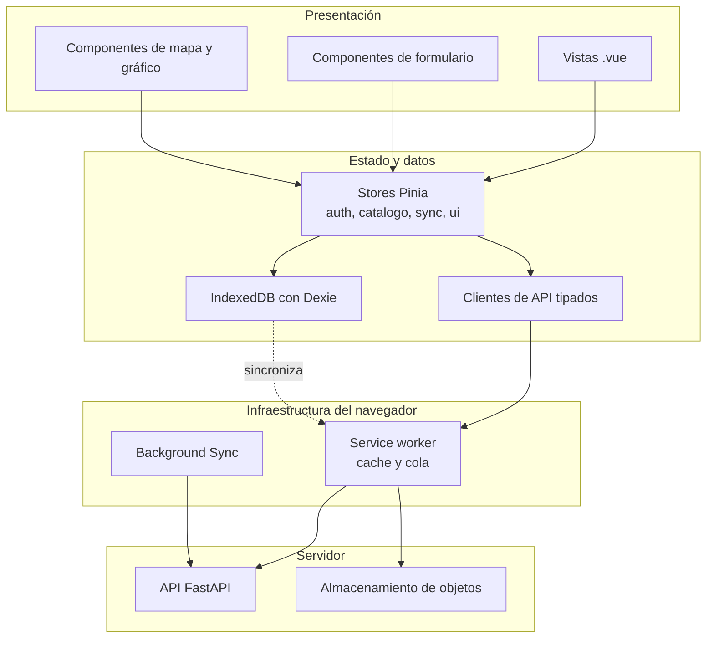
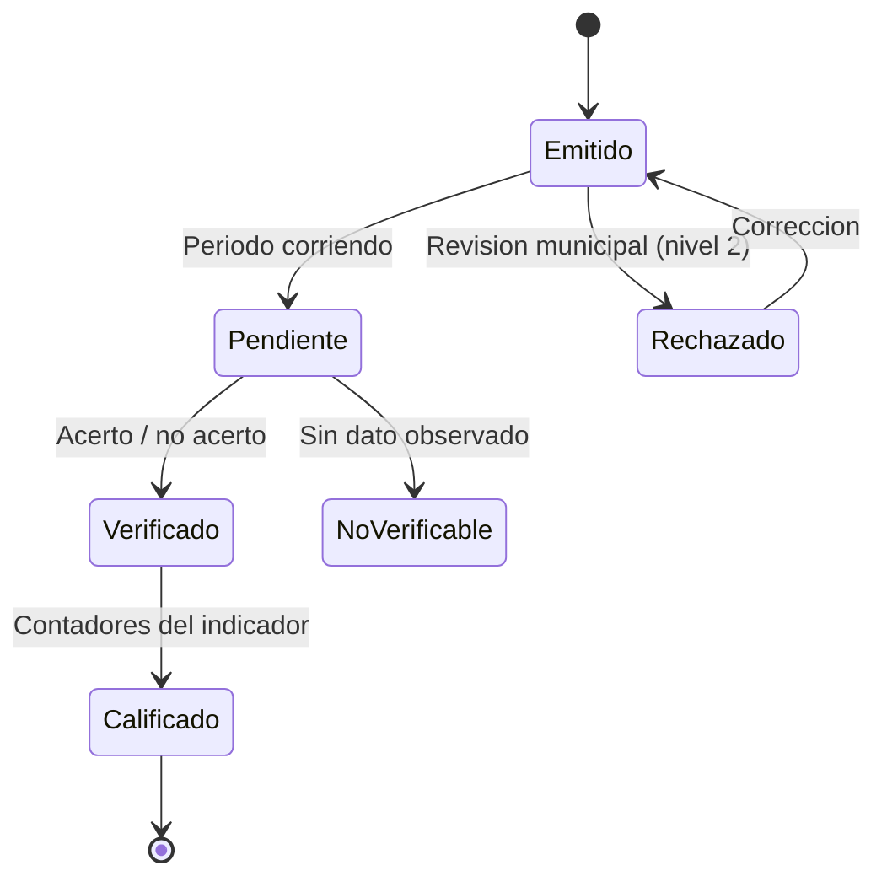
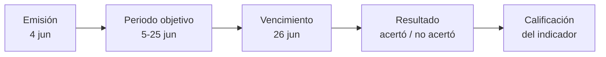
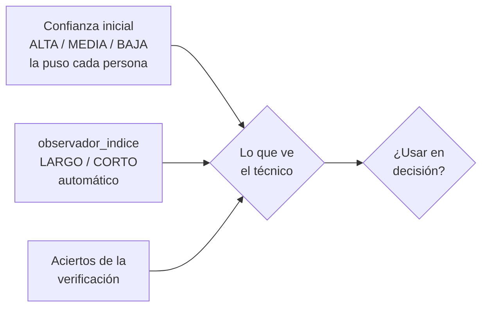
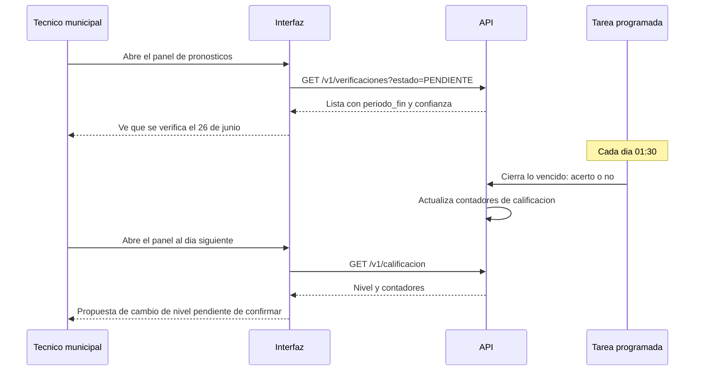
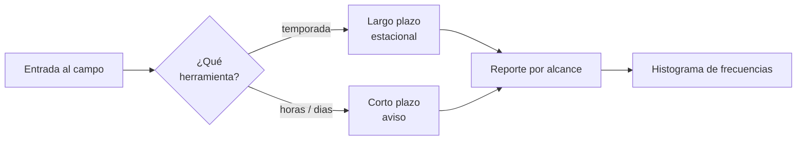
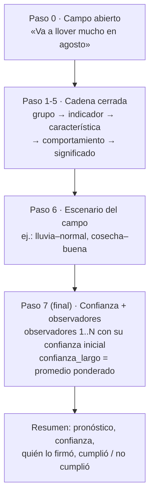
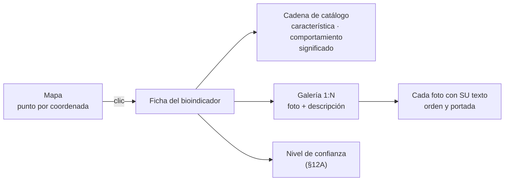

# 06 · Frontend Vue 3

Estructura, convenciones y decisiones de la SPA y de la PWA. El inventario de lo que ya existe está en [02-COMPONENTES-VISUALES.md](02-COMPONENTES-VISUALES.md); los contratos, en [05-APIS.md](05-APIS.md).

> **Contraste con la estructura actual del repositorio**: **no existe frontend en este repositorio** (sin `web/`, `src/` ni `package.json`). Esta propuesta se construye desde cero y su cliente HTTP apunta a los prefijos reales **`/api/v1`** y **`/api/v2`** de la API FastAPI existente. Las capacidades marcadas `[ACTUAL]`/`[DEFECTO]` describen el SINB legado de la VIDECI.

## Cómo leer este documento

| Marcador | Significado |
|---|---|
| `[ACTUAL]` | Comprobado en `web/` — *fuente del SINB legado (VIDECI), no incluida en este repositorio* |
| `[DEFECTO]` | Problema comprobado |
| `[MEJORA]` | Capacidad existente que se modifica |
| `[NUEVO]` | Capacidad que el SINB no tiene |
| `[DECIDIR]` | Requiere firma institucional |

---

## 0. La arquitectura en una figura



`[NUEVO]` El service worker es el que sabe salir a la API. La vista nunca hace peticiones directas: así el comportamiento es el mismo con red y sin ella.

---

## 1. Qué cambia y por qué

El frontend actual es Blade con jQuery, un Vue 2.0.3 cargado sin compilar y 65 librerías de terceros ([02-COMPONENTES-VISUALES.md §3](02-COMPONENTES-VISUALES.md)). Ninguna de esas piezas se reutiliza como código.

| Aspecto | Actual | Nuevo | Motivo |
|---|---|---|---|
| Renderizado | Servidor, Blade | SPA en el cliente | Necesario para captura offline, mapas y sincronización |
| Framework | Vue 2.0.3 sin compilar | Vue 3 con `<script setup>` | La versión actual es de 2016 y está comentada en el layout |
| Estado | `localStorage` y variables en Blade | Pinia, tipado y con persistencia | El estado actual no es observable ni depurable |
| Build | Ninguno | Vite 6 | HMR, tree-shaking, code splitting |
| CSS | Bootstrap 3 más CSS propio | Tailwind 3 más tokens propios | Sin jQuery, sin `!important` por todas partes |
| Rutas | Rutas Laravel con prefijo raíz | `createWebHashHistory` | Funciona en subdirectorio y tras instalar la PWA |
| Offline | No existe | Service worker más IndexedDB | Es el requisito principal del sistema |
| Errores | `alert()` y SweetAlert | Colores y mensajes en línea | `alert()` bloquea el hilo y no es accesible |

---

## 2. Estructura

```text
frontend/
├── index.html
├── vite.config.ts
├── tailwind.config.js
├── postcss.config.js
├── tsconfig.json
├── package.json
├── .env.example
├── public/
│   ├── favicon.svg
│   ├── pwa-192.png
│   ├── pwa-512.png
│   └── icons/
│       ├── evento-lluvia.png          <- reutilizado del inventario actual
│       ├── evento-helada.png
│       ├── evento-granizo.png
│       ├── evento-sequia.png
│       ├── evento-sismo.png
│       └── logo-prosudo.png
│
└── src/
    ├── main.ts                        <- punto de entrada, monta la app
    ├── App.vue                        <- shell: router-view mas layout
    ├── env.d.ts
    │
    ├── router/
    │   ├── index.ts
    │   └── guards.ts                  <- auth, rol, red
    │
    ├── stores/                        <- Pinia
    │   ├── auth.ts
    │   ├── catalogo.ts
    │   ├── sync.ts
    │   ├── formulario-diario.ts
    │   ├── observacion.ts
    │   ├── pronostico.ts
    │   ├── aviso.ts                        <- corto plazo: vigencia y confianza
    │   ├── alertas.ts
    │   ├── mapa.ts
    │   └── ui.ts
    │
    ├── composables/                   <- logica reutilizable, sin componente
    │   ├── useApi.ts
    │   ├── useColaOffline.ts
    │   ├── useIndexedDb.ts
    │   ├── useGeolocalizacion.ts
    │   ├── useVoz.ts
    │   ├── useIdioma.ts
    │   ├── useSincronizacion.ts
    │   └── useDebounce.ts
    │
    ├── api/                           <- un modulo por recurso
    │   ├── cliente.ts                 <- fetch, retry, idempotencia
    │   ├── auth.ts
    │   ├── catalogos.ts
    │   ├── formularios-diarios.ts
    │   ├── observaciones.ts
    │   ├── senales.ts
    │   ├── pronosticos.ts
    │   ├── validaciones.ts
    │   ├── sync.ts
    │   └── admin.ts
    │
    ├── tipos/                         <- tipos TypeScript por modulo
    │   ├── api.ts
    │   ├── dominio.ts
    │   ├── catalogo.ts
    │   ├── sync.ts
    │   └── ui.ts
    │
    ├── vistas/                        <- una por ruta
    │   ├── auth/Login.vue
    │   ├── auth/Recuperar.vue
    │   ├── panel/Panel.vue
    │   ├── panel/Resumen.vue
    │   ├── campo/Inicio.vue
    │   ├── campo/Formulario diario.vue
    │   ├── campo/Senal.vue
    │   ├── campo/Observacion.vue
    │   ├── campo/Comunidades.vue
    │   ├── tecnico/Pronosticos.vue
    │   ├── tecnico/Validaciones.vue
    │   ├── tecnico/Mapa.vue
    │   ├── investigacion/Confiabilidad.vue
    │   ├── investigacion/Cobertura.vue
    │   ├── admin/Usuarios.vue
    │   ├── admin/Auditoria.vue
    │   ├── admin/Campanas.vue
    │   └── admin/Catalogos.vue
    │
    ├── componentes/
    │   ├── ui/                        <- design system
    │   ├── campo/                     <- captura en terreno
    │   ├── mapa/
    │   ├── graficos/
    │   ├── offline/
    │   └── layout/
    │
    ├── estilos/
    │   ├── main.css
    │   ├── tokens.css                 <- variables del design system
    │   └── tipografia.css
    │
    ├── assets/
    │   └── audio/                     <- cacheados de piper
    │
    └── textos/
        └── es.ts                     <- único diccionario, en español
```

**Convención de carpetas**: `vistas` son rutas, `componentes` son piezas reutilizables, `composables` es lógica sin UI, `api` habla con el servidor, `stores` es estado compartido. Un componente de `componentes` nunca importa de `vistas`.

---

## 3. Dependencias

### 3.1 Runtime

| Paquete | Versión | Para qué |
|---|---|---|
| `vue` | 3.5 | Framework, con `<script setup>` |
| `vue-router` | 4.4 | Rutas, con `createWebHashHistory` |
| `pinia` | 2.2 | Estado global |
| `@vueuse/core` | 11 | `useOnline`, `useLocalStorage`, `useIntersectionObserver` |
| `leaflet` | 1.9 | Mapa base |
| `vue-leaflet` | 0.10 | Envoltorio de Leaflet para Vue 3 |
| `chart.js` | 4.4 | Gráficos de línea y barra |
| `vue-chartjs` | 5.3 | Envoltorio de Chart.js |
| `echarts` | 5.5 | Treemaps y mapas de calor |
| `@lucide/vue` | — | Iconos SVG como componentes |
| `dexie` | 4.0 | IndexedDB con API de promesas |
| `xlsx` | — | Exportación a Excel en el navegador |
| `date-fns` | 3.6 | Fechas |
| `zod` | 3.23 | Validación en el límite de la API |

### 3.2 Desarrollo

| Paquete | Para qué |
|---|---|
| `vite` 6 | Bundler y servidor de desarrollo |
| `@vitejs/plugin-vue` | Compilador de archivos `.vue` |
| `vite-plugin-pwa` | Service worker, manifiesto, actualizaciones |
| `tailwindcss` 3.4 | CSS utility-first |
| `postcss` y `autoprefixer` | Pipeline de Tailwind |
| `@tailwindcss/forms` | Estilos de formulario coherentes |
| `typescript` 5.6 | Tipado |
| `vue-tsc` | Verificación de tipos de los `.vue` |
| `vitest` | Tests unitarios |
| `@vue/test-utils` | Montaje de componentes en tests |
| `happy-dom` | DOM para tests |
| `fake-indexeddb` | IndexedDB en tests |
| `msw` | Mock de la API en tests |
| `eslint` y `prettier` | Lint y formato |

### 3.3 Dependencias explícitamente excluidas

| Paquete | Por qué no |
|---|---|
| `bootstrap` | jQuery por debajo, y el soporte Vue 3 es un proyecto aparte |
| `jquery` | Nada de jQuery. Los eventos y el DOM se hacen con Vue y `fetch` |
| `jqvmap` | Mapa de municipios como imagen: sin zoom, sin pan, sin capas |
| `datejs` | 34 MB por un formateo de fechas. `date-fns` pesa 15 KB |
| `sweetalert2` | Bloquea el hilo, no es accesible, imposible de alinear con el diseño |
| `toastr` y `pnotify` | El actual ya tiene tres sistemas de notificación superpuestos |
| `moment` | Mutable y pesado |

> El sistema actual carga SweetAlert2, Toastr y PNotify a la vez, más Font Awesome 4 local y Font Awesome 5 por CDN ([02-COMPONENTES-VISUALES.md §3](02-COMPONENTES-VISUALES.md)). El nuevo tiene **un** sistema de notificaciones y **un** set de iconos.

---

## 4. Vite

```ts
// vite.config.ts
import { defineConfig } from 'vite'
import vue from '@vitejs/plugin-vue'
import { VitePWA } from 'vite-plugin-pwa'
import { fileURLToPath, URL } from 'node:url'

export default defineConfig({
  plugins: [
    vue(),
    VitePWA({
      registerType: 'prompt',
      includeAssets: ['favicon.svg', 'icons/*.png'],
      manifest: {
        name: 'SINB - Bioindicadores',
        short_name: 'SINB',
        description: 'Captura de bioindicadores en campo',
        lang: 'es',
        theme_color: '#1abb9c',
        background_color: '#f5f7fa',
        display: 'standalone',
        orientation: 'portrait',
        icons: [
          { src: 'pwa-192.png', sizes: '192x192', type: 'image/png' },
          { src: 'pwa-512.png', sizes: '512x512', type: 'image/png' },
          { src: 'pwa-512.png', sizes: '512x512', type: 'image/png', purpose: 'maskable' },
        ],
        shortcuts: [
          { name: 'Formulario diario de hoy', url: '#/campo/formulario-diario' },
          { name: 'Registrar seña', url: '#/campo/senal' },
        ],
      },
      workbox: {
        globPatterns: ['**/*.{js,css,html,svg,png,woff2}'],
        runtimeCaching: [
          {
            urlPattern: /\/api\/v1\/(catalogos|municipios|comunidades|ecorregiones|bioindicadores)/,
            handler: 'NetworkFirst',
            options: {
              cacheName: 'catalogos',
              expiration: { maxEntries: 60, maxAgeSeconds: 60 * 60 * 24 * 30 },
              networkTimeoutSeconds: 5,
            },
          },
          {
            urlPattern: /\/api\/v1\/(formularios-diarios|observaciones)/,
            handler: 'NetworkFirst',
            options: {
              cacheName: 'lecturas',
              expiration: { maxEntries: 200, maxAgeSeconds: 60 * 60 * 24 },
              networkTimeoutSeconds: 10,
            },
          },
        ],
        navigateFallback: 'index.html',
        navigateFallbackDenylist: [/^\/api\//],
      },
    }),
  ],
  resolve: {
    alias: { '@': fileURLToPath(new URL('./src', import.meta.url)) },
  },
  build: {
    target: 'es2022',
    sourcemap: true,
    chunkSizeWarningLimit: 300,
    rollupOptions: {
      output: {
        manualChunks: {
          vue: ['vue', 'vue-router', 'pinia'],
          leaflet: ['leaflet', 'vue-leaflet'],
          charts: ['chart.js', 'vue-chartjs'],
          echarts: ['echarts'],
          xlsx: ['xlsx'],
        },
      },
    },
  },
})
```

### 4.1 Chunking

| Chunk | Contenido | Cuándo se carga |
|---|---|---|
| `index` | Bootstrap, router, shell | Siempre |
| `vue` | Vue, Router, Pinia | Con el index |
| `leaflet` | Mapa | Solo en rutas con mapa |
| `charts` | Chart.js | Solo en rutas con gráfico |
| `echarts` | ECharts | Solo en confiabilidad y cobertura |
| `xlsx` | SheetJS | Solo al exportar |

El campo sin señal descarga `index` y `vue`, y nada más. `leaflet`, `charts` y `echarts` no se piden nunca en el PWA de captura.

---

## 5. Enrutado

```ts
// src/router/index.ts
import { createRouter, createWebHashHistory } from 'vue-router'

export const router = createRouter({
  history: createWebHashHistory(),
  routes: [
    { path: '/login', name: 'login', component: () => import('@/vistas/auth/Login.vue') },

    {
      path: '/campo',
      component: () => import('@/vistas/campo/Comunidades.vue'),
      meta: { requiereAuth: true, offline: true },
      children: [
        { path: '', name: 'campo-inicio', component: () => import('@/vistas/campo/Inicio.vue'), meta: { offline: true } },
        { path: 'formulario-diario', name: 'formulario-diario', component: () => import('@/vistas/campo/Formulario diario.vue'), meta: { offline: true } },
        { path: 'senal', name: 'senal', component: () => import('@/vistas/campo/Senal.vue'), meta: { offline: true } },
        { path: 'observacion', name: 'observacion', component: () => import('@/vistas/campo/Observacion.vue'), meta: { offline: true } },
        { path: 'pronostico', name: 'pronostico-largo', component: () => import('@/vistas/campo/PronosticoLargo.vue'), meta: { offline: true, herramienta: 'largo' } },
        { path: 'aviso', name: 'aviso', component: () => import('@/vistas/campo/Aviso.vue'), meta: { offline: true, herramienta: 'corto' } },
      ],
    },

    {
      path: '/tecnico',
      meta: { requiereAuth: true, permiso: 'tecnico.acceder' },
      children: [
        { path: 'pronosticos', name: 'pronosticos', component: () => import('@/vistas/tecnico/Pronosticos.vue') },
        { path: 'validaciones', name: 'validaciones', component: () => import('@/vistas/tecnico/Validaciones.vue') },
        { path: 'avisos', name: 'avisos', component: () => import('@/vistas/tecnico/Avisos.vue') },
        { path: 'observadores', name: 'observadores', component: () => import('@/vistas/tecnico/Observadores.vue') },
        { path: 'mapa', name: 'mapa', component: () => import('@/vistas/tecnico/Mapa.vue') },
      ],
    },

    { path: '/panel', name: 'panel', component: () => import('@/vistas/panel/Panel.vue'), meta: { requiereAuth: true } },
    { path: '/investigacion/confiabilidad', name: 'confiabilidad', component: () => import('@/vistas/investigacion/Confiabilidad.vue'), meta: { requiereAuth: true, permiso: 'confiabilidad.ver' } },
    { path: '/admin/usuarios', name: 'admin-usuarios', component: () => import('@/vistas/admin/Usuarios.vue'), meta: { requiereAuth: true, permiso: 'admin.usuarios' } },
    { path: '/:pathMatch(.*)*', name: 'no-encontrado', component: () => import('@/vistas/NoEncontrado.vue') },
  ],
  scrollBehavior: () => ({ top: 0 }),
})
```

### 5.1 Por qué `createWebHashHistory`

El sistema actual tiene rutas con prefijo raíz `/` y `asset()` sin base configurable: se rompe al desplegar en subdirectorio ([docs/AUDITORIA.md §5.6](../docs/AUDITORIA.md)). Con hash history la SPA funciona en raíz, en subdirectorio, detrás de un proxy y **sin servidor** una vez instalada como PWA.

| Enfoque | URL | Problema |
|---|---|---|
| `createWebHistory` | `/campo/formulario-diario` | Necesita reconfigurar el servidor en cada ruta. Rompe al instalar la PWA |
| **`createWebHashHistory`** | `/#/campo/formulario-diario` | Funciona en los cuatro escenarios. La URL es menos bonita |
| `createMemoryHistory` | `/` | Solo para renderizado en servidor. No sirve aquí |

### 5.2 Guardas

```ts
// src/router/guards.ts
router.beforeEach((to) => {
  const auth = useAuthStore()

  if (to.meta.requiereAuth && !auth.autenticado) {
    return { name: 'login', query: { redirigir: to.fullPath } }
  }

  if (to.meta.permiso && !auth.tienePermiso(to.meta.permiso as string)) {
    // No se redirige a otra ruta protegida: vuelve al panel con aviso
    return { name: 'panel', query: { error: 'sin_permiso' } }
  }

  if (to.meta.offline === false && !useSyncStore().enLinea) {
    return { name: 'campo-inicio' }
  }

  return true
})
```

La autorización de la UI **no es seguridad**, solo comodidad de uso. La autoridad real está en el servidor: el permiso del endpoint y el RLS ([09-SEGURIDAD.md §3](09-SEGURIDAD.md)). Un `v-if` no protege nada.

---

## 6. Estado con Pinia

### 6.1 Store de autenticación

```ts
// src/stores/auth.ts
export const useAuthStore = defineStore('auth', () => {
  const usuario = ref<Usuario | null>(null)
  const permisos = ref<Set<string>>(new Set())
  const municipios = ref<Municipio[]>([])
  const accessToken = ref<string | null>(null)   // solo en memoria
  const cargando = ref(true)

  const autenticado = computed(() => usuario.value !== null)
  const esTecnico = computed(() => usuario.value?.rol === 'tecnico')
  const esAdministrador = computed(() => usuario.value?.rol === 'administrador')

  function tienePermiso(codigo: string): boolean {
    return permisos.value.has(codigo)
  }

  async function cargar(): Promise<void> {
    try {
      const r = await api.auth.reintentarRefresh()
      usuario.value = r.usuario
      permisos.value = new Set(r.permisos)
      municipios.value = r.municipios
      accessToken.value = r.access_token
    } catch {
      usuario.value = null
    } finally {
      cargando.value = false
    }
  }

  return { usuario, permisos, municipios, accessToken, autenticado, esTecnico, esAdministrador, tienePermiso, cargar }
})
```

### 6.2 Store de catálogo

```ts
// src/stores/catalogo.ts
export const useCatalogoStore = defineStore('catalogo', () => {
  const version = ref<number>(0)
  const ecorregiones = ref<Ecorregion[]>([])
  const bioindicadores = ref<Bioindicador[]>([])
  const municipios = ref<Municipio[]>([])
  const comunidades = ref<Comunidad[]>([])
  const cargando = ref(false)

  const bioindicadoresPorCategoria = computed(() =>
    bioindicadores.value.reduce<Record<string, Bioindicador[]>>((acc, b) => {
      (acc[b.categoria] ??= []).push(b)
      return acc
    }, {}),
  )

  async function sincronizarSiHaceFalta(): Promise<void> {
    if (cargando.value) return

    const { version: vServidor } = await api.catalogos.version()
    if (vServidor === version.value) return   // no hay cambios

    cargando.value = true
    try {
      const c = await api.catalogos.todos()
      version.value = c.version
      ecorregiones.value = c.ecorregiones
      bioindicadores.value = c.bioindicadores
      municipios.value = c.municipios
      comunidades.value = c.comunidades
      await db.catalogos.reemplazar(c)          // a IndexedDB para arrancar offline
    } finally {
      cargando.value = false
    }
  }

  async function cargarDeLocal(): Promise<void> {
    const c = await db.catalogos.leer()
    if (!c) return
    version.value = c.version
    ecorregiones.value = c.ecorregiones
    bioindicadores.value = c.bioindicadores
    municipios.value = c.municipios
    comunidades.value = c.comunidades
  }

  return { version, ecorregiones, bioindicadores, municipios, comunidades, bioindicadoresPorCategoria, sincronizarSiHaceFalta, cargarDeLocal }
})
```

### 6.3 Store de sincronización

```ts
// src/stores/sync.ts
export const useSyncStore = defineStore('sync', () => {
  const enLinea = ref(navigator.onLine)
  const sincronizando = ref(false)
  const cola = ref<OperacionCola[]>([])
  const conflictos = ref<Conflicto[]>([])
  const ultimoCursor = ref<string | null>(null)
  const ultimaSync = ref<Date | null>(null)

  const pendientes = computed(() => cola.value.length)
  const hayConflictos = computed(() => conflictos.value.length > 0)

  async function encolar(op: OperacionCola): Promise<void> {
    await db.cola.agregar(op)
    cola.value = await db.cola.listar()
    if (enLinea.value) void sincronizar()      // no espera: la captura no se bloquea
  }

  async function sincronizar(): Promise<void> {
    if (!enLinea.value || sincronizando.value || cola.value.length === 0) return

    sincronizando.value = true
    try {
      while (cola.value.length > 0) {
        const lote = cola.value.slice(0, 200)
        const r = await api.sync.push({ cliente_id: db.clienteId, operaciones: lote })

        await db.cola.eliminar(r.aceptadas)
        conflictos.value.push(...r.conflictos)

        cola.value = await db.cola.listar()
        ultimoCursor.value = r.cursor_pull
      }
      await api.sync.pull(ultimoCursor.value)
      ultimaSync.value = new Date()
    } catch (e) {
      // 429 y 5xx dejan la cola intacta; se reintenta con backoff
      if (esReintentable(e)) programarReintento()
    } finally {
      sincronizando.value = false
    }
  }

  return { enLinea, sincronizando, cola, conflictos, ultimoCursor, ultimaSync, pendientes, hayConflictos, encolar, sincronizar }
})
```

**Detalle de diseño**: `encolar` no espera a la red. La captura se guarda en IndexedDB y retorna. Si hay red, sube en segundo plano. La interfaz nunca se bloquea por una petición, y ese es el motivo por el que la app funciona en el campo.

### 6.4 Persistencia

| Store | Persistencia | Motivo |
|---|---|---|
| `auth` | `accessToken` en memoria, `refreshToken` en IndexedDB cifrado | Evita que un XSS robe una sesión permanente |
| `catalogo` | IndexedDB | Necesario para arrancar sin red |
| `sync` | IndexedDB | La cola **debe** sobrevivir al cierre de la app |
| `formulario-diario` | Ninguna | Estado de formulario, se pierde sin daño |
| `mapa` | `sessionStorage` | Solo posición de capas |
| `ui` | `localStorage` | Preferencias de tema, densidad e idioma |

---

## 7. Cliente HTTP

```ts
// src/api/cliente.ts
export async function apiFetch<T>(ruta: string, opciones: RequestInit = {}): Promise<T> {
  const auth = useAuthStore()

  const cabeceras = new Headers(opciones.headers)
  cabeceras.set('Accept', 'application/json')
  if (auth.accessToken) cabeceras.set('Authorization', `Bearer ${auth.accessToken}`)
  if (db.clienteId) cabeceras.set('X-Client-Id', db.clienteId)

  let respuesta = await fetch(`${config.apiBase}${ruta}`, { ...opciones, headers: cabeceras })

  // Un solo refresh, transparente, y solo si no era un refresh
  if (respuesta.status === 401 && !ruta.includes('/auth/refresh')) {
    const r = await api.auth.reintentarRefresh()
    auth.accessToken = r.access_token
    cabeceras.set('Authorization', `Bearer ${r.access_token}`)
    respuesta = await fetch(`${config.apiBase}${ruta}`, { ...opciones, headers: cabeceras })
  }

  if (respuesta.status === 204) return undefined as T

  const cuerpo = await respuesta.json().catch(() => null)

  if (!respuesta.ok) {
    throw new ErrorApi(cuerpo?.error ?? {
      codigo: 'INTERNO',
      mensaje: 'Error inesperado',
      request_id: respuesta.headers.get('X-Request-Id'),
    })
  }

  return cuerpo as T
}
```

### 7.1 Reintentos

| Situación | Reintento | Motivo |
|---|---|---|
| `5xx` | Sí, exponencial hasta 5 intentos | Fallo del servidor, suele ser transitorio |
| Red caída | Sí, indefinido con tope de 5 minutos | El PWA espera a que vuelva la señal |
| `429` | **No** | El servidor dice cuándo. Reintentar antes empeora |
| `4xx` | **No** | El error es del cliente. Reintentar da el mismo resultado |
| `401` tras refresh | No, una sola vez | Si persiste, es sesión inválida |

### 7.2 Errores tipados en el cliente

```ts
export class ErrorApi extends Error {
  constructor(public readonly e: {
    codigo: string
    mensaje: string
    detalles?: Record<string, unknown>
    request_id?: string
  }) {
    super(e.mensaje)
    this.name = 'ErrorApi'
  }
}
```

El componente decide qué pintar comparando `codigo`, nunca el mensaje. El mensaje es para el usuario final y cambia con el idioma.

---

## 8. IndexedDB

```ts
// src/composables/useIndexedDb.ts
import Dexie, { type Table } from 'dexie'

interface OperacionCola {
  id: string              // UUIDv7 generado en el dispositivo
  tipo: 'formulario-diario' | 'observacion' | 'senal' | 'pronostico' | 'foto'
  datos: Record<string, unknown>
  autor_id: string
  creada_at: string
  intentos: number
  ultimo_error?: string
}

class SinbDB extends Dexie {
  cola!: Table<OperacionCola, string>
  catalogos!: Table<{ id: string; payload: unknown }, string>
  borradores!: Table<{ id: string; datos: unknown }, string>

  constructor() {
    super('sinb')
    this.version(1).stores({
      cola: 'id, tipo, creada_at, autor_id',
      catalogos: 'id',
      borradores: 'id',
    })
  }
}

export const db = new SinbDB()
```

### 8.1 Qué se guarda y qué no

| Dato | En IndexedDB | Motivo |
|---|---|---|
| Capturas pendientes de subir | Sí | Si se pierde, se pierde evidencia de campo |
| Catálogos | Sí | Sin ellos no se puede arrancar offline |
| Fechas ya registradas | Sí | Evita capturar dos veces el mismo día |
| Borradores de formulario | Sí | Una captura de 5 minutos no se pierde al cerrar la app |
| Token de acceso | No | Va en memoria |
| Fotos pendientes | Sí, como `Blob` | Se sube después del `push`, en segundo plano |
| Datos ya sincronizados | No | Se piden al servidor con `NetworkFirst` |

---

## 9. PWA

### 9.1 Registro

```ts
// src/main.ts
import { registerSW } from 'virtual:pwa-register'

const updateSW = registerSW({
  onNeedRefresh() {
    // No se recarga sola. En el campo, recargar a mitad de una captura
    // perdería lo escrito. Se pregunta.
    useUiStore().notificarActualizacion(updateSW)
  },
  onOfflineReady() {
    useUiStore().notificar('La aplicacion ya funciona sin conexion', 'exito')
  },
})
```

### 9.2 Estrategias de caché

| Recurso | Estrategia | Motivo |
|---|---|---|
| Shell, JS, CSS | `Precache` | Todo el bundle queda disponible al instalar |
| Catálogos | `NetworkFirst`, 5 s | Los datos frescos mandan, pero sin red se usa el caché |
| Lecturas propias | `NetworkFirst`, 10 s | Ídem, con más tolerancia a red lenta |
| Fotos propias | `CacheFirst` | Una foto no cambia. Caché primero |
| Navegación | `index.html` | La SPA resuelve la ruta |
| `/api/v1/**` no catalogado | **Sin caché** | Un dato no cacheado explícitamente no se sirve de caché |

La última fila importa: sin ella, el `NetworkFirst` por defecto de Workbox cachearía **todas** las peticiones, incluidas las de otros municipios. El RLS del servidor seguiría protegiendo, pero se filtraría información por el `Cache-Control` del proxy.

### 9.3 Detección de red

```ts
// src/composables/useSincronizacion.ts
const enLinea = useOnline()   // de @vueuse/core

watch(enLinea, (nuevo) => {
  if (nuevo) {
    void useSyncStore().sincronizar()
  } else {
    useUiStore().notificar('Sin conexion. Las capturas se guardan en el dispositivo', 'info', 5000)
  }
})
```

`navigator.onLine` solo dice si hay interfaz de red, no si hay internet. La comprobación real la hace el primer `fetch`: si falla, se trata como offline aunque `onLine` diga `true`.

### 9.4 Instalación

```ts
const promptInstalacion = ref<BeforeInstallPromptEvent | null>(null)

onMounted(() => {
  window.addEventListener('beforeinstallprompt', (e) => {
    e.preventDefault()
    promptInstalacion.value = e as BeforeInstallPromptEvent
  })
})

async function instalar() {
  await promptInstalacion.value?.prompt()
  const { outcome } = await promptInstalacion.value?.userChoice
  if (outcome === 'accepted') useUiStore().notificar('Aplicacion instalada', 'exito')
}
```

El botón de instalar **solo** aparece cuando el navegador emite `beforeinstallprompt`. Un botón que no hace nada en un iPhone es peor que no tener botón.

---

## 10. Tailwind

### 10.1 Configuración

```js
// tailwind.config.js
export default {
  content: ['./index.html', './src/**/*.{vue,ts}'],
  theme: {
    extend: {
      colors: {
        primary: {
          50: '#e8f8f5', 100: '#c4ede5', 200: '#8fdccc',
          300: '#5acbb2', 400: '#2eb99c', 500: '#1abb9c',
          600: '#14a588', 700: '#0f8770', 800: '#0a6857',
          900: '#054a3d',
        },
        secondary: { DEFAULT: '#34495e', light: '#5d6d7e', dark: '#2c3e50' },
        alerta:   { DEFAULT: '#e74c3c', suave: '#fde2e1' },
        info:     { DEFAULT: '#3498db', suave: '#dceefb' },
        exito:    { DEFAULT: '#27ae60', suave: '#e8f4ea' },
        aviso:    { DEFAULT: '#f39c12', suave: '#fdf3e7' },
        superficie: '#ffffff',
        fondo:     '#f5f7fa',
        texto:     '#2c3e50',
        textoSuave:'#7f8c8d',
      },
      fontFamily: {
        sans: ['Inter', 'system-ui', 'sans-serif'],
        mono: ['JetBrains Mono', 'monospace'],
      },
      spacing: { toque: '48px' },
      minHeight: { toque: '48px' },
      minWidth: { toque: '48px' },
    },
  },
  plugins: [require('@tailwindcss/forms')],
}
```

### 10.2 La regla de los 48 píxeles

```css
/* src/estilos/tokens.css */
:root {
  /* Objetivos tactiles. En campo se usa con guantes y a pleno sol */
  --min-touch: 48px;
  --min-touch-grande: 64px;

  /* Jerarquia de espaciado en multiplos de 4 */
  --esp-1: 4px;  --esp-2: 8px;  --esp-3: 12px;
  --esp-4: 16px; --esp-5: 24px; --esp-6: 32px;

  /* Radios */
  --radio-sm: 4px; --radio: 8px; --radio-lg: 12px;

  /* Sombras, derivadas de la paleta actual */
  --sombra-1: 0 1px 2px rgb(44 62 80 / 0.08);
  --sombra-2: 0 2px 8px rgb(44 62 80 / 0.10);
  --sombra-3: 0 8px 24px rgb(44 62 80 / 0.14);
}
```

Un botón de 32 píxeles es cómodo con un ratón y se queda corto con un dedo. En campo el mínimo es 48, y los controles principales del Formulario diario, 64.

---

## 11. Textos en español

```ts
// src/textos/index.ts — único módulo de cadenas, en español
import es from './es'

export const t = (clave: string, params?: Record<string, string | number>): string => {
  const texto: unknown = clave.split('.').reduce<unknown>(
    (acc, k) => (acc as Record<string, unknown>)?.[k], es)
  if (typeof texto !== 'string') {
    if (import.meta.env.DEV) console.warn(`[textos] falta la clave ${clave}`)
    return clave
  }
  return params
    ? Object.entries(params).reduce((s, [k, v]) => s.replace(`{${k}}`, String(v)), texto)
    : texto
}
```

```ts
// src/textos/es.ts
export default {
  campo: {
    formularioDiario: {
      titulo: 'Formulario diario de hoy',
      lluvia: 'Lluvia',
      helada: 'Helada',
      granizo: 'Granizo',
      viento: 'Viento',
      leve: 'Leve',
      moderada: 'Moderada',
      fuerte: 'Fuerte',
      guardar: 'Guardar',
      guardado: 'Guardado en el dispositivo',
    },
    offline: {
      pendiente: '{n} captura pendiente de subir',
      sincronizado: 'Todo sincronizado',
      conflicto: '{n} captura en conflicto',
    },
  },
}
```

| Regla | Detalle |
|---|---|
| Un solo diccionario | Todo en español, sin idiomas ni `Accept-Language` |
| Una cadena, una clave | La clave describe el significado, no la posición |
| Interpolación con `{}` | Nunca texto ya concatenado |
| Cobertura en CI | Un test falla si una plantilla usa una clave que no existe |

`[NUEVO]` Los **nombres de especies** no pasan por aquí: se escriben como los conoce la persona — en su idioma si así lo conoce — y se guardan como dato (`indicador_natural.nombre`, `sinonimo_indicador`) ([11 §3](11-INTERCULTURALIDAD.md#31-un-indicador-tiene-varios-nombres)).

Reglas y decisiones en [11-INTERCULTURALIDAD.md §2](11-INTERCULTURALIDAD.md#2-un-solo-idioma-español).

---

## 12A. Cómo se ve la verificación en pantalla `[NUEVO]`

La verificación es **básica**: al vencer el periodo se resuelve acertó / no acertó. Lo que la interfaz tiene que hacer visible es **cuándo se verifica**, **con qué confianza** se emitió y **qué nivel** tiene el indicador en ese ámbito.

### 12A.1 El estado de un pronóstico



`[NUEVO]` `NoVerificable` es un estado visible con su motivo, no un error: el sistema dice que no pudo concluir y por qué. `Rechazado` es la revisión del nivel 2, no una restricción de ventana.

### 12A.2 La ficha de un pronóstico pendiente

| Campo | Ejemplo | Por qué se muestra |
|---|---|---|
| Herramienta | Largo plazo | Para qué sirve: estacional o aviso |
| Indicador | Zorro | Con su nombre en español junto al nombre científico |
| Periodo objetivo | 5 a 25 de junio | Lo que el pronóstico cubre |
| Se verifica el | 26 de junio | El día exacto, no «en algún momento» |
| Estado | Pendiente | Con color e icono, nunca solo color |
| Confianza | MEDIA (0,700) | La que pusieron los observadores, calculada en el servidor |
| Observadores | 3 | Quiénes lo firmaron |

`[NUEVO]` La columna «Se verifica el» es la que materializa el requisito: una persona ve que el pronóstico del 4 de junio no se cierra hasta el 26, porque su periodo termina el 25.

### 12A.3 La línea de tiempo



### 12A.4 El panel de calificación

| Nivel | Color | Texto bajo la pastilla | Qué puede hacer el técnico |
|---|---|---|---|
| `EN_VERIFICACION` | Gris | Pocos registros o sin verificaciones | Registrar observaciones |
| `USABLE` | Verde | Verificaciones consistentes | Usar en decisión |
| `REVISAR` | Ámbar | Requiere revisión, con nota | Ver la nota; decidir si vuelve a usarse |

`[NUEVO]` Los tres niveles son los que muestra la API ([05 §4.6](05-APIS.md)) y los que existen en la base ([04 §14.3](04-BASE-DE-DATOS.md#143-calificacion_indicador-tres-niveles-nuevo)). El cambio de nivel nunca lo hace la sola máquina: la tarea propone y una persona confirma.

### 12A.5 Confiabilidad a la vista



`[NUEVO]` Tres piezas, sin número mágico: la confianza que puso la gente, el índice automático del observador y cuánto acertó el indicador. Un número solo, sin explicación, no ayuda a decidir una siembra.

`[NUEVO]` El `pronostico_digital` **no tiene confianza**: es control y ayuda. Aparece aparte, con su etiqueta, para que nadie lo confunda con un pronóstico certificado.

### 12A.6 El ciclo visto desde la interfaz



---

## 12B. Las dos herramientas y el asistente en pantalla `[NUEVO]`

`[NUEVO]` El sistema tiene **dos herramientas de pronóstico** y el productor elige una al entrar. Los nombres son `[DECIDIR]`.

### 12B.1 Las dos herramientas en la navegación

| Herramienta | Ruta | Qué levanta | Confianza |
|---|---|---|---|
| **Largo plazo** (estacional) | `/campo/pronostico` | Pronóstico de temporada, cadena de catálogo íntegra | `confianza_largo` (por observador, ALTA/MEDIA/BAJA) |
| **Corto plazo · Avisos** | `/campo/aviso` | «Va a granizar» en su localidad, con vigencia | `confianza_corto` (misma mecánica, tipo CORTO) |



### 12B.2 El asistente de registro (largo plazo)



| Pantalla | Qué muestra |
|---|---|
| **Paso 0** | Un cuadro de texto libre, sin autocorrección: la frase queda **tal cual** en `pronostico_libre` |
| **Pasos 1–5** | Selectores encadenados sobre la frase ya registrada; nunca la reescriben |
| **Paso 6** | Escenarios del campo con probabilidad |
| **Paso 7** | Lista de observadores con nombre + confianza inicial; botón **«Añadir observador»** (auto-registro o en representación) |
| **Resumen final** | Confianza del pronóstico, nombres de los observadores y, después de verificar, **cumplió / no cumplió por registro** |

### 12B.3 Pantalla de observadores

`[NUEVO]` El recolector **destaca a los observadores locales**. En `/tecnico/observadores`:

| Elemento | Detalle |
|---|---|
| Nombre destacado | Quien emitió el pronóstico, visible siempre (consentimiento: [11](11-INTERCULTURALIDAD.md)) |
| Confianza inicial | Badge `ALTA` / `MEDIA` / `BAJA` — **dato que la persona puso**, no cambia solo |
| Índice automático | Badge numérico con etiqueta **LARGO** o **CORTO**, separados |
| Sin datos | Con `n_emitidos = 0` se muestra **«sin datos»**, nunca «0 puntos» |
| Historial | Aciertos y fallos por registro, con fecha |

### 12B.4 Pantalla del aviso (corto plazo)

| Elemento | Detalle |
|---|---|
| Texto libre | «Siento el ambiente húmedo… va a granizar» — se guarda tal cual |
| Geografía | Nombre de la comunidad + punto + geografías heredadas |
| Vigencia | Barra de tiempo restante (24 h por defecto); al vencer cambia a **VENCIDO** |
| Verificación | Tres estados que elige el técnico: `CUMPLIO` / `NO_CUMPLIO` / `SIN_DATOS` |
| Ayuda digital | Panel **solo lectura** con el pronóstico digital — *control y ayuda*, nunca certifica |

### 12B.5 Histograma y reportes

`[NUEVO]` **Histograma de frecuencia de pronósticos**: barras por área (municipio, departamento, zona) con contadores por estado — alimenta las gráficas de reporte.

`[NUEVO]` **Reportes por alcance**: comunidad → municipio → región → nacional. Cada reporte se ordena **en el tiempo** (temporalidad siempre presente); ejemplos típicos: indicadores de marzo a noviembre, pronósticos de noviembre a abril siguiente — son **ventanas de ejemplo**, no reglas ([07 §9.8](07-FLUJOS-BIOCULTURALES.md)).

---

## 12C. Bioindicadores: mapa, coordenadas y fotos `[NUEVO]`

`[NUEVO]` **Lo que ya se hace**: los bioindicadores se visualizan en el mapa **con sus coordenadas** (punto de la comunidad o del registro, `geometry(Point, 4326)`). **Lo que falta**: la foto. Se cierra con una galería **1:N**: un indicador, muchas fotos, **cada una con su descripción**.

### 12C.1 La ficha del bioindicador



| Elemento | Qué muestra |
|---|---|
| Mapa | Punto por coordenada + popup con nombre local, foto portada y nivel |
| **Galería** | Miniaturas en `orden`; al abrir, foto grande **con su descripción** debajo |
| Añadir foto | Cámara o galería del teléfono → sube directo a MinIO → descripción **obligatoria** ([05 §4.10](05-APIS.md)) |
| Editar | Solo la descripción/orden de **esa** foto; no se edita el texto de otra |
| Consentimiento | Si aparece una persona, se pide consentimiento antes de publicar ([11](11-INTERCULTURALIDAD.md)) |
| Sin conexión | Miniaturas vienen con el catálogo; la subida espera red ([08](08-OFFLINE-SINCRONIZACION.md)) |
| Vacío | Estado «sin fotos todavía» con botón — nunca un hueco roto |

### 12C.2 Reglas de la galería

| Regla | Detalle |
|---|---|
| **1:N** | Relación de un bioindicador con N fotos; el texto **no se comparte**: cada fila de `evidencia` tiene su `descripcion` |
| **Descripción obligatoria** | El formulario no deja confirmar la foto sin texto (validación cliente y servidor) |
| **Portada** | La foto con `orden = 0` es la que aparece en el popup y en los reportes |
| **Reuso** | Una foto hecha en una observación puede «promoverse» a la galería del indicador sin volver a subirla |
| **Temporalidad** | Cada foto conserva su fecha (EXIF si existe) — en las gráficas e informes siempre se ordena en el tiempo |

---

## 13. Accesibilidad

| Regla | Aplicación |
|---|---|
| Contraste | Mínimo 4.5:1 en texto normal. `#1abb9c` sobre blanco da 2.3:1, así que en texto se usa `primary-700` |
| Objetivos táctiles | 48 px mínimo, 64 px en los controles del Formulario diario |
| Foco visible | `:focus-visible` con anillo de 2 px en `primary-600`. Nunca `outline: none` sin reemplazo |
| Etiquetas | Cada input tiene `label` asociado. Los pictogramas tienen `aria-label` |
| Navegación por teclado | Todas las acciones del Formulario diario se completan con teclado |
| Anuncio de cambios | `aria-live="polite"` en el estado de la cola, para que un lector de pantalla anuncie "Guardado" |
| Movimiento | Se respeta `prefers-reduced-motion` |
| Errores | El texto del error se asocia al campo por `aria-describedby` |
| Color | La severidad de una alerta nunca se comunica **solo** con color. Lleva icono y texto |

> **Sobre el color de marca**: `#1abb9c` es el turquesa institucional actual y se mantiene en superficies, bordes y botones. Pero sobre blanco da 2.3:1, insuficiente para texto. Para texto se usa `primary-700` (`#0f8770`, 4.9:1). La marca se conserva sin sacrificar legibilidad.

---

## 14. Rendimiento

### 14.1 Presupuesto

| Recurso | Presupuesto | Medido contra |
|---|---|---|
| Bundle inicial, gzip | ≤ 120 KB | Objetivo 8 del [README](README.md) |
| Chunk `leaflet` | ≤ 160 KB | Solo en rutas con mapa |
| Chunk `echarts` | ≤ 320 KB | Solo en investigación |
| Chunk `xlsx` | ≤ 430 KB | Solo al exportar |
| LCP en 3G | < 2.5 s | Lighthouse móvil |
| CLS | < 0.1 | Sin salto de layout al cargar catálogos |
| TTI | < 3.5 s | |

### 14.2 Técnicas

| Técnica | Detalle |
|---|---|
| Code splitting por ruta | `import()` en cada `component` del router. Ninguna vista entra en el bundle inicial |
| Carga diferida de Leaflet | El mapa se monta al abrir la vista, con un placeholder de la altura correcta para no mover el layout |
| `shallowRef` en listas grandes | `ref` hace reactivo cada objeto. Con 5.000 comunidades, `shallowRef` evita 5.000 proxies |
| Filtros con `computed` | Un filtro por comunidad sobre 5.000 filas es instantáneo si está memoizado |
| Imágenes optimizadas | Fotos en WebP, `loading="lazy"`, `decoding="async"` |
| Tests en CI | Cada PR |

---

## 15. Convenciones

| Convención | Regla |
|---|---|
| Nombre de componente | `PascalCase`, un archivo, un componente |
| Props | `defineProps<T>()` tipado. Un componente sin props tipados no se aprueba |
| Emits | Declarados en el mismo `defineEmits<T>()`. Nunca `emit('cambio')` sin tipo |
| Composición | `<script setup>` siempre. Sin Options API |
| Estado local | `ref` y `computed`. Un store solo si el estado se comparte |
| Efectos | `watchEffect` con limpieza explícita. Sin `@ts-ignore` |
| Eventos | `emits` hacia arriba. Nunca mutar props |
| CSS | Clases de Tailwind. `scoped` solo si el componente necesita una animación específica |
| Accesibilidad | `alt`, `label` y `aria-label` obligatorios en la revisión |
| Textos | Ninguna cadena literal en la plantilla. Todo por `t()` de `src/textos` |
| Imports | Alias `@/`. Nunca rutas relativas largas |
| Tests | Comportamiento de usuario y transición de estado, no detalles de implementación |

---

## 16. Ver también

- [02-COMPONENTES-VISUALES.md](02-COMPONENTES-VISUALES.md) — inventario, design system y catálogo de componentes
- [05-APIS.md](05-APIS.md) — los contratos que consume este cliente
- [08-OFFLINE-SINCRONIZACION.md](08-OFFLINE-SINCRONIZACION.md) — la cola y el protocolo
- [11-INTERCULTURALIDAD.md](11-INTERCULTURALIDAD.md) — idiomas, pictogramas, audio y accesibilidad
- [12-INFRAESTRUCTURA.md](12-INFRAESTRUCTURA.md) — compilación y despliegue de la SPA