# 07 · Flujos bioculturales

Del cuaderno de campo a la recomendación nacional y de vuelta: cómo entra una observación, quién la valida en cada nivel, cómo se distribuye y cómo se comprueba si el pronóstico acertó.

---

## Cómo leer este documento

| Marcador | Significado |
|---|---|
| `[ACTUAL]` | Comprobado en `web/` o `docs/` — *`web/` es el SINB legado (VIDECI), no incluido en este repositorio* |
| `[DEFECTO]` | Problema comprobado |
| `[MEJORA]` | Capacidad existente que se modifica |
| `[NUEVO]` | Capacidad que el SINB no tiene |
| `[DECIDIR]` | Requiere firma institucional |

Los fragmentos citados son de `web/` y del dump `sinb_20260714.sql` — **fuentes del SINB legado de la VIDECI, no incluidas en este repositorio**.

> **Contraste con la estructura actual del repositorio**: los flujos de este documento operan **exclusivamente sobre `sinb.*`**. No comparten tablas, estados ni aprobaciones con los módulos `edan` (motor de aprobaciones EDAN, `docs/APROBACIONES_EDAN.md`) ni `rida`: son dominios independientes. La validación en tres niveles es una cadena propia del SINB.

---

## 1. Los tres niveles de trabajo

`[NUEVO]` El sistema actual tiene cuatro roles (la propuesta añade el quinto, `usuario-supramunicipal`, §12) pero **un solo nivel de flujo**: la observación se registra y no existe ningún paso de validación ni de agregación posterior. La propuesta organiza el trabajo en **tres niveles**, cada uno con un responsable y una regla de salida.

| Nivel | Nombre | Responsable | Entrada | Salida |
|---|---|---|---|---|
| **1** | Campo y comunidad | `observador-local` | Plan de muestreo | Observación en borrador |
| **2** | Validación y consolidación municipal | `usuario-recolector` valida · `usuario-municipal` consolida · `usuario-supramunicipal` revisa su región | Observaciones de sus comunidades | Observación validada, recomendación y pronóstico municipal, aviso de corto plazo |
| **3** | Nacional (VIDECI) | `administrador` | Datos municipales | Vista nacional, distribución, verificación |

`[NUEVO]` **Fuera de los niveles hay tareas**, no roles: la preparación de catálogos e inventario (§3), la verificación de pronósticos vencida (§9), la consolidación longitudinal de series (§9.6) y la automatización (digital cada 15 min, avisos cada 30 min). Corren sobre los tres niveles, pero ningún paso del flujo depende de que una persona esté esperándolas.

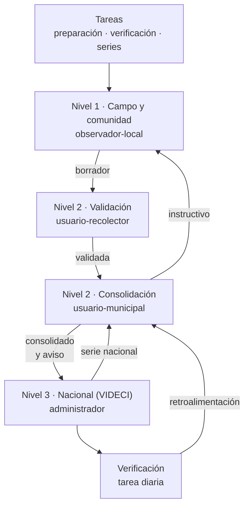

`[MEJORA]` El ciclo de retroalimentación es lo que convierte el sistema en un instrumento de aprendizaje. En el modelo actual la información sube y no vuelve: `t_observacion` no tiene ninguna ruta de regreso al observador.

---

## 2. El flujo actual verificado

Antes de proponer, conviene registrar qué hace hoy el sistema. Este ciclo está documentado en [`docs/FLUJOS.md` §F9](../docs/FLUJOS.md) y es el punto de partida obligatorio.

### 2.1 Ciclo actual `[ACTUAL]`

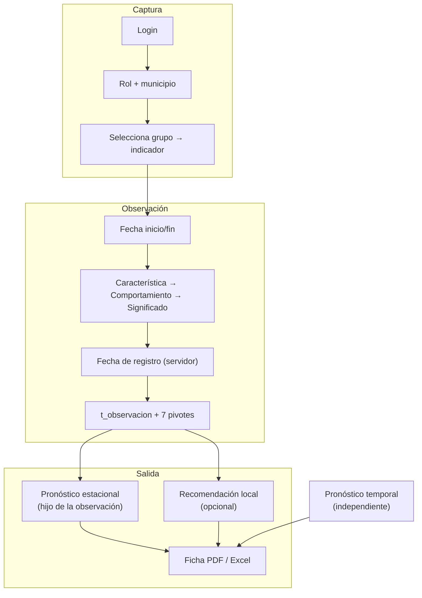

Tres características del flujo actual:

1. **La recomendación es opcional**: `t_observacion_recomendacion.t_observacion_id_observacion` es `NULL`-able.
2. **El pronóstico estacional no**: `t_observacion_pronostico` tiene 248 filas para 237 pronósticos, así que el pronóstico estacional **siempre** cuelga de una observación.
3. **El pronóstico temporal es independiente**: no comparte controlador, modelo, vista ni tabla con el estacional.

### 2.2 Defectos del ciclo actual `[DEFECTO]`

| # | Defecto | Evidencia | Efecto en el flujo |
|---|---|---|---|
| D1 | **No hay paso de validación** | `t_observacion` no tiene campo de validación | Nada distingue un dato de campo de uno revisado |
| D2 | **La observación no sabe dónde ocurrió** | `t_observacion` solo tiene 5 columnas; sin `municipio_id` ni `comunidad_id` | No se puede listar «observaciones de la comunidad X» |
| D3 | **Importadores con `TRUNCATE`** | `docs/FLUJOS.md` §F3.2 | Reimportar un Excel destruye el catálogo |
| D4 | **`GET /crear-provincia` trunca provincias** | `ProvinciasController.php:28-29` | Abrir el formulario de alta borra el catálogo de provincias |
| D5 | **Sin transacciones** | `grep "DB::transaction"` → 0 resultados | Un error intermedio deja datos a medias |
| D6 | **Autorización solo en la vista** | `@permiso(...)` en Blade | Una llamada directa por `curl` a `POST /usuarios` no pasa por `@permiso` |
| D7 | **Menú 10 apunta a una ruta inexistente** | `url = 'listarPronosticosEstacional'` vs ruta `listaPronosticos` | 404 al pulsar «Pronóstico estacional» |
| D8 | **El PDF falla en ejecución** | `PhpSpreadsheet` declarado pero no instalado | `PdfController` da error fatal |
| D9 | **`GET /excel` sin middleware `auth`** | `routes/web.php` | Exporta nombre, correo, celular y CI de los 279 usuarios |
| D10 | **Login exige correo** | `AuthController::login()` valida `usuario` como `required\|email` | Un usuario cuyo login no es correo **no puede entrar** |

D10 merece detalle: `t_login.usuario` es `varchar(30)` sin formato de correo, y el login se genera con `nombre + paterno` en minúsculas (`docs/FLUJOS.md` §F2.1). Si el nombre no contiene un `@`, la validación falla antes de comparar la contraseña. Es un defecto que deja usuarios fuera del sistema sin que lo parezca.

---

## 3. Preparación (tarea administrativa)

`[ACTUAL]` Hoy este nivel existe y es frágil. El inventario por municipio se carga con `GET /importar-inventario`, que lee `gestionTerritorial.xlsx`, hoja `Indicadores`, e inserta sin deduplicar.

`[DEFECTO]` El dump ya contiene pares repetidos en `t_municipio_indicador_natural`: `(1, 167, 72)` y `(2, 167, 72)`. Reimportar el mismo archivo duplica las 41 filas.

`[DEFECTO]` `UsuariosController` genera el login con `nombre + paterno` en minúsculas y **`t_login.usuario` no tiene `UNIQUE`**: dos usuarios con nombres iguales comparten credencial. El `unique` de `ci` y `celular` está comentado en `ValidarUsuario.php:27,31`.

`[DEFECTO]` La contraseña por defecto es el literal `'123'`, hardcodeado en `UsuariosController:185`. Solo la ruta de restablecimiento la hashea, y esa ruta **falla**: `t_password_resets` no existe en el dump, así que `Password::broker()->sendResetLink()` lanza `QueryException`. Si la tabla existiera, `CanResetPassword::resetPassword()` escribiría el texto plano y el usuario quedaría bloqueado.

### 3.1 Flujo de preparación

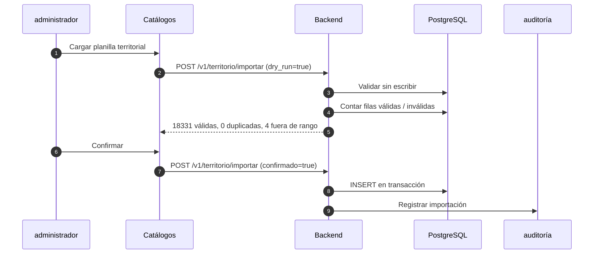

**Reglas**

| Regla | Detalle |
|---|---|
| `dry_run` obligatorio | La primera llamada siempre valida sin escribir. Responde con el conteo exacto |
| Transacción única | Toda la importación es una transacción. Un error de fila revierte todo |
| Sin `TRUNCATE` | Nunca se borra el catálogo para reimportar. Se hace `INSERT ... ON CONFLICT DO UPDATE` |
| Inventario sin duplicados | `UQ (fk_id_municipio, fk_id_indicador, vigente_desde)`. La reimportación es idempotente |
| Validación de geometría | Coordenadas dentro de `[-69.6, -57.5] × [-22.9, -9.8]`. Las que fallen se rechazan y se listan |
| Asignación de zona | Por altitud y municipio principal. Las dudosas quedan `NULL` y se marcan para revisión |
| Conteo de zonas | Las 3 zonas geográficas se migran con la FK que hoy falta ([04 §4.3](04-BASE-DE-DATOS.md#43-zona_geografica-y-el-hueco-verificado-defecto-mejora)) |
| Credenciales | Login con `UNIQUE`, derivado del CI y no del nombre. Contraseña aleatoria de un solo uso, nunca `'123'` |

**Salida de la preparación.** Los 41 registros de `municipio_indicador_natural` limpios, los tres niveles de `departamento → provincia → municipio → comunidad` verificados, y los 18.331 puntos con geometría válida.

---

## 4. Nivel 1 · Campo y comunidad

Es el nivel donde vive el conocimiento. `observador-local` es el único que puede realmente registrarlo.

### 4.1 Herramientas de registro por tipo de bioindicador `[NUEVO]`

`[ACTUAL]` El sistema no registra con qué se midió. La característica se guarda como texto: `Canto del liqi liqi` no dice si se oído con el oído, con un grabador, o contando cantos por minuto.

`[NUEVO]` Cada observación declara el instrumento usado. Sin esto, dos registros del mismo comportamiento no son comparables, y la verificación de pronósticos no puede usarse para nada.

| Grupo | Indicador típico | Herramienta | Unidad | Característica registrada |
|---|---|---|---|---|
| Animales | `Zorro` | Observación directa + audio | dB, MHz | Tipo de aullido, hora del aullido |
| Animales | `Liqi liqi` | Observación directa + audio | dB, cantos/min | Canto, intensidad, duración |
| Animales | `Tuju` | Trampa de captura + ficha | g, cm | Actividad de la madriguera |
| Plantas | `Pichitanka` y similares | Transecta de cuadrantes | %, índice | Estado de floración, porte |
| Condiciones meteorológicas | `Helada` | Termómetro de mínima + placa de Stevenson | °C | Temperatura mínima, durée |
| Condiciones meteorológicas | `Lluvia` | Pluviómetro manual | mm | Acumulación en 24 h |
| Condiciones meteorológicas | `Granizo` | Pluviómetro + registro fotográfico | mm, diámetro | Tamaño de grano |
| Astros | `Sol`, `Luna` | Registro de posición horaria | grado, hora | Posición, ausencia |
| Constelaciones | `Via Láctea` | Observación nocturna estacional |Visible/no | Visibilidad, hora |
| Eventos atmosféricos | `Rayo`, `Viento` | Sensor o registro escrito | m/s | Intensidad, dirección |
| Eventos tradicionales | `San Juan` | Acta de asamblea + observación | — | Fecha, ritual, respuesta |

**Campos nuevos** en `observacion_registro`: `herramienta`, `unidad`, `confianza` (1–5) y `es_calidad_dudosa`. El resto ya está en [04 §3.6](04-BASE-DE-DATOS.md#36-observacion_registro-la-integridad-de-la-cadena-nuevo).

### 4.2 La ficha de observación

`[ACTUAL]` Hoy el flujo es: login → rol + municipio → grupo → indicador → fechas → característica → comportamiento → significado → fecha de registro → siete pivotes.

`[DEFECTO]` La ficha no captura quién anotó qué. `t_observacion_usuario` permite varios usuarios, pero no distingue el responsable del anotador, y en una validación comunitaria esa diferencia es determinante.

`[NUEVO]` La ficha de campo se organiza en bloques, con guardado por bloque para no perder trabajo:

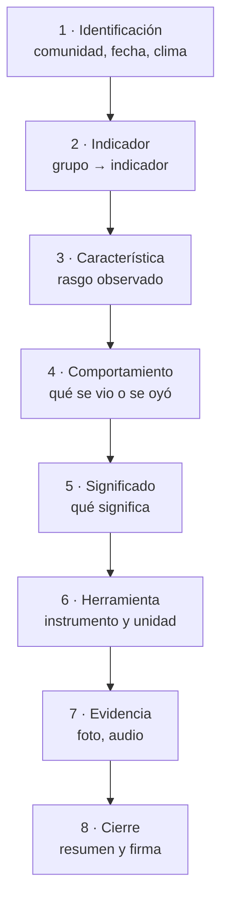

Cada bloque guarda por separado: si se pierde la señal al halfway, se conservan los bloques ya enviados.

**Reglas de validación por bloque**

| Bloque | Regla | Origen |
|---|---|---|
| Identificación | La comunidad es obligatoria y fija el municipio | D2 corregido |
| Indicador | Solo indicadores del `municipio_indicador_natural` de esa comunidad; los demás se ofrecen en «fuera de inventario» | Actual + MEJORA |
| Característica | Solo características del indicador, validado por FK compuesta | P2 de [04](04-BASE-DE-DATOS.md) |
| Comportamiento | Solo comportamientos de la característica, validado por FK compuesta | P2 de [04](04-BASE-DE-DATOS.md) |
| Significado | Solo significados del comportamiento, validado por FK compuesta | P2 de [04](04-BASE-DE-DATOS.md) |
| Herramienta | Obligatoria si la característica tiene unidad de medida | NUEVO |
| Evidencia | Obligatoria si `presencia = 'PRESENTE'` y el grupo es Animales o Plantas | NUEVO |
| Cierre | Requiere al menos un registro con `confianza ≥ 3` | NUEVO |

### 4.3 Ausencia y no observación `[NUEVO]`

`[NUEVO]` El dato más valioso en un relevamiento de bioindicadores es el que **no se vio**. Si nadie registra la ausencia, no hay forma de distinguir «no había liqi liqi» de «no se escuchó».

| `presencia` | Significado | Ejemplo |
|---|---|---|
| `PRESENTE` | Se observó el comportamiento | Se oyó el canto del liqi liqi |
| `AUSENTE` | Se buscó activamente y no se encontró | Se escuchó una hora y no cantó |
| `NO_OBSERVADO` | No se buscó | No se pudo acceder al sitio |

`[NUEVO]` `AUSENTE` exige `notas` con el esfuerzo realizado: cuántas horas, en qué franja horaria. Sin esa información, `AUSENTE` no sirve para calcular la tasa de detección.

### 4.4 Duplicados y reentradas `[NUEVO]`

`[DEFECTO]` Nada impide registrar dos veces la misma observación del mismo observador.

`[NUEVO]` Reglas:

| Regla | Detalle |
|---|---|
| Mismo día | No se puede repetir el mismo `indicador + caracteristica + presencia` dentro de una misma sesión |
| Reentrada | Una sesión con `fecha_inicio` distinta es legítima: `es_reentrada` y `sesion_padre_id` |
| Fusionado offline | Dos dispositivos del mismo observador en el mismo día generan versiones concurrentes: gana la de mayor `version_registro` y la otra se registra como conflicto |

### 4.5 Observadores destacados y la sesión de pronóstico `[NUEVO]`

`[NUEVO]` **Cambio en la forma de recolección.** El recolector **menciona y resalta el nombre de los observadores locales** de los que toma la información. Dos formas legítimas de registrar:

| Forma | Quién aparece | Cuándo |
|---|---|---|
| **Auto-registro** | El observador es él mismo el que registra | El usuario también es `observador-local` |
| **En representación** | El recolector registra **a nombre de uno o varios observadores**, con sus nombres | El recolector concentra la información en el espacio comunitario |

| Regla | Detalle |
|---|---|
| **1..N observadores por sesión** | Una misma sesión de pronóstico puede concentrar a varios observadores de la comunidad; el recolector añade uno, dos o tres |
| **Nombres siempre visibles** | Quien valida ve **quiénes** son los observadores detrás de cada pronóstico ([11 §6](11-INTERCULTURALIDAD.md): consentimiento del nombre) |
| **Colectivo o individual** | `tipo_registro = 'COLECTIVO'` si hay 2+ observadores; `'INDIVIDUAL'` si es uno solo |
| **Georreferenciación** | Toda sesión se sistematiza con **nombre de comunidad, coordenada de la comunidad y sus geografías** (departamento, provincia, municipio, zona) |
| **Cierre del nivel 1** | El pronóstico de largo plazo sale de aquí con su `pronostico_libre` (paso 0, campo abierto) y sus observadores con confianza inicial (§6.4) |

**Geografía que viaja con cada registro:**

| Dato | Origen |
|---|---|
| Nombre de la comunidad | `comunidad.nombre` (catálogo, 18.331 filas) |
| Coordenada | `comunidad.geom` (punto) |
| Geografías | Zona → departamento → provincia → municipio (heredadas por FK) |

---

## 5. Nivel 2 · Validación municipal

`[NUEVO]` Este nivel **no existe**. Es el salto más grande de la propuesta, y el que más valor aporta: sin validación, un dato de campo tiene el mismo peso que un dato revisado.

### 5.1 Flujo de validación

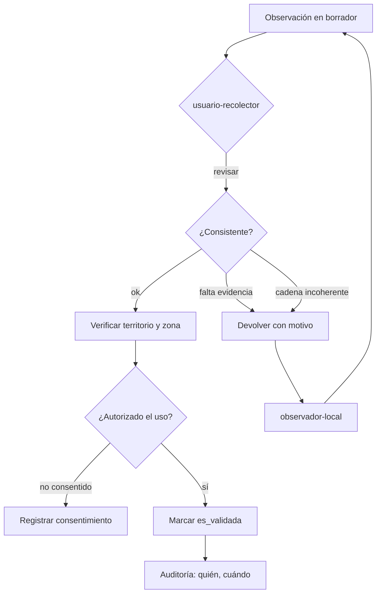

### 5.2 Controles del revisor

`[DEFECTO]` Hoy no hay ningún control. La cadena de cinco niveles puede ser contradictoria (indicador 6 con característica del indicador 2) y nada lo detecta.

`[NUEVO]` El revisor ve, por cada registro:

| Control | Origen |
|---|---|
| Característica pertenece al indicador | FK compuesta de [04 §3.6](04-BASE-DE-DATOS.md#36-observacion_registro-la-integridad-de-la-cadena-nuevo) |
| Comportamiento pertenece a la característica | FK compuesta |
| Significado pertenece al comportamiento | FK compuesta |
| Indicador en el inventario del municipio | `municipio_indicador_natural` |
| Evidencia presente si el grupo lo exige | Regla de §4.2 |
| `confianza ≥ 3` | Regla de §4.2 |
| Geojson de la comunidad coherente | `comunidad.geom` |
| Consentimiento de uso vigente | `consentimiento_uso` ([04 §10.1](04-BASE-DE-DATOS.md#101-consentimiento_uso-nuevo)) |

### 5.3 Motivos de rechazo `[NUEVO]`

`[NUEVO]` El rechazo no es un borrado. Se guarda el motivo para que el observador corrija:

| Motivo | Código | Recoverable |
|---|---|---|
| Falta evidencia fotográfica | `SIN_EVIDENCIA` | Sí, se adjunta después |
| Cadena de niveles incoherente | `CADENA_INCOHERENTE` | Sí, se corrige el registro |
| Indicador fuera del inventario municipal | `FUERA_INVENTARIO` | Sí, con autorización de `usuario-municipal` |
| Coordenada fuera de la comunidad | `FUERA_TERRITORIO` | Sí, se ajusta el punto |
| Sin consentimiento de uso | `SIN_CONSENTIMIENTO` | Sí, se autoriza |
| Datos ilegibles | `ILEGIBLE` | Sí, se repite la sesión |
| Duplicado de otra sesión | `DUPLICADO` | No, se marca |

### 5.4 Revisión comunitaria `[NUEVO]`

`[MEJORA]` El modelo actual tiene `usuario-municipal` como «Administrador de datos Municipales» y `usuario-recolector` como «Recoleccion de datos comunidades». El nombre del segundo rol ya supone trabajo comunitario, pero no hay ninguna acción de validación comunitaria en las 75 rutas.

`[NUEVO]` La validación comunitaria es un paso formal, con su propio estado:

| Paso | Quién | Qué confirma |
|---|---|---|
| Consulta | Autoridades de la comunidad | Que el registro refleja lo que la comunidad observa |
| Aprobación | `observador-local` designado | Que el nombre del indicador y su significado son correctos |
| Rectificación | `observador-local` | Que se corrija lo que no corresponde |

`[DECIDIR]` La autoridad de la comunidad que valida debe quedar registrada en `usuario.requiere_consentimiento` y en `consentimiento_uso.otorgante`. El sistema no puede suponer quién representa a la comunidad.

---

## 6. Nivel 2 · Consolidación municipal

`[ACTUAL]` Este nivel no existe como tal. Lo más próximo es `listaInventarioMunicipios()`, el único punto del sistema que resuelve el municipio del usuario de forma explícita: `loginModel → usuarioComunidad → comunidad → municipio`.

`[DEFECTO]` La resolución usa `$user->usuarioComunidad()->first()` **sin `orderBy`**. Si un usuario tuviera dos comunidades en municipios distintos, devolvería una cualquiera. Hoy hay 279 filas para 279 usuarios, así que no se manifiesta; el cambio a vigencia múltiple en [04 §8.3](04-BASE-DE-DATOS.md#83-usuario_comunidad-actual-mejora) lo hace más probable.

### 6.1 Flujo de consolidación

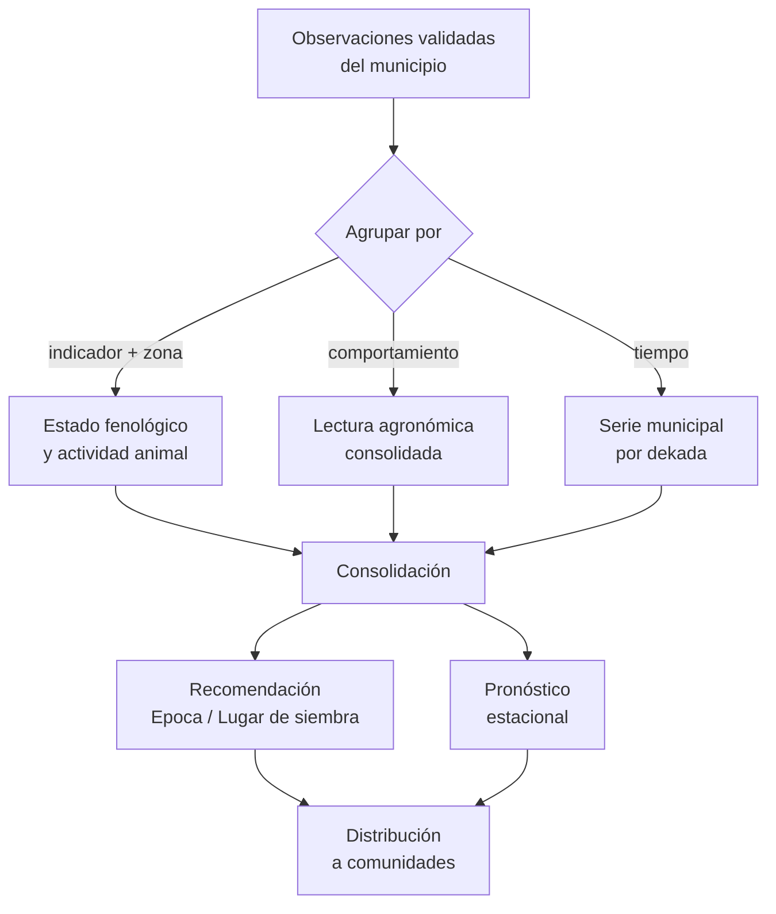

### 6.2 Agregación municipal

`[NUEVO]` La consolidación se hace sobre `v_registro_territorial` ([04 §9.4](04-BASE-DE-DATOS.md#94-vistas-de-lectura)). La consulta de base:

```sql
-- Frecuencia de un comportamiento por municipio, con su lectura agronómica
SELECT co.fk_id_municipio,
       r.fk_id_comportamiento,
       s.significado,
       count(*)                                   AS n_registros,
       count(DISTINCT o.fk_id_comunidad)          AS n_comunidades,
       min(o.fecha_inicio)                        AS primera_vez,
       max(o.fecha_inicio)                        AS ultima_vez
FROM observacion_registro r
JOIN observacion o        ON o.id = r.fk_id_observacion
JOIN comunidad co         ON co.id = o.fk_id_comunidad
LEFT JOIN significado s   ON s.id = r.fk_id_significado
WHERE o.es_validada
  AND o.estado = 'ACTIVO'
  AND o.fecha_inicio >= current_date - interval '1 year'
GROUP BY 1, 2, 3
HAVING count(*) >= 5;
```

`[NUEVO]` El `HAVING count(*) >= 5` es deliberado: una lectura basada en una o dos observaciones no se puede recomendar a un municipio. El umbral es `[DECIDIR]` y depende de la cobertura real; `n_comunidades` se muestra siempre, porque 5 registros de una sola comunidad no equivalen a 5 comunidades.

### 6.3 Recomendación municipal

`[ACTUAL]` El vocabulario de recomendación está en cuatro tablas: `dimension_recomendacion` (2), `categoria_comportamiento` (10), `recomendacion_local` (104) y `variante_local` (118). El sistema ofrece «Epoca de siembra» y «Lugar de siembra» con categorías como `Retrasada`, `Adelantada`, `Secos`, `Humedos`.

`[DEFECTO]` La relación entre las cuatro tablas está incompleta: `variante_local` referencia `recomendacion_local`, pero `recomendacion_local` no referencia `dimension_recomendacion`. Una recomendación local no sabe si habla de época o de lugar de siembra.

`[NUEVO]` La recomendación se genera con su nivel de alcance explícito:

| Alcance | Cuándo | Quién la ve |
|---|---|---|
| `COMUNIDAD` | El dato viene de una sola comunidad y es específico | Esa comunidad |
| `MUNICIPIO` | El dato agrega varias comunidades | Todas las comunidades del municipio |
| `DEPARTAMENTO` | El dato agrega varios municipios | Todo el departamento |
| `NACIONAL` | El dato es un patrón del país | Todas |

`[NUEVO]` Una recomendación `MUNICIPIO` exige `n_comunidades ≥ 3`. Una recomendación `NACIONAL` exige cobertura de las tres zonas geográficas. Esto evita que un evento local se comunique como nacional.

### 6.4 Pronóstico municipal

`[ACTUAL]` El pronóstico estacional es hijo de una observación: 248 filas de `t_observacion_pronostico` para 237 pronósticos.

`[DEFECTO]` El nombre del campo de pronóstico se copia como texto (`pronostico_estacional varchar(45)`), no como FK. Si el catálogo `t_campo_pronosticos` cambia, el histórico queda con el nombre viejo y no se puede consultar por campo.

`[NUEVO]` El pronóstico municipal se emite con:

| Campo | Valor |
|---|---|
| `pronostico_libre` | **Paso 0: el pronóstico tal como lo dice el observador**, campo abierto de texto. Se recupera sin reescribir ni validar ([04 §6.1](04-BASE-DE-DATOS.md)) |
| `tipo_registro` | `COLECTIVO` si concentra 2+ observadores; `INDIVIDUAL` si es uno solo (§4.5) |
| Observadores | Lista `pronostico_observador` 1..N con su **confianza inicial** (ALTA 1.0 / MEDIA 0.7 / BAJA 0.5) |
| `confianza_largo` | **Confianza del pronóstico** = promedio ponderado de sus observadores (§4.5, [04 §6.2](04-BASE-DE-DATOS.md)) |
| `fk_id_campo` | Lluvia, Granizo, Helada, Cosecha |
| Escenarios | Del catálogo `escenario`, con `probabilidad`; ejemplos por campo: **cosecha–buena, helada–leve, lluvia–normal, siembra–intermedia** |
| `periodo_inicio` / `periodo_fin` | La ventana que cubre |
| `zona_objetivo` | La zona geográfica afectada |
| `emitido_por` | `usuario-municipal` |
| `fk_id_comunidad` | `NULL` si el pronóstico es municipal |

**Asistente de registro del pronóstico (largo plazo)** — siete pasos en total:

| Paso | Qué ocurre | Por qué |
|---|---|---|
| **0** | **Recuperación en campo abierto**: el observador dicta el pronóstico tal cual | Se respeta la frase original; ningún formulario la reescribe antes |
| 1–5 | Cadena de catálogo: grupo → indicador → característica → comportamiento → significado | Vocabulario cerrado e íntegro, seleccionable sobre la frase ya registrada |
| 6 | Escenario del campo con su probabilidad | Da estructura analítica sin perder el texto libre |
| **7 (final)** | **Confianza del pronóstico + observadores** (colectivo/individual) y cumplió/no cumplió por registro | La confianza no la pone el sistema: la ponen las personas; el resultado cierra el ciclo con [§9](#9-verificación-de-pronósticos) |

`[DEFECTO]` `t_campo_pronosticos` incluye `terremoto`, con escenarios `ninguno` y `poco`. Un pronóstico de terremoto no es un pronóstico agroclimático y esos escenarios no tienen sentido ordinal. `[DECIDIR]` Retirar el campo o declararlo fuera de alcance; en ambos casos se marca `INACTIVO` y no se borra nada ([04 §6.1](04-BASE-DE-DATOS.md#61-estacional-actual)).

---

## 6A. Corto plazo · el aviso `[NUEVO]`

`[NUEVO]` El sistema tiene **dos herramientas**: esta, de **corto plazo (avisos)**, y la de largo plazo que ya vimos (§6.4). Aquí el productor dice lo que siente en su localidad — *«va a granizar»* — y el aviso se verifica al vencer su vigencia. Los nombres de ambas herramientas son `[DECIDIR]`. El aviso se emite y se revisa dentro del **nivel 2** (municipal/regional).

### 6A.1 Flujo de un aviso

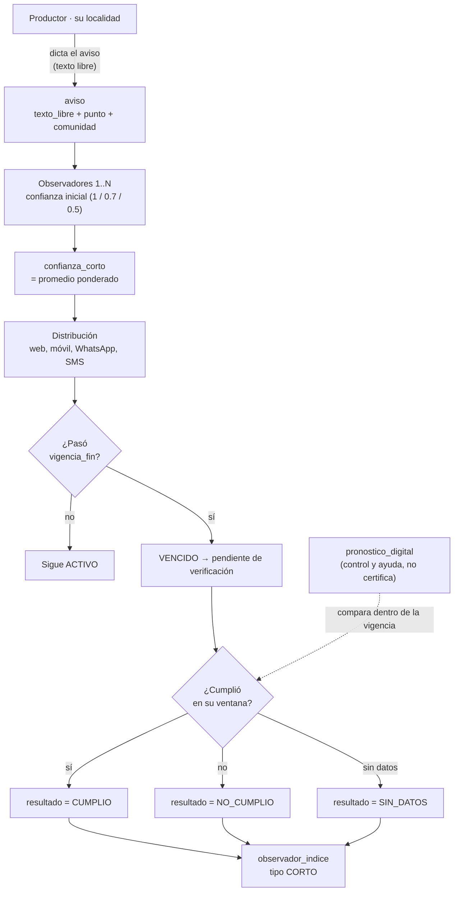

### 6A.2 Reglas de vida del aviso

| Momento | Regla |
|---|---|
| **Captura** | Texto libre del observador + nombre de comunidad + punto; geografías heredadas (§4.5) |
| **Confianza** | **Segunda confianza, aparte de la de largo plazo**: `confianza_corto` con la misma mecánica ALTA/MEDIA/BAJA y pesos 1/0.7/0.5 ([04 §6.3](04-BASE-DE-DATOS.md)) |
| **Vigencia** | Por defecto 24 h, extensible hasta 48 h `[DECIDIR]`; fuera de ventana deja de estar activo |
| **Verificación** | **Por registro**: `CUMPLIO` / `NO_CUMPLIO` / `SIN_DATOS`, comparando lo ocurrido dentro de la vigencia |
| **Acumulación** | Cada verificación actualiza `observador_indice` con `tipo = 'CORTO'` → el sistema puede decir **qué tan acertado es cada usuario**, por separado de su acierto de largo plazo |
| **Ayuda** | El **pronóstico digital** (Open-Meteo y otras fuentes, [10](10-INTEROPERABILIDAD.md)) sirve de **control y de ayuda** en la comparación; nunca certifica por sí solo |

---

## 7. Nivel 3 · Nacional (VIDECI)

### 7.1 Contexto institucional `[ACTUAL]`

`[ACTUAL]` El SINB está desplegado en **VIDECI**, operado por personal militar, con apoyo del **PMA**. La interfaz se relaciona con VIDECI, MINDEF y PROSUCO.

`[NUEVO]` Los cuatro componentes institucionales del sistema actual:

| Componente | Relación documentada | Efecto en el flujo |
|---|---|---|
| **VIDECI** | Despliegue y operación | Dueño del dato, decide publicación |
| **MINDEF** | Dependencia militar | Autoriza ventana de mantenimiento y despliegue |
| **PROSUCO** | Apoyo PMA | Contribuye indicadores y revisión técnica |
| **SINB** | Sistema | Ejecuta captura, consolidación y distribución |

`[DECIDIR]` El flujo de aprobación nacional necesita una regla que hoy no existe: quién autoriza que una recomendación pase de `MUNICIPIO` a `NACIONAL`. La propuesta propone que sea `administrador` con validación de `usuario-municipal` de origen, y que la publicación，cada quede en `auditoria`.

### 7.2 Flujo del nivel 3

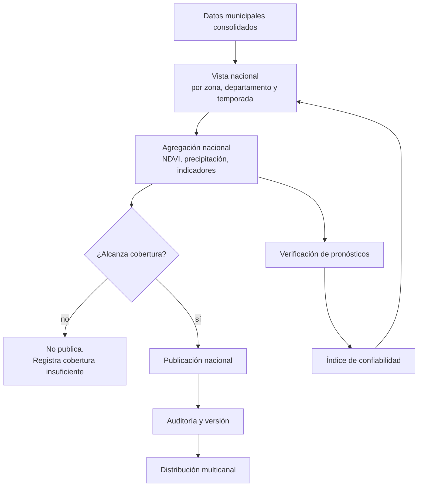

### 7.3 Cobertura mínima para publicar

`[NUEVO]` Un agregado nacional se publica solo si cumple:

| Requisito | Umbral |
|---|---|
| Comunidades cubiertas | ≥ 5 % del total de la zona (≈ 75 de 18.331) |
| Municipios | ≥ 3 |
| Zonas geográficas | Las tres |
| Período | ≥ 1 dekada completa |
| Validación | 100 % de observaciones validadas |

Si no se cumple, el resultado se guarda como **cobertura insuficiente** y no se distribuye. Publicar un promedio de dos comunidades como si fuera nacional es el error más probable de este tipo de sistema.

---

## 8. Distribución

### 8.1 Estado actual `[ACTUAL]`

`[ACTUAL]` El sistema exporta:

| Export | Estado |
|---|---|
| `UsuariosExport` (`.xlsx`) | Funciona (Maatwebsheet) |
| `PdfController` / `PdfExport` | **Falla**: `PhpSpreadsheet` no está instalado |
| Ficha PDF por observación | Sin ruta registrada |

`[DEFECTO]` `GET /excel` está **fuera del middleware `auth`** y devuelve nombre, correo, celular, CI y rol de los 279 usuarios. Es una exposición de datos personales que debe cerrarse antes de cualquier despliegue nuevo ([09](09-SEGURIDAD.md)).

### 8.2 Canales objetivo `[NUEVO]`

| Canal | Formato | Consumidor | Estado |
|---|---|---|---|
| PWA en el teléfono | HTML + JSON | `observador-local` | NUEVO |
| Ficha imprimible | HTML a PDF | tecnico de campo | NUEVO |
| API | JSON + GeoJSON | Sistemas de VIDECI | NUEVO |
| Boletín municipal | PDF + CSV | `usuario-municipal` | NUEVO |
| Exportación tabular | `.csv` / `.xlsx` | Análisis | NUEVO |
| Informe nacional | PDF | VIDECI, PMA | NUEVO |

### 8.3 Reglas de distribución

| Regla | Detalle |
|---|---|
| Nivel de alcance | Cada canal recibe solo lo que le corresponde: la comunidad ve su recomendación, el municipio ve la suya |
| Idioma | Castellano y las lenguas de la comunidad, según `traduccion_indicador` ([11](11-INTERCULTURALIDAD.md)) |
| Offline | Todo lo que se distribuye puede descargarse para consulta sin conexión |
| Consentimiento | Un dato sin `consentimiento_uso` vigente no se distribuye fuera del municipio |
| Trazabilidad | Cada envío queda en `auditoria` con destinatario, alcance y versión |
| Formato | GeoJSON según RFC 7946, EPSG:4326 ([10](10-INTEROPERABILIDAD.md)) |

---

## 9. Verificación de pronósticos

`[NUEVO]` Esta es la capacidad que convierte el registro en conocimiento. El sistema actual **no verifica nada**: `t_pronostico_temporal` tiene 7 filas y ninguna evaluación.

### 9.1 Por qué es imprescindible

Un sistema que emite pronósticos debe poder responder: ¿acertó? La referencia más cercana al dominio del SINB es el trabajo de **Gilles y colaboradores (2022)** en el Altiplano boliviano, que evaluó indicadores aimaras con 95 agricultores:

- La **temperatura mínima en la Fiesta de San Juan (8 de marzo)** explica el **55,5 %** de la varianza de precipitación de la temporada de crecimiento.
- El **inicio de lluvias** se anticipa con el patrón de floración de dos especies vegetales.
- Las **heladas** afectan la floración y correlacionan con lluvias tardías.

Es decir: el conocimiento local tiene valor predictivo demostrable, y se mide con métodos cuantitativos estándar. La propuesta no inventa esa metodología: la aplica.

### 9.2 Procedimiento de verificación

Versión simple: **al vencer el periodo, ¿acertó o no?** Corre como tarea diaria, sin reglas por indicador ni horarios por regla ([04 §14.1](04-BASE-DE-DATOS.md#141-cómo-se-verifica-versión-simple)).

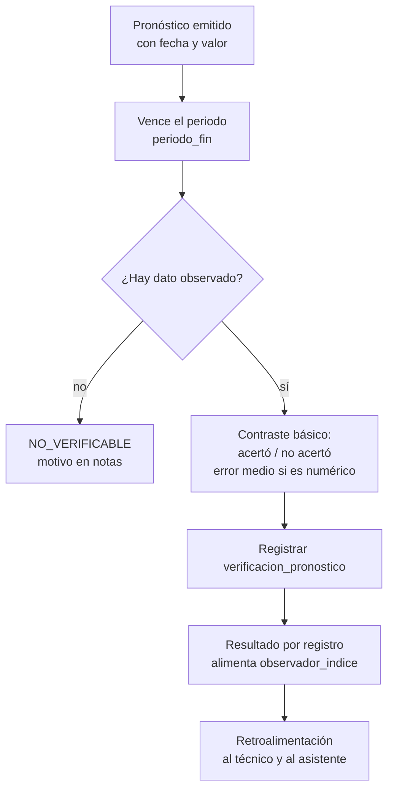

`[NUEVO]` **Cumplió / no cumplió, por registro.** Cada verificación se asocia a su pronóstico y a **sus observadores**; el resultado por registro alimenta `observador_indice` con `tipo = 'LARGO'` y se muestra junto a la `confianza_largo` del pronóstico ([04 §6.2](04-BASE-DE-DATOS.md)). Así el asistente final del registro puede decir: confianza del pronóstico, quiénes lo firmaron y cuánto acertó cada uno.

### 9.3 Qué se mide

`[NUEVO]` Métrica básica, según el tipo de pronóstico:

| Tipo de pronóstico | Resultado | Métrica básica |
|---|---|---|
| Categórico (`Mucha`, `Normal`, `Poca` lluvia; escenarios) | acertó / no acertó | % de aciertos en el periodo |
| Binario (`Helada` sí/no) | acertó / no acertó | tasa de acierto |
| Numérico (mm, °C) | `error_absoluto` y `sesgo` | error medio del periodo |
| Fenológico (inicio de floración o de lluvias) | desfase en días | ¿dentro de la tolerancia? |

`[OPCIONAL]` **Comparar contra una referencia** (climatología, persistencia, skill score) y las métricas avanzadas (RMSE, Brier, matriz de confusión) quedan como métodos a futuro: [04 §14.2](04-BASE-DE-DATOS.md#142-métodos-a-futuro-opcional), [10 §10](10-INTEROPERABILIDAD.md#10-verificación-y-métodos-a-futuro).

### 9.4 El detalle crítico: no verificar consigo mismo

`[NUEVO]` **Un pronóstico no puede verificarse con la observación que lo generó.** Es la trampa más fácil de cometer al automatizar.

| Pronóstico | No se verifica con | Se verifica con |
|---|---|---|
| Estacional, derivado de la floración en San Juan | La misma floración observada | La precipitación real de la temporada |
| Temporal, derivado de la temperatura mínima | La misma temperatura mínima | La precipitación o helada efectivamente ocurrida |
| Cualquiera | La observación del propio observador | Una fuente independiente: estación, satélite o estación meteorológica |

`[NUEVO]` La regla se implementa en el esquema: `verificacion_pronostico.es_autoevaluada` distingue el cálculo automático, y `fk_id_variable` apunta siempre a una variable **meteorológica o satelital**, nunca a un comportamiento del propio SINB.

### 9.5 Comparación con el calendario agrícola

`[NUEVO]` El pronóstico se evalúa contra el **calendario de OP's de la región**. La referencia técnica más completa es el **SIAMEXCA** de INIFAP (México): 144 variables mensuales en ráster a 30", 1961–2010, incluyendo suma térmica, grados-día de crecimiento, evapotranspiración y duración de la temporada de crecimiento.

`[NUEVO]` Para el Altiplano, el calendario relevante es el de **papa, maíz, haba y quinua** por etapa fenológica (INIFAP, INSAGI). El seguro agrícola\indexado boliviano operó exactamente así: en papa, la etapa vegetativa (días 11–36) y la reproductiva (días 37–130) explican el rendimiento con un `R²` ajustado de 0,72, y 1 mm menos de agua disponible resta entre 29,7 y 31,2 kg/ha.

`[MEJORA]` Si el SINB registra la etapa fenológica cuando observa una planta, esa observación puede usarse directamente para evaluar el calendario. Es el puente entre el conocimiento local y el modelo agronómico.

---

### 9.6 Del pronóstico al cambio climático: la escala de décadas `[NUEVO]`

La verificación de §9.2 mide un pronóstico en meses. El cambio climático se mide en décadas, y para eso hace falta una capa que el sistema actual no tiene en absoluto.

`[ACTUAL]` El SINB guarda 243 observaciones y 237 pronósticos estacionales. No hay ninguna noción de año como unidad de análisis, ni de línea base, ni de tendencia. Cada observación es un punto suelto.

`[NUEVO]` La escala longitudinal se apoya en cuatro ideas:

| Idea | Qué hace | Tabla |
|---|---|---|
| **Ventana** | Sistematiza los períodos con significado climatico | `ventana_observacion` |
| **Serie** | Agrega las observaciones de un indicador por año y comunidad | `serie_indicador` |
| **Norma** | Declara el período de referencia | `norma_climatica` |
| **Anomalía** | Une el indicador con la variable meteorológica | `desviacion_indicador` |

**El argumento operativo.** Si una comunidad registra la primera floración de una especie en el mismo punto cada año, esa serie detecta un cambio que ninguna estación del Altiplano registra, porque las estaciones están donde hay estaciones, no donde están las comunidades.

**El argumento inverso.** Un indicador observado en San Juan cada 8 de marzo durante quince años es un registro climático paralelo al instrumental, sin haberlo planeado. Es la forma más barata y más legítima de construir una serie longitudinal donde la cobertura meteorológica es escasa.

### 9.7 Las cuatro escalas y su unidad de análisis

`[NUEVO]` Cada escala tiene su unidad, su horizonte y su método. Confundirlas es el error que lleva a decir «el cambio climático llegó antes» cuando solo se aceleró el registro.

| Escala | Unidad | Horizonte | Método |
|---|---|---|---|
| Sesión de campo | 1 observación | 1 día | Registro directo |
| Pronóstico | 1 pronóstico | 1 a 365 días | Verificación de §9.3 |
| Temporada | Dekada | 1 a 5 años | Anomalía contra norma |
| Década | Año | 10 a 30 años | Regresión de tendencia |

### 9.8 Ventanas de observación `[NUEVO]`

`[ACTUAL]` El sistema actual no tiene noción de ventana. `t_observacion` guarda `fecha_inicio` y `fecha_fin`, pero nada dice que el 8 de marzo es una ventana con significado climatico.

`[NUEVO]` Las ventanas convierten un método en parte del sistema:

| Ventana | Período | Predice | Método |
|---|---|---|---|
| `san-juan` | 8 de marzo | Temperatura mínima → precipitación de la temporada | Gilles et al. (2022) |
| `maya-xook-kin` | 1–12 de enero | Cada mes del año siguiente | Maya Xook K'iin, Yucatán |
| `maya-xook-kin-alt` | 12–24 de enero | Variante según el informante | Maya Xook K'iin |
| `jallu` | 8 de marzo | Lluvia de la temporada | Jallu aimara, norte de Chile |

`[NUEVO]` Las dos ventanas de Maya Xook K'iin se registran **separadas** porque el corpus documenta dos períodos distintos según el informante. Unificarlas sería inventar precisión.

`[NUEVO]` `ventana_observacion.vigente` existe por una razón concreta: la observación astronómica aimara **está desapareciendo** mientras la climatica permanece. Una ventana que ya no se observa debe quedar registrada con su vigencia, porque perder esa distinción borra evidencia histórica.

`[NUEVO]` **La temporalidad siempre se considera.** Cada registro, indicador y pronóstico lleva su momento (fechas, temporada, horizonte) y los reportes se ordenan por él. Ejemplos típicos de reporte: indicadores de **marzo a noviembre** y pronósticos de **noviembre a abril**. Son **ventanas de ejemplo**: no son reglas ni rechazan nada — la temporalidad se atiende en cada nivel y en cada gráfica, con las ventanas que fija cada comunidad o municipio.

### 9.9 Detección de tendencia `[NUEVO]`

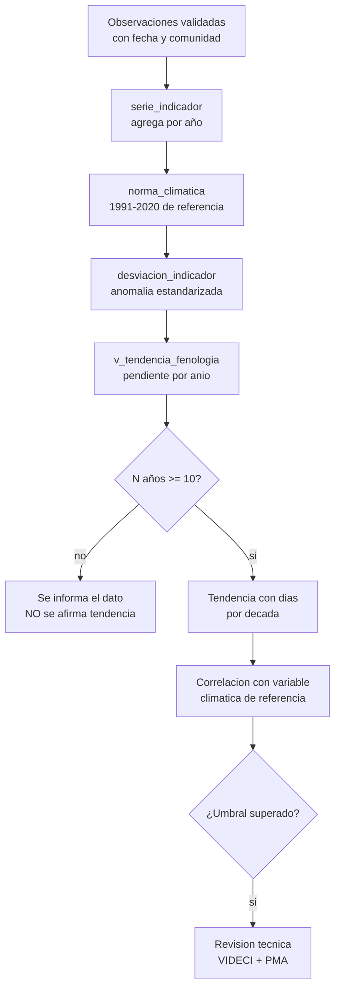

`[NUEVO]` La regla de los diez años es la más importante del capítulo. Con menos de diez años el sistema **informa el dato pero no afirma tendencia**. Una regresión sobre cinco puntos siempre parece significativa, y eso es exactamente el error que hace que un sistema lose la credibilidad frente a la comunidad.

`[NUEVO]` La anomalía es la misma que usa la meteorología para decir que un día fue «más cálido que lo normal», pero aplicada al comportamiento de un ser vivo:

```
anomalía = (valor observado − valor normal) / desviación típica
```

Si la anomalía de la floración y la de la precipitación se mueven juntas durante quince años, eso es una señal. Si se mueven en direcciones opuestas, también es información.

### 9.10 El límite honesto `[DECIDIR]`

Gilles et al. (2022) lograron el 55,5 % de varianza explicada con 95 entrevistas en el Altiplano. El SINB tendrá menos años de observación y una cobertura de comunidades más dispersa.

`[DECIDIR]` Esto debe declararse explícitamente en los informes que produzca el sistema:

| Afirmación | Permitida |
|---|---|
| «En 2026 la primera floración se registró el 12 de enero» | Sí, siempre |
| «Se observa un adelanto de 4 días por década» | Solo con ≥ 10 años |
| «El cambio climático afecta la floración» | Solo con corrección significativa y revisión técnica |
| «El conocimiento local predice el clima» | Solo con validación contra fuente independiente |

`[NUEVO]` La última fila es la más importante. El sistema registra conocimiento indígena, y atribuirle capacidad predictiva sin verificarla la desacredita. Verificar es lo que le da crédito.

### 9.11 El ciclo completo en una sola figura

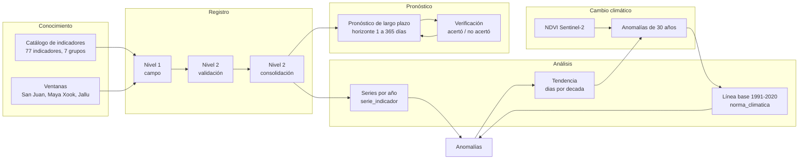

`[NUEVO]` El ciclo cierra: la verificación alimenta el pronóstico, el pronóstico se apoya en la norma, la norma se construye con datos instrumentales y satelitales, y la serie biocultural se compara con esa norma. Ninguna de las tres piezas funciona sola, y esa es la razón de que el sistema sea un sistema y no tres módulos sueltos.

---

## 9A. Verificación y calificación (versión simple) `[NUEVO]`

### 9A.1 El principio

`[NUEVO]` Un pronóstico no es un registro estático: hay que comprobar después si acertó. La versión acordada es la **más simple que funciona**:

| Regla | Detalle |
|---|---|
| Cuándo | Al vencer `periodo_fin`, en la **tarea diaria** ([03](03-BACKEND.md)) |
| Qué se resuelve | **¿Acertó o no acertó?** (y error medio si es numérico) |
| Con qué confianza | La `confianza_inicial` que puso cada persona + el `observador_indice` automático (LARGO/CORTO) |
| Quién revisa | Una persona puede re-verificar y dejar constancia (`es_autoevaluada = false`) |

`[DECIDIR]` Lo que **no** entra en la fase 1: métodos por indicador, reglas con ventana de calendario, horarios de ejecución por regla y tablas de programación. Queda todo guardado como referencia a futuro en [04 §14.2](04-BASE-DE-DATOS.md#142-métodos-a-futuro-opcional) y [10 §10](10-INTEROPERABILIDAD.md#10-verificación-y-métodos-a-futuro).

### 9A.2 El ciclo completo

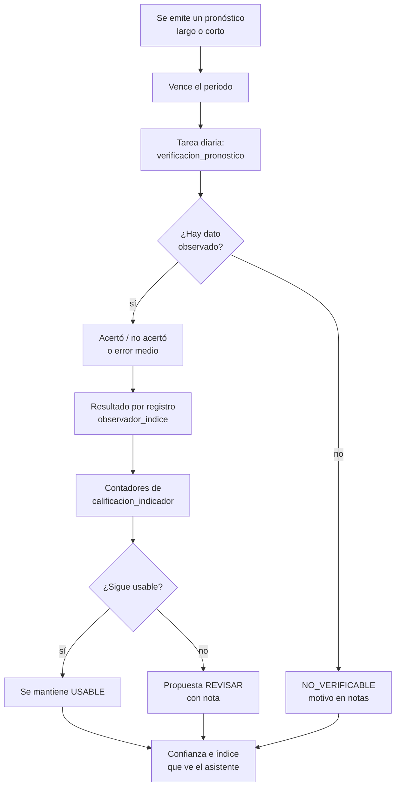

`[NUEVO]` El bucle se cierra: cada verificación alimenta la calificación, y la calificación decide si el indicador sigue **usable** para pronosticar. Detalle del esquema en [04 §14](04-BASE-DE-DATOS.md#14-verificación-simplificada-y-calificación-nuevo).

### 9A.3 Calificación: tres niveles `[NUEVO]`

Un bioindicador no vale lo mismo en todas partes. `calificacion_indicador` registra qué tan usable está, **por ámbito y fecha**, con tres niveles ([04 §14.3](04-BASE-DE-DATOS.md#143-calificacion_indicador-tres-niveles-nuevo)):

| Nivel | Criterio | Significado |
|---|---|---|
| `EN_VERIFICACION` | Recién incorporado o con pocos registros | Estado inicial |
| `USABLE` | Acumula registros y sus verificaciones aciertan | Puede usarse en decisión |
| `REVISAR` | Pierde vigencia, la práctica disminuye o falla al verificar | Requiere revisión, con nota obligatoria |

`[NUEVO]` La tarea diaria propone los cambios con los contadores nuevos y una persona los confirma. Un indicador nunca se degrada en silencio: `REVISAR` siempre llega con `notas` que explican por qué.

`[ACTUAL]` El caso de la observación astronómica aimara es real: se registra en `t_tipo_observacion`, pero no tiene serie de uso. Eso es exactamente un caso de `REVISAR`, y el nivel existe para que aparezca en los informes en vez de desaparecer.

`[NUEVO]` **Qué ve el asistente en el paso 7**: la `confianza_inicial` de cada observador, su `observador_indice` actualizado con el resultado de la verificación, y si el indicador está `USABLE` en ese ámbito. El `pronostico_digital` no tiene confianza propia: es la ayuda que acumula datos para validar los dos tipos (§4.5).

---

## 10. Cartografía en el flujo

### 10.1 Estado actual `[ACTUAL]`

`[ACTUAL]` `ZonaGeograficaController::mapa()` usa Leaflet con Google Maps y activación de clustering por encima de 1.000 puntos.

`[DEFECTO]` Leaflet carga 18.331 comunidades desde una consulta, y con `TRUNCATE` en los importadores, cada recarga depende de un proceso destructivo.

`[DEFECTO]` El mapa es un componente de navegación. No hay geometría de comunidad, solo un punto, y no hay ninguna capa satelital.

### 10.2 Capas objetivo `[NUEVO]`

| Capa | Fuente | Estado |
|---|---|---|
| communities | `comunidad.geom` (Point) | NUEVO |
| límites de comunidad | GeoJSON cargado | NUEVO |
| Municipalities | GeoJSON | NUEVO |
| Zonas geográficas | `zona_geografica` | ACTUAL |
| Observaciones | `v_registro_territorial` | NUEVO |
| Cobertura deUTS | `agregado_satelital` | NUEVO |
| NDVI actual | Sentinel-2, 10–20 m | NUEVO |
| Precipitación | Open-Meteo / CHIRPS | NUEVO |
| Estaciones | SENAMHI | DECIDIR |

`[NUEVO]` El mapa pasa de navegación a herramienta de decisión: el técnico ve dónde hay observaciones y dónde no, qué comunidades están cubiertas por una precipitación alta, y dónde el NDVI cae.

### 10.3 GeoJSON de entrada `[NUEVO]`

`[NUEVO]` Las comunidades pueden tener polígono, no solo punto:

| Campo | Tipo | Uso |
|---|---|---|
| `id` | `uuid` | Vínculo con `comunidad` |
| `comunidad` | `string` | Nombre, para revisión visual |
| `codigo_ine` | `string` | Validación contra el INE |
| `properties` | `object` | Zona, altitud, municipio |
| `geometry` | `Polygon` | RFC 7946, EPSG:4326, Polígono exterior único |

Reglas de importación: coordenadas en `[-180, 180]` y `[-90, 90]`, polígono exterior único, sin autocruce, área mínima de 0,01 km², y centroidro dentro del país.

### 10.4 Validación de coherencia territorial

`[NUEVO]` Antes de aceptar una observación, el sistema comprueba que el punto cae dentro del polígono de la comunidad, con tolerancia de 500 m (la precisión del GPS de un teléfono en terreno):

| Resultado | Acción |
|---|---|
| Punto dentro | Se acepta |
| A menos de 500 m del borde | Se acepta con aviso |
| A más de 500 m | Se rechaza con `FUERA_TERRITORIO` |

---

## 11. Conflicto y sincronización offline

`[MEJORA]` Hoy `QUEUE_CONNECTION=sync`: no hay colas, ni correo, ni websockets. No existe captura sin conexión.

`[NUEVO]` Cuando el dispositivo vuelve a la red, la fusión resuelve por campo, no por fila completa:

| Campo | Estrategia | Razón |
|---|---|---|
| `presencia`, `valor_texto`, `valor_numerico` | **Servidor gana** si el registro ya fue validado | Un dato validado no se sobrescribe |
| `presencia`, `valor_texto`, `valor_numerico` | **Última escritura gana** si está en borrador | Es la corrección del propio observador |
| `presencia` | **Unión** si es distinto y ambos en borrador | `PRESENTE` + `AUSENTE` en el mismo día es información, no conflicto |
| Evidencia | **Siempre unión** | Dos fotos son dos fotos |
| `es_validada` | **Nunca desde el cliente** | Solo el servidor valida |
| `fk_id_zona_geografica` | **Servidor gana** | Derivada de la geometría, no del cliente |

`[NUEVO]` Los conflictos se registran en `sincronizacion_log.conflictos` y se listan para revisión de `usuario-municipal`. No se descartan en silencio.

Detalle del protocolo en [08](08-OFFLINE-SINCRONIZACION.md).

---

## 12. Roles y responsabilidades

`[ACTUAL]` Los cuatro roles y sus permisos, **más uno nuevo**:

| Rol | Permisos | Menús | Puede en el flujo |
|---|---|---|---|
| `administrador` | 69 | 15 | Preparación, nivel 3, todo el territorio |
| `usuario-municipal` | 48 | 10 | Nivel 2 (consolidación), su municipio |
| `usuario-recolector` | 26 | 5 | Nivel 2 (validación), sus comunidades |
| `observador-local` | 18 | 4 | Nivel 1, su comunidad |
| `usuario-supramunicipal` `[NUEVO]` | [NUEVO] | [NUEVO] | Nivel 2 en **lectura y reportes de toda su región**; gestiona usuarios de su ámbito; no publica a nivel nacional |

`[NUEVO]` La **región** (departamento o conjunto de municipios) es `[DECIDIR]` — la definición exacta se decide en diseño. El reja del supra es su región: los mismos permisos de abajo, otro alcance.

`[DEFECTO]` Los permisos se aplican en la vista: `@permiso('crear-usuario')` envuelve el botón en Blade. Una llamada directa a `POST /usuarios` por `curl` no pasa por esa directiva. Y los 70 gates de `AuthServiceProvider.php` se registran como `fn() => true`, es decir, conceden siempre.

`[NUEVO]` La matriz se aplica en el servidor, con RLS ([04 §12](04-BASE-DE-DATOS.md#12-aislamiento-por-rol-rls)) y permiso explícito por endpoint ([09](09-SEGURIDAD.md)).

### 12.1 Matriz de flujo

| Acción | `observador-local` | `usuario-recolector` | `usuario-municipal` | `usuario-supramunicipal` | `administrador` |
|---|---|---|---|---|---|
| Ver catálogos | Sí | Sí | Sí | Sí | Sí |
| Ver indicadores de su municipio | Sí | Sí | Sí | De su región | Sí |
| Crear observación | Sí, su comunidad | Sí, sus comunidades | Sí | No (lee) | Sí |
| Corregir observación en borrador | Sí | Sí | Sí | No (lee) | Sí |
| Corregir observación validada | No | No | Sí | No | Sí |
| Validar observación | No | Sí | Sí | No (lee en bloque) | Sí |
| Rechazar observación | No | Sí, con motivo | Sí | No | Sí |
| Emitir pronóstico municipal | No | No | Sí | No (lee) | Sí |
| **Registrar aviso (corto plazo)** `[NUEVO]` | Sí, su comunidad | Sí, sus comunidades | Sí | Sí (su región) | Sí |
| **Ver confianza e índice de observadores** `[NUEVO]` | Solo el propio | Sus comunidades | Su municipio | Su región | Todos |
| Crear recomendación municipal | No | No | Sí | No (lee) | Sí |
| Publicar a nivel nacional | No | No | No | **No** | Sí |
| Verificar pronóstico (largo y corto) | No | No | Sí | No (lee) | Sí |
| Cargar territorio | No | No | No | No | Sí |
| Gestionar usuarios | No | No | Solo su municipio | **Su región** | Sí |
| Ver auditoría | No | No | Su municipio | Su región | Sí |
| Exportar | Su comunidad | Sus comunidades | Su municipio | Su región | Nacional |

---

## 13. Referencias internacionales

`[NUEVO]` Estas referencias fundamentan el diseño de verificación y las ventanas de observación. No son adornos: cada una aporta un método concreto.

### 13.1 Bolivia, Altiplano `[NUEVO]`

**Gilles, Garcia, Yucra, Quispe y colaboradores (2022)** - *Validating local meteorological forecast knowledge in the Bolivian Altiplano*.

- 95 agricultores evaluaron indicadores aimaras.
- La **temperatura mínima en San Juan (8 de marzo)** explica el **55,5 %** de la varianza de precipitación de la temporada de crecimiento.
- El **inicio de lluvias** se anticipa con la floración de dos especies.
- Las **heladas** afectan la floración y se relacionan con lluvias tardías.

**Uso en el SINB.** Es el método de referencia para §9: un indicador estacional validado contra una variable meteorológica independiente, con un porcentaje de varianza explicada como medida de éxito.

**CEAC-UTO / Orlando Chura** — *Metodología para la articulación de ciencia ancestral y ciencia moderna para la modelación climática de la comunidad Condoriri*.

- Investigación Acción Participativa Revalorizadora (IAPR).
- Índices agro-meteorológicos y agroclimáticos.
- Busca parámetros del conocimiento ancestral **compatibles** con el pronóstico de SENAMHI.
- Delimita la validez del conocimiento ancestral frente al conocimiento científico.
- Marco de alerta de riesgo.

**Uso en el SINB.** Es el precedente institucional más cercano: articular en vez de sustituir. Justifica el nivel 3, donde VIDECI y PMA revisan antes de publicar.

### 13.2 México `[NUEVO]`

**Maya Xook K'iin** (Yucatán) — método de predicción anual.

- Observa intensidad del sol, densidad de nubes, niebla, lluvia y temperatura baja.
- Ventana de observación: **1–12 de enero** o **12–24 de enero**, según el informante.
- Observación en **horas de luz** (6:00–18:00).
- El resultado es un **pronóstico por mes**, representado en un mapa con símbolos.
- Ejemplo de salida: «mayo lluvioso, soleado y ventoso».

**Uso en el SINB.** Aporta tres cosas concretas: (a) una **ventana estacional definida** con inicio y fin, que es lo que permite el pronóstico estacional; (b) la noción de **pronóstico por mes** en lugar de por temporada; (c) un **formato visual** de salida, que es la distribución (§8.2).

**SIAMEXCA** (INIFAP) — Sistema de Información Agroclimática.

- 144 variables mensuales en ráster, 30" de resolución, 1961–2010.
- Variables: Tx, Ti, Tm, rango térmico, suma térmica, grados-día, fotoperiodo, precipitación, ETP, índice de humedad, radiación, humedad relativa.
- 41 variables de temporada, incluida la duración de la temporada de crecimiento y los meses húmedos.

**Uso en el SINB.** Define el conjunto de variables que la verificación debería cubrir (§9.3) y la referencia de resolución espacial.

**INSAGI** — calendario de cultivos por etapa fenológica regionalizada.

**Uso en el SINB.** Referencia para el calendario fenológico del Altiplano (§9.5).

### 13.3 Chile, norte grande `[NUEVO]`

**Jallu aimara** (Arica, Parinacota, Tarapacá).

- Predicción de lluvias durante la **fiesta de San Juan (8 de marzo)**.
- Si llueve **pausado todo el día con momentos de sol** → buen año, cosecha abundante.
- Si lluye **demasiado fuerte** → mala predicción.
- La observación astronómica **está desapareciendo**; la climatica **no**.
- Clasificación: fitoindicadores, zooindicadores, astronómicos y meteorológicos.
- No distinguen estaciones (verano, otoño) sino **temporadas**: frías, lluviosas, de heladas, calurosas.

**Uso en el SINB.** Es la contraparte andina del método de San Juan y aporta la observación sobre **desaparición de la práctica astronómica**. El SINB debe poder distinguir un conocimiento en desuso de uno vigente: por eso `sinonimo_indicador.estado` y `consentimiento_uso.vigencia_hasta` existen ([04 §10](04-BASE-DE-DATOS.md#10-conocimiento-consentimiento-y-traducción-nuevo)).

### 13.4 FAO `[NUEVO]`

**Handbook on climate information for farming communities.**

- Boletín agroclimático **dekadal** (cada 10 días), estacional y anual.
- Mapas de inicio y fin de lluvias, y de duración de la temporada de crecimiento.
- Estaciones automáticas (AWS) como alternativa a la observación manual.

**Uso en el SINB.** La cadencia dekadal es la que usa el consolidado municipal (§6.2) y la que hace comparables los resultados. El sistema sinb actual no tiene periodicidad: ladekada es la propuesta.

### 13.5 Síntesis de lo que aporta cada referencia

| Referencia | Aporta al SINB |
|---|---|
| Gilles et al. (Bolivia) | Método de validación de indicadores estacionales contra variables meteorológicas |
| CEAC-UTO Condoriri | Precedente de articulación institucional en Bolivia |
| Maya Xook K'iin | Ventana estacional definida y pronóstico por mes |
| Jallu (Chile) | Conocimiento andino compartido y su estado de conservación |
| SIAMEXCA / INSAGI | Calendario fenológico y variables agroclimáticas de referencia |
| FAO | Cadencia dekadal y formato de boletín |
| Seguros indexados (Bolivia) | Peso de la etapa fenológica en el rendimiento |

---

## 14. Trazabilidad de los flujos

| Nivel | Componente | Tablas |
|---|---|---|
| Preparación | Backend, catálogos e inventario | [03](03-BACKEND.md) |
| 1 | Frontend, ficha de campo | [06](06-FRONTEND.md) |
| 2–3 | Base de datos, validación, RLS | [04](04-BASE-DE-DATOS.md) |
| Todos | API REST | [05](05-APIS.md) |
| 1 | Captura sin conexión | [08](08-OFFLINE-SINCRONIZACION.md) |
| Todos | Permisos, auditoría, sesiones | [09](09-SEGURIDAD.md) |
| Tareas | NDVI, series, verificación | [10](10-INTEROPERABILIDAD.md) |
| 1–2 | Nombres locales, consentimiento | [11](11-INTERCULTURALIDAD.md) |
| Todos | Despliegue, respaldo, operación | [12](12-INFRAESTRUCTURA.md) |
| Todos | Bloques de construcción, responsables | [13](13-ROADMAP.md) |
