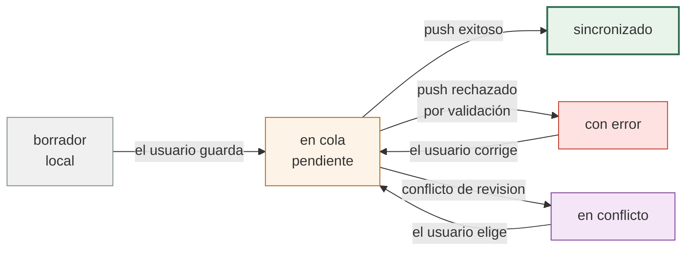
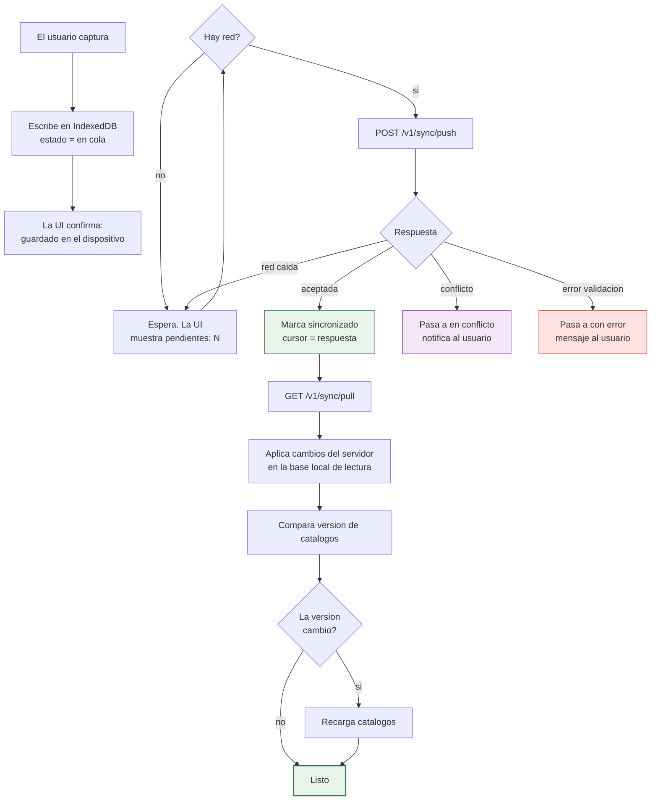
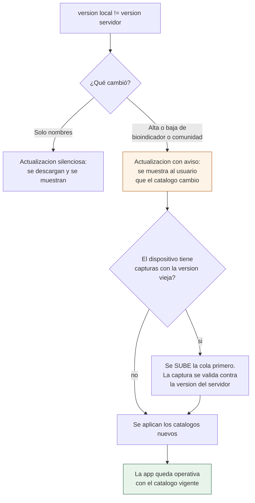
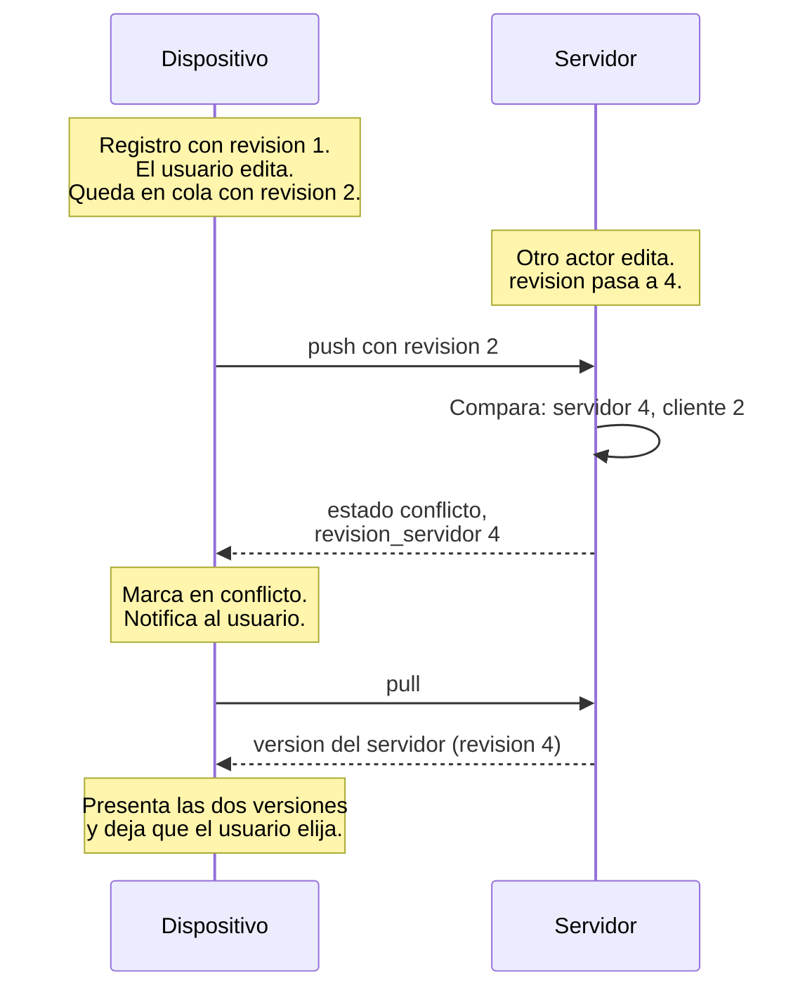
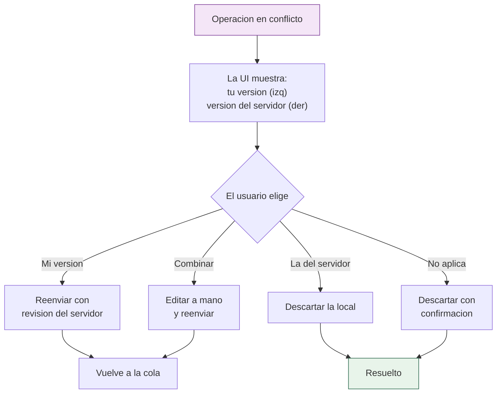
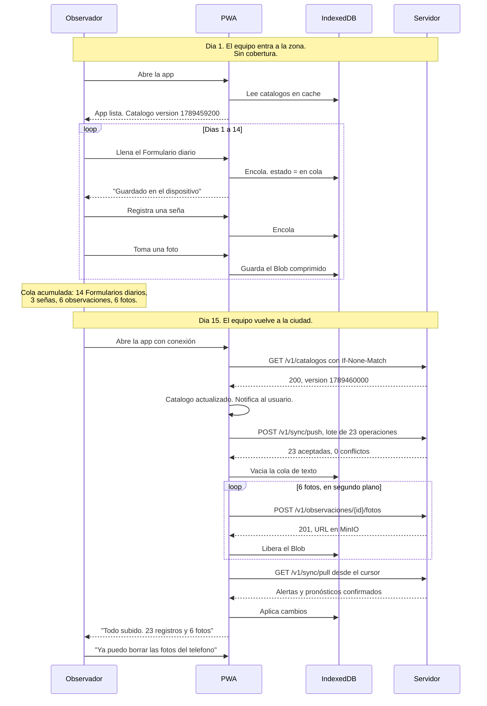

# 08 · Offline y sincronización

El sistema se usa en el campo, sin señal, durante semanas. Esta es la parte del diseño que decide si el proyecto es viable o si se abandona en la segunda semana de uso.

> **Contraste con la estructura actual del repositorio**: este repositorio **ya tiene un mecanismo de sincronización offline** para EDAN (`/api/v2`, sincronización incremental por secciones con `procedencia`, `pendiente_actualizacion`, `pendiente_eliminacion` y `id_local` — ver `docs/DOCUMENTO_V2_SYNC.md`, `edan.edan_localidades`). Es una referencia útil de patrón, pero **la sincronización SINB es independiente**: reutiliza las ideas (UUIDv7, cursor, resolución de conflictos), **no las tablas ni los estados** de EDAN. Todo lo de este documento se implementa sobre `sinb.*` con su propio `sincronizacion_log` (ver [04](04-BASE-DE-DATOS.md)).

---

## 1. Por qué offline es un requisito, no una mejora

### 1.1 El contexto real

| Dato | Valor |
|---|---|
| Municipios del área de estudio | 4 |
| Comunidades | 18.331 |
| Ecorregiones | 4 |
| Tipo de despliegue | DISEPER, MINDEF, VIDECI |
| Señal móvil en campo | Irregular, a menudo ausente |
| Capacidad del personal | Desde observación de campo hasta mantenimiento nocturno |

La observación de campo ocurre en lugares donde no hay cobertura. Quien observa no tiene la opción de "esperar a que haya señal".

### 1.2 La decisión estructural

> **La aplicación es offline-first, no offline-tolerant.**
>
> Es decir: el estado normal de la aplicación es "sin conexión", y la conexión es el caso excepcional que se aprovecha cuando aparece. No es "una aplicación en línea que a veces falla".

### 1.3 Qué implica esa decisión

| Implicación | Consecuencia técnica |
|---|---|
| El usuario nunca ve un error de red como resultado final | La escritura siempre tiene éxito local, se sincronice o no |
| El servidor nunca es la fuente de verdad para el dispositivo en campo | El dispositivo tiene su propia copia y su propio cursor |
| Cada registro tiene identidad en el cliente | UUIDv7 generado en el dispositivo, no autoincremento del servidor |
| Los conflictos se resuelven en el dispositivo | El servidor devuelve conflictos, no impone su versión |

### 1.4 Lo que NO se hace offline

| Operación | Offline | Motivo |
|---|---|---|
| Formulario diario | Sí | Captura pura, sin dependencia de red |
| Señal | Sí | Captura pura |
| Observación | Sí | Captura pura |
| Foto | Sí, se sube después | El archivo es grande; la red es el cuello de botella |
| Pronóstico | Sí | Captura pura, con validación diferida |
| Editar catálogo | No | Solo el administrador, y siempre con conexión |
| Ver mapa satelital | Con caché previo | Los tiles ya descargados se muestran |
| Ver confiabilidad | Con caché previo | Lectura del último cálculo |
| Validar pronóstico | Sí, se confirma al subir | El técnico puede estar en campo |
| Exportar | No | Requiere el conjunto completo del servidor |

---

## 2. Arquitectura de sincronización

### 2.1 Los tres estados de un registro

Todo registro que el usuario crea pasa por tres estados locales:



**Regla clave**: los estados A, B, D y E son locales y sobreviven al cierre de la aplicación. El estado C es el único que requiere red.

### 2.2 Diagrama de flujo completo



### 2.3 Componentes

| Componente | Ubicación | Responsabilidad |
|---|---|---|
| `useIndexedDb` | PWA | Persistencia local de cola, catálogos y borradores |
| `useSync` | PWA | Orquesta push, pull y resolución de conflictos |
| `syncService` | PWA | Llamadas HTTP de sincronización |
| `POST /v1/sync/push` | API | Acepta operaciones, devuelve conflictos |
| `GET /v1/sync/pull` | API | Devuelve cambios desde un cursor |
| `sync_log` | BD | Una fila por sincronización, para diagnóstico |
| `version_catalogos()` | BD | Calcula la versión de catálogos |

Detalle de la API en [05-APIS.md §10](05-APIS.md); detalle de la tabla en [04-BASE-DE-DATOS.md §10.2](04-BASE-DE-DATOS.md).

---

## 3. Versión de catálogos

### 3.1 El problema que resuelve

El usuario necesita saber qué comunidades existen, qué bioindicadores son válidos y en qué meses se esperan. Esa información cambia: se corrige un nombre, se agrega una comunidad, se ajusta el rango de meses de un indicador.

Si el PWA no sabe que el catálogo cambió, seguirá ofreciendo un indicador que el administrador ya desactivó, o no ofrecerá uno nuevo que el campo espera.

### 3.2 La versión es un número, no una fecha

La versión de catálogos es el **epoch del `updated_at` más reciente** de las tablas de catálogo, como entero.

```sql
CREATE OR REPLACE FUNCTION version_catalogos() RETURNS bigint AS $$
    SELECT COALESCE(MAX(epoch), 0) FROM (
        SELECT extract(epoch FROM max(updated_at)) AS epoch FROM comunidad
        UNION ALL SELECT extract(epoch FROM max(updated_at)) FROM bioindicador
        UNION ALL SELECT extract(epoch FROM max(updated_at)) FROM bioindicador_sinonimo
        UNION ALL SELECT extract(epoch FROM max(updated_at)) FROM ecorregion
    ) t;
$$ LANGUAGE sql STABLE;
```

El detalle de esta función está en [04-BASE-DE-DATOS.md §12.4](04-BASE-DE-DATOS.md).

**Por qué un número y no un hash**: un epoch como entero cabe en un `number` de JavaScript, se compara con `===`, y no requiere hashear nada en el cliente. Un hash exigiría calcularlo en cada arranque del PWA.

### 3.3 Cuándo se compara

| Momento | Acción |
|---|---|
| Arranque de la aplicación | Se compara la versión local con la del servidor. Si difiere, se recarga |
| Después de un `pull` exitoso | Se compara de nuevo, por si el cambio ocurrió durante la sesión |
| Al volver la red tras un periodo offline | Se compara antes de subir la cola, por si el catálogo cambió mientras el dispositivo estaba desconectado |
| Cada 6 horas en primer plano | Comprobación preventiva, para detectar cambios en medio de una jornada |

No se compara en cada captura. Sería una petición de red inútil si la aplicación está offline.

### 3.4 Qué ocurre cuando la versión difiere



### 3.5 Capturas pendientes y catálogo desactualizado

Este es el caso delicado. Si el dispositivo capturó un registro cuando el catálogo era la versión 3, y el catálogo ya va en la 4, ¿el registro es válido?

**Respuesta: se sube primero, se valida contra el servidor.** El servidor valida la captura con el catálogo vigente y decide:

| Situación | Resultado del `push` |
|---|---|
| El bioindicador sigue existiendo y activo | Aceptada |
| El bioindicador se desactivó, pero la captura es histórica | Aceptada, con `aviso: "BIOINDICADOR_INACTIVO"` |
| La comunidad fue dada de baja | Rechazada, `409 ENTIDAD_INACTIVA` |
| El campo ya no existe en el catálogo | Aceptada. El catálogo define el vocabulario, no invalida el pasado |

La regla general: **el catálogo restringe lo que se puede crear, nunca invalida lo que ya se creó.** Un sistema que invalida el pasado obliga a la gente a mentir sobre cuándoilepsy pasó.

### 3.6 Descarga de catálogos

```http
GET /v1/catalogos
If-None-Match: "1789459200"
```

```http
HTTP/1.1 304 Not Modified
ETag: "1789459200"
```

Si la versión no cambió, el servidor responde `304` sin cuerpo. La aplicación conserva su copia local. Esto es importante en el campo: evita descargar 350 KB en cada comprobación.

| ETag | Significado |
|---|---|
| `"1789459200"` | La versión de catálogo que tiene el cliente |
| Respuesta `200` con `version` distinta | Hay que reemplazar el catálogo local |
| Respuesta `304` | El catálogo local está vigente |

---

## 4. `push`: enviar capturas al servidor

### 4.1 Un endpoint para todo

Toda captura pendiente se envía por un único endpoint: `POST /v1/sync/push`. No un endpoint por tipo de registro.

| Opción | Endpoint por tipo | Endpoint único |
|---|---|---|
| Peticiones | 3 para 3 capturas | 1 para 3 capturas |
| Coste por petición en 2G | Alto | Bajo |
| Validación | Una por endpoint | Un lote, un UoW |
| Parcialidad | Difícil | Natural, por operación |
| Trazabilidad | Difícil | Un `sync_log` por lote |

El contrato completo está en [05-APIS.md §10.1](05-APIS.md).

### 4.2 Formato

```json
{
  "cliente_id": "0198f2c4-1111-7222-8333-444455556666",
  "operaciones": [
    {
      "tipo": "formulario-diario",
      "datos": {
        "id": "0198f2c4-aaaa-7222-8333-444455556666",
        "comunidad_id": "0198f2c4-cccc-7222-8333-444455556666",
        "fecha": "2026-09-14",
        "lluvia": true,
        "lluvia_intensidad": 2,
        "helada": true,
        "helada_intensidad": 1,
        "granizo": false,
        "viento_fuerte": false,
        "nota": "Helada fuerte desde las 4 de la mañana",
        "gps": { "lat": -16.4997, "lon": -68.1509, "precision_m": 12 }
      }
    },
    {
      "tipo": "senal",
      "datos": {
        "id": "0198f2c4-bbbb-7222-8333-444455556666",
        "campana_id": "0198f2c4-dddd-7222-8333-444455556666",
        "bioindicador_id": "0198f2c5-0001-7222-8333-444455556666",
        "fecha": "2026-09-10",
        "descripcion": "Zurucutureturned por tercera vez este mes",
        "mes_esperado_respeta": true
      }
    }
  ]
}
```

### 4.3 Los IDs se generan en el dispositivo

Cada operación lleva un UUIDv7 generado en el PWA. El servidor lo respeta.

| Regla | Motivo |
|---|---|
| El dispositivo genera el ID | Un registro debe tener identidad antes de tocar la red |
| El servidor no reasigna | Si lo reasignara, el PWA no podría reconocer su propia fila |
| UUIDv7, no UUIDv4 | El v7 es ordenable por tiempo. Los registros suben en orden de captura, lo que hace el historial legible |
| `cliente_id` por dispositivo | Distingue el teléfono del tablet, para diagnosticar cuál falla |

Un `BIGSERIAL` del servidor no sirve aquí: si el dispositivo sube tres registros y solo uno se acepta, los otros dos no tienen identidad con la que reintentarse.

### 4.4 Límite del lote

| Límite | Valor | Motivo |
|---|---|---|
| Operaciones por lote | 200 | Con 30 KB por operación son 6 MB. Suficiente para un dispositivo |
| Operaciones mínimas por lote | 1 | Permite subir una captura aislada sin esperar a llenar el lote |
| `payload` máximo | 10 MB | Tope duro del servidor. Evita que un lote mal formado agote la memoria |
| Fotos por lote | 0 | Las fotos van en un canal aparte, por su tamaño. Ver §7 |

El PWA agrupa hasta 200 operaciones o hasta 4 MB, lo que ocurra primero. Si la cola tiene 5 capturas, sube un lote de 5.

**`[NUEVO]` Prioridad de los avisos.** El aviso de **corto plazo** tiene vigencia de horas: su operación se marca `prioridad = alta` y sale de la cola **antes** que las observaciones ordinarias (mismo endpoint, orden por prioridad y antigüedad). Un aviso que no llegó a tiempo no se puede verificar, y perderlo echaría a perder la medición de acierto de ese observador. Los demás tipos (observación, pronóstico de largo plazo) conservan su orden normal ([07 §6A](07-FLUJOS-BIOCULTURALES.md)).

### 4.5 Respuesta

```json
{
  "aceptadas": 1,
  "conflictos": 1,
  "resultados": [
    {
      "id": "0198f2c4-aaaa-7222-8333-444455556666",
      "estado": "aceptada",
      "revision": 1,
      "creado": true
    },
    {
      "id": "0198f2c4-bbbb-7222-8333-444455556666",
      "estado": "conflicto",
      "codigo": "CONFLICTO_REVISION",
      "revision_servidor": 4,
      "revision_cliente": 2
    }
  ],
  "cursor_pull": "2026-09-14T20:15:00Z"
}
```

El PWA procesa la respuesta **operación por operación**:

| `estado` devuelto | Qué hace el PWA |
|---|---|
| `aceptada` | Borra de la cola, guarda el `revision` y el `cursor_pull` |
| `conflicto` | Pasa a estado local "en conflicto", notifica al usuario |
| `rechazada` | Pasa a estado local "con error", guarda el mensaje para mostrarlo |

Nunca se borra toda la cola de golpe. Si el PWA cierra la aplicación a mitad del procesamiento, solo se pierden las operaciones ya confirmadas por el servidor, y un reenvío es idempotente.

### 4.6 Idempotencia del `push`

Reenviar una operación ya aceptada no crea un duplicado:

| Situación | Resultado |
|---|---|
| Mismo `id` que ya existe, mismos datos | `200`, `estado: "aceptada"`, `creado: false` |
| Mismo `id`, datos distintos | `409`, `CONFLICTO_REVISION` |
| Mismo `id`, mismo `revision` | `200`, sin cambios |

Es la red de seguridad del protocolo. Si el PWA no sabe si el lote anterior llegó, reenvía y no pasa nada.

---

## 5. `pull`: recibir cambios del servidor

### 5.1 Qué trae el `pull`

El `pull` trae cambios que el dispositivo necesita para estar al día, pero que el usuario no captura: otros autores, cambios del técnico, alertas.

| Tipo | Quién lo escribe | Por qué lo necesita el dispositivo |
|---|---|---|
| Pronósticos confirmados | Técnico | El observador local debe ver que su pronóstico fue confirmado |
| Alertas | Sistema | Aviso de helada o granizo |
| Formularios diarios de la comunidad | Otros observadores | Ver el registro colectivo del día |
| Actualizaciones de catálogos | Administrador | Nombres corregidos, indicadores nuevos |
| Estado de validación | Técnico | Saber que su pronóstico fue medido |

### 5.2 El cursor

El cursor es un `timestamptz` con `id` como desempate. El PWA guarda el último y lo envía en la siguiente llamada.

```http
GET /v1/sync/pull?desde=2026-09-10T08:00:00Z&limite=500
```

```json
{
  "datos": [
    { "tipo": "formulario-diario", "operacion": "upsert", "registro": { "id": "...", "...": "..." } },
    { "tipo": "alerta", "operacion": "insert", "registro": { "id": "...", "...": "..." } }
  ],
  "siguiente_cursor": "2026-09-12T14:22:00Z",
  "tiene_mas": true
}
```

El PWA itera hasta que `tiene_mas` es `false`, guardando el cursor de cada iteración. Así, si se interrumpe a la mitad, no pierde lo ya avanzado.

### 5.3 No se usa `OFFSET`

La paginación por cursor es obligatoria aquí, y no por rendimiento sino por corrección.

Con `OFFSET`, si entre dos llamadas otro técnico inserta un registro, el `OFFSET` desplaza la ventana y **un registro se salta sin que nadie lo note**. En una base de datos con datos mutantes, `OFFSET` sobre un rango que cambia produce huecos silenciosos. Con cursor, cada registro tiene una posición estable y no hay huecos.

El detalle completo está en [05-APIS.md §7](05-APIS.md).

### 5.4 Qué se aplica y qué no

| Regla | Detalle |
|---|---|
| El `pull` nunca borra | Solo `upsert` e `insert`. Una eliminación llega como `operacion: "delete"` con `id` |
| El `pull` nunca sobrescribe una captura local pendiente | Si un registro local está "en cola", el `pull` no lo toca |
| El `pull` respeta el RLS | Solo trae lo que el usuario puede ver por rol y territorio |
| El `pull` no trae catálogos | Los catálogos van por su propio endpoint, con su versión. Ver §3 |

La regla de no sobrescribir una captura pendiente es la que evita perder un registro. Si el `pull` trae una versión del servidor de un registro que el dispositivo tiene en cola, ese registro local gana hasta que se resuelva.

---

## 6. Conflictos

### 6.1 Cuándo hay conflicto

| Caso | Ejemplo | Resultado |
|---|---|---|
| `CONFLICTO_REVISION` | El dispositivo editó un registro con `revision` 2; el servidor ya va en 4 | `409` en esa operación |
| `ENTIDAD_INACTIVA` | La comunidad fue dada de baja entre la captura y el `push` | `409`, la captura se conserva |
| `BIOINDICADOR_INACTIVO` | El indicador se desactivó, pero la captura es histórica | Aceptada, con `aviso` |
| `ROL_SIN_PERMISO` | El usuario perdió el permiso durante el periodo offline | `403` en esa operación |

### 6.2 El caso `CONFLICTO_REVISION`

Ocurre cuando el dispositivo editó un registro que también fue editado en el servidor.



### 6.3 Resolución

El conflicto lo resuelve **el usuario**, no el servidor. El servidor no elige por la persona.

| Estrategia | Cuándo | Resultado |
|---|---|---|
| Ganar el servidor | El registro local ya no importa | Se descarta la captura local |
| Ganar el local | El usuario sabe que su versión es la correcta | Se reenvía con el `revision` del servidor |
| Editar y reenviar | Se puede combinar | El usuario fusiona y envía con la `revision` vigente |
| Descartar | La captura ya no aplica | Se borra de la cola con confirmación |



**El usuario nunca pierde una captura por un conflicto sin haberla visto.** Ese es el compromiso. Un merge automático sería más elegante y peor: si dos personas capturaron lo mismo con palabras distintas, solo una de las dos versiones puede quedar, y descartar la otra en silencio es la forma más rápida de perder la confianza de la comunidad.

### 6.4 Por qué los conflictos son raros en la práctica

El diseño está orientado a que no ocurran:

| Medida | Efecto |
|---|---|
| Cada registro tiene un autor y un alcance | Dos personas de la misma comunidad pueden editar el mismo Formulario diario, pero casi nada más |
| Los roles no se solapan | Un observador local y un observador no escriben en la misma tabla |
| `UNIQUE (comunidad_id, fecha)` en el Formulario diario | Dos capturas del mismo día no pueden coexistir: una se rechaza en la base |
| UUIDv7 generado en el cliente | No hay colisión de IDs entre dispositivos |

El conflicto sigue siendo posible, y por eso existe el flujo de §6.3. Pero es la excepción, no el camino normal.

---

## 7. Fotos

### 7.1 Por qué van aparte

Una foto de un teléfono de gama media pesa entre 2 y 6 MB. Un lote de 5 fotos son 20 MB. Sobre una conexión de 2G, subir eso en el `push` bloquearía la cola entera.

| Canal | Contenido | Tamaño | Cuándo |
|---|---|---|---|
| `push` JSON | Registros sin archivo | 30 KB por operación | Prioridad alta |
| `POST /v1/observaciones/{id}/fotos` | Un archivo por petición | 2 a 6 MB | Segundo plano, después del `push` |

El `push` va primero. Las fotos se suben cuando el registro ya existe en el servidor, porque la foto cuelga del `observacion_foto`, que referencia la observación.

### 7.2 Compresión antes de subir

La app comprime antes de transmitir, en el dispositivo:

| Paso | Detalle |
|---|---|
| Reescalar | Lado mayor a 1.600 px. Para evidencia de campo es más que suficiente |
| Comprimir | JPEG, calidad 0.78. Una foto de 4 MB baja a unos 400 KB |
| Eliminar metadatos | Se quita EXIF antes de comprimir, por privacidad. Ver §9 |
| Preservar orientación | Se aplica la rotación del EXIF antes de quitarlo, o la foto sale girada |

```ts
// src/services/foto.ts
import { createImageBitmap } from 'canvas' // polyfill o navegador

export async function prepararFoto(file: File): Promise<Blob> {
  const bitmap = await createImageBitmap(file)

  // Limite de lado mayor
  const escala = Math.min(1, 1600 / Math.max(bitmap.width, bitmap.height))
  const ancho = Math.round(bitmap.width * escala)
  const alto = Math.round(bitmap.height * escala)

  const canvas = document.createElement('canvas')
  canvas.width = ancho
  canvas.height = alto

  const ctx = canvas.getContext('2d')!
  ctx.drawImage(bitmap, 0, 0, ancho, alto)
  bitmap.close()

  // JPEG sin metadatos. La calidad 0.78 conserva detalle de hoja suficiente
  const blob = await new Promise<Blob | null>((r) =>
    canvas.toBlob(r, 'image/jpeg', 0.78)
  )
  if (!blob) throw new Error('No se pudo comprimir la foto')
  return blob
}
```

### 7.3 La foto vive en el dispositivo hasta que se sube

| Estado | Ubicación | Qué muestra la UI |
|---|---|---|
| Capturada, no subida | IndexedDB como `Blob` | "Foto pendiente" |
| Subiendo | En vuelo en `fetch` | "Subiendo foto" |
| Subida | MinIO, referenciada en `observacion_foto` | Miniatura, cargada del servidor |
| Subida con error | IndexedDB, con `intentos` incrementado | "Reintentando foto" |

La foto nunca se descarta sin que el usuario lo sepa. Si el dispositivo se queda sin espacio, la app avisa antes de empezar a descartar fotos pendientes, nunca en silencio.

### 7.4 Limpieza de espacio

| Umbral | Acción |
|---|---|
| Espacio libre > 500 MB | Normal |
| Espacio libre < 500 MB | La UI avisa: "quedan N fotos por subir" |
| Espacio libre < 100 MB | La app prioriza subir fotos y posterga capturas de texto nuevas |
| Espacio libre < 50 MB | La app avisa que **no se deben tomar fotos nuevas** hasta que haya espacio |

La prioridad siempre es: subir lo pendiente, aceptar capturas nuevas de texto. Un texto ocupa kilobytes; una foto, megabytes. Ante falta de espacio, se protege el dato de texto, que es el difícil de reponer.

---

## 8. Detección de red, reintentos y momento de subir

### 8.1 Detección de red

| Mecanismo | Uso | Limitación |
|---|---|---|
| `navigator.onLine` | Indicador rápido de interfaz | Dice si hay interfaz de red, no si el servidor responde |
| `fetch` con timeout | Detección real. Un `fetch` fallido es la única señal fiable | Cuesta un intento |
| `ping` al backend | Comprobación explícita antes de un lote grande | Una petición |
| `NetworkInformation` | Tipo de conexión, para decidir tamaño de lote | No disponible en todos los navegadores |

La app **no confía en `navigator.onLine`** para decidir que puede subir. Un dispositivo puede estar conectado a una antena que no tiene salida a internet. La decisión de subir se toma con un `fetch` real, y si falla, se reintenta con espera.

### 8.2 Reintentos con espera exponencial

```ts
// src/composables/useSync.ts
const RETROCESO = [2, 5, 15, 60, 300] // segundos

async function subirConReintento(operaciones: OperacionCola[]) {
  for (let intento = 0; intento <= RETROCESO.length; intento++) {
    try {
      return await syncService.push(operaciones)
    } catch (e) {
      const esUltimo = intento === RETROCESO.length

      if (esUltimo || !esErrorDeRed(e)) throw e

      // Espera con jitter, para no colapsar todos los dispositivos
      // en el mismo instante cuando vuelve la red
      const base = RETROCESO[intento] * 1000
      const espera = base + Math.random() * 1000
      await dormir(espera)
    }
  }
}
```

| Intento | Espera | Cuándo en la práctica |
|---|---|---|
| 1 | Inmediato | La red volvió |
| 2 | 2 s | Fallo transitorio |
| 3 | 5 s | Servidor reiniciando |
| 4 | 15 s | Back-end caído, quizá el despliegue |
| 5 | 60 s | Problema prolongado |
| 6 | 5 min | Se rinde y espera al próximo ciclo |

**El jitter no es un detalle menor.** Sin él, si una antena recupera la señal a las 8:00 para 300 dispositivos de campo, los 300 reintentan a la vez, saturan el servidor, y vuelven a caer. Con jitter, se reparten.

### 8.3 Cuándo intentar subir

| Disparador | Detalle |
|---|---|
| Al volver `online` | Se agenda un intento en 3 s, no inmediato. Evita la avalancha |
| Al abrir la aplicación | Si hay red y cola pendiente, se intenta |
| Tras cada captura | Si hay red, se intenta en segundo plano. La UI no espera |
| Cada 15 min en primer plano | Cola de seguridad |
| Al cerrar la aplicación | Se intenta una vez. Si falla, la cola queda para la próxima apertura |

La app **nunca bloquea la interfaz** por la sincronización. Capturar, cerrar, seguir trabajando. La subida es una tarea de fondo que informa su estado sin molestar.

### 8.4 La app funciona sin conexión de verdad

| Situación | Comportamiento |
|---|---|
| Sin red al abrir | La app arranca normal con catálogos en caché |
| Sin red al capturar | Se guarda en cola. La UI confirma "guardado en el dispositivo" |
| Sin red varios días | Acumula cola. La UI muestra el contador de pendientes |
| Sin red al cambiar catálogo | Usa el catálogo local. La comparación de versión espera |
| Sin red al iniciar sesión | No puede. Se explica que hace falta una conexión solo para eso |
| Sin red al validar pronóstico | Se guarda en cola. El técnico valida en campo y sube después |

La autenticación es el único punto que requiere red obligatoria, y es una limitación conocida y aceptada: no se puede verificar un token sin contactar al servidor. El token de acceso se conserva en memoria mientras su vigencia dure, lo que permite trabajar offline dentro de esa ventana de 15 minutos. Más allá de eso, la app sigue capturando, pero las capturas quedan marcadas como pendientes de sesión y no se pueden subir hasta que el usuario vuelva a entrar.

---

## 9. Seguridad en el dispositivo

### 9.1 Qué se guarda en el dispositivo

| Dato | En el dispositivo | Cómo se protege |
|---|---|---|
| Capturas pendientes | Sí | IndexedDB. Se puede cifrar, pero el riesgo es que alguien tenga el teléfono desbloqueado |
| Catálogos | Sí | Datos públicos. Sin cifrar |
| Fotos pendientes | Sí | `Blob` en IndexedDB |
| Borradores | Sí | Datos de campo. Sin cifrar |
| Token de acceso | **No** | Solo en memoria. Se pierde al cerrar la app |
| Token de refresco | **Sí** | En IndexedDB, cifrado con una clave WebCrypto no exportable |
| Contraseña | **Nunca** | Ni en memoria, ni en caché, ni en logs |

### 9.2 Por qué el token de acceso no se persiste

Un token de acceso persistido en `localStorage` sobrevive al cierre del navegador y es legible por cualquier script que se ejecute en el origen. Una vulnerabilidad de XSS se convierte en robo de sesión.

| Decisión | Consecuencia |
|---|---|
| Access solo en memoria | Robarlo da acceso durante 15 minutos, no de forma permanente |
| Refresh en IndexedDB cifrado | Permite reabrir sesión sin volver a escribir la contraseña |
| Clave no exportable | El refresh cifrado no sirve sin el dispositivo. Extraer el `Blob` da un ciphertext inútil |
| Rotación en cada uso | Si el refresh se filtra, su primer uso legítima lo invalida y la familia se revoca |
| Sin persistencia en la web | El despliegue es PWA. No hay versión web que requiera `localStorage` |

**El coste asumido**: si alguien roba el `Blob` cifrado y además ejecuta código en el origen, puede descifrar el refresh mientras ese código siga corriendo. Eso ya es una sesión comprometida. La rotación limita el daño: el refresh se invalida en cuanto el cliente legítimo lo usa.

Cifrado con WebCrypto, revocación de la familia y ciclo completo en [09-SEGURIDAD.md §5](09-SEGURIDAD.md).

### 9.3 El teléfono extraviado

| Riesgo | Mitigación |
|---|---|
| Alguien abre la app y ve datos de campo | El teléfono ya está desbloqueado. Ninguna app de campo resuelve esto mejor que un candado de pantalla |
| Fotos de comunidades mantenidas en el dispositivo | Se avisa al usuario de que elimine las fotos del dispositivo tras subirlas, si va a extraviar el equipo |
| Datos de comunidades sensibles | El RLS limita lo que se descarga. El observador local solo baja datos de su comunidad |

La segunda mitigación es responsabilidad del usuario y depende de que el equipo de campo lo entienda. Por eso la app lo dice con claridad al subir una foto: "Esta foto ya está en el servidor. Puedes borrarla del teléfono si el equipo no es seguro."

---

## 10. Escenario completo: dos semanas sin señal



**Resultado**: 14 días de trabajo de campo en un dispositivo, sin perder un registro. Ese es el objetivo de todo este documento.

---

## 11. Métricas y diagnóstico

### 11.1 `sync_log`

Cada sincronización escribe una fila en `sync_log`, que existe para una pregunta concreta: *¿por qué la app de esta comunidad lleva tres días sin subir datos?*

| Campo | Para qué sirve |
|---|---|
| `usuario_id` | De qué aplicación falla |
| `cliente_id` | Qué dispositivo. Distingue teléfono de tablet |
| `operaciones_enviadas` | Tamaño del lote |
| `operaciones_aceptadas` | Lo que realmente se guardó |
| `conflictos` | Si el problema son conflictos |
| `cursor_pull` | Si el dispositivo está recibiendo |
| `payload_bytes` | Si el problema es el tamaño |
| `duracion_ms` | Si el problema es la velocidad |
| `created_at` | Cuándo |

Con estas diez columnas se responde el diagnóstico sin preguntar nada al usuario.

### 11.2 La pregunta de diagnóstico y su respuesta

| Síntoma | Campo que lo revela | Causa probable |
|---|---|---|
| "No sube nada" | No hay filas en `sync_log` | El PWA nunca intentó subir. Bug de la app, o la app no se abrió |
| "Sube pero no aparece" | `operaciones_aceptadas = 0` | Todo rechazado. Ver `conflictos` y el error en el cliente |
| "Va muy lento" | `payload_bytes` alto con `duracion_ms` alto | Red lenta. Revisar tamaño de lote, o la foto de 6 MB |
| "Va rápido pero no trae nada" | `cursor_pull` no avanza | El `pull` falla. Token expirado, o filtro de RLS |
| "Sale error a veces" | `conflictos` alto | Otro actor edita lo mismo. Ver §6 |
| "Un solo usuario" | `usuario_id` concreto con fallos | Token expirado. Se cierra sesión sin avisar |

### 11.3 Indicadores agregados

| Indicador | Meta | Cómo se mide |
|---|---|---|
| Latencia de sincronización | < 24 h | `now() - creado` en el `observacion` frente al `created_at` del `sync_log` |
| Tasa de éxito de `push` | > 99% | `operaciones_aceptadas / operaciones_enviadas` |
| Tasa de conflictos | < 2% | `conflictos / operaciones_enviadas` |
| Tamaño medio de lote | 20 a 50 | Media de `operaciones_enviadas` |
| Dispositivos sin sincronizar | 0 tras 48 h | `sync_log` sin filas en 48 h |

El objetivo de menos de 24 horas de latencia está en el README. La métrica que lo verifica es `now() - creado` contra el primer `sync_log` que registra esa captura.

---

## 12. Límites conocidos

| Límite | Impacto | Por qué se acepta |
|---|---|---|
| El token expira y hay que iniciar sesión online | Pasadas 15 min sin red, las capturas siguen entrando en la cola pero no se pueden subir | Renovar un access token exige contactar al servidor. No hay forma de evitarlo sin emitir tokens de larga vida, que son peores. Ver §9.2 |
| Los catálogos son un archivo único de 350 KB | Descarga completa aunque cambie un nombre | Filtrar localmente es instantáneo. Paginarlos sería peor en 2G |
| Sin cifrado en el dispositivo | Datos legibles con acceso físico | El teléfono desbloqueado expone todo. Cifrado complica el PWA sin proteger de verdad |
| El `pull` no trae catálogos | Dos fuentes de verdad local | Evita que un cambio de catálogo se aplique a medio recorrido |
| Sin resolución automática de conflictos | El usuario tiene que decidir | Fusionar automáticamente pierde datos. Ver §6.3 |
| La cola crece sin límite en teoría | Espacio lleno | Mitigado con umbrales en §7.4 |

Sobre el último punto: la cola no tiene tope duro a propósito. Un tope obligaría a descartar capturas, que es exactamente lo que este diseño evita. Los umbrales de espacio gestionan el problema con avisos antes de que sea crítico.

---

## 13. Ver también

- [04-BASE-DE-DATOS.md §10.2](04-BASE-DE-DATOS.md) — la tabla `sync_log` y `version_catalogos()`
- [05-APIS.md §5.5](05-APIS.md) — idempotencia
- [05-APIS.md §5.4](05-APIS.md) — actualizaciones optimistas con `If-Match`
- [05-APIS.md §7](05-APIS.md) — paginación por cursor y por qué no `OFFSET`
- [05-APIS.md §10](05-APIS.md) — contrato de `push` y `pull`
- [06-FRONTEND.md §8](06-FRONTEND.md) — esquema de IndexedDB
- [06-FRONTEND.md §9](06-FRONTEND.md) — estrategia de caché del service worker
- [07-FLUJOS-BIOCULTURALES.md §2](07-FLUJOS-BIOCULTURALES.md) — captura de señas sin señal
- [07-FLUJOS-BIOCULTURALES.md §5](07-FLUJOS-BIOCULTURALES.md) — el Formulario diario sin señal
- [09-SEGURIDAD.md §5](09-SEGURIDAD.md) — ciclo de vida del token