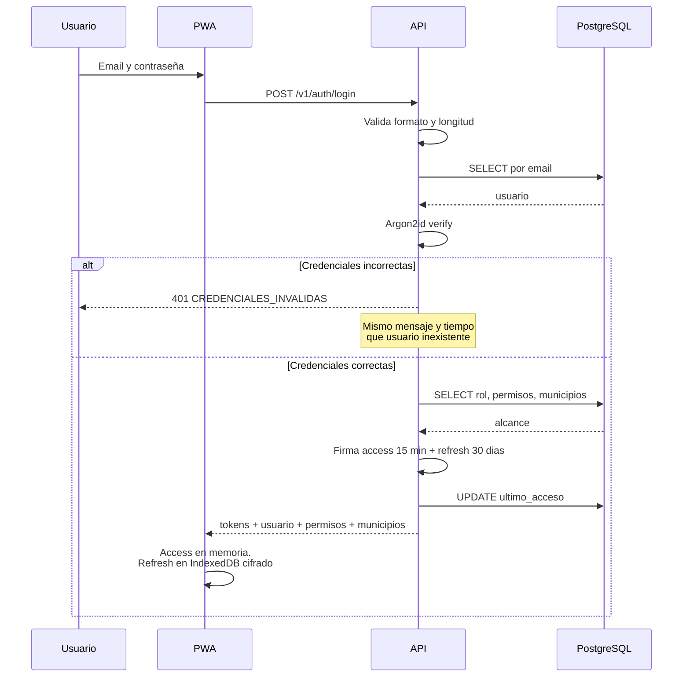
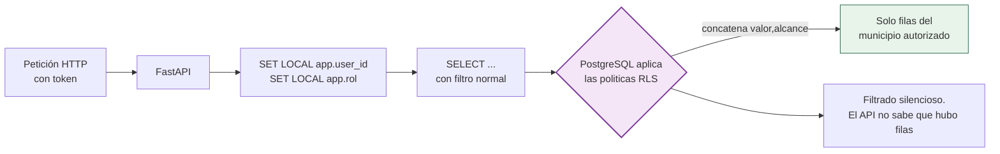
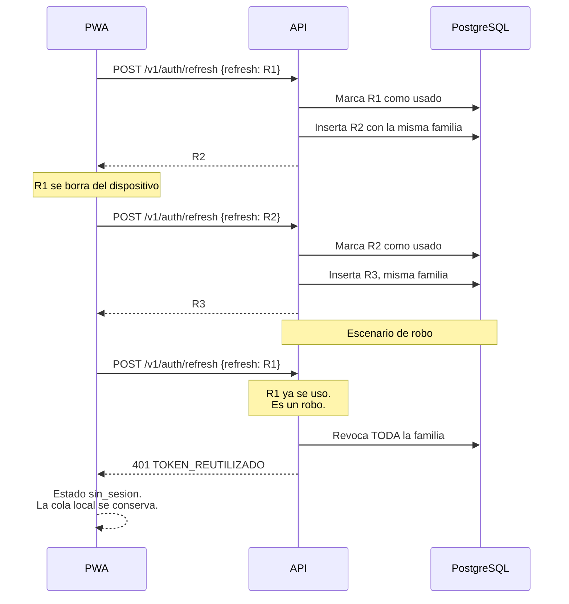

# 09 · Seguridad

Autenticación, permisos, aislamiento por territorio, ciclo de vida del token, almacenamiento de archivos, auditoría y límites del modelo.

> **Contraste con la estructura actual del repositorio**: la base de seguridad **ya existe y se reutiliza** — autenticación **JWT HS256** (`api/auth/jwt.py`), **auditoría de toda escritura** (`AuditMiddleware` en `api/audit.py`) y tablas de usuarios, roles y permisos en el esquema **`usuarios`** (reutilizables **solo si el diseño del SINB lo requiere**). **No existe RLS activo** en el repositorio (sin `ENABLE ROW LEVEL SECURITY`): el aislamiento por territorio de §4 es, por tanto, `[NUEVO]` y se aplica **dentro de `sinb.*`**. Nada de este documento modifica los permisos de `edan` ni `rida`.

---

## 1. Modelo de amenaza

**Alcance esencial.** Todo lo que sigue se apoya en cuatro controles: **TLS** en tránsito (§6), **JWT** de vida corta (§5), **RLS** por territorio (§4) y **auditoría** de cada cambio (§8). Con esos cuatro se cubre lo que este sistema necesita.

Fuera de alcance por ahora (se anotan como límite en §9, no como tarea): segundo factor (MFA) y cifrado de los datos en reposo.


### 1.1 Qué hay que proteger

El sistema maneja tres clases de información con sensibility distinta:

| Clase | Ejemplos | Sensibilidad |
|---|---|---|
| **Conocimiento local** | Señas, pronósticos de observadores locales, confiabilidad por ecorregión | Alta. Es el patrimonio del proyecto |
| **Datos de campo** | Formularios diarios, observaciones, fotos | Media. Registro histórico, atribuible a una persona |
| **Datos de catálogo** | Municipios, comunidades, bioindicadores | Baja. Son públicos y se publican en el README |

### 1.2 Contra quién

| Actor | Capacidad | Objetivo |
|---|---|---|
| Curiosó sin cuenta | Puede probarlo | Ver datos de otras comunidades |
| Usuario legítimo de una comunidad | Acceso válido | Ver más de lo que le corresponde |
| Usuario con un token robado | Token válido del usuario | Publicar como esa persona |
| Actor externo | Red, sin cuenta | Extraer el catálogo, probar credenciales |
| Administrador legítimo | Acceso total | Abusar del acceso. Necesita trazabilidad |

### 1.3 Lo que este diseño NO protege

| Fuera de alcance | Por qué |
|---|---|
| Que un usuario lea lo que ya descargó en su dispositivo | Ya está en su teléfono. Mitigado por el cifrado con clave no exportable y por la revocación de la familia de refresh |
| Que el equipo de campo registre capturas erróneas | La app valida formato y rango, no la veracidad del dato de campo |
| Disponibilidad durante una caída prolongada | El backend tiene réplicas, pero no hay plan de continuidad sin conexión |
| Que el personal con acceso total difunda datos | Se mitiga con `audit_log`, no se elimina |

La tercera es la más importante y la más fácil de olvidar: **ningún sistema de validación de entrada corrige el problema de que la gente registre lo que cree, no lo que ocurrió.** La calidad del dato es un problema de método, y se aborda en el flujo de validación con la comunidad ([11-INTERCULTURALIDAD.md](11-INTERCULTURALIDAD.md)), no con un `CHECK`.

---

## 2. Autenticación

### 2.1 Principio

> **La API no tiene páginas web. No hay sesiones, no hay cookies, no hay CSRF.**

La API recibe un bearer token firmado y no mantiene estado de sesión. Cada petición se autentica sola.

| Consecuencia | Detalle |
|---|---|
| La API escala horizontalmente sin sesiones pegajosas | Cualquier réplica sirve cualquier petición |
| No hay CSRF | No hay cookie que un navegador envíe automáticamente |
| No hay expiración por inactividad en el servidor | El token expiró o no, no hay tabla de sesiones |

### 2.2 Flujo de login



### 2.3 Contramedidas de fuerza bruta

| Medida | Detalle | Por qué |
|---|---|---|
| Argon2id | `m=65536, t=3, p=4`. CPU y memoria caras a propósito | Caro de crackear, barato de verificar en un login |
| Sal por usuario | Generada al crear la cuenta | Dos usuarios con la misma contraseña no comparten hash |
| Comparación en tiempo constante | `verify` de Argon2id | Evita ataques de temporización |
| Rate limit por IP | 5 intentos por minuto | Limita ataques automatizados |
| Rate limit por cuenta | 10 intentos por 15 min | Limita ataques dirigidos a una cuenta |
| Mensaje uniforme | `CREDENCIALES_INVALIDAS` para usuario inexistente y contraseña mala | No revela qué cuentas existen |
| Temporización uniforme | Si el usuario no existe, se verifica igualmente contra un hash señuelo | No revela la existencia por diferencia de tiempo |
| `ultimo_acceso` | Se actualiza al entrar | Permite detectar cuentas en uso |

El hash señuelo es la parte que casi nadie implementa y la que más importa: sin él, un atacante mide tiempos y descubre qué correos existen.

### 2.4 Contraseñas

| Regla | Valor | Motivo |
|---|---|---|
| Longitud mínima | 12 caracteres | El factor que más importa |
| Composición | Sin reglas de símbolos | "Password1!" produce "Password1!" durante años |
| Comprobación contra listas de filtradas | Bloqueante | Contraseñas como `password123` están en cualquier diccionario |
| Almacenamiento | Solo Argon2id | Nunca reversible, nunca en log |
| Restablecimiento | Email con token de un solo uso, 1 hora | Sin preguntas de seguridad |
| Cambio de contraseña | Invalida toda la familia de refresh | Robar la contraseña antigua no sirve si se cambió |

### 2.5 Cuentas: desde cero

**No se migran cuentas, contraseñas ni asignaciones del sistema actual.**

| Motivo | Detalle |
|---|---|
| Los hashes son incompatibles | El sistema actual usa bcrypt o SHA. Ver [docs/AUDITORIA.md §2](../docs/AUDITORIA.md) |
| Los correos pueden estar obsoletos | Un contacto que ya no existe deja al usuario fuera |
| Los roles cambian | Los roles actuales no reflejan la estructura de cuatro roles de [07 §4](07-FLUJOS-BIOCULTURALES.md) |
| La seguridad se rehace | Arrancar con credenciales existentes heredadas las debilidades |

El proceso es: el administrador crea las cuentas nuevas, con alcance territorial explícito, y cada usuario recibe un enlace de restablecimiento. Las cuentas del sistema actual se archivan, no se borran, por si hace falta consultar quién vivía en qué comunidad.

---

## 3. RBAC: permisos por rol

### 3.1 Modelo

El control de acceso es **Role-Based Access Control** con permiso granular, no por rol.

```text
usuario ──< usuario_rol >── rol ──< rol_permiso >── permiso
```

Un usuario tiene uno o más roles. Cada rol tiene permisos. La autorización pregunta por el permiso, nunca por el rol directamente.

| Pregunta | Cómo se responde |
|---|---|
| "¿Puede este usuario crear un pronóstico?" | ¿Tiene el permiso `crear-pronostico`? |
| "¿Puede este usuario validar?" | ¿Tiene el permiso `validar-observacion`? |
| "¿Puede este usuario ver los datos de esta comunidad?" | RLS, no permiso. Ver §4 |

**Por qué separar permiso de rol**: si la autorización preguntara "¿es técnico?", cada vez que hubiera que cambiar la lógica de un rol habría que tocar código. Con permisos, cambiar quién puede validar un pronóstico es una fila en `rol_permiso`.

### 3.2 La matriz de roles real `[ACTUAL]` + el quinto rol `[NUEVO]`

Los cuatro roles existen en `t_rol` y sus capacidades se conservan exactamente. Se añade **un solo rol nuevo** sin tocar los slugs legados: `usuario-supramunicipal` ([04 §8.1](04-BASE-DE-DATOS.md)).

| Rol | Permisos | Menús | `solo-municipal` |
|---|---|---|---|
| `administrador` | 69 | 15 | 0 |
| `usuario-municipal` | 48 | 10 | 1 |
| `usuario-recolector` | 26 | 5 | 1 |
| `observador-local` | 18 | 4 | 1 |
| `usuario-supramunicipal` `[NUEVO]` | [NUEVO] | [NUEVO] | **0**, pero restringido a su región |

`[ACTUAL]` Los tres roles no administrativos tienen `solo-municipal = 1`: no pueden salir de su territorio. Esa restricción es la que se implementa con RLS.

`[NUEVO]` El supra **no es un super-administrador**: no publica a nivel nacional ni configura catálogos. Su reja es la región — el mismo RLS con `app.municipios` cargado con todos los municipios de su región ([04 §12](04-BASE-DE-DATOS.md)). La definición de «región» es `[DECIDIR]`.

| Capacidad | admin | municipal | recolector | observador |
|---|---|---|---|---|
| Ver observaciones | Sí | Sí | Sí | Solo propias |
| Crear observación | Sí | Sí | Sí | Sí |
| Editar observación | Sí | Sí | Sí | Solo suyas |
| Validar observación | Sí | Sí | No | No |
| Recalificar observación | Sí | Sí | No | No |
| Crear pronóstico | Sí | Sí | No | No |
| Configurar regla | Sí | Sí | No | No |
| Calificar indicador | Sí | Sí | No | No |
| Ver calificación | Sí | Sí | Sí | Sí |
| Exportar | Sí | Sí | No | No |
| Ver auditoría | Sí | No | No | No |
| Administrar usuarios | Sí | No | No | No |
| `alerta.ver` | No | Si | Si | Si |
| `alerta.ack` | No | Si | Si | Si |
| `admin.usuarios` | No | No | No | Si |
| `admin.roles` | No | No | No | Si |
| `admin.audit` | No | No | No | Si |
| `admin.catalogo` | No | No | No | Si |
| `admin.alertas` | No | No | No | Si |
| `territorio.importar` | No | No | No | Si |
| `bioindicador.editar` | No | No | No | Si |
| `sensores.gestionar` | No | No | No | Si |

La matriz funcional por rol está en [07-FLUJOS-BIOCULTURALES.md §4.1](07-FLUJOS-BIOCULTURALES.md). Esta es la matriz de permisos.

`[NUEVO]` Permisos añadidos por las capacidades nuevas (dos herramientas, observadores, índice):

| Capacidad | admin | supra | municipal | recolector | observador |
|---|---|---|---|---|---|
| `crear-aviso` | Sí | Sí | Sí | Sí | Sí, su comunidad |
| `verificar-aviso` | Sí | No (lee) | Sí | No | No |
| `ver-indice` | Sí | Su región | Su municipio | Sus comunidades | **Solo el propio** |
| `ver-pronostico` (incluye digital, solo lectura) | Sí | Su región | Su municipio | Lectura | Lectura |

`[NUEVO]` **Dos confianzas, dos controles.** La `confianza_inicial` (por observador, ALTA/MEDIA/BAJA) la pone la persona y se guarda como dato histórico; el `observador_indice` (automático, por tipo LARGO/CORTO) lo calcula el sistema con el cumplimiento. Ninguno de los dos acepta valores del cliente en escritura — el servidor los deriva ([04 §6.2](04-BASE-DE-DATOS.md), [05 §4.5A](05-APIS.md)).

### 3.3 Cómo se aplica el permiso

```python
# app/api/dependencies.py
def requiere(*permisos: str):
    """Dependencia de FastAPI que exige al menos un permiso."""
    async def dependencia(
        usuario: UsuarioAutenticado = Depends(usuario_actual),
    ) -> UsuarioAutenticado:
        if not usuario.permisos.intersection(permisos):
            raise AutorizacionError(
                codigo="ROL_SIN_PERMISO",
                mensaje="No tiene permiso para esta operación",
                detalle={"requeridos": list(permisos)},
            )
        return usuario
    return dependencia

# Uso
@router.post("/v1/formularios-diarios", dependencies=[Depends(requiere("formulario-diario.registrar"))])
async def crear_formulario-diario(...): ...

@router.post(
    "/v1/pronosticos-comunales",
    dependencies=[Depends(requiere("crear-pronostico"))],
)
async def emitir_pronostico(...): ...

@router.post(
    "/v1/validaciones",
    dependencies=[Depends(requiere("validar-observacion"))],
)
async def validar(...): ...
```

| Decisión | Motivo |
|---|---|
| Comprobación en el router | Un permiso comprobado solo en el dominio es fácil de olvidar en un endpoint nuevo |
| El rol no se comprueba nunca directamente | El codigo no dice `if rol == "usuario-municipal"`. Dice `if "validar-observacion" in permisos` |
| `intersection` y no igualdad | Permite `requiere("a")` o `requiere("a", "b")` sin cambiar la firma |
| El 403 no revela el permiso requerido en el mensaje | El `detalle` va al log, no al cliente |

### 3.4 Permisos de solo lectura del catálogo

`bioindicador`, `municipio`, `comunidad` y `ecorregion` se pueden leer con cualquier token válido, sin permiso específico. Son datos públicos y se usan en casi todas las pantallas.

El coste: cualquier cuenta, por mínima que sea, puede descargar los 19.000 registros del catálogo. Como son públicos, se acepta. El endpoint ya está limitado por rate limit y devuelve gzip ([05-APIS.md §5.1](05-APIS.md)).

### 3.5 Menús por rol `[ACTUAL]`

La navegación también se filtra. Un usuario de campo no debería ver un menú que le dé `403` al pulsarlo.

| Menú | `observador-local` | `usuario-recolector` | `usuario-municipal` | `administrador` |
|---|---|---|---|---|
| Inicio | Sí | Sí | Sí | Sí |
| Observaciones | Sí | Sí | Sí | Sí |
| Pronósticos | Ver | Ver | Sí | Sí |
| Validación | No | No | Sí | Sí |
| Análisis y mapa | No | No | Sí | Sí |
| Calificación de indicadores | Ver | Ver | Sí | Sí |
| Recomendaciones | No | No | Sí | Sí |
| Exportar | No | No | Sí | Sí |
| Administración | No | No | No | Sí |
| Auditoría | No | No | No | Sí |

`[ACTUAL]` Los conteos verificados: `administrador` 15 menús, `usuario-municipal` 10, `usuario-recolector` 5, `observador-local` 4.

`[DEFECTO]` El menú 10 de `t_menu` apunta a `listarPronosticosEstacional`, pero la ruta registrada es `listaPronosticos`. Quien lo pulse recibe un 404. Hay que corregir el slug antes de migrar ([01 §1.3](01-ARQUITECTURA.md#13-los-diez-defectos-estructurales-defecto)).

El menú se construye desde los permisos, no desde una tabla aparte. Así no puede divergir de la autorización real: si el menú muestra un ítem, el permiso existe.

---

## 4. RLS: aislamiento por territorio

### 4.1 El objetivo

> **Nadie ve datos de otro municipio.**

Ese es el objetivo número 5 del README. Se implementa en la base de datos, no en el backend, porque en el backend bastaría un `if` olvidado en un endpoint nuevo.



| Capa | Qué hace | Qué no hace |
|---|---|---|
| FastAPI | Traduce el token a `SET LOCAL app.user_id, app.rol` | No filtra filas |
| PostgreSQL RLS | Filtra cada fila según el alcance | No sabe qué pidió el cliente |

El backend **nunca** escribe un `WHERE municipio_id = ...` para el alcance. Si lo hiciera, tendría que acordarse en cada consulta.

### 4.2 El contexto por transacción

```python
# app/db/session.py
@asynccontextmanager
async def sesion_con_contexto(usuario: UsuarioAutenticado):
    async with sesion.begin():
        # SET LOCAL: dura hasta el COMMIT de esta transacción.
        # Si se usara SET normal, el alcance se filtraría a la
        # siguiente petición que reutilice la conexión del pool.
        await sesion.execute(
            text("SELECT set_config('app.user_id', :uid, true)"),
            {"uid": str(usuario.id)},
        )
        await sesion.execute(
            text("SELECT set_config('app.rol', :rol, true)"),
            {"rol": usuario.rol_principal},
        )
        yield sesion
```

| Detalle | Motivo |
|---|---|
| `SET LOCAL`, no `SET` | Con `SET`, el valor persiste en la conexión del pool. La siguiente petición heredar el alcance de otra persona. Es una fuga de datos silenciosa |
| Dentro de `begin()` | `SET LOCAL` dura hasta el fin de la transacción. Sin transacción abierta, dura la sentencia |
| Rol, no lista de roles | El RLS necesita un rol principal. Los roles múltiples se resuelven en la capa superior |
| El worker no abre contexto | Los procesos de fondo usan un rol de servicio con permisos completos, y no pasan por `sesion_con_context` |

### 4.3 La política

```sql
-- Referencia: [04-BASE-DE-DATOS.md §11.2](04-BASE-DE-DATOS.md)
ALTER TABLE monitoreo_diario ENABLE ROW LEVEL SECURITY;
ALTER TABLE monitoreo_diario FORCE ROW LEVEL SECURITY;

CREATE POLICY monitoreo_select ON monitoreo_diario
    FOR SELECT USING (app_tiene_alcance(comunidad_id));

CREATE POLICY monitoreo_insert ON monitoreo_diario
    FOR INSERT WITH CHECK (
        app_tiene_alcance(comunidad_id)
        AND registrado_por = current_setting('app.user_id', true)::uuid
    );
```

Las cuatro piezas:

| Pieza | Función |
|---|---|
| `app_municipios_autorizados()` | Devuelve los municipios del usuario. `NULL` si es administrador |
| `app_tiene_alcance(comunidad_id)` | `TRUE` si el usuario tiene alcance sobre esa comunidad |
| `ENABLE ROW LEVEL SECURITY` | Activa el filtrado |
| `FORCE ROW LEVEL SECURITY` | Aplica la política también al dueño de la tabla |

`FORCE` no es opcional. Sin él, el `superusuario` de PostgreSQL, que es quien corre las migraciones, se saltaría todas las políticas por accidente.

### 4.4 INSERT también se filtra

La parte que se olvida: `USING` filtra lecturas, `WITH CHECK` filtra escrituras.

| Política ausente | Consecuencia |
|---|---|
| `SELECT` | El usuario lee datos ajenos |
| `INSERT ... WITH CHECK` | El usuario **escribe** datos en una comunidad ajena. Falsear un dato ajeno |
| `UPDATE ... WITH CHECK` | El usuario mueve un registro a una comunidad ajena |

Una tabla con solo `SELECT USING (true)` es una tabla abierta a escritura para cualquier `INSERT` que pase la validación de la aplicación.

### 4.5 No hay política de DELETE

```sql
-- Sin politica de DELETE: el permiso del rol tampoco lo permite.
```

Las capturas de campo no se borran. Se anulan con un registro nuevo y un `motivo`. Un sistema donde el técnico puede borrar el Formulario diario de ayer no es auditable.

| Tabla | `DELETE` permitido |
|---|---|
| `monitoreo_diario`, `observacion`, `senal` | No |
| `pronostico_comunal`, `validacion_pronostico` | No |
| `verificacion_pronostico` cerrada | No |
| `bioindicador`, `comunidad` | Sí, pero como baja lógica, no física |
| `audit_log` | Nunca. Trigger de protección. Ver §8 |

### 4.6 Verificación del aislamiento

El RLS no se prueba a mano una vez. Se prueba en cada despliegue, con un test que intenta cruzarRoles.

```python
# tests/integration/test_rls.py
async def test_municipal_no_ve_comunidad_ajena(sesion_admin, tokens):
    """El RLS debe filtrar, no el filtro del API."""
    # Este test hace SELECT * sin ningun WHERE a proposito.
    # Si el RLS funciona, la comunidad ajena NO aparece.
    filas = await sesion_admin.ejecutar_crudo(
        "SET LOCAL app.user_id = :uid; SET LOCAL app.rol = 'usuario-municipal';",
        uid=tokens["municipal"].id,
        sql="SELECT comunidad_id FROM monitoreo_diario",
    )
    assert all(f.comunidad_id in tokens["municipal"].municipios for f in filas)
```

| Test | Qué verifica |
|---|---|
| `test_municipal_no_ve_comunidad_ajena` | Que el `SELECT` se filtra |
| `test_observador_no_escribe_ajena` | Que el `INSERT ... WITH CHECK` bloquea |
| `test_no_se_puede_trasladar_registro` | Que el `UPDATE ... WITH CHECK` bloquea |
| `test_admin_ve_todo` | Que el administrador no queda excluido |
| `test_worker_sin_contexto_no_falla` | Que la conexión de fondo no rompe |
| `test_token_otro_no_filtra` | Que el `SET LOCAL` no se filtra entre peticiones del pool |

Ese último es el que detecta la fuga del pool de conexiones, que es un fallo silencioso y grave.

### 4.7 El mapa completo

El mapa de política por tabla está en [04-BASE-DE-DATOS.md §11.4](04-BASE-DE-DATOS.md). Resumen:

| Alcance | Tablas |
|---|---|
| Por comunidad | `monitoreo_diario`, `observacion`, `senal`, `pronostico_comunal`, `pronostico_senal`, `validacion_pronostico`, `alerta_agrometeorologica` |
| Global, lectura libre | `departamento`, `provincia`, `municipio`, `comunidad`, `ecorregion`, `ecorregion_comunidad`, `bioindicador`, `bioindicador_sinonimo`, `permiso`, `rol_permiso` |
| Global, escritura admin | `calificacion_indicador`, `usuario`, `token_refresh`, `auditoria` |
| Solo admin | `audit_log` |
| Propio | `sync_log` |
| Solo worker | `dato_satelital`, `estacion_hidrometeorologica`, `estacion_lectura` |

`[NUEVO]` Con las capacidades nuevas se añaden al mapa: **alcance municipio** para `aviso` y sus observadores, `pronostico_observador` y `observador_indice` (el índice del observador solo es visible en su propio registro salvo para quien tenga alcance sobre su territorio). El **`usuario-supramunicipal`** entra por la misma puerta que `usuario-municipal`: la única diferencia es que su `app.municipios` contiene los municipios de su región.

---

## 5. Ciclo de vida del token

### 5.1 Dos tokens

| Token | Vida | Dónde vive | Contenido |
|---|---|---|---|
| Access | 15 minutos | Solo en memoria | `sub`, `rol`, `municipios`, `jti`, `iat`, `exp` |
| Refresh | 30 días | IndexedDB cifrado | `sub`, `jti`, familia. Sin alcance |

El access lleva los municipios porque el RLS los necesita en cada fila, y consultar la base para eso en cada lectura convertiría `app_municipios_autorizados()` en `VOLATILE` y haría el filtrado inmanejable. Va firmado, así que no se puede alterar.

### 5.2 Por qué 15 minutos

| Vida más corta | Vida más larga |
|---|---|
| 5 min: 3 renovaciones por hora. Fricción visible, y las renovaciones en 2G son un problema | 24 h: un token robado sirve para un día entero |

Quince minutos es el punto donde un token robado tiene una ventana de daño acotada sin generar una petición de renovación por cada acción del usuario.

### 5.3 Rotación del refresh



La detección de robo es el segundo uso de un refresh ya rotado. Ante esa señal, se revoca la familia entera y ambos quedan fuera. El coste es un login extra para el usuario legítimo; el beneficio es que el atacante no puede mantener el acceso.

### 5.4 Qué ocurre cuando expira en el PWA

El PWA no le pide nada al usuario. Ante un `401`:

1. El cliente HTTP intenta el `refresh` **una sola vez**, de forma transparente
2. Si funciona, reintenta la petición original y el usuario no se entera
3. Si falla, la app entra en estado `sin_sesion`
4. **La app sigue permitiendo capturar offline**
5. Las capturas quedan en la cola con el `autor_id` del último usuario conocido
6. En el siguiente login se ofrecen para subir, previa confirmación explícita

El punto 4 es el importante. Un `401` no puede convertirse en "no puedes trabajar". La captura de campo no depende de la sesión.

### 5.5 Revocación

| Acción | Efecto |
|---|---|
| Logout | Revoca la familia del refresh |
| Logout en todas partes | Revoca todas las familias del usuario |
| Cambio de contraseña | Revoca todas las familias |
| Detección de reutilización | Revoca la familia de tokens |
| Cambio de rol | Invalida el access por expiración. El refresh sigue, pero emite un access con el rol nuevo |

El access no se revoca individualmente. Se deja expirar, que es lo que hace barato el esquema. La revocación real es sobre el refresh.

### 5.6 Firmado con qué

| Elemento | Elección | Motivo |
|---|---|---|
| Algoritmo | EdDSA (Ed25519) o RS256 | RS256 es el más compatible. EdDSA firma más rápido en móvil |
| Clave | Asimétrica, privada en el servidor | El servidor firma, los clientes verifican. Ningún cliente tiene la clave privada |
| Rotación | Doble clave, con `kid` en el header | Se puede rotar sin invalidar todos los tokens |
| Almacenamiento | Variable de entorno o archivo con permisos `0600` | Nunca en el repositorio, nunca en la imagen |
| Reloj | Tolerance de 60 s | Los relojes del dispositivo se desvían |

**No se usa HMAC.** Con HMAC, cualquier componente que pueda verificar un token puede también firmarlo. En una arquitectura con varios servicios, la firma asimétrica deja claro quién puede emitir y quién solo puede leer.

---

## 6. Criptografía en tránsito

| Aspecto | Decisión |
|---|---|
| TLS | 1.3 obligatorio. 1.2 si hay que |
| HSTS | `max-age=31536000; includeSubDomains; preload` |
| Redirección | Todo HTTP a HTTPS, sin excepción |
| Cookies | `Secure`, `HttpOnly`, `SameSite=Strict`. El sistema no usa cookies de sesión, pero las de sesión técnica sí |
| Certificados | Let's Encrypt, renovación automática |
| Entre PWA y API | HTTPS obligatorio, `connect-src` limitado al origen de la API |
| Entre servicios | mTLS en la red interna |

### 6.1 Cabeceras de seguridad

```http
Strict-Transport-Security: max-age=31536000; includeSubDomains; preload
X-Content-Type-Options: nosniff
X-Frame-Options: DENY
Referrer-Policy: strict-origin-when-cross-origin
Permissions-Policy: geolocation=(self), camera=(self), microphone=(self)
Content-Security-Policy: default-src 'self'; img-src 'self' data: blob:; connect-src 'self' https://api.sinb.gob.bo; style-src 'self' 'unsafe-inline'; script-src 'self'; worker-src 'self' blob:
Cross-Origin-Opener-Policy: same-origin
Cross-Origin-Resource-Policy: same-origin
```

| Cabecera | Por qué |
|---|---|
| `X-Frame-Options: DENY` | Impide que alguien incruste el panel en un iframe para phishing |
| `nosniff` | Impide que el navegador interprete un `.json` como HTML |
| `connect-src` limitado | Si una XSS se ejecutara, no podría enviar datos a un atacante |
| `blob:` en `img-src` | Necesario para las fotos pendientes en IndexedDB |
| `Permissions-Policy` | Geolocation, cámara y micrófono solo para la propia app, no embebibles |
| Sin `unsafe-eval` | Vite en desarrollo sí lo necesita, pero producción no. La CSP de producción no lo permite |

---

## 7. Almacenamiento de archivos

### 7.1 Por qué el almacenamiento de objetos y no el sistema de archivos

| Necesidad | Sistema de archivos | Almacenamiento de objetos |
|---|---|---|
| Despliegue en varias réplicas | Necesita disco compartido | Cada réplica sirve el mismo objeto |
| Fotos de 6 MB | Ocupa el disco del servidor | No toca el disco de la app |
| Replicación | Manual | Automática |
| Coste | Crece con el hardware | Crece por uso |
| Backup | Scripts | Replicación nativa |
| Compatibilidad | Específica del proveedor | S3 en todas partes |

Se usa **MinIO** en el despliegue del Estado, con API compatible con S3, para no acoplar el código al proveedor.

### 7.2 Estructura de claves

```text
sinb/
  observacion/
    2026/
      09/
        0198f2c4-aaaa-7222-8333-444455556666/
          0198f2c4-eeee-7222-8333-444455556666.jpg
```

| Decisión | Motivo |
|---|---|
| Prefijo por entidad y fecha | Facilita una política de ciclo de vida por antiguedad |
| Carpeta por registro | Reúne todas las fotos de una observación |
| Nombre = `observacion_foto.id` | Sin datos personales en el nombre. Un nombre de archivo con nombre de comunidad es una fuga |
| Extensión fija | Se normaliza al subir. Un `.html` subido como foto es un XSS |
| Sin UUID en el nombre de la comunidad | Ver arriba |

### 7.3 El nombre del archivo nunca contiene datos del usuario

| Correcto | Incorrecto |
|---|---|
| `0198f2c4-eeee-...jpg` | `foto-juan-perez-comunidad-chuquiputipiti.jpg` |
| El ID es opaco | El nombre viaja en logs, en `audit_log`, en URLs y en elucket listing |

Las URLs firmadas que se devuelven al cliente caducan, así que el nombre no acaba filtrándose por ahí.

### 7.4 Upload

```http
POST /v1/observaciones/0198f2c4-aaaa-.../fotos
Content-Type: image/jpeg
Content-Length: 412883
Idempotency-Key: 0198f2c4-ffff-7222-8333-444455556666
```

```json
{
  "id": "0198f2c4-eeee-7222-8333-444455556666",
  "url_firmada": "https://minio.sinb.gob.bo/senb/observacion/2026/09/...?X-Amz-Expires=3600",
  "expires_at": "2026-09-14T21:15:00Z",
  "bytes": 412883
}
```

| Paso | Detalle |
|---|---|
| 1. Cliente pide permiso | `POST` con metadatos. El servidor valida alcance, tipo y tamaño |
| 2. Servidor devuelve URL firmada | Válida 1 hora, de un solo uso |
| 3. Cliente sube directo a MinIO | El archivo **no pasa por FastAPI**. Una foto de 6 MB no consume un worker |
| 4. Cliente confirma | `POST /fotos/{id}/confirmar`. El servidor verifica que el objeto existe |
| 5. Servidor registra | Se crea la fila en `observacion_foto` |

El paso 3 es el que importa: subir el archivo directamente al almacenamiento de objetos mantiene la API sin estado y la hace escalable. Sin eso, cada foto consume un worker de la API durante su transferencia.

### 7.5 Validación del contenido

| Validación | Regla |
|---|---|
| Tipo declarado | `image/jpeg`, `image/png`, `image/webp`. Nada más |
| Tamaño máximo | 10 MB |
| Bytes reales | Se comprueba la firma del archivo. Un `.jpg` que en realidad es HTML no se guarda |
| Dimensiones | Máximo 6.000 px de lado. Evita denegación por imágenes enormes |
| Proporción | Rechazo de imágenes 1:1000. Casi siempre son errores o ataques |
| Re-encoding | Se vuelve a comprimir en el servidor. Elimina EXIF y payloads ocultos |

El re-encoding no es opcional. Una imagen puede llevar un payload en los metadatos EXIF, o un fragmento de código en un espacio que la especificación de JPEG permite ignorar y que algunos navegadores no ignoran. Al re-guardar la imagen con un encoder conocido, ese payload desaparece.

### 7.6 Acceso a las fotos

| Regla | Detalle |
|---|---|
| No se sirven directamente | El bucket es privado |
| Se sirve por URL firmada | Caduca en 1 hora |
| Se emite tras verificar el alcance | El RLS se consulta antes de firmar |
| Sin URL en el listado | Un listado de observaciones no devuelve URLs. Se piden por separado |
| La URL no va en `audit_log` | Se registra el `observacion_foto.id`, no la URL firmada |

### 7.7 Ciclo de vida

| Objeto | Retención | Motivo |
|---|---|---|
| Fotos de campo | Permanente | Son evidencia del registro histórico |
| Fotos de perfil de usuario | Hasta que se reemplace | — |
| Adjuntos de alerta | 1 año | Las alertas son operativas, no históricas |
| Exportaciones | 7 días | Son grandes y se regeneran |
| Datos satelitales crudos | 2 años | Los derivados sí se conservan |

Las fotos de campo no se borran nunca, aunque la observación se anule. Son el registro de lo que se vio.

---

## 8. Auditoría

### 8.1 Qué se audita

| Operación | Tabla | Qué guarda |
|---|---|---|
| Login | `audit_log` | Usuario, IP, resultado. No la contraseña |
| Login fallido | `audit_log` | Correo intentado, IP. Permite detectar ataques |
| Cambio de contraseña | `audit_log` | Usuario, IP |
| Cambio de rol | `audit_log` | Usuario, rol anterior, rol nuevo |
| Cambio de alcance | `audit_log` | Usuario, municipios anteriores, nuevos |
| Modificación de catálogo | `audit_log` | Tabla, `id`, valores anteriores y nuevos |
| Validación de pronóstico | `audit_log` | Pronóstico, evaluador, resultado |
| Confirmación de pronóstico | `audit_log` | Pronóstico, técnico |
| Exportación | `audit_log` | Usuario, filtros, número de filas |
| Importación de catálogo | `audit_log` | Usuario, fuente, filas afectadas |
| Cambio de configuración | `audit_log` | Parámetro, valor anterior, nuevo |
| Intento de RLS | Log de aplicación | Usuario, tabla, `id` intentado |

### 8.2 Por qué se guardan los valores anteriores

Un log que solo dice "se cambió el bioindicador X" no sirve para nada. Sin el valor anterior no se puede deshacer un cambio ni entender un error.

```json
{
  "usuario_id": "0198f2c4-1a2b-7c3d-8e4f-5a6b7c8d9e0f",
  "accion": "update",
  "tabla": "bioindicador",
  "registro_id": "0198f2c5-0001-7222-8333-444455556666",
  "valores_antes": { "mes_esperado_min": 10, "mes_esperado_max": 12, "activo": true },
  "valores_despues": { "mes_esperado_min": 11, "mes_esperado_max": 12, "activo": true },
  "ip": "10.14.2.87",
  "user_agent": "Mozilla/5.0 (Linux; Android 13)",
  "request_id": "0198f2c4-9f8e-7a7b-8c8d-9e0f1a2b3c4d",
  "created_at": "2026-09-14T20:11:04Z"
}
```

Solo se guardan las columnas que cambiaron. Guardar la fila entera multiplica el tamaño sin aportar información.

### 8.3 `audit_log` es inmutable

```sql
-- Trigger de proteccion, [04-BASE-DE-DATOS.md §12.3](04-BASE-DE-DATOS.md)
CREATE FUNCTION audit_log_es_inmutable() RETURNS trigger AS $$
BEGIN
    RAISE EXCEPTION 'audit_log no admite DELETE ni UPDATE';
END;
$$ LANGUAGE plpgsql;

CREATE TRIGGER audit_log_no_update
    BEFORE UPDATE OR DELETE ON audit_log
    FOR EACH ROW EXECUTE FUNCTION audit_log_es_inmutable();
```

Un log de auditoría que el administrador puede editar no es un log de auditoría. La única forma de modificarlo es interveniendo la base de datos directamente, y eso deja rastro en el log del sistema.

### 8.4 Retención

| Dato | Retención |
|---|---|
| `audit_log` | 7 años |
| `sync_log` | 2 años |
| Logs de aplicación | 90 días, luego agregados |
| Eventos de seguridad (login fallido, RLS) | 2 años |

Siete años para el log de auditoría no es un capricho: es el plazo habitual de los contratos de financiamiento en el sector público. Antes de fijar esa cifra, conviene confirmarla con la institución, porque si resulta ser diez, cambiar el `DELETE` programado es trivial, pero no recuperarlo después.

---

## 9. Límites del modelo

| Límite | Impacto | Mitigación |
|---|---|---|
| No hay segundo factor | Una contraseña robada da acceso | Rate limit, auditoría, alertas de login |
| No hay detección de anomalías | Un abuso legítimo no se detecta | `audit_log` para análisis posterior |
| `audit_log` ve el administrador | El administrador puede leer el log | Los accesos al log se registran en el log del servidor |
| El refresh cifrado depende del dispositivo | Perder el dispositivo obliga a re-loguear | Es el objetivo del diseño |
| Sin cifrado de datos en reposo en el dispositivo | Un teléfono desbloqueado expone lo capturado | Aviso explícito al usuario. Ver [08 §9](08-OFFLINE-SINCRONIZACION.md) |
| El RLS depende de `SET LOCAL` | Un endpoint que olvide el contexto ve todo | Test de integración en cada despliegue. Ver §4.6 |

### 9.1 El último límite es el más peligroso

Una conexión de pool sin contexto de usuario tiene `app.user_id` vacío. `app_tiene_alcance` devolvería `FALSE` para todo, lo que es seguro. Pero si alguien abre una sesión sin el contexto y la política es `USING (true)`, ve todo.

El test `test_worker_sin_contexto_no_falla` y el `test_token_otro_no_filtra` de §4.6 existen exactamente para que ese fallo no llegue a producción sin detectarse.

---

## 10. Ver también

- [03-BACKEND.md §6](03-BACKEND.md) — manejo de errores y códigos
- [04-BASE-DE-DATOS.md §11](04-BASE-DE-DATOS.md) — RLS completo
- [04-BASE-DE-DATOS.md §12](04-BASE-DE-DATOS.md) — triggers de auditoría y de `updated_at`
- [05-APIS.md §3](05-APIS.md) — flujo de autenticación
- [05-APIS.md §6](05-APIS.md) — catálogo de errores, incluidos los de seguridad
- [05-APIS.md §12](05-APIS.md) — cabeceras de seguridad y CORS
- [06-FRONTEND.md §9](06-FRONTEND.md) — CSP y service worker
- [07-FLUJOS-BIOCULTURALES.md §4](07-FLUJOS-BIOCULTURALES.md) — la matriz de roles
- [08-OFFLINE-SINCRONIZACION.md §9](08-OFFLINE-SINCRONIZACION.md) — seguridad en el dispositivo