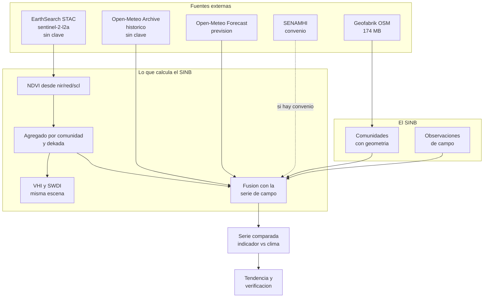

# 10 · Interoperabilidad

Cómo entra al sistema la información que el SINB no produce: satélite, meteorología, límites territoriales. Y cómo sale de forma verificable.

---

## Cómo leer este documento

| Marcador | Significado |
|---|---|
| `[ACTUAL]` | Comprobado en `web/` o en pruebas de esta propuesta — *`web/` es el SINB legado (VIDECI), no incluido en este repositorio* |
| `[DEFECTO]` | Problema comprobado |
| `[MEJORA]` | Capacidad existente que se modifica |
| `[NUEVO]` | Capacidad que el SINB no tiene |
| `[DECIDIR]` | Requiere firma institucional |

**Regla de este documento.** Una integración entra solo si se verificó el endpoint desde la red de destino. Toda fuente que no se pudo probar está marcada y no se usa en el diseño.

---

## 1. Estado actual

> **Contraste con la estructura actual del repositorio**: la tabla siguiente describe el **SINB legado** (verificado sobre `web/`). En este repositorio no hay integraciones externas activas para SINB, pero sí existen **cargas de datos puntuales por script** (`scripts/cargar_municipios_343.py`, `scripts/cargar_censo2024_shared.py` hacia el esquema `shared`) que no son integraciones API. Las entidades nuevas que se mencionan aquí (`escena_satelital`, `agregado_satelital`, `serie_climatica`, `variable_climatica`, `verificacion_pronostico`) se crean en **`sinb.*`**, apoyándose en PostGIS 3.4 ya presente.

`[DEFECTO]` El SINB **no integra nada**. Verificado sobre `web/`:

| Capacidad | Estado |
|---|---|
| API REST | No existe |
| PWA o aplicación móvil | No existe |
| Cálculo de pronóstico | No existe |
| Meteorología consumida | No existe |
| Integración satelital | No existe |
| Notificaciones | No existe |
| Bitácora de auditoría | No existe |
| Multi-idioma | No existe |
| Exportación GeoJSON | No existe |

`[ACTUAL]` Lo único cartográfico es `ZonaGeograficaController::mapa()`, que usa **Leaflet con Google Maps** y activa clustering por encima de 1.000 puntos.

`[ACTUAL]` Las únicas exportaciones son `UsuariosExport` (`.xlsx`, funciona) y `PdfController` (falla, §11).

`[DEFECTO]` `QUEUE_CONNECTION=sync`. No hay colas, ni correo, ni procesos en segundo plano. Cualquier ingesta externa tendría que ejecutarse dentro de una petición web, lo que no es viable para ráster.

---

## 2. Fuentes verificadas

Todas probadas desde la red de desarrollo. Los resultados son reales, no supuestos.

### 2.1 EarthSearch STAC (Element84) — Sentinel-2 `[NUEVO]`

**Estado: funcional, sin clave de API.**

| Dato | Valor verificado |
|---|---|
| Método y ruta | `POST https://earth-search.aws.element84.com/v1/search` |
| Colección | `sentinel-2-l2a` |
| Respuesta | `features: 3`, `matched: 18` |
| Identificador de ejemplo | `S2B_19KFA_20260726_0_L2A` |
| Fecha de adquisición | `2026-07-26T14:47:48Z` |
| Cobertura de nubes | `0.040332` (4,03 %) |
| Plataforma | `sentinel-2b` |
| Assets confirmados | `nir`, `red`, `green`, `blue`, `swir16`, `swir22`, `rededge1`, `rededge2`, `rededge3`, `scl`, `visual`, `aot`, `wvp` |
| Formato de imagen | COG en `https://sentinel-cogs.s3.us-west-2.amazonaws.com/...` |
| Autenticación | Ninguna |

**Cuerpo de la consulta**

```json
{
  "collections": ["sentinel-2-l2a"],
  "bbox": [-69.5, -17.5, -67.5, -16.5],
  "datetime": "2026-01-01/2026-12-31",
  "limit": 10,
  "query": {
    "eo:cloud_cover": { "lt": 20 },
    "platform": { "eq": "sentinel-2b" }
  }
}
```

**Respuesta real (recortada)**

```json
{
  "type": "FeatureCollection",
  "features": [
    {
      "type": "Feature",
      "id": "S2B_19KFA_20260726_0_L2A",
      "properties": { "datetime": "2026-07-26T14:47:48Z",
                      "platform": "sentinel-2b",
                      "eo:cloud_cover": 0.040332 },
      "assets": {
        "nir":  { "href": "https://sentinel-cogs.s3.us-west-2.amazonaws.com/.../B08.tif" },
        "red":  { "href": "https://sentinel-cogs.s3.us-west-2.amazonaws.com/.../B04.tif" },
        "scl":  { "href": "https://sentinel-cogs.s3.us-west-2.amazonaws.com/.../SCL.tif" }
      }
    }
  ],
  "matched": 18,
  "links": [ { "rel": "next",
               "href": "https://earth-search.aws.element84.com/v1/search?..." } ]
}
```

`[NUEVO]` Es la fuente primaria de imagen y la única del catálogo que no requiere trámite. La resolución de 10 m en bandas NIR y roja es adecuada para el objetivo, y la cobertura de nubes de 4 % en el Altiplano es buena.

`[MEJORA]` Sobre el mapa actual: Google Maps muestra calles y limites administrativos, pero **no muestra vegetacion**. La comparacion lado a lado entre una observacion de floracion y la imagen de la misma fecha es lo que permite a un tecnico decidir si el dato de campo coincide con lo que ve el satelite.

### 2.2 Open-Meteo Archive — histórico `[NUEVO]`

**Estado: funcional, sin clave.**

```
GET https://archive-api.open-meteo.com/v1/archive
      ?latitude=-17.5
      &longitude=-67.5
      &start_date=2026-01-01
      &end_date=2026-01-03
      &daily=precipitation_sum
      &timezone=America/La_Paz
```

**Respuesta real (recortada)**

```json
{
  "latitude": -17.5,
  "longitude": -67.5,
  "elevation": 3830.0,
  "daily_units": { "time": "day", "precipitation_sum": "mm" },
  "daily": {
    "time": ["2026-01-01", "2026-01-02", "2026-01-03"],
    "precipitation_sum": [0.0, 1.4, 0.0]
  }
}
```

`[ACTUAL]` Nota relevante: devuelve `elevation`, que sirve para validar la altitud de `comunidad.elevacion_m` ([04 §4.2](04-BASE-DE-DATOS.md#42-coordenadas-de-double-a-geometría-mejora)).

### 2.3 Open-Meteo Forecast — humedad de suelo `[NUEVO]`

**Estado: funcional, sin clave.**

```
GET https://api.open-meteo.com/v1/forecast
      ?latitude=-17.5
      &longitude=-67.5
      &hourly=soil_moisture_0_to_7cm
      &forecast_days=1
```

Unidades: `m³/m³`. Es la profundidad de la raíz de la papa y la quinua en el Altiplano.

### 2.4 Open-Meteo NDVI `[DEFECTO]`

`[DEFECTO]` **`daily=ndvi` devuelve HTTP 400.** Open-Meteo no expone índice de vegetación.

Consecuencia de diseño: **el NDVI no se pide, se calcula.** Ver §6.

### 2.5 Geofabrik — límites de OSM `[NUEVO]`

**Estado: funcional, descarga confirmada.**

| Dato | Valor verificado |
|---|---|
| URL | `https://download.geofabrik.de/south-america/bolivia-latest.osm.pbf` |
| Código HTTP | 200 |
| Tamaño | 173.891.680 bytes (≈ 174 MB) |
| Tipo | `application/octet-stream` |

`[NUEVO]` Se descarga el `.osm.pbf` y se filtra con `osmium`. El `.shp.zip` del mismo sitio es mucho más lento de descargar porque trae también los `.osm.pbf` por departamento.

Herramientas del proceso:

| Herramienta | Uso |
|---|---|
| `osmium extract` | Recorta por `bbox` de la comunidad |
| `osmium tags-filter` | Conserva solo los límites que interesan |
| `osmium export` | Convierte a GeoJSON |
| `shapely` | Valida geometrías en Python |

### 2.6 CHIRPS — precipitación `[DECIDIR]`

**Estado: inaccesible desde esta red.**

| Ruta probada | Resultado |
|---|---|
| `https://data.chc.ucar.edu/chirps/v2.0/daily` | El dominio no resuelve por DNS |
| `https://data.chc.ucsb.edu/chirps/v2.0/daily` | 404 |
| `https://www.chc.ucsb.edu/data/chirps` | 200 (página informativa) |

`[DECIDIR]` CHIRPS es la mejor opción técnica (0,05° ≈ 5,5 km, cobertura desde 1981, todo el planeta) pero **no se puede afirmar su accesibilidad desde la red de VIDECI sin probarla allí**. Tres opciones, en orden de preferencia:

| Opción | Descripción | Condición |
|---|---|---|
| A | Descarga del NetCDF oficial en la red de VIDECI | Probar desde la red institucional |
| B | Espejo interno en MinIO, sincronizado mensualmente | Si A falla |
| C | Open-Meteo Archive como fuente primaria | Si A y B fallan |

`[NUEVO]` Si CHIRPS queda fuera, Open-Meteo Archive cubre el papel: es la fuente de §2.2, ya verificada, y con precipitación diaria de 1940. La resolución es menor (≈ 11 km), pero para validar un pronóstico de escala municipal es suficiente. El diseño de `variable_climatica.fuente` ya contempla ambas ([04 §9.1](04-BASE-DE-DATOS.md#91-variable_climatica-y-serie_climatica-nuevo)).

### 2.7 Fuentes descartadas

| Fuente | Resultado | Motivo |
|---|---|---|
| Planetary Computer STAC | 404 en la ruta de colecciones | No verificable |
| USGS Landsat M2M | 403 | Requiere clave de USGS, trámite previo |
| MODIS ORNL `MOD13Q1` | 400 y 404 | Endpoints no disponibles |
| Open-Meteo `daily=ndvi` | 400 | No existe |
| RainViewer nowcast | Servicio retirado | **Nowcast descontinuado el 01/01/2026** ([§8A](#8a-pronóstico-digital-control-y-ayuda-para-el-corto-plazo-nuevo)) |

`[NUEVO]` MODIS se descarta **solo para NDVI**, no en general: MODIS MOD13 ya viene con NDVI precalculado a 250 m y cubre losiblinggap de Sentinel-2 entre revisitas. Si en el futuro se necesita una serie más larga o más frecuente, MODIS es la primera opción a reevaluar, por longitud de serie. `[DECIDIR]` Requiere reintento desde la red institucional.

### 2.8 Fuentes institucionales

| Fuente | Endpoint | Condición |
|---|---|---|
| SENAMHI Bolivia | Boletín agroclimático y estaciones | `[DECIDIR]` acuerdo de acceso a datos |
| SENAMHI | API de estaciones | `[DECIDIR]` requiere convenio |
| INIFAP SIAMEXCA (México) | Variables agroclimáticas en ráster | Referencia, solo lectura manual |
| VIDECI / PMA | Datos internos | `[DECIDIR]` formato de intercambio |

`[DECIDIR]` El acceso a los datos de SENAMHI es la incógnita mayor del documento. Si no hay convenio, la verificación de pronósticos se apoya en Open-Meteo y en satélite, y eso se declara en los informes.

---

## 3. Mapa de fuentes

| Dato | Fuente principal | Alternativa | Verificada |
|---|---|---|---|
| Escenas de satélite | EarthSearch / Sentinel-2 | MODIS | Sí |
| Precipitación histórica | Open-Meteo Archive | CHIRPS | Sí |
| Precipitación prevista | Open-Meteo Forecast | SENAMHI | Sí |
| Temperatura mínima / máxima | Open-Meteo Archive | SENAMHI | Sí |
| Humedad de suelo | Open-Meteo Forecast | — | Sí |
| NDVI | **Cálculo propio** desde Sentinel-2 | MOD13 | Fórmula, §6 |
| Límites de comunidad | OSM / Geofabrik | INE Shapes | Descarga sí |
| Estaciones meteorológicas | SENAMHI | — | `[DECIDIR]` |

### 3.1 De dónde sale cada dato



`[NUEVO]` El dato de campo y el dato satelital no se guardan en el mismo lugar: uno viene de una persona y otro de un sensor. El sistema los mantiene separados y los une en el momento del análisis, en `desviacion_indicador`. Esa separación es lo que permite decir «el comportamiento responde al clima» con dos fuentes independientes.

### 3.2 Las fuentes descartadas y por qué

| Fuente | Qué se intentó | Resultado | Decisión |
|---|---|---|---|
| Open-Meteo `daily=ndvi` | Pedir NDVI directo | HTTP 400 | Calcularlo desde bandas |
| MODIS ORNL | Descargar MOD13 | Sin respuesta utilizable | Sustituido por Sentinel-2 |
| USGS Landsat | Landsat Collection 2 | Sin respuesta utilizable | Sustituido por Sentinel-2 |
| Planetary Computer | STAC de Microsoft | Sin respuesta utilizable | Sustituido por EarthSearch |
| CHIRPS | Descarga directa de precipitación | Inaccesible desde esta red | Open-Meteo cubre el histórico |
| SENAMHI | Datos de estaciones | Sin convenio | `[DECIDIR]` |
| RainViewer nowcast | Radar en vivo para el corto plazo | Descontinuado el 01/01/2026 | Open-Meteo `minutely_15` lo cubre ([§8A](#8a-pronóstico-digital-control-y-ayuda-para-el-corto-plazo-nuevo)) |

`[NUEVO]` **Ninguna fuente descartada es obligatoria.** La propuesta funciona con EarthSearch, Open-Meteo y OSM, las tres verificadas. Los descartes reducen redundancia, no capacidad.

`[DECIDIR]` Si más adelante se consigue acceso a SENAMHI o CHIRPS, se añaden como fuentes de contraste. Un valor observado que coincide entre dos fuentes independientes es más confiable que uno verificado dos veces en la misma.

---

## 4. GeoJSON

### 4.1 Principio `[ACTUAL]`

`[ACTUAL]` El sistema ya tiene las coordenadas de 18.331 comunidades en `t_comunidad.latitud` y `t_comunidad.longitud`, ambas `double`.

`[DEFECTO]` No hay geometría de polígono. Un punto no sirve para calcular superficie, ni para distinguir comunidades vecinas, ni para agregar lluvia sobre una zona.

`[MEJORA]` PostGIS resuelve las tres cosas: superficie, contención y agregación ([04 §4.2](04-BASE-DE-DATOS.md#42-coordenadas-de-double-a-geometría-mejora)).

### 4.2 Formato de salida

`[NUEVO]` RFC 7946, EPSG:4326, orden de coordenadas longitud-latitud.

```json
{
  "type": "FeatureCollection",
  "name": "comunidades_municipio_167",
  "crs": { "type": "name", "properties": { "name": "urn:ogc:def:crs:OGC:1.3:CRS84" } },
  "features": [
    {
      "type": "Feature",
      "geometry": {
        "type": "Polygon",
        "coordinates": [
          [ [ -68.1234, -16.5678 ], [ -68.1100, -16.5600 ],
            [ -68.0980, -16.5700 ], [ -68.1100, -16.5800 ],
            [ -68.1234, -16.5678 ] ]
        ]
      },
      "properties": {
        "id": "3f2a9c14-5b8e-4d7a-9e12-7c4b6a8d0e35",
        "comunidad": "Santiago de Chaka",
        "codigo_ine": "02010030",
        "municipio": "Coroico",
        "provincia": "La Paz",
        "departamento": "La Paz",
        "zona": "Zona Subandina",
        "elevacion_m": 1850,
        "area_km2": 12.4
      }
    }
  ]
}
```

### 4.3 Reglas de importación `[NUEVO]`

| Regla | Detalle |
|---|---|
| Sistema | Solo EPSG:4326. Otra proyección se rechaza con mensaje explícito |
| Polígono | Exterior único, sin autocruce, sin anillos interiores |
| Orden | Antihorario para exteriores, horario para interiores |
| Coordenadas | Longitud `[-180, 180]`, latitud `[-90, 90]` |
| Bolivia | `[-69.6, -57.5] × [-22.9, -9.8]` |
| Área mínima | 0,01 km² |
| Área máxima | 5.000 km² |
| Prefijo | Sin prefijo `t_`, sin acentos en el nombre del archivo |
| Identificador | `id` en `properties`, no en el `id` del `Feature` |

### 4.4 Validación de coherencia `[NUEVO]`

```sql
-- Polígonos que se solapan entre sí
SELECT a.nombre AS poligono_a, b.nombre AS poligono_b
FROM comunidad a, comunidad b
WHERE a.id < b.id
  AND a.estado <> 'ELIMINADO'
  AND b.estado <> 'ELIMINADO'
  AND ST_Intersects(a.geom_poligono, b.geom_poligono)
  AND ST_Area(ST_Intersection(a.geom_poligono, b.geom_poligono))
      > 0.001 * LEAST(ST_Area(a.geom_poligono), ST_Area(b.geom_poligono));

-- Polígonos que no contienen su propio centroide
SELECT nombre FROM comunidad
WHERE geom_poligono IS NOT NULL
  AND NOT ST_Contains(geom_poligono, ST_PointOnSurface(geom_poligono));
```

`[NUEVO]` La segunda comprobación detecta un error común al importar: convertir un polígono con hueco donde el centroide cae en el exterior. Un centroide fuera del propio polígono significa que la geometría está mal construida, y cualquier cálculo de agregación sobre ella será incorrecto.

### 4.5 Índice espacial

```sql
ALTER TABLE comunidad ADD COLUMN geom_poligono geometry(Polygon, 4326);
CREATE INDEX gist_comunidad_poligono ON comunidad USING gist (geom_poligono);

-- Área en km2, generado
ALTER TABLE comunidad
    ADD COLUMN area_km2 numeric(12,4)
        GENERATED ALWAYS AS (ST_Area(geom_poligono::geography) / 1e6) STORED;
```

`[NUEVO]` `geom_poligono` y `geom` (punto) conviven a propósito. El punto sirve para colocar el marcador y ordenar la ficha; el polígono sirve para medir y agregar.

---

## 5. Petición de escenas

### 5.1 Criterios de selección `[NUEVO]`

| Criterio | Valor | Razón |
|---|---|---|
| Colección | `sentinel-2-l2a` | Nivel de corrección atmosférica L2A |
| Nube máxima | 20 % Altiplano, 40 % Zona Oriental | El Altiplano tiene mucha cobertura; la zona Oriental es más nublosa |
| Banda de tiempo | Ventana de observación ± 3 días | Una observación del 8 de marzo busca la imagen de esa semana |
| Plataforma | Cualquiera de S2A o S2B | No se restringe |

### 5.2 Almacenamiento `[NUEVO]`

`[NUEVO]` La imagen **no se copia**: se referencia. El COG vive en el bucket público de Element84 y se referencia por URL.

| Dato | Valor |
|---|---|
| Escenas por comunidad al año | 12 a 36, según cobertura de nube |
| Bandas por escena | 3: `nir`, `red`, `scl` |
| Bytes leídos por escena recortada | ≈ 3 MB |
| Bytes totales por comunidad al año | 36 a 108 MB |
| Almacenamiento local | Solo el NDVI agregado |

Escribir la razón: descargar el COG completo de una escena de Sentinel-2 son unos 800 MB por banda. Recortarlo a la extensión de una comunidad lo baja a unos pocos megabytes. Copiar la imagen no aporta nada y costaría terabytes.

### 5.3 Tarea programada

```
CRON: 15 06 * * *   Ingesta diaria
  1. Consultar EarthSearch con la nube máxima por zona
  2. Descartar escenas ya registradas por (proveedor, coleccion, escena_id)
  3. Recortar nir, red y scl al bbox de cada comunidad afectada
  4. Calcular NDVI (§6)
  5. Insertar en escena_satelital y agregado_satelital con ON CONFLICT
  6. Registrar en sincronizacion_log
```

`[NUEVO]` `ON CONFLICT DO NOTHING` sobre `escena_satelital`, y `ON CONFLICT DO UPDATE` sobre `agregado_satelital`. La tarea es idempotente: correrla dos veces no duplica nada ([04 §9.2](04-BASE-DE-DATOS.md#92-escena_satelital-y-agregado_satelital-nuevo)).

---

## 6. NDVI desde Sentinel-2

### 6.1 Por qué hay que calcularlo `[DEFECTO]`

`[DEFECTO]` Ninguna de las fuentes verificadas entrega NDVI listo: Open-Meteo devuelve 400, MODIS no responde, y EarthSearch entrega las bandas pero no el índice.

`[NUEVO]` El NDVI se calcula con la fórmula estándar:

```
NDVI = (NIR − Red) / (NIR + Red)
```

| Banda Sentinel-2 | Resolución | Uso |
|---|---|---|
| `B08` (`nir`) | 10 m | Reflectancia del infrarrojo cercano |
| `B04` (`red`) | 10 m | Reflectancia del rojo visible |
| `SCL` | 20 m | Clasificación de escena, para enmascarar |

### 6.2 Máscara de nubes `[NUEVO]`

`[NUEVO]` Sin máscara, un píxel de nube se lee como reflectancia baja y falsea el índice. La banda `SCL` (Scene Classification Layer, 20 m) clasifica cada píxel:

| Valor `SCL` | Clase | Uso en NDVI |
|---|---|---|
| 3 | Nube | Excluir |
| 8 | Nube cirrosa | Excluir |
| 9 | Nube cimarrón | Excluir |
| 10 | Cirro | Excluir |
| 11 | Nieve | Excluir en el Altiplano |
| 2 | Sombra de nube | Excluir |
| 4 | Vegetación | Incluir |
| 5 | Suelo desnudo | Incluir |
| 6 | Agua | Excluir |
| 7 | No clasificado | Excluir |

```python
import rasterio
import numpy as np
from rasterio.mask import mask

VEGETACION = {4, 5}
EXCLUIDOS  = {0, 1, 2, 3, 6, 7, 8, 9, 10, 11}

with rasterio.open(href_nir) as src_nir, \
     rasterio.open(href_red) as src_red, \
     rasterio.open(href_scl,  resampling=rasterio.enums.Resampling.nearest) as src_scl:

    # Recorte a la extent de la comunidad
    geom_window, tr = mask(src_nir, [geometria], crop=True)
    nir = geom_window[0].astype("float32")
    red = geom_window[0].astype("float32")

    scl, _ = mask(src_scl, [geometria], crop=True, indexes=1)
    scl = np.resize(scl, nir.shape)

    valido = np.isin(scl, list(VEGETACION))
    if not valido.any():
        return None          # escena sin píxeles útiles

    # Reflectancia a reflectancia: el factor 0.0001 viene del offset del producto
    nir = nir * 0.0001
    red = red * 0.0001

    with np.errstate(divide="ignore", invalid="ignore"):
        ndvi = (nir - red) / (nir + red)

    validos = ndvi[valido & np.isfinite(ndvi)]

    return {
        "ndvi_promedio":   float(np.mean(validos)),
        "ndvi_p10":        float(np.percentile(validos, 10)),
        "ndvi_p90":        float(np.percentile(validos, 90)),
        "pixeles_validos": int(validos.size),
        "fraccion_nube":   round(1.0 - float(valido.mean()), 4),
    }
```

### 6.3 Código de implementación `[NUEVO]`

`[NUEVO]` Tres medidas evitan que un valor se presente sin contexto:

| Medida | Qué hace |
|---|---|
| `pixeles_validos` | Un NDVI de 12 píxeles no es un dato de comunidad |
| `fraccion_nube` | Un NDVI sobre el 5 % de píxeles no es comparable con uno sobre el 80 % |
| `valor_p10` y `valor_p90` | La dispersión interna revela si el promedio representa algo |

`[MEJORA]` `valor_p10` y `valor_p90` permiten distinguir dos casos que el promedio oculta: una ladera uniforme y un mosaico de bosque y cultivo tienen el mismo NDVI medio, y distribuciones muy distintas. Para una comunidad del Altiplano esa diferencia importa.

### 6.4 Índices derivados `[DECIDIR]`

`[NUEVO]` Con las mismas tres bandas se calculan los índices que publica el boletín agroclimático de SENAMHI. El costo marginal es una fórmula más:

| Índice | Qué mide | Dependencia |
|---|---|---|
| **NDVI** | Estado de la vegetación | `nir`, `red` |
| **VHI** | Salud de la vegetación | NDVI de la escena actual y del percentil histórico |
| **SWDI** | Déficit de agua en suelo | Inverso del NDVI |
| **NDRE** | Estado en cultivos de hoja ancha | `rededge1`, `nir` |
| **EVI** | Vegetación con alta biomasa | `nir`, `red`, `blue` |

`[DECIDIR]` Empezar solo con **NDVI**. VHI y SWDI requieren percentile historico, que no existe hasta acumular varios anos. `NDRE` es pertinente para papa y haba, y `EVI` para bosques. La decision de cuales incorporar se toma con un ano de datos en mano.

### 6.5 Lectura de un NDVI

`[NUEVO]` Los rangos habituales del índice, para que el técnico no lea un número sin contexto:

| NDVI | Lectura | Bolivia |
|---|---|---|
| `< 0,1` | Suelo desnudo | Valle seco enDecember |
| `0,1 – 0,3` | Vegetación escasa | Post-siembra, Altiplano |
| `0,3 – 0,6` | Vegetación moderada | Crop en crecimiento |
| `> 0,6` | Vegetación densa | Bosque, papa con follaje completo |

`[DECIDIR]` Los umbrales de referencia anteriores son los habituales del índice. Conviene confirmarlos con los de SENAMHI para Bolivia antes de publicarlos en un informe oficial.

---

## 7. Agregación territorial

### 7.1 NDVI por comunidad `[NUEVO]`

`[NUEVO]` El promedio del NDVI se calcula por el **polígono de la comunidad**, no por una caja envolvente. Es la diferencia entre el dato de la comunidad y el dato de un rectángulo que la contiene.

```sql
-- NDVI medio ponderado por área dentro de la comunidad
SELECT c.id                          AS comunidad_id,
       c.nombre,
       round(avg(a.valor_promedio)::numeric, 6) AS ndvi_medio,
       sum(a.pixeles_validos)        AS pixeles,
       round(avg(a.fraccion_nube)::numeric, 4) AS nube_media
FROM comunidad c
JOIN agregado_satelital a ON a.fk_id_comunidad = c.id
WHERE a.periodo BETWEEN DATE '2026-01-01' AND DATE '2026-03-31'
GROUP BY 1, 2;
```

`[NUEVO]` `agregado_satelital` tiene `UQ (fk_id_comunidad, periodo, variable)`, así que la agregación no duplica al recalcularse ([04 §9.2](04-BASE-DE-DATOS.md#92-escena_satelital-y-agregado_satelital-nuevo)).

### 7.2 NDVI de un área mayor `[NUEVO]`

```sql
-- NDVI de toda una provincia, a partir de los píxeles de sus comunidades
SELECT p.nombre AS provincia,
       sum(a.pixeles_validos) AS pixeles,
       sum(a.valor_promedio * a.pixeles_validos) / sum(a.pixeles_validos) AS ndvi_ponderado
FROM agregado_satelital a
JOIN comunidad c         ON c.id = a.fk_id_comunidad
JOIN provincia_municipio pm ON pm.fk_id_municipio = c.fk_id_municipio
JOIN provincia p          ON p.id = pm.fk_id_provincia
WHERE a.variable = 'NDVI' AND a.periodo = DATE '2026-02-15'
GROUP BY 1;
```

`[MEJORA]` Ponderar por número de píxeles válidos y no por número de comunidades es lo correcto. Una comunidad con 3.000 píxeles y otra con 300 no tienen el mismo peso, y promediar por comunidad las equipara.

### 7.3 NDVI y observación de campo `[NUEVO]`

`[NUEVO]` Esta es la consulta que une las dos mitades del sistema:

```sql
-- Comparación directa: observación de campo y estado de vegetación, misma fecha
SELECT o.codigo_corto        AS sesion,
       co.nombre             AS comunidad,
       o.fecha_inicio        AS fecha,
       i.nombre              AS indicador,
       r.presencia,
       r.valor_texto,
       s.significado,
       a.ndvi_promedio,
       a.fraccion_nube
FROM observacion o
JOIN comunidad co            ON co.id = o.fk_id_comunidad
JOIN observacion_registro r  ON r.fk_id_observacion = o.id
JOIN indicador_natural i     ON i.id = r.fk_id_indicador_natural
LEFT JOIN significado s      ON s.id = r.fk_id_significado
LEFT JOIN agregado_satelital a
       ON a.fk_id_comunidad = co.id
      AND a.variable = 'NDVI'
      AND a.periodo = o.fecha_inicio
WHERE o.es_validada
  AND i.fk_id_grupo = 2      -- Plantas
  AND r.presencia = 'PRESENTE'
ORDER BY o.fecha_inicio DESC;
```

Si el técnico registra «floración temprana» y el NDVI de esa semana es alto, hay consistencia. Si el NDVI es bajo, o la observación fue tardía o está equivocada. Esa comprobación es barata y es la que da confianza al sistema.

---

## 8. Meteorología operativa

### 8.1 Precipitación `[NUEVO]`

| Uso | Endpoint | Frecuencia |
|---|---|---|
| Serie histórica | Open-Meteo Archive | Diaria |
| Previsión a corto plazo | Open-Meteo Forecast | Cada 6 h |
| Respaldo histórico largo | CHIRPS | `[DECIDIR]` |

`[NUEVO]` Open-Meteo devuelve el histórico por **coordenada**, no por comunidad. Como hay 18.331 comunidades y muchas comparten área, se agrupan por celda de 0,1° y se asigna la misma serie a las comunidades de la misma celda. Son unos 2.500 puntos para Bolivia, en lugar de 18.331 peticiones.

### 8.2 Temperatura y heladas `[NUEVO]`

```sql
CREATE OR REPLACE FUNCTION dias_helada(serie date[], tmin numeric[])
RETURNS integer LANGUAGE sql IMMUTABLE AS $$
    SELECT count(*)::integer
    FROM unnest(serie, tmin) AS s(d, t)
    WHERE t <= 0;
$$;
```

`[NUEVO]` La_definition de día de helada sigue la convención de SENAMHI: temperatura mínima a 2 m menor o igual a 0 °C. La helada es la variable con másmortandad de cultivo en el Altiplano, y el bulletin agroclimático de SENAMHI la reporta de forma systematic. La convención exacta debe confirmarse con SENAMHI antes de publicarla.

`[ACTUAL]` Estos indicadores ya están en el vocabulario del SINB: `t_campo_pronosticos` contiene `Helada`, con los escenarios `Ninguno`, `Sin helada`, `Leve`, `Moderada`, `Intensa`. La verificación connects esa categoría con el dato observado.

### 8.3 Humedad de suelo `[NUEVO]`

`[NUEVO]` Open-Meteo entrega `soil_moisture_0_to_7cm` en `m³/m³`. Es la profundidad de raíces de papa y quinua en el Altiplano, y es la variable que explica el efecto de 1 mm de agua sobre el rendimiento que citan los seguros indexados (§13.5).

---

## 8A. Pronóstico digital: control y ayuda para el corto plazo `[NUEVO]`

`[NUEVO]` El sistema tiene **dos herramientas** de pronóstico — largo plazo (estacional) y **avisos de corto plazo** ([06 §12B](06-FRONTEND.md)) — y una tercera pieza que no es un pronóstico de nadie: el **pronóstico digital**. Es una **herramienta de control y de ayuda** que corre sola, acumula datos y, con ese acervo, **posteriormente valida** — contra indicadores — el pronóstico de largo plazo y el de corto plazo. **No tiene confianza** propia: solo las personas tienen confianza.

### 8A.1 Fuentes para el corto plazo

| Fuente | Producto | Estado |
|---|---|---|
| **Open-Meteo** | `minutely_15` — lluvia y variables cada 15 min, 48 h de horizonte | **Verificado desde la red** ✅ sin API key, respuesta correcta para La Paz |
| **Open-Meteo** | `hourly` con `past_days=1` — contexto horario reciente | **Verificado desde la red** ✅ sin API key |
| RainViewer nowcast | Radar de lluvia en vivo | **Descartado**: el servicio nowcast se descontinuó el 01/01/2026 |
| IMERG (NASA) | Precipitación satelital cada 30 min | `[DECIDIR]` — retraso de ~3 h, no sirve para horas |
| Google WeatherNext / Tomorrow.io | Pronóstico de corto plazo | `[DECIDIR]` — API key y límites de uso por confirmar |
| SENAMHI (Bolivia) | Oficial institucional | `[DECIDIR]` — convenio de intercambio pendiente |

### 8A.2 Reglas

| Regla | Detalle |
|---|---|
| **Solo lectura** | `pronostico_digital` se lee, no se edita ni se publica como resultado del SINB |
| **Cadencia** | Cada 15 minutos (`sinb.ingesta.pronostico_digital`, [03 §6.6](03-BACKEND.md)) |
| **Alcance** | Por comunidad (coordenada de `comunidad.geom`), para comparar lo local con lo digital |
| **Doble uso** | **Ayuda** al momento de verificar (comparación dentro de la vigencia del aviso) y **control** acumulativo (serie de referencia para el largo plazo) |
| **Nunca certifica** | El acierto del observador se mide contra indicadores y climatología ([§10](#10-verificación-y-métodos-a-futuro)); el digital es la cinta métrica, no el juez |

`[NUEVO]` Almacenamiento y contrato: [04 §6.4](04-BASE-DE-DATOS.md) (tabla con `raw` para auditoría), endpoints en [05 §4.5A](05-APIS.md).

---

## 9. Modo degradado

`[NUEVO]` Las fuentes externas pueden fallar. El sistema debe seguir registrando observaciones, porque un día sin datos bioculturales no se recupera.

| Fuente no disponible | Efecto | Comportamiento |
|---|---|---|
| EarthSearch | Sin NDVI nuevo | Se muestran los últimos disponibles con su fecha |
| Open-Meteo | Sin serie meteorológica nueva | La verificación queda `PENDIENTE` |
| CHIRPS | Sin respaldo largo | Se usa Open-Meteo |
| SENAMHI | Sin estaciones | La verificación solo usa satélite |
| Todas | El sistema completo | La captura sigue funcionando; el análisis se pausa |

`[NUEVO]` **La captura nunca depende de una fuente externa.** `observacion_registro` se escribe contra PostgreSQL y nada más. Esa es la razón por la que el diseño pone la verificación en `verificacion_pronostico` y no en la observación: el dato de campo se guarda siempre, la comparación con el mundo puede esperar.

`[NUEVO]` Cada informe muestra la fecha del último dato externo usado. Un informe que dice «precipitación de hoy» sin fecha es peor que uno que dice «sin datos desde el 12 de marzo».

---

## 10. Verificación y métodos a futuro

La verificación de la fase 1 es la **versión simple**: al vencer el periodo, ¿acertó o no?, con su métrica básica ([04 §14.1](04-BASE-DE-DATOS.md#141-cómo-se-verifica-versión-simple), [07 §9A](07-FLUJOS-BIOCULTURALES.md#9a-verificación-y-calificación-versión-simple-nuevo)). Aquí se documenta esa versión mínima y, como referencia metodológica, los métodos que podrían añadirse después.

### 10.1 Verificación (versión simple) `[NUEVO]`

Una sola tarea diaria cierra los pronósticos cuyo `periodo_fin` ya pasó y sigue `PENDIENTE` ([03 §5.3](03-BACKEND.md)):

| Tipo de pronóstico | Resultado | Métrica básica |
|---|---|---|
| Categórico (`Mucha/Normal/Poca`, escenarios) | acertó / no acertó | % de aciertos en el periodo |
| Binario (helada sí/no) | acertó / no acertó | tasa de acierto |
| Numérico (mm, °C) | `error_absoluto` y `sesgo` | error medio del periodo |
| Fenológico (inicio de floración o de lluvias) | desfase en días | ¿dentro de la tolerancia? |

`[NUEVO]` Dos reglas que no se negocian:

- **Nunca se verifica con la observación que generó el pronóstico** (`es_autoevaluada`, `verificado_por`) — [07 §9.4](07-FLUJOS-BIOCULTURALES.md#94-el-detalle-crítico-no-verificar-consigo-mismo).
- **Fuente del valor observado** (§10.6): serie meteorológica, satélite o una observación independiente registrada después — nunca el mismo dato de entrada.

`[NUEVO]` El resultado por registro alimenta `observador_indice` (LARGO/CORTO) y los contadores de `calificacion_indicador` ([03 §5.4](03-BACKEND.md)). Si no hay dato observado, la fila queda `NO_VERIFICABLE` con el motivo en `notas`: no se inventa un resultado.

### 10.2 Métricas y criterios a futuro `[OPCIONAL]`

**No se construye en la fase 1.** Referencia para cuando haya volumen de datos ([04 §14.2](04-BASE-DE-DATOS.md#142-métodos-a-futuro-opcional)):

| Método / criterio | Qué aporta | Cuándo aplicaría |
|---|---|---|
| `acierto_categoria_ordinal` + matriz de confusión | Distingue «se equivocó de categoría» de «acertó casi» | Lluvia `Mucha/Normal/Poca`, escenarios |
| `tasa_acierto_binario` | Tasa de acierto y falsos positivos | Helada sí/no, granizo sí/no |
| `rmse_numerico` | Magnitud del error y sesgo | mm, °C |
| `brier_probabilistico` | Escenarios con probabilidad | Solo si se emiten probabilidades `[DECIDIR]` |
| `verificacion_fenologica` con tolerancia por ventana | Desfase con tolerancia distinta por cultivo/ventana | Floración, inicio de lluvias |
| `correlacion_temporal` | Asociación indicador–variable a largo plazo | Series de décadas |
| Skill contra climatología (§10.3) | Si acierta más que la moda histórica | Cuando haya serie suficiente |
| Regla de los diez años (§10.5) | No afirmar tendencia con menos de 10 años pares | Análisis de cambio climático |

`[MEJORA]` El método fenológico es el propio del dominio biocultural: el acierto se mide en **días de desfase**, no en sí o no.

### 10.3 Skill contra climatología `[OPCIONAL]`

**A futuro.** Métrica de comparación con la referencia, cuando haya verificaciones suficientes:

```
skill = 1 − error_del_pronóstico / error_de_la_referencia
```

| Referencia | Definición |
|---|---|
| Persistencia | Lo dicho el periodo anterior |
| Climatología | La moda histórica de ese periodo y zona |
| Media climatológica | El promedio histórico de ese periodo |

```sql
CREATE VIEW v_skill AS
WITH climatologia AS (
    SELECT fk_id_variable, fk_id_comunidad, desviacion AS escala
    FROM norma_climatica
    WHERE anio_inicio = 1991 AND anio_fin = 2020
)
SELECT v.fk_id_comunidad,
       v.fk_id_variable,
       round(1.0 - avg(v.error_absoluto) / nullif(avg(c.escala), 0), 4) AS skill,
       count(*) AS n
FROM verificacion_pronostico v
JOIN climatologia c
  ON c.fk_id_variable  = v.fk_id_variable
 AND c.fk_id_comunidad = v.fk_id_comunidad
WHERE v.estado = 'VERIFICADA' AND v.error_absoluto IS NOT NULL
GROUP BY 1, 2
HAVING count(*) >= 10;
```

`[NUEVO]` La escala de la referencia es la desviación típica de la norma 1991–2020 ([04 §13.4](04-BASE-DE-DATOS.md#134-norma_climatica-las-líneas-base-nuevo)). Un skill negativo significa que el pronóstico es peor que la climatología, y esa información debe publicarse igual.

### 10.4 La regla de los diez años `[NUEVO]`

```sql
SELECT indicador_id,
       comunidad_id,
       dias_por_decada,
       n_anos,
       es_concluyente
FROM v_tendencia_fenologia
WHERE es_concluyente = true          -- n_anos >= 10
ORDER BY abs(dias_por_decada) DESC;
```

`[NUEVO]` Con menos de diez años el sistema informa el dato individual y **no** afirma tendencia ([07 §9.10](07-FLUJOS-BIOCULTURALES.md#910-el-límite-honesto-decidir)). Diez años pareados son un mínimo, no un óptimo.

### 10.5 Anomalías comparadas `[NUEVO]`

La consulta que une el comportamiento vivo con la variable meteorológica:

```sql
CREATE VIEW v_anomalia_comparada AS
SELECT di.anio,
       i.nombre        AS indicador,
       co.nombre       AS comunidad,
       di.anomalia     AS anomalia_indicador,
       vc.nombre       AS variable,
       sc.valor,
       sc.valor - nc.media AS anomalia_climatica
FROM desviacion_indicador di
JOIN indicador_natural i        ON i.id  = di.fk_id_indicador
JOIN comunidad co                ON co.id = di.fk_id_comunidad
JOIN variable_climatica vc       ON vc.id = di.fk_id_variable_referencia
JOIN serie_climatica sc
     ON sc.fk_id_variable = vc.id
    AND sc.fk_id_comunidad = co.id
    AND sc.fecha BETWEEN make_date(di.anio::int, 1, 1)
                     AND make_date(di.anio::int, 12, 31)
JOIN norma_climatica nc
     ON nc.fk_id_variable = vc.id AND nc.fk_id_comunidad = co.id
WHERE di.es_significativa
  AND di.anio >= nc.anio_inicio AND di.anio <= nc.anio_fin;
```

`[NUEVO]` Si `anomalia_indicador` y `anomalia_climatica` se mueven juntas, el comportamiento responde al clima. Si se mueven al revés, el comportamiento responde a otra cosa, y eso también es un hallazgo. La vista no decide: muestra los dos.

### 10.6 La fuente del valor observado `[NUEVO]`

| Variable objetivo | Fuente | Resolución |
|---|---|---|
| Precipitación acumulada | Open-Meteo Archive | Diaria |
| Temperatura mínima | Open-Meteo Archive | Diaria |
| Días de helada | Open-Meteo Archive | Diaria |
| Humedad de suelo | Open-Meteo Forecast | Horaria |
| NDVI | Sentinel-2 | 10 m, por dekada |

`[ACTUAL]` `daily=ndvi` de Open-Meteo devuelve HTTP 400 y MODIS ORNL no respondió de forma utilizable. Por eso el NDVI se calcula desde bandas Sentinel-2 ([§6](#6-ndvi-desde-sentinel-2)) y no se pide a ninguna fuente.

### 10.7 Del resultado a la calificación `[NUEVO]`

```sql
-- Contadores por indicador y ambito: base de la calificacion de 3 niveles
CREATE VIEW v_calificacion_base AS
SELECT ci.fk_id_indicador,
       ci.ambito,
       ci.nivel,
       ci.n_observaciones,
       ci.n_verificaciones,
       ci.n_aciertos,
       CASE WHEN ci.n_verificaciones >= 10
                 AND ci.n_aciertos::numeric / ci.n_verificaciones < 0.5
            THEN 'REVISAR' ELSE ci.nivel END AS propuesta
FROM calificacion_indicador ci;
```

| Situación | Efecto en `calificacion_indicador` |
|---|---|
| Pocos registros o sin verificaciones | Se mantiene `EN_VERIFICACION` |
| ≥ 10 verificaciones y ≥ 50 % de aciertos | Propuesta `USABLE` (la confirma `usuario-tecnico`) |
| ≥ 10 verificaciones y < 50 % de aciertos | Propuesta `REVISAR` con nota obligatoria |
| Sin dato observado (`NO_VERIFICABLE`) | No cuenta ni a favor ni en contra |

`[NUEVO]` La tarea diaria recalcula los contadores y deja las propuestas; el nivel lo confirma siempre una persona ([04 §14.3](04-BASE-DE-DATOS.md#143-calificacion_indicador-tres-niveles-nuevo), [03 §5.4](03-BACKEND.md)). El descenso nunca es automático y un bioindicador no pierde su valor por una mala temporada.

---

## 11. Exportaciones

### 11.1 Contrato único de subida `[DEFECTO]`

`[DEFECTO]` La documentación anterior usaba dos flujos incompatibles: `POST /v1/observaciones/{id}/fotos` en un documento y URL firmada de MinIO con confirmación en otro.

`[MEJORA]` Se adopta **un solo flujo de tres pasos**, y es el que se implementa:

| Paso | Endpoint | Descripción |
|---|---|---|
| 1 | `POST /v1/evidencias/iniciar` | Devuelve clave de objeto y URL firmada |
| 2 | `PUT {url_firmada}` | Subida directa a MinIO |
| 3 | `POST /v1/evidencias/{uuid}/confirmar` | Registra la evidencia y la asocia al registro |

`[MEJORA]` Las fotos no pasan por la API: van directo del teléfono al almacenamiento. Eso libera memoria del servidor y funciona con la conexión lenta de campo.

### 11.2 Formatos `[NUEVO]`

| Formato | Contenido | Uso |
|---|---|---|
| `.csv` | Tabla plana | Análisis en hoja de cálculo |
| `.xlsx` | Varias hojas, con formato | Informe legible |
| `.pdf` | Ficha con imagen y mapa | Distribucion a campo |
| `.geojson` | Geometría y atributos | SIG externo |
| `.json` | Estructura completa | Intercambio de sistemas |

`[DEFECTO]` El único export de PDF del sistema actual **falla en ejecución**: `PdfController` requiere `PhpOffice\PhpSpreadsheet\...` y la clase no está instalada. `composer.json` la declara, pero `composer.lock` no la incluye, así que `vendor/` no la tiene. Además `PdfController` no tiene ruta registrada ([07 §2.2](07-FLUJOS-BIOCULTURALES.md#22-defectos-del-ciclo-actual-defecto)).

`[DEFECTO]` `GET /excel` está **fuera del middleware `auth`** y devuelve nombre, correo, celular, CI y rol de los 279 usuarios, sin filtro territorial. Debe cerrarse antes de cualquier despliegue ([09](09-SEGURIDAD.md)).

### 11.3 Exportación con permiso `[NUEVO]`

`[NUEVO]` Toda exportación registra en `auditoria` con `accion = 'EXPORTAR'`, el alcance (qué comunidad, municipio o nacional) y el número de filas. Una exportación de datos personales sin rastro es indistinguible de una brecha.

---

## 12. Trazabilidad de fuentes

Cada dato externo conserva su procedencia en `serie_climatica.ingested_en` y `variable_climatica.fuente`. Reglas:

| Regla | Detalle |
|---|---|
| Fuente obligatoria | `variable_climatica.fuente` es `NOT NULL` y con `CHECK` cerrado |
| Fecha de ingesta | `ingested_en` permite saber cuándo se obtuvo |
| Calidad | `calidad` de 0 a 100 según la completitud de la serie |
| Inmutabilidad | Una serie descargada no se reescribe si la fuente cambia su histórico |
| Reproceso | Un recálculo registra la versión, sin borrar la anterior |

`[MEJORA]` La última regla importa: los modelos climáticos se revisan. Si Open-Meteo cambia su histórico de 2020, el SINB debe poder guardar ambas versiones y saber cuál se usó en cada informe.

---

## 13. Referencias

### 13.1 Fuentes técnicas

| Fuente | Uso | Estado |
|---|---|---|
| EarthSearch STAC (Element84) | Catálogo Sentinel-2 | Verificado |
| Sentinel-2 L2A COG | Bandas `nir`, `red`, `scl` | Verificado |
| Open-Meteo Archive | Histórico meteorológico | Verificado |
| Open-Meteo Forecast | Previsión y humedad de suelo | Verificado |
| Geofabrik / OpenStreetMap | Límites territoriales | Descarga verificada |
| CHIRPS (UCSB) | Precipitación histórica | `[DECIDIR]` |
| SENAMHI Bolivia | Estaciones y boletines | `[DECIDIR]` |
| RFC 7946 | Formato GeoJSON | Estándar |

### 13.2 Métodos de referencia

| Referencia | Aporta |
|---|---|
| Gilles y colaboradores (2022) | Validación de indicadores aimaras contra variables meteorológicas, Altiplano |
| CEAC-UTO, Condoriri | Articulación de conocimiento ancestral y meteorología oficial |
| SENAMHI, boletín agroclimático | Índices SWDI, VHI y SPI; publicación dekadal |
| SIAMEXCA (INIFAP) | Variables agroclimáticas en ráster, 1961–2010 |
| FAO, manual de información climática | Cadencia dekadal y formato de boletín |
| INSAGI | Calendario fenológico regionalizado |
| Seguros indexados de Bolivia | Peso de la etapa fenológica en el rendimiento |

### 13.3 Trazabilidad documental

| Tema | Documento |
|---|---|
| Variables, series y verificación | [04-BASE-DE-DATOS.md §9, §13](04-BASE-DE-DATOS.md) |
| Flujo de verificación y tendencia | [07-FLUJOS-BIOCULTURALES.md §9](07-FLUJOS-BIOCULTURALES.md) |
| Contratos REST | [05-APIS.md](05-APIS.md) |
| Tareas programadas y colas | [03-BACKEND.md](03-BACKEND.md) |
| Descarga sin conexión | [08-OFFLINE-SINCRONIZACION.md](08-OFFLINE-SINCRONIZACION.md) |
| Seguridad de la descarga | [09-SEGURIDAD.md](09-SEGURIDAD.md) |
| Componentes de mapa | [02-COMPONENTES-VISUALES.md](02-COMPONENTES-VISUALES.md) |
| Despliegue en red institucional | [12-INFRAESTRUCTURA.md](12-INFRAESTRUCTURA.md) |
