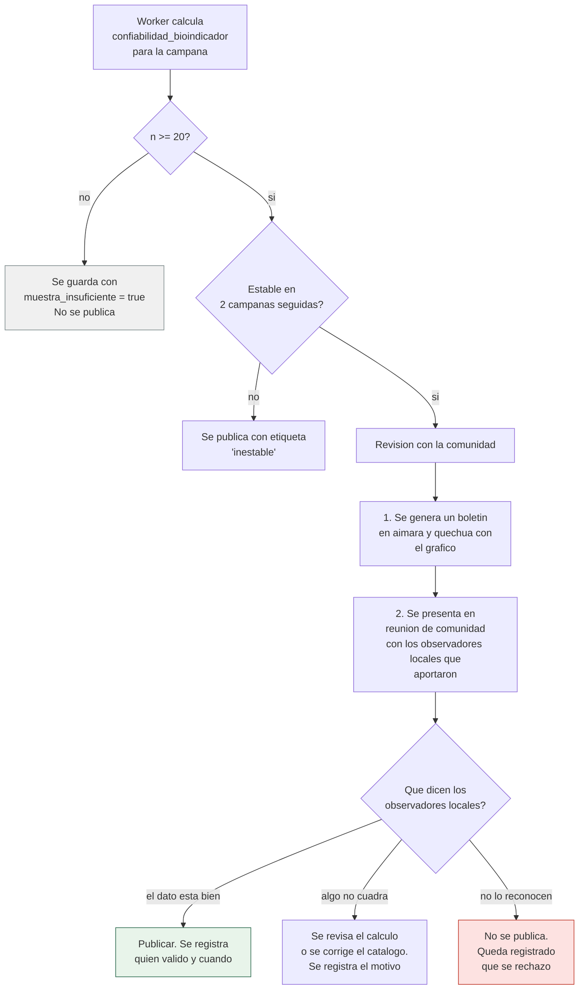
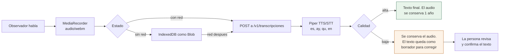

# 11 · Interculturalidad

Cuatro idiomas, cuatro roles, un vocabulario que pertenece a la comunidad y una regla de oro: **el sistema traduce la tecnología al conocimiento local, nunca al revés**.

> **Contraste con la estructura actual del repositorio**: las entidades de gobernanza (`consentimiento_uso`, `traduccion_indicador`, `sinonimo_indicador`, `variante_local`) son **nuevas y viven en `sinb.*`**, según [04](04-BASE-DE-DATOS.md). El repositorio no las contiene hoy y no hay tablas equivalentes en `edan` ni `rida` con las que se pueda solapar — la independencia de dominios garantiza que el consentimiento biocultural no quede sujeto a los ciclos de otros módulos.

---

## 1. Por qué esto va en un documento técnico

La interculturalidad en este proyecto no es una sección de valores. Es la razón por la que el esquema de datos tiene una tabla que no se parece a nada del sistema actual, y la razón por la que el cálculo de confiabilidad no puede publicarse sin consultar a la comunidad.

Tres consecuencias concretas, todas visibles en el código:

| Consecuencia | Dónde se ve |
|---|---|
| Todo en español, sin capa de idiomas | Un solo diccionario de cadenas (§2.3), sin `Accept-Language` |
| Los sinónimos de un indicador son filas de tabla, no columnas | `sinonimo_indicador` |
| La validación del dato requiere una persona de la comunidad | El mecanismo de §4 |

Un sistema en español donde el vocabulario agrícola vive en el código y no como filas de tabla no es intercultural: es un sistema con palabras duras.

---

## 2. Un solo idioma: español

### 2.1 Alcance

| Elemento | Idioma | Detalle |
|---|---|---|
| Interfaz | Español | Sin capa de traducción en la fase 1 |
| Mensajes de error | Español | El servidor devuelve código; el cliente muestra el texto en español |
| Catálogos y reportes | Español | Nombre oficial en español, con la grafía real de cada comunidad |
| Nombres de comunidades | Como están | No se normaliza ni se traduce la grafía oficial |
| Nombres de bioindicadores | Español + nombres locales | El nombre en español y los nombres locales como **dato**, no como traducción de interfaz |
| Contenido de campo | Tal como lo dijo la persona | `pronostico_libre` y notas se guardan sin reescribir |

`[ACTUAL]` La base de datos está en español y así sigue: **no hay idiomas, no hay diccionarios por idioma, no hay `usuario.idioma_preferido` ni header `Accept-Language` en la fase 1** ([04](04-BASE-DE-DATOS.md)).

### 2.2 Lo que sí cambia: el vocabulario como dato

| Elemento | Tratamiento | Por qué |
|---|---|---|
| Nombres de comunidades | Grafía oficial, sin tocar | El nombre de la comunidad es de la comunidad |
| Nombres de bioindicadores | `sinonimo_indicador` como **filas** | Un mismo indicador tiene varios nombres; son conocimiento, no cadenas de interfaz |
| Fechas | ISO 8601 en datos, formato boliviano en pantalla | Bolivia escribe `14/07/2026` |
| Números | Punto para miles, coma para decimales | Convención nacional |
| Unidades | `"mm"`, `"°C"` | Unidades, no texto traducible |
| Códigos de error | Nunca traducidos | Son identificadores técnicos |

`[NUEVO]` Un sistema en español donde el vocabulario agrícola vive en el código y no como filas de tabla no es intercultural: es un sistema con palabras duras. La interculturalidad de este documento está en §3 (vocabulario), §4 (validación con la comunidad), §5 (la voz) y §9 (gobernanza), no en una capa de idiomas.

### 2.3 El diccionario de cadenas

```ts
// src/textos/es.ts — único diccionario, en español
export default {
  comun: {
    guardado: 'Guardado en el dispositivo',
    pendiente: 'Pendiente de sincronizar',
    sin_conexion: 'Sin conexión',
  },
  formularioDiario: {
    titulo: 'Formulario diario de hoy',
    lluvia: 'Lluvia',
    helada: 'Helada',
    granizo: 'Granizo',
    viento_fuerte: 'Viento fuerte',
    intensidad: { leve: 'Leve', moderada: 'Moderada', fuerte: 'Fuerte' },
    guardar: 'Guardar',
  },
  errores: {
    VALOR_FUERA_DE_RANGO: 'El valor debe estar entre {min} y {max}',
    COMUNIDAD_INACTIVA: 'Esa comunidad ya no está en el sistema',
    SIN_CONEXION: 'Sin conexión. Se guardará en el dispositivo',
  },
}
```

| Regla | Detalle |
|---|---|
| Una cadena, una clave | La clave describe el significado, no la posición |
| Interpolación con `{}` | `El valor debe estar entre {min} y {max}`, no el valor ya concatenado |
| Sin claves autogeneradas | Nada de `error_422_1`. Si dos errores comparten mensaje, comparten clave |
| El diccionario se carga entero | Un solo archivo, sin carga diferida |
| Se valida cobertura en CI | Un test falla si falta una clave |

`[DECIDIR]` **A futuro** ([OPCIONAL])**: añadir aimara o quechua sería un diccionario más y algunas filas en `sinonimo_indicador`. No se compromete ningún idioma en la fase 1, y el diseño no lo impide.

---

## 3. El vocabulario

### 3.1 Un indicador tiene varios nombres

El catálogo del método nombra los indicadores como los nombra la gente: qariwa, waycha, sank'ayu, ch'illiwa, q'illu q'illu, liqi liqi, cosorio, tiluchi, cangrejo sevoro. Cada uno tiene además nombre científico, y a veces variantes locales.

`[NUEVO]` **La especie se escribe como la conoce quien la observa.** Si el nombre vive en aimara, en quechua o en español, así se escribe y así se guarda — con su grafía correcta, sin corregir ni traducir. El catálogo está en español (§2), pero los nombres de las especies son dato cultural, no cadenas de interfaz.

```sql
INSERT INTO indicador_natural (codigo, nombre, nombre_cientifico, categoria, activo)
VALUES ('BIO-001', 'qariwa', 'Senecio clavicolus', 'floracion', true);

INSERT INTO sinonimo_indicador (fk_id_indicador_natural, sinonimo, fuente)
VALUES
  ((SELECT id FROM indicador_natural WHERE codigo = 'BIO-001'), 'waycha',  'catalogo_inicial'),
  ((SELECT id FROM indicador_natural WHERE codigo = 'BIO-001'), 'wacca wacca', 'campo'),
  ((SELECT id FROM indicador_natural WHERE codigo = 'BIO-001'), 'qharwa waycha', 'campo');
```

| Decisión | Motivo |
|---|---|
| El nombre canónico es el del catálogo inicial | Estable. No cambia con cada aporte de campo |
| Los sinónimos son filas, no columnas | La lista crece sin cambiar el esquema |
| `fuente` distingue catálogo de campo | Un sinónimo aportado en campo es evidencia de uso local, no una decisión editorial |
| Búsqueda por `pg_trgm` sobre ambos | Buscar "wacca" encuentra el indicador aunque el usuario escriba otra variante |

### 3.2 Búsqueda tolerante

| Se escribe | El sistema encuentra |
|---|---|
| `waycha` | qariwa, por synonym |
| `qariwa` | qariwa |
| `WACCA` | qariwa, sin distinguir mayúsculas |
| `waca waka` | qariwa, por fuzzy de trigramas |
| `senecio` | qariwa, por nombre científico |

```sql
CREATE INDEX bioindicador_nombre_trgm ON bioindicador USING GIN (nombre_comun gin_trgm_ops);
CREATE INDEX bioindicador_cientifico_trgm ON bioindicador USING GIN (nombre_cientifico gin_trgm_ops);
CREATE INDEX sinonimo_texto_trgm ON bioindicador_sinonimo USING GIN (sinonimo gin_trgm_ops);
```

| Consecuencia | Detalle |
|---|---|
| Se necesita `unaccent` | `CREATE EXTENSION IF NOT EXISTS unaccent`. Sin él, "waca" y "wacá" no coinciden |
| Se pierde acentos en la búsqueda | No en el almacenamiento. Solo en la expresión de búsqueda |
| El español sin acentos encuentra el aimara con acentos | Es una ventaja aquí: quien escribe "q'illu" encuentra "q'illu" y "q'illu" con sus variantes |

### 3.3 La grafía es dato, no error

| Situación | Decisión |
|---|---|
| `q'illu q'illu` con apóstrofo | Correcto. Es la grafía aimara |
| `ch'illuwa` y `chilliwa` | Son dos sinónimos distintos de la misma persona que escribe |
| `Qariwa` y `qariwa` | Igual, la búsqueda es insensible a mayúsculas |
| `Waca Waka` con mayúsculas | Igual |
| Un nombre con tilde que "está mal" | No se corrige. Se añade como synonym y el original queda |

La tentación de "limpiar" los nombres produce un catálogo que nadie reconoce. El objetivo es que alguien de la comunidad vea el nombre que él usa.

---

## 4. Validación con la comunidad

### 4.1 Por qué un índice no se publica solo

La confiabilidad de un bioindicador es un número. Publicarlo sin más produce dos fallos:

| Fallo | Ejemplo |
|---|---|
| **El número contradice a quien aportó** | Un observador local ve que su indicador sale con índice 0.42, en zona de "no confiable", y el equipo de campo deja de reportarlo. La confiabilidad baja más. Un ciclo de silencio |
| **El número se usa fuera de contexto** | Un investigador compara índices entre ecorregiones sin saber que la ecorregión tiene n bajo |

Ninguno de los dos fallos es un error de cálculo. Son errores de gobernanza del dato.

### 4.2 El mecanismo de validación



### 4.3 Qué se registra de esa revisión

| Campo | Valor |
|---|---|
| `campana_id` | La campaña revisada |
| `ecorregion_id` | La ecorregión |
| `bioindicador_id` | El indicador |
| `indice` | El número calculado |
| `muestra` | El n |
| `revisado_por` | La persona que lo revisó, con su comunidad |
| `fecha_revision` | Cuándo |
| `publicado` | Si se publicó o no |
| `motivo_rechazo` | Si no se publicó, por qué. Obligatorio |

Sin el campo `motivo_rechazo` lleno, la fila no se guarda. Rechazar sin explicar es tan poco útil como publicar sin revisar.

### 4.4 El coste, dicho claro

| Coste | Valor |
|---|---|
| Reuniones | 2 a 4 por campaña y ecorregión |
| Tiempo | Media jornada cada una |
| Quién | Técnico de la zona más los observadores locales que aportaron |
| Frecuencia | Por campaña, no por semana |

Es un coste real y hay que financiarlo. Un sistema que exige revisión comunitaria y no la budgeta deja de publicar índices en el segundo año. La alternativa, publicar sin revisar, produce el ciclo de silencio de §4.1.

---

## 5. La voz

### 5.1 Por qué el audio es más que una comodidad

En el Altiplano y los valles hay hablantes de aimara y quechua cuya lectura y escritura en alfabeto latino es limitada. Un formulario que exige escribir obliga a que alguien con acceso a internet transcriba. Eso significa que el dato real pasa por un intermediario, y el intermediario decide qué escribir.

| Opción | Consecuencia |
|---|---|
| Solo texto | El dato real lo escribe un tercero |
| **Texto con voz opcional** | El dato lo dice quien observa, y el texto se completa después si hace falta |
| Solo voz | Depende de un transcriptor, que en aimara y quechua no es fiable |

El diseño elige la segunda: **el audio es la fuente primaria y el texto es derivado**.

### 5.2 Cadena de captura



| Decisión | Motivo |
|---|---|
| El audio se conserva aunque se transcriba | Es la evidencia original. Un texto mal transcrito es un texto sin valor |
| La transcripción es un borrador | Piper en aimara y quechua no es fiable. El texto siempre lo confirma una persona |
| El audio se borra tras un año | Reduce el riesgo de exponer a quien habla. El texto ya está |
| `audio/webm` y no `mp3` | Codec nativo del navegador, sin conversión en el cliente |
| Se graba mono a 16 kHz | Es voz, no música. Un cuarto del tamaño |

### 5.3 Consentimiento para grabar

Antes de grabar, el usuario ve y escucha una frase en su idioma:

> "Se va a grabar su voz. La voz se guarda un año y el texto que salga de la voz queda en el registro. Si no quiere, puede escribir en su lugar."

| Opción del usuario | Qué ocurre |
|---|---|
| Grabar | Se guarda audio y transcripción |
| Escribir | Solo texto. Sin audio |
| Ninguna | No se puede registrar una nota, pero sí el resto del Formulario diario |

El rechazo no impide el uso de la app. Rechazar el audio tiene que ser tan fácil como aceptarlo, o la gente acepta por cansancio y el consentimiento deja de significar nada.

---

## 6. Nombres de comunidad

### 6.1 La grafía oficial manda

| Campo | Regla |
|---|---|
| `nombre` | La grafía que usa la comunidad, con tildes, apóstrofos y mayúsculas |
| `codigo_ine` | El código oficial si existe. `NULL` si no |
| Variantes | Filas en `bioindicador_sinonimo` no aplican. Las variantes de comunidad no se guardan: se busca por `pg_trgm` |
| Unificación | Si dos comunidades son la misma, se fusiona con `audit_log` y justificación |

### 6.2 Por qué no una tabla de alias de comunidad

El diseño podría tener `comunidad_alias` para guardar "Chuquiputipiti", "Chuq'ipitipiti", "Chuquipiti". No la tiene.

| Motivo | Detalle |
|---|---|
| Búsqueda difusa ya resuelve | `pg_trgm` encuentra las variantes sin necesidad de una tabla |
| Un alias afirma una equivalencia | Si "Chuq'ipitipiti" es una comunidad distinta y se registra como alias, se fusionan dos pueblos |
| La fusión es una decisión administrativa | No la puede tomar un automatizado de sinónimos |

Con el trigrama el usuario encuentra lo que busca sin que el sistema decida que son la misma cosa.

### 6.3 No hay campos de idioma

La ficha de comunidad **no** tiene campos de idioma (`comunidad_aymara`, `comunidad_quechua` y similares quedan fuera). El sistema está en español; lo que se conserva de cada comunidad es su **nombre oficial con su grafía real** y sus observadores con sus propios nombres (§3).

`[DECIDIR]` Si algún día se incorporan idiomas, los valores por defecto de formulario se decidirían entonces — el diseño no lo impide, pero nada de eso entra en la fase 1 (§2.3).

---

## 7. Calendarios y fechas

### 7.1 Los tres calendarios

| Gregoriano | Almacenamiento, intercambio entre sistemas, índices |
| Andino | Presentación en comunidades del Altiplano y los valles |
| Campaña agrícola | La unidad real de agrupación de los datos |

Las dos filas siguientes repiten la información de la tabla anterior con la decisión concreta de qué se muestra junto a qué.

### 7.2 Qué implementa el sistema

**Decisión**: el almacenamiento es siempre gregoriano. La conversión es una capa de presentación.

| Decisión | Motivo |
|---|---|
| `date` y `timestamptz` en PostgreSQL | Un solo sistema de fechas. Índices, consultas y `ON DELETE` se mantienen simples |
| La campaña manda sobre el año | Lo que importa es "la campaña de esta helada", no "el año 2026" |
| Fases configurables por campaña | Lo que es floración en el Altiplano no lo es en el Chaco |
| Meses esperados por ecorregión | Una misma especie puede anticiparse en el norte |

### 7.3 La campaña agrícola

| Fase | Fechas típicas del Altiplano | Qué ocurre |
|---|---|---|
| Preparación | Agosto a septiembre | Labranza y abonos |
| Siembra | Septiembre a noviembre | Papa, haba, maíz |
| Crecimiento | Noviembre a enero | Vegetación activa |
| Floración | Noviembre a diciembre | **La fase clave del proyecto**: aquí se concentran las señas |
| Fructificación | Diciembre a febrero | Fruto y semilla |
| Cosecha | Febrero a abril | Papa, maíz, quinua |

La fase de floración es la que más importa porque es donde vive el conocimiento biocultural. Por eso `bioindicador.mes_esperado_min` y `mes_esperado_max` se definen contra el calendario de la campaña y no contra meses del año: en el Altiplano la "segunda siembra" no empieza en marzo.

| Riesgo | Mitigación |
|---|---|
| Mezclar fechas de sistemas distintos | Un solo sistema en la base |
| Obligar al usuario al gregoriano | La interfaz muestra la fecha local junto a la gregoriana |
| Una campaña no coincide con el año solar | `campana.fecha_inicio` y `fecha_fin` explícitas. El sistema agrupa por campaña |

---

## 8. La interfaz

### 8.1 Jerarquía visual por rol

Lo que se ve primero cambia según el rol, porque lo que importa cambia según el rol.

| Ficha | Primero | Segundo | Tercero |
|---|---|---|---|
| Del observador comunitario | El pictograma grande | La fecha | El resto, pequeño |
| Del observador local | El campo de señas | El nombre del indicador | La fecha |
| Del técnico | El dato satelital junto al de campo | La fecha | El resto |
| Del investigador | El índice de confiabilidad | El `n` | La serie histórica |

### 8.2 Los cuatro estados de pantalla

```text
1. CARGANDO    skeleton con la forma del contenido final
2. VACÍO       ilustración + un botón + qué hacer
3. ERROR       qué pasó + qué intentar + reintento
4. CON DATOS   el contenido
```

Nunca una pantalla en blanco. Nunca un error sin reintento. Un vacío sin explicación se lee como un fallo.

### 8.3 Los mensajes de error están en español claro

| Error del servidor | Mensaje en pantalla |
|---|---|
| `422 VALIDACION_CAMPO` | Revisa el campo marcado |
| `403 ROL_SIN_PERMISO` | No tienes permiso para esta acción |
| `401 TOKEN_EXPIRADO` | Sesión vencida. Entrando de nuevo |
| `503 SIN_CONEXION` | Sin conexión. Se guardará en el dispositivo |

| Regla | Detalle |
|---|---|
| El servidor devuelve código, no texto | El cliente resuelve el código a texto |
| El texto del servidor es un código | Nunca un mensaje. Un mensaje obliga a parsear |
| El mensaje vive en un único diccionario en español | `src/textos/es.ts` (§2.3), sin negociación de idioma |

### 8.4 Accesibilidad

| Regla | Motivo |
|---|---|
| Objetivos táctiles de 48 px, 64 en el Formulario diario | Dedos funcionales con guantes o con la pantalla sucia |
| Contraste mínimo 4.5:1 | Se lee a pleno sol |
| Nunca solo color | Cada estado lleva pictograma y texto además del color |
| `aria-label` en todo control con solo icono | Un lector de pantalla no ve un icono |
| Orden de tabulación lógico | Se navega con un pulgar |
| Texto escalable a 200 % | Para quien necesita ver de cerca |
| Se respeta `prefers-reduced-motion` | El movimiento constante en pantalla pequeña causa dolor |

---

## 9. Gobernanza del dato cultural

### 9.1 Quién decide qué

| Decisión | Quién | Mecanismo |
|---|---|---|
| Nombre canónico de un indicador | Administración, con la comunidad | Catálogo inicial. Luego solo se añaden sinónimos |
| Sinónimo | Quien lo conoce | Alta desde la app, con `fuente = 'campo'` |
| Rango de meses esperados | observador local y técnico | Ajuste con registro en `audit_log` |
| Fusión de comunidades | Administración, con justificación | `audit_log` con valores anteriores |
| Publicación de un índice | Técnico de la zona + observadores locales que aportaron | El mecanismo de §4.2 |
| Baja de un bioindicador | Administración, con consulta a la comunidad | `audit_log` + notificación |

### 9.2 La propiedad del conocimiento

| Pregunta | Respuesta |
|---|---|
| ¿A quién pertenece una seña? | A quien la dijo. Se registra con su nombre |
| ¿Se publica una seña sin permiso? | No. Sin autorización explícita es dato interno de la comunidad |
| ¿Quién ve las señas de otra comunidad? | Nadie. El RLS lo impide |
| ¿Se borra una seña? | No. Se marca como retirada, con motivo, en `audit_log` |
| ¿Se puede usar con fines comerciales? | No. Requiere un acuerdo de acceso a datos específico |

**La excepción**: si alguien pide retirar lo que dijo porque identificaba un recurso sensible, se anonimiza la autoría y se conserva el contenido, con registro del cambio. El dato científico no se pierde, la persona queda protegida.

### 9.3 Consentimiento informado

| Momento | Qué se explica |
|---|---|
| Primer inicio de sesión | Para qué se usa el dato, quién lo ve, y que puede pedir su retirada |
| Captura de una seña | Que el conocimiento se comparte con la comunidad y con el equipo de investigación |
| Captura de audio | Que la voz queda grabada, y por cuánto tiempo |
| Antes de publicar un índice | Que los observadores locales que aportaron serán consultados |
| **Cuando su nombre se destaca** `[NUEVO]` | Que aparecerá como observador detrás de los pronósticos que firma, y con qué confianza lo registró |

`[NUEVO]` El recolector **menciona y resalta a los observadores locales** que aportan el pronóstico ([07 §4.5](07-FLUJOS-BIOCULTURALES.md)): el nombre viaja con el registro — `pronostico_libre` tal cual, lista de observadores 1..N, confianza inicial de cada uno. Si un observador no consiente que su nombre aparezca, se registra **«observador no identificado»** con la misma confianza: se conserva el dato sin exponer a la persona.

El consentimiento no es un `checkbox` en el login. Es una conversación. El sistema la registra, pero no la reemplaza.

---

## 10. Riesgos

| Riesgo | Impacto | Mitigación | Riesgo residual |
|---|---|---|---|
| Traducción literal o incorrecta | Pérdida de sentido | Traductores de la comunidad, revisión por pares, glosario | Medio. Ninguna traducción automática sustituye a una persona de la comunidad |
| El sistema se percibe como ajeno | Rechazo | Nombre local, iconos propios, presencia en cada reunión | Medio |
| Centralización de la autoridad | El conocimiento deja de ser de la comunidad | El mecanismo de §4.2 y la gobernanza de §9 | Medio. La burocracia siempre tiende a centralizar |
| Datos mal interpretados por investigadores | Conclusiones falsas | Toda publicación cita la comunidad de origen | Bajo |
| El Tsimane no está | Los tsimanes no pueden usar la app en su idioma | Decisión documentada. Añadirlo es un diccionario y filas de sinónimos | Alto para esas comunidades, bajo para el resto |
| Vocabulario que cambia | La búsqueda falla | El vocabulario está en la base, no en el código | Bajo |
| Mezcla de aimara y quechua en una pantalla | Confusión de lectura | Pruebas con hablantes nativos de cada zona | Medio |

---

## 11. Ver también

- [02-COMPONENTES-VISUALES.md §4](02-COMPONENTES-VISUALES.md) — los 30 pictogramas y los que faltan
- [04-BASE-DE-DATOS.md §6](04-BASE-DE-DATOS.md) — `bioindicador` y `bioindicador_sinonimo`
- [06-FRONTEND.md §11](06-FRONTEND.md) — el módulo único de textos en español
- [07-FLUJOS-BIOCULTURALES.md §2](07-FLUJOS-BIOCULTURALES.md) — captura de señas y validación de temporada
- [07-FLUJOS-BIOCULTURALES.md §5.4](07-FLUJOS-BIOCULTURALES.md) — el registro por audio
- [09-SEGURIDAD.md §1](09-SEGURIDAD.md) — las tres clases de información
- [10-INTEROPERABILIDAD.md §5.4](10-INTEROPERABILIDAD.md) — qué se publica y qué no
- [docs/Sistema Biocultural.md](../docs/Sistema%20Biocultural.md) — el catálogo original de indicadores