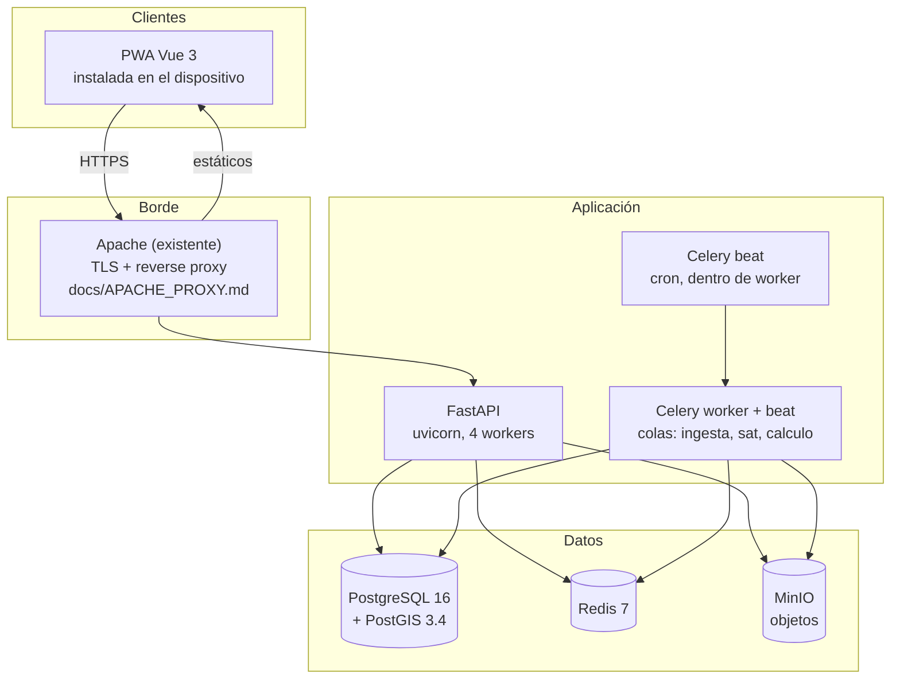
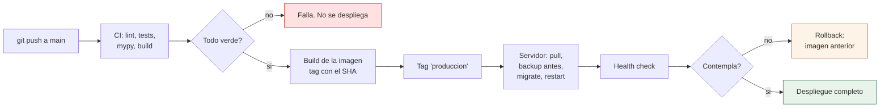

# 12 · Infraestructura

Dónde vive cada cosa, cómo se despliega, cómo se monitorea y qué se hace cuando algo se cae.

---

## 0. Contraste con la infraestructura actual

> **Actualización de contraste.** Separación entre lo que **ya está verificado** en este repositorio y lo que esta propuesta **añade**.

| Capa | Estado actual verificado | Esta propuesta lo propone como |
|---|---|---|
| API | FastAPI (`api/`) ya desplegable, `start_api.sh` / `stop.sh` en la raíz | Ampliación: workers Celery (`[OPCIONAL]` observabilidad, §6.4) |
| Base de datos | **PostgreSQL 16 + PostGIS 3.4**, `db_sinagersat`, esquema **`sinb` vacío**, copias de seguridad diarias (`database/hacer_backup.sh`, `database/backup_*.sql`) | Ampliación: partición, índices y `monitoreo_diario` **dentro de `sinb.*`** |
| Proxy | Apache (`docs/APACHE_PROXY.md`, `docs/DESPLIEGUE_API*.md`) | Mantenimiento y ajuste |
| Almacenamiento | `uploads/` local (montado por FastAPI) | **MinIO** con URL firmadas (§3, §5) |
| Cola / caché | **No existen** (sin Celery, sin Redis) | `[NUEVO]` — §3 contenedores |
| Monitoreo | **No existe** formalmente | `[NUEVO]` — §6 |

Todo lo nuevo de este documento se despliega **sin afectar a los módulos `edan` ni `rida`**, que comparten servidor pero no datos ni despliegue lógico del SINB.

---

## 1. Requisitos

### 1.1 No crece con el proyecto

| Componente | Volumen estimado | Nota |
|---|---|---|
| `usuario` | 200 a 2.000 | Todo el equipo de campo e investigadores |
| `comunidad` | 18.331 | Catálogo |
| `bioindicador` | 300 a 800 | Catálogo |
| `monitoreo_diario` | 18.331 x 365 = 6,7 millones/año | **El volumen que domina todo** |
| `observacion` | 50.000 a 200.000/año | Incluye confirmaciones de señas |
| `senal` | 20.000 a 80.000/año | El aporte nuevo del método |
| `pronostico_comunal` | 18.331 x 4 = 73.000/año | Si toda comunidad pronostica |
| `validacion_pronostico` | Hasta 73.000/año | Uno por pronóstico |
| `dato_satelital` | 4 ecorregiones x 365 x 4 variables = 5.840/año | Muy poco |
| `observacion_foto` | 100.000 a 400.000/año | El volumen en bytes |
| `audit_log` | 500.000 a 2 millones/año | Crece siempre |
| `sync_log` | 100.000 a 500.000/año | Uno por sincronización |

### 1.2 El cálculo que define la infraestructura

```text
18.331 comunidades x 365 días = 6.691.815 filas de monitoreo_diario al año
```

Una fila por comunidad y día. Es la cifra que decide todo lo demás: el tipo de servidor, el coste de disco, el particionado, y por qué `monitoreo_diario` es la única tabla que necesita atención especial.

| Año | Filas acumuladas | Con `updated_at` e índices | Espacio estimado |
|---|---|---|---|
| 1 | 6,7 millones | ~5 índices | ~4 GB |
| 3 | 20 millones | | ~12 GB |
| 5 | 33 millones | | ~20 GB |

Veinte gigabytes para diez años de datos. **Un servidor de 8 GB de RAM y 100 GB de disco aguanta**, con margen.

| Conclusión | Detalle |
|---|---|
| PostgreSQL en un solo nodo | No se necesita cluster ni particionado |
| El cuello de botella es la API, no la base | Los datos caben en memoria una vez indexados |
| Un solo servidor de aplicación | Con réplicas de lectura si la API lo necesita |
| MinIO en el mismo servidor, o externo | Las fotos pesan más que la base |

### 1.3 La fotografía es lo único que pesa

| Dato | Tamaño | Al año |
|---|---|---|
| Base de datos completa | ~4 GB | ~4 GB de crecimiento |
| Fotos comprimidas a 400 KB | 250.000 fotos | **100 GB** |

Las fotos son 25 veces el tamaño de la base. Eso define la infraestructura de almacenamiento y por qué MinIO tiene presupuesto propio.

| Decisión | Motivo |
|---|---|
| Comprimir a 400 KB en el cliente | 6 MB a 400 KB es una reducción de 15 veces sin perder valor probatorio |
| Almacenamiento de objetos separado (MinIO) | Las fotos no compiten con la base por I/O |
| Backup de la base y de los objetos, por separado | Se restauran por separado, sin mezclar cargas |

---

## 2. Arquitectura de despliegue

### 2.1 Vista general



### 2.2 Un solo servidor, o dos

| Escenario | Composición | Coste relativo |
|---|---|---|
| **Desarrollo** | 1 vCPU, 4 GB, todo en contenedor | Bajo |
| **Producción mínima** | 4 vCPU, 8 GB, 200 GB SSD, PostgreSQL + Redis + MinIO + API + worker | 1x |
| **Producción con fotos** | Igual, más 1 TB de disco para objetos | 1,5x |
| **Producción institucional** | 2 servidores: aplicación y datos, con copia de seguridad en NFS | 2x |

La decisión no depende del volumen de datos, que es pequeño. Depende de quién opera el servidor y de si hay alguien que entienda de PostgreSQL.

| Si no hay nadie con experiencia en PostgreSQL | Decisión |
|---|---|
| Sí | Un solo servidor. La copia de seguridad se hace con `pg_dump` y se copia a un NAS |
| No | Servicio gestionado para la base, servidor propio para la aplicación |

### 2.3 El servidor mínimo

| Recurso | Valor | Por qué |
|---|---|---|
| CPU | 4 vCPU | 2 para la API, 1 para los workers, 1 de margen |
| RAM | 8 GB | PostgreSQL con `shared_buffers` de 2 GB, resto para API, Redis y el sistema |
| Disco | 200 GB SSD | Base de datos y logs |
| Disco de objetos | 1 TB | Las fotos en MinIO ([§1.3](#13-la-fotografía-es-lo-único-que-pesa)) |
| SO | Ubuntu 24.04 LTS | Soporte hasta 2029 |
| Red | 100 Mbps | La API habla poco. Las fotos hablan mucho |

```ini
# /etc/postgresql/16/main/postgresql.conf
shared_buffers = 2GB
work_mem = 8MB
maintenance_work_mem = 256MB
effective_cache_size = 6GB

# Para una base que cabe en RAM pero con millones de filas:
random_page_cost = 1.1
effective_io_concurrency = 200

max_connections = 100
```

| Parámetro | Por qué este valor |
|---|---|
| `shared_buffers` de 2 GB | Un cuarto de la RAM. La regla clásica |
| `work_mem` de 8 MB | Con 100 conexiones, 8 MB cada una son 800 MB. Más que eso revienta |
| `random_page_cost` de 1.1 | En SSD, el acceso aleatorio es casi tan barato como el secuencial |
| `max_connections` de 100 | Con `pgbouncer` no hace falta más |

### 2.4 Connection pooler

La API abre y cierra conexiones constantemente. Sin pooler, PostgreSQL gasta procesos en cada petición.

| Pieza | Detalle |
|---|---|
| `pgbouncer` | En modo `transaction`. Devuelve la conexión al pool al terminar la transacción |
| Pool de la API | 5 conexiones por worker, 4 workers: 20 conexiones |
| `asyncpg` | Pool propio de la aplicación, 5 por worker |
| `SET LOCAL` y pooler | Compatible. `SET LOCAL` dura hasta el COMMIT, que es justo lo que dura una transacción del pooler |

La última fila es la razón por la que §4.6 de [09-SEGURIDAD.md](09-SEGURIDAD.md) insiste en `SET LOCAL` y no en `SET`. Con `SET` normal, el contexto de usuario sobreviviría a la devolución de la conexión al pool y se lo entregaría a otro usuario.

---

## 3. Contenedores

### 3.1 Los cinco servicios

| Servicio | Imagen | Recursos | Reinicio |
|---|---|---|---|
| `postgres` | `postgres:16-postgis` | 1 vCPU, 3 GB | `always` |
| `redis` | `redis:7-alpine` | 0,25 vCPU, 256 MB | `always` |
| `minio` | `minio/minio` | 0,5 vCPU, 512 MB | `always` |
| `api` | `sinb/backend` | 2 vCPU, 2 GB | `always` |
| `worker` | `sinb/backend` | 1 vCPU, 2 GB | `always` |

`api` y `worker` usan la misma imagen con distinto comando. Dos imágenes distintas divergen, y una divergencia entre el código que lee y el que escribe es un fallo difícil de encontrar.

**Lo básico, por ahora.** Tres decisiones de este despliegue mínimo:

| Decisión | Detalle |
|---|---|
| Sin `nginx` en el compose | El servidor ya tiene **Apache** como proxy TLS (`docs/APACHE_PROXY.md`, `docs/DESPLIEGUE_API*.md`). `[DECIDIR]` pasar a nginx si se quiere un solo stack documentado en §2 |
| `beat` dentro del `worker` | Un servicio menos que mantener. Si crece, separarlo es cambiar el `command:` ([§3.3](#33-orquestación)) |
| Sin observabilidad externa | Sin OpenTelemetry, Prometheus, Grafana ni Loki. Log de la API y métricas de §6 bastan; ver `[OPCIONAL]` §6.4 |

### 3.2 La imagen del backend

```dockerfile
# Dockerfile
FROM python:3.12-slim AS base

ENV PYTHONUNBUFFERED=1 \
    PYTHONDONTWRITEBYTECODE=1 \
    PIP_NO_CACHE_DIR=1

WORKDIR /app

# Dependencias de sistema. WeasyPrint necesita Pango y cairo.
RUN apt-get update && apt-get install -y --no-install-recommends \
        build-essential libpq-dev \
        libpango-1.0-0 libpangoft2-1.0-0 libharfbuzz0b libcairo2 \
        libgdk-pixbuf-2.0-0 libffi-dev shared-mime-info \
    && rm -rf /var/lib/apt/lists/*

# Dependencias de Python en capa propia, para cachear
COPY pyproject.toml ./
RUN pip install --no-cache-dir -e .

COPY alembic.ini ./
COPY app ./app

# Usuario sin privilegios
RUN useradd --create-home --uid 10001 sinb \
    && chown -R sinb:sinb /app
USER sinb

EXPOSE 8000
HEALTHCHECK --interval=30s --timeout=3s --start-period=20s \
    CMD python -c "import urllib.request,sys; \
        sys.exit(0 if urllib.request.urlopen('http://localhost:8000/health/live',timeout=2).status==200 else 1)"

CMD ["uvicorn", "app.main:app", "--host", "0.0.0.0", "--port", "8000", \
     "--workers", "4", "--proxy-headers", "--forwarded-allow-ips", "*"]
```

| Decisión | Motivo |
|---|---|
| `python:3.12-slim` | Debian, no Alpine. Alpine usa musl y muchas dependencias compiladas fallan |
| `libpango`, `libcairo` incluidos | WeasyPrint no funciona sin ellos. Es el error más común al desplegar |
| `pip install -e .` desde `pyproject.toml` | Un solo sitio de verdad para las dependencias |
| Imagen no root | Un contenedor que se compromete no debería poder escribir en el sistema |
| `HEALTHCHECK` contra `/health/live` | Docker sabe si el proceso está vivo sin intervención humana |
| `--proxy-headers` | Para que el proxy (Apache) pase la IP real al log. Sin esto, todas las peticiones parecen venir de localhost |

### 3.3 Orquestación

```yaml
# compose.yml, versión de producción
services:
  postgres:
    image: postgres:16-postgis
    restart: always
    environment:
      POSTGRES_DB: sinb
      POSTGRES_USER: sinb
      POSTGRES_PASSWORD_FILE: /run/secrets/postgres_password
    volumes:
      - pgdata:/var/lib/postgresql/data
      - ./backups:/backups
    healthcheck:
      test: ["CMD-SHELL", "pg_isready -U sinb -d sinb"]
      interval: 10s
      retries: 5
    deploy:
      resources:
        limits: { cpus: '1', memory: 3G }

  redis:
    image: redis:7-alpine
    restart: always
    command: redis-server --appendonly yes --maxmemory 200mb --maxmemory-policy noeviction
    volumes:
      - redisdata:/data
    deploy:
      resources:
        limits: { cpus: '0.25', memory: 256M }

  minio:
    image: minio/minio
    restart: always
    command: server /data --console-address ":9001"
    environment:
      MINIO_ROOT_USER_FILE: /run/secrets/minio_user
      MINIO_ROOT_PASSWORD_FILE: /run/secrets/minio_password
    volumes:
      - miniodata:/data
    deploy:
      resources:
        limits: { cpus: '0.5', memory: 512M }

  api:
    image: sinb/backend:${TAG}
    restart: always
    depends_on:
      postgres: { condition: service_healthy }
    env_file: [.env]
    secrets: [postgres_password]
    deploy:
      resources:
        limits: { cpus: '2', memory: 2G }

  worker:
    image: sinb/backend:${TAG}
    restart: always
    command: sh -c "celery -A app.workers worker -Q ingesta,satelit,calculo -c 2 -l info & exec celery -A app.workers beat -l info -S /tmp/celerybeat"
    depends_on:
      postgres: { condition: service_healthy }
    env_file: [.env]
    deploy:
      resources:
        limits: { cpus: '1', memory: 2G }

# TLS y proxy fuera del compose: los lleva el Apache que ya existe en el
# servidor (docs/APACHE_PROXY.md). Si se pasa a nginx, añadir aquí el
# servicio `nginx` con puertos 80/443 y certificados.

volumes: { pgdata: {}, redisdata: {}, miniodata: {} }
```

| Detalle | Motivo |
|---|---|
| `maxmemory-policy noeviction` en Redis | Redis es broker de Celery. Si evicta, se pierde una tarea |
| `depends_on: service_healthy` | Espera a que PostgreSQL acepte conexiones, no a que el contenedor exista |
| `command:` distinto, misma imagen | Un solo artefacto |
| `secrets` y no variables con contraseña | Las contraseñas no viven en el `compose.yml` |
| `límites` de recursos | Un worker que se descontrola no tumba el host |
| `beat` dentro de `worker` | Un servicio menos en el compose. Si algún día hace falta separarlo, se cambia el `command:` |
| TLS fuera del compose | Lo lleva el Apache existente del servidor |
| `-S /tmp/celerybeat` | El archivo de schedule no se persiste. Si dos procesos `beat` leen y escriben el mismo archivo, se corrompe |

---

## 4. Despliegue

### 4.1 El flujo



| Etapa | Detalle |
|---|---|
| 1. CI | Lint, tests unitarios, tests de integración con PostgreSQL real, `mypy --strict` |
| 2. Build | Imagen etiquetada con el SHA del commit. Nunca `latest` |
| 3. Backup | `pg_dump` comprimido antes de migrar. Si la migración falla, se restaura |
| 4. Migración | `alembic upgrade head`. Con `expand and contract`, nunca destructiva en el mismo despliegue |
| 5. Reinicio | `docker compose up -d`. Los contenedores de la API se reemplazan uno a uno |
| 6. Verificación | `/health/ready` responde en menos de 30 segundos |

### 4.2 Migraciones sin caída

| Regla | Ejemplo |
|---|---|
| Nunca renombrar una columna en el mismo despliegue | Primero se añade la nueva, se copia, y en un despliegue posterior se borra la vieja |
| Nunca añadir un `NOT NULL` a una tabla poblada | Se añade con `DEFAULT`, se rellena por lotes, y solo después se marca `NOT NULL` |
| El `DEFAULT` no se borra hasta mucho después | Un cliente antiguo sigue insertando sin la columna nueva |
| Cada migración tiene su reversa | Probada, no solo escrita |

```sql
-- Despliegue 1: añadir
ALTER TABLE monitoreo_diario ADD COLUMN gps geography(Point, 4326);

-- Despliegue 2: el código empieza a escribirlo
-- (los clientes antiguos siguen sin enviarlo. La columna es nullable)

-- Despliegue 3: empezar a exigirlo
ALTER TABLE monitoreo_diario
    ADD CONSTRAINT monitoreo_gps_requerido
    CHECK (gps IS NOT NULL OR created_at < '2027-01-01');

-- Despliegue 4: meses después, cuando ningún cliente antiguo existe
ALTER TABLE monitoreo_diario ALTER COLUMN gps SET NOT NULL;
ALTER TABLE monitoreo_diario DROP CONSTRAINT monitoreo_gps_requerido;
```

### 4.3 Rollback

| Fallo | Acción | Tiempo |
|---|---|---|
| La migración falló | `alembic downgrade`. El backup está listo si hace falta restaurar | 2 min |
| La API no arranca | Se despliega la imagen anterior | 1 min |
| Un endpoint nuevo da `500` | Se revierte el tag. Sin tocar la base | 1 min |
| Un cálculo produce datos malos | Se revierte la app, y los datos se corrigen con un script puntual | 10 min |

El principio: **una reversa de aplicación siempre es posible sin revertir la base**. Por eso las migraciones nunca son destructivas en el mismo despliegue.

### 4.4 Actualización de la PWA

| Aspecto | Decisión |
|---|---|
| Estrategia | Servicio worker con `skipWaiting` controlado por el usuario |
| Aviso de actualización | Banner: "Hay una versión nueva. Actualizar" |
| Datos sin subir | La actualización **no** borra IndexedDB. La app comprueba la versión del esquema |
| Migración de IndexedDB | `db.version(n+1).stores({...})` en el `onupgradeneeded` |
| Actualización automática | **No**. Un observador a mitad del Formulario diario no debe ver cambiar la pantalla |

La última fila es la más importante. Una actualización automática a mitad de una captura pierde el trabajo de esa persona.

---

## 5. Copias de seguridad

### 5.1 Qué se copia

| Dato | Método | Frecuencia | Retención |
|---|---|---|---|
| PostgreSQL | `pg_dump -Fc` comprimido | Diario 02:00, y antes de migrar | 7 diarios, 4 semanales, 12 mensuales |
| Objetos de MinIO | Replicación del volumen a un NAS | Diario | Igual que la base |
| Configuración | Repositorio Git, sin secretos | Con cada cambio | Permanente |
| Secretos | Gestor de secretos del servidor | Con cada cambio | Permanente |

| Relación | Motivo |
|---|---|
| La copia de la base y la de objetos van juntas | Un `observacion_foto` sin su `observacion` es un archivo huérfano |
| La de objetos es la más pesada | 100 GB/año contra 4 GB/año de base |
| `pg_dump`, no una copia del volumen | Un `pg_dump` es consistente por transacción. Copiar el volumen con la base en marcha no lo es |

### 5.2 Restauración probada

Una copia de seguridad que no se ha restaurado nunca no es una copia de seguridad. Es una hipótesis.

| Cada cuánto | Prueba |
|---|---|
| Trimestral | Restaurar la base en un contenedor limpio y contar filas de `monitoreo_diario` |
| Semestral | Restaurar base y objetos, y abrir un Formulario diario real desde la PWA |
| Anual | Restaurar en un servidor completo, desde cero, con el playbook del §4 |

| Comprobación | Resultado esperado |
|---|---|
| `SELECT count(*) FROM monitoreo_diario` | Coincide con el último `pg_dump` |
| `SELECT count(*) FROM observacion_foto` | Coincide |
| Un objeto específico existe en MinIO | Descarga con éxito |
| La API arranca contra la copia | `/health/ready` responde |
| La PWA sincroniza contra la copia | Acepta operaciones |

### 5.3 Mantenimiento

| Tarea | Frecuencia | Efecto |
|---|---|---|
| `VACUUM ANALYZE` | Automático | PostgreSQL lo hace solo con los parámetros correctos |
| `REINDEX` en índices de texto | Mensual | `pg_trgm` se degrada con el tiempo |
| Limpieza de `sync_log` más de 2 años | Trimestral | `DELETE` por lotes de 10.000 |
| Limpieza de `audit_log` más de 7 años | Anual | Por lotes |
| Rotación de logs | Semanal | `logrotate` |
| Verificación de disco | Semanal | Aviso al 75 % |

---

## 6. Monitoreo

### 6.1 Qué se mide

| Capa | Métrica | Aviso |
|---|---|---|
| API | Latencia p50, p95, p99 | p95 > 500 ms |
| API | Tasa de error 5xx | > 1 % |
| API | Peticiones por segundo | Contexto |
| API | Uso de memoria | > 80 % del límite |
| PostgreSQL | Conexiones activas | > 70 % de `max_connections` |
| PostgreSQL | Cache hit ratio | < 95 % |
| PostgreSQL | Consultas lentas | > 1 s |
| PostgreSQL | Espacio en disco | > 75 % |
| PostgreSQL | Replicación lag | > 5 min, si hay réplica |
| Celery | Tareas en cola | > 1.000 |
| Celery | Tareas fallidas | Cualquiera |
| Redis | Memoria | > 90 % |
| MinIO | Espacio | > 75 % |
| Disco | Espacio de SO | > 15 % libre |
| PWA | Latencia de sincronización | > 24 h. Objetivo del README |
| PWA | Tasa de conflictos | > 2 % |

### 6.2 Los cinco objetivos de nivel de servicio

| Objetivo | Meta | Cómo se mide | Qué se hace si se incumple |
|---|---|---|---|
| Disponibilidad de la API | 99,5 % | `ping` desde fuera, cada minuto | Avería prioritaria |
| Latencia del Formulario diario | < 500 ms p95 | `POST /v1/observaciones` en el log de la API | Revisar índices y `work_mem` |
| Latencia de sincronización | < 24 h | `sync_log` contra `created_at` | Revisar conectividad de campo |
| Latencia del mapa | < 3 s | `GET /v1/mapa/{comunidad}` en el log de la API | Revisar consultas espaciales |
| Éxito del `push` | > 99 % | `operaciones_aceptadas / enviadas` | Revisar validaciones y conflictos |

El objetivo de menos de 24 horas de latencia es el más importante y el más difícil: depende de la conectividad en campo, no del servidor. Si falla, el primer lugar donde mirar es la red del municipio, no la base de datos.

### 6.3 Alertas

| Severidad | Ejemplo | Canal | Quién |
|---|---|---|---|
| Crítica | API caída, base sin espacio | SMS y teléfono | Responsable del sistema |
| Alta | p95 > 1 s, errores 5xx > 5 % | Correo y chat | Equipo técnico |
| Media | Tarea Celery fallida, disco al 80 % | Chat | Equipo técnico |
| Informativa | Despliegue completado, backup hecho | Log | Nadie |

| Regla | Motivo |
|---|---|
| Pocas alertas, y todas accionables | Una alerta que nadie ve es ruido |
| Cada alerta dice qué hacer | "Disco al 85 %. Liberar espacio o ampliar" |
| Nada de alertas por debajo del 75 % | Un aviso al 50 % es ruido que entrena al equipo a ignorar |
| Las críticas avisan también a una persona | Un canal que nadie vigila no avisa |

### 6.4 Trazas y métricas avanzadas `[OPCIONAL]`

Lo esencial del monitoreo está en §6.1–§6.3: log de la API, métricas básicas de PostgreSQL y Celery, y alertas. Esto queda **fuera del despliegue básico** y se añade cuando haya tableros y alguien que los opere:

| Pieza | Para qué | Cuándo |
|---|---|---|
| OpenTelemetry | Latencias y errores con detalle, por operación | Cuando haya quien mire tableros |
| Prometheus + Grafana | Dashboards con histórico | Igual |
| Loki | Logs consultables por campo | Igual |

Si se añade, dos reglas que no cambian: **`X-Request-Id` en todas las respuestas** — une el log de la API, la traza y el `audit_log` — y **nunca registrar el cuerpo de la petición**: puede contener notas de campo y datos personales.

---

## 7. Rendimiento

### 7.1 Los cinco puntos lentos previsibles

| Punto | Síntoma | Causa | Solución |
|---|---|---|---|
| Listado de comunidades | Búsqueda lenta al teclear | `LIKE '%texto%'` sobre 18.331 filas | Índice `pg_trgm` ([04 §5.4](04-BASE-DE-DATOS.md)) |
| Cruce espacial | El mapa tarda | `ST_Intersects` sin índice | Índice `GiST` en `geometria` |
| Listado de Formularios diarios | Filtro por rango de fechas sobre millones de filas | Falta el índice compuesto | Índice por `(comunidad_id, fecha)` |
| Cálculo de confiabilidad | El worker tarda horas | `GROUP BY` sobre toda la historia | Calcular por campaña, con índice parcial |
| Sincronización | El `pull` devuelve demasiado | Filtro de fecha sin sparsifier | Índice en `updated_at` |

### 7.2 Los índices que importan

| Índice | Tabla | Tipo |
|---|---|---|
| `monitoreo_comunidad_fecha_ix` | `monitoreo_diario` | `btree (comunidad_id, fecha DESC)` |
| `monitoreo_fecha_ix` | `monitoreo_diario` | `btree (fecha DESC)`, parcial donde hay evento |
| `observacion_comunidad_fecha_ix` | `observacion` | `btree (comunidad_id, fecha DESC)` |
| `senal_comunidad_fecha_ix` | `senal` | `btree (comunidad_id, fecha DESC)` |
| `comunidad_nombre_trgm` | `comunidad` | `GIN (nombre gin_trgm_ops)` |
| `bioindicador_nombre_trgm` | `bioindicador` | `GIN (nombre_comun gin_trgm_ops)` |
| `comunidad_geometria_gix` | `comunidad` | `GiST (geometria)` |
| `confiabilidad_ecorregion_ix` | `confiabilidad_bioindicador` | `btree (ecorregion_id, campana_id)` |

Cada uno de los ocho responde a una pantalla concreta. Un índice que no corresponde a una pantalla es un índice que se paga en cada escritura y no se aprovecha nunca.

### 7.3 Paginación

| Contexto | Estrategia |
|---|---|
| Cualquier listado de la API | Cursor por `timestamptz` + `id` ([05 §7](05-APIS.md)) |
| El PWA pide páginas grandes | Hasta 500 registros por página. El payload es lo que manda |
| La tabla de Phechagrama del técnico | Vista agregada por día, no 6,7 millones de filas |

El último punto es el que evita el peor caso: un técnico de un municipio quiere ver la campaña de su municipio, que son 365 días. Si la consulta devuelve 365 filas y no una fila por comunidad y día de todas las comunidades, el problema desaparece.

### 7.4 `EXPLAIN` obligatorio antes de optimizar

```sql
EXPLAIN (ANALYZE, BUFFERS)
SELECT * FROM monitoreo_diario
WHERE comunidad_id = '0198f2c4-...' AND fecha BETWEEN '2026-09-01' AND '2026-09-30';

-- Con el indice correcto:
-- Index Scan using monitoreo_comunidad_fecha_ix on monitoreo_diario
--   (fecha >= '2026-09-01' AND fecha < '2026-10-01')
--   Filter: comunidad_id = '...'
-- Planning Time: 0.2 ms
-- Execution Time: 0.4 ms
```

| Regla | Motivo |
|---|---|
| Ningún índice sin un `EXPLAIN` que lo justifique | Un índice sin consulta que lo usa solo ralentiza las escrituras |
| Revisar el plan tras cada million de filas nuevo | Un plan que era un `Index Scan` puede pasar a `Seq Scan` |
| `auto_explain` activado en producción | Registra las consultas que superan 1 s |

---

## 8. Gestión de secretos

### 8.1 Qué es secreto

| Secreto | Dónde vive |
|---|---|
| Contraseña de PostgreSQL | Archivo de Docker secrets, montado en `/run/secrets` |
| Clave de firma del JWT | Variable de entorno desde el gestor de secretos del servidor |
| Credenciales de MinIO | Archivo de secretos |
| Token de GitHub | Solo en CI, nunca en la imagen |
| API keys de fuentes externas | Solo `satelital`. Hoy no hay ninguna; CHIRPS es público |

### 8.2 Reglas

| Regla | Detalle |
|---|---|
| Nunca en el repositorio | Ni en código, ni en `.env` versionado |
| `.env.example` sin valores | Solo los nombres de las variables |
| Rotación documentada | Con el procedimiento escrito, no con la intención |
| Un secreto por entorno | Desarrollo, pruebas y producción no comparten ninguno |
| El `.gitignore` incluye `.env` | Y `*.pem`, `*.key` |

### 8.3 Rotación de la clave de firma del JWT

La clave se rota sininvalidar los tokens emitidos:

```json
{
  "alg": "RS256",
  "kid": "2026-01",
  "typ": "JWT"
}
```

| Paso | Detalle |
|---|---|
| 1 | Se genera el par nuevo y se añade como `kid` activo |
| 2 | Se siguen aceptando las claves anteriores, marcadas como de solo verificación |
| 3 | Cuando todos los tokens de las claves viejas expiran, se retiran |
| 4 | Solo entonces se borra la clave vieja |

Con `kid` en el header, la rotación no invalida nada de golpe. Sin `kid`, rotar es equivalente a cerrar la sesión de todos los usuarios.

---

## 9. Operación diaria

### 9.1 Rutina

| Cuándo | Qué |
|---|---|
| **Cada 15 minutos** `[NUEVO]` | Automático: ingesta del **pronóstico digital** (control y ayuda del corto plazo) |
| **Cada 30 minutos** `[NUEVO]` | Automático: vencimiento de **avisos** fuera de su vigencia |
| Cada mañana | Mirar el panel: alertas, latencia, tareas fallidas |
| Cada lunes | Verificar que el backup de ayer se hizo y pesa lo esperado |
| Cada mes | `REINDEX` de los índices de trigramas |
| Cada trimestre | Restauración de prueba de la base |
| Cada semestre | Restauración completa con objetos |
| Cada año | Revisión de la configuración, versiones y licencias |

`[NUEVO]` Las dos tareas nuevas son de **solo lectura/estado**: no escriben sobre el dato del observador y su fallo no detiene captura ni verificación ([03 §5.2](03-BACKEND.md)).

### 9.2 Actualizaciones

| Componente | Cada cuánto | Cómo |
|---|---|---|
| PostgreSQL | 3 años mayor, minors según necesidad | Actualización de imagen y `pg_upgrade` |
| Imagen `postgres:16-postgis` | Mensual | Rebuild de la imagen de la API |
| Dependencias de Python | Mensual | `pip list --outdated`, revisión manual, Dependabot |
| `npm` del frontend | Mensual | `npm audit`, actualización manual de las directas |
| SO | Cada 2 años | Major nueva de Ubuntu |
| Imagen base de Docker | Mensual | Rebuild con digest nuevo |

| Regla | Motivo |
|---|---|
| Las minors de PostgreSQL sí, sin excepciones | Corrigen bugs de corrupción de datos |
| Las majors, con `pg_upgrade` y ventana de parada | Un cambio de major requiere volcado y restauración |
| Las actualizaciones de seguridad, en menos de 30 días | Una vulnerabilidad conocida y abierta es un riesgo aceptado |
| Las versiones mayores de los minor, en la ventana de mantenimiento | Nadie quiere un incidente a las 3 de la mañana |

---

## 10. Ver también

- [01-ARQUITECTURA.md](01-ARQUITECTURA.md) — decisiones de arquitectura que esta infraestructura implementa
- [03-BACKEND.md §8](03-BACKEND.md) — workers y tareas asíncronas
- [04-BASE-DE-DATOS.md](04-BASE-DE-DATOS.md) — índices, DDL y RLS
- [05-APIS.md §9](05-APIS.md) — rate limiting
- [05-APIS.md §10](05-APIS.md) — sincronización
- [08-OFFLINE-SINCRONIZACION.md §11](08-OFFLINE-SINCRONIZACION.md) — las métricas de `sync_log`
- [09-SEGURIDAD.md §6](09-SEGURIDAD.md) — TLS y cabeceras de seguridad
- [10-INTEROPERABILIDAD.md](10-INTEROPERABILIDAD.md) — las tareas de ingesta que corren los workers