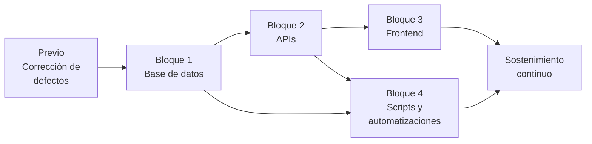

# 13 · Hoja de ruta

Tareas, entregables y criterios de aceptación. **Sin costes ni cronograma**: el calendario y el presupuesto se fijan aparte, con la ventana de control de cambios de MINDEF. El orden no es negociable en su primera parte: las correcciones de seguridad van antes que cualquier funcionalidad nueva.

---

## Cómo leer este documento

| Marcador | Significado |
|---|---|
| `[ACTUAL]` | Comprobado en `web/` — *fuente del SINB legado (VIDECI), no incluida en este repositorio* |
| `[DEFECTO]` | Problema comprobado |
| `[MEJORA]` | Capacidad existente que se modifica |
| `[NUEVO]` | Capacidad que el SINB no tiene |
| `[DECIDIR]` | Requiere firma institucional |

---

## 0. Contraste con la estructura actual

> **Actualización de contraste.** El orden de las fases se mantiene, pero dos supuestos del plan cambian según lo verificado en este repositorio:

| Supuesto original | Situación real verificada | Consecuencia en la hoja de ruta |
|---|---|---|
| Se parte de un sistema Laravel sin API | Este repositorio **ya tiene API FastAPI** (`/api/v1`, `/api/v2`) y migraciones SQL versionadas (`database/migrations/`) | Los bloques 1 y 2 se leen como **ampliación del módulo SINB** (`api/sinb/` + endpoints `/api/*/sinb/…`), no como construcción desde cero |
| Se migra desde el dump `sinb_20260714.sql` | El dump **no está localizado en este repositorio**; el esquema `sinb` está **vacío** | La migración de datos queda **bloqueada** hasta decidir: (a) localizar el dump y cargarlo con `id_legacy`, o (b) arrancar en blanco con el inventario de [04 §1](04-BASE-DE-DATOS.md#1-inventario-real-y-su-destino) |

**Hitos previos al bloque 1** *(nuevos, por contraste)*:

1. **Confirmar el origen de datos**: localizar `sinb_20260714.sql` o validar la decisión de partir de esquema vacío.
2. **Validar el aislamiento de dominio**: revisar que ninguna migración cree claves foráneas hacia `edan.*` o `rida.*`, y que el prefijo `sinb.` esté explícito en todo DDL.
3. **Confirmar reutilización condicional**: decidir, entidad por entidad, si se usa `usuarios`, `shared` o `repositorio` o se mantiene todo propio en `sinb.*` ([04 §0](04-BASE-DE-DATOS.md#0-cómo-encaja-con-la-estructura-actual-del-repositorio)).

---

## 1. El criterio de orden

`[NUEVO]` La secuencia no es «lo más útil primero», es «lo que bloquea lo demás primero».

| Principio | Consecuencia |
|---|---|
| Un defecto crítico no espera a la reescritura | El previo antes del bloque 1 |
| No se migra sobre un sistema con brechas | La seguridad va primero |
| No se construye sobre un modelo de datos improvisado | El esquema va antes que la API |
| La captura de campo es el corazón | El bloque 3 antes que los informes |
| El dato tiene que llegar solo | Los scripts del bloque 4 empiezan en cuanto hay esquema |
| El cambio pasa por control de cambios de MINDEF | Bloques cortos, con ventana aprobada |

`[NUEVO]` La última fila explica por qué la ingesta de clima y satélite y la verificación aparecen pronto aunque «se vean» tarde: una serie que empieza pronto vale mucho más que una que empieza al final.

---

## 2. Vista de los bloques

| Bloque | Contenido | Depende de |
|---|---|---|
| Previo | Corrección de los defectos críticos del sistema actual | — |
| 1 · Base de datos | 46 tablas migradas + las nuevas en `sinb.*`, RLS, catálogos | Previo |
| 2 · APIs | Contratos REST, tokens, permisos, exportaciones | 1 |
| 3 · Frontend | PWA offline-first, pantallas de los tres niveles | 2 |
| 4 · Scripts y automatizaciones | Tareas programadas, clima, satélite, verificación, respaldos | 1, 2 |

`[NUEVO]` Los bloques no se terminan uno para empezar otro: el bloque 4 puede avanzar en cuanto existe esquema, y el bloque 3 avanza endpoint a endpoint. Lo que sí es fijo es el orden **1 → 2**.

`[DECIDIR]` **Cronograma y coste.** Esta hoja no fija fechas ni cifras: lista tareas, entregables y criterios. El calendario depende del presupuesto aprobado, del equipo disponible y de la ventana de control de cambios de MINDEF.

---

## 3. Previo · Corrección de defectos críticos `[NUEVO]`

**Objetivo**: que el sistema actual sea seguro y funcional antes de tocar su arquitectura.

### 3.1 Tareas

| # | Tarea | Defecto que corrige | Responsable |
|---|---|---|---|
| 0.1 | Cerrar `GET /excel` | Fuera de `auth`, exporta 279 usuarios | Backend |
| 0.2 | Cambiar `required\|email` a `usuario` en login | 284 usuarios no pueden entrar | Backend |
| 0.3 | Forzar restablecimiento de las 284 contraseñas | `'123'` como inicial | Backend + Admin |
| 0.4 | Crear `t_password_resets` y su flujo | El reset lanza excepción | Backend |
| 0.5 | Implementar los gates con verificación real | 70 gates `fn() => true` | Backend |
| 0.6 | Añadir permiso a `POST /usuarios` | Alta sin autorización | Backend |
| 0.7 | Corregir el `TRUNCATE` en los 4 importadores | Reimportar destruye el catálogo | Backend |
| 0.8 | Envolver todo el alta de provincia en transacción | Abrir el formulario borra provincias | Backend |
| 0.9 | Añadir transacción a los flujos de guardado | 0 `DB::transaction` | Backend |
| 0.10 | Sincronizar `composer.lock` | PDF falla en ejecución | Backend |
| 0.11 | Corregir los 10 slugs de permiso inexistentes | 404 en la interfaz | Backend |
| 0.12 | Corregir el slug del menú 10 | Ruta inexistente | Backend |
| 0.13 | Limpiar `\r\n` literal en `t_zona_geografica` | Dato corrupto | Datos |
| 0.14 | Añadir bitácora mínima de auditoría | Cero rastro de escrituras | Backend |
| 0.15 | Cabeceras de seguridad y TLS | Sin CSP ni HSTS | Sysadmin |

### 3.2 Criterios de aceptación

| Criterio | Cómo se verifica |
|---|---|
| `GET /excel` devuelve 401 sin sesión | Petición anónima |
| Un usuario sin correo no puede entrar | Prueba con un usuario real |
| `POST /usuarios` sin permiso devuelve 403 | `curl` directo, no la interfaz |
| Reabrir `/crear-provincia` no borra nada | Con 111 provincias cargadas |
| Una importación fallida no deja datos parciales | Cortar la conexión en la fila 800 |
| El PDF se genera | Ejecutar el informe |
| Todas las escrituras dejan rastro | Consultar `auditoria` |
| Los 10 slugs de permiso existen | Comparar vistas contra `t_permiso` |

---

## 4. Bloque 1 · Base de datos `[NUEVO]`

**Objetivo**: el esquema PostgreSQL con PostGIS —las 46 tablas migradas y las nuevas en `sinb.*`—, con RLS activo y catálogos cargados.

### 4.1 Tareas

| # | Tarea | Entregable |
|---|---|---|
| 1.1 | Instalar PostgreSQL 16 + PostGIS 3.4 | Entorno con `GEOMETRY` verificado |
| 1.2 | Migrar la cadena de 5 niveles con FK compuestas | `grupo`, `indicador_natural`, `caracteristica`, `comportamiento`, `significado` |
| 1.3 | Migrar territorio con geometría | 9, 111, 337, 18.331 y geometría real |
| 1.4 | Migrar observaciones con sus 7 pivotes | `observacion`, `observacion_registro` |
| 1.5 | Migrar pronósticos y recomendaciones | `pronostico_estacional`, `escenario`, catálogo agronómico |
| 1.6 | Migrar identidad y construir RBAC | `usuario`, `rol`, `permiso`, `token_refresh` |
| 1.7 | Implementar RLS por rol y municipio | Políticas probadas |
| 1.8 `[NUEVO]` | Tablas de verificación y calificación | `verificacion_pronostico`, `calificacion_indicador`, `observador_indice` ([04 §14](04-BASE-DE-DATOS.md#14-verificación-simplificada-y-calificación-nuevo)) |
| 1.9 `[NUEVO]` | Tablas de observadores, avisos y pronóstico digital | `pronostico_observador`, `aviso`, `aviso_observador`, `pronostico_digital` |
| 1.10 `[NUEVO]` | Rol `usuario-supramunicipal` + RLS por región | Quinto rol con `app.municipios` regional |
| 1.11 `[NUEVO]` | Tabla `evidencia`: fotos **1:N con descripción** | DDL con `descripcion` obligatoria en galería |
| 1.12 `[NUEVO]` | Catálogo de motivos de rechazo | 6 motivos tipificados |
| 1.13 | Conventional commits de los cambios de esquema | Historial legible |
| 1.14 | Migración doble y corte | Los dos sistemas en paralelo `[DECIDIR]` |

### 4.2 Criterios de aceptación

| Criterio | Verificación |
|---|---|
| Las 46 tablas actuales están migradas | Comparación de conteos |
| Un indicador no puede tener una característica ajena | Intentar insertar la combinación inválida |
| Un rol no ve datos de otro municipio | Consulta como `usuario-municipal` |
| Un supra solo ve su región | Consulta como `usuario-supramunicipal` |
| La migración no pierde ni una fila | Comparación de conteos y suma de identificadores |
| Cada pronóstico emitido tiene su fila de verificación | Consultar `verificacion_pronostico` |
| Un nivel de calificación vigente no se duplica por ámbito | Insertar dos veces el mismo ámbito y fecha |
| La `confianza_largo` solo la calcula el servidor | Intentar enviarla desde el cliente |

---

## 5. Bloque 2 · APIs `[NUEVO]`

**Objetivo**: los contratos REST que sirven el esquema: autenticación, catálogo, observaciones, avisos, verificación y exportaciones.

### 5.1 Tareas

| # | Tarea | Entregable |
|---|---|---|
| 2.1 | API de autenticación y territorio | `/v1/auth`, `/v1/municipios`, `/v1/comunidades` |
| 2.2 | API de catálogo | `/v1/catalogo/cadena` + CRUD genérico `/v1/catalogos/{tabla}` ([04 §1A](04-BASE-DE-DATOS.md#1a-tres-bloques-con-su-crud-nuevo)) |
| 2.3 | API de observaciones | CRUD + validación + estados |
| 2.4 | API de avisos, observadores, índice e histograma | `/v1/avisos`, `/v1/observadores`, histograma, reportes por alcance |
| 2.5 `[NUEVO]` | API de verificación y calificación | `/v1/verificaciones`, `/v1/calificacion` ([05 §4.6](05-APIS.md)) |
| 2.6 | Emisión de pronóstico y recomendación municipal | Validación de datos de entrada y cobertura |
| 2.7 | Consolidación por municipio y zona | Vista de nivel 2 y nivel 3 |
| 2.8 `[NUEVO]` | Propuesta y confirmación de nivel de calificación | Flujo con `usuario-municipal` |
| 2.9 | Exportación GeoJSON con RFC 7946 | EPSG:4326, longitud-latitud |
| 2.10 | Exportación XLSX y PDF funcionales | `.xlsx`, `.pdf` |
| 2.11 | Auditoría de toda exportación | `accion = 'EXPORTAR'` |
| 2.12 | API documentada y versionada | OpenAPI en `/docs` + `schemathesis` |
| 2.13 | Informe para VIDECI con anomalías comparadas | Informe anual |
| 2.14 | Formato de intercambio con SENAMHI | `[DECIDIR]` |

### 5.2 Criterios de aceptación

| Criterio | Verificación |
|---|---|
| `/v1/catalogo/cadena` devuelve los 5 niveles | Contar niveles y filas |
| La API responde lo que dice el OpenAPI | `schemathesis` |
| Un pronóstico no se emite con datos incompletos | Enviar la observación obligatoria ausente |
| El aviso que no tiene resultado no califica | Revisar la fila de verificación |
| Una foto sin descripción no se confirma | Enviar `descripcion` vacía |
| El GeoJSON abre en QGIS sin avisos | Importar en QGIS |
| Toda exportación deja rastro | Consultar `auditoria` |
| El PDF se genera sin errores | Ejecutar el informe |

---

## 6. Bloque 3 · Frontend `[NUEVO]`

**Objetivo**: que un observador registre en el Altiplano sin cobertura, y que el dato llegue intacto; y que los tres niveles trabajen en pantalla.

### 6.1 Tareas

| # | Tarea | Entregable |
|---|---|---|
| 3.1 | PWA instalable y funcional sin red | `vite-plugin-pwa` configurado |
| 3.2 | IndexedDB con Dexie | 5 tablas locales |
| 3.3 | Catálogo versionado descargado | `/v1/catalogo/version` comparado |
| 3.4 | Validación de la cadena de 5 niveles en cliente | FK compuesta replicada |
| 3.5 | Formulario de observación de campo | Pantalla más importante del sistema |
| 3.6 | Captura de ausencia y no observación | Estados diferenciados |
| 3.7 | Evidencias como blob local y subida por URL firmada | Fotos sin conexión |
| 3.8 | Sincronización por bloques con reintentos | Cola con backoff 2s/10s/60s |
| 3.9 | Resolución de conflictos por campo | Servidor gana en datos validados |
| 3.10 | Indicador de estado sin tecnicismos | 5 estados visibles |
| 3.11 | Ficha imprimible | CSS de impresión |
| 3.12 | Prueba de campo con usuarios reales | 3 comunidades piloto |
| 3.13 `[NUEVO]` | Asistente de pronóstico con paso 0 (campo abierto) | Cadena íntegra + `pronostico_libre` tal cual |
| 3.14 `[NUEVO]` | Pantalla de observadores destacados 1..N | Auto-registro o en representación, con confianza inicial |
| 3.15 `[NUEVO]` | Herramienta de avisos (corto plazo) con vigencia y prioridad de cola | `<TarjetaAviso>` offline-first |
| 3.16 `[NUEVO]` | Galería de fotos del bioindicador en ficha y mapa | `<GaleriaBioindicador>` + `<PopupMapaBioindicador>` |
| 3.17 `[NUEVO]` | Pantalla de verificación pendiente y calificación (3 niveles) | `EN_VERIFICACION` / `USABLE` / `REVISAR` ([06 §12A](06-FRONTEND.md#12a-cómo-se-ve-la-verificación-en-pantalla-nuevo)) |
| 3.18 | Revisión comunitaria antes de validar | Que quien registró lo confirme |
| 3.19 | Validación municipal (nivel 2) con motivos de rechazo | Estados y motivos tipificados |
| 3.20 | Recomendación municipal contextual | 5 dimensiones reales |
| 3.21 | Publicación nacional (nivel 3) en VIDECI | Cobertura mínima para publicar |
| 3.22 | Distribución nacional por canales | Web, boletín y ficha |
| 3.23 | Mapa con capas NDVI en la interfaz | Leaflet con teselas raster |
| 3.24 | Modo degradado sin conexión externa | El sistema sigue funcionando |

### 6.2 Criterios de aceptación

| Criterio | Verificación |
|---|---|
| Se registra una observación completa con el teléfono en modo avión | Prueba real |
| 20 observaciones se sincronizan con una sola sesión HTTP | Medición de red |
| Ninguna foto del usuario se pierde | Contar antes y después |
| La primera apertura sin red muestra el formulario funcional | Prueba de campo |
| Un conflicto no pierde datos sin avisar | Forzar conflicto entre dos dispositivos |
| La ficha impresa es legible en A4 | Impresión de prueba |
| Funciona con guantes y sol | Prueba con observadores |
| El aviso sube antes que las observaciones ordinarias | Cola con los tres tipos mezclados |
| La frase del paso 0 llega idéntica al servidor | Comparar texto capturado y guardado |
| Una foto sin descripción no se confirma | Enviar `descripcion` vacía |
| Una foto editada no toca la descripción de otra | PATCH sobre una foto de la galería |
| La revisión comunitaria deja registro | Buscar la confirmación |
| Un pronóstico no se publica con cobertura insuficiente | Regla de cobertura mínima |
| Solo `administrador` publica a nivel nacional | `curl` con otro rol |
| El sistema funciona 72 horas sin red externa | Desconectar y operar |

---

## 7. Bloque 4 · Scripts y automatizaciones `[NUEVO]`

**Objetivo**: lo que corre solo: verificación de pronósticos, índice de observadores, ingesta de clima y satélite, agregaciones y respaldos.

### 7.1 Tareas

| # | Tarea | Entregable |
|---|---|---|
| 4.1 | Tarea diaria de verificación | `verificacion.py` con `SKIP LOCKED` ([03 §5.3](03-BACKEND.md#53-la-tarea-de-verificación-nuevo)) |
| 4.2 | Propuesta de calificación con 3 niveles | Tarea nocturna → `REVISAR` / `USABLE` |
| 4.3 | Índice automático por observador y tipo (LARGO / CORTO) | `observador_indice` con tarea 04:13 |
| 4.4 | Ingesta del pronóstico digital cada 15 min | `pronostico_digital` |
| 4.5 | Verificación de avisos (corto plazo) | `CUMPLIO` / `NO_CUMPLIO` / `SIN_DATOS` dentro de la vigencia |
| 4.6 | Ingesta de Open-Meteo Archive | `serie_climatica` poblada |
| 4.7 | Ingesta de Open-Meteo Forecast | Previsión y humedad de suelo |
| 4.8 | Consulta de escenas en EarthSearch | STAC sin clave |
| 4.9 | Descarga de bandas Sentinel-2 | `nir`, `red`, `scl` |
| 4.10 | Cálculo de NDVI con máscara SCL | Índice por comunidad y dekada |
| 4.11 | Agregación territorial de NDVI | `agregado_satelital` |
| 4.12 | Carga de geometrías desde OSM | Polígonos de comunidad |
| 4.13 | Validación de geometría con PostGIS | `ST_IsValid` y `ST_MakeValid` |
| 4.14 | Serie de indicadores y norma climática | `serie_indicador`, `norma_climatica` `[DECIDIR]` |
| 4.15 | Tendencia fenológica con regla de 10 años | `v_tendencia_fenologia` |
| 4.16 | Vista de anomalías comparadas | `v_anomalia_comparada` |
| 4.17 | Agregación municipal automática y anual | Conteos y promedios por comunidad |
| 4.18 | Respaldos diarios y restauración probada | `pg_dump` + réplica de objetos ([12 §5](12-INFRAESTRUCTURA.md)) |
| 4.19 `[OPCIONAL]` | Métodos de verificación avanzados | Fenológico con desfase, numérico (RMSE/MAE), correlación, skill ([10 §10.2](10-INTEROPERABILIDAD.md#102-métricas-y-criterios-a-futuro-opcional)) |

### 7.2 Criterios de aceptación

| Criterio | Verificación |
|---|---|
| Un pronóstico vencido se verifica solo, sin intervención | Dejar uno vencido y mirar `verificacion_pronostico` |
| Sin dato observado la verificación queda `NO_VERIFICABLE` | Caso sin observación en el periodo |
| Un aviso acertado no toca el índice LARGO | Comparar `observador_indice` antes/después |
| Con cero registros el índice muestra «sin datos» | Observador nuevo |
| Toda comunidad con coordenadas tiene NDVI | Consulta de cobertura |
| El NDVI está entre -1 y 1 en el 100 % de las escenas | Validación de rango |
| Los píxeles de nube están excluidos | Máscara SCL |
| La geometría de una comunidad es válida | `ST_IsValid` |
| Las 18.331 comunidades tienen polígono o marca de falta | Consulta de cobertura |
| Un respaldo se restaura | Prueba trimestral ([12 §5.2](12-INFRAESTRUCTURA.md#52-restauración-probada)) |

`[NUEVO]` **La honestidad es parte del entregable.** En el primer año el sistema **no puede afirmar ninguna tendencia** ([07 §9.10](07-FLUJOS-BIOCULTURALES.md#910-el-límite-honesto-decidir)), y eso se comunica con claridad. Lo que sí puede hacer es verificar pronóstico a pronóstico y mostrar año a año el acierto de cada observador.

---

## 8. Sostenimiento `[NUEVO]`

**Objetivo**: que el sistema siga funcionando y siga aprendiendo.

| Actividad | Frecuencia | Responsable |
|---|---|---|
| Verificación de pronósticos | Diaria, automática | Sistema |
| Propuesta de calificación | Diaria, automática | Sistema |
| Agregación anual | Anual, automática | Sistema |
| Revisión de métricas de la API | Semanal | Backend |
| Revisión de la cola de trabajo | Semanal | DevOps |
| Prueba de restauración de respaldo | Mensual | Sysadmin |
| Revisión de bitácora de acceso | Mensual | Seguridad |
| Revisión de índices y querys | Trimestral | Backend + DBA |
| Revisión de la calidad de los datos | Trimestral | Gestor de datos |
| Revisión de los niveles de calificación | Semestral | Técnico + comunidades |
| Actualización de dependencias | Trimestral | Backend |
| Informe anual a VIDECI | Anual | Técnico |

`[NUEVO]` Un sistema que solo se mantiene actualizando el software se estropea. La fila que más importa es la de **revisión semestral de los niveles con las comunidades**: es la que protege el conocimiento local de la deriva técnica.

---

## 9. Riesgos del proyecto

| # | Riesgo | Bloque | Probabilidad | Impacto | Mitigación | Responsable |
|---|---|---|---|---|---|---|
| 1 | El sistema actual no se puede corregir a tiempo | Previo | Media | Alto | El previo no depende de nada externo | Backend |
| 2 | Los bioindicadores no alcanzan 10 años en el horizonte del proyecto | 4 | Alta | Alto | Publicar año a año, sin afirmar tendencia antes | Especialista en datos |
| 3 | Las comunidades no adoptan la PWA | 3 | Media | Alto | Formación y revisión comunitaria | Técnico |
| 4 | No se consigue acceso a SENAMHI | 4 | Media | Medio | Open-Meteo cubre el histórico | Técnico |
| 5 | El control de cambios de MINDEF ralentiza el despliegue | Todos | Alta | Medio | Bloques cortos con ventana aprobada | Sysadmin |
| 6 | El conocimiento local se desacredita por sobreinterpretar | 4 | Media | Alto | Regla de los 10 años y umbral de significación | Especialista en datos |
| 7 | El volumen de imágenes satelital excede el presupuesto | 4 | Media | Medio | Guardar solo agregados si hace falta | Sysadmin |
| 8 | Un solo desarrollador sabe cómo funciona una parte | Todos | Media | Alto | Documentación por módulo y revisión cruzada | Tech lead |
| 9 | Los 284 usuarios no recuperan el acceso tras el cambio de hash | Previo | Alta | Medio | Restablecimiento forzado con comunicación previa | Administrador |
| 10 | La verificación no encuentra aciertos positivos | 4 | Media | Alto | Es un resultado legítimo: se publica igual | Especialista en datos |

`[NUEVO]` El riesgo 10 merece énfasis: **es posible que el sistema demuestre que varias reglas no funcionan**. Ese es un resultado valioso, no un fracaso. Un sistema que solo publica lo que funciona, y que muestra lo que no funciona con la misma claridad, es más confiable que uno que promete precisión y no la mide.

---

## 10. Decisiones pendientes

| # | Decisión | Bloque | Quién decide | Consecuencia |
|---|---|---|---|---|
| 1 | Coexistencia con Laravel o corte único | 1 | VIDECI + MINDEF | Afecta toda la migración |
| 2 | Norma climática de referencia | 4 | Técnico | Por defecto 1991–2020 |
| 3 | Dominio del API | 2 | VIDECI | Sugerido `api.sinb.gob.bo` |
| 4 | Acceso de terceros al API | 2 | VIDECI | Abre o cierra el acceso a datos |
| 5 | Retención de la bitácora | Todos | Seguridad | Por defecto 5 años |
| 6 | Cifrado local en reposo | 3 | Seguridad | En los dispositivos de campo |
| 7 | Convenios con SENAMHI y PMA | 4 | VIDECI | Mejora la fuente, no la bloquea |
| 8 | Aplicación de la Ley 29733 | 1 | Legal | Datos personales |
| 9 | Umbral de cobertura mínima nacional | 3 | VIDECI | Qué se publica |
| 10 | Si se emiten probabilidades o solo categorías | 3 | Técnico | Habilita o no el Brier |
| 11 `[NUEVO]` | Nombres de las dos herramientas (largo / corto) | 3 | VIDECI + comunidades | Navegación y manuales |
| 12 `[NUEVO]` | Definición de «región» para el rol supra | 1 | VIDECI | Alcance del RLS regional |
| 13 `[NUEVO]` | Vigencia del aviso: 24 h por defecto, 48 h máximas | 4 | Técnico | Ventana de verificación |
| 14 `[DECIDIR]` | Pasar de Apache a nginx en el despliegue | Infra | Sysadmin | Un solo stack documentado ([12 §3.1](12-INFRAESTRUCTURA.md#31-los-cinco-servicios)) |

`[OPCIONAL]` La experimentación con IA (motor de texto, emparejador offline, MCP) no es una fase ni una decisión de esta hoja: queda como nota breve en [14](14-RESUMEN-EJECUTIVO.md) y no bloquea ningún bloque.

---

## 11. Trazabilidad

| Tema | Documento |
|---|---|
| Arquitectura y bloques | [01](01-ARQUITECTURA.md) |
| Esquema y DDL | [04](04-BASE-DE-DATOS.md) |
| Tareas programadas y verificación diaria | [03 §5](03-BACKEND.md#5-tareas-programadas-lo-mínimo-nuevo) |
| Tres niveles de flujo | [07](07-FLUJOS-BIOCULTURALES.md) |
| Fuentes satelitales, clima y métodos a futuro | [10](10-INTEROPERABILIDAD.md) |
| Despliegue e infraestructura | [12](12-INFRAESTRUCTURA.md) |
| Resumen para exposición | [14-RESUMEN-EJECUTIVO.md](14-RESUMEN-EJECUTIVO.md) |
