# 14 · Resumen ejecutivo

### El nuevo SINB — compacto completo de la propuesta

> **Sistema de Información Biocultural (SINB)** · VIDECI · con apoyo del PMA
> Documento único de exposición: aquí está, en un solo lugar, todo el contenido de los 14 documentos — lógica clara, ejemplos, tablas, comparaciones y diagramas. La IA aparece solo como una nota **opcional** (§13).

---

## La propuesta en tres frases

1. **El SINB ya guarda el dato biocultural más valioso de Bolivia**: 77 indicadores, 523 comportamientos, 293 significados, 18.331 comunidades.
2. **Hoy solo guarda**: no calcula, no verifica si sus pronósticos aciertan y no aprende.
3. **La propuesta le añade la capacidad de medir su propia confiabilidad**: verifica cada pronóstico, **califica cada bioindicador con evidencia** y muestra, año tras año, qué sirve y qué no.

> **Idea central**: el conocimiento local pasa de *opinión* a *evidencia medible, con fecha y con nombre*.

---

## Tabla de contenidos

| # | Sección | Responde a |
|---|---|---|
| 1 | [Cómo leer este documento](#1-cómo-leer-este-documento) | Qué significa cada marcador |
| 2 | [Qué es el SINB, explicado simple](#2-qué-es-el-sinb-explicado-simple) | ¿De qué hablamos? |
| 3 | [Mapa de actores](#3-mapa-de-actores) | ¿Quién participa? |
| 4 | [Estado actual del sistema](#4-estado-actual-del-sistema--anterior) | ¿Qué hay hoy? |
| 5 | [Tabla maestra: anterior vs nuevo](#5-tabla-maestra-anterior-vs-nuevo) | ¿Qué cambia exactamente? |
| 6 | [Qué se propone](#6-qué-se-propone--nuevo) | ¿Qué se construye? |
| 7 | [Cómo funcionará](#7-cómo-funcionará--nuevo) | ¿Cómo se usa? |
| 8 | [Ventajas](#8-ventajas) | ¿Por qué conviene? |
| 9 | [Bioindicadores: conservar y medir](#9-bioindicadores-conservar-medir-y-analizar-en-el-tiempo) | ¿Cómo se protege y se mide el conocimiento? |
| 10 | [Listado de herramientas](#10-listado-de-herramientas) | ¿Con qué se construye? |
| 11 | [Usos: apps, web e interoperabilidad](#11-usos-apps-web-e-interoperabilidad) | ¿Quién lo usa y cómo? |
| 12 | [Integración con herramientas y fuentes](#12-integración-con-herramientas-y-fuentes-externas) | ¿Con qué se conecta? |
| 13 | [IA opcional: motor de texto y MCP](#13-ia-opcional-motor-de-texto-y-mcp) | Nota opcional: qué sería y por qué no ahora |
| 14 | [Compacto de los 14 documentos](#14-compacto-de-los-14-documentos) | ¿Dónde está cada detalle? |
| 15 | [Decisiones que necesitan firma](#15-las-decisiones-que-necesitan-firma) | ¿Qué debe decidir la institución? |
| 16 | [Cronograma y coste](#16-cronograma-y-coste) | ¿Cuánto cuesta y cuándo? |
| 17 | [El argumento final](#17-el-argumento-final) | ¿Por qué hacerlo? |

---

## 1. Cómo leer este documento

Toda la propuesta usa **seis marcadores**. Sin excepción: o está verificado, o está marcado como nuevo.

| Marcador | Significado | Cómo se verifica |
|---|---|---|
| **`[ACTUAL]`** | **Ya existe hoy.** Se conserva tal cual | Leyendo el código, el dump o las rutas citadas |
| **`[DEFECTO]`** | **Existe y está mal.** Se corrige en Fase 0 | Con la evidencia citada |
| **`[MEJORA]`** | **Ya existe y cambia.** Se modifica su comportamiento | Con el motivo en la misma línea |
| **`[NUEVO]`** | **No existe.** Es idea nueva de esta propuesta | Se marca en cada documento donde aparece |
| **`[DECIDIR]`** | **Hay dos caminos y hace falta firma institucional** | Con las dos opciones y su coste |
| **`[OPCIONAL]`** | **Exploración fuera del alcance base** ([§13](#13-ia-opcional-motor-de-texto-y-mcp)). No bloquea nada; se puede descartar sin efecto | Con su análisis de viabilidad y su experimento de prueba |

**Regla de oro**: si algo no lleva `[ACTUAL]` o `[DEFECTO]`, es propuesta. Nada se presenta como existente si no lo está.

> **▸ Bloques expandibles.** Los bloques cuyo título empieza con **▸** son plegables: **haga clic en el título** para desplegar el ejemplo o el desglose completo, y vuelva a clicar para plegarlo. Si no lo despliega, se queda solo con el resumen.

### 1.1 Dónde vive el nuevo SINB en este repositorio

> **Contraste con la estructura real.** Las fuentes del análisis original (`web/`, `sinb_20260714.sql`) corresponden al **SINB legado de la VIDECI** (Laravel + MariaDB) y **no están incluidas en este repositorio**. Lo que este repositorio aporta y donde se aplica la propuesta:

| Elemento | Estructura actual verificada en este repositorio |
|---|---|
| Motor de base de datos | **PostgreSQL 16 + PostGIS 3.4**, base `db_sinagersat` |
| Arquitectura | **Multi-esquema**: `shared`, `usuarios`, `edan`, `rea`, `repositorio`, `rida`, **`sinb`**, `recursos` |
| Esquema `sinb` | **Existe y está vacío** → es el **destino exclusivo** del modelo propuesto |
| API | **FastAPI** (Python 3.12), rutas `/api/v1` y `/api/v2`, JWT, auditoría (`AuditMiddleware`) |
| Migraciones | SQL versionadas en `database/migrations/` (v2.x) |
| Integración activa | **Firma digital AGETIC** (proxy con `httpx` en `api/firma_digital/`) |
| Dominios vecinos | `edan` y `rida` son módulos **independientes** |

**Tres reglas de integración** (detalle en [04 §0](04-BASE-DE-DATOS.md#0-cómo-encaja-con-la-estructura-actual-del-repositorio)):

| # | Regla | Consecuencia |
|---|---|---|
| 1 | **Independencia de dominio** | Todo va a **`sinb.*`**. **Prohibido** crear claves foráneas hacia `edan.*`, `rida.*` ni `rea.*` |
| 2 | **Reutilización condicional** | `usuarios`, `shared` y `repositorio` se usan **solo si el diseño lo requiere y queda justificado** |
| 3 | **Namespace explícito** | Todo DDL lleva prefijo `sinb.` y `SET search_path` en cada migración |

---

## 2. Qué es el SINB, explicado simple

El **Sistema de Información Biocultural** registra cómo las comunidades del Altiplano se relacionan con su territorio a partir de señales vivas —el canto del liqi liqi, el aullido del zorro, la floración de la picaflor— y las convierte en **pronósticos verificables**.

| Pregunta | Respuesta simple |
|---|---|
| ¿Qué guarda hoy? | Lo que los observadores anotan: animales, plantas, clima, astros y **qué significa cada señal** |
| ¿Para qué sirve? | Anticipar heladas, lluvias y fechas de siembra con el conocimiento de la propia comunidad |
| ¿Qué le falta? | **Comprobar si acierta.** Guarda sin verificar, no calcula, no aprende |
| ¿Qué se le añade? | Medir su propia confiabilidad y **calificar cada bioindicador en el tiempo** |

### 2.1 El corazón del sistema: la cadena de cinco niveles

`[ACTUAL]` Este es **el activo más valioso**. No es código: es el lenguaje con el que las comunidades nombran el mundo.

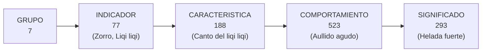

| Ejemplo real | Cadena completa |
|---|---|
| Indicador | `Liqi liqi` (*Vanellus andina*) |
| Característica | `Canto del liqi liqi` |
| Comportamiento | Canto agudo y repetido al amanecer |
| Significado | `Helada fuerte` · `Siembra atrasada` |

> **`[ACTUAL]` Esta cadena no se aplana, no se mezcla y no se destruye.** Se conserva íntegra en el nuevo esquema (principios P1 y P11 de [04](04-BASE-DE-DATOS.md)).

### 2.2 Qué sistema es, con una analogía

| Analogía | SINB hoy | SINB propuesto |
|---|---|---|
| Cómo funciona como… | **Una libreta digital**: anota todo correctamente | **Un laboratorio**: anota, mide, compara y dice qué tan confiable es |
| ¿Y si se equivoca? | El error queda guardado igual | El sistema lo detecta, lo marca y **deja de apoyarse en lo que falla** |
| ¿Sirve para decidir? | Sirve para **consultar** | Sirve para **decidir siembra, alerta y política pública** |

---

## 3. Mapa de actores

`[ACTUAL]` Cuatro roles reales en el sistema (`t_rol`) **más uno nuevo** (`usuario-supramunicipal`), más las instituciones y las fuentes automáticas.

| Actor | Rol | Qué hace hoy | Qué gana con la propuesta |
|---|---|---|---|
| **Comunidad / observador comunitario** | `observador-local` | Conoce y aporta las señales | Su conocimiento queda registrado **con consentimiento**, y se valida con ella; además **aparece como observador** detrás de los pronósticos que firma, con su confianza |
| **Recolector de campo** | `usuario-recolector` | Capta observaciones en el territorio | App que **funciona sin señal**: captura en el cerro, sincroniza al volver la red |
| **Técnico municipal** | `usuario-municipal` | Revisa y consolida | Ve pronósticos, **confirma calificaciones** y decide con evidencia |
| **Gestor regional** `[NUEVO]` | `usuario-supramunicipal` | No existe hoy | **Gestión y reportes de toda su región**, validación en bloque, usuarios de su ámbito |
| **VIDECI / administración** | `administrador` | Opera el sistema | Panel nacional, **trazabilidad de cada cambio**, datos verificables |
| **Instituciones** (MINDEF, PROSUCO, SENAMHI, PMA) | Consumidoras | Reciben reportes manuales | **API pública** con datos geográficos y series verificables |
| **Investigadores externos** | Consulta | Sin acceso formal | Series históricas con método y advertencia de confianza |
| **Fuentes automáticas** | — | No existen | Sentinel-2, Open-Meteo y OSM alimentan el sistema **sin costo de licencia** |

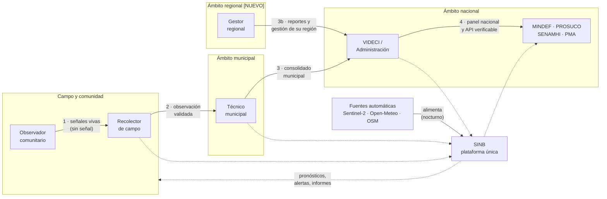

> **`[NUEVO]` Regla de oro**: el sistema traduce la tecnología al conocimiento local, **nunca al revés**. Detalle en [11](11-INTERCULTURALIDAD.md).

---

## 4. Estado actual del sistema · ANTERIOR

### 4.1 Lo que ya existe y se conserva

| Activo | Volumen verificado | Por qué es valioso |
|---|---|---|
| Cadena biocultural de 5 niveles | 7 grupos · 77 indicadores · 188 características · 523 comportamientos · 293 significados | El lenguaje de las comunidades |
| Territorio | 9 departamentos · 111 provincias · 337 municipios · 18.331 comunidades · 3 zonas | La estructura real del país |
| Observaciones de campo | 243 con 1.610 registros | La evidencia primaria |
| Pronósticos | 237 estacionales · 7 temporales | La práctica de pronóstico ya existe |
| Vocabulario agronómico | 5 dimensiones · 19 recomendaciones · 6 variantes | Manejo de papa y haba |
| Usuarios | 279 activos · 4 roles · 70 permisos | La estructura de permisos |
| Pictogramas y logos | 30 PNG · VIDECI/MINDEF/PROSUCO | Identidad institucional, **no se regenera** |

### 4.2 Diagnóstico en corto

<b>▸ HAGA CLIC PARA VER LAS TRES VERDADES (se despliega)</b>

| | Estado |
|---|---|
| **`[ACTUAL]` Funciona** | El conocimiento está capturado y estructurado: cadena de 5 niveles, territorio, pronósticos y usuarios. **Eso no se toca, se conserva.** |
| **`[DEFECTO]` Está en riesgo** | La plataforma legada (Laravel + MariaDB) tiene **10 defectos verificados**, entre ellos permisos que conceden siempre y una exportación de usuarios **sin autenticación**. |
| **`[NUEVO]` No existe** | Verificación de pronósticos, cálculo automático, clima y satélite, trabajo sin conexión, series históricas y **análisis de precisión en el tiempo**. |

### 4.3 Los diez defectos `[DEFECTO]`

> *Contraste*: verificados en el **SINB legado de la VIDECI** (código Laravel `web/`, no incluido en este repositorio). Aplican a su despliegue de Fase 0.

| # | Defecto verificado | Consecuencia en lenguaje llano |
|---|---|---|
| 1 | `Gate::define($slug, fn() => true)` | Los 70 permisos **conceden siempre** en el servidor |
| 2 | Autorización solo en Blade (`@permiso`) | Cualquiera con la URL puede ejecutar acciones |
| 3 | `GET /excel` fuera del middleware `auth` | Se descargan nombre, correo, celular, CI y rol de **279 usuarios** |
| 4 | Contraseña inicial `'123'` | Credencial conocida |
| 5 | `required\|email` en el login | Los usuarios sin correo **no pueden entrar** |
| 6 | `t_password_resets` no existe | El restablecimiento lanza excepción |
| 7 | `TRUNCATE` en 4 importadores | Reimportar **destruye** el catálogo |
| 8 | `GET /crear-provincia` trunca | Abrir el formulario **borra** las 111 provincias |
| 9 | `DB::transaction` → 0 usos | Un fallo deja datos **a medias** |
| 10 | `composer.lock` desincronizado | El PDF falla en ejecución |

`[NUEVO]` **Ninguno espera a la reescritura**: son días o semanas de trabajo y van en la **Fase 0**.

### 4.4 Lo que hoy no hace el sistema

> *Contraste*: columna **Estado en este repositorio**, verificado sobre `api/` y `database/`.

| Lo que falta | SINB legado | Estado en este repositorio | Consecuencia |
|---|---|---|---|
| API REST | 0 endpoints | **`[ACTUAL]` Existe** (FastAPI, `/api/v1`, `/api/v2`) | El módulo SINB se monta como **ampliación** |
| Trabajo sin conexión | No existe | No existe para SINB | Sin cobertura, **no se registra nada** |
| Cálculo de pronóstico | No existe | No existe | Los pronósticos se emiten **a mano** |
| **Verificación de aciertos** | No existe | No existe | **Nadie sabe si un pronóstico acierta** |
| Meteorología | No se consume | No se consume | No hay serie con la que comparar |
| Satélite (NDVI) | No se usa | No se usa | No hay índice propio |
| Auditoría | No existe | **`[ACTUAL]` Existe** (`AuditMiddleware`), ampliable a `sinb.*` | Las escrituras dejan rastro |
| Series históricas | No existe | No existe | No hay historial → **no hay cambio climático** |
| Firma de documentos | — | **`[ACTUAL]` Existe** (proxy AGETIC) | Patrón de integración reutilizable |

---

## 5. Tabla maestra: ANTERIOR vs NUEVO

> La pregunta que todos se hacen: **qué se queda, qué cambia y qué aparece.**

### 5.1 Por área funcional

| Área | `[ACTUAL]` Lo que EXISTE y se conserva | `[MEJORA]` Lo que CAMBIA | `[NUEVO]` Lo que NO EXISTE y se crea | Doc. |
|---|---|---|---|---|
| **Conocimiento** | Cadena de 5 niveles, 77 indicadores, vocabulario agronómico | Sin prefijo `t_`, integridad de cadena, UTF8 nativo | Consentimiento, traducciones, sinónimos, evidencias (foto/audio) y **galería 1:N de fotos del bioindicador, cada una con su descripción** (ya se veían en el mapa con coordenadas) | [04](04-BASE-DE-DATOS.md) §3.7, [06](06-FRONTEND.md) §12C |
| **Territorio** | 9 dep., 111 prov., 337 mun., 18.331 comunidades, 3 zonas | Pivotes conservados, comunidades con geometría | Zonas conectadas al territorio, inventario por municipio | [04](04-BASE-DE-DATOS.md) |
| **Identidad** | 279 usuarios, 4 roles, 70 permisos, 18 menús | Contraseñas y criptografía corregidas | `token_refresh` con revocación, bitácora ampliada, **5.º rol `usuario-supramunicipal`** | [04](04-BASE-DE-DATOS.md), [09](09-SEGURIDAD.md) |
| **Captura en campo** | Observaciones y pronósticos (escritorio) | — | **PWA offline-first**, UUIDv7 en el dispositivo, sincronización por bloques, IndexedDB | [06](06-FRONTEND.md), [08](08-OFFLINE-SINCRONIZACION.md) |
| **Captura asistida** `[OPCIONAL]` | — (todo se teclea a mano) | — | Motor de texto: voz/texto libre → **propuesta estructurada**; emparejador offline; MCP | [§13](#13-ia-opcional-motor-de-texto-y-mcp) |
| **Flujo** | Un solo nivel: se registra y ya | Roles reutilizados | **Tres niveles** (campo → municipal → nacional) con preparación y tendencia como tareas | [07](07-FLUJOS-BIOCULTURALES.md) |
| **Pronóstico** | 237 estacionales, 7 temporales, emisión a mano | Categoría corregida en `pronostico_temporal` | Motor de emisión con reglas y métodos por pronóstico | [04](04-BASE-DE-DATOS.md), [03](03-BACKEND.md) |
| **Recolección de pronósticos** `[NUEVO]` | Pronósticos sin observadores ni confianza | — | **Dos herramientas** (largo plazo y avisos), `pronostico_libre` tal cual, observadores 1..N, **dos confianzas** (inicial + índice automático LARGO/CORTO), histograma | [04](04-BASE-DE-DATOS.md) §6, [07](07-FLUJOS-BIOCULTURALES.md) §6A |
| **Pronóstico digital** `[NUEVO]` | — | — | **Control y ayuda**: Open-Meteo `minutely_15`/`hourly` cada 15 min, acumula datos para validar después ambos tipos de pronóstico | [10](10-INTEROPERABILIDAD.md) §8A |
| **Verificación** | — (no existe) | — | **`[NUEVO]` Verificación**: al vencer el periodo, ¿acertó o no? + calificación en 3 niveles | [04](04-BASE-DE-DATOS.md) §14, [07](07-FLUJOS-BIOCULTURALES.md) §9A |
| **Calificación** | — (no existe) | — | **`[NUEVO]`** calificación en 3 niveles (`EN_VERIFICACION` / `USABLE` / `REVISAR`) + confiabilidad a la vista | [04](04-BASE-DE-DATOS.md) |
| **Clima y satélite** | — (no existe) | — | **`[NUEVO]`** Sentinel-2, NDVI calculado, Open-Meteo, series, norma climática | [10](10-INTEROPERABILIDAD.md) |
| **API** | — (legado sin API) | — | Contratos REST versionados, tokens, OpenAPI, permisos por endpoint | [05](05-APIS.md) |
| **Seguridad** | Autorización solo en vistas | Auditoría, RLS, tokens, cifrado | **`[NUEVO]`** RLS por territorio, ciclo de vida de token, cifrado de evidencias | [09](09-SEGURIDAD.md) |
| **Interculturalidad** | Español, 4 roles | — | **`[NUEVO]`** Todo en español, nombres locales como dato, consentimiento, validación comunitaria | [11](11-INTERCULTURALIDAD.md) |
| **Infraestructura** | — (legado) | Copias de seguridad ya existentes | Contenedores, monitoreo, secretos, **on-premise sin nube** | [12](12-INFRAESTRUCTURA.md) |
| **Interoperabilidad** | Firma digital AGETIC (en repositorio) | — | **`[NUEVO]`** GeoJSON, API pública, exportaciones verificables, satélite y clima | [10](10-INTEROPERABILIDAD.md) |

### 5.2 Resumen visual: de qué tipo es cada cambio

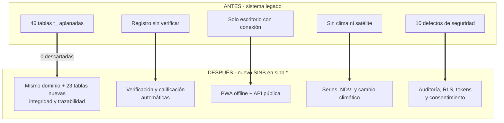

### 5.3 Desglose por marcador

<b>▸ HAGA CLIC PARA VER EL DESGLOSE COMPLETO POR MARCADOR (se despliega)</b>

**`[ACTUAL]` SE CONSERVA SIN CAMBIOS** (no se toca)

| Elemento | Volumen |
|---|---|
| Cadena de 5 niveles | 7 grupos, 77 indicadores, 188 características, 523 comportamientos, 293 significados |
| Territorio | 9 departamentos, 111 provincias, 337 municipios, 18.331 comunidades |
| Observaciones | 243 cabeceras con 1.610 registros |
| Pronósticos | 237 estacionales, 7 temporales |
| Vocabulario agronómico | 5 dimensiones, 19 recomendaciones, 6 variantes |
| Usuarios y roles | 279 usuarios, 4 roles, 70 permisos, 18 menús |
| Identidad visual | 30 pictogramas, logos VIDECI/MINDEF/PROSUCO |
| Motor y API base | PostgreSQL 16 + PostGIS, FastAPI, JWT, auditoría |
| Firma digital | Proxy AGETIC (`api/firma_digital/`) |

**`[DEFECTO]` SE CORRIGE EN FASE 0** — 10 defectos (§4.3)

**`[MEJORA]` SE MODIFICA CON MOTIVO DOCUMENTADO** — criptografía de contraseñas · categoría de pronóstico temporal · unicidad de pivotes · tipos de `usuario` · contrato único de subida de evidencias

**`[NUEVO]` SE CONSTRUYE DESDE CERO**

| Categoría | Nuevas capacidades |
|---|---|
| Datos | 23 tablas nuevas (evidencias, satélite, clima, verificación, consentimiento, auditoría, sync, **observadores, avisos, pronóstico digital**) |
| Flujos | Tres niveles de trabajo con reglas de salida |
| Inteligencia | Verificación de pronósticos, calificación en 3 niveles, confiabilidad a la vista |
| Campo | PWA offline, UUIDv7, sync por bloques, IndexedDB, resolución de conflictos |
| Automatización | Motor de pronóstico, ingesta satelital y meteorológica, tareas nocturnas |
| Seguridad | RLS por territorio, tokens rotativos, cifrado de evidencias, todo en español, consentimiento |
| Exposición | API REST completa, GeoJSON, exportaciones en 5 formatos, portal institucional |
| Operación | Contenedores, monitoreo, respaldo, gestión de secretos, on-premise |

**`[DECIDIR]` REQUIERE FIRMA INSTITUCIONAL** — 10 decisiones (§15)

**`[OPCIONAL]` FUERA DEL ALCANCE BASE** — motor de texto, emparejador offline y MCP (§13). Se construye después de la Fase 6 o no se construye; **el plan no lo espera**.

### 5.4 El esquema de datos: 46 tablas mapeadas, 23 nuevas

| Categoría | Tablas de origen | Destino en `sinb.*` |
|---|---|---|
| Territorio y geografía | `t_departamento`, `t_provincia`, `t_municipio`, `t_comunidad`, 3 pivotes, `t_zona_geografica` | se conservan |
| Cadena biocultural | `t_grupo` → `t_significado` (cadena completa) | se conserva íntegra |
| Observaciones | `t_observacion` + 7 pivotes | se unifican en **`observacion_registro`** `[NUEVO]` |
| Pronósticos y escenarios | `t_campo_pronosticos`, `t_escenarios`, `t_pronostico_*` | se conservan y depuran |
| Recomendaciones | `t_recomendaciones`, `t_recomendacion_local`, `t_comportamiento_local` | se **renombran** para evitar homónimos |
| Identidad y control | `t_usuario`, `t_login`, `t_rol`, `t_permiso`, `t_menu` | se conservan, se corrigen tipos |

**Resultado: 46 tablas mapeadas · 0 descartadas · 23 nuevas** — 13 de cobertura e identidad, 4 de registro climático longitudinal, 5 de recolección (observadores, avisos, pronóstico digital) y 1 de verificación/calificación.

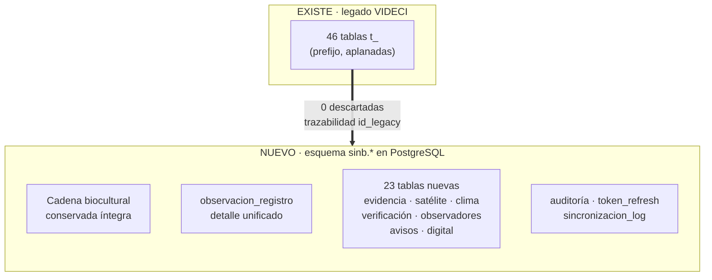

---

## 6. Qué se propone · NUEVO

**Un nuevo SINB actualizado y modernizado**: misma identidad, mismo conocimiento, plataforma nueva y capacidades que hoy no existen.

| # | Pilar | En lenguaje llano | Marcador |
|---|---|---|---|
| 1 | **Plataforma moderna** | PostgreSQL 16 + API FastAPI sobre la base ya existente; el SINB vive en su esquema propio `sinb.*`, **sin tocar EDAN ni RIDA** | `[MEJORA]` |
| 2 | **Captura sin conexión** | App de campo que **funciona en el cerro sin señal** y sincroniza al volver la red | `[NUEVO]` |
| 3 | **Verificación de pronósticos** | Cada pronóstico se comprueba **al vencer su periodo**: ¿acertó o no? | `[NUEVO]` |
| 4 | **Calificación de bioindicadores** | El sistema sabe, con evidencia, **qué indicador sirve**, cuál empieza y cuál dejó de funcionar | `[NUEVO]` |
| 5 | **Clima y satélite** | Series meteorológicas e **NDVI propio** (Sentinel-2) para comparar conocimiento local con lo que mide el cielo | `[NUEVO]` |
| 6 | **Seguridad y gobernanza** | Auditoría de todo, **consentimiento** del conocimiento comunitario | `[NUEVO]` |

### 6.1 Antes y después

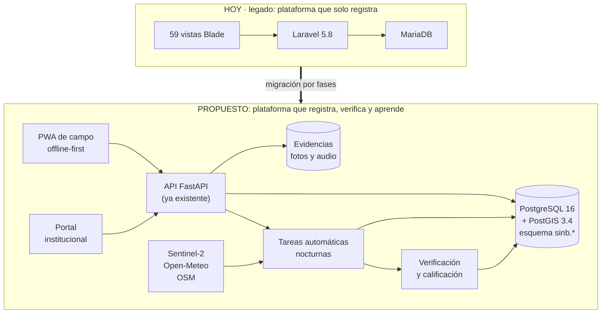

> `[NUEVO]` La plataforma objetivo es un **monolito modular**: un solo proceso, un solo PostgreSQL. Con un equipo pequeño en VIDECI, los microservicios serían coste sin beneficio.

### 6.2 Arquitectura de módulos (independencia garantizada)

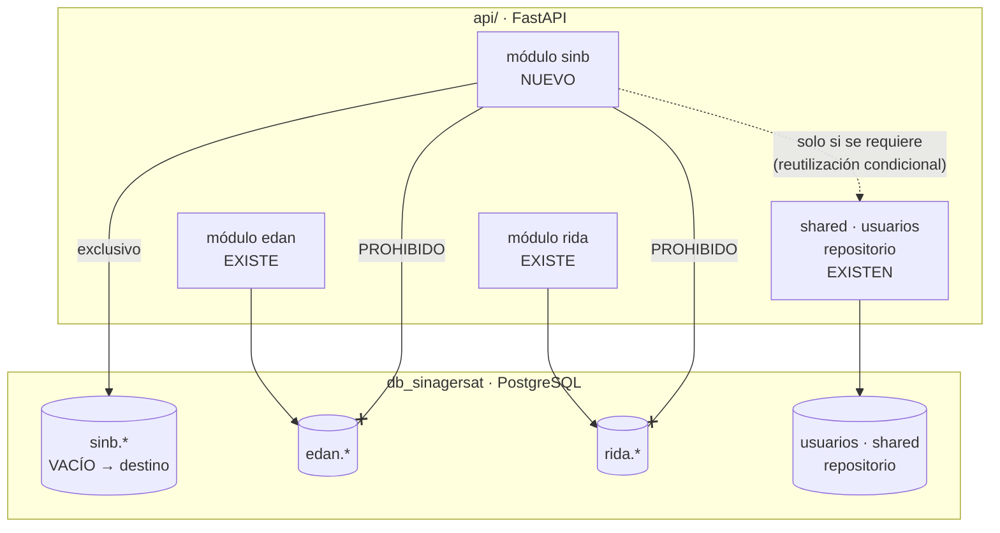

> **`[NUEVO]` Garantía de diseño**: el SINB es **autónomo**. Cero dependencias hacia `edan.*` y `rida.*`; reutiliza `usuarios`, `shared` y `repositorio` **solo cuando el diseño lo requiera** ([04 §0](04-BASE-DE-DATOS.md#0-cómo-encaja-con-la-estructura-actual-del-repositorio)).

---

## 7. Cómo funcionará · NUEVO

### 7.1 El proceso completo, en seis pasos

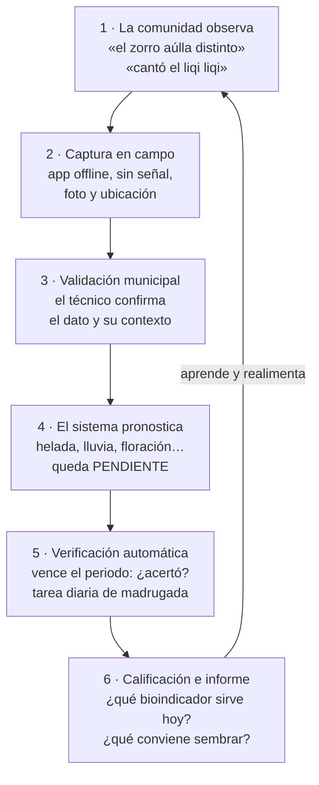

`[NUEVO]` **Dos herramientas dentro del paso 1.** El sistema levanta el pronóstico de **largo plazo** (estacional) y el de **corto plazo (avisos)**, con nombres `[DECIDIR]`. En ambas, el paso 0 es **recuperar el pronóstico en campo abierto** — la frase tal como la dice el observador, sin reescribir —; después viene la cadena de catálogo íntegra (grupo → indicador → característica → comportamiento → significado). El paso final registra la **confianza del pronóstico y sus observadores 1..N**, y cada registro se cierra con **cumplió / no cumplió**.

`[NUEVO]` **Tres capas, dos confianzas**: el pronóstico largo y el corto tienen cada uno su **confianza inicial** (la pone la persona: ALTA/MEDIA/BAJA) y su **índice automático** (lo calcula el sistema con el cumplimiento, separado por tipo). El **pronóstico digital** no tiene confianza: es **herramienta de control y ayuda** que acumula datos y con ellos **posteriormente valida** a ambos. Detalle: [04 §6](04-BASE-DE-DATOS.md), [07 §6A](07-FLUJOS-BIOCULTURALES.md).

### 7.2 Los tres niveles de trabajo

`[NUEVO]` Hoy existe un solo nivel: se registra y ya. La propuesta organiza el trabajo en tres niveles, cada uno con responsable y regla de salida ([07](07-FLUJOS-BIOCULTURALES.md)).

| Nivel | Quién | Qué ocurre | Entrada | Salida |
|---|---|---|---|---|
| **Nivel 1 · Campo** | `observador-local` | La comunidad observa; se captura **sin conexión** | Plan de muestreo | Observación en borrador |
| **Nivel 2 · Validación y consolidación** | `usuario-recolector` y `usuario-municipal` | Se confirma el dato y se consolida el municipio | Observaciones de sus comunidades | Recomendación municipal |
| **Nivel 3 · Nacional (VIDECI)** | `administrador` | Vista nacional, distribución y publicación | Datos municipales | Panel y distribución |

Dos cosas **no son niveles** sino tareas: la **preparación** (catálogos, permisos y territorio) y el **análisis longitudinal** (series y cambio climático), que corren en el servidor.

### 7.3 Un día real con el nuevo SINB

| Cuándo | Qué pasa |
|---|---|
| 4 de junio, 07:10 | El observador registra `Zorro`, característica `Tipo de aullido`. **No hay señal: se guarda en el teléfono.** |
| 4 de junio, 18:40 | Hay red: la observación **viaja sola** al servidor, sin pérdida |
| 5 de junio | El sistema emite el pronóstico de heladas (5–25 de junio) y lo deja **PENDIENTE** hasta el 27 de junio |
| 28 de junio, 01:30 | La tarea diaria encuentra el pronóstico vencido, lo compara con las temperaturas reales y **calcula si acertó** |
| 28 de junio | Se actualiza la calificación de `Zorro` en ese ámbito: sigue `USABLE`, pasa a `REVISAR` con nota, o sigue en `EN_VERIFICACION` |
| Esa mañana | El técnico municipal ve: **«Zorro · heladas · 8 aciertos en 10 verificaciones»**, con su nivel |

### 7.4 Ejemplo paso a paso de la verificación

<b>▸ HAGA CLIC AQUÍ PARA VER EL EJEMPLO COMPLETO (se despliega)</b> — pronóstico de heladas

| Paso | Qué pasa |
|---|---|
| 4 de junio | El técnico registra `Zorro`, característica `Tipo de aullido` |
| 5 de junio | Emite el pronóstico de heladas para el 5–25 de junio |
| 5 de junio | El sistema crea la fila de verificación en `PENDIENTE`, con `periodo_fin = 25 de junio` |
| 28 de junio, 01:30 | La tarea diaria encuentra el pronóstico vencido (`FOR UPDATE SKIP LOCKED`) |
| 28 de junio | Compara con lo observado: **acertó**, **no acertó** o `NO_VERIFICABLE` si no hay dato |
| Esa misma noche | La tarea de calificación mira los contadores del ámbito y **propone** un nivel |
| Al día siguiente | Una persona **confirma** el nivel: `EN_VERIFICACION` / `USABLE` / `REVISAR` (nota obligatoria en el último) |

> **Por qué importa**: en la fase 1 no hace falta un método distinto para cada pronóstico. Hace falta **comprobar, con fecha, si acertó** — y que eso quede registrado contra el indicador y su ámbito.

`[OPCIONAL]` **A futuro**, con años de datos, el mismo ejemplo puede medir además *qué tan* acertó (desfase en días, RMSE, correlación): [10 §10.2](10-INTEROPERABILIDAD.md#102-métricas-y-criterios-a-futuro-opcional).

---

## 8. Ventajas

### 8.1 Qué cambia para el usuario

| Ventaja | Qué resuelve | Beneficio concreto | Marcador |
|---|---|---|---|
| **Funciona sin internet** | Señal ausente en campo | Se captura en el cerro; **nada se pierde** | `[NUEVO]` |
| **Verifica sus propios pronósticos** | Nadie sabía si acertaba | El sistema **mide el acierto y lo publica** | `[NUEVO]` |
| **Califica cada bioindicador** | «¿sirve o no sirve esta señal?» | Se responde **con datos, no con opinión** | `[NUEVO]` |
| **Aprende y se autolimpia** | Reglas que dejaron de funcionar | Lo que no se sostiene **deja de emitirse**; la credibilidad se protege sola | `[NUEVO]` |
| **Clima y satélite sin licencia** | No había series ni NDVI | Sentinel-2, Open-Meteo y OSM: **gratis y verificados** | `[NUEVO]` |
| **Seguro y trazable** | Defectos de seguridad legados | Auditoría de toda escritura, permisos reales, consentimiento registrado | `[MEJORA]` |
| **Sin nube, on-premise en VIDECI** | Restricción institucional | Todo opera **en la infraestructura del Estado** | `[NUEVO]` |
| **Sin tocar EDAN ni RIDA** | Riesgo de romper otros módulos | Integración **aislada** en `sinb.*`, riesgo controlado | `[NUEVO]` |
| **Reutiliza lo ya pagado** | Evitar reconstruir lo que existe | API, PostgreSQL, auditoría, firma AGETIC y copias de seguridad **ya están** | `[ACTUAL]` |

### 8.2 Lo que hace único a este producto

| Característica | Por qué importa |
|---|---|
| **Validación por pronóstico, no global** | Cada regla tiene su método y su momento: el conocimiento local es contextual |
| **Calificación automática de bioindicadores** | Distingue lo que funciona, lo que empieza y lo que dejó de practicarse |
| **Método fenológico con días de desfase** | Propio del dominio; **ningún sistema meteorológico lo tiene** |
| **Conocimiento local como dato, no como anécdota** | Estructurado, agregable, comparable y calificable |
| **NDVI calculado, no consultado** | Desde bandas Sentinel-2: ninguna fuente pública lo entrega listo para Bolivia |
| **Consentimiento y validación comunitaria** | Lo que hace que el dato cultural sea **legítimo** ([11](11-INTERCULTURALIDAD.md)) |

### 8.3 Comparativa directa: ANTERIOR vs NUEVO

| Capacidad | ANTERIOR (legado) | NUEVO (propuesta) |
|---|---|---|
| Registrar observaciones | Sí, solo con conexión | **Sí, sin conexión** |
| Saber si un pronóstico acierta | **No** | **Sí, por método y fecha** |
| Saber qué bioindicador sirve | **No** | **Sí, 3 niveles + confiabilidad a la vista** |
| Ver NDVI y clima comparados | **No** | **Sí, Sentinel-2 + Open-Meteo** |
| Detectar cambio climático | **No** | **Sí, con regla de 10 años** |
| Trazar quién cambió qué | **No** | **Sí, auditoría de todo** |
| Explicar por qué un dato es fiable | **No** | **Sí, con causa y límite** |
| API para terceros | **No** | **Sí, OpenAPI versionado** |
| Exportar GeoJSON para SIG | **No** | **Sí, RFC 7946** |
| Permisos que funcionan | **No** (conceden siempre) | **Sí**, por endpoint y rol |
| Firma digital de documentos | Parcial | **Sí, AGETIC reutilizado** |
| Publicar y compartir | Reportes manuales | **Sí, API + exportaciones en 5 formatos** |

---

## 9. Bioindicadores: conservar, medir y analizar en el tiempo

> Esta es la capacidad que convierte a la propuesta en producto: **el sistema conserva el conocimiento y además dice, con fecha y con nombre, qué tan preciso es.**

### 9.1 Conservar: nada se pierde

| Mecanismo | Qué garantiza | Doc. |
|---|---|---|
| **Cadena de 5 niveles íntegra** | Principio P1: grupo → indicador → característica → comportamiento → significado, sin aplanar | [04](04-BASE-DE-DATOS.md) |
| **Nada se borra, se marca estado** | Principio P11: `estado` + `eliminado_en`; un bioindicador **nunca se destruye** | [04](04-BASE-DE-DATOS.md) |
| **Consentimiento registrado** | Alcance, fecha y revocación del uso del conocimiento comunitario | [04](04-BASE-DE-DATOS.md), [11](11-INTERCULTURALIDAD.md) |
| **Nombres locales en tabla** | Los nombres de especies — en el idioma en que los conozca la persona — son **filas**, no texto fijo en el código | [11](11-INTERCULTURALIDAD.md) |
| **Trazabilidad con origen** | `id_legacy` permite auditar cada fila contra el dump de origen | [04](04-BASE-DE-DATOS.md) |

### 9.2 Medir: el ciclo de verificación

`[NUEVO]` **Al vencer el periodo de un pronóstico, se comprueba: ¿acertó o no?** Ese resultado, repetido en el tiempo, es lo que sostiene la calificación.

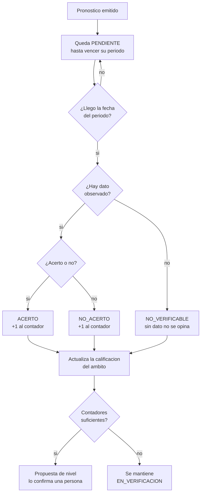

> `[NUEVO]` El bucle se cierra sobre sí mismo: **cada verificación alimenta la calificación**, y la calificación decide si el indicador sigue usable para pronosticar. `[OPCIONAL]` Cuando haya años de datos, a este ciclo simple se le pueden añadir los métodos de medida por naturaleza (fenológico con desfase, numérico, correlación, skill): [10 §10.2](10-INTEROPERABILIDAD.md#102-métricas-y-criterios-a-futuro-opcional) y [04 §14.2](04-BASE-DE-DATOS.md#142-métodos-a-futuro-opcional).

### 9.3 Los tres niveles de calificación

Un bioindicador **no vale lo mismo en todas partes**. Se califica por ámbito (indicador + municipio) y fecha:

| Nivel | Requisito | Qué significa |
|---|---|---|
| `EN_VERIFICACION` | Recién incorporado, o con pocos registros y pocas verificaciones | Estado inicial, se le da tiempo |
| **`USABLE`** | Acumula registros y sus verificaciones aciertan de forma consistente | **Puede usarse en decisión** |
| `REVISAR` | Pierde vigencia, la práctica disminuye o sus verificaciones fallan | Requiere revisión, con nota obligatoria |

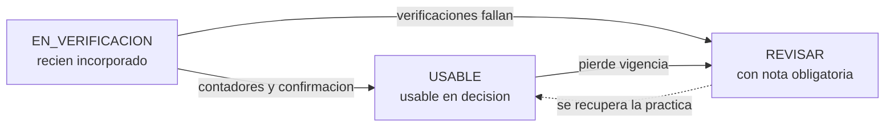

> `[NUEVO]` La propuesta de cambio de nivel la sugiere la tarea diaria y **lo confirma una persona**. `REVISAR` no es un castigo: es lo que aparece cuando un conocimiento deja de practicarse o deja de acertar, y la nota explica por qué.
>
> `[ACTUAL]` Caso real: la observación astronómica aimara existe pero no tiene serie de uso. Eso es exactamente `REVISAR`, y el nivel existe para que **aparezca en los informes en vez de desaparecer**.

### 9.4 Confiabilidad a la vista

Responde a la pregunta operativa: *¿puedo decidir una siembra con esto?* — sin un número único inventado:

| Qué se muestra | Qué es | Cómo se calcula |
|---|---|---|
| Confianza inicial del observador | 1,0 con histórico verificable · 0,7 con 2 años · 0,5 sin histórico | Al emitir, según su historial |
| Índice del observador (0–100) | Cuánto acierta cada persona, **por separado** en LARGO y CORTO | `n_cumplidos / n_emitidos`, tarea 04:13 |
| Contadores del ámbito | Verificaciones, aciertos y última fecha del indicador en su municipio | Tarea diaria de verificación |
| Nivel de calificación | `EN_VERIFICACION` / `USABLE` / `REVISAR` | [§9.3](#93-los-tres-niveles-de-calificación) |

> `[NUEVO]` Cuando algo va mal, la interfaz **explica el motivo**: «4 años de datos, un solo verificador». Un número bajo sin explicación se lee como error; con causa se lee como limitación conocida.

### 9.5 `[OPCIONAL]` Métodos de medida, a futuro

La versión simple de la fase 1 compara acertó / no acertó. Con años de datos, cada pronóstico puede medir lo que corresponde a su naturaleza:

| Tipo de pronóstico | Método | Qué mide | Muestra mínima |
|---|---|---|---|
| Lluvia `Mucha/Normal/Poca` | Categórico ordinal | Acierto de categoría y error | n ≥ 5 |
| Helada sí/no | Categórico binario | Tasa de acierto y falsos positivos | n ≥ 10 |
| Temperatura acumulada | Numérico | Error medio y sesgo | n ≥ 5 |
| Inicio de floración | **Fenológico** | **Desfase en días** | n ≥ 5 |
| Precipitación probabilística | Brier | Fiabilidad de la probabilidad | n ≥ 20 |
| Precipitación por década | Correlación temporal | Tendencia con significación | **n ≥ 10 años** |

> `[OPCIONAL]` El método **fenológico** es propio del dominio biocultural y no tiene equivalente en meteorología operativa: un pronóstico de floración no acierta o falla, acierta con **días de diferencia y con signo**. Estos métodos **no entran en la fase 1**: el detalle y el orden de implementación están en [10 §10.2](10-INTEROPERABILIDAD.md#102-métricas-y-criterios-a-futuro-opcional).

### 9.6 Analizar en el tiempo: cambio climático con honestidad

| Escala | Horizonte | Unidad de análisis | Qué mide |
|---|---|---|---|
| Pronóstico operativo | 1–365 días | Comunidad y día | Si la regla acierta |
| Fenología estacional | 1–2 años | Indicador y día del año | Si la fecha se adelanta o retrasa |
| Cambio climático | 10–30 años | Indicador y década | Si hay desplazamiento consistente |

| Años de datos | Qué se publica |
|---|---|
| 1 a 5 | Solo observaciones individuales |
| 6 a 9 | Serie anual descriptiva |
| 10 a 19 | Tendencia con intervalo de confianza y advertencia |
| 20 o más | Tendencia con afirmación |

> `[NUEVO]` **La regla de los diez años.** Con menos de diez años pareados, el sistema informa el dato y **no afirma tendencia**. En el primer año de operación no se puede afirmar ningún cambio climático: lo que sí se puede es medir el acierto año a año y mostrar hacia dónde va. Comunicar esto desde el inicio es parte de la propuesta, no una limitación que esconder.
>
> `[NUEVO]` También es posible que el sistema demuestre que varias reglas **no funcionan**. Eso es un resultado valioso: un sistema que solo publica lo que funciona es **más confiable** que uno que promete precisión y no la mide.

---

## 10. Listado de herramientas

> Todo lo que se usa o se propone usar. **Estado**: `[ACTUAL]` ya está en el repositorio · `[NUEVO]` se incorpora con esta propuesta.

### 10.1 Núcleo — backend y base de datos

| Herramienta | Versión | Uso | Estado |
|---|---|---|---|
| Python | 3.12 | Runtime del backend | `[ACTUAL]` |
| FastAPI | ≥ 0.115 | API REST, OpenAPI automático, validación | `[ACTUAL]` |
| Uvicorn | ≥ 0.30 | Servidor ASGI | `[ACTUAL]` |
| SQLAlchemy | ≥ 2.0 | ORM | `[ACTUAL]` |
| Pydantic | ≥ 2.0 | Validación y esquemas | `[ACTUAL]` |
| PostgreSQL | 16 | Base de datos principal | `[ACTUAL]` |
| PostGIS | 3.4 | Extensión geoespacial (`geom`, GiST) | `[ACTUAL]` |
| psycopg2 | ≥ 2.9 | Conexión PostgreSQL | `[ACTUAL]` |
| python-jose / bcrypt | — | JWT y hash de contraseñas | `[ACTUAL]` |
| httpx | ≥ 0.27 | Cliente HTTP a servicios externos | `[ACTUAL]` |
| openpyxl | ≥ 3.1 | Importación/exportación Excel | `[ACTUAL]` |
| Alembic | 1.13 | Migraciones reversibles y versionadas | `[NUEVO]` |
| Celery | 5.4 | Colas, reintentos, tareas programadas | `[NUEVO]` |
| Redis | 7.2 | Broker de colas y caché | `[NUEVO]` |

### 10.2 Experiencia de usuario — frontend

| Herramienta | Versión | Uso | Estado |
|---|---|---|---|
| Vue | 3.5 | Framework de interfaz (`<script setup>`) | `[NUEVO]` |
| Vite | 6 | Bundler y servidor de desarrollo | `[NUEVO]` |
| Pinia | 2.2 | Estado global | `[NUEVO]` |
| vue-router | 4.4 | Enrutado | `[NUEVO]` |
| Leaflet + vue-leaflet | 1.9 | Mapa base | `[NUEVO]` |
| Chart.js / ECharts | 4.4 / 5.5 | Gráficos, treemaps, mapas de calor | `[NUEVO]` |
| Dexie | 4.0 | IndexedDB con API de promesas (offline) | `[NUEVO]` |
| Tailwind CSS | 3.4 | Estilos utility-first | `[NUEVO]` |
| vite-plugin-pwa | — | Service worker, manifiesto, actualizaciones | `[NUEVO]` |
| zod | 3.23 | Validación en el límite de la API | `[NUEVO]` |
| date-fns | 3.6 | Manejo de fechas | `[NUEVO]` |
| xlsx | — | Exportación a Excel en el navegador | `[NUEVO]` |
| TypeScript / Vitest / msw | 5.6 | Tipado y pruebas | `[NUEVO]` |

**Excluidas a propósito** (no se incorporan): `bootstrap`, `jquery`, `moment`, `sweetalert2`, `toastr`, `pnotify`, `jqvmap`, `datejs` — ver [06 §3.3](06-FRONTEND.md).

### 10.3 Almacenamiento, infraestructura y observabilidad

| Herramienta | Uso | Estado |
|---|---|---|
| **MinIO** (compatible S3) | Fotos, audio y documentos; URL firmadas, subida directa desde el teléfono | `[NUEVO]` |
| **nginx** | TLS, estáticos, reverse proxy — hoy el servidor ya lleva **Apache** ([12 §3.1](12-INFRAESTRUCTURA.md#31-los-cinco-servicios)) | `[DECIDIR]` |
| **Docker / Docker Compose** | Empaquetado y despliegue reproducible | `[NUEVO]` |
| **systemd** | Arranque y reinicio automático en el servidor | `[NUEVO]` |
| **Prometheus + Grafana** | Métricas de latencia, cola y verificación | `[OPCIONAL]` |
| **OpenTelemetry** | Trazas y telemetría de la API | `[OPCIONAL]` |
| Copia de seguridad (`pg_dump` + `hacer_backup.sh`) | Respaldos diarios de la base | `[ACTUAL]` |
| Apache HTTP Server | Proxy actual documentado | `[ACTUAL]` |

### 10.4 Herramientas de procesamiento geodatos

| Herramienta | Uso | Estado |
|---|---|---|
| **osmium** | Extraer, filtrar y exportar límites de OSM a GeoJSON | `[NUEVO]` |
| **Geofabrik** | Descarga del `.osm.pbf` de Bolivia | `[NUEVO]` |
| **STAC client** (EarthSearch / Element84) | Búsqueda de escenas Sentinel-2 por fecha y nubosidad | `[NUEVO]` |
| **rasterio / numpy** | Lectura de bandas COG y cálculo del NDVI | `[NUEVO]` |
| PostGIS (`ST_Intersection`, `ST_Area`, GiST) | Agregación territorial y consultas espaciales | `[NUEVO]` |

### 10.5 Pruebas, calidad y seguridad

| Herramienta | Uso | Estado |
|---|---|---|
| Vitest + @vue/test-utils + happy-dom | Pruebas unitarias de frontend | `[NUEVO]` |
| fake-indexeddb + msw | Pruebas de offline y de la API simulada | `[NUEVO]` |
| ESLint + Prettier | Lint y formato | `[NUEVO]` |
| `pytest` (recomendado) | Pruebas de backend | `[NUEVO]` |
| AuditMiddleware | Auditoría de toda escritura | `[ACTUAL]` |
| AGETIC (validador de firmas) | Validación de firmas digitales de PDF | `[ACTUAL]` |

### 10.6 Formatos de salida

| Formato | Contenido | Uso | Estado |
|---|---|---|---|
| `.csv` | Tabla plana | Análisis en hoja de cálculo | `[NUEVO]` |
| `.xlsx` | Varias hojas con formato | Informe legible | `[NUEVO]` |
| `.pdf` | Ficha con imagen y mapa | Distribución a campo | `[NUEVO]` |
| `.geojson` | Geometría y atributos (RFC 7946) | SIG externo (QGIS, ArcGIS) | `[NUEVO]` |
| `.json` | Estructura completa | Intercambio de sistemas | `[NUEVO]` |

### 10.7 Herramientas que se pueden HACER para el sistema (no existen, se construyen)

> `[OPCIONAL]` Además de lo que se **usa**, estas son las herramientas que se **crean** para el SINB — cada una resuelve un problema concreto de la operación. Las tres primeras no son IA y entran en las fases base; las dos últimas son la exploración de [§13](#13-ia-opcional-motor-de-texto-y-mcp).

| Herramienta a construir | Qué hace | Dónde corre | Cuándo |
|---|---|---|---|
| **Motor de pronóstico** `[NUEVO]` | Emite pronósticos con su validación de datos | Servidor (Celery, nocturno) | Bloque 4 |
| **Tarea de verificación** `[NUEVO]` | Compara cada pronóstico vencido con la realidad: ¿acertó o no? | Servidor (diario, 01:30) | Bloque 4 |
| **Emparejador offline** `[NUEVO]` | Buscador de diccionario en la app: reconoce indicadores en frases escritas **sin señal y sin IA** | Teléfono (IndexedDB) | Bloque 3 |
| **Motor de texto** `[OPCIONAL]` | Voz/texto libre → **propuesta estructurada** de observación (indicador, característica, fecha) con % de confianza | Servidor VIDECI, modelo **autoalojado** | Fuera de plan (§13) |
| **Servidor MCP** `[OPCIONAL]` | Puente para que un asistente de IA conectado consulte e inyecte datos por la **API oficial**, con JWT y auditoría | Servidor VIDECI | Fuera de plan (§13) |

### 10.8 Resumen: qué se reutiliza y qué se agrega

| | Herramientas |
|---|---|
| **`[ACTUAL]` Ya están (no se pagan, no se reinstalan)** | Python · FastAPI · Uvicorn · SQLAlchemy · Pydantic · PostgreSQL 16 · PostGIS 3.4 · python-jose · bcrypt · httpx · openpyxl · copias de seguridad · Apache · firma AGETIC |
| **`[NUEVO]` Se incorporan** | Alembic · Celery · Redis · MinIO · nginx · Docker · Prometheus · Grafana · OpenTelemetry · osmium · Geofabrik · STAC · rasterio · Vue 3 · Vite · Pinia · Leaflet · Chart.js · Dexie · Tailwind · zod · TypeScript · Vitest |
| **`[OPCIONAL]` Solo si se aprueba la experimentación** | Modelo de lenguaje **autoalojado** (p. ej. runtime tipo Ollama/vLLM con modelo abierto 7–14B) · servidor MCP SINB (ver §13) |

---

## 11. Usos: apps, web e interoperabilidad

### 11.1 Qué superficie de uso tiene cada parte

| Superficie | Qué es | Para quién | Marcos de trabajo |
|---|---|---|---|
| **PWA de campo** | Aplicación web instalable, **offline-first** | Observadores y recolectores en terreno | Vue 3 + service worker + IndexedDB |
| **Portal institucional** | Panel web de consulta, mapas e informes | Técnicos municipales, VIDECI, instituciones | Vue 3 + Leaflet + Chart.js |
| **API REST** | Contratos JSON versionados | Sistemas de terceros, SIG, apps móviles futuras | FastAPI + OpenAPI |
| **Exportaciones** | Archivos descargables | Análisis, informes y distribución | CSV · XLSX · PDF · GeoJSON · JSON |
| **Mapas SIG** | Capas geográficas interoperables | SIG (QGIS, ArcGIS), cartografía web | GeoJSON RFC 7946 + PostGIS |

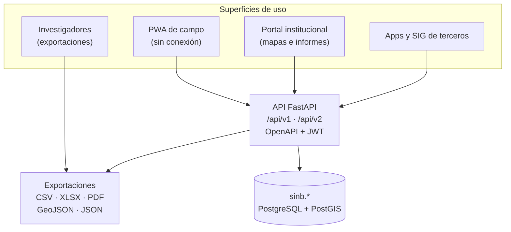

### 11.2 Casos de uso por actor

| Actor | Caso de uso concreto | Superficie |
|---|---|---|
| Observador comunitario | Registrar `Zorro · Tipo de aullido` con foto, **sin señal**, y firmar un pronóstico **con su nombre y su confianza** | PWA de campo |
| Productor / observador | Levantar un **aviso de corto plazo** («va a granizar») con vigencia de 24 h | PWA de campo |
| Gestor regional `[NUEVO]` | Ver el consolidado y los reportes de **toda su región** y gestionar sus usuarios | Portal / PWA |
| Recolector | Revisar sus observaciones pendientes y enviarlas al volver la red | PWA de campo |
| Técnico municipal | Validar observaciones, ver el pronóstico y **confirmar la calificación** del `Zorro`; verificar avisos y ver el **histograma** | Portal institucional |
| VIDECI | Ver panel nacional, distribuir alertas y auditar quién cambió qué | Portal institucional |
| SIG del MINDEF | Descargar `comunidades.geojson` y cargarlo en QGIS | API / GeoJSON |
| SENAMHI / PMA | Consumir series climáticas y NDVI vía API | API REST |
| Investigador | Descargar serie anual en `.xlsx` con advertencia de confianza | Exportaciones |
| Ciudadano / prensa | Consultar indicadores calificados y sus niveles de confianza | Portal (solo lectura) |

### 11.3 Interoperabilidad: qué sale y qué entra

| Dirección | Qué | Formato / medio | Estado |
|---|---|---|---|
| **SALE** | Observaciones, pronósticos, calificaciones | API JSON (`/api/v1/sinb/…`) | `[NUEVO]` |
| **SALE** | Límites y comunidades con geometría | GeoJSON RFC 7946 | `[NUEVO]` |
| **SALE** | Informes y series | CSV · XLSX · PDF | `[NUEVO]` |
| **SALE** | Indicadores y nivel de confianza | API + portal (solo lectura) | `[NUEVO]` |
| **ENTRA** | Escenas Sentinel-2 (bandas B04, B08, SCL) | STAC / COG | `[NUEVO]` |
| **ENTRA** | Serie meteorológica histórica y previsión | Open-Meteo API | `[NUEVO]` |
| **ENTRA** | Límites territoriales | Geofabrik `.osm.pbf` → GeoJSON | `[NUEVO]` |
| **ENTRA** | Validación de firmas de PDF | AGETIC (proxy `httpx`) | `[ACTUAL]` |
| **ENTRA** | Catálogos INE (departamento/provincia/municipio) | `shared` (ya cargados) | `[ACTUAL]` |

### 11.4 Contrato de evidencias: cómo sube un archivo

`[MEJORA]` **Un solo flujo de tres pasos**, sin que la foto pase por la API:

| Paso | Endpoint | Qué ocurre |
|---|---|---|
| 1 | `POST /v1/evidencias/iniciar` | Devuelve clave de objeto y URL firmada |
| 2 | `PUT {url_firmada}` | **El teléfono sube directo a MinIO** |
| 3 | `POST /v1/evidencias/{uuid}/confirmar` | Se registra la evidencia y se asocia al registro |

> Ventaja: libera memoria del servidor y **funciona con la conexión lenta de campo**.

---

## 12. Integración con herramientas y fuentes externas

### 12.1 Fuentes verificadas

`[NUEVO]` **Regla**: una integración entra solo si se verificó el endpoint desde la red de destino. Lo que no se pudo probar, se marca y **no se usa en el diseño**.

| # | Fuente / herramienta | Qué aporta | Cómo se integra | Frecuencia | Destino en BD | Estado |
|---|---|---|---|---|---|---|
| 1 | **EarthSearch STAC** (Element84) | Escenas Sentinel-2 L2A | API STAC → COG (`nir`, `red`, `scl`) | Cada 5 días (revisita) | `sinb.escena_satelital` | Verificado |
| 2 | **Open-Meteo Archive** | Histórico meteorológico desde 1940 | `GET archive-api.open-meteo.com` | Diaria (nocturna) | `sinb.serie_climatica` | Verificado |
| 3 | **Open-Meteo Forecast** | Previsión y humedad de suelo | `GET api.open-meteo.com` | Diaria | `sinb.serie_climatica` | Verificado |
| 4 | **NDVI propio** | Índice de vegetación | **Cálculo** `(B08−B04)/(B08+B04)` con máscara de nubes | Diaria (nocturna) | `sinb.agregado_satelital` | Fórmula propia |
| 5 | **Geofabrik / OSM** | Límites de comunidades | Descarga `.osm.pbf` → `osmium extract/tags-filter/export` | Baja (catálogo) | `sinb.comunidad` (geometría) | Descarga verificada |
| 6 | **AGETIC** (validador de firmas) | Validación de firmas digitales en PDF | Proxy `httpx` en `api/firma_digital/` | Bajo demanda | `repositorio.documentos` | **`[ACTUAL]` Implementado** |
| 7 | **INE / shared** | Departamentos, provincias, municipios, cultivos, pecuario | Catálogos ya cargados en `shared` | Estático | `shared.*` | **`[ACTUAL]` Implementado** |
| 8 | **CHIRPS (UCSB)** | Precipitación histórica satelital | Descarga directa | Diaria | `sinb.serie_climatica` | `[DECIDIR]` |
| 9 | **SENAMHI Bolivia** | Estaciones y boletín agroclimático | API o convenio | Dekadal | `sinb.serie_climatica` | `[DECIDIR]` (requiere convenio) |
| 10 | **Open-Meteo `minutely_15`** `[NUEVO]` | Pronóstico cada 15 min, 48 h de horizonte (**corto plazo**) | `GET api.open-meteo.com` | Cada 15 min | `sinb.pronostico_digital` | **Verificado desde la red** |
| 11 | **Open-Meteo `hourly` + `past_days=1`** `[NUEVO]` | Contexto horario reciente | `GET api.open-meteo.com` | Cada 15 min | `sinb.pronostico_digital` | **Verificado desde la red** |

### 12.2 Fuentes descartadas y por qué

| Fuente | Resultado de la prueba | Veredicto |
|---|---|---|
| Planetary Computer STAC | 404 en la ruta de colecciones | **No verificable** → descartada |
| MODIS ORNL `MOD13Q1` | 400 y 404 | **No disponible** → descartada solo para NDVI |
| Open-Meteo `daily=ndvi` | HTTP 400 | **No existe** → se calcula desde Sentinel-2 |
| RainViewer nowcast | Servicio retirado | **Nowcast descontinuado el 01/01/2026** → lo cubre Open-Meteo `minutely_15` |

> `[NUEVO]` MODIS se descarta **solo para NDVI**: trae NDVI precalculado a 250 m y podría cubrir huecos de Sentinel-2. Es la **primera opción a reevaluar** si se necesita serie más larga. `[DECIDIR]` Requiere reintento desde la red institucional.

### 12.3 Cómo se integra cada herramienta (lógica)

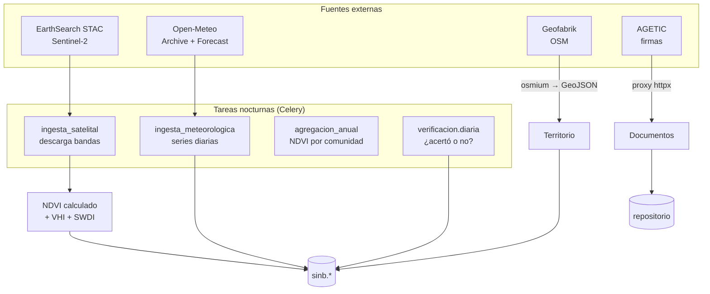

### 12.4 Trazabilidad de cada dato externo

| Regla | Detalle |
|---|---|
| **Fuente obligatoria** | `variable_climatica.fuente` es `NOT NULL` con `CHECK` cerrado |
| **Fecha de ingesta** | `ingested_en` permite saber cuándo se obtuvo |
| **Calidad** | `calidad` de 0 a 100 según completitud de la serie |
| **Inmutabilidad** | Una serie descargada **no se reescribe** si la fuente cambia su histórico |
| **Reproceso** | Un recálculo registra la versión, **sin borrar la anterior** |

> `[MEJORA]` Importa: los modelos climáticos se revisan. Si Open-Meteo cambia su histórico de 2020, el SINB guarda **ambas versiones** y sabe cuál usó en cada informe.

### 12.5 Integraciones que ya existen y se aprovechan

| Integración existente | Dónde está | Cómo se aprovecha |
|---|---|---|
| **Firma digital AGETIC** | `api/firma_digital/` (proxy `httpx`, límite 20 MB) | Firmar y validar los informes PDF que genere el SINB |
| **Repositorio de documentos** | `api/repositorio/` + esquema `repositorio` | Archivar informes y fichas del SINB **solo si el diseño lo requiere** |
| **Auditoría global** | `api/audit.py` (`AuditMiddleware`) | Ampliar cobertura a toda escritura en `sinb.*` |
| **JWT y roles** | `api/auth/`, esquema `usuarios` | Autenticar usuarios del SINB **solo si se reutilizan cuentas** |
| **GeoJSON de municipios** | `api/shared/` (rutas GeoJSON/WKT) | Patrón de referencia para el GeoJSON de comunidades del SINB |
| **Copias de seguridad** | `database/hacer_backup.sh` (diarias) | Incluir el esquema `sinb` en la misma rutina |

---

## 13. IA opcional: motor de texto y MCP

`[OPCIONAL]` **Nota.** Nada de esto entra en el plan base y nada lo espera.

| Pieza | Qué haría | Por qué no ahora |
|---|---|---|
| Motor de texto (voz o texto libre) | Propuesta estructurada de observación con % de confianza, **confirmada por una persona** | Exige modelo autoalojado y años de ejemplos propios |
| Emparejador offline | Diccionario local que reconoce indicadores en frases **sin señal y sin IA** | No es IA; sí es útil y ya está en el bloque 3 |
| MCP de solo lectura | Puerta extra delante de la misma API: mismos JWT, permisos y auditoría | Solo tiene sentido con el motor de texto |

La regla que no cambiaría: **la IA propone, la persona confirma** — nunca escribe validado. Si algún día se decide probarlo, se aprueba o se descarta con sus propios datos, al margen de los bloques de [13](13-ROADMAP.md).

---

## 14. Compacto de los 14 documentos

> Cada documento en una línea, con su aporte y sus marcadores dominantes.

| Doc. | Documento | Aporte al conjunto | Marcadores |
|---|---|---|---|
| **01** | [Arquitectura](01-ARQUITECTURA.md) | Arquitectura actual y objetivo, los 10 defectos, los 4 roles, estilo modular | `[DEFECTO]` `[NUEVO]` |
| **02** | [Componentes visuales](02-COMPONENTES-VISUALES.md) | Sistema visual, paleta, **30 pictogramas heredados**, componentes de mapa Vue 3 | `[ACTUAL]` `[NUEVO]` |
| **03** | [Backend](03-BACKEND.md) | Pila técnica, estructura de módulos, colas y **la tarea de verificación dinámica** | `[MEJORA]` `[NUEVO]` |
| **04** | [Base de datos](04-BASE-DE-DATOS.md) | Esquema completo con DDL, cadena de 5 niveles, RLS, **verificación y calificación §14**, riesgos de migración | `[ACTUAL]` `[NUEVO]` `[DECIDIR]` |
| **05** | [APIs](05-APIS.md) | Contratos REST, tokens, subida de evidencias, errores, permisos por endpoint | `[NUEVO]` |
| **06** | [Frontend](06-FRONTEND.md) | PWA, estructura Vue 3, IndexedDB, **cómo se ve la validación en pantalla** | `[NUEVO]` |
| **07** | [Flujos bioculturales](07-FLUJOS-BIOCULTURALES.md) | **Tres niveles de flujo**, verificación, distribución, cambio climático | `[NUEVO]` |
| **08** | [Offline y sincronización](08-OFFLINE-SINCRONIZACION.md) | Offline-first, UUIDv7, sincronización por bloques, resolución de conflictos | `[NUEVO]` |
| **09** | [Seguridad](09-SEGURIDAD.md) | Defectos de seguridad, tokens rotativos, RLS, auditoría, cifrado de evidencias | `[DEFECTO]` `[NUEVO]` |
| **10** | [Interoperabilidad](10-INTEROPERABILIDAD.md) | Sentinel-2, NDVI calculado, Open-Meteo, GeoJSON, **fórmulas de métricas** | `[DEFECTO]` `[NUEVO]` |
| **11** | [Interculturalidad](11-INTERCULTURALIDAD.md) | Nombres locales, **consentimiento**, validación comunitaria (todo en español) | `[ACTUAL]` `[NUEVO]` |
| **12** | [Infraestructura](12-INFRAESTRUCTURA.md) | Contenedores, despliegue **on-premise en VIDECI**, respaldo, monitoreo | `[NUEVO]` |
| **13** | [Hoja de ruta](13-ROADMAP.md) | Fases, plazos, criterios de aceptación, riesgos, decisiones de Fase 0 | `[NUEVO]` `[DECIDIR]` |
| **14** | **Este documento** | Compacto de exposición de todo lo anterior | — |

---

## 15. Las decisiones que necesitan firma

| # | Decisión | Por qué no es técnica |
|---|---|---|
| 1 | Coexistencia con el legado o corte único | Afecta la operación de VIDECI durante meses |
| 2 | Norma climática de referencia | Es una decisión sobre qué periodo representa «lo normal» |
| 3 | Dominio del API | Nombre institucional |
| 4 | Acceso de terceros al API | Abre o cierra el acceso a datos del Estado |
| 5 | Retención de la bitácora | Compromiso institucional de conservación |
| 6 | Cifrado local en reposo | Afecta dispositivos en manos de la comunidad |
| 7 | Convenios con SENAMHI y PMA | Relación institucional |
| 8 | Aplicación de la Ley 29733 | Compromiso legal con datos personales |
| 9 | Umbral de cobertura mínima nacional | Define qué se publica |
| 10 | Si se emiten probabilidades o solo categorías | Habilita o no el cálculo del método Brier |
| 11 `[NUEVO]` | Nombres de las dos herramientas (largo plazo / corto plazo) | Aparecen en la navegación, manuales y formación |
| 12 `[NUEVO]` | Qué es exactamente una «región» para el 5.º rol | Define el alcance territorial del gestor regional |
| 13 `[NUEVO]` | Vigencia del aviso: 24 h por defecto, 48 h como máximo | Define la ventana en que un aviso se puede verificar |

> `[DECIDIR]` **Ninguna bloquea el inicio**: la Fase 0 es idéntica en todos los escenarios.

`[OPCIONAL]` La experimentación con IA (motor de texto, emparejador, MCP) **no aporta decisiones de este plan**: queda como nota en [§13](#13-ia-opcional-motor-de-texto-y-mcp).

---

## 16. Cronograma y coste

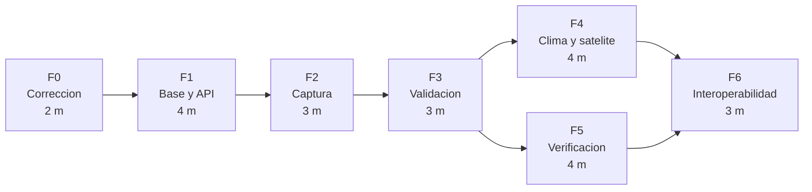

| Fase | Duración | Personas-mes | Resultado verificable |
|---|---|---|---|
| 0 · Corrección | 2 m | 4 | Sistema actual seguro y funcional |
| 1 · Base y API | 4 m | 16 | Migración de las 46 tablas y API operativa |
| 2 · Captura | 3 m | 12 | PWA offline en manos de observadores |
| 3 · Validación | 3 m | 9 | Niveles 2 y 3 operativos |
| 4 · Clima y satélite | 4 m | 12 | NDVI y series meteorológicas |
| 5 · Verificación | 4 m | 8 | Verificación de pronósticos y calificación en 3 niveles |
| 6 · Interoperabilidad | 3 m | 9 | GeoJSON, API y fuentes externas |
| **Total** | **23 meses** | **70** | — |

> `[DECIDIR]` Propuesta de planificación: las fechas y las cifras se fijan con el presupuesto aprobado y la ventana de control de cambios de MINDEF. Las **tareas y criterios** de cada fase están desglosados en [13](13-ROADMAP.md) (previo + 4 bloques), sin coste ni cronograma. Cifras en **personas-mes** porque la tabla salarial es institucional. Costes de infraestructura en [12](12-INFRAESTRUCTURA.md).

> **Contraste**: como el repositorio ya tiene API FastAPI, PostgreSQL y migraciones versionadas, la **Fase 1 se ejecuta como ampliación del módulo SINB** (`api/sinb/` + esquema `sinb.*`), **no como construcción desde cero**. Ver [13 §0](13-ROADMAP.md#0-contraste-con-la-estructura-actual).

---

## 17. El argumento final

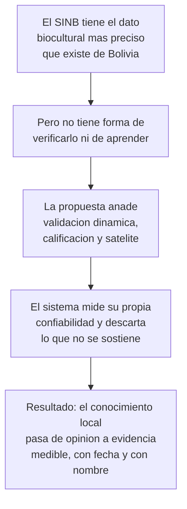

> **`[NUEVO]` El SINB ya tiene el dato más valioso sobre el Altiplano; lo único que le falta es medir su propia confiabilidad.**

Un sistema que registra lo que las comunidades saben, lo compara con lo que el satélite y las estaciones muestran, verifica cada pronóstico con el método que le corresponde **en el momento que le corresponde**, y califica cada bioindicador según la evidencia acumulada, es un sistema que puede **sostener decisiones de siembra**.

**Y si un indicador deja de funcionar, el sistema lo dice.**

---

## Anexo · Dónde está el detalle

| Documento | Contenido |
|---|---|
| [01](01-ARQUITECTURA.md) | Arquitectura actual y objetivo, los 10 defectos, los 4 roles |
| [02](02-COMPONENTES-VISUALES.md) | Sistema visual, paleta, pictogramas, componentes de mapa |
| [03](03-BACKEND.md) | Servicios, colas, la tarea de verificación dinámica y las tareas programadas |
| [04](04-BASE-DE-DATOS.md) | Esquema completo con DDL, cadena de 5 niveles, RLS, verificación y calificación |
| [05](05-APIS.md) | Contratos REST, tokens, subida de evidencias, errores |
| [06](06-FRONTEND.md) | PWA, estructura, y cómo se ve la verificación en pantalla |
| [07](07-FLUJOS-BIOCULTURALES.md) | Tres niveles de flujo, verificación, cambio climático |
| [08](08-OFFLINE-SINCRONIZACION.md) | IndexedDB, sincronización por bloques, conflictos |
| [09](09-SEGURIDAD.md) | Defectos de seguridad, tokens rotativos, RLS, auditoría |
| [10](10-INTEROPERABILIDAD.md) | Sentinel-2, NDVI, Open-Meteo, GeoJSON, fórmulas de métricas |
| [11](11-INTERCULTURALIDAD.md) | Nombres locales, consentimiento y revisión comunitaria (todo en español) |
| [12](12-INFRAESTRUCTURA.md) | Despliegue en VIDECI, respaldo, control de cambios |
| [13](13-ROADMAP.md) | Fases, tareas, plazos, criterios de aceptación, riesgos |
