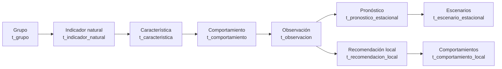
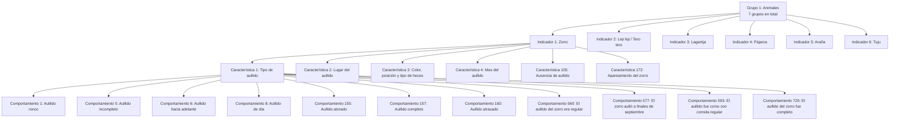
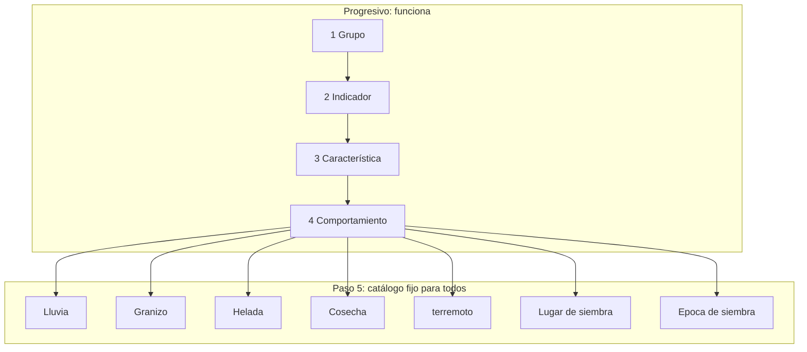
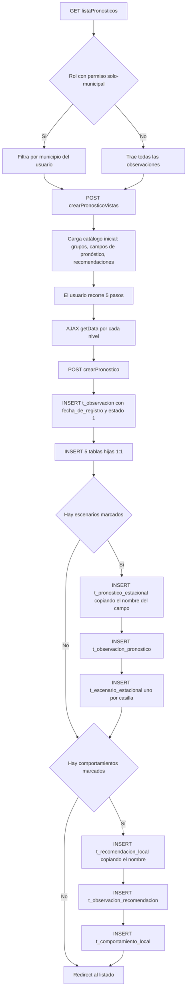
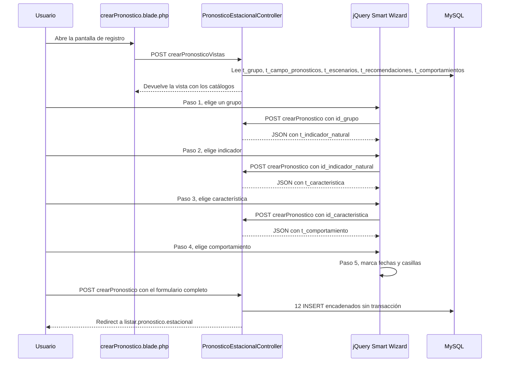
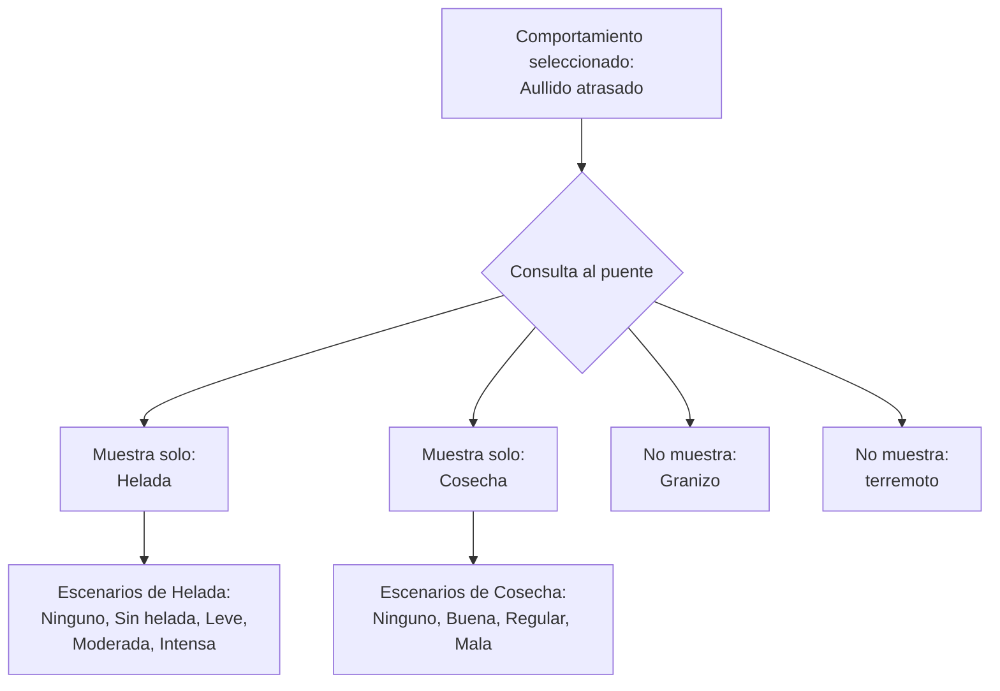
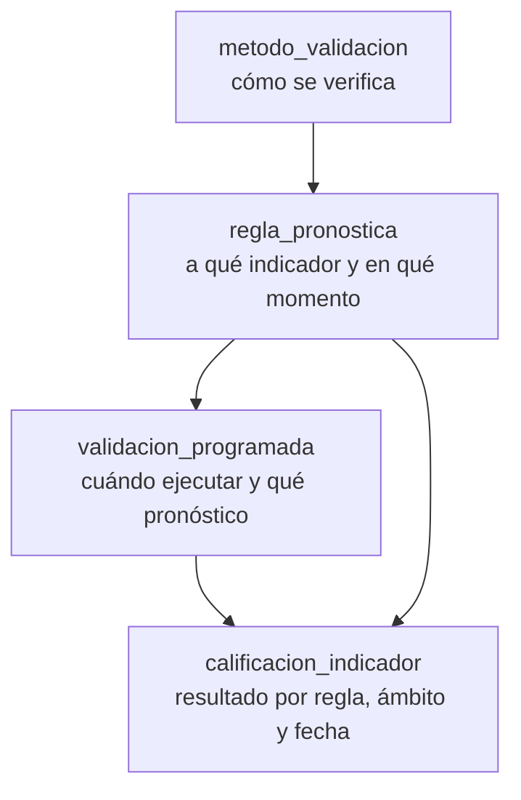

# Documentación del Pronóstico de Largo Plazo

> Registro de la observación biocultural con pronóstico estacional y recomendación local de siembra.
>
> Documento de referencia técnica. Todo lo que aparece aquí fue verificado contra el código fuente y el volcado `sinb_20260714.sql`.

---

## 1. Propósito y alcance

Este documento explica **cómo funciona el registro del pronóstico**, **qué flujo sigue**, **qué tablas escribe** y **qué endpoints consume**.

El alcance es el ciclo completo del módulo: alta, consulta, edición, borrado y publicación hacia el mapa público.

### 1.1 Nota terminológica

El sistema se presenta como **Pronóstico de Largo Plazo**, pero el código existente lo llama **estacional** de forma masiva. No es una discrepancia del documento: es el estado real del proyecto.

| Contexto | Término |
|---|---|
| Nombre funcional del sistema | Pronóstico de Largo Plazo |
| Nombre en el código | `estacional` |
| Archivos PHP/Blade/JS con `estacional` | 21 |
| Ocurrencias de `estacional` en el SQL | 50 |
| Migraciones afectadas | 2 |

Las dos migraciones que fijan el nombre actual son:

- `web/database/migrations/2020_08_31_141519_create_pronostico_estacional_table.php`
- `web/database/migrations/2020_08_31_141613_create_escenario_estacional_table.php`

**Este documento no renombra el código.** Consigna el nombre real en cada referencia técnica (`t_pronostico_estacional`, `PronosticoEstacionalController`, `listar.pronostico.estacional`) para que pueda localizarse sin ambigüedad. La decisión de renombrar se plantea en la sección 11.

---

## 2. Cómo funciona hoy

### 2.1 La idea central

Lo que el sistema registra no es un pronóstico aislado, sino una **observación biocultural**: el registro de que un grupo de indicadores naturales presentó un comportamiento particular en un periodo, y de qué pronóstico se espera para los distintos campos (**Lluvia**, **Granizo**, **Helada**, **Cosecha**, **terremoto**).

Esa observación se guarda una sola vez y de ella cuelgan dos ramas:

- **Rama de pronóstico**: qué valor toma cada campo, por ejemplo Helada → *Intensa*.
- **Rama de recomendación**: qué comportamiento de siembra corresponde, por ejemplo Época de siembra → *Adelantada*.

### 2.2 La cadena biocultural

El formulario recorre la cadena completa. No es un adorno: los cuatro niveles son obligatorios y se guardan en tablas distintas.



Los cuatro primeros selects son **en cascada**: elegir un nivel dispara la carga del siguiente mediante el endpoint `getData/{tabla}/{id}`.

Esta cascada es **realmente progresiva y restrictiva**. Verificado sobre los datos:

| Relación | Filas del puente | Rasgo medido |
|---|---|---|
| `t_grupo_indicador_natural` | 77 | Un indicador pertenece a un grupo |
| `t_indicador_natural_caracteristica` | 161 | Cada característica pertenece a **un solo** indicador |
| `t_caracteristica_comportamiento` | 503 | Cada comportamiento pertenece a **una sola** característica |

El dato clave: **0 de 161 características** están compartidas entre dos indicadores. No hay contaminación entre ramas. Elegir *Zorro* en el paso 2 elimina de entrada las 155 características que no son del zorro.

Como los comportamientos también son únicos por característica, la cadena es un árbol limpio y no un grafo con cruces.

### 2.3 Ejemplo real, paso a paso

Este es el recorrido que hacen los datos, usando el grupo 1 (*Animales*) y el indicador 1 (*Zorro*), tal como están en el volcado.



Tres observaciones que salen de estos datos:

1. **El filtro es efectivo.** El paso 3 no muestra 189 características, muestra 6. El paso 4 no muestra 523 comportamientos, muestra 11.
2. **El comportamiento es texto redactado por el observador.** "El zorro aulló a finales de septiembre como queriéndose atragantar al final" convive con "Aullido completo". No hay taxonomía: son 523 frases, muchas redundantes entre sí.
3. **La granularidad es desigual.** El comportamiento 560 y el 593 describen el mismo hecho con distinta redacción. Eso obliga a que el análisis posterior agrupe por texto, no por categoría.

### 2.4 Dónde se rompe la progresividad

La cadena es progresiva hasta el paso 4. En el paso 5 **deja de serlo**.



Al llegar al paso 5, los cinco campos de pronóstico y las dos recomendaciones aparecen **siempre, completos, para cualquier combinación de los pasos 1 a 4**. No hay ninguna relación en el esquema que conecte el comportamiento elegido con el campo de pronóstico aplicable.

**No existe puente entre `t_comportamiento` y `t_campo_pronosticos`.** Verificado: el término `campo_pronostico` aparece en el volcado únicamente dentro de `t_campo_pronosticos` y `t_escenarios`, y en ningún otro lado.

Consecuencia práctica: si el usuario acaba de registrar "el zorro aulló de forma tardía", el sistema le ofrece igual pronosticar *Granizo* y *Cosecha*, que no guardan relación con ese dato. La relación es de conocimiento agropecuario y no está modelada.

### 2.5 Lo que dicen los datos de las observaciones reales

Sobre las 243 observaciones del volcado:

| Métrica | Valor |
|---|---|
| Observaciones totales | 243 |
| Activas (`estado = 1`) | 232 |
| Borradas lógicamente (`estado = 0`) | 11 |
| Con al menos un pronóstico | 189 |
| Con al menos una recomendación | 91 |
| Con ambas ramas | 41 |
| Solo pronóstico, sin recomendación | 148 |
| Solo recomendación, sin pronóstico | 50 |

Este reparto es el argumento más fuerte a favor de un flujo progresivo:

- **148 observaciones (61%)** registraron pronóstico pero ninguna recomendación. O el usuario no entendió que las dos columnas eran independientes, o el sistema le mostró demasiado para llenar.
- **50 observaciones (21%)** registraron recomendación pero ningún pronóstico.
- Solo **41 observaciones (17%)** completaron ambas ramas.

Un flujo que ofrece todo a todos produce que menos de un quinto se complete. Un flujo que ofrece solo lo pertinente produciría más.

Distribución de los pronósticos registrados:

| Campo | Registros |
|---|---|
| Cosecha | 94 |
| Lluvia | 88 |
| Helada | 39 |
| Granizo | 16 |
| terremoto | 0 |

**Cero registros de terremoto.** Confirma el defecto D1 con datos reales: el campo se muestra en pantalla, pero nunca llega a guardarse.

Distribución de las recomendaciones:

| Recomendación | Registros |
|---|---|
| Epoca de siembra | 85 |
| Lugar de siembra | 19 |

Comportamientos de siembra más usados:

| Comportamiento | Registros |
|---|---|
| Intermedia | 44 |
| Adelantada | 20 |
| Tardia | 20 |
| Retrasada | 16 |
| Altos | 6 |
| Bajos | 4 |
| Secos | 4 |
| Humedos | 4 |

Solo 8 comportamientos distintos de los 10 disponibles, y tres de ellos con menos de 5 usos.

### 2.6 Quién puede usarlo

La autorización se aplica **en el código**, no en las rutas:

| Rol | Puede registrar |
|---|---|
| `administrador` | Sí |
| `usuario-municipal` | Sí |
| `usuario-recolector` | Sí (`solo-municipal`) |
| `observador-local` | Sí (`solo-municipal`) |

El filtro municipal se aplica en `PronosticoEstacionalController.php:53` mediante `$user->can('solo-municipio')`, que restringe el listado a las comunidades del municipio del usuario.

Los botones de alta rápida de catálogos dependen de permisos granulares: `crear-inventario`, `crear-indicador`, `crear-caracteristica`, `crear-comportamiento`.

---

## 3. El formulario paso a paso

Archivo: `web/resources/views/vistasPronosticos/crearPronostico.blade.php` (664 líneas)

Usa el plugin **jQuery Smart Wizard** (`vendors/jQuery-Smart-Wizard/js/jquery.smartWizard.js`) con 5 pasos sobre un único `<form>` que se envía a `crear.pronostico.recomendacion`.

### 3.1 Los cinco pasos

| Paso | Título en pantalla | Campo | Tipo | `name` | Obligatorio en HTML |
|---|---|---|---|---|---|
| 1 | ¿Que se ha observado? | Grupo | `select` | `id_grupo` | Sí |
| 2 | ¿Que indicador natural se ha observado? | Indicador natural | `select` por AJAX | `id_indicador_natural` | **No** — ver defecto D8 |
| 3 | ¿Que característica se ha observado? | Característica | `select` por AJAX | `id_caracteristica` | Sí |
| 4 | ¿Que comportamiento has visto? | Comportamiento | `select` por AJAX | `id_comportamiento` | Sí |
| 5 | Realice su pronóstico | Fecha de inicio de observación | `date` | `fecha_inicio` | Sí |
| 5 | Realice su pronóstico | Fecha de fin de observación | `date` | `fecha_fin` | Sí |
| 5 | Realice su pronóstico | Escenarios del pronóstico | `checkbox[]` | `escenarios{N}[]` | No |
| 5 | Realice su pronóstico | Comportamientos de siembra | `checkbox[]` | `comportamientos{N}[]` | No |

Las dos fechas se prellenan con la fecha del día mediante JavaScript. No hay validación de que `fecha_fin` sea posterior a `fecha_inicio`.

El identificador de usuario viaja en un campo oculto: `<input name="id_usuario" type="hidden" value="{{$idUsuarioActual}}">` (línea 72).

### 3.2 Paso 5: los checkboxes

El paso 5 se renderiza en dos columnas.

**Columna izquierda — pronóstico.** Itera `$campoPronostico` y, por cada campo, sus escenarios. El nombre del checkbox se construye con el **id del campo**, por eso existen `escenarios1[]` a `escenarios5[]`. El valor enviado es el **texto** del escenario, no su id.

| Campo | Escenarios disponibles en `t_escenarios` |
|---|---|
| 1 · Lluvia | Ninguno, Normal, Poco, Irregular, Mucho, Atrasada, Adelantada |
| 2 · Granizo | Ninguno, Sin granizo, Leve, Moderado, Intenso |
| 3 · Helada | Ninguno, Sin helada, Leve, Moderada, Intensa |
| 4 · Cosecha | Ninguno, Buena, Regular, Mala |
| 5 · terremoto | ninguno, poco |

**Columna derecha — recomendación de siembra.** Itera `$recomendacionLocal` y genera `comportamientos1[]` y `comportamientos2[]`, con los comportamientos de `t_comportamientos`:

| Recomendación | Comportamientos |
|---|---|
| 1 · Epoca de siembra | Retrasada, Adelantada, Intermedia, Tardia |
| 2 · Lugar de siembra | Bajos, Altos, Secos, y otros (10 en total) |

### 3.3 Los cuatro modales de alta rápida

Cada paso lleva un botón que abre un modal para crear el elemento faltante sin salir del formulario. Todos los modales tienen su propia etiqueta `<form>`, por lo que **no se envían con el principal**.

| Paso | Botón | Permiso | Campos del modal |
|---|---|---|---|
| 1 | Registrar nuevo grupo observado | `crear-inventario` | `grupo` |
| 2 | Registrar nuevo indicador natural observado | `crear-indicador` | `indicador_natural`, `nombre_cientifico`, `fotoIndicador` (archivo), `id_grupo`, `id_municipio`, `id_usuario` |
| 3 | Registrar nueva característica | `crear-caracteristica` | `caracteristica`, `id_indicador_natural`, `id_usuario` |
| 4 | Registrar nuevo comportamiento | `crear-comportamiento` | `comportamiento`, `id_caracteristica`, `id_usuario` |

---

## 4. El flujo

### 4.1 Flujo completo del alta



### 4.2 Secuencia HTTP del alta



### 4.3 Consulta, edición y borrado

| Acción | Qué hace realmente |
|---|---|
| **Listado** | `listarPronosticosEstacionales` (`:38`) hace `get()` sobre 12 tablas jointeadas, sin paginación. Filtra por `t_observacion.estado = 1`. |
| **Detalle** | `getObervacionPronostico` (`:409`) recupera la cadena biocultural y luego carga en dos consultas separadas los pronósticos y las recomendaciones. |
| **Edición** | `editarPronosticoEstacional` (`:439`) arma los datos; `actualizarPronosticoEstacional` (`:552`) hace `update` sobre las tablas hijas por `where`, y **borra y recrea** escenarios y comportamientos. |
| **Borrado** | `eliminarPronosticoEstacional` (`:796`) solo ejecuta `UPDATE t_observacion SET estado = 0`. Las 11 tablas hijas conservan sus filas. |

### 4.4 Publicación hacia el mapa

`reportesController@getPronosticosEstacionales` (`:178`) cierra el ciclo. Devuelve JSON con dos bloques, cada uno agregado con `count(*)` y `groupBy`, filtrado por comunidad y por rango de `fecha_inicio`:

- **`pronosticoEstacional`**: `t_observacion` → `t_observacion_usuario` → `t_usuario` → `t_usuario_comunidad` → `t_comunidad` → `t_observacion_pronostico` → `t_pronostico_estacional` → `t_escenario_estacional`
- **`recomendacionLocal`**: la misma base, y luego `t_observacion_recomendacion` → `t_recomendacion_local` → `t_comportamiento_local`

Ambos filtran por municipio a través de `t_usuario_comunidad`.

---

## 5. Estandarización: cómo hacer el paso 5 progresivo

Esta sección responde a la pregunta central: **el flujo debe ir restrictingse según lo que se elija, y hoy no lo hace a partir del paso 5**.

### 5.1 El diagnóstico

| Nivel | ¿Es progresivo hoy? | Evidencia |
|---|---|---|
| Grupo → Indicador | Sí | 77 filas de puente, filtro real |
| Indicador → Característica | Sí | 161 filas, 0 características compartidas |
| Característica → Comportamiento | Sí | 503 filas, filtro real |
| Comportamiento → Campo de pronóstico | **No** | No existe el puente |
| Campo de pronóstico → Escenario | Sí | 23 filas en `t_escenarios` |
| Observación → Recomendación | **No** | Catálogo fijo de 2, sin relación |

La ruptura está exactamente en el punto donde el usuario toma la decisión que más importa: qué va a pasar con la lluvia, la helada o la cosecha.

### 5.2 La tabla auxiliar que falta

El patrón de tabla puente ya existe tres veces en el esquema y es lo que hace que los pasos 1 a 4 funcionen. El paso 5 simplemente no lo tiene.

```mermaid
flowchart LR
    subgraph actual["Hoy: catálogo fijo"]
        C["Comportamiento<br/>seleccionado"] -.->|"sin relación"| L1["Lluvia"]
        C -.->|"sin relación"| L2["Helada"]
        C -.->|"sin relación"| L3["Cosecha"]
    end
    subgraph propuesto["Con tabla puente"]
        C2["Comportamiento<br/>seleccionado"] -->|"consulta"| P["t_comportamiento_campo_pronostico"]
        P --> L4["Solo los campos<br/>que aplican"]
    end
```



La tabla que faltaría:

```sql
CREATE TABLE `t_comportamiento_campo_pronostico` (
  `id_comportamiento_campo_pronostico` int(11) unsigned NOT NULL AUTO_INCREMENT,
  `fk_t_comportamiento_id_comportamiento` int(11) NOT NULL,
  `fk_t_campo_pronostico_id_campo_pronostico` int(10) unsigned NOT NULL,
  PRIMARY KEY (`id_comportamiento_campo_pronostico`),
  KEY `idx_comportamiento` (`fk_t_comportamiento_id_comportamiento`),
  KEY `idx_campo_pronostico` (`fk_t_campo_pronostico_id_campo_pronostico`),
  CONSTRAINT `fk_ccp_comportamiento`
    FOREIGN KEY (`fk_t_comportamiento_id_comportamiento`)
    REFERENCES `t_comportamiento` (`id_comportamiento`) ON DELETE CASCADE,
  CONSTRAINT `fk_ccp_campo_pronostico`
    FOREIGN KEY (`fk_t_campo_pronostico_id_campo_pronostico`)
    REFERENCES `t_campo_pronosticos` (`id_campo_pronostico`) ON DELETE CASCADE
) ENGINE=InnoDB DEFAULT CHARSET=utf8mb4 COLLATE=utf8mb4_unicode_ci;
```

Un comportamiento puede relacionarse con uno, varios o ningún campo de pronóstico. La tabla admite las tres situaciones, que es exactamente lo que hace falta.

### 5.3 El mismo tratamiento para las recomendaciones

Hoy existen dos catálogos de siembra y ninguna relación con lo observado. Si el usuario eligió una característica que no tiene nada que ver con la siembra, el paso 5 igual le ofrece *Epoca de siembra* y *Lugar de siembra*.

La misma solución aplica:

```sql
CREATE TABLE `t_comportamiento_recomendacion` (
  `id_comportamiento_recomendacion` int(11) unsigned NOT NULL AUTO_INCREMENT,
  `fk_t_comportamiento_id_comportamiento` int(11) NOT NULL,
  `fk_t_recomendacion_id_recomendacion` int(10) unsigned NOT NULL,
  PRIMARY KEY (`id_comportamiento_recomendacion`),
  KEY `idx_comportamiento` (`fk_t_comportamiento_id_comportamiento`),
  KEY `idx_recomendacion` (`fk_t_recomendacion_id_recomendacion`),
  CONSTRAINT `fk_cr_comportamiento`
    FOREIGN KEY (`fk_t_comportamiento_id_comportamiento`)
    REFERENCES `t_comportamiento` (`id_comportamiento`) ON DELETE CASCADE,
  CONSTRAINT `fk_cr_recomendacion`
    FOREIGN KEY (`fk_t_recomendacion_id_recomendacion`)
    REFERENCES `t_recomendaciones` (`id_recomendacion`) ON DELETE CASCADE
) ENGINE=InnoDB DEFAULT CHARSET=utf8mb4 COLLATE=utf8mb4_unicode_ci;
```

### 5.4 Cómo quedaría el paso 5



El endpoint de cascada existente (`getData/{tabla}/{id}`) ya tiene la forma correcta. Solo necesita un cuarto caso:

```php
case 'campoPronostico':
    $data = comportamientoModel::join(
        't_comportamiento_campo_pronostico',
        't_comportamiento.id_comportamiento',
        '=',
        't_comportamiento_campo_pronostico.fk_t_comportamiento_id_comportamiento'
    )->join(
        't_campo_pronosticos',
        't_comportamiento_campo_pronostico.fk_t_campo_pronostico_id_campo_pronostico',
        '=',
        't_campo_pronosticos.id_campo_pronostico'
    )->select('t_campo_pronosticos.*')
      ->where('t_comportamiento_campo_pronostico.fk_t_comportamiento_id_comportamiento', $id)
      ->get();
    break;
```

### 5.5 Poblado de la tabla puente

Los 523 comportamientos se clasifican en cinco grupos según lo que_indican en el agroclima Boliviano:

| Grupo | Comportamientos de ejemplo | Campos de pronóstico aplicables |
|---|---|---|
| Fenómenos de frío | *Helada*, *Aullido atrasado*, *Ausencia de aullido* | Helada, Cosecha |
| Fenómenos de agua | *Lluvia*, *Mucho viento*, *Poco viento* | Lluvia, Granizo, Cosecha |
| Fenómenos de actividad animal | *Apareamiento*, *Aullido completo* | Cosecha, Helada |
| Movimientos celeste | *Del norte (Perú)*, *Del este (Brasil)*, *Al sur* | Cosecha |
| Eventos tradicionales | *Lluvia de San Juan*, *Helada de San Juan* | Lluvia, Helada, Cosecha |

Es una clasificación de 523 filas. Es trabajo del equipo AGRICOLA, no de desarrollo, pero es la pieza que convierte el paso 5 en progresivo.

### 5.6 Beneficio esperado

Con el flujo progresivo, el paso 5 mostraría en promedio dos o tres campos en lugar de cinco, y una recomendación en lugar de dos. Los datos actuales sugieren que eso reduciría el abandono: hoy solo el 17% de las observaciones completa ambas ramas.

---

## 6. Las tablas que toca

El flujo completo involucra **20 tablas**: 12 se escriben y 8 son catálogos de solo lectura.

### 6.1 Tablas escritas

| Tabla | Rol | Columnas clave | Filas en el dump |
|---|---|---|---|
| `t_observacion` | Núcleo de la observación | `id_observacion`, `fecha_inicio`, `fecha_fin`, `fecha_de_registro`, `estado` | 243 |
| `t_observacion_grupo` | Grupo observado (1:1) | `fk_t_observacion_id_observacion`, `fk_t_grupo_id_grupo` | — |
| `t_observacion_indicador_natural` | Indicador (1:1) | `fk_t_observacion_id_observacion`, `fk_t_indicador_natural_id_indicador_natural` | — |
| `t_observacion_caracteristica` | Característica (1:1) | `fk_t_observacion_id_observacion`, `fk_t_caracteristica_id_caracteristica` | — |
| `t_observacion_comportamiento` | Comportamiento (1:1) | `fk_t_observacion_id_observacion`, `fk_t_comportamiento_id_comportamiento` | — |
| `t_observacion_usuario` | Autor del registro (1:1) | `fk_t_observacion_id_observacion`, `fk_t_usuario_id_usuario` | — |
| `t_observacion_pronostico` | Puente observación-pronóstico (1:N) | `t_observacion_id_observacion`, `t_pronostico_estacional_id_pronostico_estacional` | — |
| `t_pronostico_estacional` | Un pronóstico por campo | `id_pronostico_estacional`, `pronostico_estacional`, `estado` | 248 |
| `t_escenario_estacional` | Escenarios del pronóstico (1:N) | `id_escenario_estacional`, `escenario_estacional`, `pronostico_estacional_id` | 245 |
| `t_observacion_recomendacion` | Puente observación-recomendación (1:N) | `t_observacion_id_observacion`, `t_recomendacion_local_id_recomendacion_local` | — |
| `t_recomendacion_local` | Copia de la recomendación | `id_recomendacion_local`, `recomendacion_local`, `estado` | 104 |
| `t_comportamiento_local` | Copia del comportamiento | `id_comportamiento_local`, `comportamiento_local`, `recomendacion_local_id` | 118 |

Las cinco tablas hijas del núcleo tienen `ON DELETE CASCADE` sobre `t_observacion`. **Excepción:** `t_observacion_usuario` declara sus dos FK **sin `ON DELETE CASCADE`**, a diferencia de las otras cuatro.

### 6.2 Catálogos de solo lectura

| Tabla | Contenido | Filas |
|---|---|---|
| `t_grupo` | Grupos de indicadores | 7 |
| `t_indicador_natural` | Indicadores, con `nombre_cientifico` y `fotografia` | 77 |
| `t_caracteristica` | Características | 189 |
| `t_comportamiento` | Comportamientos | 523 |
| `t_grupo_indicador_natural` | Puente grupo-indicador | 77 |
| `t_indicador_natural_caracteristica` | Puente indicador-característica | 161 |
| `t_caracteristica_comportamiento` | Puente característica-comportamiento | 503 |
| `t_campo_pronosticos` | Los 5 campos del pronóstico | 5 |
| `t_escenarios` | Catálogo de escenarios por campo | 23 |
| `t_recomendaciones` | Las 2 recomendaciones de siembra | 2 |
| `t_comportamientos` | Catálogo de comportamientos de siembra | 10 |

---

## 7. Las APIs y rutas

`web/routes/api.php` **está vacío**. No existe una API REST propiamente dicha: todo son rutas web de Laravel, y las que consume el JavaScript devuelven JSON.

### 7.1 Rutas del módulo (`web.php:83-91`)

| Método | URI | Nombre de ruta | Método del controlador |
|---|---|---|---|
| GET | `listaPronosticos` | `listar.pronostico.estacional` | `listarPronosticosEstacionales` |
| GET | `getData/{tabla}/{id}` | `data.observaciones` | `datoObservaciones` |
| GET | `observacionPronostico/{idObservacion}` | `observacion.pronostico` | `getObervacionPronostico` |
| GET | `buscarUsuarioPronostico` | `buscarUsuarioPronostico` | `buscarUsuarioPronostico` |
| POST | `crearPronosticoVistas` | `listar.grupos.indicadores` | `indicadorNaturalGrupo` |
| POST | `crearPronostico` | `crear.pronostico.recomendacion` | `crearPronostico` |
| GET | `editarPronostico/{idObservacion}` | `editar.pronostico.estacional` | `editarPronosticoEstacional` |
| POST | `actualizarPronostico` | `actualizar.pronostico.estacional` | `actualizarPronosticoEstacional` |
| DELETE | `eliminarPronostico/{idObservacion}` | `eliminar.pronostico.estacional` | `eliminarPronosticoEstacional` |

Todas se declaran dentro de grupos con middleware en `web.php`. La autorización real se resuelve en el controlador, no en la ruta.

### 7.2 Endpoint de cascada

`datoObservaciones($tabla, $id)` alimenta los selects en cadena. Distingue tres casos por el parámetro `$tabla`:

| `$tabla` | Consulta |
|---|---|
| `indicador` | `t_grupo_indicador_natural` unido a `t_indicador_natural`, filtrado por `fk_t_grupo_id_grupo` |
| `caracteristica` | `t_indicador_natural_caracteristica` unido a `t_caracteristica`, filtrado por `fk_t_indicador_natural_id_indicador_natural` |
| `comportamiento` | `t_caracteristica_comportamiento` unido a `t_comportamiento`, filtrado por `fk_t_caracteristica_id_caracteristica` |

Es el único punto reutilizable del módulo y ya tiene la forma correcta para el cuarto caso propuesto en la sección 5.4.

### 7.3 Alta de catálogos (`indicadoresController`)

| Método | URI | Nombre de ruta |
|---|---|---|
| POST | `registrarIndicadorGrupo` | `registrarIndicadorGrupo` |
| POST | `registrarIndicadorNatural` | `registrarIndicadorNatural` |
| POST | `registrarCaracteristica` | `registrarIndicadorCaracteristica` |
| POST | `registrarComportamiento` | `registrarIndicadorComportamiento` |

Administración de catálogos, en `CategoriaPronosticoController`: `listarPronosticos`, `crearPronosticoEstacional`, `actualizarPronostico`, `eliminarPronosticoEstacional`, `campo-pronostico-lista`, `campo-pronostico-crea`, `campo-pronostico-edita`, `campo-pronostico-edita-estado`, `listaComportamientoPronostico`, `crearComportamientoPronostico`, `ComportamientoPronostico`, `eliminarComportamientoPronostico`, `pronosticoComportamiento`, `pronosticoEscenario`.

### 7.4 Rutas públicas (`reportesController`)

| Método | URI | Propósito |
|---|---|---|
| GET | `getPronosticosEstacionales/{id_comunidad}/{year}` | Agregado JSON que alimenta el mapa público |
| GET | `getIconoPronostico/{id_comunidad}/{gestion}` | Icono del pronóstico en el mapa |
| GET | `getMarkerPronosticoEstacional/{id_comunidad}/{gestion}/{pronostico}` | Marcador del mapa |
| GET | `getPronosticosComunidades/{year}/{p_type}` | Pronósticos por comunidad |

---

## 8. Los dos catálogos paralelos

El módulo tiene un problema de diseño que conviene explicitar: para el pronóstico y para la recomendación existen **dos juegos de tablas** con la misma forma y distinto propósito.

### 8.1 Pronóstico

| | Tabla | Modelo | Columna de enlace |
|---|---|---|---|
| La vista **lee** | `t_escenarios` (23 filas) | `CampoPronostico\Escenario` | `campo_pronostico_id` |
| El controlador **escribe** | `t_escenario_estacional` (245 filas) | `PronosticoEstacional\EscenarioEstacional` | `pronostico_estacional_id` |

La vista carga `CampoPronostico::with('escenarios')` para pintar las casillas. El controlador, en cambio, crea un registro nuevo en `t_pronostico_estacional` y le cuelga filas en `t_escenario_estacional`.

Consecuencia: el catálogo y el dato histórico son tablas distintas. Consultar "qué escenarios existen" y "qué escenario se registró" son consultas diferentes sobre estructuras diferentes.

### 8.2 Recomendación

El mismo patrón, y aquí es más evidente porque el crecimiento lo delata:

| | Tabla | Filas |
|---|---|---|
| Catálogo original | `t_recomendaciones` | 2 |
| Catálogo original | `t_comportamientos` | 10 |
| Copia por registro | `t_recomendacion_local` | 104 |
| Copia por registro | `t_comportamiento_local` | 118 |

El controlador hace `Recomendacion::find(1)` o `find(2)`, copia el texto a una fila nueva de `t_recomendacion_local`, y cuelga de ahí los comportamientos copiados también uno a uno. Las 104 y 118 filas son el resultado de repetir esa copia en cada alta.

No es un error de funcionamiento: el sistema funciona. Es una deuda que impide cambiar un escenario sin tener que actualizar cada copia histórica.

### 8.3 La falta de referencia al catálogo

`PronosticoEstacional::$fillable` acepta `pronostico_estacional` (el texto), no un id de campo. No existe FK entre `t_pronostico_estacional` y `t_campo_pronosticos`. Si alguien renombra "Helada" en el catálogo, los registros históricos siguen diciendo "Helada" porque guardan una copia del texto, no una referencia.

---

## 9. Defectos detectados

| # | Severidad | Ubicación | Defecto |
|---|---|---|---|
| D1 | **Crítica** | `PronosticoEstacionalController.php:311-351` | El campo `terremoto` (id 5) se muestra en pantalla y sus 2 escenarios se renderizan como `escenarios5[]`, pero el controlador solo lee `escenarios1` a `escenarios4`. **El pronóstico de terremoto se pierde en silencio.** Confirmado con datos: 0 registros de terremoto en 243 observaciones. |
| D2 | **Crítica** | `:439`, `:552`, `:796` | `editar`, `actualizar` y `eliminar` no verifican que la observación pertenezca al municipio del usuario. Un usuario autenticado que adivine un `idObservacion` ajeno puede leerlo, modificarlo o borrarlo. |
| D3 | **Alta** | `:208` | No hay validación server-side. `crearPronostico` no llama a `validate()` ni a un `FormRequest`. Nada impide `fecha_fin` anterior a `fecha_inicio`, ni un grupo que no pertenezca al municipio. |
| D4 | **Alta** | `:235-393` | Los 12 `INSERT` se ejecutan sin transacción. Un fallo a la mitad deja una `t_observacion` sin sus hijas, y el sistema no tiene forma de detectarlo. |
| D5 | **Alta** | `:272` | Se copia el nombre del catálogo a `t_pronostico_estacional.pronostico_estacional` en vez de referenciar `id_campo_pronostico`. Sin FK ni integridad referencial. |
| D6 | **Alta** | `:796` | El borrado lógico solo marca `t_observacion.estado = 0`. Las 11 tablas hijas quedan con filas huérfanas y sin ninguna consulta que las alcance. |
| D7 | **Alta** | sección 8.2 | `t_recomendacion_local` y `t_comportamiento_local` son tablas de copia (104 y 118 filas) que replican catálogos de 2 y 10 filas. |
| D8 | **Media** | `crearPronostico.blade.php:98` | El `<select name="id_indicador_natural">` no tiene atributo `required`, pese a que la etiqueta muestra el asterisco de obligatorio. El wizard deja avanzar sin indicador. |
| D9 | **Media** | `:270-393` | Los índices `escenarios1..4` y `comportamientos1..2` están fijos en el código. Hoy coinciden con el catálogo, pero agregar un campo o una recomendación rompe el flujo sin avisar. |
| D10 | **Media** | `:183` | `buscarUsuarioPronostico` devuelve usuarios de **toda la base** sin filtrar por municipio, a diferencia del listado (`:93-98`). Expone ci, nombre, paterno y materno fuera del ámbito del usuario. |
| D11 | **Media** | `ValidarPronosticoEstacional.php` | Existe un `FormRequest` con una regla, pero **nunca se invoca** desde este flujo. Además valida `t_campo_pronosticos`, que es el catálogo, no el alta de observaciones. |
| D12 | **Media** | `:70`, `:87` | `listarPronosticosEstacionales` termina en `get()` sobre 12 tablas jointeadas, sin paginación ni `distinct`. |
| D13 | **Media** | sección 2.4 | El paso 5 no es progresivo: ofrece los 5 campos y las 2 recomendaciones a cualquier combinación de los pasos 1 a 4. No existe puente entre `t_comportamiento` y `t_campo_pronosticos`. |
| D14 | **Media** | sección 2.5 | Solo 41 de 243 observaciones (17%) completan ambas ramas. 148 tienen pronóstico sin recomendación y 50 tienen recomendación sin pronóstico. |
| D15 | **Media** | — | No existe ningún campo de validación dinámica: ni método, ni fecha de aplicación, ni nivel de calificación, ni confianza, ni fuente. Un pronóstico se guarda y nunca se contrasta con lo que ocurrió. |
| D16 | **Media** | `t_comportamiento` | Los 523 comportamientos son texto libre redactado por observadores, sin taxonomía. Casos como el 560 y el 593 describen el mismo hecho con distinta redacción. |
| D17 | **Baja** | `:156` | `datoObservaciones` no inicializa `$data`. Si `$tabla` no coincide con ningún `case`, responde con una variable no definida. Además el `case 'caracteristica';` usa punto y coma en lugar de dos puntos. |
| D18 | **Baja** | `crearPronostico.blade.php:171,206` | Erratas en los textos de ayuda: "Intruciones" y "pronónostico". El contenedor usa la clase `recomedacion_id`. |
| D19 | **Baja** | `t_observacion_usuario` | Es la única de las cinco tablas hijas del núcleo sin `ON DELETE CASCADE` sobre `t_observacion`. |

---

## 10. Diseño objetivo: validación dinámica

Todo lo anterior describe el estado actual. Esta sección es propuesta.

### 10.1 El problema que resuelve

Hoy un pronóstico se registra y se archiva. No hay forma de saber si acertó. Un pronóstico de *Helada → Intensa* que resultó falso convive con uno que se cumplió, y el sistema no los distingue.

La validación dinámica cierra ese ciclo: cada pronóstico lleva su **método**, su **momento de aplicación** y su **calificación**, y el sistema los contrasta automáticamente cuando corresponde.

### 10.2 Las cuatro entidades



| Entidad | Responde a |
|---|---|
| `metodo_validacion` | Cómo se verifica: Brier, ACI, Kappa, Cramér, correlación fenológica, percentiles |
| `regla_pronostica` | A qué indicador, en qué momento del año, contra qué variable y con qué tolerancia |
| `validacion_programada` | Qué pronóstico se valida, de qué tipo, y en qué instante |
| `calificacion_indicador` | Qué nivel alcanzó, en qué ámbito y en qué fecha |

### 10.3 Los seis niveles de calificación

| Nivel | Significado |
|---|---|
| `NO_CALIFICADO` | Sin datos suficientes |
| `EN_OBSERVACION` | Faltan observaciones de contraste |
| `PRELIMINAR` | Calculado automáticamente, aún sin revisión |
| `CALIFICADO` | Validado y confirmado |
| `REFERENTE` | Validado y publicado como referencia |
| `EN_REVISION` | En revisión por el equipo municipal |

El ascenso a `CALIFICADO` y `REFERENTE` exige confirmación de `usuario-municipal`. El descenso de nivel **no es automático**: requiere revisión humana, para no perder trazabilidad de un pronóstico que se dejó sin sostén.

### 10.4 Los horizontes no se mezclan

| Tipo | Horizonte | Nota |
|---|---|---|
| Operativo | 1 a 365 días | Pronóstico de siembra y manejo |
| Detección de cambio climático | 10 a 30 años | No se verifica con un pronóstico estacional |

Además, un pronóstico **no puede validarse con la misma observación que lo generó**.

### 10.5 Qué campos habría que agregar al formulario

| Campo nuevo | Tipo | Quién lo llena |
|---|---|---|
| Método de validación | `select` desde `metodo_validacion` | El sistema, según la naturaleza del campo |
| Momento de aplicación | `datetime` | Automático, calculado desde `regla_pronostica` |
| Regla aplicada | Referencia a `regla_pronostica` | El sistema |
| Fecha de la observación de contraste | `date` | El usuario, al registrar la observación posterior |
| Nivel de calificación | `enum` de 6 valores | El sistema; el municipal confirma |
| Confianza | `decimal` | El sistema |
| Fuente del dato | `string` | El usuario |

### 10.6 Verificación pendiente

El DDL de este diseño está en `04-BASE-DE-DATOS.md` §14, pero **no se ha ejecutado contra PostgreSQL**. Dos puntos concretos a resolver antes de migrar:

1. El enum de naturaleza de método no incluye el valor probabilístico, pero la tabla de métodos incluye Brier, que es probabilístico.
2. Falta confirmar que los nombres de las columnas coincidan exactamente entre el DDL y el código de calificación.

---

## 11. Preguntas abiertas

| # | Pregunta | Impacto |
|---|---|---|
| P1 | ¿Se renombra el código de `estacional` a `largo plazo`? | Afecta 21 archivos, 50 puntos del SQL y 2 migraciones. Si es sí, conviene decidir si se conserva el nombre viejo como alias o se rompe el cambio. |
| P2 | ¿Qué se hace con el campo `terremoto`? | Hoy se muestra y se pierde. Se puede agregar al controlador, o quitarlo del catálogo si no aplica. |
| P3 | ¿Quién clasifica los 523 comportamientos en campos de pronóstico? | Es el trabajo del equipo agrícola y habilita la tabla puente de la sección 5.2. Sin eso, el paso 5 sigue siendo plano. |
| P4 | ¿El pronóstico se califica automáticamente o se revisa a mano? | Define si `validacion_programada` corre en background o en cada consulta. |
| P5 | ¿Las tablas de copia se consolidan en una sola? | Implica una migración de datos sobre 104 y 118 filas, y decidir si el histórico se conserva con referencia al catálogo. |
| P6 | ¿El borrado debe ser físico o lógico? | Hoy es lógico pero inconsistente. Si sigue siendo lógico, hay que decidir si las hijas se conservan como histórico o se limpian. |
| P7 | ¿Se agrega paginación al listado? | Con 243 observaciones y 12 joins, el volumen crece rápido. |

---

## Referencias

| Archivo | Rol |
|---|---|
| `web/app/Http/Controllers/PronosticoEstacionalController.php` | Lógica completa del módulo (806 líneas, 9 métodos) |
| `web/resources/views/vistasPronosticos/crearPronostico.blade.php` | Formulario de alta (664 líneas) |
| `web/resources/views/vistasPronosticos/editarPronosticoEstacional.blade.php` | Formulario de edición |
| `web/resources/views/vistasPronosticos/detallePronosticoEstacional.blade.php` | Vista de detalle |
| `web/resources/views/vistasPronosticos/listaPronosticos.blade.php` | Listado |
| `web/app/Http/Controllers/reportesController.php` | Agregados JSON para el mapa público |
| `web/app/Http/Controllers/indicadoresController.php` | Alta de catálogos bioculturales |
| `web/app/Http/Controllers/CategoriaPronosticoController.php` | Administración de catálogos |
| `web/app/Http/Requests/ValidarPronosticoEstacional.php` | FormRequest no invocado |
| `web/app/Models/PronosticoEstacional/` | 4 modelos: pronóstico, escenario, recomendación, comportamiento |
| `web/app/Models/CampoPronostico/` | 2 modelos: campo y escenario de catálogo |
| `web/app/Models/RecomendacionLocal/` | 2 modelos: recomendación y comportamiento de catálogo |
| `web/app/Models/pronosticosModels/` | 7 modelos de las tablas de observación |
| `web/routes/web.php` | 9 rutas del módulo, 4 de catálogos, 4 públicas |
| `web/routes/api.php` | **Vacío** |
| `sinb_20260714.sql` | Esquema y datos autoritativos |
| `docs/FUNCIONALIDAD.md` | Capacidades funcionales reales |
| `docs/FLUJOS.md` | Flujo biocultural documentado |
| `docs/AUDITORIA.md` | Rutas, permisos y defectos |
